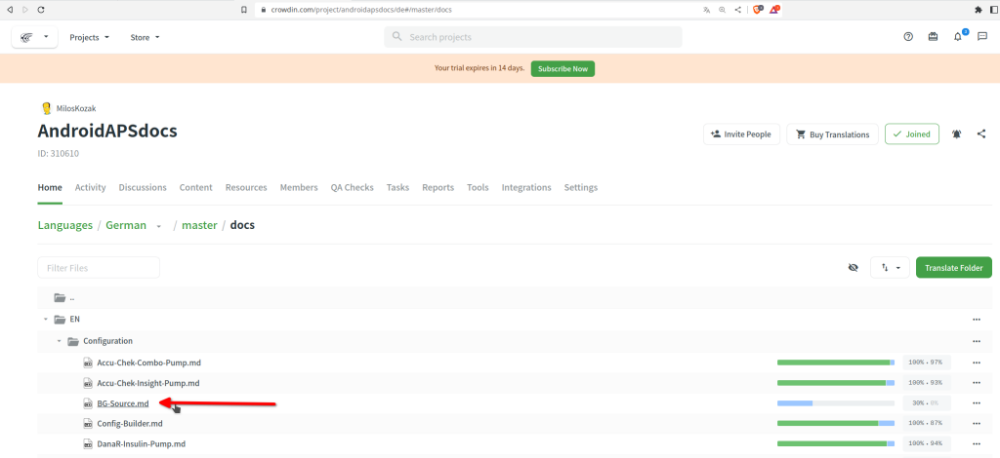

# Slik oversetter du tekster i AAPS-appen og dokumentasjonen

* For tekstene i appen, gå til <https://crowdin.com/project/androidaps> og logg inn med GitHub-kontoen din
* For dokumentasjonen, gå til <https://crowdin.com/project/androidapsdocs> og logg inn med GitHub-kontoen din

* Send en forespørsel om å bli med i dokumentasjonsteamet. Det gjør du ved å klikke på flagget til språket du ønsker, og deretter på knappen «Join» (bli med) øverst til høyre på neste side. Oppgi språk, fortell litt om deg selv og erfaringen din med AAPS, og om du vil være oversetter eller korrekturleser (korrekturleser er bare for folk som er gode til å oversette + erfarne AAPS-brukere).

```{admonition} Tid før godkjenning :class: note

Godkjenningen er et manuelt steg. Som ideell organisasjon gir vi ingen garantier for svartid, men vanligvis blir du godkjent i løpet av < 1 dag. Hvis ikke, kontakt dokumentasjonsteamet via Facebook eller Discord.

    <br />* Når vi har godkjent deg, klikk på flagget
       
    
    ## Oversettelse av appen
    
    (translations-translate-strings-for-AAPS-app)=
    ### Oversette tekster i AAPS-appen
    
    * Hvis du ikke har noen preferanse for hvilke tekster du vil oversette, velger du bare knappen «Translate All» (oversett alle) for å starte. Da får du opp tekstene som trenger oversettelse.
    
       
    
    * Hvis du vil oversette en enkelt fil, søker du opp filen via søkefeltet eller mappetreet og klikker på filnavnet for å begynne å oversette tekstene i den filen.
    
       
    
    * Oversett setningene på venstre side ved å skrive inn ny oversatt tekst, eller bruk & rediger et forslag
    
       
    
    
    ### Korrekturlese tekster i AAPS-appen
    
    * Korrekturlesere starter med å velge «Proofread» (korrekturles) på startsiden for språket.
    
       
    
    
      og godkjenne oversatte tekster
    
       
    
    Når en korrekturleser godkjenner en oversettelse, blir den med i neste versjon av AAPS.
    
    (translations-translation-of-the-documentation)=
    ## Oversettelse av dokumentasjonen
    
    * Klikk på navnet til dokumentasjonssiden du vil oversette
    
    
    
    
    * Oversett setning for setning
    
        1. Den gule teksten er teksten du jobber med akkurat nå.
    
        1. Den grønne teksten er allerede oversatt. Den trenger du ikke gjøre på nytt.
    
        1. Den røde teksten er det som gjenstår å oversette.
    
        1. Dette er kildeteksten du jobber med akkurat nå
    
        1. Dette er oversettelsen du holder på med. Du kan kopiere teksten ovenfor eller velge et av forslagene nedenfor.
    
        1. Dette er forslagene til oversettelse. Her ser du blant annet hvor godt Crowdin mener forslaget passer, og om teksten allerede var oversatt tidligere og bare kom tilbake fordi den ble flyttet, ikke endret.
        1. Trykk på knappen «Save» (lagre) for å lagre et forslag til oversettelse. Deretter går den videre til en korrekturleser for endelig kontroll.
    
    
    
    * En oversatt side blir ikke publisert i dokumentasjonen før
    
        1. oversettelsen er korrekturlest
    
        1. synkroniseringen mellom Crowdin og GitHub er fullført (én gang i timen); den lager en PR i GitHub.
    
        1. PR-en i GitHub er godkjent.
    
    Vanligvis tar dette 1–3 dager, men i ferier kan det ta litt lenger tid.
    
    ### Oversette lenker
    
    ```{admonition} Lenker oversettes ikke lenger
    :class: note
    
    Lenker oversettes ikke lenger. Tidligere hadde vi et avsnitt om dette her, men det er borte: etter overgangen til Markdown og myst_parser lager vi eksplisitte etiketter (labels) i den engelske teksten, og de overføres automatisk til de andre språkene.
    
    

Du oversetter teksten som vises som lenke. Du må passe på at du **ikke** fjerner lenken, som vises som et par `<0></0>`-tagger, eller med andre tall hvis det er flere lenker i samme avsnitt.

Det er korrekturleserens jobb å se ekstra nøye på dette!

### Korrekturlesing

* Korrekturlesere må bytte til korrekturmodus («Proofreading mode»)
    
    
    
    og godkjenne oversatte tekster
    
    

* Når en korrekturleser godkjenner en oversettelse, blir den med i neste bygg av dokumentasjonen. Det skjer ikke etter en fast plan, men ved behov, omtrent én gang i uken, unntatt i ferier. For å få fart på prosessen kan du informere dokumentasjonsteamet om nye oversettelser.