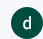
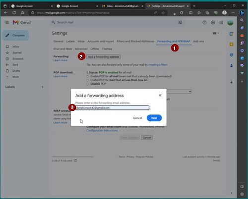

# En egen Google-konto for AAPS (valgfritt)

Noen **AAPS**-brukere foretrekker å bruke hoved-e-postkontoen sin også til **AAPS**. Andre **AAPS**-brukere (eller omsorgspersonene deres) setter opp en egen e-postkonto for **AAPS** – dette er valgfritt, og nedenfor gir vi et eksempel på hvordan du gjør det.

Hvis du ikke vil sette opp en egen Gmail-konto for **AAPS**, kan du gå rett til neste del, [Bygge AAPS](../SettingUpAaps/BuildingAaps.md).

```{admonition} Advantages of a dedicated Google account for AAPS
:class: dropdown

- Egen lagringsplass på Google Disk betyr at du ikke risikerer å fylle opp grensen på din personlige Google Disk med **Eksporter innstillinger**.
- Hver versjon av **AAPS** (og støtteapper som xDrip, BYODA osv.) lagres på ett enkelt sted, uavhengig av maskinvaren på datamaskinen din. Hvis PC-en eller telefonen din blir stjålet, mistet eller ødelagt, har du fortsatt tilgang.
- Med et likt oppsett blir støtte på nett enklere, fordi brukerne har samme mappestruktur.
- Avhengig av oppsettet (se nedenfor) får du en egen identitet, et alias, for å kommunisere i miljøet, og det kan beskytte personvernet ditt. 
- Barn med T1D kan beholde sin egen «hverdags»-e-postkonto som mindreårige, mens de bruker **AAPS** og tilhørende funksjoner som krever en voksenkonto.
- Gmail lar deg registrere opptil 4 kontoer på samme telefonnummer.
```

## Slik setter du opp en egen Google-konto for AAPS

(⌛Omtrent 10 minutter)


Krav:

* Du har en Windows-PC (Windows 10 eller nyere) og en Android-telefon (Android 12 eller nyere) som skal kjøre **AAPS**-appen. Begge har alle de nyeste sikkerhetsoppdateringene, internettilgang og administratorrettigheter, siden noen steg krever at du laster ned og installerer programmer.
* Android-telefonen er allerede satt opp med din personlige «hverdags»-e-postadresse, for eksempel en Gmail-konto.

```{admonition} Things to consider when setting up your new account
:class: dropdown
- Du kan bruke et annet navn enn ditt eget, som passer til kontoen (for eksempel t1dsuperstar), av hensyn til personvernet. Da kan du bruke det i offentlige **AAPS**-forum og samtidig holde din egen identitet privat. Siden Google krever en e-postadresse og et telefonnummer for gjenoppretting, kan kontoen fortsatt spores.
- Den nye **AAPS**-kontoen bruker det samme telefonnummeret til verifisering som «_hverdags_»-kontoen din. Den bruker «hverdags»-e-postadressen til verifisering;
- Vi setter opp videresending av e-post, slik at all e-post som sendes til den nye AAPS-kontoen, videresendes til hovedkontoen (så du slipper å sjekke to ulike postkasser);
- Bruk forskjellige passord for _hverdags_-Gmail-kontoen din og Gmail-kontoen for AAPS
- Hvis du bruker Googles «totrinnsbekreftelse» (også kalt flerfaktorautentisering) på én Gmail-konto, kan du like godt gjøre det på begge Gmail-kontoene.
- Hvis du planlegger å bruke Google «passnøkler» (Passkeys), må du passe på å registrere flere enheter. Dette er for at du ikke skal låse deg selv ute. Gjør det bare på enheter som ingen andre har tilgang til (_altså_ ikke på en PC med en delt konto som andre kan låse opp).
```


```{admonition} Video Walkthrough!
:class: note
Klikk [her](<https://drive.google.com/file/d/1dMZTIolO-kd2eB0soP7boEVtHeCDEQBF/view?usp=drive_link>) for en videogjennomgang av hvordan du setter opp en egen Google-konto.
```

 Dette er stegene som vises i videoen:

I dette eksempelet: 
- Den eksisterende «_hverdags_»-Google-kontoen din er <donald.muck42@gmail.com> ; 
- Den nye «_AAPS_»-Gmail-kontoen din blir: <donald.muck42.aaps@gmail.com>; 


### Gå til <https://account.google.com> 

 Hvis du allerede er logget inn på Google, sendes du til siden **Min konto** for «hverdags»-kontoen din. (1) Klikk på profilbildet ditt øverst til høyre på siden (i dette tilfellet et enkelt  (2) velg «_legg til en annen konto_».


### Skriv inn opplysningene for den NYE kontoen: 

- Gå inn på den nye kontoen: 
- Opprett konto
- til personlig bruk. 


### Skriv inn opplysningene om personen:
 - Skriv inn fornavn
 - etternavn
 - fødselsdato (må være en voksen alder)

### Velg den NYE e-postadressen din og et passord

I dette eksempelet legges «.AAPS» til Donald Mucks eksisterende adresse …\
Angi et passord

### Skriv inn et telefonnummer som kan motta SMS-en med verifiseringskoden

Gmail sender deg nå en unik kode som du skriver inn for å bekrefte.

### Skriv inn e-postadressen for gjenoppretting

Her blir det den eksisterende «_hverdags_»-e-posten din …

### Fullfør oppsettet av kontoen

Gmail viser kontonavnet. Du blir bedt om å godta Gmails vilkår og bekrefte innstillingene for tilpasning.

### Tilpass visningen av den nye profilen

Nå bør du være på Gmails Min konto-side, som viser den nye e-postkontoen din for **AAPS**. Profilbildet settes som standard til den første bokstaven i navnet ditt. Endre det til noe unikt for å unngå forvirring … i dette eksempelet har Donald.Muck.AAPS erstattet  med 

\


### Åpne Gmail-nettsiden i begge vinduene for å konfigurere den nye kontoen

For at du ikke skal måtte følge med på en egen e-postkonto, videresender du all e-post fra den nye **AAPS**-kontoen til hverdagskontoen din\
Denne delen kan være litt forvirrende, siden du må bytte frem og tilbake mellom de to kontoene. For å gjøre det enklere, åpne 2 separate nettleservinduer over hverandre:

1. Flytt det eksisterende nettleservinduet til toppen av skjermen og endre størrelsen slik at det bare tar omtrent den øverste halvdelen av skjermen …
2. Høyreklikk på nettleserikonet på oppgavelinjen
3. Velg «Nytt vindu» i menyen … og tilpass det slik at det bare tar den nederste halvdelen av skjermen.

Åpne <https://gmail.com> i hvert nettleservindu. Pass på at den personlige kontoen din er øverst og den nye **AAPS**-kontoen nederst, og at den er lett å kjenne igjen på profilbildet øverst i høyre hjørne. (hvis du trenger det, kan du alltid bytte konto ved å klikke på profilbildet og velge riktig konto.


Gmail-startsidene dine bør se slik ut:\


 ### I den nye Gmail-kontoen (nederste vindu), åpne Gmail-innstillingene …

- Klikk på tannhjulet til venstre for profilbildet
- og velg deretter «**Se alle innstillinger**»


### Sett opp videresending …

- Klikk på innstillingsfanen «Videresending og POP/IMAP»
- Klikk på «Legg til en adresse for videresending»
- Legg til «hverdags»-e-postadressen din
- Gmail sender en verifiseringskode til «hverdags»-e-postadressen din.
- Bytt tilbake til hverdagsprofilen din og klikk på lenken for å bekrefte at du godtar videresendingen (eller hent koden fra Gmails bekreftelses-e-post i «hverdags»-Gmail-vinduet og lim den inn i Gmail-vinduet for «den nye AAPS-kontoen»).

Det blir en del fram og tilbake mellom vinduene, men dette sikrer at når du sjekker e-posten i «hverdags»-kontoen din, ser du også e-postene som er videresendt fra AAPS-kontoen din, for eksempel Gmail-varsler.



### Bekreft e-postadressen for videresending

- I «hverdags»-Gmail-kontoen (øverste vindu) får du e-posten «Bekreftelse av videresending i Gmail» (Gmail forwarding Confirmation).
- Åpne den og «klikk på lenken for å bekrefte forespørselen»

### Arkiver videresendte e-poster i den nye Gmail-kontoen for AAPS (nederste vindu)

<!---->

1. Oppdater det nederste vinduet
2. Kryss av for «Videresend innkommende e-post»
3. Og arkiver Gmails kopi (for å holde den nye postkassen ren)
4. Bla helt ned til bunnen for å lagre endringene\
   


Gratulerer! Nå har du opprettet en egen Google-konto for AAPS. Neste steg er å [bygge AAPS-appen](../SettingUpAaps/BuildingAaps.md).