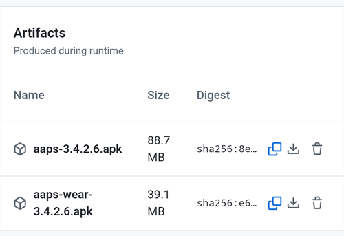

# Bygge AAPS Wear-appen

**AAPS**-appen for en Wear OS-smartklokke (**Wear-apk-en**, `aaps-wear-….apk`) er en egen installasjonsfil, adskilt fra **AAPS**-telefonappen. Du trenger begge: telefonappen kjører loopen, klokkeappen viser dataene fra den og kan sende kommandoer til den. Klokkeappen installeres fra telefonen, se [Wear OS-smartklokke](WearOsSmartwatch.md).

De to appene virker bare sammen når de passer til hverandre:

- **Samme AAPS-versjon** på telefonen og på klokken.
- **Samme keystore-fil** brukt til å signere begge appene.

Den enkleste måten å sikre dette på er å bygge begge appene **samtidig**, i samme bygg. Nettleserbygget gjør dette for deg: hvert bygg lager telefon-apk-en og Wear-apk-en sammen. Med Android Studio eller kommandolinjen bygger du Wear-apk-en som et andre steg, rett etter telefon-apk-en.

```{note}
Bruker du allerede **AAPS** på telefonen, men har ingen Wear-apk fra det samme bygget? Bygg begge appene på nytt, med samme keystore-fil, og installer telefonappen på nytt også. En Wear-apk som er bygget måneder senere, eller med en annen Android Studio-versjon, er trolig ikke kompatibel med telefonappen.
```

## Støttede Wear OS-versjoner

**AAPS** kjører på klokker med **Wear OS 3.0, 3.2 eller 3.5** (Android 11, API-nivå 30) **eller nyere** (Wear OS 4, 5 og 6). Klokker med Wear OS 2 støttes ikke.

```{warning}
AAPS-urskiver er tilgjengelige for Wear OS-smartklokker med API-nivå 30 til 33 (Wear OS 3.0, 3.2, 3.5 og 4).<br>
Nyere Wear OS-versjoner ødelegger gradvis AAPS-urskivene — se [Endringer i urskiver på Wear OS](#wearos-watchface-changes) og [begrensningene på Wear OS 5](#BuildingAapsWearOs-WearOS5).
```

(building-aaps-wear-os-method)=

## Få Wear-apk-en med din byggemetode

Følg delen for den metoden du bruker til å [bygge AAPS](../SettingUpAaps/BuildingAaps.md).

(building-aaps-wear-os-browser)=

### Nettleserbygg (anbefalt)

**Ingenting ekstra å gjøre.** Hvert nettleserbygg lager to filer fra samme kildekode og samme keystore-fil:

- `aaps-….apk`: telefonappen.
- `aaps-wear-….apk`: klokkeappen.

Wear-apk-en følger [varianten](#browserbuild-variant) du valgte for bygget: `fullRelease` gir **AAPS Wear**-appen, `aapsclientRelease` gir **AAPSClient Wear**-appen, og `pumpcontrolRelease` gir **PumpControl Wear**-appen. Hver Wear-app snakker bare med den tilhørende telefonappen.

Her finner du Wear-apk-en:

- **AAPS Builder**: på byggesiden blar du ned til **Artifacts** og laster ned `aaps-wear-….apk` ved siden av telefonappen, som vist i [Steg 5 – Installer appen på telefonen](#aaps-builder-step5). Last den ned på telefonen som kjører **AAPS** hvis du installerer klokkeappen fra telefonen (Wear Installer 2 eller Easy Fire Tools), eller på datamaskinen din hvis du bruker ADB.

  

- **Fork med Google Drive**: åpne Google Drive, mappen `AAPS`, og så mappen for versjonen du bygget. Den inneholder telefon-apk-en og Wear-apk-en, se [Steg 4 – Bygg APK-filen](#github-build-apk).

  

Ta vare på Wear-apk-en sammen med telefon-apk-en i sikkerhetskopiene dine. Med **AAPS Builder** ligger filene på byggesiden i bare 14 dager.

Neste: installer Wear-apk-en på klokken, se [Wear OS-smartklokke](WearOsSmartwatch.md).

(building-aaps-wear-os-android-studio)=

### Android Studio

Wear-apk-en bygges som telefon-apk-en, som et andre signert bygg. Gjør det rett etter telefon-apk-en, med samme Android Studio-versjon og samme keystore-fil.

- Følg instruksjonene for [Android Studio-bygg](../SettingUpAaps/ComputerBuild.md).
- Når du kommer til [modulvalget](#Building-APK-wearapk) i «Bygg den signerte AAPS-apk-en», pass på å velge **`AndroidAPS.wear`**.


Velg «**fullRelease**» for å lage **AAPS** Wear-apk-filen.


Hvis du vil, kan du i stedet bygge **«pumpcontrolRelease»** fra nedtrekksmenyen. Da kan du bare fjernstyre pumpen, uten looping.

Neste: installer Wear-apk-en på klokken, se [Wear OS-smartklokke](WearOsSmartwatch.md).

(building-aaps-wear-os-troubleshooting)=

#### Feilsøking av Android Studio-bygget

Når du bygger den fulle **AAPS**-appen (og faktisk alle signerte apper), lager Android Studio en .json-fil i samme mappe. Dette gir så feil med [endringer som ikke er committet](#troubleshooting_androidstudio-uncommitted-changes) når du prøver å bygge den neste signerte appen, for eksempel **AAPS** wear-appen. Den raskeste løsningen er å gå til mappen der den fulle AAPS-appen ble bygget. Mappen din er sannsynligvis noe slikt som:

`C:\Users\Your Name\AndroidStudioProjects\AndroidAPS\app\aapsclient\release.`

Slett .json-filen som ikke trengs, eller flytt den ut av mappen. Prøv så å bygge **AAPS** wear-appen igjen. Hvis det ikke virker, hjelper den mer detaljerte [feilsøkingsveiledningen](../GettingHelp/TroubleshootingAndroidStudio.md) deg med å finne akkurat den filen som skaper problemet. Det kan også være keystore-filen din.

(building-aaps-wear-os-cli)=

### Kommandolinje

Følg [Byggeinstruksjoner for kommandolinjen](../SettingUpAaps/CLIBuild.md) og gjenta stegene for kompilering og signering for `wear`-modulen, med samme keystore-fil:

```sh
./gradlew :wear:assembleFullRelease
```

Den usignerte Wear-apk-en skrives til `wear/build/outputs/apk/full/release/`. Signer den med `apksigner` akkurat som telefon-apk-en, og installer den så på klokken, se [Wear OS-smartklokke](WearOsSmartwatch.md).
