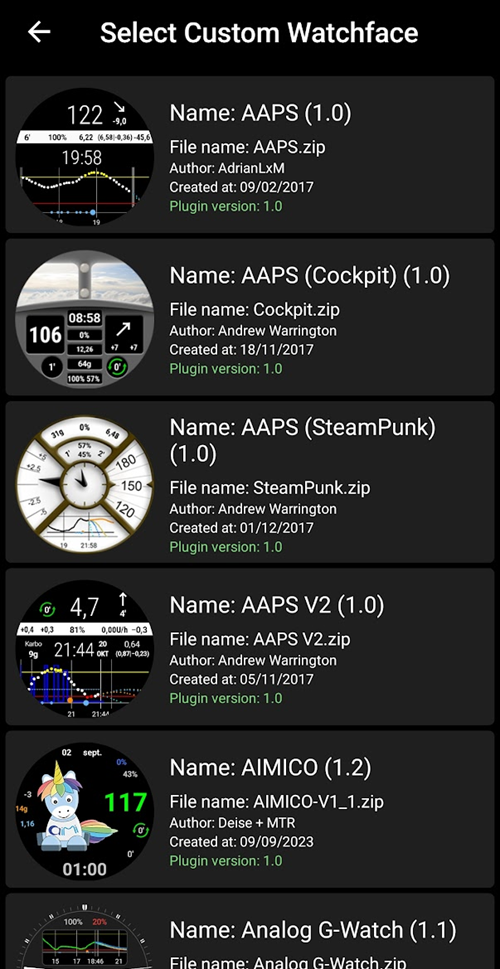

# Sett opp AAPS på Wear OS-klokken din

Instruksjonene nedenfor gjelder **AAPS Wear**-apk-en som du må bygge. Hvis du ikke har bygget den ennå, se veiledningen [her](../WearOS/BuildingAapsWearOS.md). Når du bygger, må du bruke den samme keystore-filen som du brukte til **AAPS**-apk-en for telefonen.

Noe av informasjonen kan du også bruke for **AAPSClient**- og **PumpControl**-versjonene av **Wear**-apk-en. Hver **Wear**-app kommuniserer med den tilhørende telefonappen. For eksempel: appen **AAPSClient Wear** kan brukes til å vise **AAPSClient**-data, ikke **AAPS**-data. Når flere klientvarianter (**AAPSClient**, **AAPSClient2**, **AAPSClient3**) er installert side om side, har flisene til hver av dem en liten overskrift i variantens egen farge, så du kan skille dem fra hverandre mens du sveiper.

## Wear OS-versjoner og kompatibilitet

(wearos-watchface-changes)=

### Endringer i urskiver på Wear OS (betydning for AAPS-urskivene)

```{admonition} Why newer Wear OS watches break AAPS watchfaces
:class: warning

I juni 2025 [kunngjorde Google endringer](https://android-developers.googleblog.com/2025/06/upcoming-changes-to-wear-os-watch-faces.html) som faser ut den gamle urskivemotoren (AndroidX / Wearable Support Library, «WSL»-motoren) til fordel for det nyere, deklarative **Watch Face Format**. De egne **AAPS**-urskivene er bygget på den gamle motoren. Jo nyere Wear OS-versjon, desto mer sannsynlig er det at en AAPS-urskive oppfører seg feil eller slutter å virke.

Dette gjelder spesielt **urskivene** — AAPS-**komplikasjoner**, fliser og fjernstyringsfunksjoner påvirkes ikke. Det er også grunnen til at **en fastvare-/systemoppdatering på en Wear OS-klokke kan ødelegge AAPS-urskivene**, og en klokke kan ikke rulles tilbake til en eldre Wear OS-versjon etterpå. Hvis AAPS-urskiven din virker nå, **slå av automatiske oppdateringer på klokken**.
```

Tabellen nedenfor oppsummerer hvordan Googles endring påvirker AAPS-urskivene (gammel motor) etter Wear OS-versjon:

| Wear OS-versjon         | Android-basis | API-nivå | Betydning for AAPS-urskivene (gamle)                                                                                                                                                                       |
| ----------------------- | ------------- | -------- | ---------------------------------------------------------------------------------------------------------------------------------------------------------------------------------------------------------- |
| Wear OS 6               | Android 16    | 36       | **Gamle urskiver er ikke lenger tilgjengelige** — AAPS installerer i stedet en [Watch Face Format-urskive](#wearos-aaps-v4-watchface): den egendefinerte urskiven din, eller AAPS V4-komplikasjonsurskiven |
| Wear OS 5               | Android 14    | 34       | **Alvorlig** — aktiv (interaktiv) modus svikter ofte, komplikasjoner fryser, animasjoner stopper                                                                                                           |
| Wear OS 4               | Android 13    | 33       | **Moderat** — struping, tapte oppdateringer, delvise feil                                                                                                                                                  |
| Wear OS 3.0 / 3.2 / 3.5 | Android 11    | 30       | **Lav** — den gamle motoren støttes fortsatt                                                                                                                                                               |

Hvis klokken din kjører en versjon der AAPS-urskivene er upålitelige, kan du i stedet vise AAPS-data gjennom **komplikasjoner** på en kompatibel urskive, eller bruke [GlucoDataHandler](https://play.google.com/store/apps/details?id=de.michelinside.glucodatahandler) med en komplikasjon, matet av pluginen [Eksterne hjelpeapper](#external-companion-apps) i **AAPS**. På **Wear OS 6 og nyere** installerer AAPS en erstatningsurskive bygget i det nye formatet — se nedenfor.

(wearos-aaps-v4-watchface)=

### Wear OS 6 og nyere — urskiven AAPS installerer

Klokker som kjører **Wear OS 6 eller nyere**, kan ikke kjøre de klassiske AAPS-urskivene som urskiver. For disse klokkene har AAPS-klokkeappen med seg to urskiver bygget i Googles nye **Watch Face Format**. Wear OS lar en app installere bare **én** urskive, så du velger hvilken av de to som skal være på klokken:

- **Egendefinert urskive** (standard): viser den egendefinerte urskiven du lastet inn fra telefonen med **Last inn urskive** (se [Bytte til en AAPS-urskive](#WearOS_changing-to-AAPS-watchface)). Klokken tegner designet ditt som et bilde, så alle eksisterende egendefinerte urskiver virker. Komplikasjonsplassene som en egendefinert urskive kan definere, er **ikke tilgjengelige** i dette bildet, fordi Wear OS bare leverer komplikasjonsdata til en ekte urskive. Trykk og hold på urskiven for å komme til den ene innstillingen den har: om alltid-på-skjermen skal vise en enkel klokke eller ditt eget design, dimmet.
- **Komplikasjons-urskive** (**AAPS V4**-urskiven): de **sju komplikasjonsplassene** kommer **ferdig satt opp med AAPS-data**: BS-verdi, IOB, COB, [BS-graf-komplikasjonen](#Watchfaces-complications), basaldose / midlertidig mål, og **Kjøremodus**-ikonet i plassen øverst til venstre (trykk på det for å endre loop-modus fra klokken). Trykk på klokkeslettet øverst for å åpne alarmappen på klokken. Du kan endre hva hver plass viser, i redigeringsverktøyet for urskiver.

Du velger på telefonen: åpne **Klokke**-pluginen, og velg en av de to under **Urskive installert på klokken**. Dette kortet vises bare mens en klokke med Wear OS 6 eller nyere er tilkoblet. **AAPS** ber deg bekrefte, fordi klokken bytter urskive med en gang. Når du bytter bort fra **Komplikasjons-urskive**, tilbakestilles også komplikasjonene du endret i redigeringsverktøyet for urskiver, til standardvalgene, og bekreftelsen sier dette. Mens **Komplikasjons-urskive** er valgt, er knappene for egendefinert urskive skjult, og en forhåndsvisning av urskiven vises i stedet. Hvis du laster inn en egendefinert urskive mens **Komplikasjons-urskive** er valgt, minner **AAPS** deg på å bytte til **Egendefinert urskive** for å se den på klokken.

- Den valgte urskiven blir **installert og aktivert automatisk** første gang AAPS-klokkeappen kjører på en slik klokke, og den **oppdateres automatisk** sammen med klokkeappen.
- Hvis du har fjernet urskiven, vises valget **Installer urskive** nederst i **hovedmenyen** til AAPS på klokken — trykk på det for å installere på nytt.

Mens en klokke med Wear OS 5 eller eldre er tilkoblet, vises kortet **Urskive installert på klokken** ikke i det hele tatt (mekanismen det bygger på, krever Wear OS 6); de klassiske urskivene kjører der som før.

(wearos-complications-watchface-setup)=

### Komplikasjons-urskive — anbefalt oppsett

**Komplikasjons-urskive** har sju komplikasjonsplasser. Trykk og hold på urskiven, trykk på **Tilpass**, og velg en datakilde for hver plass. Plassene er nummerert som i redigeringsverktøyet for urskiver: **1** venstre, **2** midten, **3** høyre, **4** grafen, **5** nederst, **6** øverst til venstre og **7** øverst til høyre.

| Standardoppsett                                                                                 | Alternativt oppsett                                                                                     |
| ----------------------------------------------------------------------------------------------- | ------------------------------------------------------------------------------------------------------- |
|  |  |

| Plass | Posisjon           | Standard                                                               | Alternativ                            |
| ----- | ------------------ | ---------------------------------------------------------------------- | ------------------------------------- |
| 1     | Venstre            | IOB                                                                    | COB & IOB                             |
| 2     | Midten             | Blodsukker                                                             | Blodsukker                            |
| 3     | Høyre              | COB                                                                    | Basaldose & Mål/TT                    |
| 4     | Graf               | BS-graf                                                                | BS-graf                               |
| 5     | Nederst            | Basaldose & Mål/TT                                                     | Opplaster/mobilbatteri                |
| 6     | Øverst til venstre | Kjøremodus                                                             | Kjøremodus                            |
| 7     | Øverst til høyre   | Opplaster/mobilbatteri, eller en appsnarvei til **AAPS slumre-varsel** | Appsnarvei til **AAPS slumre-varsel** |

Snarveien **AAPS slumre-varsel** velges blant klokkens egne **Appsnarvei**-komplikasjoner. Når du trykker på den, slumrer du alarmen som går på telefonen.

```{tip}
Slå på **Alltid på-skjerm** på klokken (**Innstillinger** > **Skjerm**). Urskiven fortsetter da å vise glukosen din når håndleddet er senket, i stedet for en tom skjerm eller en enkel klokke.
```

```{admonition} No complication data while the watch is locked
:class: note
Hvis en **Låsetype** er satt under **Innstillinger** > **Sikkerhet og personvern**, skjuler klokken komplikasjonsdata mens den er låst, og urskiven viser tomme plasser til du låser den opp. For å holde dataene synlige, slå av **Skjul informasjon** i samme meny.
```

### Wear OS 3

Installer **AAPS Wear**-apk-en med [Wear Installer 2](https://youtu.be/abgN4jQqHb0?si=5L7WUeYMSd_8IdPV), Easy Fire Tools (beskrevet nedenfor) eller ADB.  
Ingen begrensninger i **AAPS Wear**-funksjonene.

(BuildingAapsWearOs-WearOS5)=

### Wear OS 4 og Wear OS 5

Eksempel: Galaxy Watch 4, 5, 6, 7 og Ultra eller Pixel Watch som **ikke** er oppdatert til Wear OS 6 ennå. Sjekk versjonen under **Innstillinger** > **Om klokken** > **Programvare**.

Installer **AAPS Wear**-apk-en med [Wear Installer 2](https://youtu.be/abgN4jQqHb0?si=5L7WUeYMSd_8IdPV) (for Wear OS 5, følg [denne videoen](https://www.youtube.com/watch?v=yef_qGvcCnk)). Alle **AAPS Wear**-funksjoner virker, men de klassiske **AAPS**-urskivene er begrenset som beskrevet i tabellen ovenfor: strupet på Wear OS 4, svikter ofte på Wear OS 5.

```{admonition} Wear OS 5
:class: warning
På Wear OS 5 må AAPS-urskiven velges med Wear Installer 2 rett etter at Wear-appen er installert: installasjonsprogrammet tilbyr urskiven **AAPS(Egendefinert)** på slutten av installasjonen. Hvis du ved et uhell bytter til en annen urskive, gjenta installasjonen. Det er ikke sikkert det går an å endre innstillingene for urskiven (Mørkt, Matchende skillelinje osv.).

Hvis den klassiske urskiven virker for deg nå, **slå av automatiske oppdateringer på klokken**: neste fastvareoppdatering vil sannsynligvis ødelegge den. Hvis du likevel oppdaterer til Wear OS 6, les delen ovenfor: **AAPS** installerer da sin egen urskive i det nye formatet.
```

Hvis urskiven er for upålitelig, vurder [GlucoDataHandler](https://play.google.com/store/apps/details?id=de.michelinside.glucodatahandler) med en komplikasjon i stedet. Den krever at pluginen [Eksterne hjelpeapper](#external-companion-apps) er aktivert i **AAPS**.

### Wear OS 6 og nyere

Eksempel: Galaxy Watch 4 og nyere med One UI 8 Watch, Pixel Watch etter 2025-oppdateringen. De fleste Galaxy- og Pixel-klokker har fått denne oppdateringen.

Installer **AAPS Wear**-apk-en med [Wear Installer 2](https://youtu.be/abgN4jQqHb0?si=5L7WUeYMSd_8IdPV). De klassiske urskivene er ikke tilgjengelige; **AAPS** installerer automatisk urskiven som er valgt på telefonen, se [urskiven AAPS installerer](#wearos-aaps-v4-watchface). Ingen begrensninger i **AAPS Wear**-funksjonene.

## Slik setter du opp en Samsung Galaxy Watch 4-smartklokke med **AAPS**

Denne delen går ut fra at du er helt ny med smartklokker. Den gir deg en grunnleggende innføring i en populær klokke, **Galaxy Watch 4**, og deretter en steg-for-steg-veiledning for å sette opp **AAPS** på klokken.

_Denne veiledningen ble skrevet for en Galaxy Watch med Wear OS 3._ På Wear OS 4 og nyere ber klokken om en **sammenkoblingskode** når en telefon eller datamaskin kobler til over ADB. Både Wear Installer 2 og terminalframgangsmåten [nedenfor](#BuildingAapsWearOs-WearOS5-TShoot) støtter dette.

Her er grunnleggende oppsettsveiledninger for [Galaxy Watch 5](https://www.youtube.com/watch?v=Y5upzOIxwTU) og [Galaxy Watch 6](https://www.youtube.com/watch?v=D6bq20KzPW0)

## Bli kjent med smartklokken

Når du har satt opp klokken etter videoen ovenfor, går du til Play-butikken på telefonen og laster ned disse appene: «Galaxy Wearable», «Samsung» og enten «Easy Fire tools» eller «Wear Installer 2».

Det finnes mange YouTube-videoer fra tredjeparter som hjelper deg med å bli kjent med den nye smartklokken din, for eksempel:

[https://www.youtube.com/watch?v=tSVkqWNmO2c](https://www.youtube.com/watch?v=tSVkqWNmO2c)

Appen «Galaxy Wearable» har også en del med bruksanvisning. Åpne Galaxy Wearable på telefonen, søk etter klokken, og prøv å koble klokken sammen med telefonen. Avhengig av versjonen din kan du bli bedt om å installere enda en app, «Galaxy Watch 4 plugin», fra Play-butikken (det tar litt tid å laste ned). Installer den på telefonen, og prøv så å koble klokken og telefonen sammen igjen i Wearable-appen. Gå gjennom en rekke menyer og huk av ulike valg.

## Opprette en Samsung-konto

Du må passe på at e-postkontoen du bruker til å opprette Samsung-kontoen, har en fødselsdato som gjør brukeren 13 år eller eldre. Ellers er det svært vanskelig å godkjenne Samsung-tillatelsene. Hvis du har gitt barnet ditt under 13 år en Gmail-konto og bruker den e-postadressen, kan du ikke bare endre den til en voksenkonto. En løsning er å endre fødselsdatoen slik at alderen blir 12 år og 364 dager. Dagen etter blir kontoen gjort om til en voksenkonto, og du kan fortsette med oppsettet av Samsung-kontoen.

(remote-control-transferring-the-aaps-wear-app-onto-your-aaps-phone)=

## Overføre **AAPS** Wear-appen til **AAPS**-telefonen din

Du kan få Wear.apk fra Android Studio over på telefonen på en av disse måtene:

a)  bruk en USB-kabel til å legge **AAPS** wear-apk-filen på telefonen, og installer den så direkte på klokken («sideloading»). Overfør Wear.apk til telefonen via USB, til nedlastingsmappen; eller

b)  klipp ut og lim inn Wear.apk fra Android Studio til Google Drive.


For å installere AAPS direkte på klokken («sideloading») kan du bruke enten: 1) Wear Installer 2 2) Easy Fire tools 3) Android Debug Bridge (ADB) Her anbefaler vi Wear Installer 2, fordi instruksjonene og framgangsmåten i videoen er så klare og godt forklart. Hvis Wear Installer 2 ikke virker for deg, prøv Easy Fire Tools eller ADB, begge beskrevet nedenfor.

### Bruke Wear Installer 2 til å installere **AAPS** Wear fra telefonen direkte på klokken

 

Wear Installer 2, utviklet av [Malcolm Bryant](https://www.youtube.com/@Freepoc), kan lastes ned fra Google Play til telefonen og brukes til å installere AAPS wear-appen direkte på klokken. Appen har en nyttig [video](https://youtu.be/abgN4jQqHb0?si=5L7WUeYMSd_8IdPV) som viser hvordan du installerer direkte («how to sideload»).

```{tip}
For klokker med Wear OS 5, følg [denne videoen](https://www.youtube.com/watch?v=yef_qGvcCnk).
Se feilsøkingstips [nedenfor](#BuildingAapsWearOs-WearOS5-TShoot).
```

Den gir alle nødvendige detaljer (det er best å åpne videoen på en annen enhet, så du kan se den mens du setter opp telefonen).

Som nevnt i videoen: når du er ferdig, slår du av ADB-feilsøking på klokken, så du ikke tapper batteriet på smartklokken.

Alternativt, men ikke for Wear OS 5, kan du:

### Bruke Easy Fire tools til å installere **AAPS** wear direkte på klokken

1)   Last ned _[Easy Fire Tools](https://play.google.com/store/apps/details?id=de.agondev.easyfiretools&hl=en)_ fra Play-butikken til telefonen


2)  Gjør deg selv til utvikler på klokken (når den er satt opp og koblet til telefonen):

Gå til **Innstillinger** > **System** > **Om** > **Versjoner** (menynavnene varierer mellom klokkemerker — på noen klokker er det **Om klokken** > **Programvareinformasjon** > **Programvareversjon**).


Trykk raskt på **Delenummer** (eller **Programvareversjon**) flere ganger til en melding sier at du nå er utvikler.


Gå tilbake til **Innstillinger** > **System**: en ny meny, **Utvikleralternativer**, vises nå.

I **Utvikleralternativer**: slå på **ADB-feilsøking** og **Trådløs feilsøking**, og bekreft spørsmålene. Trådløs feilsøking viser da klokkens **IP-adresse & port**, noe som: **192.168.1.214** : 5555. Du trenger bare IP-adressen (her **192.168.1.214**), ikke portnummeret etter kolonet. Merk at IP-adressen kan endre seg, for eksempel hver gang du bytter til en ny telefon for AAPS.


STEG 3)     Skriv inn IP-adressen, _f.eks._ **192.168.1.214**, i Easy Fire tools på telefonen (åpne menyen (☰) til venstre, gå til innstillinger og skriv inn IP-adressen).


Trykk så på ikonet med stikkontakten øverst til høyre. Den blir grønn når den er tilkoblet.


STEG 4) Følg instruksjonene [her](https://wearablestouse.com/blog/2022/01/04/install-apps-apk-samsung-galaxy-watch-4/?utm_content=cmp-true) for å installere (det vil si overføre) aaps-wear.apk direkte på smartklokken med Easy Fire tools


(BuildingAapsWearOs-WearOS5-TShoot)=

### Bruke terminalen
Koble smartklokken og datamaskinen til samme Wi-Fi-nettverk.

- For å installere ADB laster du den ned fra: https://developer.android.com/tools/releases/platform-tools
- Åpne en terminal.
- På Windows: lag en ny mappe med navnet `adb` på disken `C:`. Åpne filen `platform-tools-latest-windows.zip` som du lastet ned ovenfor. Kopier alle filene i `platform-tools` til `C:\adb`, og åpne denne mappen i en ledetekst (høyreklikk og velg Åpne i terminal). Skriv kommandoen nedenfor for å sette stien til mappen der ADB ligger: `setx PATH "%PATH%;C:\adb"`
- På Mac kan du bruke Homebrew i stedet for å installere manuelt: `brew install android-platform-tools`

På klokken:
- Gå til Innstillinger → Om klokken → **Programvareinformasjon**
- Trykk 7 ganger på Programvareversjon til du ser at utviklermodus er slått på.
- Gå til Innstillinger → Utvikleralternativer. Slå på **ADB-feilsøking**
- Gå til Innstillinger → Utvikleralternativer → Trådløs feilsøking → **Koble til ny enhet**

Du vil se en Wi-Fi-sammenkoblingskode, en IP-adresse og en port:


- I terminalen: `adb pair ipaddress:port` F.eks. `adb pair 10.10.1.125:36299`
- Du blir bedt om sammenkoblingskoden. Skriv den inn.
- Du vil se et svar:<br> `Successfully paired to 10.10.1.125:36299 [guid=adb-RXXXW20LMKJY-eh5zBj]`<br>
- Skriv i terminalen: <br>`adb devices`.<br> Du skal se noe som dette:<br> `List of devices attached`<br> `10.10.1.125:36299  offline`<br> `adb-RFAW20LMKJY-eh5zBj._adb-tls-connect._tcp   device`<br>

- Gå nå til mappen på datamaskinen der Wear-apk-en ligger, og skriv<br> `adb install wear-full.apk` <br>der du bytter ut wear-full.apk med navnet på apk-filen din.
- Du vil se:<br> `Performing Streamed Install`<br> `Success`


(wear-os-5-troubleshooting)=

### Generelle feilsøkingsråd for Wear OS 5

- Ikke bruk Wi-Fi-deling (tethering). Det vil ikke fungere.
- Du trenger ikke å slå på ADB-feilsøking på telefonen (bare på klokken). Slå av ADB-feilsøking på telefonen.
- Pass på at du kobler til det lokale nettverket der telefonen og klokken kan se hverandre (ikke bruk Wi-Fi-gjestenettverket ditt).
- Pass på at både klokken og telefonen er på samme nettverk og samme Wi-Fi-enhet. Spesielt Wi-Fi-forsterkere (repeatere) og tilgangspunkter kan skape problemer.
- Pass på at du er nær hovedruteren, og start så både telefonen og klokken på nytt.

**Sammenkobling:**

- Klokken: Trådløs feilsøking: noter IP-adressen.
- Wear Installer: Skriv inn IP-adressen i Wear Installer-appen.
- Velg Koble til ny enhet, og noter sammenkoblingskoden og portnummeret som vises.
- Wear Installer: skriv inn sammenkoblingskoden + mellomrom + portnummeret.
- Wear Installer skal melde at sammenkoblingen var vellykket. Hvis ikke, avslutt Wear Installer og prøv igjen.

Når de er koblet sammen, skal du kunne installere AAPS wear-apk-en:

- Avslutt/lukk Wear Installer, og start den så på nytt.
- Under trådløs feilsøking: noter IP-adressen og portnummeret, og pass på at du sjekker/skriver inn IP-adressen og portnummeret i Wear Installer.
- Merk: portnummeret er et annet enn det som ble brukt til sammenkoblingen!

## Sette opp forbindelsen mellom klokken og telefonen fra **AAPS**

Det siste steget er å konfigurere **AAPS** på telefonen slik at den kommuniserer med **Wear.apk** på klokken. For å gjøre dette, aktiver Klokke-pluginen:

* Gå til **AAPS**-appen på telefonen

* Åpne **menyen** (☰) øverst til venstre, og gå til **Konfigurasjon** > **Kommunikasjon**

* Huk av for **Klokke**


For å gi bolus eller gjøre andre handlinger fra klokken, slå også på **Styr fra klokke** i [Innstillinger > Klokke](#preferences-wear).

For å bytte til en annen **AAPS**-urskive trykker og holder du på urskiven på startskjermen på klokken, og trykker på **Tilpass**. Sveip så mot høyre til du kommer til alle **AAPS**-urskivene.

Hvis **AAPS** Wear.apk er installert riktig på smartklokken, ser det slik ut:


For noen smartklokker, som Samsung Galaxy, må «Ekstern tilkobling» under Avanserte funksjoner i Samsung Galaxy være slått **på** for å bruke **Wear.apk** & **AAPS** eksternt via Wi-Fi.


(wear-os-watch-phone-communication)=

### Feilsøking av kommunikasjonen mellom **AAPS**-klokken og **AAPS**-telefonen

1.  Hvis EasyFire tools ikke kobler til, eller du får «authorisation failed» > sjekk at IP-adressen er skrevet inn riktig.
2.  Sjekk at smartklokken er koblet til internett (og ikke bare koblet til telefonen via Bluetooth).
3.  Sjekk at **AAPS**-telefonen og smartklokken er koblet sammen i Samsung-appen.
4.  Det kan også hjelpe å starte både telefonen og smartklokken helt på nytt (det vil si å slå telefonen av og på)
5.  Hvis du har fått lastet ned Wear.apk til telefonen, men ikke får noen BS-data, _sjekk_ at du har installert riktig **AAPS** Wear-apk på klokken: klokkeappen fra et nettleserbygg er filen `aaps-wear-….apk`, se [Bygge Wear-appen](../WearOS/BuildingAapsWearOS.md). Hvis filen du installerte er en av disse: a) en **AAPSClient** Wear-apk (mens telefonen kjører **AAPS**); b) en `.aab`-fil; eller c) en fil med ordet «debug» i navnet, har du ikke valgt riktig Wear OS-apk under byggingen.
6.  Sjekk at ruteren din ikke isolerer enhetene fra hverandre.

Flere feilsøkingstips finner du [her](https://freepoc.org/wear-installer-help-page/#:~:text=If%20you%20are%20having%20problems,your%20phone%20and%20your%20watch.)

(WearOS_changing-to-AAPS-watchface)=

## Bytte til en AAPS-urskive på Wear OS-klokken din

Det finnes flere urskiver i standardbygget av AAPS Wear OS-APK-en. Når du har installert AAPS Wear-APK-en på klokken, er de tilgjengelige. Slik velger du en av dem:

1. På klokken (med Wear OS): trykk og hold på den gjeldende urskiven for å åpne urskivevelgeren, bla helt til høyre til du ser knappen «Legg til urskive», og velg den


2. Bla gjennom listen til du finner «AAPS(Egendefinert)» (avhengig av klokken ligger urskivene til installerte apper under en «Nedlastet»-del eller gruppert etter app), og trykk midt på bildet for å legge den til i utvalget ditt av gjeldende urskiver. Ikke bry deg om hvordan urskiven «AAPS(Egendefinert)» ser ut nå. Vi velger utseendet du vil ha i neste steg.


3. Åpne nå AAPS på telefonen, og åpne Klokke-pluginen: **Konfigurasjon** > **Kommunikasjon** > **Klokke** > **Åpne plugin** (huk av for **Klokke** først hvis den ikke er aktivert).


4. Trykk på knappen «Last inn urskive» og velg urskiven du liker



5. Sjekk klokken: urskiven «AAPS(Egendefinert)» skal nå vise utseendet du valgte. Gi den noen sekunder på å oppdatere seg. **Klokke**-skjermen på telefonen viser nå navnet på den innlastede urskiven og en forhåndsvisning av den. **Info urskive** viser detaljene om den og feltene den inneholder, og **Flere urskiver** åpner [utvekslingssiden](../ExchangeSiteCustomWatchfaces/index.md) der du kan laste ned andre egendefinerte urskiver. Nå kan du tilpasse komplikasjonene osv. ved å trykke og holde på urskiven og så trykke på knappen «Tilpass» på bildet av urskiven.

```{admonition} Complications on a custom watchface
:class: note
Egendefinerte urskiver laget med versjon 3.0 eller nyere av formatet for egendefinerte urskiver kan ha opptil fem komplikasjonsplasser, der plassering og størrelse er definert av urskiven (**Komplikasjonslayout**). På klokken: trykk og hold på urskiven, trykk på **Tilpass**, og trykk på **Komplikasjon 1** til **Komplikasjon 5** for å velge datakilden som vises i hver plass. De samme radene finnes i AAPS-appen på klokken under **Innstillinger** > **AAPS(Egendefinert)**; trykker du på en der, åpnes den samme velgeren. **Prioritet for komplikasjonstype** avgjør om en plass foretrekker en verdi eller måler, tekst, eller et ikon når datakilden tilbyr flere. En endret prioritet gjelder først neste gang du velger en datakilde for den plassen.

Disse plassene virker bare på klokker med **Wear OS 5 eller eldre**, der den egendefinerte urskiven kjører som en ekte urskive. På **Wear OS 6 og nyere** vises den egendefinerte urskiven som et bilde uten komplikasjonsplassene, og steg 1 og 2 ovenfor trengs ikke: pass på at **Egendefinert urskive** er valgt under **Urskive installert på klokken** i **Klokke**-pluginen på telefonen (se [urskiven AAPS installerer](#wearos-aaps-v4-watchface)).
```

## AAPSv2-urskive – forklaring


A – tid siden forrige loop-kjøring

B – CGM-måling

C – minutter siden siste CGM-måling

D – endring siden forrige CGM-måling (i mmol eller mg/dL)

E – gjennomsnittlig endring i CGM-målingene de siste 15 minuttene

F – telefonbatteri

G – basaldose (vist i E/t ved vanlig dose og i % ved midlertidig basal)

H – BGI (blood glucose impact) -> hvor mye BS «burde» stige eller falle ut fra insulinaktiviteten alene.

I – karbohydrater (aktive karbohydrater | eKarbo framover i tid)

J – aktivt insulin (fra bolus | fra basal)
