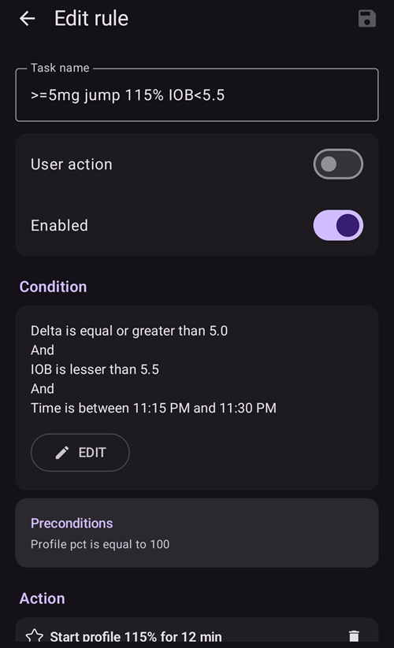

# Volledig gesloten loop (Full Closed Loop)

```{contents} In this page
:backlinks: entry
:depth: 2
```

Het grote voordeel van een volledig gesloten loop **FCL** is dat deze een kunstmatige alvleesklier kan nabootsen en het dagelijks beheer makkelijker kan maken, zonder dat je voor maaltijden hoeft te bolussen.

Een **hybride gesloten loop** ('HCL') werkt met een algoritme, maar de gebruiker moet nog steeds zelf boluses geven vóór maaltijden. Daardoor kan de loop tijdelijk stoppen (tijdelijk basaal van nul) om te voorkomen dat er te veel insuline wordt gegeven.

Bij **FCL** zijn boluses voor de grootte van de maaltijd niet meer nodig: laat het aan het algoritme over!  **AAPS** kan maaltijden aan zonder dat de gebruiker een bolus geeft en zonder koolhydraatinvoer, in een modus die ‘niet-aangekondigde maaltijden’ heet **(‘UAM’)**. Met **UAM** kan **AAPS** beter omgaan met onjuiste koolhydraatinvoer, doordat het agressiever werkt.

## Wat kun je verwachten?

Er zijn veel gepubliceerde studies over de goede resultaten die **FCL** kan bereiken. Lees voor meer informatie het volgende:

1)   National Library of Medicine, PubMed [First Use of Open-Source Automated Insulin Delivery AndroidAPS in Full Closed-Loop Scenario: Pancreas4ALL Randomized Pilot Study](https://pubmed.ncbi.nlm.nih.gov/36826996/);

2)  ClinicalTrials.gov National Library of Medicine, Clinical Trial [Feasibility and Safety Study of the Automated Insulin Delivery Closed Loop System Pancreas4ALL (ASAP)](https://www.clinicaltrials.gov/study/NCT04835350?term=Feasibility%20and%20Safety%20Study%20of%20the%20Automated%20Insulin%20Delivery%20Closed%20Loop%20System%20Pancreas4ALL%20(ASAP)&rank=1)

Voor succes met **FCL** moet de gebruiker:

- controleren of aan de voorwaarden voor **FCL** is voldaan;
- **Automatiseringen** instellen die passen bij de behoeften van zijn dagelijks beheer; en
- de instellingen van **AAPS** (vooral de **Automatiseringen**) fijn afstemmen en aanpassen.


## Algemene overwegingen om wel (of niet) over te stappen van HCL naar FCL

**FCL** is niet voor iedereen:

- Sommige **FCL**-gebruikers bereiken een TIR (70–180) van ongeveer 90% en een HbA1c onder 6%, maar andere gebruikers willen een strakkere regeling. Vooral om waarden boven 140 mg/dl te beperken bij eten met snelle koolhydraten is waarschijnlijk een pre-bolus nodig.
- Het afstemmen van **AAPS** kan lastig zijn. Het is niet voor gebruikers die zich al overweldigd voelen door AAPS.  Je moet een paar weken uittrekken om je **FCL** aan te passen en fijn af te stemmen. Als je die tijd investeert, kan dat betere resultaten en een betere **BG**-regeling opleveren.
- Maaltijden kunnen makkelijker worden, maar sporten kan bij **FCL** nog steeds lastig zijn. De meesten van ons willen sportsnacks beperken om het lichaamsgewicht onder controle te houden.
- Een **FCL** opzetten voor kinderen blijft moeilijk (zie hieronder).


## Goed afgestemde hybride gesloten loop

Het is verstandig om eerst een goed afgestemde **HCL** te hebben, voordat je aan de overstap naar **FCL** denkt.  Succes met **FCL** vraagt een zeer persoonlijke afstemming van de instellingen van de gebruiker, zodat **AAPS** insuline kan geven die JOUW succesvolle hybride gesloten loop zo goed mogelijk nabootst.

Bij **FCL** moet de gebruiker zijn **Automatiseringen** instellen en afstemmen. De gebruiker moet echter goed begrijpen wat zijn insulinebehoeften zijn, voordat hij aan **FCL** begint. Fouten kunnen worden verborgen door tegenfouten. Dit kan een instabiel **FCL**-systeem opleveren dat later moeilijk te corrigeren is. Je kunt verwachten dat je met je FCL een vergelijkbare %TIR bereikt als je nu ziet met je **HCL**.

**FCL is een zelfgemaakte (DIY) opzet van Automatiseringen. De gebruiker bepaalt die door zijn gegevens te analyseren uit zowel zijn succesvolle HCL als zijn eerste ervaring met FCL tijdens het afstemmen van de instellingen.**

## Snelle insuline (Lyumjev, Fiasp)

**FCL** vraagt om snelle insuline.  Zo kan de **FCL** aan het begin van de stijging van de **BG** door een maaltijd de **BG** binnen bereik houden (volgens de gangbare definitie onder 180 mg/dl (10 mmol/l)).

Een modelstudie (details zie LINK FullLoop V2/March2023; daar paragraaf 2.2) kan in getallen laten zien dat *snellere insulines*

Bron:

 


IEEE Control Systems Magazine, ResearchGate [The Artificial Pancreas and Meal Control: An Overview of Postprandial Glucose Regulation in Type 1 Diabetes](https://www.researchgate.net/publication/322866519_The_Artificial_Pancreas_and_Meal_Control_An_Overview_of_Postprandial_Glucose_Regulation_in_Type_1_Diabetes);

- geeft duidelijk lagere **BG**-pieken dan langzamere insulines;
- een paar minuten vertraging van de eerste maaltijdbolus te verdragen zonder onaanvaardbaar hoge pieken; en
- het effect van verschillende hoeveelheden koolhydraten (maaltijdgroottes) op de **BG**-piek kleiner te maken.

**FCL** werkt waarschijnlijk niet goed met een andere insuline dan Lyumjev of Fiasp, tenzij de gebruiker een zeer gematigd tot koolhydraatarm dieet volgt.

Fiasp of Lyumjev kan echter vaak tot pompverstoppingen leiden, zelfs na het optimaliseren van zaken zoals de naaldlengte. Het is belangrijk om de tijd van de canule of pod in de gaten te houden. Veel gebruikers merken dat de insuline na 48 uur minder goed werkt, waarna de canule/pod gaat haperen.

## Vereisten

Betrouwbare **BG**-waarden en een stabiele Bluetooth-verbinding zijn nodig, zodat **AAPS** optimaal kan werken zonder waardevolle tijd te verliezen. **FCL** vraagt om een technisch stabiel systeem, 24/7:

- de **prestaties van je CGM**. Je CGM mag geen springerige **BG**-waarden geven die **FCL** verkeerd kan opvatten als teken van een beginnende maaltijd. Ook **CGM**-kalibraties kunnen springerige waarden geven.
- hoe en waar eventuele afvlakking (smoothing) van de **CGM** gebeurt, en wat dit kan betekenen voor je afstemming. Vooral hoe de delta is bepaald, en of AAPS dit herkent als teken van een beginnende maaltijd.
- Bluetooth-stabiliteit voor de pomp en de CGM;
- het voorkomen (of in ieder geval vroeg herkennen) van een pompverstopping (occlusie);
- de gegevensstroom, de gebruikte apps op je telefoon en het verschil tussen de dagen van sensorgebruik;
- alle **AAPS**-onderdelen goed opgeladen houden en reserveonderdelen dicht bij de hand hebben; en
- canule- (of pod-)wissels altijd op tijd doen om de kans op een verstopping te verkleinen;

Het bovenstaande verschilt per **AAPS**-systeem en per levensstijl.

## Beperkingen door maaltijden

- Een **FCL** opzetten is misschien makkelijker voor mensen wier eten geen voedingsmiddelen bevat met een snel, groot effect op de **BG**, en wier maaltijdpatroon niet sterk wisselt van dag tot dag. Dit betekent niet per se koolhydraatarm.

- Een vet- of eiwitrijk dieet, of een trage vertering/gastroparese, maakt het voor **FCL** eerder makkelijker dan moeilijker, omdat late koolhydraten de onvermijdelijke “staarten” van de late werking van de bolus rond de piek mooi opvangen.

### Glykemische index en effect op de bloedglucose

The challenge for the **UAM** mode rises with rising 'Effect on Blood Glucose' ('EBG')

- Begin gematigd/laag, en stem de instellingen van je **Profiel** af. Pas daarna "test" je maaltijden met een hoog **EBG**.
- Overweeg een eerste bolus van < 50% als je eten met een zeer hoog **EBG** eet.

1) **Geen EBG**: bijv. vers vlees, vis, eieren, spek, oliën, kaas. 2) **Laag EBG**: bijv. verse groenten en bessen, paddenstoelen, noten, melk, yoghurt, hüttenkäse. 3) **Gemiddeld EBG**: bijv. volkorenbrood/-noedels, aardappelen, wilde rijst, haver, gedroogd fruit. 4) **High EBG**: e.g. wheat breads, baguette, toast, waffles, cookies, mash potatoes, noodles, rice. 5) **Zeer hoog EBG**: bijv. suiker, zoete dranken, vruchtensappen, cornflakes, snoep, zoetigheid, chips, zoute pretzelstengels.


De moeilijkste maaltijden voor **FCL** bestaan alleen uit onderdelen met een zeer hoog en hoog **EBG** (zie rood in de afbeelding): niet alleen schiet de **BG** snel omhoog, er is ook weinig vet/eiwit/vezel om de onvermijdelijke “staart” van de insulinewerking op te vangen. Die staart ontstaat als je eerder de hoge glucose probeert te regelen.

Onregelmatig snacken en zoete dranken drinken met veel snel opneembare koolhydraten is een probleem voor **FCL**.


## Voorbereiden op beweging/sport

Bij sport of beweging met een pomp of hybride gesloten loop wordt aangeraden dat de gebruiker de **IOB** vóór het sporten verlaagt.

Bij **FCL** is het algoritme afgestemd om **UAM** te herkennen en automatisch insuline te geven tegen stijgingen van de **BG**.  Een hoog **Tijdelijk streefdoel** en een lager **Profiel percentage** (al actief rond het begin van de maaltijd) moeten ruim vóór elke activiteit worden ingesteld.

Ongewone of onregelmatige sportactiviteit is moeilijk voor **FCL**. Voor sport moet je vooruit plannen (vooral als je minder noodkoolhydraten/snacks wilt nodig hebben bij een lage waarde tijdens het sporten). After an active day it is recommended that a lower  **Percentage Profile** is set for overnight after the evening meal is fully digested: set in **Automations** an elevated (>100 mg/dL) **BG**  target, with **Enable SMB with high temp target** switched off in **AAPS** **Settings**.

## Hindernissen bij kinderen

**FCL** kan extra uitdagingen geven bij kinderen, zoals:

- Lyumjev of Fiasp is misschien niet beschikbaar of wordt niet goed verdragen.
- De basaalstand per uur kan erg laag zijn, wat een slechte basis is voor grote **SMB's**.
- Het eten kan veel zoete onderdelen bevatten. Door het typisch kleine bloedvolume van een klein lichaam is er een sterke neiging tot zeer hoge **BG**-pieken.
- Groeihormonen en duidelijke veranderingen in insulinegevoeligheid maken het moeilijk om de **FCL** goed afgestemd te houden.


## Versterkte SMB's inschakelen: veiligheid

Bij **HCL** gelden veiligheidsbeperkingen voor de grootte van boluses die de loop automatisch mag geven.

**FCL**-loopers hoeven rond het begin van de maaltijd geen grote bolus meer te geven. Daarom moeten de grenzen voor de grootte van **SMB's** ruimer worden, zodat de loop groot genoeg **SMB's** kan geven.

Als je **AAPS** in de Master-release gebruikt, wordt aangeraden om in de **Instellingen** van **AAPS** de maximaal toegestane **SMB**-grootte in te stellen die **FCL** mag geven (maxUAMSMBBasalMinutes=120, d.w.z. de basaal van 2 uur op dat moment van de dag).

Als je basaalstand erg laag is, zijn de resulterende **SMB**-grenzen misschien te laag om stijgingen van de **BG** na de maaltijd goed genoeg aan te pakken. Een mogelijke oplossing is eten vermijden dat sterke **BG**-pieken geeft. Het algoritme [Auto ISF](#Open-APS-features-auto-isf) (alleen beschikbaar in een dev-build met engineering mode) heeft een instelling **SMB max range extension**. Die vergroot het standaardmaximum van de basaal van 2 uur met een factor >1, en laat je de standaard **SMB delivery ratio** van 50% verhogen.

**Volg de instructies zodat AAPS je bolus kan nabootsen met een paar SMB's**.

Kijk regelmatig in het scherm van de **APS**-plugin (**Configuratie → APS → Plug-in openen**) of je **SMB's** groot genoeg mogen zijn om de insuline te geven die de loop rond het begin van de maaltijd nodig heeft.

Anders levert je afstemming soms niets op!


```{admonition} Boosting **ISF** can become dangerous
:class: danger

Bekijk/analyseer de grootte van de **SMB's** kort na het begin van je maaltijd zorgvuldig. Stem af in stappen, en verander niet meer dan 1 of 2 parameters tegelijk.

De instellingen van je **AAPS** moeten goed genoeg zijn om met jouw (!) verschillende maaltijden om te gaan.
```

## Maaltijdherkenning/je Automatiseringen voor de boost

Voor een succesvolle **FCL** is de **ISF** de belangrijkste instelling om af te stemmen. Als je **AAPS** Master + **Automatiseringen** gebruikt, moet **bij het herkennen van een maaltijd automatisch een profielwissel naar > 100% worden gestart** (via glucosedelta's), die de scherpere **ISF** geeft.

**AAPS** Master staat in **HCL**-modus een tijdelijk **Profiel** tot 130% toe. De **ISF** versterken gaat in 3 stappen:

- Step 1 -  review the **ISF** applicable for this meal time hour within the **Profile**, and see whether e.g. Autosens suggest a modification that takes care of the current (last few hours’) insulin sensitivity status of the body.
- Stap 2 - pas een factor toe (1/Profiel%, zoals ingesteld in de **Automatisering**) om de **ISF** te versterken.
- Stap 3 - controleer of de voorgestelde **ISF** binnen de ingestelde veiligheidsgrenzen valt.

### Sjablonen voor Automatiseringen bij FCL

Vakjes om bovenaan aan te vinken. Je hebt de keuze:

- In je lijst met **Automatiseringen** kun je het vinkje (links van elk veld) UIT zetten => Dit schakelt die **Automatisering** uit. Je kunt dit bijvoorbeeld doen voor alle **FCL**-**Automatiseringen** voor het ontbijt, om bij het ontbijt **HCL** te gebruiken.

- Bij elke **Automatisering**-regel kun je het vakje Gebruikersactie aanvinken => dan worden de ingestelde Acties niet automatisch uitgevoerd als de Voorwaarden kloppen. In plaats daarvan waarschuwt het hoofdscherm van **AAPS** je telkens als je **FCL** automatisch een **SMB** zou geven. Je kunt dan ‘ja’ of ‘nee’ zeggen. Dit is erg handig in de fase waarin je afstemt.

Deze functie kan handig zijn in bepaalde situaties, zoals het “foot to floor”-syndroom (voeten op de vloer), waarbij de **BG** plotseling stijgt bij het opstaan in de ochtend, maar de gebruiker een volledig automatische reactie “ontbijt gestart” wil voorkomen.

Het deel hieronder legt uit hoe je de Voorwaarden van **Automatiseringen** combineert, en hoe je situaties aanpakt waarin **AAPS** meer (of minder) insuline moet geven. Omdat de **ISF** niet direct kan worden aangepast, doet een **Profiel percentage** boven 100% voor ons doel hetzelfde.

### Automatisch grote SMB's bij stijgende bg

The key to successful **FCL**: **at the beginning of BG increases from meals, very large automatic SMBs must be given by the loop as quickly as possible** “to catch up” with the required **IOB** needed (compare with your typical administered bolus for similar meal in **HCL**!)

To achieve this, data from your **HCL** should be analyzed to determine which **deltas** might not be meal-related and which might be.

- Omdat je de **Automatisering** binnen een vooraf bepaald tijdvak kunt instellen, hoef je alleen dat tijdvak te analyseren.
- Als je heel verschillende maaltijden eet (bijv. een vrij koolhydraatrijk ontbijt maar een koolhydraatarme lunch), kun je twee verschillende (sets) **Automatiseringen** maken, een voor elk tijdvak.
- Laat de nachten weg als je af en toe sprongen ziet door compressie-lows
- Meestal is de delta van de laatste 5 minuten genoeg.
- Maar je kunt ook een van de gemiddelde delta's gebruiken. Door de delta's in de voorwaarden van je **Automatiseringen** te vergelijken, kun je zelfs acties maken die meer of minder agressief zijn, afhankelijk van of de **BG** versneld stijgt of niet.

> ( delta – short avg delta )>n   is een formule die je kunt gebruiken om versnelling te herkennen, zodat de eerste **SMB** start bij het eerste teken van een stijgende **BG**. -                                                                             
> Let op: niet te gebruiken met slechte of sterk afgevlakte **CGM**-waarden!

Een **CGM** met onregelmatige gegevens maakt het lastig voor de gebruiker: om veilig te zijn moet je ruim marge nemen bij het bepalen welke delta zeker een teken is van een begonnen maaltijd. Dit betekent:

- **FCL** verliest extra tijd, wat leidt tot hogere **BG**-pieken en een lagere %**TIR**;
- je kunt geen eerdere of kleinere delta gebruiken, omdat die ook zonder maaltijd de **SMB's** kan starten die bij **FCL** de bolus van de gebruiker moeten vervangen.

Verder hebben de eerste stijgingen na een maaltijd een **lage iob**. Met dat in gedachten kan een Automatisering (#1) voor het avondeten er zo uitzien:


Automatisering #1

Als de Voorwaarden kloppen, geeft **AAPS** 1 of 2 **SMB's** in de volgende 12 minuten, met een versterkte **ISF** volgens het ingestelde verhoogde **Profiel percentage** (in het voorbeeld een boost van 30% van insulinReq). Zolang deze Voorwaarden kloppen, wordt de **Automatisering**-regel telkens met 12 minuten verlengd. Een koolhydraatarme maaltijd laat de **BG** misschien langzamer stijgen. Het helpt om nog een Automatisering (#2) te hebben die bij een lagere delta start en een zwakkere insulineboost geeft.



Dezelfde **Automatisering** zal waarschijnlijk ook starten bij koolhydraatrijkere maaltijden, zodra de steile stijging uit Automatisering #1 voorbij is.

Je moet deze twee (+ misschien een derde) **Automatiseringen** “trapsgewijs” instellen, passend bij wat je bij je (verschillende) maaltijden ziet => Het kiezen van passende sprongen, **iob**-criteria en versterkingen is een afstemproces in herhaalde stappen.  Als je in de Voorwaarden passende tijdvakken opneemt, kun je ook makkelijk verschillende Automatiseringen maken voor je verschillende maaltijden (ontbijt, lunch, avondeten).

Let op: al in de stijgfase (!) moet een "teveel" aan **iob** worden tegengehouden, zodat de late werking van de **insuline** (de "**staart**" na 3–5 uur) niet groter wordt dan wat de loop kan afremmen met een tijdelijk basaal van nul (basaal “weghalen” om het hypogevaar te verkleinen).

Bij grote maaltijden is er **soms een tweede stijging**. Tegen die tijd is meestal ook de iob wat gedaald, en de agressievere Automatiseringen werken weer. (Controleer of je iob-voorwaarde in Automatisering #2 niet te laag is ingesteld om dit mogelijk te maken).

Kort nadat de eerste **SMB's** zijn gegeven, volgt een **evenwichtige fase** waarin een gematigde insulinetoediening de extra opgenomen koolhydraten moet dekken. (Behalve bij koolhydraatarme maaltijden, waarbij de loop misschien een te zwakke stijging van de **BG** ziet en nu al meteen naar een tijdelijk basaal van nul gaat).

Het hoofdscherm van **AAPS** (waar je in de **UAM**-volledige loop cob=0 ziet) kan in deze fase om extra benodigde koolhydraten vragen. In de **UAM**-modus betekent dat gewoon dat je een ruwe controle kunt doen: Is het aannemelijk dat die hoeveelheid koolhydraten nog in je lichaam zit, nog niet opgenomen uit je maaltijd van ongeveer een uur geleden (waarover je de loop niets hebt verteld)?


### iob-drempel

Vaak laten **Automatiseringen** #1 en/of #2 de iob stijgen tot een hoogte die meestal genoeg is voor **jouw** maaltijden. Voor een persoonlijke afstemming kijk je in je **HCL**-gegevens naar de hoogste iob-waarden bij goed geregelde maaltijden (vaak: je maaltijdbolus), en vanaf welke hoogte er aan het eind een hypo (of behoefte aan extra koolhydraten) optrad.

Zinvolle **iob-drempels** waarbij je je loop minder agressief moet maken, zijn misschien niet voor elke maaltijd hetzelfde. Maar vooral in het eerste uur na het begin van een maaltijd, dat in de **UAM**-modus heel belangrijk is. Dit verschilt per gebruiker. Bij sommige gebruikers wordt maar ongeveer 30 g/uur opgenomen, en dan kan het mogelijk zijn om een zinvolle **iob** te bepalen die niet van de precieze maaltijd afhangt.

Voor bijzondere maaltijden, of om de drempel te verlagen als je daarna gaat sporten, kun je de **iob**-drempel snel anders instellen in je **Automatisering**.

Automation (#3), "iobTH reached => **SMBs** off”, is defined to end (or pause, until another wave of carb-related rise hits) the aggressive **SMB** boosting.


Automatisering #3

Deze vertelt de loop dat het boven je ingestelde **iob-drempel** beter is om geen **SMB's** meer te gebruiken

- Het voorbeeld doet dat door TT=111 in te stellen (dat is vrij willekeurig gekozen; kies een getal >100 dat je makkelijk herkent als je automatische **SMB**-uitschakeling)
- Sta in **AAPS**' [Instellingen → OpenAPS SMB](#Preferences-openaps-smb-settings) in het algemeen geen **SMB** toe bij een verhoogde streefwaarde.                                                                                                                   
  De benodigde insuline moet dan veel voorzichtiger worden gegeven, via de smalle weg van **TBR's**

**Let op: Automatisering #3 werkt alleen als er geen actief TT is.** Als je met een EatingSoonTT werkte, moet die dus op dat moment beëindigd zijn. Dat is meestal 30–40 minuten na het begin van de maaltijd.

Een manier om dit te doen is een **Automatisering**-voorwaarde maken die een eventueel lopend EatingSoonTT beëindigt bij de Voorwaarde **iob**>65% * iobTH.
> Werken met EatingSoonTT Sommige loopers stellen ongeveer een uur of langer vóór het begin van de maaltijd een EatingSoonTT in (met de TT-knop, of automatisch via een lagere **BG**-streefwaarde in het **Profiel** als de eettijden vrij vast zijn), alleen om zeker te zijn van een lage **BG** bij de start en een iets hogere  **iob**. But, assuming the **FCL** is always en route towards target, this might not yield much and you may prefer to define an **Automation** that sets an EatingSoonTT at recognition of meal start (glucose delta, or acceleration = delta > avg delta). Een laag **TT** is in deze fase belangrijk, omdat je loop elke **SMB** berekent met (voorspelde glucose min TT)/sens. Een laag TT maakt de resulterende insulinReq dus groter.

Nadat de eerste versterkte **SMB**'s zijn gegeven, moeten je ingestelde iobTH en **Automatisering** #3 een goed evenwicht vinden: de glucosepiek beperken, maar na de maaltijd ook niet tot een hypo leiden.

Als je ontbijt qua koolhydraten sterk verschilt van je gemiddelde avondeten, kan het helpen om **Automatiseringen** te maken die op de betreffende tijden van de dag gelden, met een andere **iobTH** (en misschien ook andere delta's en een ander ingesteld **Profiel percentage**). Zowel jij, bij het bepalen van je maaltijdspectrum en instellingen (vooral **iobTH**), als de loop, die de oplopende **BG**-curve regelt, moeten bepaalde piekhoogtes accepteren om het hypogevaar tegen het einde van de **DIA's** van de **SMB's** te verkleinen.

### Stilstand bij hoge bg-waarden

Als je na een “rijke” maaltijd een lange stilstand met een **hoge BG**-waarde ziet, helpt **Automatisering** #4 (hieronder), “post-meal High”, tegen de vetzuurresistentie: na maaltijden met meerdere gangen, een grote vette pizza of een raclette-avond kan de glucosecurve twee bulten vormen of, heel vaak, een lang hoog plateau.


Automatisering #4


Automatisering #5

Automatisering #4, “post-meal High” (hoog na de maaltijd), is ook geschikt in een hybride gesloten loop.

Daarnaast is een stop-Automatisering #5, “Stop pmH”, nodig, zodat de insulinetoediening minder agressief wordt zodra de glucosewaarde daalt. (Vaak zal de loop extra insuline toch al beperken om een hypo te voorkomen, omdat de voorspelde glucose al laag uitkomt).

## Hypopreventie

Het kernprobleem is dat de **UAM**-**FCL** (zonder koolhydraatinvoer) **geen idee heeft hoeveel gram koolhydraten nog beschikbaar is** voor opname, en die “staart”-insuline misschien kan opgebruiken zonder dat je daardoor in een hypo komt.

Met versterkte **SMB's** heeft de **FCL** “ingehaald” wat we vroeger met een maaltijdbolus deden. Maar **aan het einde (de “staart”) van de insulinewerking kan hypopreventie een serieus onderwerp worden**.

Ter voorbereiding op **FCL** moet de gebruiker goed kijken naar het **verloop van de iob in de tijd** bij typische maaltijden, en beoordelen **wanneer het te veel wordt, en hoe je dat kunt opvangen door je Automatiseringen af te stemmen**. Dat kan, omdat we meerdere knoppen hebben om aan te draaien. Het kan lastig zijn om dit goed te krijgen

In het algemeen heeft het geen zin om de instellingen steeds verder te optimaliseren voor één soort maaltijd. Als je een goed genoeg instelling hebt, bijvoorbeeld voor een soort lunch die je vaak eet, test dan hoe dit werkt met andere soorten, en hoe je een “compromis” zou maken.

Om een hypo in de uren 3–5 na de maaltijd te voorkomen, maak je de loop minder agressief voordat er te veel iob bij elkaar komt. Concrete aanpakken:

- Word al tijdens de glucosestijging steeds milder met de **ISF**, zoals in de voorbeelden van Automatisering #1 en #2.
- Bepaal de iob-drempel waarboven **AAPS** duidelijk voorzichtiger wordt (Automatisering #3, hierboven). Let op: deze **iob** kan worden overschreden door de laatste **SMB** voordat de regel actief werd, en daarna nog verder door TBR's als de loop een insulinReq ziet. Koolhydraten die worden opgenomen, zorgen voor een tegenbeweging naar een lagere iob.
- De iob-drempel kan per maaltijd verschillen: door de automatiseringen te klonen, kun je makkelijk onderscheid maken tussen tijdvakken voor ontbijt, lunch en avondeten (of zelfs voor locaties, zoals de bedrijfskantine of bij je schoonmoeder enz.)
> Je kunt binnen deze tijdvakken nog verder onderscheid maken door verschillende TT's in te stellen voor koolhydraatarm vs. snelle koolhydraten, enz. Zo kun je verschillende soorten maaltijden die op dit moment van de dag kunnen voorkomen “coderen”, en ze oproepen met **Automatiseringen** die speciaal daarvoor zijn afgestemd. Dit is waarschijnlijk niet nodig, tenzij je eetgewoonten erg wisselen.

Vóór een bijzondere maaltijd kun je je **iob**-drempel verhogen, of iets anders veranderen in een van je Automatiseringen, in minder dan 5 seconden, direct op je AAPS-telefoon (**Beheren → Automatisering**).

Het hypogevaar enkele uren na de maaltijd hangt vooral af van de vraag of je maaltijd zo was samengesteld dat de **insulinestaarten van het bestrijden van het grootste deel van de koolhydraten** worden **opgebruikt door “vertraagde koolhydraten”** (extra/vertraagde opname van koolhydraten/eiwit/vet/vezels).

Na verloop van tijd leer je patronen kennen en stem je je Automatiseringen af – misschien pas je zelfs je eetgewoonten een beetje aan, bijvoorbeeld door af en toe een kleine(!) late snack te nemen. Die kan helpen om een goede **balans tussen insulinewerking en koolhydraatopname** te houden voor de **hele** tijd van de maaltijd (vertering, opname), en zo het leven voor je loop (en voor jezelf) makkelijker maken.

### Volgorde van de ingestelde Automatiseringen

Er kunnen problemen ontstaan als definities in **Automatiseringen** elkaar overlappen. Voorbeeld: Het probleem is dat delta >8 ook delta >5 is, dus er kunnen twee **Automatiseringen** met elkaar concurreren. Wat doet de loop dan? De loop beslist altijd volgens de volgorde waarin je **Automatiseringen** staan in **Beheren → Automatisering**.  Voorbeeld: De regel delta > +8 moet eerst komen (en de sterkste boost starten als alle voorwaarden kloppen); daarna komt de controle op delta >5 (met een mildere reactie). Andersom zou de regel delta>8 nooit werken, omdat delta>5 al geldt, en dan is de zaak afgehandeld.
> Tip voor Automatiseringen: De volgorde is heel makkelijk te veranderen. Houd in **Beheren → Automatisering** de greep **=** rechts van een regel ingedrukt, en sleep de regel naar een andere plaats.

Ook is het heel makkelijk en snel om voorwaarden of acties op elk moment aan te passen, binnen seconden, gewoon op je AAPS-smartphone; bijvoorbeeld als je naar een heel bijzondere maaltijd gaat. (Maar vergeet niet om het op/voor de volgende dag weer normaal te zetten).

(full-closed-loop-troubleshooting)=

## Probleemoplossing

### Terug naar de hybride gesloten loop

Je kunt de vinkjes van de **Automatiseringen** voor je **FCL** weghalen, en weer voor maaltijden bolussen en koolhydraten invoeren. Als je de knoppen **Insuline** of **Calculator** van je hoofdscherm had verwijderd, zet ze dan terug in de instellingen van de [QuickLaunch-werkbalk](#quicklaunch) (ze blijven altijd beschikbaar onder **Behandelingen** in de navigatie onderaan). Let op: nu moet je zelf weer bolussen voor maaltijden.

Het kan verstandig zijn om **FCL** alleen te doen voor maaltijden (tijdvakken) waarvoor de **Automatiseringen** volledig zijn ingesteld en aangevinkt, en alleen de vinkjes weg te halen bij de andere maaltijden waarvoor je **HCL** wilt (of waarvoor je in je overgangsperiode nog niets hebt ingesteld).

Het is bijvoorbeeld heel goed mogelijk, zonder extra stappen nadat de **Automatiseringen** voor het avondeten zijn ingesteld, om **FCL** alleen voor het avondeten te doen, terwijl je ontbijt en lunch in een **HCL** doet zoals je gewend bent.


### Wordt nog aan de voorwaarden voor FCL voldaan?

- Klopt het basis-**Profiel** nog?
- Is de kwaliteit van de **CGM** slechter geworden
- Zie de vereisten (hierboven).

### Glucose wordt te hoog

- Maaltijden worden niet snel genoeg herkend
    - Controleer de stabiliteit van Bluetooth
    - Controleer of je kleinere delta's kunt instellen om de eerste **SMB** te starten
    - Probeer een aperitief of soep een paar minuten vóór het begin van de maaltijd
- SMB's zijn te zwak
    - Controleer de volgorde van de **Automatiseringen** (bijv.: grote delta vóór kleine delta)
    - Controleer (in realtime) in het scherm van de **APS**-plugin of de basaal per uur uit het profiel en de ingestelde minuten (max. 120) de toegestane SMB-grootte beperken
    - Controleer (in realtime) in het scherm van de **APS**-plugin of het %profiel  hoger moet worden ingesteld
- Als al je instellingen op het maximum staan, moet je misschien leven met de tijdelijke hoge waarde, of je eetpatroon aanpassen.
> Als je een dev-build wilt testen: [Auto ISF](#Open-APS-features-auto-isf) maakt ook nog grotere SMB's mogelijk. Sommige gebruikers geven ook een kleine pre-bolus in hun “FCL”. Dit beïnvloedt echter het verloop van de glucosecurve, en daarmee het herkennen van stijgingen en het starten van **SMB's**. Daarom is het niet makkelijk om dit met een overtuigend voordeel toe te passen.
- Een belangrijke waarneming van pilotgebruikers was dat de manier waarop je glucose- en iob-curves naar het begin van de maaltijd lopen veel uitmaakt voor hoe hoog je piek door koolhydraten wordt: Dalen (bijv. naar een ingesteld EatingSoonTT), wat iob opbouwen en al naar een sterke positieve versnelling buigen, lijkt erg te helpen om pieken laag te houden.

### Glucose wordt te laag

- Maaltijden worden ten onrechte herkend
    - Controleer of je grotere delta's kunt instellen om de eerste **SMB** te starten
    - Vink “Gebruikersactie” aan in de betreffende Automatisering, zodat je in de toekomst ter plekke kunt beslissen om de Automatisering niet uit te voeren als het niet om een maaltijd gaat
    - Om te voorkomen dat snacks **SMB's** starten zoals bij een maaltijd, stel je bij het snacken een TT>100 in (zoals je dat bij sport en bij snacks tegen een hypo toch al doet)
- SMB's geven in totaal te veel insuline
    - Controleer (in realtime) in het scherm van de **APS**-plugin of **SMB max range extension** kleiner moet worden ingesteld
    - Controleer (in realtime) in het scherm van de **APS**-plugin of het **Profiel percentage**  lager moet worden ingesteld
    - De SMB-toedieningsverhouding kan waarschijnlijk kleiner worden ingesteld. Let op: in dit geval geldt het voor alle **SMB's** (alle tijdvakken),
- Problemen met de insuline-“staart” na maaltijden
    - Misschien moet je een snack nemen (als je een hypovoorspelling ziet) of druivensuikertabletten (als je al in de hypozone bent). Maar let op: de benodigde koolhydraten die de loop je op een gegeven moment meldt, zijn heel waarschijnlijk overdreven. De loop heeft namelijk helemaal geen informatie over hoeveel koolhydraten je hebt gegeten en hoeveel daarvan nog moet worden opgenomen (terwijl jij misschien kunt schatten hoeveel er nog komt, ook uit vetten en eiwitten).
    - Het is nuttig om te weten of het probleem vooral al in de stijgfase van de bg ontstaat. Dan kan een lagere iobTH een eenvoudige oplossing zijn.
    - Als je vaak extra koolhydraten nodig hebt, noteer dan hoeveel gram nodig was (tel niet mee wat je uiteindelijk te veel nam en waarvoor weer extra insuline nodig was).  Gebruik dan de IC-waarde uit je profiel om te schatten hoeveel insuline de **SMB** minder had moeten geven, en gebruik deze informatie bij je afstemming (van het **Profiel percentage** in de **Automatiseringen**, of misschien ook je ingestelde iobTH). This may relate to the **SMBs** given when glucose was high, or also to the **SMBs** during the **BG** rise.
    - Het kan goed zijn dat je gewoon hogere **BG**-pieken moet accepteren om niet te laag te gaan. Of verander je eten naar iets met minder koolhydraten en meer eiwit en vet.


### Meer informatie

Blijf in contact met andere **FCL**-gebruikers.

Discussie over volledig gesloten loop met Automatiseringen:

- Engels:   [Discord-kanaal](https://discord.gg/ChXj8BaKwA)

- Duits:  [Duitse Looper Community](https://de.loopercommunity.org/t/ueber-die-kategorie-full-loop/10107)
