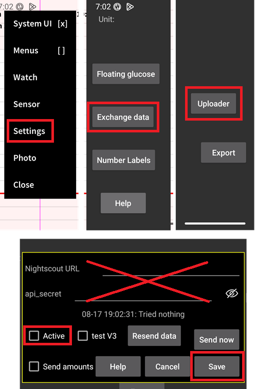

# Juggluco-instellingen

Als het nog niet geïnstalleerd is, download dan [Juggluco](https://www.juggluco.nl/Juggluco/download.html).

Volg de [instructies](https://www.juggluco.nl/Jugglucohelp/introhelp.html) om je sensor te verbinden.

## Basisinstellingen voor alle CGM systemen

### Nightscout upload uitschakelen

Laat geen andere app gegevens (bloedglucose en behandelingen) naar Nightscout uploaden.

Schakel alle actieve uploaders naar Nightscout uit in Juggluco.

(juggluco-to-aaps)=

## Juggluco naar AAPS

Juggluco kan bloedglucose rechtstreeks naar AAPS sturen, waardoor SMBs altijd worden ingeschakeld als je een [vertrouwde sensor](#GettingStarted-TrustedBGSource) gebruikt.

Wanneer je een Libre 2/2+/3/3+ sensor gebruikt, zullen minuut voor minuut metingen naar AAPS worden gestuurd, maar dit zal geen minuut voor minuut berekeningen in AAPS activeren.

Zet in Juggluco 'xDrip broadcast' aan (zet 'Patched Libre' niet aan), bevestig en sla de pakketinformatie van AAPS op. Selecteer in AAPS de BG-bron xDrip.

Zorg in AAPS dat de waarden voldoende [vloeiend gemaakt](./SmoothingBloodGlucoseData.md) worden.

(juggluco-to-xdrip)=

## Juggluco naar xDrip

Juggluco kan bloedglucose naar xDrip sturen, en xDrip stuurt die dan naar AAPS.

Zet in Juggluco 'Patched Libre' aan (zet 'xDrip broadcast' niet aan), bevestig en sla de pakketinformatie van dexdrip op. Selecteer in AAPS de BG-bron xDrip.

Apply sufficient [smoothing](./SmoothingBloodGlucoseData.md) in AAPS if necessary. When using a Libre 2/2+/3/3+ sensor, xDrip will average the minute-by-minute readings to 5-minute readings and [also smooth](#libre2-value-smoothing-raw-values) them.

