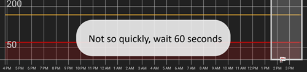
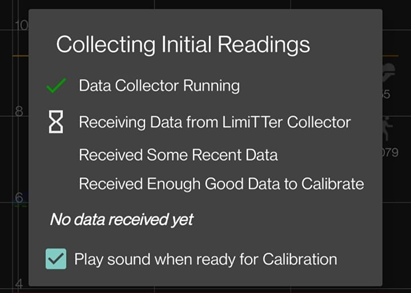

# FSL 2 en OOP2 instellen voor een directe Bluetooth-verbinding in xDrip

Overgezet van [MinimalL00per](https://www.minimallooper.com/post/how-to-setup-freestyle-libre-2-and-oop2-to-use-a-native-Bluetooth-connection-in-xdrip) naar markdown en **herzien/bijgewerkt**: 25 aug. 2025, psonnera

Onderaan dit document staat een lijst met definities. Ken je een term of afkorting niet, *[spring dan naar beneden](#minimallooper-definitions)* voor uitleg.

 

## Configuratie

### Hardware

- *FSL2 en 2+* **LET OP: de versies voor de VS, Canada, Nieuw-Zeeland en Australië worden NIET ondersteund**

**(OPTIONEEL) Reader** (niet geschikt voor FSL2+)

- Reader 1 (met bijgewerkte firmware)

- Reader 2

*LET OP: wil je in deze oplossing de reader gebruiken, dan MOET je de sensor EERST MET DE READER STARTEN. Doe je dat niet, dan kun je met de reader geen waarden van de geactiveerde sensor uitlezen. Als de sensor is opgewarmd, kun je waarden uitlezen met de LL-app of met xDrip.*

### Software

**OOP** - Out of Process Algorithm, een externe Android-app (APK) die helpt om ruwe sensordata op te halen en daaruit bloedglucosewaarden te maken. xDrip stuurt de verzamelde ruwe BT-data van de FSL2 naar OOP, en OOP stuurt bloedglucosewaarden terug naar xDrip.

- **OOP2**

  - **Werkt alleen met Europese FSL2/2+ sensoren**

  - Gesloten broncode (niet beschikbaar op GitHub)

  - Het doel is de versleutelde ruwe sensorwaarden te ontsleutelen en terug te sturen naar xDrip. Daarna kan xDrip werken met ruwe data (kalibratie nodig) of glucosewaarden geven zoals de Reader 1.

[***xDrip***](https://jamorham.github.io/)

- [*Nightly*](https://github.com/NightscoutFoundation/xDrip/releases): de nieuwste broncode, elke nacht gebouwd. Niet grondig getest

- [*Stable*](https://xdrip-plus-updates.appspot.com/stable/xdrip-plus-latest.apk): de nieuwste stabiele, geteste versie.

- **LET OP: nieuwe sensoren hebben een bijgewerkte OOP2-app nodig. Daarom raden we aan minstens de nieuwste release (Stable) van xDrip te gebruiken, die past bij de nieuwste OOP2.**

 

## Werkwijze

- *Download en installeer eerst de apps hieronder*
- *Apps verwijderen die mogelijk conflicteren*
- *Een FSL2 sensor starten in directe Bluetooth-modus met LL en xDrip
  - [*Stap 1: Apps installeren en instellen*](#minimallooper-step1)
  - [*Stap 2: Instellingen van xDrip*](#minimallooper-step2)
  - [*Stap 3: Plaats de sensor op je lichaam*](#minimallooper-step3)
  - [*Stap 4: Open de LL-app en start de sensor met de allereerste NFC-scan*](#minimallooper-step4)
  - [*Stap 5: Open xDrip en scan de FSL2 sensor met NFC*](#minimallooper-step5)
  - [*Stap 6: Start de nieuwe sensor in xDrip*](#minimallooper-step6)
  - [*Stap 7: Wacht 60 seconden en scan de sensor opnieuw met NFC*](#minimallooper-step7)
  - [*Stap 8: Verzamelen van data duurt 3 tot 15 minuten*](#minimallooper-step8)
  - [*Stap 9: Controleer of de sensor verbonden is en data levert*](#minimallooper-step9)

- *[Notities](#minimallooper-notes)*
- *[Voordelen](#minimallooper-advantages)*
- *[Nadelen](#minimallooper-disadvantages)*
- <u>*\[Probleemoplossing\](#minimallooper-troubleshooting)*</u>

## Voordat je begint

We raden sterk aan om deze werkwijze te volgen met een **nieuwe sensor**. Er zijn meldingen dat een verbinding met een al lopende sensor mogelijk is (***zie [hieronder](#minimallooper-started-sensor)***), maar de kans is erg groot dat de LL-app of de reader tijdens het verbinden een nieuwe private sleutel voor de communicatie maakt. Dit betekent dat xDrip na het koppelen de nieuwe sleutel niet kent en dus niet met de sensor kan communiceren. Een verbinding met een lopende sensor probeer je op eigen risico, het liefst tegen het einde van de levensduur van de sensor.

### Download en installeer eerst de apps hieronder

(Libre2_OOP2)=

- **OOP2** - Versies van oop2 vind je hier:

  (*Let op: je moet ingelogd zijn bij Google om de link te openen.*)

*[oop2.apk](https://drive.google.com/file/d/1106h2s12b3Ev9gKCTU2G75q8h9ChHjcz/view?usp=sharing)* - OOP2_21_09_25 (05d1989) **2025.09.21** (nieuwste versie)

- **xDrip** - de **<u>nieuwste versie</u>** (minimaal versie 2025.09.26) vind je hier:

[*xDrip.apk*](https://github.com/NightscoutFoundation/xDrip/releases)

(minimallooper-started-sensor)=

### Wat als mijn sensor al gestart is? Kan ik nog steeds waarden krijgen in xDrip? JA!

Veel mensen hebben gevraagd of deze methode ook werkt met een sensor die al actief is. Het antwoord is een duidelijk **JA**: je kunt een sensor starten die al loopt.

1.  Zorg **EERST** dat je de wijzigingen en instellingen in xDrip hebt gedaan en dat OOP2 is geïnstalleerd en ingesteld zoals hieronder beschreven.

2.  Ga **DAARNA** naar *Stap 5* en **ZORG ERVOOR** dat je LL geforceerd hebt gestopt voordat je begint. Volg daarna de werkwijze tot het einde.

*LET OP: je kunt je geactiveerde FSL2 sensor niet met de FSL-reader gebruiken ALS de sensor niet eerst met de FSL-reader is gestart. Als de sensor WEL eerst met de FSL-reader is gestart, dan kun je de sensor **scannen** en waarden uitlezen met ZOWEL de reader als apps zoals LL en xDrip.*

## Een FSL2 sensor starten in directe Bluetooth-modus met LL en xDrip

*LET OP: staan er in de screenshots instellingen die niet speciaal met een KADER zijn aangegeven en die NIET AANGEVINKT zijn (dus uitgeschakeld), LAAT ZE DAN UITGESCHAKELD. De screenshots tonen een werkende configuratie voor ALLE getoonde instellingen. Wil je andere functies aan- of uitzetten als je sensor eenmaal werkt, dan mag je dat op eigen risico proberen.*

(minimallooper-step1)=

### Stap 1: Apps installeren en instellen

**Installeer en stel OOP2 in** en controleer of het werkt door de app gewoon te openen.


**Instellingen**

- *Use service* **aan**

- *Use foreground service* **aan**

- *Timer Duration* **5 minuten**

  - Verander dit in **1 sec** als je de resultaten niet snel genoeg krijgt (de screenshot hieronder toont deze instelling).

**Versie 2: 93e5cac-2020.12.08 (nieuwste versie)**


**Installeer xDrip**, minimale versie: de nieuwste release. Meer documentatie over het installeren en instellen van xDrip vind je [*hier*](../CompatibleCgms/xDrip.md).

(minimallooper-step2)=

### Stap 2: Instellingen van xDrip

**Hardware Data Source**: Libre Bluetooth


**NFC Scan features**: *instellingen die niet genoemd worden, staan uit.*

- *Use NFC feature*: **aan**
- *Sensor Age or Expiry*: **aan**
- *Scan when not in xDrip*: **aan**
- *Use Any-tag optimized reading method*: **uit**, maar probeer **aan** als scannen moeilijk gaat


- *Starting Bluetooth connection with FSL2 sensor*: **Always connect to libre2 sensors**


- *Smooth libre 3 data when using xxx method*: laat de standaardwaarde staan. Verhoog de waarde bij een sensor met veel ruis, verlaag hem als de sensor stabiel is.


**Less Common Settings -\> Bluetooth Settings** (*deze zijn belangrijk en kunnen per telefoon/opstelling verschillen*)

- *Turn Bluetooth on*: **aan**
- *Trust Auto-Connect*: **aan**
- *Use Background Scans*: **aan**
- *Always discover services*: **aan**

Je kunt xDrip instellen met de QR-code hieronder. Scan de code (of laad de afbeelding) in xDrip -> Auto Configure.

```{admonition} QR Code
:class: dropdown


```


Heb je de QR-code hierboven gescand en heb je een Samsung-telefoon (dit helpt ook bij veel Chinese merken), scan dan ook de andere QR-code hieronder. Die past de instellingen aan voor een betrouwbaardere verbinding:

- *Trust Auto-Connect*: **uit**
- *Use Background Scans*: **uit**

```{admonition} QR Code
:class: dropdown


```


**Advanced settings for FSL2** (*optioneel maar handig*)

- *show Raw values in Graph*: **aan**

- *show Sensor info in Status*: **aan**


**Extra Logging Settings** (*nodig om fouten te zoeken als het niet goed werkt*)

- *Extra tags for logging*: vul deze waarde in

`BgReading:d,jamorham librereceiver:v,LibreOOPAlgorithm:v,jamorham nsemulator:v,DexCollectionService:v`


(minimallooper-OOPsettings)=

**Less Common Settings -\> Other misc options**

> **Instellingen voor OOP2**

- *Out of process Libre algorithm*: **UIT**

(*ZORG DAT DIT **UIT** STAAT VOOR OOP2, ANDERS KRIJG JE GEEN WAARDEN!*)


(minimallooper-step3)=

### Stap 3: Plaats de sensor op je lichaam

(minimallooper-step4)=

### Stap 4: Open de LL-app en start de sensor met de allereerste NFC-scan

Open de LL-app, scan dan de net geplaatste sensor, en sluit daarna de LL-app en schakel hem uit of verwijder hem. **Je moet nog steeds de volle 60 minuten wachten tot de sensor is opgewarmd, voordat je verdergaat en de sensor in xDrip start**. Vertrouw niet op de waarden van daarvoor, want de sensor is intern nog aan het kalibreren en de waarden schommelen sterk.

#### Stap 4a (OPTIONEEL, FSL-reader gebruiken):

**Start de FSL2 (niet 2+) sensor door hem met de allereerste NFC-scan te scannen met de FSL-reader**

Wil je naast de LL-app of xDrip ook de **FSL-reader** gebruiken om waarden van de FSL2 sensor te lezen, **dan moet je de net geplaatste FSL2 sensor EERST met de FSL-reader scannen.** Na het opwarmen van de sensor kun je dan met de LL-app of xDrip waarden scannen.

*LET OP: de LL-app is alleen nodig voor de ALLEREERSTE NFC-scan na het plaatsen van de sensor. De app stuurt het signaal om de opwarmperiode te starten. Daarna MOET de app uitgeschakeld (app-instellingen -\> geforceerd stoppen) of verwijderd worden. Je kunt de aangepaste (patched) 2.3 app of de officiële versies gebruiken, dat maakt niet uit. Het belangrijkste is dat de LL-app niet draait terwijl xDrip het BT-koppelen met de sensor probeert te starten. De LL-app verstoort namelijk de communicatie en daarmee het opnieuw verbinden via Bluetooth.*

*Er zijn meldingen dat het genoeg is om in de Android-systeeminstellingen de **locatietoestemming** van de LL-app uit te zetten. Dan stoort de app de verbinding niet. Een paar gebruikers melden dat dit werkt. Toch **raad ik aan de app uit te schakelen of te verwijderen**, maar je kunt dit proberen als je wilt experimenteren.*

(minimallooper-step5)=

### Stap 5: Open xDrip en scan de FSL2 sensor met NFC

(*Herinnering! Zorg dat LL uitgeschakeld is (locatie uit) of verwijderd, EN dat je de volle 60 minuten hebt gewacht tot de sensor is opgewarmd en intern gekalibreerd.*)

**Scan de FSL2 sensor met NFC** in xDrip. Dit stuurt een signaal naar de sensor om Bluetooth-koppelen aan te zetten, zodat het koppelen (bonding) kan beginnen. Onderaan het overzichtsscherm van xDrip verschijnt kort een kleine melding met de tekst **Scanning**, gevolgd door de melding **Scanned OK!** als de NFC-scan van de FSL 2 sensor gelukt is.


(minimallooper-step6)=

### Stap 6: Start de nieuwe sensor in xDrip

Druk in het **overzichtsscherm van xDrip** op het **hamburgermenu** linksboven. Kies daarna **Start Sensor**.

Druk op het scherm **Start New Sensor** op **Start Sensor**. Er verschijnt een vraag **Did you insert it today?** Antwoord met **NOT TODAY**.


*LET OP: heb je per ongeluk op "YES, TODAY" gedrukt, dan moet je de sensor stoppen met "stop sensor" in het hoofdmenu van xDrip, en daarna "start sensor" doen door Stap 5 opnieuw te volgen.*

(minimallooper-step7)=

### Stap 7: Wacht 60 seconden en scan de sensor opnieuw met NFC

Een tweede NFC-scan is nodig om de sensor **TOE TE VOEGEN** als het Bluetooth-apparaat waarvan xDrip de waarden ophaalt. Als dit klaar is, zie je een melding **NEW SENSOR STARTED**.


Je moet 60 seconden wachten, omdat de sensor tijdens dit proces niet vaker dan één keer per minuut gescand kan worden. Scan je de sensor te vroeg, dan staat de waarschuwing **Not so quickly, wait 60 seconds** in het overzichtsscherm van xDrip.



Open de event logs van xDrip en controleer of de sensor goed gekoppeld is met xDrip.


(minimallooper-step8)=

### Stap 8: Verzamelen van data duurt 3 tot 15 minuten

Na 3 tot 15 minuten is er genoeg data verzameld om de eerste waarden te tonen. *Krijg je op dat moment nog steeds geen waarden, dan helpt het soms om de telefoon opnieuw op te starten.*

Gebruik je een Samsung (of een telefoon van veel Chinese merken) en heb je problemen met het ontvangen van data, scan dan de QR-code hieronder in xDrip -> Auto Configure.

```{admonition} QR Code
:class: dropdown


```

Die verandert de Bluetooth-instellingen van xDrip in:

- *Trust Auto-Connect*: **uit**
- *Use Background Scans*: **uit**

(minimallooper-step9)=

### Stap 9: Controleer of de sensor verbonden is en data levert

Druk op het hamburgermenu linksboven in het overzichtsscherm van xDrip en kies **System Status**. Op het scherm System Status toont het veld **Bluetooth Device:** de Bluetooth-naam van de FSL2 in de vorm **ABB___XXXXXXXXXXX**. De X'en zijn het serienummer van de sensor. Het veld **Connection Status** toont **Connected** en het veld **Sensor Start:** toont de tijd waarop de sensor is gestart.


Op het scherm **BT Device** (veeg naar links) kun je meer verbindingsdetails van de sensor controleren. Je kunt dit scherm ook gebruiken om verbindingsproblemen op te lossen. Hieronder staat een lijst met velden en hun doel, als hulp bij het oplossen van verbindingsproblemen.

*LET OP: **Bluetooth Pairing in dit venster <u>NIET AANRAKEN</u> EN NIET WIJZIGEN van <u>Disabled</u>**. Doe je dat wel, dan probeert xDrip direct te koppelen. Dat mislukt (Not bonded) en dan moet je de hele werkwijze opnieuw beginnen vanaf Stap 5.*


- **Phone Service State:** het laatste moment waarop de telefoon een BT-verbinding met de sensor had (dit moet minder dan 5 minuten geleden zijn)
- **Bluetooth Device:** toont de huidige status van de verbinding (**Connected** of **Disconnected**)
- **Device Mac Address**: dit is de hardware-ID van de sensor
- **Bluetooth Pairing**: dit moet **<u>Disabled, tap to enable</u>** zijn. Tik hier NIET op. Tik je er per ongeluk op, tik dan opnieuw tot het weer op disabled staat.
- **Slowest wake up**: dit kun je negeren. xDrip wacht niet de hele tijd op waarden: xDrip verwacht ze pas na een bepaalde tijd (meestal 5 minuten). Komt er op dat moment geen data binnen, dan zie je "Woke up early". Dat betekent dat xDrip data verwachtte, maar dat er geen data is. Slowest wake up is de langste vertraging die er normaal was voordat data binnenkwam.
- **Next Wake up**: hier moet 5 minuten staan


(minimallooper-notes)=

### Notities

- **NFC-scans met LL NADAT het koppelen in xDrip klaar is**: je kunt NFC-scans doen, maar het koppelen met xDrip moet eerst klaar zijn. Kijk altijd in xDrip of de volgende 5-minutenwaarde bijna komt (bijv. 4 minuten geleden). Is het bijna 5 min, wacht dan tot de nieuwe BT-waarde binnen is en doe daarna de NFC-scan. Scan je op het verkeerde moment, dan verstoor je het BT-proces in xDrip en komen er geen BT-waarden binnen. Het kan dan een tijdje duren voordat er opnieuw gekoppeld en verzonden wordt, en soms kan LL de BT-verbinding van de sensor "afpakken". Maar tussen deze BT-waarden door heb ik nooit problemen gehad met een NFC-scan, gevolgd door het direct uitschakelen van de app. Ik weet niet zeker of LL elke keer uitgeschakeld moet worden, maar ik doe het voor de zekerheid.

- - **Wat gebeurt er?** Bij een Bluetooth-verbinding wordt een private gedeelde sleutel gemaakt. Die is nodig voor de communicatie tussen de sensor en de app of het apparaat dat verbinding maakt. De kans is groot dat de LL-app of de reader tijdens het verbinden een nieuwe private gedeelde sleutel voor de communicatie maakt. Dit betekent dat xDrip na het koppelen de nieuwe sleutel niet kent en dus niet met de sensor kan communiceren.

  - Een aantal gebruikers meldt dat de LL-app weer gestart kan worden nadat de sensor goed is gestart en xDrip waarden ontvangt. Zet bij de Android-toestemmingen van de LL-app gewoon de instelling **Locatie toestaan** uit. Als dit klaar is, zou je de LL-app en xDrip tegelijk moeten kunnen gebruiken. Ik raad aan om geen standaard-app voor NFC-scannen te kiezen, maar bij elke NFC-scan te kiezen met welke app je de sensor wilt uitlezen. VERGEET OOK NIET om bij je volgende sensorwissel de LL-app geforceerd te stoppen na de eerste NFC-scan voor het opwarmen van de nieuwe sensor. Als de sensor is ingesteld en xDrip waarden ontvangt, kun je de LL-app weer starten.

&nbsp;

- **Je telefoon opnieuw opstarten**: controleer na het opnieuw opstarten, en na het uitschakelen of geforceerd stoppen van de app, dat de LL-app NIET draait. Ik raad aan om een herstart te testen, om te zien of LL vanzelf weer start. Je kunt dit bekijken in de instellingen van de LL-app, onder de Android-app-instellingen van je telefoon. Is de app nog ingeschakeld, schakel de LL-app dan opnieuw uit. Mogelijk is verwijderen van de LL-app de enige manier om dit te voorkomen. Zo voorkom je dat LL per ongeluk de BT-koppeling overneemt. Na een herstart duurt het ook weer 3–15 minuten voordat je BT-waarden van de sensor krijgt. Wees dus geduldig en houd hier rekening mee als je opnieuw opstart vlak voor een moment waarop je een BG-waarde nodig hebt, bijvoorbeeld voor een bolus of een maaltijd.

&nbsp;

- **Batterij optimalisatie**: zorg dat je deze apps UITSLUIT van de batterij optimalisatie op je telefoon

  - xDrip

  - OOP 2

  - LL

  - AAPS

&nbsp;

- **Vliegtuigmodus gebruiken:** soms wil je de vliegtuigmodus aanzetten (als je gaat vliegen ;-), of 's nachts als je geen wifi- of mobiele signalen wilt van een telefoon dicht bij je hoofd). Dit kan problemen geven met de Bluetooth-communicatie bij het aanzetten van de vliegtuigmodus. Als je de vliegtuigmodus van de telefoon aanzet en daarna Bluetooth weer aanzet, gaan bloedglucosewaarden verloren. De enige oplossing is de collector opnieuw te starten in xdrip+ -\> System Status -\> Classic Status Page. Na het opnieuw starten van de collector kwamen de bloedglucosewaarden weer terug.

 

(minimallooper-advantages)=

### Voordelen

- **Aangepaste LL-app niet meer nodig** Je hebt geen aangepaste (patched) versie van de LL-app meer nodig om waarden van de FSL2 sensor op te halen. Je kunt de aangepaste LL-app gebruiken, maar ook de officiële versies van de LL-app kunnen de eerste NFC-scan voor het starten doen, op dezelfde manier als de aangepaste app. Voor de eerste NFC-scan om de sensor te starten is er geen verschil.

&nbsp;

- **NFC-scanners van derden niet meer nodig** NFC-scanners van derden, zoals Miaomiao, Bubble of Blucon, zijn niet meer nodig *(maar je kunt ze nog wel gebruiken)* om waarden te verzamelen, omdat de sensor ze nu zelf via Bluetooth kan leveren. Minder hardware betekent minder dingen die mis kunnen gaan, minder apparaten om op te laden en een eenvoudigere opstelling.

&nbsp;

- **Je kunt nog steeds waarden scannen met NFC met de FSL2 reader (versie 1 met bijgewerkte firmware of versie 2) ALS de FSL2 sensor EERST met de FSL-reader is gestart.** De losse FSL2 reader kan dan nog steeds waarden van de actieve sensor scannen als de sensor via Bluetooth met xDrip is gekoppeld.

  - Je **MOET** de sensor starten met de allereerste NFC-scan om het opwarmen te starten, en dat **EERST met de FSL-reader**. Vanaf dit moment kunnen ook andere apps NFC-waarden van de nu geactiveerde sensor lezen.
- Voor zover ik weet laat de FSL2 sensor (zolang hij geen verbinding heeft of probeert te maken) via BLE altijd precies elke 2 minuten weten dat hij er is en beschikbaar is (zichtbaar voor elk Bluetooth-apparaat dat naar Bluetooth-apparaten kan zoeken). Het apparaat dat als eerste op dit signaal reageert, wint de race en is het *enige* apparaat dat verbinding mag maken en de sensor mag uitlezen. Tijdens de NFC-scan wordt namelijk een private gedeelde sleutel gemaakt, die nodig is om de FSL 2 communicatie te ontsleutelen. De sensor is dan niet beschikbaar voor andere apparaten die deze private sleutel niet hebben en misschien ook verbinding proberen te maken. Het lijkt erop dat de FSL 2 reader deze race altijd wint, wie de "tegenstander" ook is.

&nbsp;

- **Zo weinig mogelijk apparaten** Mijn doel is altijd geweest om zo weinig mogelijk medische apparaten op mijn lichaam te hebben. De FSL2 samen met het Omnipod-systeem heeft dit doel bereikt. Dit is nog belangrijker als ik op reis ga (kort of lang), omdat ik minder spullen en minder wisselsets mee hoef te nemen. Zo heb ik meer ruimte voor andere dingen in mijn bagage. Hopelijk komt er in de toekomst een patchpomp met alleen een vervangbaar reservoir, waarbij de chip en de motor een deel vormen dat je kunt houden en opnieuw gebruiken. Dat zou afval en verpakking bij het wisselen van de infuusplek verminderen, en weer meer ruimte in mijn koffer geven voor andere dingen.

&nbsp;

- **Geen gat van een uur meer bij een sensorwissel** Omdat je met de LL-app een nieuwe sensor kunt starten met een eerste NFC-scan, kan de huidige sensor tegelijk blijven werken en waarden via Bluetooth blijven leveren. Na 20 minuten kun je waarden van de nieuwe sensor krijgen, maar het is beter om 1 uur te wachten zodat de sensor intern goed kan kalibreren. Dit betekent dat je de huidige sensor kunt stoppen en de nieuwe kunt starten (nadat die een uur eerder is geplaatst en met de NFC-scan van LL is opgewarmd). Binnen 3 tot 15 minuten heb je dan je eerste kalibraties en waarden.

&nbsp;

(minimallooper-disadvantages)=

### Nadelen

- **Telefoon opnieuw opstarten:** omdat het Bluetooth-proces opnieuw moet starten als je telefoon opnieuw opstart, moet je eerst zorgen dat je de LL-app handmatig uitschakelt (als je hem niet hebt verwijderd). Wees daarna geduldig tot de eerste waarden binnenkomen (3 tot 15 min). Plan het opnieuw opstarten van de telefoon dus zo dat het niet op belangrijke momenten gebeurt, zoals bij een correctiebolus of bij maaltijden en tussendoortjes.

&nbsp;

- **Je kunt LL en xDrip niet tegelijk gebruiken voor Bluetooth-waarden**. LL zal altijd proberen de Bluetooth-verbinding met de sensor en de koppeling "af te pakken". Gebeurt dat, dan zit je voor de rest van de levensduur van de sensor vast aan LL. De apps tegelijk gebruiken werkt dus niet altijd. Zoals ik hieronder schrijf, kun je de LL-app inschakelen en een NFC-scan doen om de waarde in LL te krijgen (als je wilt vergelijken, of de geschiedenis wilt ophalen voor jezelf of voor rapporten voor je endocrinoloog). Schakel de app wel weer uit zodra je je waarde hebt, en probeer dit niet binnen een minuut vóór het moment waarop xDrip zijn Bluetooth-waarde ophaalt. Ik weet niet zeker hoe de FSL2 reader hierbij werkt, maar dat ga ik later testen.
- Een aantal gebruikers meldt dat de LL-app weer gestart kan worden nadat de sensor goed is gestart en xDrip waarden ontvangt. Zet bij de Android-toestemmingen van de LL-app gewoon de instelling **Locatie toestaan** uit. Als dit klaar is, zou je de LL-app en xDrip tegelijk moeten kunnen gebruiken. Ik raad aan om geen standaard-app voor NFC-scannen te kiezen, maar bij elke NFC-scan te kiezen met welke app je de sensor wilt uitlezen. VERGEET OOK NIET om bij je volgende sensorwissel de LL-app geforceerd te stoppen na de eerste NFC-scan voor het opwarmen van de nieuwe sensor. Als de sensor is ingesteld en xDrip waarden ontvangt, kun je de LL-app weer starten.

&nbsp;

- **NFC-scanners van derden kunnen nog steeds gebruikt worden**. Ja, ik noemde dit een nadeel, maar ik wil ook laten zien dat je, als er iets misgaat met de sensor en LL de controle overneemt, altijd terug kunt vallen op een NFC-scanner op de sensor om waarden in xDrip te krijgen. Je kunt ook zo'n apparaat gebruiken in plaats van een directe Bluetooth-verbinding, als je je prettiger voelt bij een opstelling met een NFC-scanner van derden (Miaomiao, Bubble, Blucon). Soms werken sommige telefoons niet goed met de directe Bluetooth-koppeling met de sensor en het ophalen van data. Je kunt deze apparaten als reserve of voor normaal gebruik inzetten. Hoe dan ook, je hebt deze mogelijkheid nog steeds.
- Wil je de **FSL-reader** gebruiken als NFC-scanner om waarden te lezen, dan MOET je de FSL2 sensor opwarmen met de **ALLEREERSTE NFC-scan** en dat **EERST MET DE READER** doen.

&nbsp;

- **LV-data worden niet automatisch geüpload** De LL-app heeft geen vaste Bluetooth-verbinding (want LL hoort niet tegelijk met xDrip te draaien zodra de sensor actief Bluetooth-waarden stuurt). Daarom krijgt LL niet automatisch waarden van de sensor. Dit betekent dat bloedglucosedata niet automatisch naar LV worden geüpload, en dus ook niet naar andere telefoons met LL. Ik noem dit een nadeel, omdat ik weet dat veel ouders op deze functie vertrouwen, net als mensen die de rapporten van LV moeten gebruiken voor hun zorgverlener. Je kunt nog steeds de LL-app openen en elke 8 uur scannen om de aangevulde data van de sensor in LL te krijgen (3 keer per dag, minstens elke 8 uur, maar waarschijnlijk zijn meer scans nodig om alle 24 uur aan data te krijgen). Maar ook dit is handwerk.

&nbsp;

(minimallooper-definitions)=

### Definities

- **BT** - Bluetooth

- **BLE** - Bluetooth Low Energy

- **FSL** - FreeStyle Libre
  - **Libre 1 (FSL1)** - alleen NFC. Eerste versie van de sensor

  - **FSL2 (FSL2)** - Bluetooth en NFC. Tweede versie van de sensor.

  - **Libre 3 (FSL3)** - Bluetooth en NFC. Derde, kleinere versie van de sensor. Niet ondersteund door OOP2 (zie Juggluco).

- **LL** - LibreLink, **app** waarmee je de sensor start met de eerste NFC-scan

- **LV** - LibreView, clouddienst om data te delen met je diabetesteam (overweeg Tidepool of Nightscout)

- **MM** - MiaoMiao, naam en fabrikant van een NFC-scanner van derden die waarden via Bluetooth naar xDrip stuurt.

- **NFC** - Near Field Communication, een handeling waarbij je de NFC-sensor van je telefoon dicht bij je sensor houdt om een waarde uit te lezen. Dit heet vaak "de sensor scannen", een "sensorscan" of "NFC-scan". Hierbij wordt op geen enkele manier Bluetooth gebruikt.

- **OOP1** - Out of Process Algorithm versie 1, de app van derden die ruwe waarden ontvangt (via Bluetooth of NFC-scan van de sensor naar xDrip gestuurd). De app verwerkt de ruwe waarden met een algoritme (dat erg lijkt op het hardware-algoritme op de chip van de sensor) en stuurt een gekalibreerde bloedglucosewaarde (gekalibreerd door het OOP1-algoritme, niet door de eigen kalibraties van xDrip) terug naar xDrip. xDrip toont die waarde of verwerkt hem verder met de eigen kalibratie van xDrip (met een vingerprik), als dat nodig is.

- **OOP2** - Out of Process Algorithm versie 2, de app van derden die de versleutelde data van de FSL 2 sensor ontvangt (via Bluetooth of NFC-scan) en die data daarna ontsleutelt. Na het ontsleutelen worden de data naar xDrip gestuurd.

 

(minimallooper-troubleshooting)=

### Probleemoplossing

#### De sensor scannen met NFC lukt niet

- Zorg dat de NFC-lezer van je telefoon aan staat in de Android-instellingen.
- De NFC-lezer moet geschikt zijn voor **ISO 15693** tags. Sommige Cubot-telefoons zijn erg lastig in gebruik.
- Zoek in de documentatie van je telefoon op waar de NFC-antenne zit. Houd de telefoon bij de sensor en houd hem daar 10 seconden: lezen via NFC duurt bij xDrip langer dan bij de app van de fabrikant of de reader.
- Probeer xDrip te sluiten voordat je de sensor scant.
- Zorg dat geen andere app de sensor wil lezen (bij het scannen zie je misschien een keuze uit verschillende apps: kies xDrip, maar beweeg de telefoon niet).
- Probeer alle combinaties van de NFC-instellingen van xDrip *Use faster multi-block reading method* en *Use Any-tag optimized reading method*. NFC-scans zijn meestal het betrouwbaarst als beide opties **uit** staan.

#### Blijft hangen bij het verzamelen van de eerste waarden

*Let op: de FSL 2 wordt niet herkend als betrouwbare databron als je hem handmatig kalibreert.*

Zet de strategie voor [OOP2-kalibratie](#minimallooper-OOPsettings) op "No calibration" tot alles werkt.

Daarna kun je kiezen of je wel of niet kalibreert.



#### Sensor wordt gemeld als FSL1


Zorg dat je de nieuwste versies van xDrip en OOP2 gebruikt.

#### Verbinding met de sensor mislukt

- Controleer of OOP1 uitgeschakeld is (zie [hier](#minimallooper-OOPsettings))


- Controleer of OOP2 niet in slaap wordt gezet door apps en instellingen voor batterijbesparing op de telefoon
- Controleer of Google Play Protect uitgeschakeld is, want dat stopt OOP2
- Heb je Bluetooth Pairing in System Status gewijzigd? Tik er opnieuw op om het terug te zetten naar **<u>Disabled</u>**


#### Gemiste waarden

Controleer of OOP2 waarden toont die niet 0 of -1 zijn. Anders kan het een teken zijn dat je sensor kapot gaat (voorbeeld hieronder in mmol/l).


Als de sensorleeftijd niet verder loopt, kan dat ook een teken zijn dat er iets mis is met je sensor. Dit betekent dat xDrip een waarde heeft ontvangen, maar die heeft weggegooid omdat hij niet bruikbaar was (sensorfout).


#### Sensor koppelen helemaal opnieuw beginnen

1. xDrip-menu -> Stop sensor (dit stopt de FSL2 niet, het zet alleen de status in xDrip op niet gestart)
2. xDrip-menu -> System status -> Forget device
3. Scan de sensor met NFC in xDrip. Wacht minstens één minuut
4. xDrip-menu -> Start sensor. Wacht minstens één minuut
5. Scan de sensor een paar keer met NFC in xDrip, en wacht altijd minstens één minuut tussen twee scans
