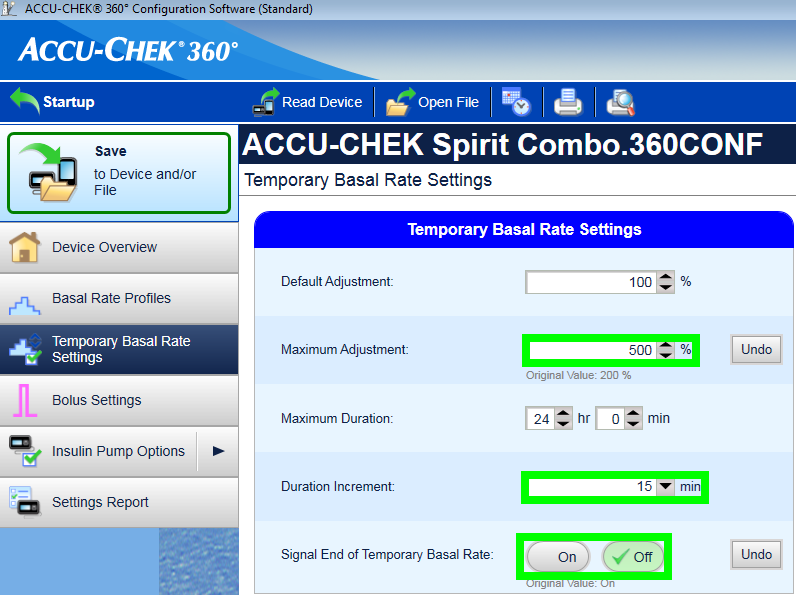
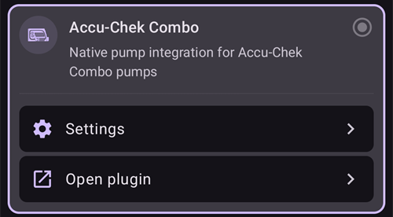
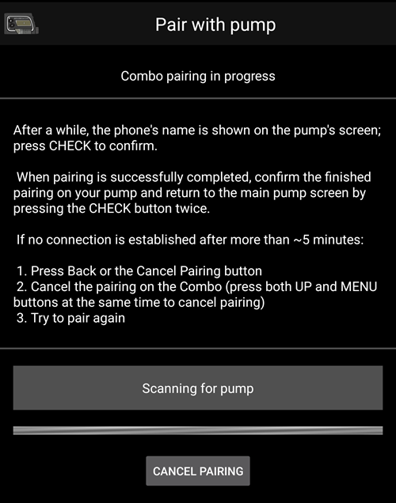

# Accu-Chek Combo

**Deze software is onderdeel van een doe-het-zelf oplossing en is niet een product, maar vraagt JOU te lezen, leren en te begrijpen hoe het systeem werkt en hoe je het kunt gebruiken. Het neemt niet je gehele diabetes management van je over, maar stelt je wel in staat om je diabetes beter onder controle te krijgen en je kwaliteit van leven te verhogen, als je bereid bent de benodigde tijd erin te investeren. Haast je niet, maar geef jezelf de tijd om te leren. Jij alleen bent verantwoordelijk voor wat je ermee doet.**

```{admonition} Accu-Chek Combo is being phased out
:class: note

Roche stopt met insulinepompen, om zich in diabetes te richten op de Accu-Chek SmartGuide CGM. Roche heeft het einde van de verkoop van de Accu-Chek Combo en de Accu-Chek Insight aangekondigd. Ook de overgebleven Accu-Chek Solo micropomp wordt afgebouwd (laatste leveringen in Duitsland eind 2025). De verandering wordt per regio ingevoerd, te beginnen in Duitsland. Andere Europese markten volgen naar verwachting. Als je van deze pomp afhankelijk bent, plan dan op tijd de overstap naar een ondersteunde pomp.
```

```{contents} Table of contents
:depth: 1
:local: true
```

## Mogelijkheden van de pomp met AAPS

* Communiceert met **AAPS** via de eigen Bluetooth van je telefoon, zonder extra communicatieapparaat.
* Automatische afhandeling van zomertijd en tijdzones.

## Benodigde hardware en software

* Een Roche Accu-Chek Combo (elke firmware, ze werken allemaal).
* Een Smartpix of Realtyme apparaatje met bijbehorende 360 Configuratie software om de pomp te configureren. (Op verzoek stuurt Roche de Smartpix met software gratis op aan haar klanten.)
* Een compatibele telefoon met Android 12 of nieuwer. Zie de [release notes](#maintenance-android-version-aaps-version) voor details.
* De **AAPS**-app geïnstalleerd op je telefoon.

Sommige telefoons werken beter dan andere. Dat hangt af van hoe goed hun Bluetooth werkt en of ze extra, zeer agressieve energiebesparing hebben. Een lijst met telefoons vind je op de pagina [Telefoons](#Phones-list-of-tested-phones). NB: deze lijst is niet compleet en bevat persoonlijke ervaringen. Je wordt gevraagd om jouw eigen ervaring hier ook aan toe te voegen en zodoende anderen te helpen (deze projecten draaien allemaal om #payitforward mentaliteit).

(combov2-before-you-begin)=
## Voordat je begint

**VEILIGHEID VOOROP** - doe dit niet in een situatie waarin je een fout niet kunt herstellen. Houd je Smartpix / Realtyme-apparaat bij de hand, samen met de 360 Configuratie software. Reken op ongeveer een uur om alles in te stellen en te controleren of alles goed werkt.

Let op de volgende beperkingen:

* Vertraagde bolus en multiwave bolus worden op dit moment niet ondersteund (je kunt in plaats daarvan [Vertraagde koolhydraten / "eCarbs"](../DailyLifeWithAaps/ExtendedCarbs.md) gebruiken).
* Alleen één basaalprofiel (het eerste) wordt ondersteund.
* De laagste basaalstand in je **Profiel** is 0,05 E/u. **AAPS** weigert een **Profiel** met een lagere stand. De Combo rondt basaalstanden af op zijn eigen stappen (0,01 E/u onder 1 E/u, 0,05 E/u tot 10 E/u, 0,1 E/u daarboven). **AAPS** gebruikt de standen die de pomp echt geeft.
* Tijdelijke basaalstanden zijn beperkt tot 500% van de huidige basaalstand. **AAPS** houdt rekening met deze grens.
* De loop is uitgeschakeld als het actieve profiel op de pomp niet profiel nr. 1 is. Dit blijft zo tot profiel nr. 1 het actieve profiel is. Daarna merkt AAPS bij de volgende verbinding (vanzelf na een tijdje, of omdat je op **Vernieuwen** tikt op het Accu-Chek Combo pompscherm) dat profiel nr. 1 het actieve profiel is, en schakelt de loop weer in.
* Als de loop vraagt om een lopende TBR te annuleren, stelt de Combo in plaats daarvan een TBR van 90% of 110% in voor 15 minuten. Dit komt doordat het echt annuleren van een TBR een alarm op de pomp geeft dat veel trillingen veroorzaakt, en die trillingen kun je niet uitschakelen.
* De stabiliteit van de Bluetooth verbinding verschilt per telefoon, waardoor "pomp niet bereikbaar" foutmeldingen kunnen ontstaan indien er geen verbinding meer gemaakt kan worden met de pomp. Als die fout optreedt, controleer dan of Bluetooth aan staat, en tik op **Vernieuwen** op het pompscherm (**Beheren** > **Pomp**) om te zien of het een tijdelijk probleem was. Als er nog steeds geen verbinding is, start dan de telefoon opnieuw op; meestal lost dat het op.
* Er is nog een ander probleem waarbij herstarten niet helpt, maar je op een knop van de pomp moet drukken (dat reset de Bluetooth-stack van de pomp) voordat de pomp weer verbindingen van de telefoon accepteert.
* Het instellen van een TBR op de pomp moet worden vermeden, aangezien AAPS de controle zou moeten houden over TBRs. Wanneer je dit wel zou doen, dan kan het tot 20 minuten duren voordat AAPS contact maakt met de pomp en de nieuwe TBR detecteert. De TBR zal alleen worden geregistreerd vanaf het moment dat hij wordt gedetecteerd, dus in het ergste geval zou er al twintig minuten lang een TBR zijn afgegeven die niet in de IOB wordt meegerekend.

De driver ondersteunt op dit moment de volgende talen op de Combo. (Dit staat los van de taal in AAPS - het is de taal op het LCD-scherm van de Combo zelf.)

* Engels
* Spaans
* Frans
* Italiaans
* Russisch
* Turks
* Pools
* Tsjechisch
* Hongaars
* Slowaaks
* Roemeens
* Kroatisch
* Nederlands
* Grieks
* Fins
* Noors
* Portugees
* Zweeds
* Deens
* Duits
* Sloveens
* Litouws

**Belangrijk**: Als je pomp op een taal staat die niet in deze lijst staat, neem dan contact op met de ontwikkelaars, en zet de taal van de pomp op een taal uit deze lijst. Anders werkt de driver niet goed.

## Telefoon instellen

Het is heel belangrijk dat batterijoptimalisaties uitgeschakeld zijn. AAPS ziet al zelf wanneer deze optimalisaties actief zijn en vraagt in de app om ze uit te schakelen. Maar op moderne Android-telefoons is Bluetooth _zelf_ een app (een systeem-app). En meestal draait die "Bluetooth-app" _standaard met batterijoptimalisaties aan_. Daardoor kan Bluetooth stoppen met reageren als de telefoon energie wil besparen, omdat de telefoon de Bluetooth-app afsluit. Daarom moeten ook in de instellingen van die Bluetooth-systeem-app de batterijoptimalisaties uitgeschakeld worden. Helaas verschilt het per telefoon hoe je die Bluetooth-systeem-app kunt vinden. In standaard Android ga je naar Instellingen -> Apps -> Alle N apps bekijken (N = het aantal apps op je telefoon). Open dan het menu rechtsboven en tik op "Systeem tonen", "Systeem-apps tonen" of "Alle apps". Zoek nu in de uitgebreide lijst met apps naar een app "Bluetooth". Kies deze app en tik in het scherm "App-info" op "Batterij". Schakel daar de batterijoptimalisaties uit (soms heet dit "batterijgebruik").

## Combo instellen

* Stel de pomp in met de Accu-Chek 360 Configuratie software. Als je de software niet hebt, neem dan contact op met de Accu-Chek klantenservice. Ze sturen meestal een CD met de "360° Pump ConfiguratieSoftware" en een SmartPix USB-infrarood verbindingsapparaat (het Realtyme apparaat werkt ook als je dat hebt).

  - **Vereiste instellingen** (groen gemarkeerd op de screenshots):

     * Zorg dat de menu configuratie op "Standaard" staat, dit zal alleen de ondersteunde menu's/acties op de pomp weergeven en de niet-ondersteunde verbergen (zoals vertraagde/multiwave bolus, meerdere basaalstanden). Wanneer je de niet-ondersteunde opties toch gebruikt, dan zullen bepaalde loop functies worden beperkt omdat het niet mogelijk is om veilig te loopen met deze opties.
     * Controleer of de _Quick Info-Tekst_ is ingesteld op "QUICK INFO" (zonder de aanhalingstekens, te vinden onder _Insuline Pomp Opties_).
     * Stel TBR _Maximale aanpassing_ in op 500%
     * Schakel _Einde tijdelijke basaalstand signaleren_ uit
     * Stel TBR _Stapgrootte duur_ in op 15 min
     * Bluetooth inschakelen

  - **Aanbevolen instellingen** (blauw gemarkeerd op de screenshots)

     * Laag reservoir alarm naar wens instellen
     * Configureer een max. bolus geschikt voor jouw therapie om te beschermen tegen bugs in de software
     * Stel ook de maximale TBR-duur in als beveiliging. Kies voor tenminste 3 uur, omdat de optie om de pomp te ontkoppelen gedurende 3 uur, een 0% gedurende 3 uur instelt.
     * Zet de toetsenblokkering op de pomp aan, zodat je niet vanaf de pomp kunt bolussen. Dit is vooral belangrijk als je de pomp eerder gebruikte en gewend was om snel een bolus te geven.
     * Stel de time-out van het scherm en van het menu in op het minimum van respectievelijk 5,5 en 5. Zo kan AAPS sneller herstellen van foutsituaties en zijn er minder trillingen tijdens zulke fouten

  

  

  

  

## De driver activeren en koppelen met de Combo

* Open het **menu** (☰) linksboven, ga naar [**Configuratie** > **Pomp**](../SettingUpAaps/ConfigBuilder.md) en kies **Accu-Chek Combo**.

  

  Als die gekozen is, toont de kaart **Accu-Chek Combo** twee knoppen: **Instellingen** en **Plug-in openen**:

  

  **Instellingen** opent de instellingen van de Accu-Chek Combo driver (zie [Instellingen](#combov2-preferences) hieronder):

  

  **Plug-in openen** (of **Beheren** > **Pomp**) opent het Accu-Chek Combo pompscherm. Zolang er geen pomp gekoppeld is, toont het **Niet gekoppeld aan een pomp**:

  

* Tik op het pompscherm op **Koppelen**. Het scherm **Koppelen met de pomp** opent. Volg de stappen op het scherm en tik dan op **Begin met koppelen**. Als Android om toestemming vraagt om de telefoon zichtbaar te maken voor andere Bluetooth-apparaten, tik dan op **Toestaan**. Na een tijdje toont de Combo een 10-cijferige PIN-code op zijn scherm, en **AAPS** vraagt erom. Vul die PIN-code in bij het veld **10-cijferige PIN-code**.

  

  

  

  De volgende afbeeldingen komen uit een oudere **AAPS**-versie. De stappen en teksten zijn hetzelfde, maar de schermen zien er iets anders uit.

  

  

  

* Als de PIN-code verkeerd is ingevuld, toont **AAPS** **PIN werkte niet. Controleer of er een typefout was. Als dit blijft gebeuren, annuleer en probeer opnieuw koppelen.**

  

* Als **Met succes gekoppeld aan Combo** verschijnt, tik dan op **OK**. Je gaat terug naar het pompscherm, dat nu de status van de pomp toont (zie [Inhoud van het Accu-Chek Combo pompscherm](#combov2-tab-contents) hieronder). De knop **Koppelen** is vervangen door **Ontkoppelen**.

* Controleer je instellingen (met de pomp voor de veiligheid **losgekoppeld** van elke canule!): stel met AAPS een TBR van 500% in voor 15 min en geef een bolus. De pomp moet nu een actieve TBR hebben en een bolus in de geschiedenis. AAPS moet ook de actieve TBR en de geleverde bolus laten zien.

* Op de Combo is het aan te raden de toetsenblokkering aan te zetten, zodat je niet vanaf de pomp kunt bolussen. Dit is vooral belangrijk als je de pomp eerder gebruikte en gewend was om de functie "snelle bolus" te gebruiken.

## Opmerkingen over het koppelen

De Accu-Chek Combo is ontwikkeld voordat Bluetooth 4.0 uitkwam, en maar één jaar nadat de allereerste Android-versie uitkwam. Daarom werkt het koppelen met andere apparaten niet 100% hetzelfde als hoe Android dat nu doet. Om dit volledig op te lossen zou AAPS rechten op systeemniveau nodig hebben. Die zijn alleen beschikbaar voor systeem-apps. Die worden door de telefoonmaker op de telefoon geïnstalleerd - gebruikers kunnen geen systeem-apps installeren.

Daardoor zal het koppelen nooit 100% zonder problemen gaan. Vooral tijdens het koppelen kan het Bluetooth-PIN-venster van Android kort verschijnen en vanzelf weer verdwijnen. Maar soms blijft het op het scherm staan en vraagt het om een PIN van 4 cijfers. (Verwar deze niet met de 10-cijferige PIN-code voor het koppelen van de Combo.) Vul niets in, tik alleen op annuleren. Als het koppelen niet doorgaat, volg dan de instructies op het scherm om het koppelen opnieuw te proberen.

(combov2-tab-contents)=
## Inhoud van het Accu-Chek Combo pompscherm

Om het pompscherm te openen, ga je naar **Beheren** > **Pomp**. Als een pomp gekoppeld is, toont het de volgende informatie (van boven naar beneden):


1. **Besturingsprogramma status**: De driver kan in een van de volgende toestanden zijn:
   - **Verbinding verbroken**: Er is geen Bluetooth-verbinding. De driver is meestal in deze toestand en maakt alleen verbinding met de pomp als dat nodig is - dit spaart energie
   - **Verbinding maken**
   - **Pomp controleren**: de pomp is verbonden, maar de driver voert nu veiligheidscontroles uit om te zorgen dat alles in orde en actueel is
   - **Gereed**: de driver is klaar om opdrachten van AAPS uit te voeren
   - **Onderbroken**: de pomp is onderbroken (op de Combo getoond als "gestopt")
   - Een beschrijving van de opdracht die wordt uitgevoerd, bijvoorbeeld **Instellen van basaal profiel** of **Pompstatus bijwerken**
   - **Fout**: er is een fout opgetreden; de verbinding is verbroken en elke lopende opdracht is afgebroken
2. **Laatste verbinding**: Hoeveel minuten geleden de driver voor het laatst met succes verbinding maakte met de Combo; als dit meer dan 30 minuten is, wordt dit in het rood getoond
3. **Batterij**: Niveau van de batterij. De Combo meldt alleen **Vol**, **Laag** of **Leeg** en geeft niets nauwkeurigers (zoals een percentage), dus alleen deze drie niveaus worden hier getoond
4. **Reservoir**: Hoeveel E er nu in het reservoir van de Combo zit
5. **Laatste bolus**: Hoeveel minuten geleden de laatste bolus is gegeven; als er sinds de start van AAPS nog geen bolus is gegeven, wordt dit niet getoond
6. **Tijdelijk basaal**: Details van de tijdelijke basaal die nu actief is; als er geen actief is, wordt dit niet getoond
7. **Basis basaalstand**: De basaalstand die nu actief is ("basis" betekent de basaalstand zonder invloed van een actieve TBR)
8. **Serienummer**: Serienummer van de Combo zoals de pomp het meldt (dit is hetzelfde als het serienummer op de achterkant van de Combo)
9. **Bluetooth-adres**: Het Bluetooth-adres van de Combo (6 bytes), getoond in de vorm `XX:XX:XX:XX:XX:XX`

Terwijl de driver iets doet (bijvoorbeeld een basaalprofiel instellen), beschrijft een vak onder de lijst wat er gebeurt, met een dunne voortgangsbalk.

De Combo kan via Bluetooth bediend worden in de modus _remote-terminal_ of in de modus _command_. De remote-terminal modus komt overeen met de "afstandsbedieningsmodus" op de meter van de Combo. Die bootst het LCD-scherm en de vier knoppen van de pomp na. Sommige opdrachten moet de driver in deze modus uitvoeren, omdat ze in de command modus niet bestaan. Die laatste modus is veel sneller, maar zoals gezegd beperkt in wat hij kan. Als de remote-terminal modus actief is, wordt het huidige remote-terminal scherm getoond in het veld net boven de tekening van de Combo. Als de driver naar de command modus overschakelt, blijft dat veld leeg.

(Je hebt hier geen invloed op; de driver bepaalt helemaal zelf welke modus hij gebruikt. Dit is alleen een opmerking, zodat je weet waarom je soms Combo-schermen in dat veld ziet.)

Onderaan staan deze knoppen:

- **Vernieuwen**: Werkt de pompstatus direct bij. Hiermee laat je AAPS ook weten dat een eerder gevonden fout nu is opgelost en dat AAPS opnieuw kan controleren of alles in orde is (meer daarover hieronder in [het gedeelte over waarschuwingen](#combov2-alerts)). Je kunt er alleen op tikken als de driver niet verbonden is, onderbroken is of in de fouttoestand staat.
- **Ontkoppelen**: Ontkoppelt de gekoppelde Combo van **AAPS** en Android, nadat je **Wil je echt de pomp ontkoppelen?** hebt bevestigd. Als er geen pomp gekoppeld is, wordt deze knop vervangen door **Koppelen**.

(combov2-preferences)=
## Instellingen

Deze instellingen zijn beschikbaar voor de Combo driver (**Configuratie** > **Pomp** > **Accu-Chek Combo** > **Instellingen**, of het instellingen-icoon (tandwiel) op het pompscherm). Van boven naar beneden:

1. **Tijd ontdekking (in seconden)**: Bij het koppelen maakt de driver de telefoon zichtbaar voor de pomp. Dit bepaalt hoe lang de telefoon zichtbaar blijft. Standaard is het maximum gekozen (300 seconden = 5 minuten). Android staat niet toe dat de telefoon onbeperkt zichtbaar blijft, dus je moet een tijdsduur kiezen.
2. **Autodetect en voer automatisch de vervanging van het insulinereservoir in**: Als dit aan staat, voert de driver de "reservoirwissel" in die je normaal zelf invoert met **Beheren** > **Prime/Vul**. Dit wordt [hieronder verder uitgelegd](#combov2-autodetections).
3. **Automatisch batterijwijziging detecteren en automatisch invoeren**: Als dit aan staat, voert de driver de "batterijwissel" in die je normaal zelf invoert met **Beheren** > **Pomp bat. wissel**. Dit wordt [hieronder verder uitgelegd](#combov2-autodetections).
4. **Schakel uitgebreide Combo logboekregistratie in**: Hiermee schrijft de driver veel meer naar de logbestanden. **LET OP**: Schakel dit niet in, tenzij een ontwikkelaar je daarom vraagt. Anders kan dit veel ruis in de **AAPS**-logbestanden geven, waardoor ze minder bruikbaar worden.

Koppelen en ontkoppelen gebeurt op het pompscherm, niet in de instellingen (zie hierboven).

(combov2-autodetections)=
## Batterij- en reservoirwissels automatisch detecteren en invoeren

De driver kan batterij- en reservoirwissels detecteren door het niveau van de batterij en het reservoir bij te houden. Als de Combo bij de vorige update van de pompstatus meldde dat de batterij laag was, en de batterij bij de nieuwe update weer normaal is, dan concludeert de driver dat de gebruiker de batterij heeft vervangen. Voor het reservoirniveau werkt het hetzelfde: als het nu hoger is dan eerder, wordt dit gezien als een reservoirwissel.

Dit werkt alleen als de batterij en het reservoir vervangen worden wanneer hun niveau als laag gemeld wordt, _en_ de batterij en het reservoir voldoende gevuld zijn.

Deze automatische detectie kun je uitschakelen in de [instellingen](#combov2-preferences) van de driver.

(combov2-alerts)=
## Waarschuwingen en fouten en hoe ze worden afgehandeld

De Combo toont waarschuwingen en fouten als remote-terminal schermen. Waarschuwingen worden getoond met een "Wx"-code (x is een cijfer) en een korte beschrijving. Een voorbeeld is "W7", "TBR OVER". Fouten zien er hetzelfde uit, maar hebben een "Ex"-code.

Sommige waarschuwingen worden automatisch door de driver weggeklikt. Dit zijn:

- W1 "reservoir low" : de driver maakt hiervan een waarschuwing "reservoir laag" die op het hoofdscherm van AAPS wordt getoond
- W2 "battery low" : de driver maakt hiervan een waarschuwing "batterij bijna leeg" die op het hoofdscherm van AAPS wordt getoond
- W3, W6, W7, W8 : deze zijn alleen ter informatie voor de gebruiker, dus de driver kan ze veilig automatisch wegklikken

Andere waarschuwingen worden _niet_ automatisch weggeklikt. Ook fouten worden _nooit_ automatisch weggeklikt. Beide worden op dezelfde manier afgehandeld: de driver toont een alarmvenster bovenop het AAPS-scherm en breekt elke lopende opdracht af. De driver gaat dan naar de toestand "fout" (zie [de inhoud van het Accu-Chek Combo pompscherm hierboven](#combov2-tab-contents)). In deze toestand kunnen geen opdrachten worden uitgevoerd. De gebruiker moet de fout op de pomp oplossen; bij een verstopping (occlusie) moet bijvoorbeeld misschien de canule vervangen worden. Als de gebruiker de fout heeft opgelost, kan het normale gebruik verder gaan door op **Vernieuwen** te tikken op het Accu-Chek Combo pompscherm. De driver maakt dan verbinding met de Combo en werkt de status bij. Hij controleert onder andere of er nog een fout op het scherm staat. De driver vernieuwt de pompstatus ook na een tijdje automatisch, dus je hoeft niet per se op die knop te drukken.

Bolussen zijn een speciaal geval. Een bolus gaat via de command modus van de Combo, en die meldt tijdens een bolus niet dat er een waarschuwing verscheen. Daardoor kan de driver waarschuwingen _tijdens_ een bolus niet automatisch wegklikken. Dit betekent helaas dat de pomp blijft piepen tot de bolus klaar is. De meest voorkomende waarschuwing tijdens een bolus is meestal W1 "reservoir low" (reservoir bijna leeg). Klik waarschuwingen van de Combo tijdens een bolus **niet** zelf weg op de pomp. Je loopt dan het risico dat de bolus wordt onderbroken. De driver handelt de waarschuwing af zodra de bolus klaar is.

Waarschuwingen die optreden terwijl de driver niet met de Combo verbonden is, merkt de driver niet op. De Combo kan een waarschuwing niet zelf naar de telefoon sturen; het is altijd de telefoon die de verbinding moet starten. Daardoor blijft de waarschuwing staan tot de driver verbinding maakt met de pomp. Je kunt op **Vernieuwen** tikken op het pompscherm om meteen verbinding te maken, zodat de driver de waarschuwing direct afhandelt (in plaats van te wachten tot AAPS zelf besluit om verbinding te maken).

**BELANGRIJK**: Als er een fout optreedt, of een waarschuwing verschijnt die niet automatisch wordt weggeklikt, gaat de driver in de fouttoestand. In die toestand **WORDT DE LOOP GEBLOKKEERD** tot de pompstatus is vernieuwd! De loop wordt weer vrijgegeven nadat de pompstatus is bijgewerkt (door op **Vernieuwen** te tikken of door de automatische update van de driver) en er geen fout meer wordt getoond.

## Waar je op moet letten bij het gebruik van de Combo

* Onthoud dat dit geen product is. Vooral in het begin moet de gebruiker het systeem in de gaten houden en begrijpen, ook de beperkingen en hoe het kan falen. Het wordt sterk aangeraden om dit systeem NIET te gebruiken wanneer de persoon het systeem niet volledig kan begrijpen.
* Door de manier waarop de afstandsbediening van de Combo werkt, zijn sommige handelingen (vooral het instellen van een basaalprofiel) traag vergeleken met andere pompen. Dit is een vervelende beperking van de Combo die niet op te lossen is.
* Gebruik nooit de knoppen op de pomp om een TBR in te stellen of te annuleren. De loop neemt de controle over TBR's over en kan anders niet betrouwbaar werken, omdat de begintijd van een TBR die de gebruiker op de pomp heeft ingesteld niet te bepalen is.
* Druk niet op knoppen van de pomp terwijl AAPS met de pomp communiceert (de pomp toont het Bluetooth-logo zolang hij met AAPS verbonden is). Dan wordt de Bluetooth-verbinding onderbroken. Doe dit alleen als er problemen zijn met het maken van een verbinding (zie [het gedeelte "Voordat je begint" hierboven](#combov2-before-you-begin)).
* Druk niet op knoppen terwijl de pomp een bolus geeft. Probeer vooral geen waarschuwingen weg te klikken door op knoppen te drukken. Zie [het gedeelte over waarschuwingen](#combov2-alerts) voor een uitgebreidere uitleg waarom.

## Checklist als er geen verbinding met de Combo gemaakt kan worden

De driver doet zijn best om verbinding te maken met de Combo, en gebruikt een paar trucs om zo betrouwbaar mogelijk te zijn. Toch lukt een verbinding soms niet. Hier zijn een paar stappen om dit op te lossen.

1. Druk op een knop op de Combo. Soms reageert de Bluetooth-stack van de Combo niet meer en accepteert hij geen verbindingen meer. Door op een knop van de Combo te drukken, zodat het LCD-scherm iets toont, wordt de Bluetooth-stack gereset. Meestal is dit de enige stap die nodig is om de verbindingsproblemen op te lossen.
2. Start de telefoon opnieuw op. Dit kan nodig zijn als er een probleem is met de Bluetooth-stack van de telefoon zelf.
3. Als het batterijdopje van de Combo oud is, overweeg dan om het te vervangen. Oude batterijdopjes kunnen problemen geven met de stroomvoorziening van de Combo, en dat heeft invloed op Bluetooth.
4. Als het verbinden nog steeds blijft mislukken, overweeg dan om de pomp te ontkoppelen en daarna opnieuw te koppelen.

(combov2-tips-for-basic-usage)=
## Tips voor dagelijks gebruik

### Zo werkt alles soepel

* Draag **je smartphone altijd bij je** en leg hem 's nachts naast je bed. Omdat je pomp tijdens het slapen achter of onder je lichaam kan liggen, werkt een hogere plek (op een plank of kastje) het best.
* Zorg er altijd voor dat de pompbatterij zo vol mogelijk is. Zie het gedeelte over de batterij voor tips over de batterij.
* Bedien de pomp zo veel mogelijk alleen via de AAPS-app. Zet daarvoor de toetsenblokkering op de pomp aan via **PUMP SETTINGS / KEY LOCK / ON** (pompinstellingen / toetsenblokkering / aan). Alleen bij het vervangen van de batterij of het reservoir moet je de knoppen van de pomp gebruiken.


### Pomp niet bereikbaar. Wat te doen?

#### Alarm voor pomp niet bereikbaar inschakelen
* Tik in **AAPS** op het icoon **Instellingen** (tandwiel) rechtsboven op het hoofdscherm, ga naar **Lokale alarmen**, zet **Waarschuw als de pomp niet bereikbaar is** aan en stel **Maximale tijd pomp onbereikbaar** in op **31** minuten.
* Zo gaat het alarm niet af als je de kamer uitloopt en je telefoon op tafel laat liggen, maar word je wel gewaarschuwd als de pomp langer onbereikbaar is dan een tijdelijke basaalstand duurt.

#### De pomp weer bereikbaar maken

* Als AAPS een alarm **Pomp niet beschikbaar** geeft, haal dan eerst de toetsenblokkering eraf en **druk op een willekeurige knop van de pomp** (bijv. de knop "omlaag"). Zodra het scherm van de pomp uit is, tik je op **Vernieuwen** op het Accu-Chek Combo pompscherm (**Beheren** > **Pomp**). Meestal werkt de communicatie dan weer.
* Als dat niet helpt, start je smartphone dan opnieuw op. Na de herstart wordt AAPS weer actief en wordt een nieuwe verbinding met de pomp gemaakt.

* Tests met verschillende smartphones hebben laten zien dat sommige smartphones de fout "pomp niet bereikbaar" vaker geven dan andere. Zie [Telefoons](#Phones-list-of-tested-phones) voor smartphones die met succes getest zijn.

#### Oorzaken en gevolgen van vaak terugkerende communicatiefouten
* Op telefoons met **weinig geheugen** (of **agressieve energiebesparing**) wordt AAPS vaak afgesloten. Je ziet dat doordat de behandelknoppen (QuickLaunch-werkbalk) op het hoofdscherm niet getoond worden als je AAPS opent, omdat het systeem nog aan het opstarten is. Dit kan bij het opstarten alarmen "pomp niet bereikbaar" geven. In het veld **Laatste verbinding** van het pompscherm (**Beheren** > **Pomp**) kun je zien wanneer AAPS voor het laatst met de pomp communiceerde.


* Deze fout kan de batterij van de pomp sneller leegmaken, omdat het basaalprofiel uit de pomp gelezen wordt als de app opnieuw start.
* Ook wordt de kans groter op de fout waarbij de pomp alle binnenkomende verbindingen weigert tot er op een knop van de pomp wordt gedrukt.

### Annuleren van tijdelijke basaalstand mislukt
* Soms kan AAPS een waarschuwing **TBR CANCELED** niet automatisch wegklikken. Dan moet je op **Vernieuwen** tikken op het Accu-Chek Combo pompscherm, of het alarm op de pomp bevestigen.

### Aandachtspunten voor de pompbatterij

#### De batterij vervangen
* Na een alarm **low battery** moet je de batterij zo snel mogelijk vervangen. Zo is er altijd genoeg energie voor een betrouwbare Bluetooth-verbinding met de smartphone, ook als de telefoon wat verder van de pomp is.
* Ook na een alarm **low battery** kan de batterij nog behoorlijk lang meegaan. Toch is het aan te raden om na een alarm "low battery" altijd een nieuwe batterij bij je te hebben.
* Tik voor het vervangen van de batterij op het **Loop**-symbool op het hoofdscherm en kies **Onderbreek loop** voor 1 uur.
* Wacht tot de telefoon met de pomp communiceert en het Bluetooth-logo op de pomp verdwijnt.


* Haal de toetsenblokkering van de pomp af, zet de pomp in de stopmodus, bevestig een eventueel geannuleerde tijdelijke basaalstand en vervang de batterij snel.
* Je hoeft de klok van de pomp na het vervangen van de batterij niet opnieuw in te stellen: AAPS werkt de datum en tijd van de pomp automatisch bij.
* Zet de pomp daarna weer in de loopmodus (run) en kies **Hervatten** door op het icoon **Loop onderbroken** op het hoofdscherm te tikken.
* AAPS stelt een nodige tijdelijke basaalstand opnieuw in zodra de volgende bloedglucosewaarde binnenkomt.

(Accu-Chek-Combo-Tips-for-Basic-usage-battery-type-and-causes-of-short-battery-life)=
#### Type batterij en oorzaken van een korte batterijduur
* Omdat veel Bluetooth-communicatie veel energie kost, gebruik je alleen **batterijen van hoge kwaliteit**, zoals Energizer Ultimate Lithium, de "Power One"-batterijen uit het "grote" Accu-Chek servicepakket, of, als je een oplaadbare batterij wilt, Eneloop-batterijen.

 

De gebruikelijke levensduur van de verschillende typen batterijen is:
* **Energizer Ultimate Lithium**: 4 tot 7 weken
* **Power One Alkaline** (Varta) uit het servicepakket: 2 tot 4 weken
* **Eneloop oplaadbare** batterijen (BK-3MCCE): 1 tot 3 weken

Als je batterij duidelijk korter meegaat dan hierboven staat, controleer dan de volgende mogelijke oorzaken:
* Er zijn een paar soorten schroefdopjes voor de batterij van de Combo die de batterij gedeeltelijk kortsluiten, waardoor die snel leeg raakt. De dopjes zonder dit probleem herken je aan de goudkleurige metalen contacten.
* Als de klok van de pomp een korte batterijwissel niet "overleeft", is waarschijnlijk de condensator kapot die de klok laat doorlopen tijdens een korte stroomonderbreking. Dan kan het helpen om de pomp door Roche te laten vervangen. Tijdens de garantieperiode is dat geen probleem.
* De hardware en software van de smartphone (het Android-besturingssysteem en de Bluetooth-stack) hebben ook invloed op de batterijduur van de pomp, ook al zijn de precieze factoren nog niet helemaal bekend. Als je de kans hebt, probeer dan een andere smartphone en vergelijk de batterijduur.

### Vertraagde bolus, multiwave bolus
Het OpenAPS-algoritme ondersteunt geen gelijktijdige vertraagde bolus of multiwave bolus. Maar je kunt een vergelijkbare behandeling bereiken met de volgende alternatieven:
* Gebruik **eCarbs** bij het invoeren van koolhydraten of in de Bolus wizard: vul de koolhydraten van de hele maaltijd in en de tijdsduur waarin je verwacht dat de koolhydraten als glucose in je bloed komen. Het systeem verdeelt dan kleine hoeveelheden koolhydraten gelijk over de hele tijdsduur. Daardoor geeft het algoritme een vergelijkbare hoeveelheid insuline, terwijl het steeds blijft controleren hoe de bloedglucose stijgt of daalt. Voor een multiwave-achtige aanpak kun je ook een kleinere directe bolus combineren met eCarbs.
* Before eating, set a temporary **Eating Soon** target of 80 mg/dL (4.4 mmol/L) for several hours (press the target on the main screen, or **Manage** > **Temp Target**). De tijdsduur moet gebaseerd zijn op de periode die je voor een vertraagde bolus zou kiezen. Zo blijft je streefdoel lager dan normaal en krijg je dus meer insuline.
* Gebruik daarna de **Bolus wizard** om alle koolhydraten van de maaltijd in te voeren, maar neem de voorgestelde waarden niet direct over. Als je een multiwave-achtige bolus wilt geven, verlaag dan de insulinedosis. Afhankelijk van de maaltijd moet het algoritme nu extra SMB's of hogere tijdelijke basaalstanden geven om de stijging van de bloedglucose tegen te gaan. Hier moet je heel voorzichtig experimenteren met de veiligheidsgrenzen voor de basaalstand (Max E/u, maximale basaal IOB) en die zo nodig tijdelijk aanpassen.

* Gebruik de vertraagde of multiwave bolus niet direct op de pomp. De driver ondersteunt ze niet (zie [Voordat je begint](#combov2-before-you-begin)); als er toch een multiwave bolus op de pomp gegeven wordt, legt **AAPS** die uit de pompgeschiedenis vast als een normale bolus plus een vertraagde bolus, zodat die in de IOB wordt meegeteld. Een vertraagde bolus werkt niet in een gesloten loop (zie [deze pagina](#extended-bolus-and-why-they-wont-work-in-closed-loop-environment) voor details).

### Alarmen bij het geven van een bolus
* Na elke bolus leest de driver de bolusgeschiedenis van de pomp. Dit is een veiligheidsmaatregel om de actieve insuline (IOB) goed te berekenen, ook als een bolus direct vanaf de pomp is gegeven.
* Als de pompgeschiedenis vóór een bolus een bolus bevat die **AAPS** niet kende (bijvoorbeeld een bolus die direct op de pomp is gegeven), wordt de gevraagde bolus **niet gegeven**, omdat die zonder die insuline is berekend. **AAPS** toont **De pompgeschiedenis heeft een bolus waar AAPS geen weet van had. De gevraagde bolus is niet gegeven...** Controleer de bolusgeschiedenis op de pomp en je IOB. Als er nog een bolus nodig is, bereken die dan opnieuw. Dit geldt ook als de onbekende bolus bij een nieuwe verbinding wordt gevonden.
* Als de bolus is gegeven, maar de pompgeschiedenis ook andere bolussen had die **AAPS** niet kende, worden die nu vastgelegd en vraagt **AAPS** je om de IOB te controleren voor de volgende bolus.
* Als de verbinding met de pomp **tijdens** een bolus wegvalt, legt **AAPS** geen 0 E vast: het toont hoeveel de pomp tot dan had gegeven en waarschuwt dat de pomp de rest misschien nog geeft. **Geef niet nog een bolus.** **AAPS** leest de echte hoeveelheid uit de pompgeschiedenis bij de volgende verbinding.
* Als de verbinding wegvalt terwijl **AAPS** de bolus verstuurt, is niet bekend of de pomp hem heeft ontvangen. Controleer de bolusgeschiedenis op de pomp voor de volgende bolus.
* Als **AAPS** niet kan bevestigen dat een bolus is gegeven, toont het **Bolus toedienen mislukt. Waarschijnlijk is er geen bolus toegediend. Gelieve de pomp te controleren om een dubbele bolus te voorkomen. Indien nodig geef je een nieuwe bolus.** Bolussen worden nooit automatisch opnieuw geprobeerd.

## Waar je hulp kunt krijgen

De Combo driver wordt door de community op **vrijwillige** basis ontwikkeld. Doe het volgende voordat je om hulp vraagt:

1. **Lees** het betreffende deel van deze documentatie om na te gaan hoe de functie hoort te werken.
2. **Vraag** het in het kanaal *#AAPS* op [Discord](https://discord.gg/4fQUWHZ4Mw), of in een van de andere [community-kanalen](../GettingHelp/WhereCanIGetHelp.md).
3. **Meld een bug**: zoek eerst in de [bestaande issues](https://github.com/nightscout/AndroidAPS/issues); staat jouw probleem er niet bij, open dan een [nieuwe issue](https://github.com/nightscout/AndroidAPS/issues) en voeg je [logbestanden](../GettingHelp/AccessingLogFiles.md) toe.

Vermeld bij een hulpvraag het merk en model van je telefoon, de Android-versie, de **AAPS**-versie en een duidelijke beschrijving van het probleem (wat is er veranderd, wanneer werkte het voor het laatst).
