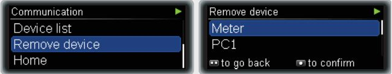
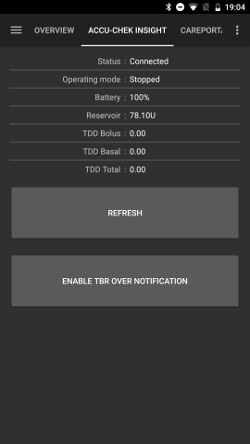

# Accu-Chek Insight

**Deze software is onderdeel van een doe-het-zelf oplossing voor een kunstmatige alvleesklier en is geen product, maar vraagt van JOU dat je het systeem leest, leert en begrijpt, ook hoe je het gebruikt. Het neemt niet je hele diabetesbehandeling van je over, maar stelt je in staat om je diabetes en je kwaliteit van leven te verbeteren, als je bereid bent de benodigde tijd erin te steken. Haast je niet, maar geef jezelf de tijd om te leren. Jij alleen bent verantwoordelijk voor wat je ermee doet.**

```{admonition} Accu-Chek Insight wordt uitgefaseerd :class: note

Roche stopt met insulinepompen om zich bij diabetes te richten op de Accu-Chek SmartGuide CGM. Roche heeft het einde van de verkoop van de Accu-Chek Combo en de Accu-Chek Insight aangekondigd. Ook de overgebleven Accu-Chek Solo micropomp wordt afgebouwd (laatste leveringen in Duitsland eind 2025). De verandering wordt per regio ingevoerd, te beginnen in Duitsland. Andere Europese markten volgen naar verwachting. Ondersteuning voor de Insight staat al als beëindigd vermeld (zie [Pompen die niet meer verkocht worden](./Future-possible-Pump-Drivers.md)). Als je van deze pomp afhankelijk bent, plan dan op tijd de overstap naar een ondersteunde pomp.

    <br />```{note}
    Voordat **AAPS** een eigen Insight driver had, werd de Insight bestuurd via de aparte app [SightRemote](https://github.com/TebbeUbben/SightRemote). SightRemote is niet meer nodig en wordt niet meer onderhouden: als je hem van toen nog geïnstalleerd hebt, verwijder hem dan en gebruik een actuele versie van **AAPS**.
    

```{contents} Inhoudsopgave :depth: 1 :local: true

    <br />## Mogelijkheden van de pomp met AAPS
    
    * Communiceert met **AAPS** via de eigen Bluetooth van je telefoon, zonder extra communicatieapparaat.
    * Automatische afhandeling van zomer-/wintertijd en tijdzone.
    
    ## Eisen aan hardware en software
    
    * Een Roche Accu-Chek Insight pomp (elke firmware, ze werken allemaal)
    
    Let op: AAPS schrijft gegevens altijd in het **eerste basaalprofiel in de pomp**.
    
    * Een Android telefoon met Android 12 of nieuwer (zie [Telefoons](../Getting-Started/Phones.md))
    * De AAPS app geïnstalleerd op je telefoon
    
    ## Instellen
    
    * De Insight pomp mag maar met één apparaat tegelijk verbonden zijn. Als je eerder de Insight afstandsbediening (meter) hebt gebruikt, moet je de meter uit de lijst met gekoppelde apparaten van je pomp verwijderen: **Menu** > **Settings** > **Communication** > **Remove device**.
    
       
    
    * Selecteer in [Configuratie > Pomp](#Config-Builder-pump) de kaart **Accu-Chek Insight**. Er kan maar één pomp tegelijk actief zijn.
    
       
    
       Als hij geselecteerd is, toont de kaart **Accu-Chek Insight** twee knoppen, **Instellingen** en **Plug-in openen**:
    
       
    
       **Instellingen** opent de instellingen van de Accu-Chek Insight driver (zie [Instellingen in AAPS](#Accu-Chek-Insight-Pump-settings-in-aaps)).
    
       **Plug-in openen** (of **Beheren → Pomp**) opent het pompscherm van de Accu-Chek Insight. Voordat er een pomp gekoppeld is, ziet het er zo uit:
    
       
    
    (accu-chek-insight-pairing)=
    ### Koppelen
    
    * Tik op het pompscherm op **Insight koppelen**. De koppelwizard opent en zoekt naar Bluetooth apparaten in de buurt (bovenaan op de afbeelding hieronder).
    * Ga op de Insight pomp naar **Menu** > **Settings** > **Communication** > **Add Device**. De pomp toont het volgende scherm (onderaan op de afbeelding hieronder) met het serienummer van de pomp.
    
       
    
    * Tik terug op je telefoon op het serienummer van de pomp in de lijst met Bluetooth apparaten. Als Android vraagt om het koppelen te bevestigen, tik dan op **Koppelen**.
    
       
    
    * De pomp en de telefoon tonen allebei een code. Controleer of de codes op beide apparaten hetzelfde zijn. Bevestig op de pomp en tik op de telefoon op **Ja**. (Tik op **Nee** als de codes niet hetzelfde zijn.)
    
       
    
    * De telefoon toont **Koppeling voltooid**. Tik op **Afsluiten** om terug te gaan naar het pompscherm.
    
       
    
    * Kijk op het pompscherm (**Beheren → Pomp**) om te controleren of alles goed is. Als de pomp gekoppeld is, toont het scherm informatie over de pomp, zoals **Serienummer**, **Fabricage datum**, **Release softwareversie** en **Bluetooth-adres**.
    
       
    
       ```{admonition} Oudere schermafbeelding
       :class: note
       Behalve het bovenste deel van de eerste afbeelding komen de schermafbeeldingen van het koppelen hierboven uit een eerdere versie van **AAPS**. In **AAPS** 4 kunnen ze er anders uitzien.
       ```
    
    * Om de koppeling te verwijderen, tik je op het pompscherm op **Ontkoppelen** en bevestig je **Koppelingsgegevens opnieuw instellen?**. Daarna verschijnt de knop **Insight koppelen** weer.
    
    Let op: er is geen vaste verbinding tussen de pomp en de telefoon. **AAPS** maakt alleen verbinding als dat nodig is (bijvoorbeeld om een tijdelijk basaal in te stellen, een bolus te geven of de pompgeschiedenis te lezen). Anders zouden de batterijen van de telefoon en de pomp veel te snel leeg zijn.
    
    (Accu-Chek-Insight-Pump-settings-in-aaps)=
    ## Instellingen in AAPS
    
    Open de instellingen met **Instellingen** op de kaart **Accu-Chek Insight** in **Configuratie** > **Pomp**, of met het tandwielicoon rechtsboven op het pompscherm.
    
    
    
    In de Insight instellingen in **AAPS** kun je de volgende opties aanzetten:
    
    * **Reservoir wissels noteren**: legt automatisch een wissel van de insulinecartridge vast als je op de pomp het programma "canule vullen" uitvoert.
    
    * **Slangwissel noteren**: voegt een notitie toe aan de **AAPS** database als je op de pomp het programma "slang vullen" uitvoert.
    
    * **Infuuswissel noteren**: voegt een notitie toe aan de **AAPS** database als je op de pomp het programma "canule vullen" uitvoert. **Let op: een infuuswissel reset ook Autosens.**
    
    * **Batterijwissel noteren**: legt een batterijwissel vast als je een nieuwe batterij in de pomp plaatst.
    
    * **Werkingsmodus-wissel noteren**: voegt een notitie toe aan de **AAPS** database als je de pomp start, stopt of pauzeert.
    
    * **Alarmen noteren**: voegt een notitie toe aan de **AAPS** database als de pomp een alarm geeft (behalve herinneringen en het annuleren van een bolus of TBR; die worden niet vastgelegd).
    
    * **TBR-emulatie inschakelen**: de Insight pomp kan tijdelijke basaalstanden (TBR's) maar tot 250% instellen. Om deze grens te omzeilen, laat TBR-emulatie de pomp een vertraagde bolus geven voor de extra insuline als er een TBR van meer dan 250% wordt gevraagd.
    
      **Let op: gebruik maar één vertraagde bolus tegelijk. Meerdere vertraagde bolussen tegelijk kunnen fouten veroorzaken.**
    
    * **Trillen uitschakelen bij handmatige bolus toediening**: zorgt dat de Insight pomp niet trilt bij een handmatige bolus (of vertraagde bolus). Alleen beschikbaar met Insight firmware 3.x.
    
    * **Trillen uitschakelen bij automatische bolus toediening**: zorgt dat de Insight pomp niet trilt bij een automatische bolus (SMB of tijdelijk basaal met TBR-emulatie). Alleen beschikbaar met Insight firmware 3.x.
    
    * **Min. herstel duur [s]** en **Max. herstel duur [s]**: hoe lang **AAPS** wacht voordat het opnieuw probeert na een mislukte poging om verbinding te maken. Je kunt een getal kiezen van 0 tot 20 seconden. Als je problemen met de verbinding hebt, kies dan een langere wachttijd.
        <br><br>Voorbeeld voor min. herstel duur = 5 en max. herstel duur = 20
        <br><br>geen verbinding -> wacht <b>5</b> sec.
          <br>  opnieuw -> geen verbinding -> wacht <b>6</b> sec.
          <br>  opnieuw -> geen verbinding -> wacht <b>7</b> sec.
          <br>  opnieuw -> geen verbinding -> wacht <b>8</b> sec.
          <br>...
          <br>opnieuw -> geen verbinding -> wacht <b>20</b> sec.
          <br>opnieuw -> geen verbinding -> wacht <b>20</b> sec.
          <br>...
    
    * **Verbindingsvertraging [s]**: hoe lang (in seconden) **AAPS** wacht voordat de verbinding met de pomp wordt verbroken nadat een actie klaar is. Je kunt een getal kiezen van 0 tot 15 seconden. De standaardwaarde is 5 seconden.
    
    Voor periodes waarin de pomp gestopt was, legt **AAPS** een tijdelijk basaal van 0% vast.
    
    ### Het pompscherm
    
    Het pompscherm van de Accu-Chek Insight (**Beheren → Pomp**) toont de huidige status van de pomp, bijvoorbeeld **Status**, **Laatste verbinding**, **Werkingsmodus**, **Batterij**, **Reservoir niveau**, de totale dagdoses van vandaag (**TDD Bolus**, **TDD Basaal**), basaalstanden en de laatste bolus. Als de pomp gekoppeld is, heeft het scherm deze knoppen:
    
    * **Vernieuwen**: vernieuwt de status van de pomp.
    * **Activeer melding van TBR eind (pomp instelling)** / **Deactiveer melding van TBR eind (pomp instelling)**: een standaard Insight pomp geeft een alarm als een TBR klaar is. Met deze knop zet je dat alarm aan of uit, zonder dat je configuratiesoftware nodig hebt.
    * **Ontkoppelen**: verwijdert de koppeling met de pomp (zie [Koppelen](#accu-chek-insight-pairing)).
    
    
    
    ```{admonition} Oudere schermafbeelding
    :class: note
    De schermafbeelding hierboven komt uit een eerdere versie van **AAPS**. In **AAPS** 4 ziet het pompscherm er anders uit en heeft het ook een knop **Ontkoppelen**.
    

## Instellingen in de pomp

Configureer alarmen in de pomp als volgt:

* Menu > Settings > Device settings > Mode settings > Quiet > Signal > Sound
* Menu > Settings > Device settings > Mode settings > Quiet > Volume > 0 (verwijder alle balken)
* Menu > Modes > Signal mode > Quiet

Hierdoor worden alle alarmen van de pomp stil, zodat AAPS kan beslissen of een alarm voor jou belangrijk is. Als AAPS een alarm niet bevestigt, wordt het alarm sterker (eerst piepen, daarna trillen).

(Accu-Chek-Insight-Pump-vibration)=

### Trilalarmen

Afhankelijk van de firmwareversie van je pomp trilt de Insight kort bij elke bolus (bijvoorbeeld als AAPS een SMB geeft of als TBR-emulatie een vertraagde bolus toedient).

* Firmware 1.x: Geen trillingen.
* Firmware 2.x: Trillingen kunnen niet worden uitgeschakeld.
* Firmware 3.x: AAPS geeft de bolus zonder trillen.

Firmwareversie is te vinden in het menu.

## Batterij vervangen

De batterij van de Insight gaat bij het loopen 10 tot 14 dagen mee, max. 20 dagen. De gebruiker die dit meldt, gebruikt lithiumbatterijen van Energizer.

De Insight pomp heeft een kleine interne batterij om essentiële functies zoals de interne klok, te kunnen laten doorgaan terwijl jij de batterij verwisselt. Als het wisselen van de batterij te lang duurt, kan deze interne batterij leegraken. Dan wordt de klok gereset en word je gevraagd een nieuwe tijd en datum in te voeren nadat je een nieuwe batterij hebt geplaatst. Als dit gebeurt, worden alle gegevens in AAPS van voor de batterijwissel niet meer meegenomen in de berekeningen, omdat de juiste tijd niet goed bepaald kan worden.

(Accu-Chek-Insight-Pump-insight-specific-errors)=

## Insight specifieke foutmeldingen

### Vertraagde bolus

Gebruik maar één vertraagde bolus tegelijk, omdat meerdere vertraagde bolussen tegelijk fouten kunnen veroorzaken.

### Time-out

Soms antwoordt de Insight pomp niet terwijl **AAPS** de verbinding opzet. **AAPS** toont dan de melding "Time-out tijdens verbinden - reset bluetooth".


Als dit gebeurt, zet dan Bluetooth op de pomp EN op de telefoon ongeveer 10 seconden uit en daarna weer aan.

## Wisselen van tijdzone met de Insight

Informatie over reizen door tijdzones vind je in de sectie [Wisselen van tijdzone met pompen](#timezone-traveling-insight).

## Waar je hulp kunt krijgen

De ontwikkeling van de Insight driver wordt door de community gedaan, op **vrijwillige** basis. Doe het volgende voordat je om hulp vraagt:

1. **Lees** het betreffende deel van deze documentatie om te controleren hoe de functie hoort te werken.
2. **Vraag** het op het kanaal *#AAPS* op [Discord](https://discord.gg/4fQUWHZ4Mw), of in een van de andere [community kanalen](../GettingHelp/WhereCanIGetHelp.md).
3. **Meld een bug**: zoek eerst in de [bestaande issues](https://github.com/nightscout/AndroidAPS/issues). Staat jouw probleem er niet bij, open dan een [nieuwe issue](https://github.com/nightscout/AndroidAPS/issues) en voeg je [logbestanden](../GettingHelp/AccessingLogFiles.md) toe.

Beschrijf als je om hulp vraagt: merk en model van je telefoon, Android versie, **AAPS** versie, en een duidelijke beschrijving van het probleem in gewone taal (wat er is veranderd, wanneer het voor het laatst werkte).