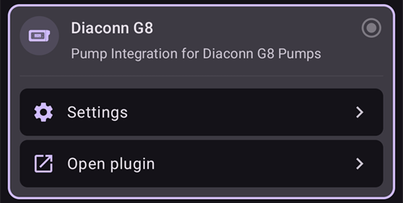
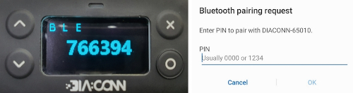

# Diaconn G8

```{contents} Table of contents
:depth: 1
:local: true
```

## Mogelijkheden van de pomp met AAPS

* Communiceert met **AAPS** via de eigen Bluetooth van je telefoon, zonder extra communicatieapparaat.
* Zomertijd en wisselingen van tijdzone moet je zelf afhandelen.

## Bluetooth-koppeling van de insulinepomp

- Tik op het **menu** (☰) linksboven.


- Tik op **Configuratie** > **Pomp** en kies **Diaconn G8**.


Als die gekozen is, toont de kaart **Diaconn G8** twee knoppen, **Instellingen** en **Plug-in openen**:



**Instellingen** opent de instellingen van de Diaconn G8-driver (zie [Instellingen van de Diaconn G8 insulinepomp](#diaconn-g8-insulin-pump-option-setting) hieronder).

**Plug-in openen** (of **Beheren** > **Pomp**) opent het pompscherm van de Diaconn G8. Voordat er een pomp gekoppeld is, ziet het er zo uit:


```{admonition} Older screenshot
:class: note
De schermafbeelding hierboven komt uit een eerdere **AAPS**-versie. In **AAPS** 4 start het koppelen met de knop **Koppelen** op het pompscherm; er is geen instelling **Geselecteerde pomp**.
```

- Tik op het pompscherm op **Koppelen**. Het scherm **Diaconn Pomp Koppeling** opent en **AAPS** zoekt naar pompen in de buurt.
- Tik op het modelnummer van je insulinepomp zodra het in de lijst staat (bijvoorbeeld **DIACONN-65010**).


- Je kunt je modelnummer op twee manieren vinden:

1. De laatste 5 cijfers van het serienummer (SN) op de achterkant van de pomp.
2. Klik op de O-knop > Information > BLE > laatste 5 cijfers.


- Als je de pomp kiest, verschijnt een venster dat om een pincode vraagt. Voer de pincode in die op je pomp staat om de verbinding te maken.

 

- Als **Succesvol gekoppeld!** verschijnt, tik je op **OK** om terug te gaan naar het pompscherm.

## Pompstatus controleren en logs synchroniseren

- Open het pompscherm (**Beheren** > **Pomp**) zodra je pomp verbonden is. Het toont de pompstatus (batterij, reservoir, laatste verbinding, laatste bolus, basaalstand en meer).
- Tik op **Vernieuwen** om verbinding te maken met de pomp, de status bij te werken en de logs te synchroniseren.
- Tik op **Historiek** om de geschiedenis te zien die uit de pomp is gelezen.


```{admonition} Older screenshot
:class: note
De schermafbeelding hierboven komt uit een eerdere **AAPS**-versie. In **AAPS** 4 staat de pompstatus op het pompscherm (**Beheren** > **Pomp**) en synchroniseer je met de knop **Vernieuwen**.
```

(diaconn-g8-bluetooth-troubleshooting)=

## Bluetooth-problemen oplossen

**Wat te doen bij een instabiele Bluetooth-verbinding met de pomp.**

### Methode 1) Start AAPS opnieuw en controleer dan de pomp opnieuw

- Tik op het **menu** (☰) linksboven.
- Tik op **Afsluiten** onderaan het menu.


- Start **AAPS** opnieuw en controleer de verbinding met de pomp.

### Methode 2) Werkt de eerste methode niet, verbreek dan de Bluetooth-verbinding en maak die opnieuw.

- Houd de Bluetooth-knop bovenaan ongeveer 3 seconden ingedrukt.


- Klik op de instellingenknop bij de gekoppelde Diaconn G8 insulinepomp.


- Ontkoppelen.


- Open in **AAPS** het pompscherm (**Beheren** > **Pomp**), tik op **Ontkoppelen** en bevestig **Koppelingsgegevens opnieuw instellen?**.
- Koppel de pomp opnieuw via Bluetooth (zie hierboven).

## Meer informatie

(diaconn-g8-insulin-pump-option-setting)=

### Instellingen van de Diaconn G8 insulinepomp

- **Configuratie** > **Pomp** > **Diaconn G8** > **Instellingen**
- Of tik op het pompscherm (**Beheren** > **Pomp**) op het instellingenicoon (tandwiel) rechtsboven.


- **Bolus snelheid** bepaalt hoe snel de pomp een bolus toedient.
- Als de optie **Reservoir wissel vastleggen** aan staat, worden de gegevens automatisch naar de careportal geüpload bij een gebeurtenis "Insulin Change" (insulinewissel).
- Als de optie **Canulewissel noteren** aan staat, worden de gegevens automatisch naar de careportal geüpload bij een gebeurtenis "Site Change" (infuuswissel).
- Als de optie **Slangwissel noteren** aan staat, worden de gegevens automatisch als notitie toegevoegd bij een gebeurtenis "Tube Change" (slangwissel).
- Als de optie **Batterijwissel noteren** aan staat, worden de gegevens automatisch naar de careportal geüpload bij een gebeurtenis "Battery Change" (batterijwissel). Je kunt een batterijwissel ook zelf vastleggen met **Beheren** > **Pomp bat. wissel**. (Let op: stop alle lopende toedieningen voordat je de batterij vervangt.)
- **Diaconn Cloud Sync** stuurt de pomplogs naar de Diaconn Cloud.


```{admonition} Older screenshot
:class: note
De schermafbeelding hierboven komt uit een eerdere **AAPS**-versie. In **AAPS** 4 leg je een batterijwissel vast met **Beheren** > **Pomp bat. wissel**; er is geen tabblad **Acties**.
```

### Functie vertraagde bolus

- Als je een vertraagde bolus gebruikt, wordt de gesloten loop uitgeschakeld.
- Zie [deze pagina](#extended-bolus-and-why-they-wont-work-in-closed-loop-environment) voor de reden waarom een vertraagde bolus niet werkt in een gesloten loop.

## Waar je hulp kunt krijgen

De Diaconn G8-driver wordt door de community ontwikkeld, op **vrijwillige** basis. Doe het volgende voordat je om hulp vraagt:

1. **Lees** het betreffende deel van deze documentatie om na te gaan hoe de functie hoort te werken.
2. **Vraag** het in het kanaal *#AAPS* op [Discord](https://discord.gg/4fQUWHZ4Mw), of in een van de andere [community-kanalen](../GettingHelp/WhereCanIGetHelp.md).
3. **Meld een bug**: zoek eerst in de [bestaande issues](https://github.com/nightscout/AndroidAPS/issues); staat jouw probleem er niet bij, open dan een [nieuwe issue](https://github.com/nightscout/AndroidAPS/issues) en voeg je [logbestanden](../GettingHelp/AccessingLogFiles.md) toe.

Vermeld bij een hulpvraag het merk en model van je telefoon, de Android-versie, de **AAPS**-versie en een duidelijke beschrijving van het probleem (wat is er veranderd, wanneer werkte het voor het laatst).
