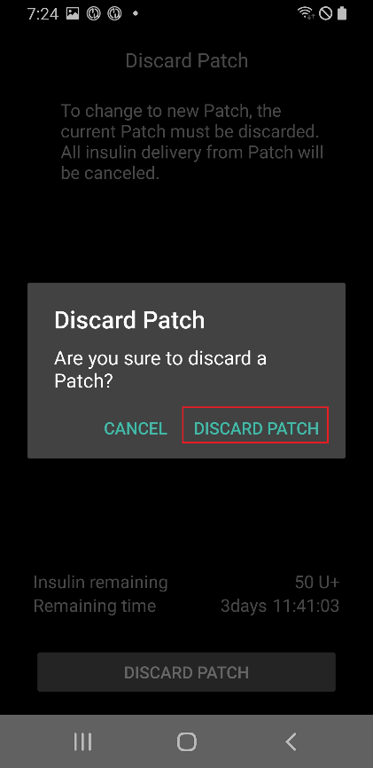
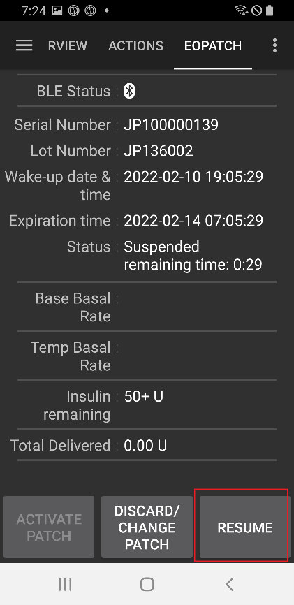

# EOPatch2

De patch heeft snelwerkende U-100-insuline nodig, zoals NovoRapid of Humalog. Gebruik de snelwerkende insuline die je arts je heeft voorgeschreven.

De kleinste dosis die de patch kan geven is 0,05 E. Stel elke basaalstand in je **Profiel** in op minstens 0,05 E/u, in stappen van 0,05 E/u. Anders rondt **AAPS** elke stand af op de dichtstbijzijnde 0,05 E/u (nooit omlaag naar 0) en gebruikt het de standen die de patch echt geeft, zodat de totale insuline per dag iets afwijkt van je **Profiel**. Ook een bolus moet minstens 0,05 E zijn.

```{contents} Table of contents
:depth: 1
:local: true
```

## Mogelijkheden van de pomp met AAPS

* Communiceert met **AAPS** via de eigen Bluetooth van je telefoon, zonder extra communicatieapparaat.
* Zomertijd en wisselingen van tijdzone moet je zelf afhandelen.

## Pomp instellen

1. Open het **menu** (☰) linksboven op het hoofdscherm van **AAPS** en kies **Configuratie**.
1. Kies in het deel **Pomp** de **EOPatch2**.
1. Druk op de terugtoets om terug te gaan naar het hoofdscherm.

 

Als die gekozen is, toont de kaart **EOPatch2** twee knoppen, **Instellingen** en **Plug-in openen**:


## Instellingen

Je opent de EOPatch2-instellingen op een van deze twee manieren:

* druk op **Instellingen** op de kaart **EOPatch2** in **Configuratie**, of
* open het pompscherm (**Beheren** → **Pomp**) en druk op het tandwiel rechtsboven.

Er zijn drie instellingen:


### Laag reservoir waarschuwing

Er verschijnt een waarschuwing als de insuline in de patch tot deze hoeveelheid of minder daalt. Je kunt dit instellen van 10 tot 50 E, in stappen van 5 E. De standaardwaarde is 10 E.

### Patch houdbaarheid herinnering

Herinnert je eraan hoeveel tijd er nog is voordat de huidige patch verloopt. Je kunt dit instellen van 1 tot 24 uur, in stappen van 1 uur. De standaardwaarde is 4 uur.

### Patch buzzer herinneringen

Als dit aan staat, piept de patch als een bolus, vertraagde bolus of tijdelijk basaal start en als die eindigt. Het heeft geen invloed op je normale basaal. Standaard staat dit uit.

## Een nieuwe patch activeren

### De activeringswizard openen

Open het pompscherm met **Beheren** → **Pomp** (of druk op **Plug-in openen** op de kaart **EOPatch2** in **Configuratie**). Als er geen patch actief is, toont het scherm **Niet geactiveerd** en onderaan een knop **Activeer Patch**.

Druk op **Activeer Patch** om de wizard te starten.


De wizard leidt je door elke stap. De rij puntjes bovenaan laat zien hoe ver je bent.

```{note}
Als je in **AAPS** nog nooit een **Profiel** hebt geactiveerd, toont de wizard eerst een pagina **Profiel vereist**. Kies het profiel dat je wilt gebruiken en druk op **Activeer profiel**.
```

### Insuline vullen

Steek de naald van de spuit in de vulopening voor insuline op de patch. Duw de zuiger langzaam in om de patch te vullen. Zodra er meer dan 80 E in de patch zit, piept hij één keer en start hij op.

Als je de piep hoort, druk je op **Begin met koppelen**.


```{warning}
- Draai de hendel voor de naald niet voordat de wizard je dat zegt. Als je hem te vroeg draait, kan dat ernstige problemen geven tijdens het vullen of de veiligheidscontrole.
- De patch bevat 80 tot 200 E. Als je er minder dan 80 E in doet, werkt de patch niet.
- Haal de insuline 15 tot 30 minuten voor het vullen uit de koelkast, zodat die op kamertemperatuur komt. De insuline moet minstens 10°C zijn.
```

### Patch koppelen

**AAPS** probeert nu automatisch met de patch te koppelen. Tijdens het koppelen verschijnen twee Bluetooth-koppelverzoeken van Android. Druk bij het eerste op **OK**. Druk bij het tweede, dat een toegangscode toont, opnieuw op **OK**.

```{warning}
- Houd de patch en je telefoon tijdens het koppelen binnen 30 cm van elkaar.
- Nadat de patch is opgestart, piept hij elke 3 minuten tot het koppelen klaar is.
- Je moet de patch binnen 60 minuten na het opstarten volledig activeren. Lukt dat niet, verwijder de patch dan.
```

  

```{admonition} Older screenshot
:class: note
De twee schermafbeeldingen van het Bluetooth-koppelen komen uit een oudere versie van **AAPS**: het **AAPS**-scherm achter het koppelverzoek van Android ziet er in **AAPS** 4 anders uit.
```

### Selecteer insuline

Kies de insuline waarmee je de patch hebt gevuld en druk op **Volgende**. **AAPS** doet na de activering een profielwissel met deze insuline.

### Bereid je voor om patch aan te brengen

Verwijder de plakstrip van de patch en druk dan op **Volgende**.

Als er een naald uitsteekt, of als de patch nat of vuil is of de plakstrip gevouwen is, druk dan in plaats daarvan op **Verwijder** en gebruik een nieuwe patch.


### Plaatsingsplek

Deze stap verschijnt alleen als **Plaatsingslocatie pomp beheren** aan staat in de instellingen voor site rotatie. Tik op de plek op de lichaamsfiguur waar je de patch gaat plakken en druk op **Volgende**, of druk op **Overslaan**.

### Patch aanbrengen

Insuline moet in een plek met vetweefsel onder de huid, met weinig zenuwen of bloedvaten. De buik, arm of dij zijn goede keuzes. Maak de plek schoon en droog, en plak dan de patch op je huid.

Controleer de infuusplaats en druk dan op **Start veiligheidscontrole**.

```{warning}
- Druk de randen van de plakstrip gelijkmatig aan, zodat de hele patch stevig op je huid plakt.
- Als de patch niet helemaal plakt, kan er lucht tussen de patch en je huid komen. Dat maakt de plakkracht en de waterbestendigheid van de patch zwakker.
```


### Veiligheidscontrole

De veiligheidscontrole duurt ongeveer 30 seconden. Als die klaar is, piept de patch één keer. Als die mislukt, druk je op **Opnieuw**.

```{warning}
Draai voor veilig gebruik de hendel voor de naald niet voordat de veiligheidscontrole klaar is.
```

 

```{admonition} Older screenshot
:class: note
De schermafbeeldingen van **Bereid je voor om patch aan te brengen** tot **Veiligheidscontrole** komen uit een oudere versie van **AAPS** en kunnen er in **AAPS** 4 anders uitzien.
```

### De naald inbrengen

Houd de patch stevig vast. Draai de hendel voor de naald meer dan 100° omhoog om de naald in te brengen. De patch piept één keer als de naald goed is ingebracht. Draai de hendel daarna helemaal door om hem te verwijderen. Druk op **Volgende**.

```{caution}
Als je naar de volgende stap gaat zonder de piep te horen, verschijnt **Naald inbreng fout**. Let op de piep en druk op **Opnieuw**. Blijft de fout, druk dan op **Verwijder** om de patch te deactiveren.
```

### Patch activering voltooid

De laatste pagina bevestigt dat de patch actief is en dat hij je waarschuwt als het einde van de gebruiksduur nadert. Druk op **Voltooien** om terug te gaan naar het pompscherm.

## De patch verwijderen

Vervang de patch als de insuline bijna op is, als hij verloopt of als hij defect is. We raden aan om elke patch niet langer dan 84 uur na het opstarten te gebruiken.

1. Open het pompscherm (**Beheren** → **Pomp**). Druk, terwijl er een patch actief is, op **Patch verwijderen**.
1. De pagina **Patch verwijderen** toont de resterende tijd en de resterende insuline in de patch. Druk op **Patch verwijderen**.
1. Een venster vraagt je om te bevestigen. Druk opnieuw op **Patch verwijderen**.
1. Als de patch gedeactiveerd is, toont de wizard **Het verwijderen van de patch is voltooid.** Haal de patch van je lichaam en druk op **Bevestigen**.

Daarna gaat de wizard direct verder met het activeren van een nieuwe patch (zie hierboven). Druk op de pijl terug als je hier wilt stoppen.

Zolang er geen patch actief is, toont **AAPS** de pomp als onderbroken en legt het een tijdelijk basaal van 0 E/u vast, zodat er geen basale insuline in de IOB wordt meegeteld tot de volgende patch geactiveerd is.

   

```{admonition} Older screenshot
:class: note
De schermafbeeldingen hierboven komen uit een eerdere versie van **AAPS**. In **AAPS** 4 open je het pompscherm via **Beheren** → **Pomp**, en de knop daarop heet **Patch verwijderen**.
```

```{admonition} If the patch does not respond
:class: warning
Als **AAPS** de patch niet kan bereiken, kan het een pagina tonen over het met de hand uitzetten van het alarm van de patch: haal de patch van je lichaam, trek de plakstrip eraf en druk met een paperclip stevig in het gaatje naast de vulopening voor insuline.

De pagina **Patch verwijderen** heeft ook een knop **Forceer een reset**. Die verwijdert de patch alleen uit **AAPS**, zonder een commando naar de patch te sturen. De patch blijft insuline geven tot de batterij leeg is of tot je hem met de hand uitzet. Gebruik dit alleen als het normale verwijderen mislukt, en haal de patch van je lichaam.
```

## Insulinetoediening onderbreken en hervatten

Als je de insulinetoediening onderbreekt, wordt ook een lopende vertraagde bolus en tijdelijk basaal geannuleerd. Als je hervat, worden die **niet** opnieuw gestart. Zolang de insulinetoediening onderbroken is, piept de patch elke 15 minuten.

### Insulinetoediening onderbreken

1. Open het pompscherm (**Beheren** → **Pomp**) en druk op **Onderbreek pomp**.
1. Een venster legt uit wat er onderbroken wordt. Druk op **Bevestigen**.
1. Kies in het venster **Periode uitstel basaal** hoe lang je wilt onderbreken: 30 min, 1 uur, 1 uur 30 min of 2 uur. Druk op **Bevestigen**.

De insulinetoediening wordt onderbroken voor de tijd die je hebt gekozen.

  

```{admonition} Older screenshot
:class: note
De schermafbeeldingen hierboven komen uit een eerdere versie van **AAPS**. In **AAPS** 4 open je het pompscherm via **Beheren** → **Pomp**, en de knop daarop heet **Onderbreek pomp**.
```

### Insulinetoediening hervatten

1. Open het pompscherm (**Beheren** → **Pomp**) en druk op **Hervat pomp**.
1. Druk in het venster **Insuline toediening hervatten** op **Bevestigen**.

 

```{admonition} Older screenshot
:class: note
De schermafbeeldingen hierboven komen uit een eerdere versie van **AAPS**. In **AAPS** 4 open je het pompscherm via **Beheren** → **Pomp**, en de knop daarop heet **Hervat pomp**.
```

```{warning}
Als de onderbrekingstijd voorbij is, toont **AAPS** de waarschuwing **Einde van insuline onderbreking**. De insulinetoediening start **niet** opnieuw tot je dat bevestigt. Doe je dat niet, dan kan je bloedglucose te hoog worden (hyperglykemie).
```

(eopatch2-alarms-and-warnings)=

## Alarmen en waarschuwingen

### Alarmen

Alarmen zijn voor dringende situaties met de hoogste prioriteit en vragen direct actie van jou. **AAPS** laat een alarm klinken dat doorgaat tot je het bevestigt, en toont het bericht als melding op het scherm **Overzicht**. Een alarm betekent dat er een probleem is met de patch die je gebruikt. In veel gevallen moet de patch worden verwijderd en vervangen door een nieuwe.

Als je op de melding op **Bevestigen** drukt, handelt **AAPS** het alarm af. Bij de meeste alarmen wordt de patch daarbij gedeactiveerd. Bij het alarm **Ongeschikte temperatuur** is de knop **Opnieuw**.

 

```{admonition} Older screenshot
:class: note
De schermafbeeldingen van alarmen komen uit een oudere versie van **AAPS** en kunnen er in **AAPS** 4 anders uitzien.
```

De verschillende alarmen worden hieronder uitgelegd.

| Alarm                              | Uitleg                                                                                                                                                               |
| ---------------------------------- | -------------------------------------------------------------------------------------------------------------------------------------------------------------------- |
| Leeg reservoir                     | De insuline in de patch is op.                                                                                                                                       |
| Patch verlopen                     | De gebruiksduur van de patch is voorbij, en hij kan geen insuline meer geven.                                                                                        |
| Verstopping                        | De insulinedoorgang van de patch lijkt verstopt.                                                                                                                     |
| Zelftest tijdens opstarten mislukt | De patch vond een onverwachte fout tijdens de zelftest na het opstarten.                                                                                             |
| Ongeschikte temperatuur            | De patch is buiten zijn normale werktemperatuur terwijl je hem activeert of gebruikt. Breng de patch naar een plek met een geschikte temperatuur (4,4 tot 37°C).     |
| Naald inbreng fout                 | De naald is tijdens het activeren niet goed ingebracht. Controleer of de rand van de patch waar de naald ingaat en de hendel voor de naald op één rechte lijn staan. |
| Patch batterij fout                | De interne batterij van de patch is bijna leeg en de patch gaat uit.                                                                                                 |
| Patch activatie fout               | De patch is niet binnen 60 minuten na het opstarten volledig geactiveerd.                                                                                            |
| Patch fout                         | De patch vond een onverwachte fout tijdens het activeren of het gebruik.                                                                                             |

### Waarschuwingen

Waarschuwingen zijn voor situaties met gemiddelde of lage prioriteit. Een waarschuwing verschijnt als melding op het scherm **Overzicht**.


```{admonition} Older screenshot
:class: note
Deze schermafbeelding komt uit een oudere versie van **AAPS**: in **AAPS** 4 verschijnt de waarschuwing op het hoofdscherm, dat er anders uitziet.
```

De verschillende waarschuwingen worden hieronder uitgelegd.

| Waarschuwing                    | Uitleg                                                                                                                                   |
| ------------------------------- | ---------------------------------------------------------------------------------------------------------------------------------------- |
| Einde van insuline onderbreking | De onderbrekingstijd die je hebt gekozen is voorbij. Druk op de melding op **Hervat pomp** om de insulinetoediening opnieuw te starten.  |
| Laag reservoir                  | De insuline in de patch is minder dan de hoeveelheid die is ingesteld bij **Laag reservoir waarschuwing**.                               |
| Patch levensduur verlopen       | De gebruiksperiode van de patch is voorbij.                                                                                              |
| Patch vervalt binnenkort        | De patch moet binnen 1 uur worden verwijderd.                                                                                            |
| Onvolledige Patch activatie     | Het activeren van de patch is na het koppelen meer dan 3 minuten onderbroken. Open het pompscherm en maak het activeren van de patch af. |
| Patch batterij bijna leeg       | De batterij van de patch is bijna leeg.                                                                                                  |

## Waar je hulp kunt krijgen

De EOPatch2-driver wordt door de community ontwikkeld, op **vrijwillige** basis. Doe het volgende voordat je om hulp vraagt:

1. **Lees** het betreffende deel van deze documentatie om na te gaan hoe de functie hoort te werken.
2. **Vraag** het in het kanaal *#AAPS* op [Discord](https://discord.gg/4fQUWHZ4Mw), of in een van de andere [community-kanalen](../GettingHelp/WhereCanIGetHelp.md).
3. **Meld een bug**: zoek eerst in de [bestaande issues](https://github.com/nightscout/AndroidAPS/issues); staat jouw probleem er niet bij, open dan een [nieuwe issue](https://github.com/nightscout/AndroidAPS/issues) en voeg je [logbestanden](../GettingHelp/AccessingLogFiles.md) toe.

Vermeld bij een hulpvraag het merk en model van je telefoon, de Android-versie, de **AAPS**-versie en een duidelijke beschrijving van het probleem (wat is er veranderd, wanneer werkte het voor het laatst).
