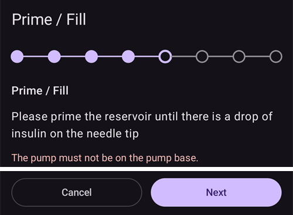
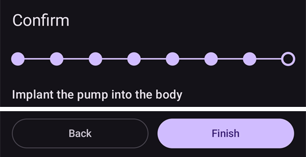

# Equil

Deze instructies gaan over het instellen van de Equil insulinepomp.

```{contents} Table of contents
:depth: 1
:local: true
```

## Mogelijkheden van de pomp met AAPS

* Patchpomp zonder slang die met **AAPS** communiceert via de eigen Bluetooth van je telefoon, zonder extra communicatieapparaat.
* **AAPS** behandelt de Equil als patchpomp met een reservoir van 200 E: het hoofdscherm toont de statuslampjes voor een patchpomp, en **Prime/Vul** en **Pomp bat. wissel** worden niet aangeboden. Vullen, voorvullen en de batterij vervangen doe je in de wizards van de pomp.
* Zolang de pomp onderbroken of gestopt is, legt **AAPS** een tijdelijk basaal van 0 E/u vast, zodat er geen basale insuline in de IOB wordt meegeteld.
* Zomertijd en wisselingen van tijdzone moet je zelf afhandelen.

## Benodigde hardware en software
* **Geschikte Equil-hardware**

  Op dit moment worden Equil 5.3 en 5.4 ondersteund.

* **AAPS** gebouwd en geïnstalleerd volgens de instructies in [APK bouwen](../SettingUpAaps/BuildingAaps.md)

## Instellen

### Equil-pomp kiezen

Open het **menu** (☰) linksboven, kies **[Configuratie](#Config-Builder-pump)** en kies onder **Pomp** de **Equil**.

Als die gekozen is, toont de kaart **Equil** twee knoppen, **Instellingen** en **Plug-in openen**:


**Plug-in openen** (of **Beheren** → **Pomp**) opent het pompscherm van de Equil. Voordat er een pomp gekoppeld is, ziet het er zo uit:


### Instellingen

Open de Equil-instellingen met **Instellingen** op de kaart **Equil**, of met het tandwiel rechtsboven op het pompscherm.


* **Alarm bij bijna lege batterij**: waarschuwt je als de batterij van de pomp bijna leeg is.
* **Alarm bij bijna leeg reservoir**: waarschuwt je als er weinig insuline in het reservoir zit.
* **Alarmtoon**: hoe de pomp je waarschuwt: **Dempen**, **Alleen trillen**, **Alleen toon** of **Trillen en geluid**.
* **Bolussnelheid**: hoe snel een bolus wordt gegeven: **1,5 E/min (standaard)**, **3 E/min**, **6 E/min** of **12 E/min**. Een snellere bolus kan vaker occlusiealarmen geven.


```{admonition} Max basal and max bolus on the patch
:class: note
De patch zelf weigert elke basaalstand boven een maximum dat **AAPS** erin programmeert. **AAPS** neemt de hoogste waarde van je **max basaal**-[instelling](../SettingUpAaps/Preferences.md) en de hoogste basaalstand per uur in je **Profiel**, zodat de patch altijd je profiel accepteert en ook de tijdelijke basaalstanden die de loop vraagt. **AAPS** stuurt ook je maximaal toegestane bolus naar de patch.

Als je je **max basaal** of **max bolus** wijzigt, stuurt **AAPS** de nieuwe waarden automatisch naar de patch. Ze worden ook bij elke profielwissel verstuurd. Op de patch zelf hoef je niets in te stellen.
```

### De pomp koppelen

Druk op het pompscherm op **Koppel**. Een wizard leidt je door elke stap. De rij puntjes bovenaan laat zien hoe ver je bent.

Als Android vraagt of **AAPS** apparaten in de buurt mag vinden en ermee mag verbinden, druk dan op **Toestaan**. **AAPS** heeft dit nodig om de pomp te vinden.


De wizard heeft deze stappen. Druk op **Volgende** om verder te gaan, of op **Annuleren** om de wizard te verlaten.

1. **Profiel vereist**: verschijnt alleen als je in **AAPS** nog nooit een **Profiel** hebt geactiveerd. Kies het profiel dat je wilt gebruiken en druk op **Activeer profiel**.
1. **Montage pomp**: zet de pomp, het gevulde reservoir en de opgeladen batterij in elkaar.

   

1. **Pomp zoeken**: **AAPS** zoekt naar Equil-pompen in de buurt. Kies je pomp uit de lijst.

   
1. **Apparaat koppelen**: je kunt een koppelwachtwoord invoeren bij **Instellen koppelwachtwoord**. Het moet 4 tekens lang zijn, gekozen uit `ABCDEF0123456789`. Druk op **Koppel**.

   

1. **Selecteer insuline**: verschijnt alleen als je meer dan één insuline hebt ingesteld. Kies de insuline die in het reservoir zit.
1. **Prime / Vullen**: de pomp mag **niet** op de basisplaat zitten. Druk op **Ontlucht/Vul** en vul het reservoir voor tot er een druppel insuline aan de punt van de naald hangt. Druk op **Volgende**.

   
1. **Site rotatie**: verschijnt alleen als **Plaatsingslocatie pomp beheren** aan staat in de instellingen voor site rotatie. Tik op de plek waar je de pomp gaat plakken, of druk op **Overslaan**.
1. **Pomp aanbrengen**: zet de pomp vast op de basisplaat.

   
1. **Canule vullen**: zodra de pomp op de basisplaat zit, druk je op **Verwijder lucht** om de lucht uit de canule te halen. Druk op **Volgende**.

   

1. **Bevestigen**: plak de pomp op je lichaam en druk op **Voltooien**.

   

```{warning}
Als je een eigen koppelwachtwoord instelt (aanbevolen voor je veiligheid), bewaar het dan op een veilige plek. Het wachtwoord wordt in de pomp opgeslagen. De pomp vraagt erom bij elke nieuwe koppeling, tot je hem op de juiste manier ontkoppelt in **AAPS**. Tot dan kun je de pomp ook niet gebruiken met de originele handbediening (PDA).
```

### Pompscherm na het koppelen

Als de pomp gekoppeld is, toont het pompscherm deze knoppen:

* **Vernieuwen**: leest nu de status en de geschiedenis van de pomp.
* **Onderbreken** / **Insulinetoediening hervatten**: stopt de insulinetoediening of start die opnieuw.
* **Vervang reservoir**: leidt je door het losmaken van de pomp, het plaatsen van een nieuw reservoir (en zo nodig een nieuwe batterij), het voorvullen en het opnieuw aanbrengen. De eerste stap vraagt *Plaatst u ook een nieuwe infusieset (basisplaat en canule)?*
  * **Ja, een nieuwe infusieset**: je kiest de plek, de canule wordt gevuld en **AAPS** legt een insulinewissel en een canulewissel vast.
  * **Nee, alleen een reservoir of batterij**: de canule wordt niet gevuld en **AAPS** legt alleen een insulinewissel vast.

  Na een reservoirwissel toont het batterijniveau **-** tot **AAPS** het opnieuw uit de pomp leest.

  

* **Geschiedenis**: toont de gebeurtenissen die de pomp heeft vastgelegd.
* **Apparaat ontkoppelen**: leidt je door het losmaken van de pomp en het ontkoppelen van **AAPS**. Dit stopt de insulinetoediening, zet de zuiger van de pomp terug naar de bodem en wist de koppeling.

### Alarmen

* Het alarm voor weinig insuline klinkt één keer bij elk niveau (10 E, 5 E en 2 E) en als het reservoir leeg is. Het alarm voor een bijna lege batterij klinkt één keer bij 10% en één keer bij 5%. Elk niveau geeft maar één keer alarm, tot de volgende reservoirwissel.
* Alarmen en stops van de pomp worden ook als mededeling in de behandelingen vastgelegd, op het tijdstip waarop de pomp ze registreerde, zodat je later kunt zien wanneer en waarom de pomp stopte.
* Als het reservoir leegraakt tijdens een bolus, legt **AAPS** alleen de insuline vast die tot dan is gegeven, en toont je beide hoeveelheden.

## Waar je hulp kunt krijgen

De Equil-driver wordt door de community ontwikkeld, op **vrijwillige** basis. Doe het volgende voordat je om hulp vraagt:

1. **Lees** het betreffende deel van deze documentatie om na te gaan hoe de functie hoort te werken.
2. **Vraag** het in het kanaal *#AAPS* op [Discord](https://discord.gg/4fQUWHZ4Mw), of in een van de andere [community-kanalen](../GettingHelp/WhereCanIGetHelp.md).
3. **Meld een bug**: zoek eerst in de [bestaande issues](https://github.com/nightscout/AndroidAPS/issues); staat jouw probleem er niet bij, open dan een [nieuwe issue](https://github.com/nightscout/AndroidAPS/issues) en voeg je [logbestanden](../GettingHelp/AccessingLogFiles.md) toe.

Vermeld bij een hulpvraag het merk en model van je telefoon, de Android-versie, de **AAPS**-versie en een duidelijke beschrijving van het probleem (wat is er veranderd, wanneer werkte het voor het laatst).
