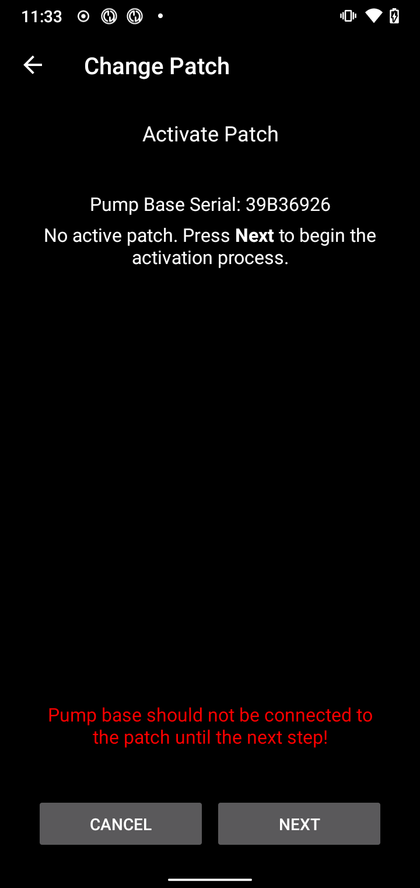
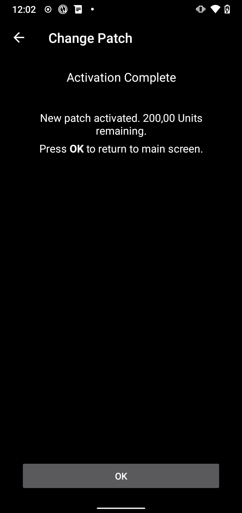

(medtrum-nano-300u)=
# Medtrum Nano 200U / 300U

Deze instructies zijn voor het instellen van de Medtrum-insulinepomp.

```{contents} Table of contents
:depth: 1
:local: true
```

## Mogelijkheden van de pomp met AAPS
* Alle loop functionaliteiten ondersteund (SMB, TBR enz.)
* Automatische afhandeling van zomertijd en tijdzone
* Vertraagde bolus wordt niet ondersteund door het AAPS stuurprogramma

## Benodigde hardware en software
* **Compatibele Medtrum-pompbasis en reservoirpatches**
    - Momenteel ondersteund:
        - Medtrum TouchCare Nano 200U met pompbasis referentie: **MD0201** en **MD8201**.
        - Medtrum TouchCare 300U met pompbasis referentie: **MD8301**.
        - Heb je een model dat niet wordt ondersteund en wil je hardware doneren of helpen met testen? Neem dan contact met ons op via Discord, [hier](https://discordapp.com/channels/629952586895851530/1076120802476441641).
* **AAPS gebouwd en geïnstalleerd** volgens de instructies in [APK bouwen](../SettingUpAaps/BuildingAaps.md).
* **Compatibele Android-telefoon** met een BLE Bluetooth-verbinding
    - Zie de AAPS [Release Notes](../Maintenance/ReleaseNotes.md)

## Voordat je begint

**VEILIGHEID VOOROP** Begin niet aan dit proces in een situatie waarin je een fout niet kunt herstellen (extra patches, insuline en apparaten om de pomp te bedienen zijn een must).

**De PDM en de Medtrum-app werken niet met een patch die door AAPS is geactiveerd.** Misschien gebruikte je eerder je PDM of de Medtrum-app om opdrachten naar je pomp te sturen. Om veiligheidsredenen kun je de geactiveerde patch alleen gebruiken met het apparaat of de app waarmee hij is geactiveerd.

*Dit betekent NIET dat je je PDM moet weggooien. We raden aan om de PDM op een veilige plek te bewaren als back-up voor noodgevallen, bijvoorbeeld als je je telefoon verliest of als AAPS niet goed werkt.*

**Je pomp stopt niet met het afgeven van insuline als hij niet met AAPS verbonden is** De standaard basaalstanden staan in de pomp, zoals ingesteld in het huidige actieve profiel. Zolang AAPS actief is, zal het tijdelijke basaalstanden sturen die maximaal 120 minuten lopen. Als de pomp om een of andere reden geen nieuwe opdrachten krijgt (bijvoorbeeld omdat de verbinding is verbroken door de afstand tussen pomp en telefoon), gaat de pomp terug naar de standaard basaalstand die in de pomp staat, zodra de tijdelijke basaalstand afloopt.

**Het AAPS-profiel ondersteunt geen basaalstanden die op het halve uur beginnen** Ben je nieuw met AAPS en stel je je basaalprofiel voor het eerst in? Let op: basaalstanden die op een half uur beginnen worden niet ondersteund. Je moet je basaalprofiel aanpassen zodat elke stand op het hele uur begint. Bijvoorbeeld: je hebt een basaalstand van 1,1 eenheden die om 09:30 begint en 2 uur duurt, dus eindigt om 11:30. Dit werkt niet. Je moet deze basaalstand van 1,1 eenheden veranderen naar een tijdsperiode van 9:00–11:00 of 10:00–12:00. Hoewel de hardware van de Medtrum-pomp zelf stappen van 30 minuten in het basaalprofiel ondersteunt, kan AAPS hier in de huidige algoritmen geen rekening mee houden.

**Basaalstanden van 0 E/u in het profiel worden NIET ondersteund in AAPS** De Medtrum-pomp ondersteunt wel een basaalstand van nul, maar AAPS gebruikt veelvouden van de basaalstand uit het profiel om automatische behandelingen te bepalen. Daarom kan AAPS niet werken met een basaalstand van nul. De laagste basaalstand in het profiel is 0,05 E/u.

Een tijdelijke basaalstand van nul kun je instellen met de functie "Verbreek verbinding met de pomp", of met een combinatie van Loop deactiveren/Tijdelijke basaalstand of Onderbreek loop/Tijdelijke basaalstand.

## Instellen

```{caution}
Als je een patch met **AAPS** activeert, **MOET** je elk ander apparaat uitzetten dat met de Medtrum-pompbasis kan praten, bijvoorbeeld een actieve PDM of de Medtrum-app.
```

### Stap 1: Selecteer de Medtrum-pomp

#### Optie 1: Nieuwe installaties

Installeer je **AAPS** voor de eerste keer? Dan leidt de **Setup Wizard** je door de installatie. Kies **Medtrum** als je bij de stap **Pomp** komt.

Twijfel je? Dan kun je ook **Virtuele Pomp** kiezen en later **Medtrum** selecteren, nadat je **AAPS** hebt ingesteld (zie optie 2).


#### Optie 2: Het scherm Configuratie

Bij een bestaande installatie kun je de **Medtrum**-pomp kiezen in [Configuratie > Pomp](#Config-Builder-pump):

Open het **menu** (☰) linksboven, tik op **Configuratie** > **Pomp** en kies de kaart **Medtrum**. Er kan maar één pomp tegelijk actief zijn.


Als hij gekozen is, toont de kaart **Medtrum** twee knoppen: **Instellingen** en **Plug-in openen**:


**Plug-in openen** (of **Beheren → Pomp**) opent het Medtrum-pompscherm. Hier wissel je patches en zie je de status van de pomp. Voordat een patch is geactiveerd, ziet het scherm er zo uit:


(medtrum-step-2)=
### Stap 2: Wijzig de Medtrum-instellingen

Tik op **Instellingen** op de kaart **Medtrum** in **Configuratie** > **Pomp**. Je kunt ook op het tandwiel rechtsboven in het Medtrum-pompscherm tikken. Dit opent de **Medtrum pomp instellingen**:


```{note}
Er is geen instelling **Serienummer** meer. **AAPS** zoekt je pompbasis met een Bluetooth-scan de eerste keer dat je een patch activeert (zie [Stap 3](#medtrum-activate-patch)), en onthoudt het serienummer. Wil je een andere pompbasis gebruiken? Zie dan [Ontkoppelen](#medtrum-unpair).
```

#### Alarminstellingen

***Standaard: Pieptoon.***

Deze instelling bepaalt hoe de pomp je waarschuwt bij een waarschuwing of fout.

- **Pieptoon**: de patch piept bij alarmen en waarschuwingen.
- **Stil**: de patch waarschuwt je niet bij alarmen en waarschuwingen.

Let op: in de stille modus laat **AAPS** het alarm nog steeds horen, afhankelijk van de volume-instellingen van je telefoon. Als je niet op het alarm reageert, gaat de patch na een tijd toch piepen.

#### Notificatie bij pomp waarschuwing

***Standaard: ingeschakeld.***

Deze instelling bepaalt hoe **AAPS** meldingen toont voor niet-kritische pompwaarschuwingen. Als dit aan staat, toont de telefoon een melding bij een pompwaarschuwing, onder andere:
- Batterij bijna leeg
- Reservoir bijna leeg (20 eenheden)
- Patch verloopt binnenkort

We raden aan dit aan te laten als de pompalarmen op **Stil** staan. In beide gevallen staan deze waarschuwingen ook op het Medtrum-pompscherm onder [Actieve alarmen](#medtrum-active-alarms).

(medtrum-patch-expiration)=
#### Patch vervalt

***Standaard: ingeschakeld.***

Deze instelling wijzigt het gedrag van de patch. Als dit aan staat, verloopt de patch na 3 dagen en geeft hij een hoorbare waarschuwing als het geluid aan staat. Na 3 dagen en 8 uur stopt de patch met werken.

Als deze instelling uit staat, waarschuwt de patch je niet voordat hij stopt. Met recente firmware van de pompbasis werkt een patch maximaal 5 dagen.

#### Waarschuwing vervallen pomp [uren]

***Standaard: 72 uur.***

Deze instelling bepaalt het tijdstip van de waarschuwing dat de patch verloopt. Als [Patch vervalt](#medtrum-patch-expiration) aan staat, toont **AAPS** dit aantal uren na de activatie een melding.

#### Maximale insuline per uur [Eenheden]

***Standaard: 25 E.***

Deze instelling wijzigt de maximale hoeveelheid insuline die in één uur kan worden toegediend. Als deze grens wordt overschreden, onderbreekt de patch de toediening en geeft hij een alarm. Je kunt het alarm resetten met de knop **Reset alarmen** op het pompscherm, zie [Reset alarmen](#nano-reset-alarms).

Stel dit in op een waarde die past bij jouw insulinebehoefte.

#### Maximale insuline per dag [Eenheden]

***Standaard: 80 E.***

Deze instelling wijzigt de maximale hoeveelheid insuline die in één dag kan worden toegediend. Als deze grens wordt overschreden, onderbreekt de patch de toediening en geeft hij een alarm. Je kunt het alarm resetten met de knop **Reset alarmen** op het pompscherm, zie [Reset alarmen](#nano-reset-alarms).

Stel dit in op een waarde die past bij jouw insulinebehoefte.

#### Scan bij verbindingsfout

***Standaard: Uit.***

Te vinden onder **Geavanceerde instellingen**.

Zet dit alleen aan als je verbindingsproblemen hebt. Als dit aan staat, zoekt de driver opnieuw naar de pomp voordat hij opnieuw verbinding probeert te maken. Zorg dat de machtiging Locatie voor **AAPS** op "Altijd toestaan" staat.

### Stap 2b: Alarminstellingen van AAPS

Deze instellingen horen niet bij de Medtrum-driver. Je opent ze met het pictogram **Instellingen** (tandwiel) rechtsboven in het hoofdscherm. Zie [Instellingen](../SettingUpAaps/Preferences.md) voor meer informatie.

#### BT Watchdog

Open **Instellingen** > **Pomp**:


**BT Watchdog** zet Bluetooth op de telefoon één seconde uit als **AAPS** geen verbinding met de pomp kan maken. Dit kan helpen op sommige telefoons waar Bluetooth vastloopt.

Zet deze instelling aan als je vaak verbindingsproblemen met je pomp hebt.

#### Lokale alarmen

Open **Instellingen** > **Lokale alarmen**:


##### Waarschuw als de pomp niet bereikbaar is

***Standaard: ingeschakeld.***

Deze instelling staat altijd aan als de Medtrum-driver is ingeschakeld. Je krijgt een waarschuwing als de pomp niet bereikbaar is. Dit kan gebeuren als de pomp buiten bereik is, of als hij niet reageert door een defecte patch of pompbasis, bijvoorbeeld als er water lekt tussen de pompbasis en de patch.

Om veiligheidsredenen kan deze instelling niet worden uitgeschakeld.

##### Maximale tijd pomp onbereikbaar

***Standaard: 30 min.***

Deze instelling bepaalt hoe lang **AAPS** wacht voordat je een waarschuwing krijgt dat de pomp niet bereikbaar is.

Je kunt deze instelling aanpassen als je de Medtrum-pomp gebruikt, maar om veiligheidsredenen raden we aan hem op 30 minuten te laten.

(medtrum-activate-patch)=
### Stap 3: Activeer de patch

**Voordat je verdergaat:**
- Zorg dat je Medtrum-pompbasis en een nieuwe reservoirpatch klaarliggen.
- Zet andere apparaten uit die met de Medtrum-pomp kunnen praten (PDM en Medtrum-app).
- Zorg het liefst dat **AAPS** is ingesteld en dat er een [profiel is geactiveerd](../DailyLifeWithAaps/ProfileSwitch-ProfilePercentage.md). Als er geen profiel actief is, begint de activering met de stap **Profiel vereist**, waar je het profiel kiest dat geactiveerd wordt.

#### Activering starten

Open het [Medtrum-pompscherm](#nano-overview) (**Beheren → Pomp**) en tik op **Patch verwisselen**. Als je [beveiliging van de instellingen](#Preferences-protection) hebt ingesteld, moet je eerst je wachtwoord of pincode invoeren.

Als er al een patch actief is, wordt gevraagd om die eerst te deactiveren, zie [Patch deactiveren](#nano-deactivate-patch).

De activering is een wizard die je stap voor stap volgt. Volg de aanwijzingen om een nieuwe patch te vullen en te activeren. Tik bij elke stap op **Annuleren** om te stoppen.

```{important}
Plak de patch pas op je lichaam en breng de canule pas in als de wizard dat zegt (nadat het voorvullen klaar is).
```

Welke stappen je eerst ziet, hangt af van je situatie:

1. **Profiel vereist**: alleen als er geen profiel actief is. Kies het profiel dat moet worden toegepast en ga dan verder.
2. **Pomp zoeken**: alleen de eerste keer, of nadat je [Ontkoppelen](#medtrum-unpair) hebt gebruikt. Verbind de pompbasis met een nieuwe patch om hem aan te zetten. **AAPS** zoekt naar Medtrum-pompbases in de buurt (hun naam begint met `MT`). Tik op die van jou in de lijst. **AAPS** slaat het serienummer op en gaat dan direct door naar het vullen van de patch.

   

3. **Activeer Patch**: alleen als **AAPS** je pompbasis al kent. Het scherm toont "Geen actieve patch. Druk op **Volgende** om het activeringsproces te starten." Zorg dat de pompbasis **nog niet** met de patch verbonden is en tik dan op **Volgende**.



#### Verbinden en vullen van de patch


Verbind de pompbasis met de patch, verwijder de resterende lucht en vul de patch met insuline. Voor de activering is minimaal 70 eenheden nodig. Het scherm toont het niveau van het reservoir. Plak de patch nog niet op je lichaam.

Als de patch is gevonden en gevuld, verschijnt de knop **Volgende**. Tik erop.

#### Selecteer insuline

Deze stap verschijnt alleen als je meer dan één insuline in **AAPS** hebt ingesteld. Kies de insuline waarmee je de patch vult. **AAPS** doet na de activering een profielwissel met deze insuline.

#### Patch voorvullen


Verwijder het veiligheidsslot **niet**. Druk de naaldknop op de patch half in en tik dan op **Volgende** om het voorvullen te starten.


Wacht tot het voorvullen klaar is.


Als het voorvullen klaar is, tik je op **Volgende** om verder te gaan.

#### Site rotatie

Deze stap verschijnt alleen als je de plaatsen van de pomp beheert met [Site rotatie](#Aapsscreens-site-rotation) (instelling **Plaatsingslocatie pomp beheren**). Kies waar je de patch op je lichaam plakt, of sla deze stap over.

#### Bevestig de patch


Maak de huid schoon en verwijder de stickers. Verwijder het veiligheidsslot, plak de patch op je lichaam en druk op de naaldknop om de canule in te brengen.

Tik op **Volgende** om de patch te activeren.

#### Patch activeren


**AAPS** activeert de pomp en stelt de eerste basaalstand in. Even geduld. Als de activering klaar is, verschijnt het volgende scherm:



```{admonition} Older screenshot
:class: note
Behalve **Pomp zoeken** komen de schermafbeeldingen van de activering hierboven uit een eerdere versie van **AAPS**. In **AAPS** 4 kunnen ze er anders uitzien.
```

Het toont hoeveel eenheden er nog in de patch zitten. Tik op **OK** om terug te gaan naar het pompscherm.

```{tip}
Na een nieuwe activering: [exporteer je instellingen](../Maintenance/ExportImportSettings.md). Zo kun je deze patchsessie later herstellen, bijvoorbeeld op een nieuwe telefoon.
```

(nano-deactivate-patch)=

### Patch deactiveren

Om de actieve patch te deactiveren, open je het [Medtrum-pompscherm](#nano-overview) (**Beheren → Pomp**) en tik je op **Patch verwisselen**.


Je moet bevestigen dat je de huidige patch wilt deactiveren. **Dit kan niet ongedaan worden gemaakt.** Tik op **Volgende** om te deactiveren, of op **Annuleren** om terug te gaan naar het pompscherm.


Als **AAPS** de patch niet kan deactiveren (bijvoorbeeld omdat de pompbasis al van de patch is gehaald), tik dan op **Weggooien** om de huidige patchsessie te vergeten. Daarna kun je een nieuwe patch activeren.


Als het deactiveren klaar is, trek je de naald terug en haal je de patch van je lichaam. Haal de pompbasis eraf en gooi de gebruikte patch weg. Tik op **OK** om terug te gaan naar het pompscherm, of op **Volgende** om een nieuwe patch te activeren.

(nano-resume-interrupted-activation)=

### Onderbroken activering hervatten

Als het activeren van een patch wordt onderbroken, bijvoorbeeld omdat de batterij van de telefoon leeg is, kun je het hervatten. Open het [Medtrum-pompscherm](#nano-overview) (**Beheren → Pomp**) en tik op **Patch verwisselen**.


Tik op **Volgende** om de activering te hervatten. Tik op **Weggooien** om de activeringsstatus te resetten, zodat je een nieuwe patch kunt activeren.


```{admonition} Older screenshot
:class: note
De schermafbeeldingen in **Patch deactiveren** en **Onderbroken activering hervatten** komen uit een eerdere versie van **AAPS**. In **AAPS** 4 kunnen ze er anders uitzien.
```

De driver leest de activeringsstatus uit de pomp. Als dit lukt, gaat de wizard verder bij de stap waar hij gestopt was.

(nano-overview)=

## Pompscherm

Het Medtrum-pompscherm (**Beheren → Pomp**) toont de huidige status van de Medtrum-patch. Er staan ook knoppen op om de patch te wisselen, alarmen te resetten en de status te vernieuwen. Een balk bovenaan toont belangrijke toestanden, bijvoorbeeld **Patch niet geactiveerd** of **Pomp is onderbroken**.


Het scherm kan deze regels tonen. Sommige regels verschijnen alleen als ze een waarde hebben.

- **Laatste verbinding**: hoe lang geleden **AAPS** voor het laatst verbinding had met de pomp.
- **Laatste bolus**: de laatste bolus die is afgegeven.
- **Batterij**: de huidige batterijspanning van de patch.
- **Reservoir**: het huidige niveau van het reservoir.
- **Serienummer**: het serienummer van je pompbasis.
- **Pomp status**: de huidige toestand van de pomp. Bijvoorbeeld **Actief** (de patch is geactiveerd en werkt normaal) of **Gestopt** (de patch is niet geactiveerd).
- **Basis basaalstand**: de basaalstand uit je profiel die nu loopt.
- **Tijdelijk basaal**: de tijdelijke basaalstand, als er een loopt.
- **Actieve bolus**: de bolus die op dit moment wordt afgegeven.
- **Actieve alarmen**: zie [hieronder](#medtrum-active-alarms).
- **Type pomp**: het model van je pompbasis.
- **FW versie**: de firmwareversie van de pompbasis.
- **Patch nr**: het volgnummer van de geactiveerde patch. Het gaat met één omhoog elke keer dat je een nieuwe patch activeert.
- **Activatie**: de datum en tijd waarop de patch is geactiveerd, en hoe lang geleden dat was.
- **Patch verloopt**: de datum en tijd waarop de patch verloopt. Toont **Niet ingeschakeld** als [Patch vervalt](#medtrum-patch-expiration) uit staat.

(medtrum-active-alarms)=
### Actieve alarmen

Deze regel toont alle alarmen die op dit moment actief zijn, bijvoorbeeld een bijna leeg reservoir of een patch die bijna verloopt.

### Vernieuwen

Deze knop vernieuwt de status van de patch. Hij is alleen beschikbaar als er een patch actief is en **AAPS** op dat moment geen verbinding heeft met de pomp.

### Patch verwisselen

Deze knop start de wizard om de patch te wisselen. Zie [Patch activeren](#medtrum-activate-patch) voor meer informatie.

(medtrum-unpair)=
### Ontkoppelen

Deze knop verschijnt alleen als **AAPS** een pompbasis kent. Hij wist het opgeslagen serienummer van de pompbasis en verbreekt de verbinding. De volgende keer dat je een patch activeert, zoekt **AAPS** opnieuw naar een pompbasis (de stap **Pomp zoeken**). Gebruik dit als je overstapt naar een andere pompbasis. Doe dit alleen als er geen patch actief is.

(nano-reset-alarms)=

### Reset alarmen

De knop **Reset alarmen** verschijnt alleen op het pompscherm als de patch zichzelf heeft onderbroken, bijvoorbeeld na een alarm voor de maximale insuline per dag. Tik erop om de alarmen te resetten en de insulinetoediening te hervatten.


```{admonition} Older screenshot
:class: note
De schermafbeelding hierboven komt uit een eerdere **AAPS**-versie. In **AAPS** 4 ziet het pompscherm er anders uit, maar de knop **Reset alarmen** werkt op dezelfde manier.
```

## Overstappen naar een andere telefoon, instellingen exporteren/importeren

Als je overstapt naar een nieuwe telefoon, doe dan het volgende:
* [Exporteer instellingen](../Maintenance/ExportImportSettings.md) op je oude telefoon.
* Zet het instellingenbestand van de oude telefoon over naar de nieuwe telefoon en importeer het in **AAPS**. Vink **Vervang ook de pompinstellingen** aan op het importscherm. Anders wordt de patchsessie niet naar de nieuwe telefoon overgezet.

Het geïmporteerde instellingenbestand moet van de patchsessie zijn die je nu gebruikt. Anders maakt de patch geen verbinding (zie [Pompen zonder slang](#ExportImportSettings-tubeless-pumps)).

Na het importeren van instellingen synchroniseert de driver de geschiedenis met de pomp. Dit kan even duren, afhankelijk van hoe oud het instellingenbestand is. De voortgang ("Records synchroniseren, nog ... te doen") staat op het hoofdscherm:


(medtrum-nano-troubleshooting)=

## Probleemoplossing

### Verbindingsproblemen

Als je time-outs of andere verbindingsproblemen hebt:
- Zet in de Android-app-instellingen van **AAPS** de machtiging Locatie op "Altijd toestaan".
- Probeer **Scan bij verbindingsfout** (Medtrum-instellingen > **Geavanceerde instellingen**) en **BT Watchdog** (**Instellingen** > **Pomp**) aan te zetten, zie [Stap 2](#medtrum-step-2).

### Bluetooth-problemen
Voor bekende problemen met Bluetooth-verbindingen, het wegvallen van pomp/pods, of problemen met activeren en verbinden: zie [Bluetooth-probleemoplossing](../GettingHelp/BluetoothTroubleshooting.md)

### Activering onderbroken

Als de activering wordt onderbroken, bijvoorbeeld door een lege telefoonbatterij of een crash van de telefoon, kun je hem hervatten. Tik op **Patch verwisselen** op het pompscherm en volg de stappen in [Onderbroken activering hervatten](#nano-resume-interrupted-activation).

### Patchfouten voorkomen

De patch kan verschillende fouten geven. Om veelvoorkomende fouten te voorkomen:
- Zorg ervoor dat de pompbasis goed in de patch zit en dat er geen openingen zichtbaar zijn.
- Oefen bij het vullen van de patch geen overmatige kracht uit op de plunjer. Probeer de patch niet verder te vullen dan het maximum voor jouw model.

## Waar je hulp kunt krijgen

Al het ontwikkelwerk voor de Medtrum-driver wordt door de community op **vrijwillige** basis gedaan. Denk daaraan en volg de volgende richtlijnen voordat je om hulp vraagt:

-  **Niveau 0:** Lees het betreffende deel van deze documentatie, zodat je begrijpt hoe de functie waarmee je problemen hebt hoort te werken.
-  **Niveau 1:** Als je nog steeds problemen ondervindt die je niet met behulp van dit document kunt oplossen, ga dan naar het *#Medtrum*-kanaal op **Discord** via [deze uitnodigingslink](https://discord.gg/4fQUWHZ4Mw).
-  **Level 2:** Search existing issues to see if your issue has already been reported at [Issues](https://github.com/nightscout/AAPS/issues). If it exists, please confirm/comment/add information on your problem. Zo niet, maak dan een [nieuw issue](https://github.com/nightscout/AndroidAPS/issues) aan en voeg [je logbestanden](../GettingHelp/AccessingLogFiles.md) toe.
-  **Wees geduldig - de meeste leden van onze community zijn vriendelijke vrijwilligers, en het oplossen van problemen kost vaak tijd en geduld van zowel gebruikers als ontwikkelaars.**