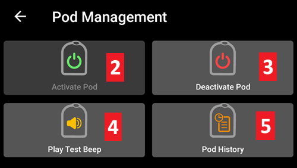
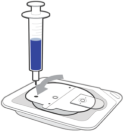
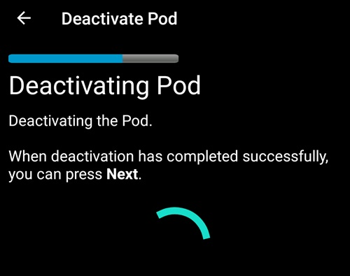
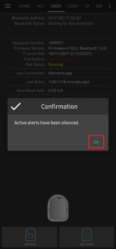
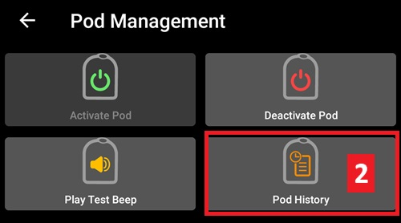

# Omnipod DASH

Deze instructies zijn voor het instellen van de pomp van de **Omnipod DASH**-generatie **(NIET Omnipod Eros)**. De DASH-driver is een beproefde manier om te loopen met Omnipod.

```{contents} Table of contents
:depth: 1
:local: true
```

## Omnipod DASH specificaties

Belangrijkste kenmerken van de **Omnipod DASH** ('DASH'):

- De DASH-pods herken je aan een **blauwe naalddop** (de oudere EROS-pod heeft een doorzichtige naalddop). Verder zijn de pods qua afmetingen gelijk.
- DASH heeft geen BLE-brug (link) nodig (GEEN RileyLink, OrangeLink of EmaLink nodig).
- De Bluetooth-verbinding van de DASH wordt alleen gebruikt bij het sturen van een opdracht (bijv. een bolus) en wordt direct daarna verbroken.
- **AAPS** wacht tot de pod bereikbaar is om opdrachten te sturen.
- Bij het activeren van een pod zoekt **AAPS** een nieuwe DASH-pod en maakt er verbinding mee.
- Verwacht bereik vanaf de telefoon: 5–10 meter (dit kan per situatie verschillen).

(omnipod-dash-constraints)=

## Bekende beperkingen/problemen van Omnipod DASH in AAPS
- Het algemene advies is om **AAPS** te gebruiken op Android 14 of 16. Over Android 15 zijn in de community veel [problemen](https://github.com/nightscout/AndroidAPS/issues/3471) gemeld. Als je toch Android 15 gebruikt, moet je waarschijnlijk **Bluetooth bonding** aanzetten (in het deel **Geavanceerde instellingen** van de [Dash-instellingen](#omnipod-dash-advanced-settings)) om Pods goed te kunnen activeren en gebruiken. Zie [Probleemoplossing](../GettingHelp/GeneralTroubleshooting.md) voor meer info over de instellingen voor bonding.
- Zomertijd en wijzigingen van tijdzone worden niet automatisch toegepast. Na een wijziging van de klok moet je de pod zelf bijwerken: druk op **Vernieuwen** op het DASH-pompscherm en druk dan op **Tijd instellen** (zichtbaar als de tijdzones van pod en telefoon verschillen) of doe een **Profiel wissel** (zie [Tijdzonewijziging voor Omnipod Dash](#timezone-traveling-with-pumps)).
- Dash ondersteunt alleen basaalstanden in stappen van 0,05 E/u. Als je in je **AAPS-profiel** een basaal instelt met stappen van 0,01, geeft AAPS geen waarschuwing, ook al rondt de pod de stand naar boven af op stappen van 0,05. Als je **Pod Historie** opent op het DASH-pompscherm, zie je dat er 0,05 basaal is ingesteld. Dit betekent ook dat de laagste basaalstand die de DASH in **AAPS** toestaat 0,05 E/u is.
- Het instellingenbestand bevat de actieve Pod-sessie. Exporteer je instellingen na elke Pod-activering, en lees [Instellingen exporteren en importeren](#omnipod-dash-export-import) voordat je instellingen importeert.
- Bij het instellen van een nieuw basaal profiel onderbreekt DASH de toediening voordat het nieuwe basale **Profiel** wordt ingesteld. Bij een onderbreking van de communicatie of een fout start het basale profiel niet vanzelf opnieuw. Zie het deel [Insulinetoediening hervatten](#omnipod-dash-resuming-insulin-delivery) voor details.
- Als waarschuwingen zijn ingesteld en de pod bijna verloopt, blijft de pod piepen tot de waarschuwingen zijn stilgezet. Zie [Pod-alarmen stilzetten](#omnipod-dash-silencing-pod-alerts) voor details.
- Er zijn een aantal bekende problemen met Bluetooth die problemen bij het activeren van een pod kunnen geven. Zie [Bluetooth-probleemoplossing](../GettingHelp/BluetoothTroubleshooting.md) voor de bekende problemen en oplossingen.

(hardware-software-requirements)=

(omnipod-dash-hardware-software-requirements)=
## Benodigde hardware en software

- Omnipod DASH herken je aan de blauwe naalddop.


- **A Compatible Android phone** with Bluetooth Low Energy (BLE) (see [Phones](../Getting-Started/Phones.md) for more info). In addition, the following information will help guide you on other key considerations around successfully activating and using the DASH on a compatible phone:
    -  De Omnipod Dash-driver van **AAPS** maakt via Bluetooth verbinding met de DASH Pod.  
      **AAPS** maakt automatisch een nieuwe Bluetooth-verbinding met de Pod elke keer dat het een opdracht moet sturen (bijv. een bolus). Na het sturen van de opdracht wordt de Bluetooth-verbinding direct verbroken.
       - **Opmerking:**
         - De Bluetooth-verbinding kan worden onderbroken of verstoord door andere Bluetooth-apparaten die gekoppeld zijn aan de telefoon waarop **AAPS** draait, zoals oordopjes enz. Zulke apparaten kunnen op sommige telefoonmodellen verbindingsfouten of problemen bij het activeren van een pod geven. Bekijk bij het kiezen van een telefoon voor Omnipod DASH de lijst met [geteste hardware-opstellingen](https://docs.google.com/spreadsheets/u/1/d/e/2PACX-1vScCNaIguEZVTVFAgpv1kXHdsHl3fs6xT6RB2Z1CeVJ561AvvqGwxMhlmSHk4J056gMCAQE02sAWJvT/pubhtml?gid=683363241&single=true). Daar staan combinaties die bekend goed werken.
         - There are a number of known issues with Bluetooth which can cause pod activation problems (See [Troubleshooting](#omnipod-dash-troubleshooting) for advice on other Bluetooth issues) specifically the [Bluetooth related issues](#omnipod-dash-bluetooth-related-issues) section.
    - De telefoon moet **Android 12 of nieuwer** hebben, met **AAPS** gebouwd en geïnstalleerd volgens de instructies [**APK bouwen**](../SettingUpAaps/BuildingAaps.md). Gebruik altijd de nieuwste uitgebrachte versie.
- Een ondersteunde [**Continue glucosemonitor (CGM)**](../Getting-Started/CompatiblesCgms.md)

De instructies hieronder leggen uit hoe je met **AAPS** een nieuwe pod-sessie activeert. You should wait for your current Pod to be close to expiry, as you will need to activate a new Pod with **AAPS**. Als een pod is gedeactiveerd, kan hij niet opnieuw worden gebruikt of geactiveerd. Het deactiveren is definitief.

## Voordat je begint

Zorg dat je deze hele handleiding hebt gelezen en begrijpt, en ook het deel **Voordat je begint** en **[Beperkingen en problemen van Omnipod en AAPS](#omnipod-dash-constraints)**, zodat je geen bekend probleem tegenkomt.

### **VEILIGHEID VOOROP** - Je **MOET NIET** proberen **AAPS** voor het eerst met een pod te verbinden zonder dat je al het volgende bij de hand hebt:
1. Extra pods (3 of meer als reserve)
2. Reserve-insuline en spullen voor MDI (pen of spuit)
3. Een werkende Omnipod PDM (voor het geval **AAPS** niet werkt)
4. Een ondersteunde telefoon is een must! (Zie [Hardware-/softwarevereisten](#hardware-software-requirements))
5. De juiste versie van AAPS gebouwd en geïnstalleerd

### Je Omnipod Dash PDM is niet meer nodig nadat de Dash-driver van AAPS je pod heeft geactiveerd.
- Voordat je **AAPS** gebruikt, heb jij of je verzorger de Pod beheerd met de Omnipod PDM (of in sommige regio's een telefoon-app) om opdrachten naar je DASH te sturen (bijv. een bolus).
- De DASH kan maar met één Bluetooth-apparaat (bijv. PDM of telefoon) verbonden zijn om te beheren en opdrachten te sturen.
- Het apparaat dat de pod activeert, is vanaf dat moment het enige apparaat dat met die Pod mag communiceren. Dit betekent dat als je een DASH met je Android-telefoon activeert via **AAPS**, **je je PDM niet meer kunt gebruiken met die pod!** Zolang die Pod actief is, is de Dash-driver van **AAPS** op je Android-telefoon de nieuwe PDM voor je pod.
- **GOOI JE PDM NIET WEG!** Bewaar hem als reserve en voor noodgevallen, bijvoorbeeld als je telefoon kwijt is of **AAPS** niet goed werkt.

### Je pod stopt **NIET** met insuline toedienen als hij niet verbonden is met AAPS.
Bij het activeren worden de standaard basaalstanden in de pod gezet, zoals ze in het huidige actieve [**Profiel**](../SettingUpAaps/YourAapsProfile.md) staan.  
Zolang **AAPS** werkt, stuurt het opdrachten om de basaalstand aan te passen die maximaal 120 minuten lopen.  
Als de pod om een of andere reden geen nieuwe opdrachten krijgt (bijvoorbeeld omdat de verbinding verloren is door de afstand tussen Pod en telefoon), gaat de pod automatisch terug naar de standaard basaalstanden uit je [**Profiel**](../SettingUpAaps/YourAapsProfile.md).

### AAPS-profielen ondersteunen geen basale tijdblokken van 30 minuten
Als je nieuw bent met **AAPS** en je basale [**Profiel**](../SettingUpAaps/YourAapsProfile.md) voor het eerst instelt: basaalstanden die op een half uur beginnen worden niet ondersteund. Een voorbeeld: als je op je Omnipod PDM een basaalstand van 1,1 eenheden hebt die om 09:30 begint en 2 uur duurt tot 11:30, kun je dit basale **Profiel** niet precies zo in **AAPS** zetten.  
Je moet deze basaalstand van 1,1 eenheden dan veranderen naar een tijdblok van 9:00–11:00 of 10:00–12:00. Hoewel de DASH-hardware zelf basale **Profiel**-blokken van 30 minuten ondersteunt, ondersteunt **AAPS** dit NIET.

### Basaalstanden van 0 E/u in het profiel worden NIET ondersteund in AAPS
De DASH ondersteunt wel een basaalstand van nul, maar **AAPS** gebruikt veelvouden van de basaalstand uit het **Profiel** van de gebruiker om automatische behandelingen te bepalen. Het kan daarom niet werken met een basaalstand van nul.  
Een tijdelijke basaalstand van nul kun je wel krijgen met de functie "Verbreek verbinding met de pomp", of met een combinatie van Loop uitschakelen/tijdelijke basaalstand of Onderbreek loop/tijdelijke basaalstand.  
**LET OP:** De laagste basaalstand die de DASH in **AAPS** toestaat is 0,05 E/u.

## Dash selecteren in AAPS

Er zijn **twee** manieren om de Omnipod DASH-driver te selecteren in **AAPS**:

### Optie 1: Nieuwe installaties

Als je **AAPS** voor het eerst installeert, leidt de **Setup Wizard** je door de belangrijkste functies en installatie-eisen van **AAPS**. Als je bij de stap **Pomp** komt, selecteer dan **Omnipod Dash**.


Als je het nog niet zeker weet, kun je nu **Virtuele Pomp** selecteren en **Omnipod Dash** later kiezen, nadat je **AAPS** hebt ingesteld (zie optie 2).

(omnipod-dash-option-2-config-builder)=
### Optie 2: Het scherm Configuratie

Bij een bestaande installatie kun je de **Omnipod Dash**-pomp selecteren in het scherm **Configuratie**:

1. Open het **menu** (☰) linksboven in het hoofdscherm en selecteer **Configuratie**.
2. Tik op **Pomp** en selecteer het keuzerondje van **Omnipod Dash** (*"Pomp integratie voor Omnipod Dash (het nieuwe, Bluetooth-enabled model met een blauwe naalddop)"*).

3. Als het geselecteerd is, toont de kaart **Omnipod Dash** twee knoppen:
   - **Instellingen** opent de [Dash-instellingen](#omnipod-dash-settings).
   - **Plug-in openen** opent het [DASH-pompscherm](#omnipod-dash-tab).

   

### Controleren of de Omnipod-driver is geselecteerd

Om te controleren of **Omnipod Dash** geselecteerd is, open je **Beheren** (navigatie onderaan het hoofdscherm) en tik je op **Pomp**. Het DASH-pompscherm opent, zoals in het volgende deel te zien is.

(omnipod-dash-tab)=

## Het DASH-pompscherm

Op het DASH-pompscherm beheer je je pods: activeren en deactiveren, de pod-status vernieuwen, alarmen stilzetten en de pod-historie bekijken. Open het met **Beheren** > **Pomp**, of met **Plug-in openen** op de kaart **Omnipod Dash** in **Configuratie** > **Pomp**.

Dit is het scherm zonder actieve pod:


En dit is het scherm met een actieve pod:


Het pictogram **Instellingen** (tandwiel) rechtsboven opent de [Dash-instellingen](#omnipod-dash-settings).

***LET OP:** Als een veld op het pompscherm (onzeker) toont, druk dan op **Vernieuwen** om de pod-status bij te werken.*

### Velden

- **Bluetooth adres:** Het Bluetooth-adres van de pod.

- **Verbindingskwaliteit:** Hoe betrouwbaar **AAPS** verbinding maakt met de pod, getoond als *gelukte verbindingen / alle verbindingspogingen :: slagingspercentage*, bijvoorbeeld `412/420 :: 98.10 %`. Na meer dan 50 gelukte verbindingen wordt de waarde geel onder 90% en rood onder 70%. Een lage waarde wijst op een Bluetooth-probleem (zie [Problemen met Bluetooth](#omnipod-dash-bluetooth-related-issues)).

- **Leveringsstatus:** De ruwe leveringsstatus die de pod meldt. Dit veld wordt alleen getoond in builds met engineering mode.

- **Uniek ID:** Het unieke ID dat **AAPS** tijdens het activeren aan de pod gaf.

- **LOT Nummer:** Het productielotnummer van de pod.

- **Volgnummer:** Het volgnummer van de pod.

- **Firmware versie:** De firmware- en Bluetooth-versies van de pod.

- **Tijd op Pod:** De huidige tijd op de pod, met de tijdzone. De tekst wordt rood als de tijdzone van de pod anders is dan die van de telefoon, en geel als de tijd op de pod meer dan 10 minuten afwijkt.

- **Pod verloopt:** De datum en tijd waarop de pod verloopt (72 uur na activering). De tekst wordt geel in de laatste 4 uur voor dit moment. Hij wordt nooit rood, omdat de pod daarna nog insuline blijft toedienen.

- **Harde einddatum Pod:** Het einde van de extra tijd van de pod (8 uur na **Pod verloopt**, voor een maximale levensduur van de pod van 80 uur). De tekst wordt geel als de extra tijd begint (bij **Pod verloopt**) en rood in de laatste 4 uur voor het harde einde. Tijdens de extra tijd toont het veld ook de resterende tijd, bijvoorbeeld *(17m resterend)*. Bij het harde einde stopt de pod met insuline toedienen en moet hij vervangen worden.

- **Pod Status:** De status van de pod: **Geen actieve Pod**, **Setup wordt uitgevoerd**, **Actief**, **Onderbroken** of, na een pod-fout, **ALARM**.

- **Laatste verbinding:** Hoe lang geleden **AAPS** voor het laatst met de pod communiceerde.

  - *Zojuist* - minder dan 10 seconden geleden.

  - *Minder dan een minuut geleden* - tussen 10 en 60 seconden geleden.

  - *XX minuten geleden* - meer dan 1 minuut geleden (en *X uur en XX minuten geleden* na een uur).

- **Laatste bolus:** De hoeveelheid van de laatste bolus die naar de pod is gestuurd, en hoe lang geleden die werd gegeven. Een niet-bevestigde bolus wordt gemarkeerd met (onzeker).

- **Basis basaalstand:** De basaalstand die voor de huidige tijd in je basale **Profiel** staat.

- **Tijdelijke basaalstand:** De tijdelijke basaalstand (TBR) die nu loopt, met de begintijd en de duur. Dit veld wordt alleen getoond als er een TBR loopt.

- **Reservoir:** Toont *Meer dan 50 E over* als er meer dan 50 eenheden in het reservoir zitten. Onder 50 eenheden wordt de precieze hoeveelheid getoond. De waarde wordt rood onder 20 eenheden.

- **Totaal toegediend:** De totale hoeveelheid insuline die uit het reservoir is toegediend. Dit is inclusief de insuline die gebruikt is voor het vullen.

- **Actieve pod alarmen:** Waarschuwingen die nu actief zijn op de pod, bijvoorbeeld *Pod verloopt binnenkort* of *Laag reservoir niveau*.

- **Foutmeldingen:** De pod-fout, als de pod defect is, in het rood getoond als *Pod foutmelding:* gevolgd door de foutcode en naam, bijvoorbeeld *Pod foutmelding: 020 ALARM_OCCLUDED*. Bekijk de [Pod Historie](#omnipod-dash-view-pod-history) en de logbestanden voor eerdere fouten en meer gedetailleerde informatie. Zie [Pod-storingen](#omnipod-dash-pod-failures).

- **PDM-melding:** Alleen getoond na een pod-fout. Het toont de fout zoals de Omnipod PDM die zou tonen: een titel (bijvoorbeeld *Verstopping gedetecteerd*, *Leeg reservoir* of *Pod verlopen*), wat er gebeurd is (bijvoorbeeld *Insulinetoediening gestopt. Vervang de Pod nu.*) en een *Ref:*-code.

### Knoppen

De knoppen onderaan het pompscherm veranderen met de status van de pod. Alleen de knoppen die op dat moment zinvol zijn, worden getoond.

- **Vernieuwen:** Vraagt de pod om zijn huidige status.
  - *Gebruik het om de pod-status bij te werken en om velden met (onzeker) te wissen.*
  - *Zie het deel [Probleemoplossing](#omnipod-dash-troubleshooting) hieronder voor meer informatie.*

- **Alarmen dempen:** Stopt de piepjes van pod-waarschuwingen (bijvoorbeeld pod verloopt of laag reservoir). Alleen getoond als de pod een actieve waarschuwing heeft. Zie [Pod-alarmen stilzetten](#omnipod-dash-silencing-pod-alerts).

- **Toediening hervatten:** Hervat de insulinetoediening op een onderbroken pod. Alleen getoond als de toediening onderbroken is. Zie [Insulinetoediening hervatten](#omnipod-dash-resuming-insulin-delivery).

- **Tijd instellen:** Zet de pod op de tijdzone van je telefoon door je basale **Profiel** opnieuw te sturen. Alleen getoond als de tijdzone van de pod anders is dan de tijdzone van je telefoon.

- [**Activeer Pod**](#omnipod-dash-activate-pod): Vult en activeert een nieuwe pod. Getoond als er geen pod actief is.

- [**Deactiveer Pod**](#omnipod-dash-deactivate-pod): Deactiveert de actieve pod. Getoond zodra een pod gekoppeld is met **AAPS**, ook als een activering halverwege is gestopt (bijvoorbeeld omdat de pod tijdens het activeren defect raakte). **AAPS** vraagt je om te bevestigen voordat het de pod deactiveert.

- **Testpieptoon afspelen:** Laat de pod één testpieptoon afspelen.

- [**Pod Historie**](#omnipod-dash-view-pod-history): Toont de activiteiten van de actieve pod.

- **Pod verwijderen:** Verwijdert een niet-afgemaakte pod uit **AAPS**. Alleen getoond als een pod-activering halverwege is gestopt. **AAPS** vraagt je om te bevestigen. Na het verwijderen kan **AAPS** niet meer met die pod communiceren: haal hem van je lichaam.



```{admonition} Older screenshot
:class: note
De schermafbeelding hierboven komt uit een eerdere **AAPS**-versie, die een apart menu **Pod Management** had. In **AAPS** 4 zijn al deze acties, ook **Activeer Pod**, **Deactiveer Pod**, **Testpieptoon afspelen** en **Pod Historie**, knoppen met tekst direct op het pompscherm.
```

(omnipod-dash-activate-pod)=

## Activeer Pod

1. Open het DASH-pompscherm (**Beheren** > **Pomp**) en druk op **Activeer Pod**. De wizard voor activering opent.

   

   ```{admonition} Older screenshot
   :class: note
   De schermafbeelding hierboven komt uit een eerdere **AAPS**-versie. In **AAPS** 4 is **Activeer Pod** een knop direct op het DASH-pompscherm, in plaats van in het menu **Pod Management**.
   ```

   Als je nog nooit een **Profiel** hebt geactiveerd in **AAPS**, toont de wizard eerst de stap **Profiel vereist**: kies het profiel dat bij het activeren moet worden gebruikt en ga verder.

2. De stap **Pod vullen** wordt getoond. Vul een nieuwe pod met genoeg insuline voor 3 dagen, **minstens 80 eenheden**. Luister naar twee piepjes van de pod: die betekenen dat de minimale hoeveelheid van 80 eenheden is gevuld. Maak de vulspuit helemaal leeg, ook nadat je de twee piepjes hebt gehoord. Haal de naalddop nog niet van de pod.

   ***LET OP:** Denk er bij het berekenen van de insuline die je voor 3 dagen nodig hebt aan dat het vullen van de pod ongeveer 3–10 eenheden kost.*

   

   

   Zorg dat de nieuwe pod en de telefoon met **AAPS** dicht bij elkaar liggen en druk op **Volgende**.

3. Als je meer dan één insuline gebruikt in **AAPS**, wordt de stap **Selecteer insuline** getoond. Die toont de insuline die **Momenteel actief** is. Als je de pod met een andere insuline hebt gevuld, druk dan op **Wissel** en selecteer die. **AAPS** doet een **Profiel wissel** met deze insuline als het activeren klaar is. Druk op **Volgende**.

   

4. In de stap **Pod initialiseren** koppelt **AAPS** met de nieuwe pod en vult hem. Je hoort een klik, gevolgd door een reeks tikgeluiden terwijl de pod zichzelf vult. Als dit gelukt is, verschijnt de knop **Volgende**. Druk op **Volgende**.

       

   ***LET OP**: Als een foutmelding zoals _Scan is mislukt_ of _'Could not find an available pod for activation'_ verschijnt (dit kan gebeuren), raak dan niet in paniek. Druk op **Opnieuw**. Meestal gaat het activeren dan goed verder.*

   

   Als de pod defect is (bijvoorbeeld omdat de activeringstijd is overschreden), wordt **Deactiveer Pod** getoond in plaats van **Opnieuw**. Gebruik die knop en begin opnieuw met een nieuwe pod.

   Als je op **Annuleren** drukt voordat het activeren klaar is, vraagt **AAPS** je te bevestigen dat je wilt afsluiten. Druk op **OK** om de wizard te verlaten, of op **Annuleren** om te blijven.

   

5. Als je de rotatie van pompplekken beheert in **AAPS** (**Plaatsingslocatie pomp beheren** in de instellingen van [Site rotatie](#Aapsscreens-site-rotation)), wordt de stap **Plaatsingsplek** getoond. Kies op de afbeelding van het lichaam waar je de pod gaat plakken en druk op **Volgende**, of druk op **Overslaan**.

   

6. Bereid daarna de plek voor de nieuwe pod voor. Was je handen om infecties te voorkomen. Maak de plek schoon met water en zeep of een alcoholdoekje, en laat de huid helemaal aan de lucht drogen voordat je verdergaat. Als de pleister je huid irriteert, kun je een beschermend doekje of beschermende spray gebruiken.

   Haal in de stap **Plaats de Pod** de blauwe plastic naalddop van de pod. Als de canule of iets anders uit de pod steekt, of als hij er vreemd uitziet: **STOP**. Druk op **Annuleren** en begin opnieuw met een nieuwe pod. Als alles er **OK** uitziet, haal je het witte papier van de pleister en plak je de pod op de gekozen plek op je lichaam.

   Druk daarna op **Volgende**.

   

7. Er verschijnt een bevestiging: *Als je op OK drukt, wordt de canule ingebracht.* **Druk ALLEEN op OK als je klaar bent om de canule in te brengen!**

   

8. In de stap **Canule inbrengen** stelt **AAPS** je basaalschema in en brengt de pod de canule in. Dit kan even duren (maximaal 1–2 minuten). **Wees geduldig!**

   ***LET OP:** Het is verstandig om de huid bij de plek van de canule even samen te knijpen voordat de canule wordt ingebracht. Zo gaat de naald soepel naar binnen en is de kans op verstoppingen kleiner.*

       

9. Als de canule goed is ingebracht, verschijnt de knop **Volgende**. Druk op **Volgende**.

   

10. De stap **Pod geactiveerd** wordt getoond. Controleer of de canule goed is ingebracht, en vervang de pod als je denkt dat dat niet zo is.

    Druk op **Voltooien**.

    Gefeliciteerd! Je hebt nu een nieuwe pod-sessie gestart.

    

11. Je bent terug op het DASH-pompscherm. Het toont nu de informatie van je actieve pod, zoals de huidige basaalstand, het reservoirniveau, de toegediende insuline, pod-fouten en waarschuwingen. **Activeer Pod** is vervangen door **Deactiveer Pod**: je kunt geen andere pod activeren zonder eerst de actieve pod te deactiveren.

    ***LET OP:** Zie [Het DASH-pompscherm](#omnipod-dash-tab) voor meer details over de getoonde informatie.*

    

    ***LET OP:** Het is verstandig om je instellingen te exporteren NA het activeren van de pod. Exporteer je instellingen na elke podwissel en één keer per maand. Kopieer het geëxporteerde instellingenbestand naar een cloudopslag (bijvoorbeeld Google Drive) of ergens anders buiten je telefoon, voor het geval je je telefoon kwijtraakt (zie [**Exporteer instellingen**](../Maintenance/ExportImportSettings.md)).*

Als een eerdere activering stopte nadat de pod gevuld was, gaat **Activeer Pod** verder vanaf de stap **Plaats de Pod**.

(omnipod-dash-deactivate-pod)=

## Deactiveer Pod

Normaal gaat een pod drie dagen (72 uur) mee, plus 8 uur extra tijd na de waarschuwing dat de pod verloopt: 80 uur in totaal.

Om een pod te deactiveren (omdat hij verlopen of defect is):

1. Open het DASH-pompscherm (**Beheren** > **Pomp**) en druk op **Deactiveer Pod**.

   

2. Druk in de stap **Deactiveer Pod** op **Volgende**. Een venster vraagt: *Een gedeactiveerde Pod kan niet opnieuw worden gebruikt. Nu deze Pod deactiveren?* Druk op **OK** om de pod te deactiveren, of op **Annuleren** om hem te houden. Deactiveren stopt alle insulinetoediening en kan niet ongedaan worden gemaakt.

   

3. De stap **Pod wordt gedeactiveerd** wordt getoond terwijl **AAPS** de pod deactiveert. De pod piept om te bevestigen dat het deactiveren gelukt is.

   

   ```{admonition} Older screenshot
   :class: note
   De schermafbeelding hierboven komt uit een eerdere **AAPS**-versie. In **AAPS** 4 toont de wizard de voortgang als een rij puntjes bovenaan, in plaats van een voortgangsbalk.
   ```

   Als het deactiveren gelukt is, verschijnt de knop **Volgende**. Druk op **Volgende**.

   

   Als het deactiveren mislukt, worden een foutmelding en een knop **Pod verwijderen** getoond. Lees [Een pod verwijderen](#omnipod-dash-discard-pod) hieronder voordat je die knop gebruikt. Je kunt ook op **Annuleren** drukken en later opnieuw **Deactiveer Pod** proberen.

4. De stap **Pod gedeactiveerd** wordt getoond. Haal de pod van je lichaam en druk op **Voltooien**.

   

5. Je bent terug op het DASH-pompscherm. Controleer of het veld **Pod Status** **Geen actieve Pod** toont en of de knop **Activeer Pod** weer zichtbaar is.

   

(omnipod-dash-discard-pod)=

### Een pod verwijderen

Verwijder een pod alleen als alle communicatie ermee blijft mislukken. Als **AAPS** nog wel met de pod kan communiceren, gebruik dan **Deactiveer Pod**.

- **AAPS** vraagt je om te bevestigen voordat het de pod verwijdert.
- Daarna kan **AAPS** niet meer met die pod communiceren.
- **De insulinetoediening is NIET gestopt**, omdat de pod niet goed is gedeactiveerd. **Haal de pod van je lichaam!**
- De stap **Pod is verwijderd** bevestigt dat de status van de pod is verwijderd. Druk op **Voltooien**. Je kunt nu een nieuwe pod activeren.

(omnipod-dash-resuming-insulin-delivery)=

## Insulinetoediening hervatten

**LET OP**: Bij een **Profiel wissel** moet **AAPS**, net als de PDM, de toediening op de pod onderbreken voordat het nieuwe basale **Profiel** wordt ingesteld. Als de communicatie mislukt tussen de opdrachten om te onderbreken en te hervatten, kan de toediening onderbroken blijven. Lees [**Toediening onderbroken**](#omnipod-dash-delivery-suspended) in het deel probleemoplossing voor meer details.

Als de insulinetoediening onderbroken is, moet je de pod vertellen dat hij de insulinetoediening moet hervatten. Als de opdracht goed is verwerkt, dient de pod weer insuline toe met de basaalstand voor de huidige tijd uit je actieve basale **Profiel**. De pod accepteert dan weer opdrachten voor bolus, **TBR** en **SMB**.

1. Open het DASH-pompscherm en controleer of het veld **Pod Status** **Onderbroken** toont. Druk op **Toediening hervatten** om de pod te vertellen dat hij de normale insulinetoediening moet hervatten.

   

2. Als de opdracht gelukt is, toont het veld **Pod Status** **Actief** en verdwijnt de knop **Toediening hervatten**.

   

   

   ```{admonition} Older screenshot
   :class: note
   De schermafbeeldingen hierboven komen uit een eerdere **AAPS**-versie, die een bevestigingsvenster toonde. In **AAPS** 4 zie je het resultaat op het DASH-pompscherm: het veld **Pod Status** toont **Actief** en de knop **Toediening hervatten** is weg.
   ```

   Als de opdracht mislukt, toont **AAPS** een waarschuwing die begint met *Hervatten van insulinetoediening is mislukt*. Druk op **Vernieuwen** en probeer het opnieuw.

   

(omnipod-dash-silencing-pod-alerts)=

## Pod-alarmen stilzetten

Dit deel legt uit hoe je de piepjes van de pod stopt als de pod het einde van zijn levensduur nadert. Wanneer deze piepjes beginnen, hangt af van de instellingen bij **Waarschuwingen** (zie [Dash-instellingen](#omnipod-dash-settings)):

- **Herinnering uren voor vervaldatum (72 uur):** hoeveel uur voor het verlopen na 72 uur de pod begint te piepen.
- **Waarschuwing op uren voor uitschakelen (80 uur):** hoeveel uur voor het uitschakelen na 80 uur de pod opnieuw piept.

De maximale levensduur van een pod is 80 uur (3 dagen en 8 uur). De fabrikant van de pod raadt echter aan om niet langer dan 72 uur (3 dagen) te gaan.

***LET OP**: De knop **Alarmen dempen** wordt alleen op het DASH-pompscherm getoond als de pod een actieve waarschuwing heeft, bijvoorbeeld pod verloopt of laag reservoir. Als de knop **Alarmen dempen** niet zichtbaar is maar je de pod wel hoort piepen, druk dan op **Vernieuwen**.*

1. Als de tijd van de herinnering bereikt is, piept de pod om je te laten weten dat hij binnenkort verloopt en dat je hem moet vervangen. Op het DASH-pompscherm toont het veld **Pod verloopt (1)** de precieze tijd waarop de pod verloopt (72 uur na activering). De tekst wordt 4 uur voor dit moment geel. Daarna wordt **Harde einddatum Pod** geel en toont het de resterende tijd tot de pod stopt met insuline toedienen. Het veld **Actieve pod alarmen (2)** toont **Pod verloopt binnenkort**, en de knop **Alarmen dempen (3)** wordt getoond.

   

2. Druk op **Alarmen dempen**. **AAPS** stuurt de opdracht naar de pod om de piepjes voor het verlopen te stoppen.

   

   ```{admonition} Older screenshot
   :class: note
   De schermafbeelding hierboven komt uit een eerdere **AAPS**-versie, waarin dit scherm het tabblad **DASH** was. In **AAPS** 4 staat de knop **Alarmen dempen** op het DASH-pompscherm (**Beheren** > **Pomp**).
   ```

3. Als de waarschuwingen zijn stilgezet, staat de waarschuwing niet meer in het veld **Actieve pod alarmen**, verdwijnt de knop **Alarmen dempen** en stopt de pod met piepen.

   

   ```{admonition} Older screenshot
   :class: note
   De schermafbeelding hierboven komt uit een eerdere **AAPS**-versie, die een bevestigingsvenster toonde. In **AAPS** 4 zie je het resultaat op het DASH-pompscherm: de waarschuwing is weg uit het veld **Actieve pod alarmen**.
   ```

   Als de opdracht mislukt, toont **AAPS** een waarschuwing die begint met *Meldingen negeren mislukt*. Druk op **Vernieuwen** en probeer het opnieuw.

De waarschuwing voor een laag reservoir werkt op dezelfde manier. Als de insuline in de pod daalt tot het **Aantal eenheden** dat bij **Waarschuwingen** is ingesteld, piept de pod. Het veld **Reservoir** toont de resterende hoeveelheid, het veld **Actieve pod alarmen** toont **Laag reservoir niveau**, en de knop **Alarmen dempen** wordt getoond. Druk op **Alarmen dempen** om de piepjes te stoppen, en plan je volgende podwissel.


(omnipod-dash-view-pod-history)=

## Pod Historie bekijken

Dit deel legt uit hoe je de historie van je actieve pod bekijkt en filtert op type actie. De pod-historie toont de opdrachten die naar je actieve pod zijn gestuurd en de resultaten daarvan, tijdens zijn levensduur van drie dagen (72–80 uur).

Het is handig om de bolussen, TBR's en basaalopdrachten te controleren die naar de pod zijn gestuurd. De andere categorieën helpen bij het oplossen van problemen en tonen de volgorde van gebeurtenissen die tot een storing leidden.

**LET OP:** **Alleen de laatste opdracht kan onzeker zijn**. Nieuwe opdrachten *worden niet verstuurd* tot de **laatste 'onzekere' opdracht 'bevestigd' of 'afgewezen' is**. Om een onzekere opdracht te 'herstellen', druk je op **Vernieuwen** op het DASH-pompscherm.

1. Open het DASH-pompscherm en druk op **Pod Historie**.

   

   ```{admonition} Older screenshot
   :class: note
   De schermafbeelding hierboven komt uit een eerdere **AAPS**-versie. In **AAPS** 4 is **Pod Historie** een knop direct op het DASH-pompscherm, in plaats van in het menu **Pod Management**.
   ```

2. Het scherm **Pod Historie** opent met het filter **Alle** geselecteerd. Het toont elke opdracht met de tijd en het resultaat, nieuwste eerst, gegroepeerd per dag. Gebruik de filterknoppen bovenaan (bijvoorbeeld **Bolussen** of **Basaalstanden**) om maar één type opdracht te tonen. Druk op de terugpijl om terug te gaan naar het DASH-pompscherm.

    

   ```{admonition} Older screenshot
   :class: note
   De tweede schermafbeelding hierboven komt uit een eerdere **AAPS**-versie, waarin je het type opdracht koos uit een lijst **Type**. In **AAPS** 4 gebruik je de filterknoppen uit de eerste schermafbeelding.
   ```

   Bij bolussen staat na de hoeveelheid het type bolus als het geen normale bolus is, bijvoorbeeld *0,05 E (SMB)* of *0,05 E (Basaal correctie)*. Een basaalcorrectie is een heel kleine bolus (één puls van de pod, 0,05 E) die de driver zelf stuurt; jij hebt er niet om gevraagd.

   ```{admonition} Why basal corrections happen
   :class: note
   De pod dient basale insuline toe in pulsen van 0,05 E, getimed door een interne klok. Elke keer dat de basaalstand verandert (bijvoorbeeld als de loop een nieuwe **TBR** instelt), start de pod deze klok opnieuw, en de puls waar hij naartoe telde gaat verloren. Omdat de loop de basaalstand vaak verandert, vooral 's nachts, kan de pod uiteindelijk minder basale insuline toedienen dan verwacht.

   **AAPS** vergelijkt de basale insuline die de pod als toegediend meldt met wat hij had moeten toedienen. Als het tekort een halve puls of meer is, dient de driver één extra puls toe als basaalcorrectie. Zo krijg je toch de basale insuline waar je profiel en de loop om vroegen. Er wordt geen correctie gestuurd als de pod onderbroken is, of als er een **TBR** van nul loopt.
   ```

(omnipod-dash-settings)=

## Dash-instellingen

Er zijn twee manieren om de instellingen van de Dash-driver te openen:

- Druk op het pictogram **Instellingen** (tandwiel) rechtsboven op het [DASH-pompscherm](#omnipod-dash-tab).
- Open het **menu** (☰) linksboven in het hoofdscherm en selecteer **Configuratie** > **Pomp**. Druk op de kaart **Omnipod Dash** op **Instellingen**.

De instellingen zijn verdeeld in vier delen die je kunt openklappen: **Bevestigings pieptonen**, **Waarschuwingen**, **Notificaties** en **Geavanceerde instellingen**. Tik op een deel om het te openen:


De meeste instellingen zijn aan/uit-schakelaars.

### Bevestigings pieptonen


Bevestigingspiepjes van de pod bij toediening en wijzigingen van bolus, basaal, SMB en TBR.

**Bolus pieptonen ingeschakeld:**    De pod piept als een bolus is toegediend. Standaard aan.

**Basaal pieptonen ingeschakeld:**    De pod piept als een nieuwe basaalstand wordt ingesteld, of als de actieve basaalstand wordt geannuleerd of gewijzigd. Standaard uit.

**SMB pieptonen ingeschakeld:**  De pod piept als een SMB is toegediend. Standaard aan.

**TBR pieptonen ingeschakeld:**  De pod piept als een TBR wordt ingesteld of geannuleerd. Standaard uit.

### Waarschuwingen


```{admonition} Older screenshot
:class: note
De schermafbeelding hierboven komt uit een eerdere **AAPS**-versie. In **AAPS** 4 staan deze instellingen in het deel **Waarschuwingen**, dat je kunt openklappen.
```

Pod-waarschuwingen voor het verlopen en uitschakelen van de pod en voor een laag reservoir. Als je deze instellingen wijzigt terwijl er een pod actief is, stuurt **AAPS** de nieuwe instellingen voor waarschuwingen naar de pod.

***LET OP:** Er wordt ALTIJD een melding van **AAPS** getoond voor elke waarschuwing, zodra **AAPS** met de pod heeft gecommuniceerd nadat de waarschuwing is afgegaan. Het wegklikken van de melding stopt de pod-waarschuwing NIET. Om de waarschuwing te stoppen, open je het DASH-pompscherm en druk je op **Alarmen dempen**.*

**Herinnering vervaldatum ingeschakeld:**    Als dit aan staat, piept de pod als de tijd van de herinnering bereikt is. Standaard aan.

**Herinnering uren voor vervaldatum (72 uur):** Hoeveel uur voor het verlopen van de pod na 72 uur de herinnering begint (1 tot 24 uur; standaard 4).

**Alert vervaldatum ingeschakeld:**   Als dit aan staat, piept de pod als de tijd van de waarschuwing bereikt is, en opnieuw 1 uur voor het uitschakelen. Standaard aan.

**Waarschuwing op uren voor uitschakelen (80 uur):**  Hoeveel uur voor het uitschakelen van de pod na 80 uur de waarschuwing begint (1 tot 8 uur; standaard 8).

**Pieptonen voor "Reservoir bijna leeg" ingeschakeld:**    De pod waarschuwt je als de insuline in het reservoir daalt tot de waarde bij **Aantal eenheden**. Standaard aan.

**Aantal eenheden:**    Het aantal eenheden waarbij de waarschuwing voor een laag reservoir afgaat (5 tot 50 eenheden; standaard 20).

### Notificaties


Kies of **AAPS** een geluid afspeelt bij zijn meldingen als het niet zeker is of een TBR, SMB of bolus is toegediend, en als de toediening onderbroken is.

***LET OP:** Dit zijn alleen meldingen op de telefoon; de pod zelf piept niet.*

**Geluid voor onzekere TBR notificaties ingeschakeld:**  Speelt een geluid af bij de melding als **AAPS** niet zeker is of een TBR is ingesteld.

**Geluid voor onzekere SMB notificaties ingeschakeld:**  Speelt een geluid af bij de melding als **AAPS** niet zeker is of een SMB is toegediend.

**Geluid voor onzekere bolus notificaties ingeschakeld:**    Speelt een geluid af bij de melding als **AAPS** niet zeker is of een bolus is toegediend.

**Geluid voor levering onderbroken notificatie ingeschakeld:**     Speelt een geluid af bij de melding als de insulinetoediening onderbroken is.

(omnipod-dash-advanced-settings)=

### Geavanceerde instellingen


**Bluetooth bonding:**  Koppelt (bonding) de pod via Bluetooth vast aan de telefoon. Probeer dit alleen als de pod geen stabiele verbinding houdt, bijvoorbeeld op Android 15 (zie [Bekende beperkingen/problemen van Omnipod DASH in AAPS](#omnipod-dash-constraints)). Als dit aan staat, toont de telefoon koppelverzoeken die je moet accepteren. Laat het uit als de pod goed verbinding maakt. Onder Android 15 heeft het geen effect. Standaard uit.

## Leeftijd van insuline en canule

De [statusregel](#screens-sensor-level-battery) op het hoofdscherm toont de leeftijd van je insuline en canule. Bij Omnipod werkt dit iets anders dan bij pompen met een slang.

**AAPS** registreert automatisch een canulewissel en een insulinewissel elke keer dat je een pod activeert. Daardoor worden de leeftijden van **Insuline** en **Canule** na elke podwissel op nul gezet. Je hoeft ze niet zelf te registreren met **Prime/Vul**. Dit komt doordat de pod de canule direct in de huid brengt op de plek waar hij geplakt is: Omnipod gebruikt geen slang.

De leeftijd van de **Pomp batterij** wordt niet gemeld: de batterij en het insulinereservoir zitten in elke pod, en de batterij gaat altijd langer mee dan de pod zelf (maximaal 80 uur).


```{admonition} Older screenshot
:class: note
De schermafbeelding hierboven komt uit een eerdere **AAPS**-versie, waarin deze leeftijden werden getoond in het deel **Careportal** van het tabblad **Acties**. In **AAPS** 4 worden ze getoond in de statusregel op het hoofdscherm.
```

### Niveau

**Insulineniveau**

Het getoonde insulineniveau is de hoeveelheid die de pod meldt. De pod meldt het werkelijke niveau van het reservoir echter pas als het onder 50 eenheden is. Tot dan wordt *Meer dan 50 E over* getoond. De gemelde hoeveelheid is niet precies: als de pod 'leeg' meldt, zit er meestal nog een paar eenheden insuline in het reservoir.

Het DASH-pompscherm toont het niveau zo:

  * **Meer dan 50 E over** - De pod meldt meer dan 50 eenheden in het reservoir.
  * **Onder 50 eenheden** - De precieze hoeveelheid insuline in het reservoir, zoals de pod die meldt.

Extra opmerking:
  * **SMS** - Geeft de waarde, of 50+U bij meer dan 50 eenheden, in SMS-antwoorden.
  * **Nightscout** - Uploadt een waarde van 50 naar Nightscout bij meer dan 50 eenheden (versie 14.07 en ouder). Nieuwere versies melden een waarde van 50+ bij meer dan 50 eenheden.

(omnipod-dash-troubleshooting)=

## Probleemoplossing

Dit deel behandelt bekende problemen en oplossingen bij het gebruik van Omnipod DASH met AAPS. Er is ook een deel [Probleemoplossing](../GettingHelp/GeneralTroubleshooting.md) in de documentatie. Lees dat ook, want het behandelt ook onderwerpen die voor sommige Pod-problemen belangrijk zijn.

---

(omnipod-dash-bluetooth-related-issues)=

## Problemen met Bluetooth

Voor bekende problemen met Bluetooth-verbindingen, het wegvallen van pomp/pods, of problemen met activeren en verbinden: zie [Bluetooth-probleemoplossing](../GettingHelp/BluetoothTroubleshooting.md)

---

(omnipod-dash-delivery-suspended)=

### Toediening onderbroken

  - Er is geen knop meer om te onderbreken. Als je de pod wilt "onderbreken", kun je een **TBR** van nul instellen voor x minuten.
  - Bij een **Profiel wissel** moet DASH de toediening onderbreken voordat het nieuwe basale **Profiel** wordt ingesteld. Als de communicatie tussen de twee opdrachten mislukt, kan de toediening onderbroken blijven. Als dit gebeurt:
     - Er wordt geen insuline toegediend, ook geen basaal, SMB, handmatige bolus enz.
     - Je kunt een melding krijgen dat een van de opdrachten niet bevestigd is: dit hangt af van het moment waarop de fout gebeurde.
     - **AAPS** probeert elke 15 minuten het nieuwe basale profiel in te stellen.
     - **AAPS** toont elke 15 minuten een melding dat de toediening onderbroken is, zolang de toediening nog onderbroken is (hervatten van de toediening is mislukt).
     - De knop [**Toediening hervatten**](#omnipod-dash-resuming-insulin-delivery) wordt op het DASH-pompscherm getoond als je de toediening zelf wilt hervatten.
     - Als het **AAPS** zelf niet lukt om de toediening te hervatten (dit gebeurt als de pod niet bereikbaar is, het geluid uit staat enz.), gaat de pod 3 minuten lang elke minuut 4 keer piepen. Dit herhaalt zich elke 15 minuten als de toediening langer dan 20 minuten onderbroken blijft.
  - Voor niet-bevestigde opdrachten druk je op **Vernieuwen** op het DASH-pompscherm om ze te bevestigen of af te wijzen.

*****LET OP:** Als je de pod hoort piepen, ga er dan niet van uit dat de toediening doorgaat zonder op de telefoon te kijken. De toediening kan onderbroken blijven, ***dus je moet het controleren!******

---
(omnipod-dash-pod-failures)=

### Pod-storingen

- Pods falen soms door allerlei problemen, ook door hardwareproblemen met de Pod zelf.
- Het is beter om geen ondersteunings- of vervangingsverzoeken bij Insulet in te dienen, omdat AAPS geen goedgekeurde manier is om de Pods te gebruiken.
- Een lijst met foutcodes is [**hier te vinden**](https://github.com/openaps/openomni/wiki/Fault-event-codes), om de oorzaak te helpen bepalen.

Als een pod defect raakt, stopt hij met insuline toedienen en piept hij onafgebroken. **AAPS** toont een melding op het hoofdscherm met de foutcode en naam, en de *Ref:*-code, bijvoorbeeld *Pod foutmelding: 020 ALARM_OCCLUDED*. Druk op **Negeren** om de melding te sluiten. Dit stopt het piepen van de pod niet.


Op het DASH-pompscherm toont het veld **Pod Status** **ALARM**, het veld **Foutmeldingen** toont de pod-fout, en het veld **PDM-melding** legt het uit, bijvoorbeeld *Verstopping gedetecteerd. Insulinetoediening gestopt. Vervang de Pod nu. Controleer uw bloedglucose*.


Een defecte pod kan niet opnieuw worden gebruikt. Controleer je bloedglucose, en [deactiveer daarna de pod](#omnipod-dash-deactivate-pod) en activeer een nieuwe.

---
### Pod-storingen met fout 49 voorkomen

Deze fout heeft te maken met een verkeerde pod-status voor een opdracht, of met een fout tijdens een opdracht voor insulinetoediening. Dit gebeurt als de driver en de Pod het niet eens zijn over de werkelijke status. De Pod reageert dan (als ingebouwde veiligheidsmaatregel) met een onherstelbare foutcode 49 (0x31). Dit eindigt in wat bekendstaat als een “screamer”: de lange, irritante pieptoon die alleen stopt als je op de juiste plek aan de achterkant van de Pod een gat prikt. De precieze oorzaak van een “49 pod-storing” is vaak moeilijk te vinden. It can happen, for example, after application crashes, when running a development version or after a re-installation.

---

### Waarschuwingen ‘Pomp niet beschikbaar’

Als er gedurende een ingestelde tijd geen verbinding met de pod kan worden gemaakt, verschijnt een waarschuwing “Pomp niet beschikbaar”. Waarschuwingen voor een onbereikbare pomp stel je in door op het pictogram **Instellingen** (tandwiel) rechtsboven in het hoofdscherm te drukken en dan **Lokale alarmen** ➜ **Maximale tijd pomp onbereikbaar** te kiezen. De aanbevolen waarde is een waarschuwing na **120** minuten.

---
(omnipod-dash-export-import)=
### Instellingen exporteren en importeren

Door de instellingen van **AAPS** te exporteren, kun je al je instellingen en Doelen terugzetten, bijvoorbeeld na een herinstallatie van **AAPS** of op een nieuwe telefoon. **Exporteer je instellingen direct na elke Pod-activering** en kopieer het bestand naar een veilige plek buiten je telefoon (bijvoorbeeld Google Drive), zodat ook de actieve Pod kan worden teruggezet. Zie [Back-ups maken en terugzetten](#ExportImportSettings-Settings-Export).

```{admonition} Importing settings can end your active Pod
:class: warning
Laat op de telefoon die de Pod al gebruikt **Vervang ook de pompinstellingen** uitgevinkt: de Pod-sessie blijft dan behouden en alleen de andere instellingen worden geïmporteerd. Vink het alleen aan op een nieuwe telefoon, met een bestand dat is geëxporteerd tijdens de Pod die je nu draagt. Zie [Pompen zonder slang](#ExportImportSettings-tubeless-pumps).
```

Als de geïmporteerde instellingen een Pod bevatten die niet meer actief is, zie dan het volgende deel.

---
### Instellingen importeren met de status van een Pod die niet meer actief is

Als je instellingen importeert met gegevens van een Pod die niet meer actief is, probeert AAPS daarmee verbinding te maken. Dat mislukt natuurlijk. In deze situatie kun je geen nieuwe Pod activeren.

Om de oude pod-sessie te verwijderen:
1. Druk op het DASH-pompscherm op **Deactiveer Pod**. Het deactiveren mislukt waarschijnlijk.
2. Als het mislukt, druk dan op **Pod verwijderen** en bevestig (zie [Een pod verwijderen](#omnipod-dash-discard-pod)).
3. Als de oude pod verwijderd is, kun je een nieuwe pod activeren.

### Generic error: java.lang.IllegalStateException: Trying to set a Bluetooth Address to ***, but it is already set to ***.

Als je deze fout krijgt bij het initialiseren van een nieuwe pod, mislukt **AAPS** omdat het nog instellingen van een oude pod in de configuratie heeft.


Dit kan gebeuren als je een back-up terugzet, of als het deactiveren van een pod mislukt.

Om het op te lossen, druk je op **Annuleren** om het activeren te verlaten. Druk op het DASH-pompscherm op **Pod verwijderen** als die knop zichtbaar is. Druk anders op **Deactiveer Pod**, en als het deactiveren mislukt, druk dan op **Pod verwijderen** (zie [Een pod verwijderen](#omnipod-dash-discard-pod)).

Je kunt nu een nieuwe pod activeren.

---
### AAPS opnieuw installeren

Als je **AAPS** verwijdert, verlies je al je instellingen, doelen en de huidige Pod-sessie. **Zorg dat je een recent geëxporteerd instellingenbestand hebt om ze terug te zetten!**

Gebruik bij een actieve Pod een export die gemaakt is tijdens de huidige Pod-sessie (zie [Instellingen exporteren en importeren](#omnipod-dash-export-import)).

1. Exporteer je instellingen en bewaar een kopie op een veilige plek (bijv. Google Drive).
2. Verwijder **AAPS** en herstart je telefoon.
3. Installeer de nieuwe versie van **AAPS**.
4. Importeer je instellingen.
5. Controleer alle instellingen (importeer eventueel de instellingen opnieuw).
6. Activeer een nieuwe pod.
7. Als je klaar bent: exporteer de huidige instellingen.

---
### AAPS bijwerken naar een nieuwere versie

Meestal is verwijderen niet nodig. Je kunt een installatie “over de bestaande heen” doen door de installatie van de nieuwe versie te starten. Dit kan ook tijdens een actieve Pod-sessie.

1. Exporteer je instellingen.
2. Installeer de nieuwe versie van **AAPS**.
3. Controleer of de installatie is gelukt
4. HERVAT de Pod of activeer een nieuwe pod.
5. Als je klaar bent: exporteer de huidige instellingen.

---
### Waarschuwingen van de Omnipod-driver

De Omnipod Dash-driver toont verschillende eigen waarschuwingen op het **hoofdscherm**. De meeste zijn alleen ter informatie en kun je wegklikken. Bij sommige moet de gebruiker iets doen om de oorzaak van de waarschuwing op te lossen.

Hieronder staat een overzicht van de belangrijkste waarschuwingen die je kunt tegenkomen:

- *Pod foutmelding: XXX NAAM*, gevolgd door *Ref: ...*: de pod is defect en is gestopt met insuline toedienen. Vervang de pod. Zie [Pod-storingen](#omnipod-dash-pod-failures).
- *Geen actieve Pod*: er is geen pod-sessie gevonden. Deze melding blijft terugkomen tot je een nieuwe pod activeert. Als er een pod is geactiveerd, verdwijnt de melding vanzelf.
- *Insuline levering is opgeschort*: de pod heeft de insulinetoediening onderbroken. Zie [Insulinetoediening hervatten](#omnipod-dash-resuming-insulin-delivery).
- *Instellen van basaal profiel is mogelijk mislukt. De insulinetoediening kan onderbroken zijn! Please manually refresh the Pod status on the pump screen and resume delivery if needed.* Setting the basal **Profile** on the pod may have failed. Press **Refresh** on the DASH pump screen, and press **Resume Delivery** if it is shown.
- *Kan niet verifiëren of SMB (X E) is geslaagd. Vernieuw de pod status om deze opdracht te bevestigen of te weigeren.* **AAPS** kon niet bevestigen dat de **SMB** is toegediend. Druk op **Vernieuwen** op het DASH-pompscherm en controleer het veld **Laatste bolus**.
- *Bolus levering status onzeker. Vernieuw de Pod status om te bevestigen of te weigeren.* Hetzelfde geldt voor een normale bolus: druk op **Vernieuwen** op het DASH-pompscherm.
- *Tijdzone op pod verschilt van de tijdzone op de telefoon. Basaalstand is onjuist. Wissel profiel om het op te lossen* Zie de opmerking over zomertijd en tijdzones in [Bekende beperkingen/problemen van Omnipod DASH in AAPS](#omnipod-dash-constraints).

(omnipod-dash-where-to-get-help-for-dash)=

## Waar je hulp kunt krijgen

Al het ontwikkelwerk voor de DASH wordt door de community gedaan op **vrijwillige** basis. Houd hier rekening mee en volg deze richtlijnen voordat je om hulp vraagt:

-  **Niveau 0:** Lees het betreffende deel van deze documentatie, zodat je begrijpt hoe de functie waarmee je problemen hebt hoort te werken.
-  **Niveau 1:** Als je nog steeds problemen hebt die je met dit document niet kunt oplossen, ga dan naar het kanaal *#AAPS* op **Discord** met [deze uitnodigingslink](https://discord.gg/4fQUWHZ4Mw). Er zijn ook veel Facebook- en andere groepen waar je vragen kunt stellen (zie [**Hulp krijgen**](../GettingHelp/WhereCanIGetHelp.md))
-  **Level 2:** Search existing issues to see if your issue has already been reported at [Issues](https://github.com/nightscout/AndroidAPS/issues). If it exists, please confirm/comment/add information on your problem. Zo niet, maak dan een [nieuw issue](https://github.com/nightscout/AndroidAPS/issues) aan en voeg [je logbestanden](../GettingHelp/AccessingLogFiles.md) toe.
-  **Wees geduldig - de meeste leden van onze community zijn vriendelijke vrijwilligers, en het oplossen van problemen kost vaak tijd en geduld van zowel gebruikers als ontwikkelaars.**

Als je om hulp vraagt, zorg dan dat je de volgende informatie bij de hand hebt. Zo kan de community je beter helpen met je vragen en problemen:
- Merk en model van je Android-telefoon
- Versie van Android (bijv. 15 of 16)
  - Heb je onlangs je Android-versie bijgewerkt?
- De versie van **AAPS** die je gebruikt
- Een eenvoudige beschrijving van je probleem, met aandacht voor de volgende punten
   - Werkte het eerder wel?
   - Wanneer werkte het wel of niet?
   - Heb je iets veranderd in de configuratie of in de profielinstellingen?
   - Heb je een nieuw Bluetooth-apparaat gekoppeld?
   - Heb je een nieuwe app bijgewerkt of geïnstalleerd?
   - Hoe lang werkte het voordat het stopte?
