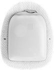
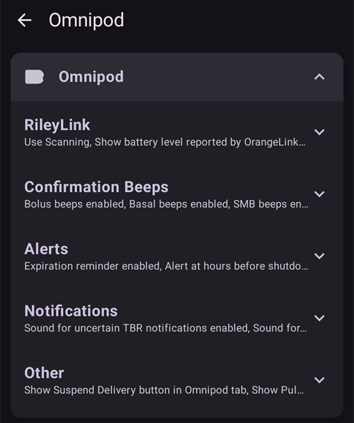
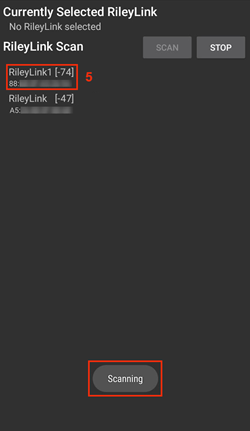
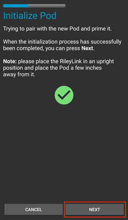
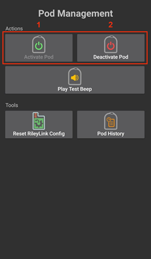
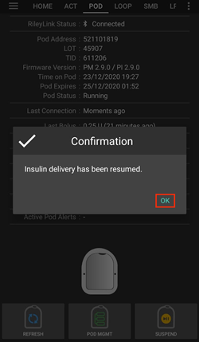
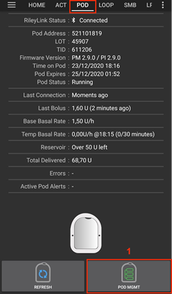
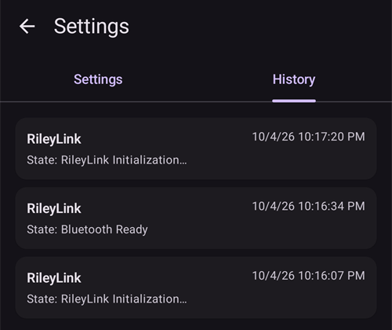

# Omnipod Eros

Deze instructies zijn voor het instellen van de Omnipod-pomp van de Eros-generatie (**GEEN Omnipod Dash**).

```{admonition} Omnipod Eros is being phased out
:class: note

Het [Omnipod System](https://www.omnipod.com/current-podders/resources/omnipod-system) (de originele Omnipod, met de Personal Diabetes Manager (PDM) en de Pod) stopt. De einddatum verschilt per land. In Canada is het bijvoorbeeld na 30 juni 2026 niet meer te krijgen. Gebruik je de Eros-pomp, plan dan op tijd de overstap naar een ondersteunde pomp.
```

**Deze software is onderdeel van een doe-het-zelf (DIY) kunstmatige alvleesklier. Het is geen kant-en-klaar product: JIJ moet het systeem lezen, leren en begrijpen, ook hoe je het gebruikt. Jij alleen bent verantwoordelijk voor wat je ermee doet.**

```{contents} Table of contents
:depth: 1
:local: true
```

## Benodigde hardware en software

- **Pod-communicatieapparaat**

> Onderdeel dat de communicatie doorgeeft tussen je telefoon met AAPS en pods van de Eros-generatie.
> 
> > -   [Website van OrangeLink](https://getrileylink.org/product/orangelink)
> > -  [433MHz RileyLink](https://getrileylink.org/product/rileylink433)
> > -   [Website van Emalink](https://github.com/sks01/EmaLink) - [Contactgegevens](mailto:getemalink@gmail.com)
> > -   DiaLink - [Contactgegevens](mailto:Boshetyn@ukr.net)
> > -   [Website van LoopLink](https://www.getlooplink.org/) - [Contactgegevens](https://jameswedding.substack.com/) - Niet getest

-   **Mobiele telefoon**

> Onderdeel waarop AAPS draait en dat opdrachten naar het pod-communicatieapparaat stuurt.
> 
> > - Een ondersteunde [Android-telefoon](#Phones-list-of-tested-phones) met **AAPS** en de bijbehorende onderdelen ingesteld.

-   **Apparaat voor insulinetoediening**

> Onderdeel dat de opdrachten uitvoert die het van het pod-communicatieapparaat krijgt, en die komen van je telefoon met AAPS.
> 
> > - Een nieuwe Omnipod-pod (Eros-generatie - **GEEN DASH**)

Deze instructies gaan ervan uit dat je een nieuwe podsessie start. Is dat niet zo, wees dan geduldig en begin met dit proces bij je volgende podwissel.

Op deze pagina betekent **RileyLink** elk van de pod-communicatieapparaten die hierboven staan.

## Voordat je begint

**VEILIGHEID VOOROP** - begin niet aan dit proces in een situatie waarin je een fout niet kunt herstellen (extra pods, insuline, een opgeladen RileyLink en telefoon zijn een must).

**Je Omnipod PDM werkt niet meer zodra de Omnipod-driver van AAPS je pod heeft geactiveerd**. Eerder gebruikte je je Omnipod PDM om opdrachten te verzenden naar je Eros-pod. Een Eros-pod kan slechts met één apparaat communiceren. Het apparaat dat de pod activeert is het enige apparaat dat vanaf dat moment met de pod kan communiceren. Dit betekent dat je je PDM **niet meer kunt gebruiken met je pod** zodra je een Omnipod Eros-pod hebt geactiveerd met je RileyLink via de Omnipod-driver van AAPS. De Omnipod-driver van AAPS met de RileyLink is nu je PDM. *Dit betekent NIET dat je je PDM moet weggooien. We raden aan om hem te bewaren als back-up en voor noodgevallen, als AAPS niet goed werkt.*

**Er kan maar één RileyLink tegelijk met een pod communiceren.** **AAPS** onthoudt één gekoppelde RileyLink. Als je een andere koppelt, vervangt die de vorige.

**Je pod stopt niet als de RileyLink buiten bereik is.** Als je RileyLink buiten bereik is of het signaal naar de actieve pod wordt geblokkeerd, blijft je pod basale insuline toedienen. Bij het activeren van een pod wordt het basaalprofiel uit AAPS in de nieuwe pod gezet. Als je contact verliest met de pod, gaat deze terug naar het ingestelde basaal profiel. Je kunt geen nieuwe opdrachten geven tot de RileyLink weer binnen bereik is en de verbinding opnieuw heeft gemaakt.

**Basaalprofielen met stappen van 30 minuten worden NIET ondersteund in AAPS.** Ben je nieuw met AAPS en stel je je basaalprofiel voor het eerst in? Let dan op: basaalstanden die op een half uur beginnen worden niet ondersteund. Je moet je basaalprofiel zo aanpassen dat elke stand op een heel uur begint. Bijvoorbeeld, als je een basaalstand hebt van 1,1 eenheden die om 9:30 begint en een duur heeft van 2 uur, dus eindigend om 11:30 uur, dan werkt dit niet.  Je moet deze basaalstand van 1,1 eenheid veranderen naar een tijdsperiode van 9:00–11:00 of 10:00–12:00.  De Omnipod-hardware ondersteunt wel stappen van 30 minuten in het basaalprofiel, maar de algoritmes van AAPS kunnen daar op dit moment niet mee rekenen.

## De Omnipod-driver inschakelen in AAPS

Je kunt de Omnipod-driver in AAPS op **twee manieren** inschakelen:

### Optie 1: De Setup Wizard

Na het installeren van een nieuwe versie van AAPS start de **Setup Wizard** automatisch. Heb je je instellingen al geëxporteerd van een eerdere installatie, dan kun je ze in de wizard importeren. Bij een nieuwe installatie ga je hieronder verder.

Doorloop de [Setup Wizard](../SettingUpAaps/SetupWizard.md) tot je bij de stap **Pomp** komt, en kies dan **Omnipod Eros** (de beschrijving is "Pompintegratie voor Omnipod Eros").


De Setup Wizard koppelt je RileyLink niet. Open na de wizard het Omnipod-pompscherm en koppel de RileyLink zoals beschreven in het [deel RileyLink instellen](#OmnipodEros-rileylink-setup).

**OF**

### Optie 2: Het scherm Configuratie

Open het **menu** (☰) linksboven > **Configuratie** > **Pomp** en kies het **keuzerondje** van **Omnipod Eros**.

Als het gekozen is, toont de kaart **Omnipod Eros** twee knoppen, **Instellingen** en **Plug-in openen**:


**Instellingen** opent de instellingen van de Omnipod-driver (zie [Omnipod-instellingen](#OmnipodEros-omnipod-settings)):



**Plug-in openen** opent het Omnipod-pompscherm. Je kunt het ook altijd openen vanaf het hoofdscherm met **Beheren** > **Pomp**. Op deze pagina heet dit het **Omnipod-pompscherm**. Voordat een RileyLink is gekoppeld en een pod is geactiveerd, ziet het er zo uit:


### Controleren of de Omnipod-driver is geselecteerd

Om te controleren of je de Omnipod-driver hebt ingeschakeld, open je **Beheren** > **Pomp** vanaf het hoofdscherm. Je zou het pompscherm van **Omnipod Eros** moeten zien, zoals hierboven. Als je nog geen RileyLink hebt gekoppeld, toont **RileyLink Status** de tekst **Niet gestart** en toont **Pod Status** de tekst **Geen actieve Pod**.

## Omnipod-configuratie

Alle functies voor de pod en de RileyLink zijn knoppen op het [Omnipod-pompscherm](#OmnipodEros-omnipod-pod-tab) (**Beheren** > **Pomp**). Sommige knoppen verschijnen alleen in bepaalde situaties, bijvoorbeeld als er een pod actief is.

>  Verbinding en status van de pod vernieuwen
> 
>  Podbeheer (activeren, deactiveren, testpieptoon afspelen, RileyLink-statistieken en podgeschiedenis)

```{admonition} Older screenshot
:class: note
De schermafbeeldingen hierboven komen uit een eerdere versie van **AAPS**. In **AAPS** 4 is er geen knop **POD MGMT** en geen menu Podbeheer: **Vernieuwen** en alle acties voor podbeheer zijn knoppen op het Omnipod-pompscherm.
```

(OmnipodEros-rileylink-setup)=

### RileyLink instellen

Heb je je RileyLink al gekoppeld, ga dan verder met het [deel Een Pod activeren](#OmnipodEros-activating-a-pod) hieronder.

*Let op: een goed zichtbaar teken dat de RileyLink niet verbonden is: de behandelknoppen (QuickLaunch-werkbalk) op het hoofdscherm ontbreken. Dit gebeurt ook ongeveer de eerste 30 seconden nadat AAPS is gestart, omdat AAPS dan verbinding maakt met de RileyLink.*

1. Zorg dat je RileyLink volledig is opgeladen en aan staat.

2. Leg de RileyLink [dicht bij je telefoon](#OmnipodEros-optimal-omnipod-and-rileylink-positioning) (~30 cm of minder).

3. Open het Omnipod-pompscherm (**Beheren** > **Pomp**) en druk op **Koppel RileyLink**.

4. Het scherm **Koppel RileyLink** begint meteen te zoeken naar Bluetooth-apparaten. Tik op je RileyLink in de lijst met gevonden apparaten.

   

5. Als **RileyLink succesvol gekoppeld** verschijnt met de naam en het adres van je apparaat, druk dan op **OK**.

6. Controleer op het Omnipod-pompscherm dat **RileyLink Status** verandert in **Verbonden**. **Pod Status** moet **Geen actieve Pod** tonen. Als de RileyLink geen verbinding maakt, druk dan op **Reset RileyLink** of start **AAPS** opnieuw.

 

 


```{admonition} Older screenshot
:class: note
De zes schermafbeeldingen hierboven (na stap 6) komen uit een eerdere versie van **AAPS**. In **AAPS** 4 koppel je de RileyLink met de knop **Koppel RileyLink** op het Omnipod-pompscherm, in plaats van met **RileyLink Configuration** in de Omnipod-instellingen. Het zoeken start automatisch.
```

```{note}
Om naar een andere RileyLink te wisselen (bijvoorbeeld een reserveapparaat), druk je opnieuw op **Koppel RileyLink** en kies je het nieuwe apparaat. Het vervangt het apparaat dat eerder gekoppeld was. Je hoeft het oude apparaat niet eerst te verwijderen.
```

(OmnipodEros-activating-a-pod)=

### Een Pod activeren

Voordat je een pod kunt activeren, moet je RileyLink gekoppeld zijn en moet **RileyLink Status** de tekst **Verbonden** tonen. De knop **Activeer Pod** blijft uitgeschakeld tot de RileyLink klaar is.

*LET OP: Om veiligheidsredenen werkt de communicatie met de pod bij het activeren (koppelen) alleen op korte afstand. Vóór het activeren is het radiosignaal van een Pod zwakker, maar nadat deze geactiveerd is zal het radiosignaal op volle sterkte werken. Zorg tijdens deze handelingen dat je pod* [dichtbij](#OmnipodEros-optimal-omnipod-and-rileylink-positioning) *is (~30 cm of minder), maar niet op of vlak naast de RileyLink.*

01. Open het Omnipod-pompscherm (**Beheren** > **Pomp**) en druk op **Activeer Pod**.

    Heb je nog nooit een profiel geactiveerd, dan verschijnt eerst de stap **Profiel vereist**. Selecteer het profiel om toe te passen bij activering.

    >   
    > 
    > ```{admonition} Older screenshot
    >     :class: note
    >     De schermafbeeldingen hierboven komen uit een eerdere versie van **AAPS**. In **AAPS** 4 is **Activeer Pod** een knop op het Omnipod-pompscherm, in plaats van in het menu **POD MGMT**.
    > ```

02. Het scherm **Pod vullen** wordt getoond. Vul een nieuwe pod met genoeg insuline voor 3 dagen en luister naar twee pieptonen. Die betekenen dat de minimale hoeveelheid van 80 eenheden is gevuld. Maak de vulspuit helemaal leeg, ook nadat je de twee piepjes hebt gehoord. Houd er bij het berekenen van de insuline die je voor 3 dagen nodig hebt rekening mee dat het voorvullen van de pod 12 tot 15 eenheden kost. Haal de naalddop nog niet van de pod.

    > 
    > 
    > Zorg dat de nieuwe pod en de RileyLink dicht bij elkaar liggen (~30 cm of minder) en druk op **Volgende**.

03. **Selecteer insuline** (alleen als je meer dan één insuline hebt ingesteld): kies de insuline waarmee je de pod vult en druk op **Volgende**. Na het activeren wordt een profielwissel met deze insuline uitgevoerd.

04. Op het scherm **Pod initialiseren** begint de pod met voorvullen (je hoort een klik, gevolgd door een reeks tikgeluiden terwijl de pod zichzelf vult). Als de RileyLink buiten bereik is van de pod die je activeert, krijg je de foutmelding **Geen reactie van de Pod**. Als dit gebeurt, [leg de RileyLink dichter](#OmnipodEros-optimal-omnipod-and-rileylink-positioning) (~30 cm of minder) bij de Pod, maar niet op of vlak naast de Pod, en druk op **Opnieuw**.

    >  

05. Als het voorvullen gelukt is, verschijnt een groen vinkje en kun je op **Volgende** drukken. Druk op **Volgende**.

    > 

06. **Plaatsingsplek** (alleen als **Plaatsingslocatie pomp beheren** aan staat in [Site rotatie](#Aapsscreens-site-rotation)): kies waar je de pod op je lichaam plakt en druk op **Volgende**.

07. Het scherm **Plaats de Pod** wordt getoond. Maak de plek voor de nieuwe pod klaar. Haal het plastic naaldkapje en het witte papier van de plakstrip van de pod, en plak de pod op de gekozen plek op je lichaam. Als de canule naar buiten steekt, druk dan op **Annuleren** en gooi de pod weg. Druk daarna op **Volgende**.

    > 

08. Er verschijnt een bevestiging: "Als je op OK drukt, wordt de canule ingebracht". **Druk ALLEEN op OK als je klaar bent om de canule in te brengen**.

    > 

09. Op het scherm **Canule inbrengen** kan het even duren voordat de Omnipod reageert en de canule inbrengt (maximaal 1–2 minuten). Wees dus geduldig.

    > Als de RileyLink buiten bereik is van de pod die je activeert, krijg je de foutmelding **Geen reactie van de Pod**. Als dit gebeurt, leg de RileyLink dan dichter (~30 cm of minder) bij de Pod, maar niet op of vlak naast de Pod, en druk op **Opnieuw**.
    > 
    > Als de RileyLink buiten het Bluetooth-bereik is of geen actieve verbinding met de telefoon heeft, krijg je de foutmelding **Geen reactie van RileyLink**. Als dit gebeurt, leg de RileyLink dan dichter bij de telefoon en druk op **Opnieuw**.
    > 
    > *OPMERKING: Voordat de canule wordt ingebracht, wordt aangeraden om een huidplooi te pakken op de plaats waar de canule gaat worden ingebracht. Dit zorgt voor het soepel inbrengen van de canule en zal de kans op verstoppingen verminderen.*
    > 
    > 
    > 
    >  

10. Als de canule goed is ingebracht, verschijnt er een groen vinkje en kun je op **Volgende** drukken. Druk op **Volgende**.

    > 

11. Het scherm **Pod geactiveerd** wordt getoond. Controleer of de canule goed is ingebracht, en vervang je pod als je denkt dat dat niet zo is. Druk op **Voltooien**. Gefeliciteerd! Je hebt nu een nieuwe actieve podsessie gestart.

    >  
    > 
    > ```{admonition} Older screenshot
    >     :class: note
    >     De schermafbeeldingen bij stap 2 tot 11 komen uit een eerdere versie van **AAPS** en kunnen er in **AAPS** 4 anders uitzien. De stappen **Selecteer insuline** en **Plaatsingsplek** staan niet op de afbeeldingen.
    > ```

12. Je komt terug op het Omnipod-pompscherm. De knop **Activeer Pod** wordt vervangen door **Deactiveer Pod**, omdat je geen andere pod kunt activeren zonder eerst de actieve pod te deactiveren.

    Het pompscherm toont nu informatie over je actieve pod, zoals de huidige basaalstand, het reservoirniveau, de toegediende insuline, fouten en waarschuwingen van de pod. Zie het deel [Omnipod-pompscherm](#OmnipodEros-omnipod-pod-tab) voor meer informatie.

     

    ```{admonition} Older screenshot
    :class: note
    De schermafbeeldingen hierboven komen uit een eerdere versie van **AAPS**. In **AAPS** 4 is er geen menu Podbeheer: je komt direct terug op het Omnipod-pompscherm, waar **Deactiveer Pod** de plaats inneemt van **Activeer Pod**.
    ```

```{note}
Als het activeren na het voorvullen werd onderbroken (bijvoorbeeld omdat de app werd gesloten), druk dan opnieuw op **Activeer Pod**. De wizard gaat verder met de stappen voor het inbrengen van de canule.
```

### Een Pod deactiveren

Normaal gesproken gaat een pod drie dagen mee (72 uur) en nog 8 uur extra nadat hij een waarschuwing heeft gegeven voor het verlopen van de pod. In totaal kan een pod dus maximaal 80 uur meegaan.

Om een pod uit te schakelen (nadat hij zijn maximale looptijd heeft bereikt, of nadat hij een foutmelding heeft gegeven):

1. Open het Omnipod-pompscherm (**Beheren** > **Pomp**) en druk op **Deactiveer Pod**.

   >   
   > 
   > ```{admonition} Older screenshot
   >    :class: note
   >    De schermafbeeldingen hierboven komen uit een eerdere versie van **AAPS**. In **AAPS** 4 is **Deactiveer Pod** een knop op het Omnipod-pompscherm, in plaats van in het menu **POD MGMT**.
   > ```

2. Zorg op het scherm **Deactiveer Pod** eerst dat de RileyLink dicht bij de pod ligt, maar niet op of vlak naast de pod. Druk dan op **Volgende**. Een venster vraagt: *Een gedeactiveerde Pod kan niet opnieuw worden gebruikt. Nu deze Pod deactiveren?* Druk op **OK** om de pod te deactiveren, of op **Annuleren** om hem te houden. Deactiveren stopt alle insulinetoediening en kan niet ongedaan worden gemaakt.

   > 

3. Het scherm **Pod wordt gedeactiveerd** verschijnt, en de pod geeft een pieptoon om te bevestigen dat het deactiveren gelukt is.

   > 
   > 
   > **ALS het deactiveren mislukt** en je geen bevestigingspieptoon hoort, krijg je misschien de melding **Geen reactie van RileyLink** of **Geen reactie van de Pod**. Druk op **Opnieuw** om het deactiveren nog eens te proberen. Blijft het deactiveren mislukken, druk dan op **Pod verwijderen** en bevestig. **AAPS** vergeet de pod dan. De insulinetoediening is **niet** onderbroken, dus haal de pod van je lichaam. Geeft je pod een gillend alarm, dan moet je dat misschien met de hand stil zetten (met een speld of paperclip), want **Pod verwijderen** zet het alarm niet stil.
   > 
   > >   

4. Er verschijnt een groen vinkje als het deactiveren gelukt is. Druk op **Volgende** om het scherm **Pod gedeactiveerd** te tonen. Je kunt de pod nu verwijderen omdat de actieve sessie is gedeactiveerd.

   > 

5. Druk op **Voltooien** om terug te gaan naar het Omnipod-pompscherm.

   >  
   > 
   > ```{admonition} Older screenshot
   >    :class: note
   >    De schermafbeeldingen bij stap 2 tot 5 komen uit een eerdere versie van **AAPS** en kunnen er in **AAPS** 4 anders uitzien.
   > ```

6. Controleer op het Omnipod-pompscherm dat **RileyLink Status** de tekst **Verbonden** toont, en **Pod Status** de tekst **Geen actieve Pod**.

   >    
   > 
   > ```{admonition} Older screenshot
   >    :class: note
   >    De schermafbeeldingen hierboven komen uit een eerdere versie van **AAPS**. In **AAPS** 4 brengt **Voltooien** je direct terug naar het Omnipod-pompscherm; er is geen menu Podbeheer en geen tabblad **Omnipod (POD)**.
   > ```

### Insulinetoediening onderbreken en hervatten

Hieronder lees je hoe je de insulinetoediening onderbreekt en hervat.

*LET OP - zie je geen knop **Onderbreken***, dan is die standaard verborgen. Zet **Knop voor het onderbreken van insuline toediening weergeven op het Omnipod-tabblad** aan in de [Omnipod-instellingen](#OmnipodEros-omnipod-settings) onder **Andere**.

#### Insulinetoediening onderbreken

Gebruik dit commando om de insulinetoediening van de actieve pod te onderbreken. In deze onderbroken status zal de pod geen insuline meer leveren. Dit commando bootst het onderbreek-commando na die de Omnipod PDM ook naar een actieve pod stuurt.

1. Open het Omnipod-pompscherm (**Beheren** > **Pomp**) en druk op **Onderbreken**. De opdracht om te onderbreken gaat via de RileyLink naar de actieve pod.

2. Als de pod alle insulinetoediening heeft onderbroken, toont **Pod Status** de tekst **Onderbroken** en wordt de knop **Onderbreken** vervangen door **Toediening hervatten**.

   >  
   > 
   > 
   > 
   >  
   > 
   > ```{admonition} Older screenshot
   >    :class: note
   >    De schermafbeeldingen hierboven komen uit een eerdere versie van **AAPS**. In **AAPS** 4 gebeuren deze stappen op het Omnipod-pompscherm in plaats van op het tabblad **Omnipod (POD)**, en het resultaat staat bij **Pod Status**.
   > ```

Als de opdracht mislukt, toont een venster **Waarschuwing** de tekst "Onderbreken van insulinetoediening is mislukt" met de reden. Controleer de verbinding met de RileyLink en probeer het opnieuw.

#### Insulinetoediening hervatten

Gebruik dit commando om de actieve, momenteel onderbroken pod, opdracht te geven om de afgifte van insuline weer te hervatten. Als de opdracht goed is verwerkt, wordt de insuline weer normaal toegediend. Daarvoor wordt de basaalstand gebruikt die op dit tijdstip in het actieve basaalprofiel staat. De pod accepteert vanaf nu weer opdrachten voor bolus, TBR, en SMB.

1. Open het Omnipod-pompscherm en controleer dat **Pod Status** de tekst **Onderbroken** toont. Druk op **Toediening hervatten**.

2. Als de opdracht lukt, toont **Pod Status** weer **Actief** en verdwijnt de knop **Toediening hervatten** (de knop **Onderbreken** verschijnt weer als je die hebt aangezet).

   >  
   > 
   > 
   > 
   >  
   > 
   > ```{admonition} Older screenshot
   >    :class: note
   >    De schermafbeeldingen hierboven komen uit een eerdere versie van **AAPS**. In **AAPS** 4 gebeuren deze stappen op het Omnipod-pompscherm in plaats van op het tabblad **Omnipod (POD)**, en het resultaat staat bij **Pod Status**.
   > ```

Als de opdracht mislukt, toont een venster **Waarschuwing** de tekst "Hervatten van insulinetoediening is mislukt" met de reden. Controleer de verbinding met de RileyLink en probeer het opnieuw.

### Pod-alarmen stilzetten

*LET OP - De knop **Alarmen dempen** staat alleen op het Omnipod-pompscherm als de pod een actieve waarschuwing heeft (bijvoorbeeld de waarschuwing dat de pod verloopt of dat het reservoir bijna leeg is), en alleen als **Podwaarschuwingen automatisch bevestigen** uit staat.*

Hieronder lees je hoe je de pieptonen van de pod stil zet die beginnen als de pod de waarschuwingstijd voor het verlopen bereikt. Deze waarschuwingstijd stel je in met **Waarschuwing op uren voor uitschakelen (80 uur)** in de Omnipod-instellingen onder **Waarschuwingen**. Een pod gaat maximaal 80 uur mee (3 dagen en 8 uur), maar Insulet raadt aan de grens van 72 uur (3 dagen) niet te overschrijden.

*LET OP - Heb je **Podwaarschuwingen automatisch bevestigen** aangezet in de Omnipod-instellingen onder **Waarschuwingen**, dan zet **AAPS** de waarschuwing automatisch stil bij de volgende communicatie met de pod. Je hoeft het dan NIET met de hand te doen.*

1. Als de waarschuwingstijd is bereikt, piept de pod om je te vertellen dat hij binnenkort verloopt en vervangen moet worden. Op het Omnipod-pompscherm toont **Pod verloopt** het precieze tijdstip waarop de pod verloopt (72 uur na het activeren); 4 uur daarvoor wordt het **geel**. **Harde einddatum Pod** toont wanneer de pod stopt met het toedienen van insuline. **Actieve pod alarmen** toont **Pod verloopt binnenkort**, en de knop **Alarmen dempen** verschijnt. **AAPS** toont ook een melding dat de pod binnenkort verloopt.

   >   
   > 
   > ```{admonition} Older screenshot
   >    :class: note
   >    De schermafbeeldingen hierboven komen uit een eerdere versie van **AAPS**. In **AAPS** 4 heet de knop **ACK ALERTS** nu **Alarmen dempen** en staat hij op het Omnipod-pompscherm.
   > ```

2. Druk op **Alarmen dempen**. De RileyLink stuurt de opdracht naar de pod om de pieptonen voor het verlopen te stoppen.

   >  
   > 
   > ```{admonition} Older screenshot
   >    :class: note
   >    De schermafbeelding hierboven komt uit een eerdere **AAPS**-versie. In **AAPS** 4 heet de knop **Alarmen dempen**.
   > ```

3. Als de waarschuwingen stil zijn gezet, piept de pod twee keer. **Actieve pod alarmen** toont de waarschuwing niet meer, de knop **Alarmen dempen** verdwijnt en de pod stopt met de pieptonen voor het verlopen.

   >  
   > 
   > ```{admonition} Older screenshot
   >    :class: note
   >    De schermafbeelding hierboven komt uit een eerdere **AAPS**-versie. In **AAPS** 4 staat het resultaat op het Omnipod-pompscherm: de waarschuwing verdwijnt uit **Actieve pod alarmen**.
   > ```

Als de opdracht mislukt (bijvoorbeeld omdat de RileyLink buiten bereik van de pod is), toont een venster **Waarschuwing** de tekst "Meldingen negeren mislukt" met de reden. Leg de RileyLink dichter bij de pod en probeer het opnieuw.


```{admonition} Older screenshot
:class: note
De schermafbeelding hierboven komt uit een eerdere **AAPS**-versie. In **AAPS** 4 toont het venster **Waarschuwing** de tekst "Meldingen negeren mislukt" met de reden.
```

(OmnipodEros-view-pod-history)=

### Pod Historie bekijken

Deze sectie toont je hoe je je actieve pod geschiedenis kunt beoordelen en kan filteren op verschillende actiecategorieën. Met de podgeschiedenis kun je de acties en resultaten bekijken die naar je huidige actieve pod zijn gestuurd tijdens zijn levensduur van drie dagen (72–80 uur).

Dit is handig om te controleren of bolussen, TBR's en basaalwijzigingen echt zijn uitgevoerd als je daar niet zeker van bent. De andere categorieën zijn vooral handig bij het oplossen van problemen en om te zien in welke volgorde dingen gebeurden voordat er iets misging.

*LET OP:* **Onzekere** opdrachten verschijnen in de podgeschiedenis, maar door hun aard kun je niet zeker zijn dat ze kloppen.

1. Open het Omnipod-pompscherm (**Beheren** > **Pomp**) en druk op **Pod Historie**.

   >   
   > 
   > ```{admonition} Older screenshot
   >    :class: note
   >    De schermafbeeldingen hierboven komen uit een eerdere versie van **AAPS**. In **AAPS** 4 is **Pod Historie** een knop op het Omnipod-pompscherm, in plaats van in het menu **POD MGMT**.
   > ```

2. Het scherm **Pod Historie** toont alle acties van de pod en hun resultaten, de nieuwste eerst, per dag gegroepeerd. Standaard is **Alle** gekozen. Tik bovenaan op een van de filterknoppen om maar één categorie te tonen. Met de terugpijl linksboven ga je terug naar het Omnipod-pompscherm.

   > 

   >  
   > 
   > ```{admonition} Older screenshot
   >    :class: note
   >    De tweede schermafbeelding komt uit een eerdere versie van **AAPS** en kan er in **AAPS** 4 anders uitzien.
   > ```

### RileyLink-instellingen en -geschiedenis bekijken

Het scherm **RileyLink statistieken** toont de instellingen van je RileyLink en de actieve pod, en de communicatiegeschiedenis van allebei. Het heeft twee tabbladen: **Instellingen** en **Geschiedenis**.

De knop **RileyLink statistieken** is standaard verborgen. Om de knop op het Omnipod-pompscherm te tonen, zet je **Knop voor RileyLink statistieken weergeven in het Omnipod-tabblad** aan in de [Omnipod-instellingen](#OmnipodEros-omnipod-settings) onder **Andere**.

#### De Bluetooth-verbinding met het pod-communicatieapparaat handmatig herstellen

Als je pod-communicatieapparaat een tijd buiten het Bluetooth-bereik van je telefoon was, kan **RileyLink Status** op het Omnipod-pompscherm **RileyLink onbereikbaar** tonen. **AAPS** maakt normaal vanzelf weer verbinding als het apparaat weer binnen bereik is. Als dat niet gebeurt:

1. Zorg dat de RileyLink aan staat, opgeladen is en dicht bij je telefoon ligt.

2. Druk op het Omnipod-pompscherm op **Reset RileyLink**. Een bericht bevestigt **Reset RileyLink configuratie**. Zie de [opmerkingen over Reset RileyLink](#OmnipodEros-reset-rileylink-config-notes) hieronder.

3. Als de **Bluetooth-verbinding** niet terugkomt, zet dan de Bluetooth-functie van je telefoon met de hand **uit** en weer **aan**.

4. Komt de verbinding nog steeds niet terug, druk dan op **Koppel RileyLink** en kies je RileyLink opnieuw.

5. Na een gelukte nieuwe verbinding toont **RileyLink Status** de tekst **Verbonden**. Je kunt ook **Verbindingsstatus** controleren op het tabblad **Instellingen** van het scherm **RileyLink statistieken**. Gefeliciteerd, je pod-communicatieapparaat is weer verbonden met AAPS!

 


```{admonition} Older screenshot
:class: note
De schermafbeeldingen hierboven komen uit een eerdere versie van **AAPS**. In **AAPS** 4 maak je opnieuw verbinding met **Reset RileyLink** of **Koppel RileyLink** op het Omnipod-pompscherm, in plaats van met de vernieuwknop op het scherm RileyLink Settings.
```

#### Instellingen van het pod-communicatieapparaat en de actieve pod

Dit scherm toont informatie en status van het pod-communicatieapparaat dat nu gekoppeld is en van de Omnipod Eros-pod die nu actief is. De informatie wordt automatisch vernieuwd.

1. Open het Omnipod-pompscherm (**Beheren** > **Pomp**) en druk op **RileyLink statistieken**. Het tabblad **Instellingen** toont je gekoppelde **RileyLink** en de actieve pod (**Apparaat**).

   >   
   > 
   > ```{admonition} Older screenshot
   >    :class: note
   >    De schermafbeeldingen hierboven komen uit een eerdere versie van **AAPS**. In **AAPS** 4 is **RileyLink statistieken** een knop op het Omnipod-pompscherm, in plaats van in het menu **POD MGMT**.
   > ```

   > 

##### Velden van de RileyLink

> - **Adres:** MAC-adres van het gekoppelde pod-communicatieapparaat.
> - **Naam:** Bluetooth-naam van het gekoppelde pod-communicatieapparaat.
> - **Batterijniveau:** het huidige batterijniveau van het verbonden pod-communicatieapparaat. Alleen zichtbaar als **Toon batterijniveau van OrangeLink/EmaLink/DiaLink** aan staat.
> - **Verbindingsstatus**: de huidige status van de Bluetooth-verbinding tussen het pod-communicatieapparaat en de telefoon met AAPS.
> - **Verbindingsfout:** als er een fout is in de Bluetooth-verbinding met het pod-communicatieapparaat, staan de details hier.
> - **Firmwareversie:** de firmwareversie van het pod-communicatieapparaat dat nu verbonden is.

##### Velden van het apparaat - met een actieve pod

> - **Apparaattype:** het type apparaat dat met het pod-communicatieapparaat communiceert (Omnipod (Eros)).
> - **Geconfigureerd apparaatmodel:** het model van het apparaat dat is ingesteld om met het pod-communicatieapparaat te communiceren.
> - **Verbonden apparaatmodel:** het model van het apparaat dat nu met het pod-communicatieapparaat communiceert.
> - **Serienummer van de pomp:** serienummer van de pod die nu geactiveerd is.
> - **Pompfrequentie:** radiofrequentie die gebruikt wordt om met de pod te communiceren.
> - **Laatst gebruikte frequentie:** laatst bekende radiofrequentie die de pod gebruikte om met het pod-communicatieapparaat te communiceren.
> - **Laatste contact met apparaat:** datum en tijd van het laatste contact tussen de pod en het pod-communicatieapparaat.

(omnipod-eros-rileylink-and-active-pod-history)=
#### Geschiedenis van RileyLink en actieve pod

Dit tabblad toont, de nieuwste eerst, elke status of actie van de RileyLink of van de pod die nu verbonden is. De geschiedenis is alleen beschikbaar voor de pod die nu actief is. Na een podwissel wordt deze geschiedenis gewist, en worden alleen gebeurtenissen van de nieuw geactiveerde pod vastgelegd en getoond.

1. Open het Omnipod-pompscherm (**Beheren** > **Pomp**), druk op **RileyLink statistieken** en tik dan op het tabblad **Geschiedenis**.

   >   
   > 
   > ```{admonition} Older screenshot
   >    :class: note
   >    De schermafbeeldingen hierboven komen uit een eerdere versie van **AAPS**. In **AAPS** 4 is **RileyLink statistieken** een knop op het Omnipod-pompscherm, in plaats van in het menu **POD MGMT**.
   > ```

   > 

##### Velden

Elke regel toont:

> - **Apparaat:** het apparaat waar de actie of status bij hoort.
> - **Tijd:** het tijdstip van de gebeurtenis.
> - **Status of actie:** de status van het apparaat of de actie die het uitvoerde.

(OmnipodEros-omnipod-pod-tab)=

## Omnipod-pompscherm

Hieronder staat uitleg over de statusvelden en knoppen op het **Omnipod-pompscherm** (**Beheren** > **Pomp**, of **Configuratie** > **Pomp** > **Plug-in openen**).

Het tandwiel rechtsboven opent de [Omnipod-instellingen](#OmnipodEros-omnipod-settings).

*LET OP: als een statusveld (onzeker) toont, druk dan op **Vernieuwen** om de podstatus te vernieuwen en dit te wissen.*


```{admonition} Older screenshot
:class: note
De schermafbeelding hierboven komt uit een eerdere versie van **AAPS**, waarin dit scherm het tabblad **Omnipod (POD)** was. In **AAPS** 4 is het het Omnipod-pompscherm, en sommige veldnamen en knoppen zijn anders.
```

### Velden

- **RileyLink Status:** toont de huidige verbindingsstatus van de RileyLink. Fouten worden in het rood getoond.

- *Niet gestart* - er is nog geen RileyLink gekoppeld, of de verbinding is nog niet gestart.
- *RileyLink onbereikbaar* - het pod-communicatieapparaat is buiten het Bluetooth-bereik van de telefoon, staat uit of heeft een storing waardoor Bluetooth-communicatie niet lukt.
- *RileyLink gereed* - het pod-communicatieapparaat staat aan en is de Bluetooth-verbinding aan het opzetten.
- *Verbonden* - het pod-communicatieapparaat staat aan, is verbonden en kan via Bluetooth communiceren.

- **Uniek ID:** toont het adres van de actieve pod.

- **LOT Nummer:** toont het LOT-nummer van de actieve pod.

- **Volgnummer:** toont het serienummer (TID) van de pod.

- **Firmware versie:** toont de firmwareversie van de actieve pod.

- **Tijd op Pod:** toont de huidige tijd op de actieve pod. Het wordt gemarkeerd als het meer dan 5 minuten afwijkt van de tijd op de telefoon.

- **Pod verloopt:** toont de datum en tijd waarop de actieve pod verloopt. De tekst wordt geel in de laatste 4 uur voor dit moment. Hij wordt nooit rood, omdat de pod daarna nog insuline blijft toedienen.

- **Harde einddatum Pod:** toont het einde van de extra tijd van de pod (8 uur na **Pod verloopt**, voor een maximale levensduur van de pod van 80 uur). De tekst wordt geel als de extra tijd begint (bij **Pod verloopt**) en rood in de laatste 4 uur voor het harde einde. Tijdens de extra tijd toont het veld ook de resterende tijd, bijvoorbeeld *(17m resterend)*. Bij het harde einde stopt de pod met insuline toedienen en moet hij vervangen worden.

- **Pod Status:** toont de status van de actieve pod (bijvoorbeeld **Geen actieve Pod**, **Actief** of **Onderbroken**).

- **Laatste verbinding:** toont wanneer er voor het laatst communicatie was met de actieve pod. De tekst wordt rood als de [maximale tijd pomp onbereikbaar](#OmnipodEros-troubleshooting) is overschreden.

- *Zojuist* - minder dan 20 seconden geleden.
- *Minder dan een minuut geleden* - meer dan 20 seconden, maar minder dan 60 seconden geleden.
- *1 minuut geleden* - meer dan 60 seconden, maar minder dan 120 seconden (2 min)
- *XX minuten geleden* - meer dan 2 minuten geleden gedefinieerd door de waarde van XX

- **Laatste bolus:** toont de dosis van de laatste bolus die naar de actieve pod is gestuurd, en tussen haakjes hoe lang geleden dat was.

- **Basis basaalstand:** toont de basaalstand uit het basaalprofiel voor het huidige tijdstip.

- **Tijdelijke basaalstand:** alleen zichtbaar terwijl er een tijdelijke basaalstand loopt. Hij wordt zo getoond:

- Eenheden per uur @ tijdstip waarop de TBR is gestart (gelopen minuten / totaal aantal minuten van de TBR)
- *Voorbeeld:* 0,00 E/u @18:25 ( 90/120 minuten)

- **Reservoir:** toont **Meer dan 50 E over** als er meer dan 50 eenheden in het reservoir zitten. Onder deze waarde wordt het geschatte aantal eenheden getoond. De tekst wordt rood onder de drempel voor een bijna leeg reservoir die je instelt in de [instellingen Waarschuwingen](#OmnipodEros-omnipod-settings).

- **Totaal toegediend:** toont het totale aantal eenheden insuline dat uit het reservoir is toegediend. *Dit is een schatting, omdat het vullen en voorvullen van de pod geen exact proces is.*

- **Actieve pod alarmen:** voor waarschuwingen die nu actief zijn op de actieve pod. Wordt meestal gebruikt als de pod ouder is dan 72 uur en de eigen pieptonen van de pod klinken.

- **Foutmeldingen:** toont de laatste fout (in het rood). Bekijk de [podgeschiedenis](#OmnipodEros-view-pod-history), de [RileyLink-geschiedenis](#omnipod-eros-rileylink-and-active-pod-history) en de logbestanden voor eerdere fouten en meer informatie.

### Knoppen

De knoppen onderaan het pompscherm veranderen afhankelijk van de situatie. Knoppen die je nu niet kunt gebruiken zijn grijs, bijvoorbeeld als de RileyLink niet verbonden is.

**Knoppen voor de podstatus** (zichtbaar als er een pod actief is):

- **Vernieuwen:** stuurt een opdracht naar de actieve pod om de status bij te werken. Gebruik deze knop om de podstatus te vernieuwen en statusvelden met de tekst (onzeker) te wissen. Zie het [deel Probleemoplossing](#OmnipodEros-troubleshooting) hieronder voor meer informatie.

  

  ```{admonition} Older screenshot
  :class: note
  De schermafbeelding hierboven komt uit een eerdere versie van **AAPS**. In **AAPS** 4 is dit een tekstknop met de naam **Vernieuwen** op het Omnipod-pompscherm.
  ```

- **Alarmen dempen:** zet de pieptonen en meldingen voor het verlopen van de pod en een bijna leeg reservoir stil. Alleen zichtbaar als de pod een actieve waarschuwing heeft en **Podwaarschuwingen automatisch bevestigen** uit staat. Nadat de waarschuwingen stil zijn gezet, verdwijnt de knop.

  

  ```{admonition} Older screenshot
  :class: note
  De schermafbeelding hierboven komt uit een eerdere versie van **AAPS**. In **AAPS** 4 heet deze knop **Alarmen dempen**.
  ```

- **Tijd instellen:** zet de tijd op de pod gelijk aan de huidige tijd op je telefoon. Alleen zichtbaar als de tijd op de pod meer dan 5 minuten afwijkt van de tijd op de telefoon.

  

  ```{admonition} Older screenshot
  :class: note
  De schermafbeelding hierboven komt uit een eerdere versie van **AAPS**. In **AAPS** 4 is dit een tekstknop met de naam **Tijd instellen** op het Omnipod-pompscherm.
  ```

- **Onderbreken:** onderbreekt de insulinetoediening van de actieve pod. Alleen zichtbaar als dit aan staat in de instellingen (**Knop voor het onderbreken van insuline toediening weergeven op het Omnipod-tabblad**).

  

  ```{admonition} Older screenshot
  :class: note
  De schermafbeelding hierboven komt uit een eerdere versie van **AAPS**. In **AAPS** 4 is dit een tekstknop met de naam **Onderbreken** op het Omnipod-pompscherm.
  ```

- **Toediening hervatten:** hervat de insulinetoediening van de actieve pod die nu onderbroken is. Alleen zichtbaar terwijl de pod onderbroken is.

  

  ```{admonition} Older screenshot
  :class: note
  De schermafbeelding hierboven komt uit een eerdere versie van **AAPS**. In **AAPS** 4 is dit een tekstknop met de naam **Toediening hervatten** op het Omnipod-pompscherm.
  ```

**Knoppen voor pod- en RileyLink-beheer:**


```{admonition} Older screenshot
:class: note
De schermafbeelding hierboven komt uit een eerdere **AAPS**-versie. In **AAPS** 4 is er geen menu Podbeheer: deze acties zijn knoppen direct op het Omnipod-pompscherm.
```

- **Activeer Pod:** vult (voorvullen) en activeert een nieuwe pod. Getoond als er geen pod actief is. De knop is alleen te gebruiken als de RileyLink verbonden is.

  

  ```{admonition} Older screenshot
  :class: note
  De schermafbeelding hierboven komt uit een eerdere versie van **AAPS**. In **AAPS** 4 is **Activeer Pod** een knop op het Omnipod-pompscherm, in plaats van in het menu Podbeheer.
  ```

- **Deactiveer Pod:** deactiveert de pod die nu actief is. Zichtbaar zodra een pod gekoppeld is, ook als het activeren halverwege is gestopt (bijvoorbeeld omdat de pod tijdens het activeren een fout gaf). De knop is alleen te gebruiken als de RileyLink verbonden is. **AAPS** vraagt je om te bevestigen voordat het de pod deactiveert.

- Gebruik deze opdracht om een pod te deactiveren die een gillend alarm geeft (fout 49).
- Als het deactiveren mislukt, biedt de deactiveringswizard de optie **Pod verwijderen**.

  

  ```{admonition} Older screenshot
  :class: note
  De schermafbeelding hierboven komt uit een eerdere versie van **AAPS**. In **AAPS** 4 is **Deactiveer Pod** een knop op het Omnipod-pompscherm, in plaats van in het menu Podbeheer.
  ```

- **Testpieptoon afspelen:** laat de pod één testpieptoon geven als je erop drukt. Zichtbaar als er een pod gekoppeld is.

  

  ```{admonition} Older screenshot
  :class: note
  De schermafbeelding hierboven komt uit een eerdere versie van **AAPS**. In **AAPS** 4 is **Testpieptoon afspelen** een knop op het Omnipod-pompscherm, in plaats van in het menu Podbeheer.
  ```

- **Pod Historie:** toont de activiteitengeschiedenis van de actieve pod. Zie [Podgeschiedenis bekijken](#OmnipodEros-view-pod-history).

  

  ```{admonition} Older screenshot
  :class: note
  De schermafbeelding hierboven komt uit een eerdere versie van **AAPS**. In **AAPS** 4 is **Pod Historie** een knop op het Omnipod-pompscherm, in plaats van in het menu Podbeheer.
  ```

- **Koppel RileyLink:** zoekt naar je pod-communicatieapparaat en koppelt het. Zie [RileyLink instellen](#OmnipodEros-rileylink-setup).

- **RileyLink statistieken:** opent het scherm RileyLink statistieken met twee tabbladen. Alleen zichtbaar als dit aan staat in de instellingen (**Knop voor RileyLink statistieken weergeven in het Omnipod-tabblad**).

- **Instellingen** - toont informatie over de instellingen van de RileyLink en de actieve pod
- **Geschiedenis** - toont de communicatiegeschiedenis van de RileyLink en de pod

  

  ```{admonition} Older screenshot
  :class: note
  De schermafbeelding hierboven komt uit een eerdere versie van **AAPS**. In **AAPS** 4 is **RileyLink statistieken** een knop op het Omnipod-pompscherm, in plaats van in het menu Podbeheer.
  ```

- **Reset RileyLink:** zet de configuratie van het pod-communicatieapparaat dat nu verbonden is opnieuw. Als de communicatie start, worden bepaalde gegevens naar de RileyLink gestuurd en daarin ingesteld:

- Geheugenregisters worden ingesteld
- Communicatieprotocollen worden ingesteld
- De afgestemde radiofrequentie wordt ingesteld
  > 
  > Zie de [extra opmerkingen](#OmnipodEros-reset-rileylink-config-notes) hieronder.

  

  ```{admonition} Older screenshot
  :class: note
  De schermafbeelding hierboven komt uit een eerdere versie van **AAPS**. In **AAPS** 4 heet deze knop **Reset RileyLink** en staat hij op het Omnipod-pompscherm.
  ```

- **Pod verwijderen:** verwijdert na een bevestiging de podstatus van een pod die niet reageert. Alleen zichtbaar als een pod is gestart maar niet volledig gekoppeld, omdat goed deactiveren dan niet meer mogelijk is:

- Een **pod is niet volledig gekoppeld** en negeert daarom opdrachten om te deactiveren.
- Een **pod blijft hangen** tussen twee stappen van het koppelen.
- Een **pod koppelt helemaal niet.**
  > 
  > Nadat je een pod hebt verwijderd, kan **AAPS** er niet meer mee communiceren. Haal de pod van je lichaam.

  

  ```{admonition} Older screenshot
  :class: note
  De schermafbeelding hierboven komt uit een eerdere versie van **AAPS**. In **AAPS** 4 is **Pod verwijderen** een knop op het Omnipod-pompscherm, in plaats van in het menu Podbeheer.
  ```

(OmnipodEros-reset-rileylink-config-notes)=

#### *Opmerkingen over Reset RileyLink*

- Deze functie gebruik je vooral als het actieve pod-communicatieapparaat niet reageert en de communicatie vastzit.
- Als het pod-communicatieapparaat uit en weer aan is gezet, druk dan op **Reset RileyLink** zodat deze communicatie-instellingen opnieuw in het pod-communicatieapparaat worden gezet.
- Doe je dit NIET, dan moet AAPS opnieuw worden gestart nadat het pod-communicatieapparaat uit en weer aan is gezet.
- Je hoeft deze knop **NIET** in te drukken als je wisselt tussen verschillende pod-communicatieapparaten.

(OmnipodEros-omnipod-settings)=

## Omnipod-instellingen

Je opent de instellingen van de Omnipod-driver op een van deze manieren:

- druk op het tandwiel rechtsboven op het Omnipod-pompscherm (**Beheren** > **Pomp**), of
- open het **menu** (☰) linksboven > **Configuratie** > **Pomp** en druk op **Instellingen** op de kaart **Omnipod Eros**.


```{admonition} Older screenshot
:class: note
De schermafbeelding hierboven komt uit een eerdere **AAPS**-versie. In **AAPS** 4 open je de instellingen met **Instellingen** op de kaart **Omnipod Eros** of met het tandwiel op het Omnipod-pompscherm, in plaats van met het tandwiel voor instellingen in **Configuratie** of het menu met de 3 puntjes.
```

De instellingen zijn in groepen verdeeld, zoals hieronder. Tik op een groep om hem open te klappen. De meeste regels zijn schakelaars die je aan of uit kunt zetten:


*LET OP: een sterretje (\*) betekent dat de instelling standaard aan staat.*

### RileyLink

Instellingen voor het pod-communicatieapparaat. Je koppelt het apparaat zelf met de knop **Koppel RileyLink** op het pompscherm (zie [RileyLink instellen](#OmnipodEros-rileylink-setup)).

- **Gebruik scannen:** zoekt eerst naar de OrangeLink voordat er verbinding wordt gemaakt. Dit kan de verbinding verbeteren. Je kunt het zo nodig ook gebruiken met andere RileyLink-klonen.

- **Toon batterijniveau van OrangeLink/EmaLink/DiaLink:** toont het echte batterijniveau van de OrangeLink/EmaLink/DiaLink. We raden alle gebruikers van OrangeLink/EmaLink/DiaLink **sterk aan** om deze instelling aan te zetten.

- Werkt NIET met de originele RileyLink.
- Werkt misschien niet met alternatieven voor de RileyLink.
- Aan - toont het huidige batterijniveau van ondersteunde pod-communicatieapparaten.
- Uit - toont de waarde n/a.

- **Loggen van batterijwissel in Acties inschakelen:** alleen beschikbaar als de instelling voor het batterijniveau hierboven aan staat. Sommige pod-communicatieapparaten werken met gewone batterijen die je kunt vervangen. Met deze instelling aan kun je een [careportal-invoer](#aaps-screens-careportal) **Pomp bat. wissel** vastleggen om de wissel te noteren en de leeftijd van de batterij op nul te zetten.

### Bevestigings pieptonen

De pod geeft bevestigingspieptonen bij toediening en wijziging van bolus, basaal, SMB en TBR.

- **\*Bolus pieptonen ingeschakeld:** zet bevestigingspieptonen aan of uit wanneer een bolus wordt toegediend.
- **Basaal pieptonen ingeschakeld:** zet bevestigingspieptonen aan of uit wanneer een nieuwe basaalstand wordt ingesteld, de actieve basaalstand wordt geannuleerd of de huidige basaalstand wordt gewijzigd.
- **\*SMB pieptonen ingeschakeld:** zet bevestigingspieptonen aan of uit wanneer een SMB wordt toegediend.
- **TBR pieptonen ingeschakeld:** zet bevestigingspieptonen aan of uit wanneer een TBR wordt ingesteld of geannuleerd.

### Waarschuwingen

Geeft AAPS-waarschuwingen en Nightscout-meldingen bij het verlopen van de pod, het uitschakelen van de pod en een bijna leeg reservoir, volgens de ingestelde drempel in eenheden.

*Let op: AAPS geeft ALTIJD een melding voor elke waarschuwing, na de eerste communicatie met de pod sinds de waarschuwing begon. De melding wegdrukken zet de waarschuwing NIET stil, BEHALVE als **Podwaarschuwingen automatisch bevestigen** aan staat. Om de waarschuwing MET DE HAND stil te zetten, open je het Omnipod-pompscherm en druk je op **Alarmen dempen**.*

- **\*Herinnering vervaldatum ingeschakeld:** als dit aan staat, piept de pod als de tijd die hieronder is ingesteld wordt bereikt.
- **Waarschuwing op uren voor uitschakelen (80 uur):** het aantal uren voordat de pod uitschakelt (80 uur na het activeren) waarop de herinnering voor het verlopen afgaat (1 tot 8 uur, standaard 8).
- **\*Pieptonen voor "Reservoir bijna leeg" ingeschakeld:** zet een waarschuwing aan of uit wanneer het aantal eenheden in de pod de grens voor een bijna leeg reservoir bereikt, zoals ingesteld in het veld Aantal eenheden.
- **Aantal eenheden:** het aantal eenheden waarbij de waarschuwing voor een bijna leeg reservoir van de pod afgaat (5 tot 50, standaard 20).
- **Podwaarschuwingen automatisch bevestigen:** als dit aan staat, komt er nog steeds een melding, maar de waarschuwing wordt automatisch stil gezet bij de eerste communicatie met de pod nadat de waarschuwing begon.

### Notificaties

Geeft AAPS-meldingen en hoorbare telefoonwaarschuwingen als het niet zeker is of een TBR, SMB of bolus gelukt is.

*LET OP: dit zijn alleen meldingen, de pod geeft geen pieptonen.*

- **\*Geluid voor onzekere TBR notificaties ingeschakeld:** zet deze instelling aan of uit voor een hoorbaar alarm en een melding op het scherm als AAPS niet zeker weet of een TBR goed is ingesteld.
- **\*Geluid voor onzekere SMB notificaties ingeschakeld:** zet deze instelling aan of uit voor een hoorbaar alarm en een melding op het scherm als AAPS niet zeker weet of een SMB goed is toegediend.
- **\*Geluid voor onzekere bolus notificaties ingeschakeld:** zet deze instelling aan of uit voor een hoorbaar alarm en een melding op het scherm als AAPS niet zeker weet of een bolus goed is toegediend.

### Andere

Geavanceerde instellingen die helpen bij het zoeken naar fouten.

- **Knop voor het onderbreken van insuline toediening weergeven op het Omnipod-tabblad:** verbergt of toont de knop **Onderbreken** op het Omnipod-pompscherm.
- **Knop voor het uitlezen van het Pulslog weergeven in het Podbeheer menu:** deze instelling staat nog in de lijst, maar het huidige pompscherm heeft geen knop **Pulse Log**.

- **Knop voor RileyLink statistieken weergeven in het Omnipod-tabblad:** verbergt of toont de knop **RileyLink statistieken** op het Omnipod-pompscherm.
- **\*Zomertijd-/tijdzonedetectie ingeschakeld:** zorgt dat wijzigingen van de tijdzone automatisch worden herkend als de telefoon wordt gebruikt in een gebied met zomertijd.

### Een actief pod-communicatieapparaat (RileyLink) wisselen of verwijderen

Er zijn veel alternatieven voor de originele RileyLink (zoals OrangeLink of EmaLink), en soms wil je meerdere of reserve-exemplaren van hetzelfde pod-communicatieapparaat. Daarom moet je misschien naar een ander apparaat wisselen.

Om te wisselen open je het Omnipod-pompscherm (**Beheren** > **Pomp**), druk je op **Koppel RileyLink** en kies je het nieuwe apparaat, zoals beschreven in [RileyLink instellen](#OmnipodEros-rileylink-setup). Het nieuwe apparaat vervangt het apparaat dat eerder gekoppeld was.

 


 

```{admonition} Older screenshot
:class: note
De schermafbeeldingen hierboven komen uit een eerdere versie van **AAPS**. In **AAPS** 4 voeg je een apparaat toe met **Koppel RileyLink** op het Omnipod-pompscherm, in plaats van met **RileyLink Configuration** in de Omnipod-instellingen. Het zoeken start automatisch.
```

Er is geen aparte knop om een gekoppeld apparaat te verwijderen. Gebruik je een RileyLink niet meer, koppel dan gewoon de nieuwe als je die nodig hebt.


```{admonition} Older screenshot
:class: note
De schermafbeeldingen hierboven komen uit een eerdere versie van **AAPS**. In **AAPS** 4 is er geen knop **Remove**: als je een nieuwe RileyLink koppelt, vervangt die de vorige.
```

## Statusregel en careportal

Er zijn een paar punten waarin de Omnipod-pod anders werkt dan pompen met een slang, vooral na het plaatsen van een nieuwe pod.

De leeftijden van **insuline** en **canule** in de [statusregel](#screens-sensor-level-battery) van het hoofdscherm worden **na elke podwissel** op 0 dagen en 0 uur **gezet**. Dit komt door de manier waarop de Omnipod-pomp is gebouwd en werkt. De **pompbatterij** en het **insulinereservoir** zitten in elke pod zelf. Omdat de pod de canule direct in de huid brengt op de plek waar de pod zit, gebruiken Omnipod-pompen geen gewone slang. *Daarom worden na een podwissel de leeftijden van deze onderdelen automatisch op nul gezet.* De **Pomp batterij leeftijd** wordt niet getoond, omdat de batterij in de pod altijd langer meegaat dan de pod zelf (maximaal 80 uur).


### Niveaus

**Insulineniveau**

De hoeveelheid insuline in de Omnipod Eros-pod wordt niet exact doorgegeven. Dit komt doordat niet precies bekend is hoeveel insuline in de pod is gedaan. Je weet alleen dat er minstens 80 eenheden in zitten als de pod tijdens het vullen 2 keer piept. Een pod kan maximaal 200 eenheden bevatten. Ook het voorvullen kan voor verschil zorgen, omdat het geen exact proces is. Daarom is de Omnipod-driver zo geschreven dat hij de beste schatting geeft van de insuline die nog in het reservoir zit.

> - **Boven 50 eenheden** - toont de waarde 50+U als er meer dan 50 eenheden in het reservoir zitten.
> - **Onder 50 eenheden** - toont een berekende schatting van de insuline die nog in het reservoir zit.
> - **SMS** - geeft de waarde of 50+U terug in sms-antwoorden
> - **Nightscout** - uploadt de waarde 50 naar Nightscout als er meer dan 50 eenheden zijn (versie 14.07 en ouder).  Nieuwere versies tonen de waarde 50+ als er meer dan 50 eenheden zijn.

**Batterijniveau**

Het tonen van het batterijniveau is een instelling die je kunt aanzetten om het huidige batterijniveau van pod-communicatieapparaten te zien, zoals de OrangeLink, EmaLink of DiaLink.  De RileyLink-hardware kan zijn batterijniveau niet doorgeven.  Het batterijniveau wordt na elke communicatie met de pod doorgegeven. Tijdens het opladen zie je daarom misschien geen gelijkmatige stijging.  Met een handmatige vernieuwing wordt het huidige batterijniveau bijgewerkt.  Als een ondersteund pod-communicatieapparaat niet verbonden is, wordt een waarde van 0% getoond.

> - **De RileyLink-hardware kan het batterijniveau NIET doorgeven**
> - **De instelling "Toon batterijniveau van OrangeLink/EmaLink/DiaLink" MOET aan staan in de Omnipod-instellingen om het batterijniveau te tonen**
> - **Het tonen van het batterijniveau werkt ALLEEN voor OrangeLink-, EmaLink- en DiaLink-apparaten**
> - **Het tonen van het batterijniveau KAN werken voor andere apparaten (behalve de RileyLink)**
> - **SMS** - geeft het huidige batterijniveau als antwoord als er een echte waarde is; de waarde n/a wordt niet teruggegeven
> - **Nightscout** - het batterijniveau wordt doorgegeven als er een echte waarde is; de waarde n/a wordt niet doorgegeven

(OmnipodEros-troubleshooting)=

## Probleemoplossing

### Pod-storingen

Pods falen soms door allerlei problemen, ook door hardwareproblemen met de Pod zelf. Het is beter om hiervoor niet naar Insulet te bellen, omdat AAPS geen goedgekeurd gebruik is. [Hier](https://github.com/openaps/openomni/wiki/Fault-event-codes) vind je een lijst met foutcodes die je helpt de oorzaak te vinden.

### Pod-storingen met fout 49 voorkomen

Deze fout heeft te maken met een verkeerde pod-status voor een opdracht, of met een fout tijdens een opdracht voor insulinetoediening. We raden aan om de synchronisatie met Nightscout op *alleen uploaden* te zetten: laat alle opties "Ontvang ... van NS" uit staan in de synchronisatie-instellingen van de Nightscout-client (zie [Nightscout](../SettingUpAaps/Nightscout.md)), om mogelijke fouten te voorkomen.

### Waarschuwingen ‘Pomp niet beschikbaar’

We raden aan om waarschuwingen voor een onbereikbare pomp op **120 minuten** te zetten. Druk op het pictogram **Instellingen** (tandwiel) rechtsboven op het hoofdscherm, kies **Lokale alarmen** > **Maximale tijd pomp onbereikbaar** en zet dit op **120**.

(OmnipodEros-import-settings-from-previous-aaps)=
### Importeer instellingen van vorige AAPS

```{admonition} Importing settings can end your active Pod
:class: warning
Laat op de telefoon die de Pod al gebruikt **Vervang ook de pompinstellingen** uitgevinkt: de Pod-sessie blijft dan behouden en alleen de andere instellingen worden geïmporteerd. Vink dit alleen aan bij een bestand dat is geëxporteerd tijdens de Pod die je nu draagt. Zie [Pompen zonder slang](#ExportImportSettings-tubeless-pumps).
```

De veiligste manier om **AAPS** opnieuw te installeren is tussen twee Pods:

1. Deactiveer je podsessie. Controleer dat je geen actieve podsessie hebt.
2. Exporteer je instellingen en bewaar een kopie op een veilige plek.
3. Verwijder de vorige versie van AAPS en start je telefoon opnieuw.
4. Installeer de nieuwe versie van AAPS en controleer dat je geen actieve podsessie hebt.
5. Importeer je instellingen en activeer je nieuwe pod.

### Waarschuwingen van de Omnipod-driver

Let op: de Omnipod-driver toont verschillende eigen waarschuwingen op het **hoofdscherm**. De meeste zijn ter informatie en kun je wegdrukken. Bij andere moet je iets doen om de oorzaak van de waarschuwing op te lossen. Hieronder staat een overzicht van de belangrijkste waarschuwingen die je kunt tegenkomen:

#### Geen actieve Pod

Geen actieve podsessie gevonden. Je kunt deze waarschuwing tijdelijk wegdrukken met **SLUIMEREN**, maar hij komt steeds terug zolang er geen nieuwe pod is geactiveerd. Zodra een pod is geactiveerd, stopt deze waarschuwing vanzelf.

#### Pod onderbroken

Informatieve waarschuwing dat de pod is onderbroken.

#### Instellen van basaal profiel mislukt. De insulinetoediening kan onderbroken zijn! Vernieuw de Pod-status handmatig in het Omnipod tabblad en hervat de toediening indien nodig.

Informatieve waarschuwing dat het instellen van het basaalprofiel van de pod is mislukt. Open het Omnipod-pompscherm en druk op **Vernieuwen**, en daarna zo nodig op **Toediening hervatten**.

#### Kan niet controleren of SMB bolus geslaagd is. Als je zeker weet dat de bolus niet is geslaagd, moet je de SMB handmatig verwijderen uit 'Behandelingen'.

Waarschuwing dat niet kon worden gecontroleerd of de SMB bolus gelukt is. Kijk naar het veld **Laatste bolus** op het Omnipod-pompscherm om te zien of de SMB gelukt is. Is dat niet zo, verwijder de regel dan uit de behandelingen.

#### Niet zeker of "taak bolus/TBR/SMB" klaar is. Controleer handmatig of het gelukt is.

Door de manier waarop de RileyLink en de Omnipod communiceren, kan het gebeuren dat het *niet zeker* is of een opdracht goed is verwerkt. Daarom moest de gebruiker over deze onzekerheid worden geïnformeerd.

Hieronder staan een paar voorbeelden van situaties waarin een melding over onzekerheid kan komen.

- **Bolussen** - onzekere bolussen kunnen niet automatisch worden gecontroleerd. De melding blijft staan tot de volgende bolus, maar een handmatige vernieuwing van de pod wist de melding. *Voor dit type melding staan pieptonen standaard aan, omdat de gebruiker ze met de hand moet controleren.*
- **TBR's, podstatussen, profielwissels, tijdwijzigingen** - een handmatige vernieuwing van de pod wist de melding.
- **Tijdsverschil met de pod -** Als de tijd op de pod en de tijd op je telefoon te veel verschillen, kan de loop van AAPS moeilijk goed werken en goede voorspellingen en doseringsadviezen maken. Als het tijdsverschil tussen de pod en de telefoon meer dan 5 minuten is, verschijnt er een knop **Tijd instellen** op het Omnipod-pompscherm. Druk op **Tijd instellen** om de tijd op de pod gelijk te zetten met de tijd op de telefoon. Als **Pod Status** daarna **Onderbroken** toont, druk dan op **Toediening hervatten** om de pod weer normaal te laten werken.

## Aanbevolen werkwijze

(OmnipodEros-optimal-omnipod-and-rileylink-positioning)=

### Beste positie van Omnipod en RileyLink

De antenne van de RileyLink die met een Omnipod-pod communiceert, is een spiraalvormige (helix-)antenne van 433 MHz. Door zijn bouw zendt hij een signaal in alle richtingen uit, in de vorm van een driedimensionale donut, waarbij de z-as de rechtopstaande antenne is. Dit betekent dat er beste posities zijn voor de RileyLink, vooral tijdens het activeren en deactiveren van een pod.


> *(Fig. 1. Grafiek van een spiraalvormige antenne met een signaal in alle richtingen*)

Om redenen van veiligheid en beveiliging moet het *activeren* van een pod op *kortere afstand (~30 cm of minder)* gebeuren dan andere handelingen, zoals een bolus geven, een TBR instellen of de podstatus vernieuwen. Door de manier waarop de RileyLink-antenne het signaal uitzendt, raden we NIET aan de pod direct op of vlak naast de RileyLink te leggen.

De afbeelding hieronder toont de beste positie van de RileyLink tijdens het activeren en deactiveren van een pod. De pod kan ook in andere posities activeren, maar met de positie op de afbeelding hieronder heb je de meeste kans op succes.

*Let op: als de communicatie mislukt terwijl de pod en de RileyLink goed liggen, kan dat komen door een lege batterij. Die verkleint het bereik van de RileyLink-antenne. Om dit te voorkomen zorg je dat de RileyLink goed is opgeladen, of dat hij tijdens dit proces direct aan een oplaadkabel hangt.*


## Waar je hulp kunt krijgen

Al het ontwikkelwerk aan de Omnipod-driver wordt door de community gedaan, door vrijwilligers. Wees daarom vriendelijk en volg deze richtlijnen als je om hulp vraagt:

- **Niveau 0:** Lees het betreffende deel van deze documentatie, zodat je begrijpt hoe de functie waarmee je problemen hebt hoort te werken.
- **Niveau 1:** Heb je nog steeds problemen die je met dit document niet kunt oplossen? Ga dan naar het kanaal *#androidaps* op **Discord** via [deze uitnodigingslink](https://discord.gg/4fQUWHZ4Mw).
- **Niveau 2:** Zoek in de bestaande issues of je probleem al is gemeld. Zo niet, maak dan een nieuwe [issue](https://github.com/nightscout/AndroidAPS/issues) aan en voeg je [logbestanden](../GettingHelp/AccessingLogFiles.md) toe.
- **Wees geduldig - de meeste leden van onze community zijn vriendelijke vrijwilligers, en het oplossen van problemen kost vaak tijd en geduld van zowel gebruikers als ontwikkelaars.**
