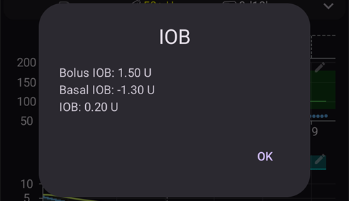
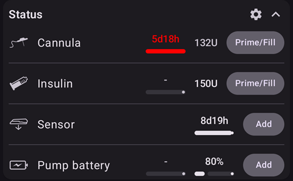
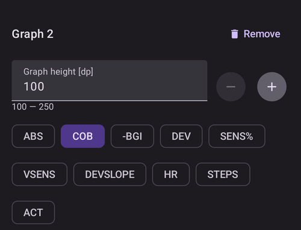
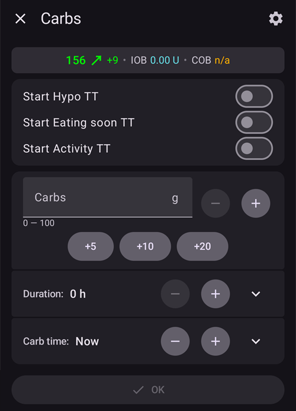

# AAPS-schermen

```{contents}
:backlinks: entry
:depth: 2
```

(the-homescreen)= (AapsScreens-the-homescreen)=

## Het hoofdscherm


Dit is het eerste scherm dat je ziet als je **AAPS** opent. Het bevat de meeste informatie die je elke dag nodig hebt.

### Sectie A - Bovenste balk

* Het **menu** (☰) links opent het navigatiemenu met **Behandelingen geschiedenis**, **Historie bekijken**, **Statistieken**, **Profielhulp**, **Onderhoud**, **Setup Wizard**, **Configuratie** en meer.
* De **zoekbalk** vindt instellingen, dialoogvensters en documentatie. Begin gewoon te typen (zie [Overal zoeken](../DailyLifeWithAaps/GlobalSearch.md)).
* Het pictogram **Instellingen** (tandwiel) rechts opent alle [instellingen](../SettingUpAaps/Preferences.md).

(aaps-screens-profile--target)=

### Sectie B - Statusblok

#### Huidige bloedglucose

De laatste bloedglucosewaarde van je CGM staat in de grote cirkel links, samen met het verschil met de vorige waarde (delta) en de leeftijd van de waarde.

De kleur van de BG-waarde toont de stand ten opzichte van het ingestelde [bereik](#Preferences-range-for-visualization).

* groen = binnen bereik
* rood = onder bereik
* geel = boven bereik

  

(loop-status)= (AapsScreens-loop-status)=

#### Loop status


Naast de BG-cirkel toont een pictogram de bedrijfsmodus van de loop (van boven naar beneden in de afbeelding):

1. Groene cirkel = [gesloten loop](#KeyAapsFeatures-ClosedLoop), loop actief
2. Paarse cirkel met stippellijn = [stop bij laag (LGS)](#KeyAapsFeatures-LGS)
3. Blauwe cirkel met stippellijn = [open loop](#KeyAapsFeatures-OpenLoop)
4. Rode cirkel met kruis = loop gedeactiveerd (blijvend uit)
5. Rood pauzepictogram = loop onderbroken (tijdelijk gepauzeerd, maar de basale insuline wordt wel gegeven) - de resterende tijd staat naast het pictogram
6. Grijze cirkel met stekker = pomp ontkoppeld (tijdelijk helemaal geen insulinetoediening) - de resterende tijd staat naast het pictogram

Druk op het pictogram om het Loop-dialoogvenster te openen. De inhoud van het dialoogvenster hangt af van de huidige toestand:

* Als de loop **actief** is (gesloten, open of LGS), kun je de bedrijfsmodus wisselen (Closed loop, Stop bij laag, Open loop of Loop deactiveren), de loop **onderbreken** of de pomp **ontkoppelen** voor een gekozen tijdsduur.
* Als de loop **gedeactiveerd** is, kun je hem weer aanzetten door een bedrijfsmodus te kiezen, of de pomp ontkoppelen.
* Als de loop **onderbroken** is, kun je hem **hervatten**, de pomp ontkoppelen, of een nieuwe tijdsduur kiezen onder **Onderbreek loop** om de onderbreking te verlengen.
* Als de pomp **ontkoppeld** is, kun je de pomp **opnieuw verbinden**, of een nieuwe tijdsduur kiezen onder **Verbreek verbinding met de pomp** om de ontkoppeling te verlengen.

Als je een onderbreking of ontkoppeling verlengt, **begint de nieuwe tijdsduur vanaf nu**: die vervangt de resterende tijd en wordt er niet bij opgeteld. Je hoeft niet eerst te hervatten of opnieuw te verbinden.

Het dialoogvenster als de loop in gesloten loop draait:


Het dialoogvenster als de loop onderbroken is, met **Hervatten** en de tijdsduren om de onderbreking te verlengen:


Het dialoogvenster als de pomp ontkoppeld is, met **Opnieuw verbinden met pomp** en de tijdsduren om de ontkoppeling te verlengen:


Het dialoogvenster in Stop bij laag, in open loop en als de loop gedeactiveerd is, verschilt alleen in de bedrijfsmodi die het aanbiedt:


Zo ziet het hoofdscherm eruit in elke modus. De kleurenband bovenaan de grafiek verandert op het moment van de wissel.

Stop bij laag:


Open loop:


Loop gedeactiveerd:


Loop onderbroken — de resterende tijd staat naast het pictogram:


Pomp ontkoppeld — de resterende tijd staat naast het pictogram. De behandelknoppen blijven in de QuickLaunch-werkbalk, zodat je nog steeds insuline van een pen of koolhydraten kunt registreren:


Na elke keuze is een bevestiging nodig.

```{admonition} Alarm: de pomp heeft de tijdelijke nul-basaalstand niet geaccepteerd :class: warning Als de pomp ontkoppeld is, houdt **AAPS** een tijdelijke basaalstand van nul op de pomp, en stelt die opnieuw in als hij ontbreekt. Als dit na 10 minuten nog steeds mislukt, geeft **AAPS** een urgent alarm: *"De pomp heeft de tijdelijke nul-basaalstand niet geaccepteerd. Mogelijk wordt er nog steeds basale insuline afgegeven. Controleer de pomp."* Het alarm wordt elke 15 minuten herhaald, totdat de tijdelijke basaalstand van nul is ingesteld of de ontkoppeling eindigt. Als je dit ziet, controleer dan je pomp: misschien geeft hij nog basale insuline, ook al toont **AAPS** hem als ontkoppeld.

    <br />Let op: welke modi je kunt kiezen hangt af van je voortgang in de [Doelen](../SettingUpAaps/CompletingTheObjectives.md). Closed loop en LGS komen pas beschikbaar als je de doelen voltooit.
    
    (aaps-screens-bg-warning-sign)=
    #### BG-waarschuwingsteken
    
    Als **AAPS** een probleem ziet met de BG-waarden die het ontvangt, verschijnt in de onderste balk van het hoofdscherm een snelkoppeling naar je BG-bron (met de naam van de bron, bijvoorbeeld **xDrip+ BG**), met een rood waarschuwingsbadge. Tik erop om het [BG-bronscherm](#aaps-screens-bg-source) te openen.
    
    ##### Dubbele BG-gegevens
    
    Het rode waarschuwingsteken betekent dat je meteen in actie moet komen: je ontvangt **dubbele BG-gegevens**, en daardoor kan de loop zijn werk niet goed doen. **AAPS** kan je BG-trend niet betrouwbaar berekenen uit dubbele waarden, en stopt daarom met corrigeren.
    
    Als je loop gesloten was, zet **AAPS** hem in de modus [Stop bij laag (LGS)](#KeyAapsFeatures-LGS): het loop-pictogram wordt paars.
    
      
    
    Druk op het loop-pictogram: de kaart **Beperkingen** bovenaan vertelt je waarom: "BgQualityCheck: LGS modus als gevolg van dubbele waarden in de BG bron".
    
      
    
    ```{admonition} Je loop draait in Stop bij laag
    :class: note
    Je loop blijft draaien, maar alleen om je tegen lage waarden te beschermen: **AAPS** kan je basaal nog verlagen of stoppen, maar geeft geen correctie-insuline totdat je dit probleem hebt opgelost!
    

Je moet uitzoeken waarom je dubbele BG-waarden krijgt:

* Staat de Dexcom bridge aan op je Nightscout-site? Zet de bridge uit in het beheerpaneel van je Nightscout-installatie: pas de variabele "enable" aan en haal daar het deel "bridge" weg. (Voor heroku zijn [hier details te vinden](https://nightscout.github.io/troubleshoot/troubleshoot/#heroku).)
* Uploaden meerdere bronnen je BG naar Nightscout? Als je de BYODA-app gebruikt, zet de upload dan aan in **AAPS**, maar niet in xDrip (als je dat gebruikt).
* Heb je volgers die je BG ontvangen, maar die ook weer naar je Nightscout-site uploaden?
* Laatste redmiddel: kies in de [NSClient-instellingen](#Preferences-nsclient) de instellingen voor Synchronisatie en zet de optie "Ontvang CGM gegevens van NS" uit.

Om de waarschuwing meteen weg te halen en de loop weer te laten corrigeren, verwijder je de dubbele waarden in het BG-bronscherm: tik op de snelkoppeling in de onderste balk. De dubbele waarde is rood gemarkeerd. Druk lang op een waarde om te beginnen met selecteren, vink de dubbele waarden aan en tik op het prullenbakpictogram rechtsboven.


Maar als er veel dubbele waarden zijn, kan het makkelijker zijn om

* [maak een back-up van je instellingen](../Maintenance/ExportImportSettings.md),
* zet je database terug in het onderhoudsmenu en
* [importeer je instellingen](../Maintenance/ExportImportSettings.md) opnieuw

    {admonition} Zet zelf terug naar Closed loop
    :class: important
    **AAPS** gaat niet vanzelf terug naar **Closed loop** als de dubbele waarden weg zijn. Druk op het loop-pictogram op het hoofdscherm en kies weer **Closed loop**.

##### Vlakke BG-gegevens

Bij sommige BG-bronnen (Libre 1, AiDEX, Glutec, Medtronic en bronnen die hun sensortype niet doorgeven) controleert **AAPS** ook op waarden die niet veranderen: als je BG 45 minuten lang minder dan 2 mg/dl (0,1 mmol/l) is veranderd, worden de gegevens als fout gezien. De snelkoppeling naar de BG-bron toont dan een rood badge met een vlakke trend. De loop stopt elke hoge tijdelijke basaalstand en geeft geen correctie-insuline totdat de waarden weer veranderen. Controleer je sensor en de app die de waarden verstuurt.

##### Onregelmatige BG-gegevens

Als waarden met onregelmatige tussenpozen binnenkomen of als er waarden ontbreken, berekent **AAPS** opnieuw waarden per 5 minuten uit de waarden die het heeft. Dit gebeurt bijvoorbeeld na een sensorwissel, of bij Libre-sensoren, waarvan de timing elke paar uur een minuut of twee verschuift. De loop blijft werken en je hoeft niets te doen. **AAPS** 4 toont hiervoor geen geel waarschuwingsteken meer.

#### Huidig profiel

Het huidige profiel staat naast het sterpictogram.

Tik op de profielnaam om het [Profielscherm](#aaps-screens-profile) te openen. Daar kun je de details van het profiel bekijken en [tussen verschillende profielen wisselen](../DailyLifeWithAaps/ProfileSwitch-ProfilePercentage.md).

**Om het profielpercentage te wijzigen** (en de tijdsduur), tik je op de profielnaam en daarna op de ronde knop **▶** (Activeer) rechtsonder in het Profielscherm. In **AAPS** 3.x opende dit scherm met lang drukken op de profielnaam; in **AAPS** 4 doet lang drukken niets. Stap voor stap: [Het profielpercentage wijzigen](#ProfileSwitch-change-percentage).


1. Normale weergave met een standaard profielactivering.
2. Profielwissel met een percentage van 90% en een resterende tijdsduur van 9 minuten. De profielnaam wordt geel zolang een tijdelijke profielwissel actief is.
3. Profielwissel met een tijdverschuiving van 1 uur en een resterende tijdsduur van 9 minuten.

#### Streefdoel


Het huidige streefdoel voor de bloedglucose staat onder de profielnaam.

Druk kort op het streefdoel om het scherm **[Tijdelijk streefdoel](../DailyLifeWithAaps/TempTargets.md)** te openen.

1. Normale weergave: het streefbereik uit je profiel.
2. Als er een tijdelijk streefdoel is ingesteld, wordt het streefdoel geel/oranje met het pictogram van de gebruikte voorinstelling, en staat de resterende tijd in minuten tussen haakjes.

(AapsScreens-visualization-of-dynamic-target-adjustment)=

#### Weergave van dynamisch aangepast streefdoel

Als je het [SMB-algoritme](#Config-Builder-aps) en de functie [Autosens](#Open-APS-features-autosens) gebruikt, kan **AAPS** je streefdoel dynamisch aanpassen op basis van je gevoeligheid.

Zet een of beide van de volgende opties aan in de [OpenAPS SMB-instellingen](#Preferences-openaps-smb-settings):

* "Gevoeligheid verhoogt streefdoel" en/of
* "Resistentie verlaagt streefdoel"

Als **AAPS** resistentie of gevoeligheid ziet, wijkt het streefdoel af van wat in het profiel staat, en verandert de kleur van het getoonde streefdoel om de aanpassing te laten zien.

(aaps-screens-iob-cob-basal-sens)=

#### IOB, COB, basaal en gevoeligheid


1. **Spuit**: insuline aan boord (IOB) - hoeveelheid actieve insuline in je lichaam  
    De insuline aan boord zou nul zijn als alleen je standaard basaal liep en er geen insuline meer over was van eerdere bolussen. 
    * IOB kan negatief zijn als er kort geleden periodes met minder basaal waren.
    * Druk op de chip om de verdeling tussen bolus- en basale insuline te zien (eerste dialoogvenster in de afbeelding, hier met een negatieve IOB na een periode met minder basaal)
2. **Graan**: [koolhydraten aan boord (COB)](../DailyLifeWithAaps/CobCalculation.md) - koolhydraten die je eerder hebt gegeten en die nog niet zijn opgenomen
3. De blauwgroene knop rechts toont de **huidige basaaltoediening**: een vlakke lijn als de basaal uit het profiel loopt, een ander pictogram als er een tijdelijke basaalstand actief is
4. De **percentagerij** toont de huidige gevoeligheid ([Autosens](#Open-APS-features-autosens) / [DynamicISF](../DailyLifeWithAaps/DynamicISF.md)). Als de loop je ISF wijzigt, toont de rij ook de ISF uit het profiel, een pijl en de ISF die de loop nu gebruikt, bijvoorbeeld "80% 2,0 ↗ 2,5". Druk erop om de Autosens-waarde en de effectieve ISF te zien (tweede dialoogvenster in de afbeelding). Als de loop met een andere waarde werkt dan het laatste Autosens-resultaat (bijvoorbeeld omdat een tijdelijk streefdoel je gevoeligheid wijzigt), toont het dialoogvenster die waarde ook als **Autosens in algoritme**. Als Autosens uit staat, houdt de loop de ISF uit je profiel en wordt er geen effectieve ISF getoond.

Het IOB-dialoogvenster, geopend door op de IOB-chip te drukken:



Druk op de blauwgroene knop om de actieve tijdelijke basaalstand te zien, wanneer die begon en hoe lang die al loopt:


(aaps-screens-carbs-required)=

#### Koolhydraten benodigd


Er wordt een koolhydratenadvies gegeven als het algoritme ziet dat er koolhydraten nodig zijn.

Dit is wanneer het oref-algoritme denkt dat het je niet kan redden met een tijdelijk basaal van nul, en je koolhydraten nodig hebt.

De berekening achter de waarschuwing voor benodigde koolhydraten is veel geavanceerder dan de berekening achter de bolus calculator. Je kunt een koolhydratenadvies zien terwijl de bolus calculator geen ontbrekende koolhydraten toont.

Meldingen 'koolhydraten nodig' kunnen naar Nightscout worden gestuurd als je dat wilt. Dan wordt er een mededeling getoond en verstuurd.

### Sectie C - Statusrij


De statusrij geeft een zichtbare waarschuwing voor

* Canule leeftijd
* Insuline leeftijd (aantal dagen dat het reservoir in gebruik is) en reservoirniveau (eenheden)
* Sensor leeftijd
* Pomp batterij leeftijd en niveau (%)

Als de drempelwaarde voor waarschuwing wordt overschreden, worden de waarden in geel weergegeven.

Als de drempelwaarde voor alarm wordt overschreden, worden de waarden in rood weergegeven.

De drempelwaarden kun je wijzigen via het kleine pictogram **Instellingen** dat verschijnt als de statusrij is **uitgeklapt** (pijltje rechts). Zie [Statusindicatoren](#Preferences-status-lights).

Het uitgeklapte statuspaneel heeft aan het eind van sommige rijen ook een knop om een wissel te registreren. Die zet de bijbehorende leeftijd terug: **Toevoegen** op de rij **Sensor** registreert het plaatsen van een sensor. Als je pomp het ondersteunt, verschijnt **Prime/Vul** op de rijen **Canule** (of **Patchpomp**) en **Insuline**, en **Toevoegen** op de rij **Pomp batterij**.



Afhankelijk van je pomp heb je misschien niet al deze pictogrammen.

(screens-sensor-level-battery)=

#### Sensorniveau (batterij)

Werkt voor CGM met een extra zender, zoals de MiaoMiao 2. (Technisch gezien moet de sensor informatie over het batterijniveau naar xDrip sturen.)

De drempelwaarden kun je instellen in [Statusindicatoren](#Preferences-status-lights).

(aaps-screens-main-graph)=

### Sectie D - Hoofdgrafiek


De grafiek toont je bloedglucose (BG) zoals gelezen van je glucosemeter (CGM).

Scroll en knijp-zoom op de grafiek om het zichtbare tijdvak te wijzigen.

Het groene gebied weerspiegelt je doelbereik.

Deze informatie wordt ook in deze grafiek getoond:

* Handmatige bolussen: blauwe driehoek net boven de BG-curve, met de punt naar beneden naar de waarde op dat moment, met de hoeveelheid insuline
* Ingevoerde koolhydraten: oranje driehoek net onder de BG-curve, met de punt naar boven naar de waarde, met de hoeveelheid koolhydraten. Een maaltijd die met de bolus is ingevoerd, ziet eruit als één markering, gesplitst door de waarde.
* De driehoeken zijn er in drie maten (klein, middel, groot), afhankelijk van de hoeveelheid vergeleken met de grootste van de dag. Als er op dat moment geen BG-waarde is (gat in de sensorgegevens), wordt de driehoek onderaan de grafiek getekend.
* BG-controles en kalibraties: getekend op hun eigen gemeten waarde, zodat je ze kunt vergelijken met de sensorcurve
* Streefdoel zoals ingesteld in het profiel of aangepast door een tijdelijk streefdoel: groene lijn
* Profielwissels: sterpictogrammen bovenaan de grafiek
* Loopstatus: kleurenband bovenaan de grafiek als de [bedrijfsmodus](#AapsScreens-loop-status) iets anders is dan gesloten loop: blauw = open loop, paars = LGS, rood = loop gedeactiveerd, geel = loop onderbroken, grijs = pomp ontkoppeld, oranje = superbolus (in de schermafbeelding: paars, daarna geel). De geschiedenis van deze wissels staat in [Bedrijfsmodus](#AapsScreens-running-mode)
* [SMB's](#Open-APS-features-super-micro-bolus-smb) worden niet in de BG-grafiek getekend (er zou er elke paar minuten een zijn): ze worden getoond in de [IOB-grafiek](#aaps-screens-iob).

Tik op een **BG-controle** in de grafiek om de waarde te zien, en de notitie als je er een hebt geschreven.

(aaps-screens-graph-press-and-hold)=

#### De waarden op een bepaald moment bekijken

**Houd de BG-grafiek even ingedrukt** om de waarden bij één meting te zien. Een stip markeert de dichtstbijzijnde waarde, er wordt op dat moment een stippellijn door alle grafieken getekend, en een pop-up bovenaan de grafiek toont:

* de tijd en de BG-waarde
* IOB, COB (alleen als die boven 0 g is) en de basaalstand op dat moment. Het basaalpictogram toont of er een tijdelijke basaalstand actief was, net als op het hoofdscherm
* elke bolus, SMB of koolhydraten op dat moment, met dezelfde driehoeken als in de grafieken

Houd je vinger op het scherm en beweeg hem naar links of rechts om van de ene waarde naar de volgende te gaan. Je voelt bij elke waarde een lichte tik, en de grafiek scrolt niet terwijl je dit doet. De pop-up blijft 2 seconden staan nadat je je vinger hebt opgetild.

Dit werkt op dezelfde manier bij de [extra grafieken](#aaps-screens-additional-graphs) onder de BG-grafiek (IOB, COB...): houd er een ingedrukt.


(AapsScreens-activate-optional-information)=

#### Optionele informatie laten weergeven

Druk op het **potlood**pictogram rechtsboven in de grafiek om de grafiekinstellingen te openen:


* **Grafiekhoogte** bepaalt hoe hoog de grafiek wordt getekend.
* **ACT** toont de curve van de insulineactiviteit: een ononderbroken geelgroene lijn <span style="background:#141218;color:#D3F166;padding:0 0.3em;border:1px solid #141218;border-radius:4px">━━━━</span> (niet te verwarren met de gestippelde gele UAM-voorspelling)
* **PRED** toont de [voorspellingslijnen](#aaps-screens-prediction-lines) (zie hieronder)

(aaps-screens-prediction-lines)=

#### Voorspellingslijnen

Als **PRED** aan staat, tekent AAPS de voorspellingen als **stippellijnen** rechts van de lijn "nu". Elke voorspelling heeft een eigen kleur. Het donkere thema gebruikt lichtere tinten van dezelfde kleuren, en een lijn binnen het groene streefbereik kan iets groener lijken.

| Lijn                   | Licht thema                                                                                                                       | Donker thema                                                                                                                       | Wat hij voorspelt               |
| ---------------------- | --------------------------------------------------------------------------------------------------------------------------------- | ---------------------------------------------------------------------------------------------------------------------------------- | ------------------------------- |
| **IOB** (blauw)        | <span style="background:#FFFFFF;color:#1E88E5;padding:0 0.3em;border:1px solid #CCCCCC;border-radius:4px">●●●●</span>             | <span style="background:#141218;color:#64B5F6;padding:0 0.3em;border:1px solid #141218;border-radius:4px">●●●●</span>              | alleen insuline                 |
| **COB** (oranje)       | <span style="background:#FFFFFF;color:#FB8C00;padding:0 0.3em;border:1px solid #CCCCCC;border-radius:4px">●●●●</span>             | <span style="background:#141218;color:#FFB74D;padding:0 0.3em;border:1px solid #141218;border-radius:4px">●●●●</span>              | koolhydraten aan boord          |
| **UAM** (geel)         | <span style="background:#FFFFFF;color:#C9BD60;padding:0 0.3em;border:1px solid #CCCCCC;border-radius:4px">●●●●</span>             | <span style="background:#141218;color:#E6D39A;padding:0 0.3em;border:1px solid #141218;border-radius:4px">●●●●</span>              | niet-aangekondigde maaltijd     |
| **ZT** (cyaan)         | <span style="background:#FFFFFF;color:#00D2D2;padding:0 0.3em;border:1px solid #CCCCCC;border-radius:4px">●●●●</span>             | <span style="background:#141218;color:#4DD4D4;padding:0 0.3em;border:1px solid #141218;border-radius:4px">●●●●</span>              | zero-temp (insuline gestopt)    |
| **aCOB** (lichtoranje) | <span style="background:#FFFFFF;color:rgba(251,140,0,0.5);padding:0 0.3em;border:1px solid #CCCCCC;border-radius:4px">●●●●</span> | <span style="background:#141218;color:rgba(255,183,77,0.5);padding:0 0.3em;border:1px solid #141218;border-radius:4px">●●●●</span> | alleen het oudere AMA-algoritme |

Als twee voorspellingen dezelfde waarden geven, liggen hun stippen over elkaar en zie je maar één van de kleuren (bijvoorbeeld UAM over IOB als de BG vlak is).

* **COB**-lijn (oranje): [koolhydraten aan boord](CobCalculation) (oranje wordt overal in AAPS gebruikt voor COB en koolhydraten)
    
    Deze voorspellingslijn toont waar je BG (niet de COB zelf!) naartoe gaat op basis van de huidige instellingen van het **Profiel**, als de afwijkingen door koolhydraatopname gelijk blijven. Deze lijn wordt alleen getoond als je COB hebt.

* **IOB**-lijn (blauw): insuline aan boord (blauw wordt overal in AAPS gebruikt voor IOB en insuline)
    
    Deze voorspellingslijn toont wat er zou gebeuren onder invloed van alleen insuline. Bijvoorbeeld als je insuline hebt gegeven en daarna geen koolhydraten hebt gegeten.

* **ZT**-lijn (cyaan): zero-temp (voorspelde BG als er een tijdelijke basaalstand van 0% zou worden ingesteld)
    
    Deze voorspellingslijn toont hoe het BG-verloop zou veranderen als de pomp alle insulinetoediening zou stoppen (0% TBR). De lijn stopt zodra hij boven je streefdoel komt.
    
    *Deze lijn verschijnt alleen als het [SMB](#Config-Builder-aps)-algoritme wordt gebruikt.*

* **UAM**-lijn (geel): [niet-aangekondigde maaltijden](#SensitivityDetectionAndCob-sensitivity-oref1)
    
    Niet-aangekondigde maaltijden (UAM) betekent dat er een duidelijke stijging van de glucose is gezien door maaltijden, adrenaline of andere invloeden. De voorspellingslijn lijkt op de **oranje COB-lijn**, maar gaat ervan uit dat de afwijkingen met een vaste snelheid afnemen (door de huidige snelheid van afname door te trekken).
    
    *Deze lijn verschijnt alleen als het [SMB](#Config-Builder-aps)-algoritme wordt gebruikt, **Activeer UAM** aan staat in de OpenAPS SMB-instellingen, en de BG meer stijgt dan alleen de insuline kan verklaren.*

* **aCOB**-lijn (licht, doorzichtig oranje): versnelde koolhydraatopname
    
    Net als COB, maar uitgaande van een vaste koolhydraatopname van 10 mg/dl/5m (-0,555 mmol/l/5m). Verouderd en beperkt nuttig.
    
    *Deze lijn verschijnt alleen als het oudere [AMA](#Config-Builder-aps)-algoritme wordt gebruikt.*

Meestal ligt je echte glucosecurve in het midden van deze lijnen, of dicht bij de lijn waarvan de aannames het meest op jouw situatie lijken.

(aaps-screens-how-predictions-become-a-dosing-decision)=

#### Hoe AAPS van voorspellingen een doseringsbeslissing maakt

AAPS doseert insuline niet alleen op basis van je huidige BG. Bij elke loopcyclus (ongeveer elke 5 minuten) kijkt het naar alle voorspellingslijnen hierboven samen en bepaalt het de veiligste aanpak.

De basisregel is **veiligheid eerst**: als *een* voorspellingslijn, in welk tijdvak dan ook, onder je lage veiligheidsgrens zakt, stelt AAPS een zero-temp in (tijdelijke basaalstand van 0%) en geeft het geen extra insuline, ook als je huidige BG hoog is. Pas als elke voorspellingslijn boven die grens blijft, overweegt AAPS om meer insuline te geven.

Als het veilig is om meer insuline te geven, kijkt AAPS waar de BG volgens de gecombineerde voorspellingen uiteindelijk uitkomt (de **eventual BG**, de uiteindelijke BG), en berekent het hoeveel correctie nodig is om die uiteindelijke BG terug te brengen naar het streefdoel. Dat wordt gegeven als een hogere tijdelijke basaalstand, of (als het oref1/[SMB](#Open-APS-features-super-micro-bolus-smb)-algoritme aan staat) als een kleine directe bolus. Als de BG nu hoog is maar al genoeg vanzelf daalt, wacht AAPS af, of verlaagt het misschien zelfs de basaalstand, in plaats van insuline toe te voegen die een latere lage waarde alleen nog lager zou maken.

Voor uitgewerkte voorbeelden van deze beslisregels met echte schermafbeeldingen, zie de [doseringsscenario's in de gids voor zorgverleners](#clinicianguide-dosing-scenarios). Ze zijn geschreven voor zorgverleners, maar gelden voor elke AAPS-gebruiker.

*Voor de volledige technische uitleg over hoe deze voorspellingen en de doseringsbeslissing worden berekend, zie de [documentatie van OpenAPS over determine-basal](https://openaps.readthedocs.io/en/latest/docs/While%20You%20Wait%20For%20Gear/Understand-determine-basal.html).*

#### Basalen

Een **ononderbroken blauwe** lijn toont de basaal die je pomp afgeeft, en laat de werkelijke afgifte in de tijd zien.

De **gestippelde blauwe** lijn toont wat de basaalstand zou zijn als er geen tijdelijke basaalaanpassingen (TBR's) waren.

Als de standaard basaalstand wordt gegeven, is het gebied onder de curve donkerblauw. Als de basaalstand tijdelijk is aangepast (hoger of lager), is het gebied onder de curve lichtblauw.

#### Activiteit

De **dunne gele** lijn is de insuline activiteit.

Het is gebaseerd op de verwachte daling in BG, alleen veroorzaakt door de aanwezige insuline, alsof er geen andere invloeden (zoals koolhydraten) aanwezig zijn.

(AapsScreens-section-g-additional-graphs)= (aaps-screens-additional-graphs)=

### Sectie E - Extra grafieken

Je kunt extra grafieken onder de hoofdgrafiek aanzetten. In de [Eenvoudige modus](#preferences-simple-mode) zijn de extra grafieken vooraf ingesteld en kun je ze niet wijzigen. Zet de **Eenvoudige modus** uit als je zelf wilt kiezen welke extra grafieken je ziet.

De extra grafieken volgen de hoofdgrafiek: als je in de BG-grafiek scrolt of zoomt, bewegen ze mee. Een zijwaartse veegbeweging op een extra grafiek scrolt ook alle grafieken. Ze hebben geen eigen tijdlabels. Lees de tijd af op de BG-grafiek.

Om een extra grafiek in te stellen, druk je op het **potlood**pictogram rechtsboven in die grafiek:



Kies de chips voor de gegevens die je in deze grafiek wilt zien; de knop **Verwijderen** verwijdert de grafiek.

Om nog een grafiek te maken, druk je op **Grafiek toevoegen** onder de laatste grafiek en kies je de chips op dezelfde manier:


De nieuwe grafiek wordt onder de andere toegevoegd. Hier een tweede extra grafiek met **SENS%** en **DEV**:


De meeste gebruikers vinden de volgende instelling van extra grafieken voldoende:

* Grafiek 1 met IOB, COB, Gevoeligheid wijziging
* Grafiek 2 met Afwijkingen en BGI.

#### Absolute insuline (ABS)

Actieve insuline inclusief bolussen **en basaal**.

(aaps-screens-iob)=

#### Actieve insuline (IOB)

Toont de insuline aan boord (= actieve insuline in jouw lichaam). Dit is inclusief insuline van bolussen en tijdelijke basaalstanden (**maar zonder de basaalstanden uit je profiel**).

Als er tijdens de DIA-tijd geen [SMB's](#Open-APS-features-super-micro-bolus-smb), geen bolussen en geen TBR waren, zou dit nul zijn.

SMB's worden in deze grafiek getoond als blauwe driehoeken, in drie maten, afhankelijk van de hoeveelheid vergeleken met de grootste SMB van de dag.

IOB kan negatief zijn als je geen insuline meer aan boord hebt van een voorafgaande bolus en je voor een langere tijd een laag (of zelfs nul) tijdelijk basaal hebt gekregen.

Het afnemen hangt af van je [instellingen voor DIA en insulinetype](#Config-Builder-insulin-dia).

#### Actieve koolhydraten (COB)

Toont de koolhydraten aan boord (= actieve, nog niet opgenomen koolhydraten in jouw lichaam).

Het afnemen hangt af van de [afwijkingen die het algoritme ziet](../DailyLifeWithAaps/CobCalculation.md).

Als het algoritme een hogere koolhydraatopname ziet dan verwacht, wordt er insuline gegeven en stijgt de IOB (meer of minder, afhankelijk van je veiligheidsinstellingen).

#### Gevoeligheid wijziging (SENS%)

Toont de gevoeligheid die [Autosens](#Open-APS-features-autosens) heeft gevonden.

Gevoeligheid is een berekening van je gevoeligheid voor insuline door sport, hormonen enz.

Let op: je moet in [Doel 8](#objectives-objective8) zijn voordat gevoeligheidsdetectie/[Autosens](#Open-APS-features-autosens) de hoeveelheid toegediende insuline automatisch mag aanpassen. Voordat je dat doel hebt bereikt, wordt de lijn in je grafiek alleen ter informatie getoond.

### Variabele gevoeligheid (VSENS)

Toont de gevoeligheid zoals berekend door [DynamicISF](../DailyLifeWithAaps/DynamicISF.md). Alleen gevuld als je deze functie gebruikt.

(screen-heart-rate-steps)=

#### Hartslag (HR) & Stappen

Deze gegevens kunnen beschikbaar zijn als je een [Wear-smartwatch](../WearOS/WearOsSmartwatch.md) gebruikt. Zet ze aan in de **AAPS** Wear-app en geef toestemming voor gezondheidsgegevens.

#### Afwijkingen (DEV)

* **Grijze** balken tonen een afwijking door koolhydraten.
* **Groene** balken tonen dat de BG hoger is dan het algoritme verwachtte. Groene balken worden gebruikt om de resistentie te verhogen in [Autosens](#Open-APS-features-autosens).
* **Rode** balken tonen dat de BG lager is dan het algoritme verwachtte. Rode balken worden gebruikt om de gevoeligheid te verhogen in [Autosens](#Open-APS-features-autosens).
* **Gele** balken tonen een afwijking door UAM.
* **Zwarte** balken tonen kleine afwijkingen die niet worden meegeteld voor de gevoeligheid

#### Bloedglucose impact (-BGI)

Deze lijn toont hoeveel de BG zou ‘moeten’ stijgen of dalen door alleen de insulineactiviteit.


Het is een goede combinatie om deze lijn samen met de afwijkingsbalken te tonen. Ze hebben dezelfde schaal, maar die is anders dan bij de andere optionele gegevens. Daarom is het een goed idee om ze in een aparte grafiek te tonen, zoals hierboven. De BGI-lijn vergelijken met de afwijkingsbalken is nog een manier om te begrijpen hoe de **BG** schommelt. Hier liggen op het moment dat met **1** is gemarkeerd de afwijkingsbalken ruim boven de BGI-lijn: de BG stijgt meer dan alleen de insulineactiviteit kan verklaren (bijvoorbeeld na koolhydraten). Op het moment dat met **2** is gemarkeerd liggen de afwijkingsbalken onder nul (rood): de BG is lager dan het algoritme verwachtte.

### Sectie F - QuickLaunch-werkbalk


De zwevende werkbalk onderaan het scherm bevat je **[QuickLaunch](../DailyLifeWithAaps/QuickLaunch.md)**-acties. Het kleine **tandwiel** opent de QuickLaunch-instellingen. Daar kies je welke knoppen je ziet (behandelingen, Careportal-invoer, CGM-acties, de schermen van het menu **Beheren**, [QuickWizard](../DailyLifeWithAaps/QuickWizards.md)-knoppen, [Scènes](../DailyLifeWithAaps/Scenes.md) en meer).

Hierboven zie je een gebruikelijke instelling: **Insuline**, **Koolhydraten** en de **Bolus wizard**.

Als de pomp **ontkoppeld** is, blijven de behandelknoppen in de werkbalk, bijvoorbeeld om insuline van een pen te registreren (zie [Insuline](#aaps-screens-buttons-insulin) hieronder). Dezelfde acties staan ook in het [menu Behandelingen](#aaps-screens-treatments-sheet) in de onderste navigatiebalk.

(aaps-screens-buttons-insulin)=

#### Insuline


Om een bepaalde hoeveelheid insuline te geven zonder de [bolus calculator](#aaps-screens-bolus-wizard) te gebruiken.

Als je **Start binnenkort eten TT** aanzet, kun je automatisch je [tijdelijk streefdoel voor binnenkort eten](#TempTargets-eating-soon-temp-target) starten.

Als je geen bolus via de pomp wilt geven, maar een hoeveelheid insuline wilt registreren (bijv. insuline gegeven met een pen), zet dan "**Bolus wordt alleen geregistreerd**" aan. Met een extra rij **Tijd**, ingesteld op **Nu**, kun je een insuline-injectie uit het verleden registreren: gebruik **-** / **+** om de tijd te wijzigen, of tik op het pijltje om de minuten te typen of een datum en tijd te kiezen.

 

Met de knoppen **+0,5 / +1,0 / +2,0** kun je de hoeveelheid insuline snel verhogen. De stapwaarden kun je wijzigen in de [instellingen van de Bolus wizard](#Preferences-deliver-this-part-of-bolus-wizard-result).

Het dialoogvenster Insuline kun je ook gebruiken als de pomp onderbroken of ontkoppeld is, bijv. om insuline te registreren die met een pen is gespoten. In dat geval staat "**Bolus wordt alleen geregistreerd**" verplicht aan (rood getoond), en verschijnen er extra velden om het insulinetype en een **Tijd**-verschuiving te kiezen voor een injectie uit het verleden:


#### Koolhydraten



Om koolhydraten in te voeren zonder erbij te bolussen.

Bepaalde [vooraf ingestelde tijdelijke streefdoelen](#TempTargets-hypo-temp-target) (Hypo, Eet Binnenkort, Activiteit) kun je direct starten met de schakelaars bovenaan.

**Koolhydraattijd**: wanneer ga je de koolhydraten eten, of wanneer heb je ze gegeten.

**Tijdsduur**: te gebruiken voor ["vertraagde koolhydraten"](ExtendedCarbs). Deze rij is ingeklapt, zodat je er niet per ongeluk de grammen in typt: gebruik **-** / **+** om de waarde te wijzigen, of tik op het pijltje om de rij te openen en een waarde te typen.

Met de knoppen **+5 / +10 / +20** kun je de hoeveelheid koolhydraten snel verhogen.

#### Quick Wizard

Voer makkelijk een hoeveelheid koolhydraten in en stel de basis van de berekening in met één vooraf ingestelde knop.

De details stel je in bij [QuickWizard](../DailyLifeWithAaps/QuickWizards.md).

(aaps-screens-treatments-sheet)=

### Sectie G - Onderste navigatiebalk

De onderste navigatiebalk geeft toegang tot:

* **Behandelingen** — een menu met snelle acties voor je behandelingen:
    
    

* **Scènes** — alleen zichtbaar als je minstens één [scène](../DailyLifeWithAaps/Scenes.md) hebt, of een regel in **Automatisering** die is gemarkeerd als **Gebruikersactie**. Het opent een menu waarin je ze kunt starten; een badge toont hoeveel je er nu kunt starten. Het **potlood** bovenaan het menu opent **Beheren → Scènes**.

* **Beheren** — de centrale plek voor alles wat je in **AAPS** beheert: Profiel, Insuline instellingen, Tijdelijk streefdoel, QuickWizard, Scènes, Automatisering, Voeding, Site rotatie, Pomp en Geautoriseerde clients. Daaronder staan acties voor apparaten en basaal, zoals Sensor ingebracht en Tijdelijk basaal. Sommige onderdelen verschijnen alleen als ze bij jouw opstelling horen. Zo hangen Prime/Vul en batterijwissel af van je pomp, en zijn Tijdelijk basaal, Vertraagde bolus en de Careportal-invoer verborgen in de [Eenvoudige modus](#preferences-simple-mode):
    
    

* **Doelen** — je voortgang in de [Doelen](../SettingUpAaps/CompletingTheObjectives.md); een badge toont hoeveel er zijn voltooid. Dit onderdeel verdwijnt zodra alle doelen zijn voltooid, en staat niet in **AAPSClient**.

(aaps-screens-notifications)=

#### Notificaties

Er kan een **notificatiebubbel** rechts boven de onderste balk verschijnen. Die verzamelt de actieve notificaties van **AAPS**; het kleine getal toont hoeveel het er zijn. De kleur volgt de belangrijkste notificatie: rood voor een urgent bericht, groen voor gewone informatie.


Tik op de bubbel om het paneel **Notificatie** te openen. Bij elk bericht staat de tijd waarop het is ontstaan. Druk op **Negeren** onder een bericht om het weg te halen. Sommige berichten hebben in plaats daarvan een andere knop, die je naar de instelling brengt die je aandacht nodig heeft.


(bolus-wizard)= (aaps-screens-bolus-wizard)=

## Bolus calculator


Als je een maaltijdbolus wilt geven, doe je dat meestal hier.

### Sectie I

De kop **Berekening** toont de berekende bolus. Wanneer je al meer insuline aan boord (IOB) hebt dan de berekende bolus, dan zal hier alleen de ontbrekende hoeveelheid koolhydraten te zien zijn.

Je kunt de bolus calculator gebruiken bij elke huidige **BG**, ook als die te hoog of te laag is. Als de **BG** boven het streefdoel is, wordt er een correctie bij de maaltijdbolus opgeteld. Als de **BG** onder het streefdoel is, wordt de bolus verlaagd. Als de insuline aan boord meer is dan nodig, vertelt de calculator hoeveel koolhydraten je nog nodig hebt, in plaats van insuline voor te stellen.

De rij pictogrammen onder de kop toont welke gegevens in de berekening worden meegenomen (BG, trend, IOB, tijdelijk streefdoel, COB). Druk op een pictogram om dat gegeven aan of uit te zetten in de berekening; het pictogram **(i)** toont de gedetailleerde getallen achter de berekening.

#### Combinaties van COB en IOB en hun betekenis

* Om veiligheidsredenen kun je IOB niet uitzetten als COB aan staat. Anders loop je het risico op te veel insuline, omdat **AAPS** dan geen rekening houdt met wat al gegeven is.
* Als je COB en IOB aanzet, wordt rekening gehouden met niet-opgenomen koolhydraten die nog niet met insuline zijn gedekt, en met alle insuline die als TBR of SMB is gegeven.
* Als je IOB aanzet zonder COB, houdt **AAPS** rekening met de al gegeven insuline, maar zet die niet af tegen koolhydraten die nog moeten worden opgenomen. Dit geeft een melding over ontbrekende koolhydraten.
* Als je kort na een maaltijdbolus bolust voor **extra eten** (bijv. een extra toetje), kan het handig zijn om **alle invoer uit te zetten**. Zo worden alleen de nieuwe koolhydraten meegeteld. De hoofdmaaltijd is dan nog niet altijd opgenomen, dus kort na een maaltijdbolus klopt IOB niet precies met COB.
* Om veiligheidsredenen wordt een **tijdelijk streefdoel** alleen in de berekening meegenomen als je dat gegeven zelf aanzet.

(AapsScreens-section-j)=

### Sectie J - Invoervelden

In het veld **Koolhydraten** vul je je schatting in van de hoeveelheid koolhydraten, **in grammen**, waarvoor je wilt bolussen; met de **+**-knoppen eronder voeg je snel koolhydraten toe. **AAPS** werkt alleen met grammen: als je telt in broodeenheden of ruilwaarden (*bijv.* DAFNE "CHO"-ruilwaarden), reken ze dan om naar grammen voordat je ze invoert. Zie de [opmerking over broodeenheden](#your-aaps-profile-insulin-to-carbs-ratio) op de profielpagina.

#### Soort koolhydraten: brood, cake of pizza

Onder het veld **Koolhydraten** vertellen de knoppen **Brood**, **Cake** en **Pizza** aan **AAPS** hoe snel de maaltijd wordt opgenomen. Bij **Cake** en **Pizza** dekt de bolus nu maar een deel van de koolhydraten, en de rest wordt later toegevoegd als eCarbs. Zie [Soort koolhydraten: brood, cake of pizza](#AapsScreens-carbs-type) op de pagina Vertraagde koolhydraten voor de percentages en de timing.

De rij **Correctie** is er als je de uiteindelijke dosis om een bepaalde reden wilt aanpassen.

Alleen het veld **Koolhydraten** is altijd open. De andere rijen (**Correctie**, **Koolhydraattijd**, **BG** en **Percentage toepassen**) zijn ingeklapt: ze tonen hun waarde met de knoppen **-** / **+**, zodat je die in kleine stappen kunt wijzigen. Tik op het pijltje om een rij te openen en een waarde te typen, en tik er nog een keer op om de rij te sluiten. Zo typ je niet per ongeluk grammen in het veld **Correctie**.


Tik ergens op de rij **Profiel** om de lijst met je profielen te openen, en tik dan op een naam om dat profiel voor deze berekening te gebruiken.


Het veld **Koolhydraattijd** is voor een bolus vooraf: zo vertel je het systeem dat de koolhydraten pas na een tijdje komen. Je kunt een negatief getal in dit veld invullen als je bolust voor koolhydraten die je al eerder hebt gegeten.

**Alarm instellen** (herinnering om te eten): als je een koolhydraattijd in de toekomst invult, verschijnt een schakelaar "**Alarm instellen**". Zo krijg je op het ingestelde moment een herinnering om de koolhydraten te eten die je in **AAPS** hebt ingevoerd:


De herinnering gaat af als een alarm van **AAPS**. Er wordt geen timer gemaakt in de klok-app van je telefoon, en het werkt ook als de bolus is ingevoerd vanuit **AAPSClient** terwijl **AAPS** op de achtergrond draaide.

Het veld **BG** is meestal al ingevuld met de laatste waarde van je CGM. Wanneer jouw CGM het niet doet, dan is dit veld leeg. Als de waarde recent is, blijft de rij **BG** ingeklapt.

De resultaatknop onderaan toont de voorgestelde bolus. Als je erop drukt, wordt om bevestiging gevraagd voordat er insuline wordt gegeven.

Goed om te weten:

* Als de berekende bolus hoger is dan je **[Maximum bolus](#Preferences-maximum-bolus)**, wordt hij verlaagd tot de maximale bolus, en toont de bevestiging de waarschuwing "Bolusbeperking toegepast". Een [QuickWizard](../DailyLifeWithAaps/QuickWizards.md) wordt in dat geval geweigerd.
* Als de bolus alleen wordt geregistreerd (bijvoorbeeld als de pomp ontkoppeld is), blijft de waarschuwing "**Bolus wordt alleen geregistreerd**" bovenaan het dialoogvenster staan, ook als je scrolt.
* Een bolus die je zelf geeft, gaat voor op een [SMB](#Open-APS-features-super-micro-bolus-smb) die nog moet worden gegeven: de SMB vervalt en de loop rekent opnieuw. Als er op dat moment een SMB wordt gegeven, wordt je bolus geweigerd met de melding "Er wordt nu een SMB toegediend. Probeer het opnieuw wanneer die klaar is." Er wordt geen insuline gegeven, en koolhydraten die je met die bolus hebt ingevoerd worden niet opgeslagen: wacht even en voer ze opnieuw in.

(AapsScreens-wrong-cob-detection)=

#### Verkeerde COB-detectie


Als je de waarschuwing hierboven ziet na het gebruik van de bolus wizard, heeft **AAPS** gezien dat de berekende COB-waarde misschien niet klopt. Dus als je opnieuw wilt bolussen na een eerdere maaltijd met COB, let dan op dat je niet te veel insuline geeft!

Zie voor details de tips op de [pagina COB berekening](#CobCalculation-detection-of-wrong-cob-values).

Zoek je het tabblad **Acties** van **AAPS** 3.x? De functies ervan zijn verhuisd naar het hoofdscherm, het menu **Beheren** en de QuickLaunch-werkbalk: zie [Waar is het tabblad Acties gebleven?](#screens-action-tab).

(aaps-screens-careportal)=

## Careportal-invoer

De leeftijden en niveaus in de [statusrij](#screens-sensor-level-battery) (sensor, insuline, canule, pompbatterij) zijn gebaseerd op Careportal-invoer: **Prime/Vul** (registreert het wisselen van de infuusplek en de insulinepatroon), **Sensor ingebracht** en **Pomp bat. wissel**.

Je kunt ze registreren vanuit het uitgeklapte statuspaneel op het hoofdscherm, vanuit het menu **Beheren**, of met [QuickLaunch](../DailyLifeWithAaps/QuickLaunch.md)-knoppen.

**Prime/Vul** registreert een wissel van de infuusplek en/of van de insulinepatroon, en kan een hoeveelheid insuline geven om te ontluchten:


**Sensor ingebracht** en **Pomp bat. wissel** vragen alleen naar de tijd van de gebeurtenis:


 Invoer voor sport, mededeling, vraag en notitie komt van de Nightscout Careportal en is een bijzondere vorm van notities.

Scroll in het menu **Beheren** naar beneden en druk op **Careportal** om deze invoer te zien: **BG Controle**, **Notitie**, **Sport**, **Vraag** en **Mededeling**.


Bij **BG Controle**, **Vraag** en **Mededeling** kun je een glucosewaarde invullen (van een meter, de sensor of een andere bron), een notitie en de tijd van de gebeurtenis. Bij **Vraag** en **Mededeling** is de glucoserij ingeklapt en staat het metertype naast de waarde: als je de waarde wijzigt, verandert het type van **Sensor** naar **Meter**.


Bij **Notitie** en **Sport** kun je een tijdsduur invullen (een ingeklapte rij: gebruik **-** / **+**, of tik op het pijltje om hem te typen), een notitie en de tijd van de gebeurtenis:


In al deze dialoogvensters (**Prime/Vul**, **Sensor ingebracht**, **Pomp bat. wissel** en de Careportal-invoer) gebruikt de tijd van de gebeurtenis dezelfde rij **Tijd** als het [dialoogvenster Insuline](#aaps-screens-buttons-insulin) en de bolus wizard: gebruik **-** / **+** om de tijd in stappen van 5 minuten te verschuiven (tot een week terug en 12 uur vooruit), of tik op het pijltje om een datum en tijd te kiezen.

## Site rotatie

**Beheren → Site rotatie** registreert op een lichaamskaart waar elke canule en sensor is geplaatst, zodat je van plek kunt wisselen: zie [Site rotatie](#Aapsscreens-site-rotation) op de pagina Pompen en canules.

**TDD** (totale dagdosis) en de vuistregel voor de verhouding basaal/bolus worden uitgelegd bij het [tabblad Insuline van Statistieken](#reviewing-tdd).

(AapsScreens-insulin-profile)=

## Insuline


**Beheren → Insuline instellingen** toont en beheert je insuline-instellingen. Elke instelling staat op een kaart met de **piektijd** en de **[DIA](#Config-Builder-insulin-dia)**; de instelling die in gebruik is, is gemarkeerd met **ACTIEF**. Onder de kaart zie je de activiteitscurve. Je kunt de bijnaam, piek en DIA van elke instelling wijzigen, behalve van de actieve: om de insuline te wijzigen die je gebruikt, [voeg je een nieuwe instelling toe en activeer je die](#Config-Builder-insulin-change-active).

Zie [Werkingsduur van insuline](#Config-Builder-insulin-dia) voor meer uitleg over wat het is en hoe je het instelt.

## Pompstatus


**Beheren → Pomp** (of **Configuratie → Pomp → Plug-in openen**) toont de status van je pomp: laatste verbinding, basis-basaalstand, batterij, reservoir...

* De weergegeven informatie is afhankelijk van jouw pompmodel.
* Zie de [pagina over pompen](../Getting-Started/CompatiblePumps.md) voor meer details.

## Loop, AMA / SMB

**Configuratie → Loop → Plug-in openen** (en **Configuratie → APS → Plug-in openen**) tonen details over de berekeningen van het algoritme en waarom **AAPS** doet wat het doet: laatste uitvoering, het resulterende verzoek en de beperkingen. Het scherm **Loop** toont alleen de beperkingen die de gegeven tijdelijke basaalstand of SMB echt hebben beperkt (en waarom de gesloten loop niet is toegestaan, als dat zo is); het scherm **APS** toont elke beperking die in de berekening is meegenomen.

De berekeningen worden uitgevoerd telkens als het systeem een nieuwe waarde van de CGM krijgt.

Zie voor meer details de [sectie APS op de pagina Configuratie](#Config-Builder-aps).

(aaps-screens-profile)=

## Profiel


**Beheren → Profiel** (of tikken op de profielnaam op het hoofdscherm) opent het Profielscherm: je profielen als kaarten die je opzij kunt vegen, met knoppen om een profiel toe te voegen, te bewerken, te dupliceren, te verwijderen en te **activeren**.

Het profiel bevat informatie over jouw persoonlijke diabetesinstellingen. Zie de uitgebreide pagina **[Profiel](../SettingUpAaps/YourAapsProfile.md)** voor meer informatie.

## Automatisering


**Beheren → Automatisering** toont je automatiseringsregels. Zie de aparte pagina [hier](../DailyLifeWithAaps/Automations.md).

## NSClient


**Configuratie → Communicatie → NSClientV3 → Plug-in openen** toont de status van de verbinding met je Nightscout-site: URL, websocket-status, wachtrij en een logboek van de synchronisatie.

Instellingen kun je wijzigen in de [NSClient-instellingen](#Preferences-nsclient).

Zie deze [pagina](../GettingHelp/TroubleshootingNsClient.md) voor het oplossen van problemen.

(aaps-screens-bg-source)=

## BG bron - xDrip, BYODA...


**Configuratie → BG bron → Plug-in openen** toont de geschiedenis van CGM-waarden en geeft de mogelijkheid om waarden te verwijderen bij een storing (bijv. compression low) of bij dubbele waarden.

## Behandelingen geschiedenis

Open het **menu** (☰) en kies **Behandelingen geschiedenis** om alles wat **AAPS** heeft geregistreerd te bekijken, te controleren en te corrigeren: koolhydraten en bolussen, tijdelijke basaalstanden, tijdelijke streefdoelen, profielwissels, Careportal-invoer, wijzigingen van de loopmodus en gebruikersinvoer. Zie [Behandelingen geschiedenis](#aaps-screens-treatments) op de pagina Je gegevens bekijken.

## Historie bekijken


Open het **menu** (☰) en kies **Historie bekijken**.

Hiermee kun je terug in de tijd gaan in de geschiedenis van **AAPS**. Zie de aparte pagina [Je gegevens bekijken > Historie bekijken](../Maintenance/Reviewing.md).

(aaps-screens-statistics)=

## Statistieken


Open het **menu** (☰) en kies **Statistieken**.

Geeft je statistieken over je totale dagdosis (TDD), tijd binnen bereik (TIR), je glucoseprofiel over de dag (AGP) en het patroon van je insulinecyclus, op vier tabbladen. Zie de aparte pagina [Je gegevens bekijken > Statistieken](#reviewing-statistics).

(aaps-screens-profile-helper)=

## Profielhulp

Open het **menu** (☰) en kies **Profielhulp**.


Met de Profielhulp kun je profielen vergelijken en startprofielen voor kinderen maken. Zie [Je AAPS-profiel](../SettingUpAaps/YourAapsProfile.md), de secties [Een profiel vanaf nul maken voor een kind](#your-aaps-profile-profile-from-scratch-for-a-kid) en [Twee profielen vergelijken](#your-aaps-profile-compare-profiles).

(aaps-screens-widgets)=

## Widgets op het startscherm

**AAPS** heeft vijf widgets die je op het startscherm van je telefoon kunt zetten, zodat je je gegevens ziet zonder de app te openen. Zie de aparte pagina [Widgets op het startscherm](../DailyLifeWithAaps/Widgets.md).

