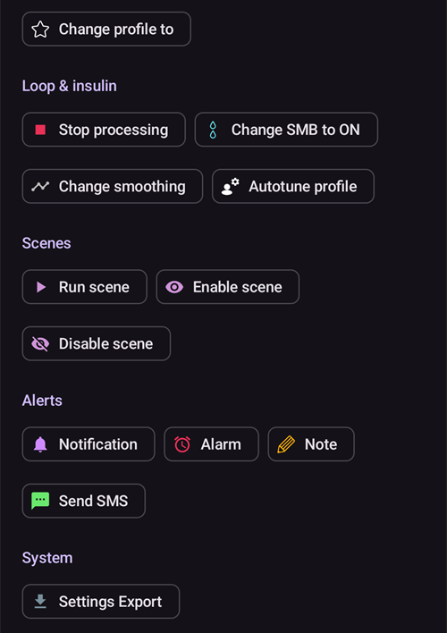
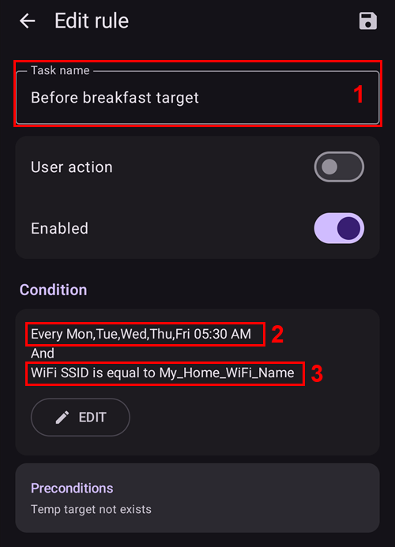

# Automatisering

```{contents} In this page
:backlinks: entry
:depth: 2
```

## Wat is Automatisering?

"**Automatisering**" is een functie die taken in AAPS kan automatiseren.

Automatisering voert bepaalde acties uit op basis van een of meer voorwaarden of triggers. Triggers kunnen onregelmatige gebeurtenissen zijn, zoals een lage of hoge bloedglucose (BG), of een bepaalde hoeveelheid negatieve actieve insuline (IOB). Automatisering kan ook terugkerende gebeurtenissen regelen, zoals maaltijden of sporten op bepaalde tijden van de dag, of als de gebruiker binnen een bepaalde afstand van een GPS-locatie of in het bereik van een wifi-SSID is. Automatisering kan volgens een schema of bij elke Pod-wissel een back-up van de instellingen van AAPS maken.

Regels van Automatisering maak en wijzig je in het scherm **Automatisering** (**Beheren → Automatisering**). Elke regel bestaat uit twee delen:

- Een of meer voorwaarden of 'triggers' die een actie starten.

    Denk aan een bepaald tijdschema, een gebeurtenis of de waarde van een eigenschap in AAPS

- Een of meer acties die worden uitgevoerd.

    Zoals een alarm, het instellen van een profiel percentage of het exporteren van de instellingen van AAPS bij een Pod-wissel.


Er zijn veel opties voor Automatisering. Bekijk ze goed in de AAPS-app, in het onderdeel Automatisering. Je kunt ook in de AAPS-gebruikersgroepen op [**Facebook**](https://www.facebook.com/groups/AndroidAPSUsers) en [**Discord**](https://discord.gg/4fQUWHZ4Mw) zoeken naar voorbeelden van Automatisering van andere gebruikers.

## Hoe Automatisering kan helpen

1. **Terugkerende taken automatiseren:** geprogrammeerde acties automatisch uitvoeren, zonder dat de gebruiker iets hoeft te doen.

1. **Minder beslissingsmoeheid:** Het grootste voordeel van **Automatisering** is dat de gebruiker niet steeds zelf iets in **AAPS** hoeft te doen. Volgens [onderzoek](https://www.ncbi.nlm.nih.gov/pmc/articles/PMC6286423/#ref4) moeten mensen met diabetes type 1 gemiddeld 180 extra beslissingen per dag nemen. **Automatisering** kan de mentale belasting verminderen. Zo houdt de gebruiker meer energie over voor andere dingen in het leven.

1. **Mogelijk betere glucoseregeling:** **Automatisering** kan er bijvoorbeeld voor zorgen dat **Tijdelijke streefdoelen** altijd worden ingesteld als dat nodig is, ook als het druk is of als je iets vergeet. Voorbeeld: een kind met diabetes heeft op school sport op dinsdag om 10:00 uur en op donderdag om 14:00 uur, en heeft 30 minuten voor het sporten een hoog tijdelijk streefdoel ('TT') nodig. Dit **Tijdelijk streefdoel** kan worden ingesteld met een **Automatisering**.

1. **AAPS sterk aanpassen** aan de voorkeur van de gebruiker, zodat het in bepaalde situaties meer of minder agressief is. Bijvoorbeeld: 's nachts een tijdelijk lager **Profiel**-% starten voor een ingestelde tijd als er negatieve **IOB** ontstaat. Dat kan erop wijzen dat het huidige **Profiel** te sterk is.

Het voorbeeld hieronder laat zien hoe een **Automatisering** stappen overbodig kan maken.

Een gebruiker sport elke ochtend om 6:00 uur: hij moet eraan denken om om 5:00 uur, voor het sporten, zelf een "Tijdelijk streefdoel-Activiteit" in AAPS in te stellen.


De gebruiker heeft een **Automatisering** ingesteld die om 5:00 uur een ‘Tijdelijk streefdoel-Activiteit’ start. Zo zijn de **BG** en **IOB** goed als voorbereiding op het sporten om 6:00 uur:


## Belangrijke punten voordat je met Automatisering begint

1. Voordat je bepaalde automatiseringen instelt, moet je met **AAPS** al een redelijke controle over je **BG** hebben. Gebruik Automatisering niet om slecht ingestelde basaal-, **ISF**- of **CR**-instellingen op te vangen (zie verder hieronder). Stel geen automatische **Profiel wissel** in om stijgingen van de **BG** door _bijv._ eten op te vangen. Daarvoor zijn andere manieren beter (SMB's enz.).

1. Zoals bij elke techniek kunnen **CGM's**, **pompen** en telefoons storingen hebben: technische problemen of sensorfouten kunnen de acties van **Automatisering** verstoren. Dan moet je misschien zelf ingrijpen.

1. **Wat je nodig hebt aan automatiseringen verandert waarschijnlijk als je dagelijkse routine verandert**. Als je wisselt tussen werk, school en vakantie, zet dan een herinnering in je agenda om te controleren welke **automatiseringen** actief zijn (ze zijn makkelijk aan en uit te zetten). Bijvoorbeeld als je op vakantie gaat en geen Automatisering meer nodig hebt voor sport op school of dagelijks sporten, of als je de tijden moet aanpassen.

1. **Automatiseringen** kunnen met elkaar in conflict komen. Controleer daarom de instellingen van elke nieuwe **automatisering** zorgvuldig in een veilige situatie, en probeer te begrijpen waarom een **automatisering** wel of niet is gestart zoals je verwachtte.

1. Als je Autosens gebruikt, gebruik dan liever **Tijdelijke streefdoelen** dan **Profiel wisselingen**. **Tijdelijke streefdoelen** zetten Autosens niet terug naar 0. **Profiel wisselingen** zetten Autosens terug.

1. De meeste **automatiseringen** moeten maar voor een **beperkte tijdsduur** gelden. Daarna kan **AAPS** opnieuw beoordelen of de **automatisering** nodig is en deze herhalen als de voorwaarde nog steeds geldt. Bijvoorbeeld: "start tijdelijk streefdoel van 7,0 mmol/l voor 30 min" of "start **Profiel** 110% voor 10 min" _en_ "start tijdelijk streefdoel van 5,0 mmol/l voor 10 min". Als je **Automatisering** gebruikt voor blijvende wijzigingen (bijv. naar een sterker profiel-%), loop je kans op een hypo.

## Wanneer kan ik Automatisering gaan gebruiken?

Je kunt **Automatisering** gebruiken vanaf **Doel 10**.

## Waar vind je Automatisering in AAPS?

Open **Beheren** in de navigatiebalk onderaan het hoofdscherm en kies **Automatisering**.

## Hoe stel ik een automatisering in?

Om een **Automatisering** in te stellen, druk je op de knop **+** in het scherm Automatisering om een ‘regel’ te maken:


* geef je ‘regel’ een titel (Taaknaam);
* druk op "**EDIT**" onder **Voorwaarde**. Kies in het scherm **Voorwaarde** hoe de triggers worden gecombineerd (**En**, **Of**, **Exclusieve of**) en druk op "**Trigger toevoegen**":


* voeg minstens één trigger toe:


* druk op "**TOEV**" onder **Actie** en kies één actie:


* sla de regel op met de knop **Opslaan** en zorg dat het vakje links van de naam van de regel is ‘aangevinkt’ om de **Automatisering** in te schakelen:


Om een regel van **Automatisering** uit te schakelen, haal je het vinkje weg links van de naam van de **Automatisering**. Het voorbeeld hieronder toont een **Automatisering** die ingeschakeld (‘aangevinkt’) of uitgeschakeld (‘niet aangevinkt’) is:


Als je een **Automatisering** instelt, kun je die eerst testen door de optie ‘Notificatie’ onder "Acties" te kiezen. Hierdoor toont **AAPS** eerst een notificatie, in plaats van de actie echt uit te voeren. Als je zeker weet dat de notificatie op de juiste tijd en bij de juiste voorwaarden verschijnt, kun je de regel van **Automatisering** aanpassen en de ‘Notificatie’ vervangen door een ‘Actie’.


```{admonition} Important note
:class: note

**Automatisering** blijft actief als de Loop is uitgeschakeld!
```


## Wanneer regels worden gecontroleerd

**AAPS** controleert alle regels van **Automatisering** telkens als er een nieuwe glucosewaarde is verwerkt. De regels worden dus gecontroleerd in het tempo van je CGM, ook als het scherm van de telefoon uit is. Regels worden ook gecontroleerd als de telefoon begint met laden, als het netwerk of de locatie verandert en als er een Bluetooth-apparaat verbinding maakt. Er loopt steeds maar één controle tegelijk. Een regel waarvan de acties wat tijd kosten (bijvoorbeeld een opdracht aan de pomp) kan dus niet twee keer worden uitgevoerd.

## Veiligheidsgrenzen

Er zijn veiligheidsgrenzen voor **Automatisering**:

* Een **Tijdelijk streefdoel** dat door een **Automatisering** wordt ingesteld, moet tussen 72 en 180 mg/dl (of 4 en 10 mmol/l) liggen.
* Het **Profiel percentage** moet tussen 50% en 130% liggen.
* Tussen twee keer uitvoeren van **Automatisering** (en voor de eerste keer) zit minstens 5 minuten.

## Negatieve waarden goed gebruiken

```{admonition} Warning
:class: warning

Wees voorzichtig als je een negatieve waarde kiest in **Automatisering**
```

Wees voorzichtig als je een ‘negatieve waarde’ kiest in een ‘Voorwaarde’ zoals "is minder dan" in **Automatisering**. Bijvoorbeeld:


**Voorbeeld 1:** Een Voorwaarde **"is minder dan"** "-0,1 mmol/l" (of "-2 mg/dl") zal:

Start een **Automatisering** voor elk getal dat **echt kleiner is dan** -0,1 (-2). Dit zijn getallen zoals -0,2, -0,3, -0,4 (-4, -6, -8) enzovoort. Let op: -0,1 (-2) zelf **valt niet** onder deze voorwaarde. (De voorwaarde "is gelijk aan of minder dan -0,1 mmol/l (-2 mg/dl)" valt _wel_ samen met -0,1 mmol/l of -2 mg/dl).

**Voorbeeld 2:** Een Voorwaarde "is groter dan" -0,1 mmol/l (-2 mg/dl) zal:

Een **Automatisering** starten voor elk getal dat **groter is dan** -0,1 mmol/l (-2 mg/dl). Dit zijn getallen zoals 0; 0,2; 0,4 mmol/l (0, 4, 8 mg/dl) en elk ander positief getal.

Denk goed na over wat je precies wilt bereiken met je **Automatisering** als je deze voorwaarden en waarden kiest.

(automations-automation-triggers)=
## Triggers voor Automatisering


Scroll naar beneden om de rest van de lijst te zien:


De gebruiker kan kiezen uit verschillende ‘Triggers’. Triggers zijn de voorwaarden waaraan moet worden voldaan voordat de automatisering wordt uitgevoerd. De lijst hieronder is niet volledig:

**Trigger:** voorwaarden koppelen

**Opties:**

Meerdere voorwaarden kunnen worden gekoppeld met
* “En”
* “Of”
* “Exclusieve of” (dit betekent: als één - en maar één - van de voorwaarden geldt, wordt de actie of worden de acties uitgevoerd)

**Trigger:** tijd vs. herhaal tijd

**Opties:**

* tijd = een eenmalige gebeurtenis
* herhaal tijd = iets wat regelmatig gebeurt (bijv. één keer per week, elke werkdag enz.)

**Trigger:** locatie

**Opties:**

* in [Instellingen > Automatisering](#preferences-maintenance-settings) kan de gebruiker de gewenste locatieservice kiezen.

**Trigger:** locatieservice

**Opties:**

* Gebruik passieve locatie: **AAPS** haalt de locatie alleen op als andere apps erom vragen.
* Gebruik netwerklocatie: de locatie van je wifi.
* Gebruik GPS-locatie (Let op! Dit kan de batterij erg snel leeg maken!)

**Triggers**: gegevens van pomp en sensor

* Trigger Canule leeftijd: beschikbaar voor alle pompen
* Trigger Insuline leeftijd: beschikbaar voor ondersteunde pompen
* Trigger Pomp batterij leeftijd: beschikbaar voor ondersteunde pompen
* Trigger Sensor leeftijd: altijd beschikbaar
* Trigger Pod activering: beschikbaar voor patchpompen

Let op: bij alle triggers voor leeftijd zal de vergelijking "gelijk aan" bijna nooit starten. Gebruik daarom twee triggers om een bereik te maken

* Trigger Reservoir niveau: beschikbaar voor alle pompen. De vergelijking "NOT\_AVAILABLE" werkt niet voor deze trigger, omdat de waarde in **AAPS** altijd is ingevuld
* Trigger Pomp batterij niveau: beschikbaar voor ondersteunde pompen. De vergelijking "NOT\_AVAILABLE" werkt niet voor deze trigger, omdat de waarde in **AAPS** altijd is ingevuld

(automations-automation-action)=
## Actie


Scroll naar beneden om de rest van de lijst te zien:



**Acties:** start **Tijdelijk streefdoel**

**Opties:**

* **BG** moet tussen 72 mg/dl en 180 mg/dl (4 mmol/l en 10 mmol/l) liggen
* **TT** werkt alleen als er nog geen Tijdelijk streefdoel is — **AAPS** voegt dit automatisch als regel "**Voorwaarden: Tijdelijk streefdoel niet bestaand**" toe aan de regel

**Acties:** stop **Tijdelijk streefdoel**

**Opties:**

geen

**Acties:** **Profiel percentage**

**Opties:**

* **Profiel** moet tussen 50% en 130% liggen
* werkt alleen als het vorige percentage 100% is

**Actions:** **Change smoothing** (in the **Loop & insulin** group)

**Opties:**

* select the [smoothing method](../CompatibleCgms/SmoothingBloodGlucoseData.md) to switch to. The list is the same as under **Configuration** > **Smoothing**, and the action does exactly what a change there does: the new method is saved, synced to paired clients, and the BG data is smoothed again right away.
* werkt alleen als die methode voor vloeiend maken nog niet actief is — **AAPS** voegt dit automatisch als regel "**Voorwaarden: Vloeiend maken … is niet actief**" toe aan de regel. Als de gekozen methode voor vloeiend maken al actief is, wordt de regel zonder melding overgeslagen.
* Example: a new sensor is often noisy during its first day. Two rules with the **Sensor age** trigger give stronger filtering while the sensor settles, and lag-free smoothing after that:
  * **Sensor age** less than 24 h: **Change smoothing** to **Unscented Kalman Filter**
  * **Sensor age** more than 24 h: **Change smoothing** to **Average smoothing**

**Acties:** **Notitie** (in de groep **Waarschuwingen** van de lijst)

**Opties:**

* kies de gebeurtenis die je wilt vastleggen: **Notitie**, **Sport**, **Vraag**, **Mededeling** of **Infuus wissel**, en eventueel een notitie. De naam van de actie verandert in de gebeurtenis die je kiest.
* **Tijdsduur**: gebruikt voor **Notitie**, **Sport** en **Infuus wissel**. **Vraag** en **Mededeling** hebben geen tijdsduur: ze leggen in plaats daarvan je huidige BG vast.
* **Infuus wissel** zet de canule leeftijd terug, net alsof je zelf een infuuswissel hebt vastgelegd. Voorbeeld: sommige pompen (zoals de Combo) leggen zelf een reservoirwissel vast, maar niet de infuuswissel. Als je die altijd samen wisselt, kan een regel met **Insuline leeftijd** minder dan 1 uur en **Canule leeftijd** meer dan 24 uur de infuuswissel voor je vastleggen.

 

**Acties:** **SMS verzenden naar alle nummers** (in de groep **Waarschuwingen**)

**Opties:**

* voer de tekst van het bericht in. Het wordt verzonden naar alle telefoonnummers die zijn toegestaan in de instellingen van [SMS Commando's](../RemoteFeatures/SMSCommands.md). De plugin SMS Commando's moet zijn ingeschakeld.

**Acties:** **Wijzig profiel naar** (in de groep **Profiel**)

**Opties:**

* kies het **Profiel** dat je wilt activeren. Het wordt geactiveerd op 100%, zonder tijdverschuiving. Als dit profiel al actief is, doet de actie niets.

**Acties:** **SMB in-/uitschakelen** (in de groep **Loop & insuline**)

**Opties:**

* kies **Aan** of **Uit**. Dit verandert de instelling **SMB toestaan** van OpenAPS SMB, precies alsof je die in **Instellingen** had veranderd. Dit blijft zo tot jij of een andere regel het terugzet.

**Acties:** **Autotune uitvoeren** (in de groep **Loop & insuline**)

**Opties:**

* kies het profiel dat je wilt afstemmen en het aantal dagen: zie [Autotune uitvoeren met een regel van Automatisering](#autotune-run-autotune-with-an-automation-rule).

**Acties:** **Stop met verwerken** (in de groep **Loop & insuline**)

**Opties:**

* geen. While the conditions of a rule with this action are true, **AAPS** does not check the rules below it in the list. As soon as its conditions are false again, the rules below are checked as usual. Voeg deze actie toe aan een regel die voorrang moet krijgen op de regels eronder (zie [de volgorde van de automatiseringen](#Automations-the-order-of-the-automations-in-the-list-matters)).

**Acties:** **Scène uitvoeren**, **Scène inschakelen**, **Scène uitschakelen** (in de groep **Scènes**)

**Opties:**

* kies de [scène](Scenes.md) die je wilt uitvoeren, inschakelen of uitschakelen.

Als de ‘Actie’ is toegevoegd, moet je de standaardwaarden veranderen in de gewenste waarde door erop te klikken en ze aan te passen.


(Automations-the-order-of-the-automations-in-the-list-matters)=
## De volgorde van de **automatiseringen** in de lijst is belangrijk
 **AAPS** voert de regels uit in volgorde van voorkeur, te beginnen bovenaan de lijst van **Automatisering**. Voorbeeld: als de **Automatisering** ‘Laag’ de belangrijkste **Automatisering** is, boven alle andere regels, dan moet deze **Automatisering** bovenaan de lijst van **Automatisering** van de gebruiker staan, zoals hieronder:


Om de volgorde van de regels van **Automatisering** te veranderen, houd je de greep **=** rechts van de regel ingedrukt en schuif je de regel. Verander de volgorde van de **automatiseringen** door de regels omhoog of omlaag te schuiven.


## Regels van Automatisering verwijderen

Om een regel van **Automatisering** te verwijderen, klik je op het prullenbakpictogram.


## Voorbeelden van Automatisering

Hieronder staan voorbeelden van **automatiseringen**. Meer over **Automatisering** en hoe gebruikers hun **Automatisering** persoonlijk hebben ingesteld, vind je in discussiegroepen op Facebook of op Discord. Neem de voorbeelden hieronder niet over als je niet goed begrijpt hoe de **Automatisering** werkt.

(automations-low-glucose-temp-target)=
### Lage glucose tijdelijk streefdoel

Deze **Automatisering** start automatisch een **Tijdelijk streefdoel** als de **BG** onder een bepaalde grens komt — hier wordt, als de glucose lager is dan 70 mg/dl, een streefdoel van 110 mg/dl gestart voor 30 minuten:


### Tijdelijk streefdoel voor de lunch (met ‘Locatie’)


Deze **Automatisering** is gemaakt voor een gebruiker die elke werkdag rond dezelfde tijd op het werk luncht. Ze start alleen als de gebruiker op een ingestelde ‘locatie’ is.  Als de gebruiker op een dag niet op het werk is, wordt deze **Automatisering** dus niet gestart.

Deze **Automatisering** stelt om 13:00 uur een laag **Tijdelijk streefdoel** (Eet Binnenkort) in, om de BG naar 90 mg/dl (of 5 mmol/l) te brengen als voorbereiding op de lunch.

De trigger ‘Locatie’ heeft een naam, een positie (tik op **Kies op kaart** of gebruik je huidige locatie) en een straal in meters. Hij start als je binnen (of buiten) dat gebied bent:


Door de ‘En’-koppeling wordt de **Automatisering** alleen uitgevoerd tijdens de ‘gekozen tijd’ en als de gebruiker op de gekozen locatie is.

De **Automatisering** start niet op andere tijden op deze locatie, en ook niet op deze tijd buiten de straal van 50 meter rond de gekozen positie.

### Automatisering met wifi-SSID als locatie

Een wifi-SSID is een goede keuze om een **Automatisering** te starten als je in het bereik van een bepaald wifi-netwerk bent (in vergelijking met GPS): het is vrij precies, gebruikt minder batterij en werkt ook binnen, waar GPS en andere locatieservices misschien niet beschikbaar zijn.

Hier is nog een voorbeeld: een **Tijdelijk streefdoel** alleen op werkdagen, voor het ontbijt(1).


De **Automatisering** start alleen op maandag t/m vrijdag om 05:30 uur (2)  
en als de telefoon met het wifi-netwerk thuis is verbonden (3).


Daarna stelt ze een **Tijdelijk streefdoel** in van 75 mg/dl voor 30 minuten (4). Een voordeel van de locatie in de regel is dat de regel bijvoorbeeld niet start als de gebruiker op vakantie is.



Scroll naar beneden om de actie te zien: een **Tijdelijk streefdoel** van 75 mg/dl voor 30 minuten (4).


Hier is de schermafbeelding met de triggers van de **Automatisering**:

1) Onder de hoofdkoppeling “EN” (aan beide voorwaarden moet worden voldaan om te starten) 1) Herhaal tijd = ma, di, wo, do, vr om 5:30  
1) Wi-Fi SSID = My_Home_WiFi_Name


(automating-preference-settings-export)=

## Exporteren van instellingen automatiseren

### Automatisch exporteren: volgens schema (dagelijks)

Schermafbeeldingen met de triggers van de Automatisering:

1) Voorwaarde: Herhaal tijd = ma, di, wo, do, vr om 8:00 1) Actie: Exporteer instellingen (vul bij "Tekst in behandelingen" in: "Dagelijks")


Let op: het exporteren wordt vastgelegd in Careportal

### Automatisch exporteren: Pod activering (alleen patchpomp)

Schermafbeeldingen met de triggers van de Automatisering:

1) Voorwaarde: Pod activering 1) Actie: Exporteer instellingen (vul bij "Tekst in behandelingen" in: "Pod activering: instellingen exporteren")


Let op: het exporteren wordt vastgelegd in Careportal. Let op: Automatisering start **helemaal niet** als je niet eerder zelf de instellingen hebt geëxporteerd. Zie [Instellingen → Onderhoud](#preferences-maintenance-settings) om het automatisch exporteren van instellingen goed in te schakelen.


## Logboek van Automatisering

**AAPS** toont een logboek van de laatste gebeurtenissen van **Automatisering** onderaan het scherm **Automatisering**, onder de regels. Gebruik het om te controleren of je regels zijn gestart wanneer je dat verwachtte.

In het voorbeeld hieronder is de regel **Low glucose temp target** (1) (zie [Lage glucose tijdelijk streefdoel](#automations-low-glucose-temp-target) hierboven) ingeschakeld. Het logboek (2) toont dat om 03:09 PM de glucose onder 70 mg/dl kwam en dat de regel is gestart:
* de actie was "Start temp target: 110mg/dL@30 min": een **Tijdelijk streefdoel** van 110 mg/dl voor 30 minuten;
* **OK** aan het einde betekent dat de actie goed is uitgevoerd.


(automations-troubleshooting)=

## Probleemoplossing

* Probleem: __Mijn automatiseringen worden niet door AAPS gestart?__

Controleer of het vakje links van de naam van de **Automatisering** is ‘aangevinkt’, zodat de regel is ingeschakeld:


* Probleem: __Mijn automatiseringen worden in de verkeerde volgorde gestart.__

Controleer de volgorde van je regels, zoals hierboven besproken.

* Probleem: __Een voorwaarde toont "Onbekende trigger … – nooit waar".__

De regel bevat een trigger die deze versie van **AAPS** niet kan lezen, bijvoorbeeld als je bent teruggegaan naar een oudere versie of instellingen uit een nieuwere versie hebt geïmporteerd. Zo'n trigger is nooit waar, dus de regel wordt niet uitgevoerd. Hij blijft ongewijzigd bewaard, zodat een nieuwere versie hem nog kan gebruiken. Bewerk de regel en vervang de trigger, of werk **AAPS** bij.

## Alternatieven voor Automatisering

Voor ervaren gebruikers zijn er andere mogelijkheden om taken te automatiseren, met IFTTT of met een Android-app van een andere partij, Automate. 
