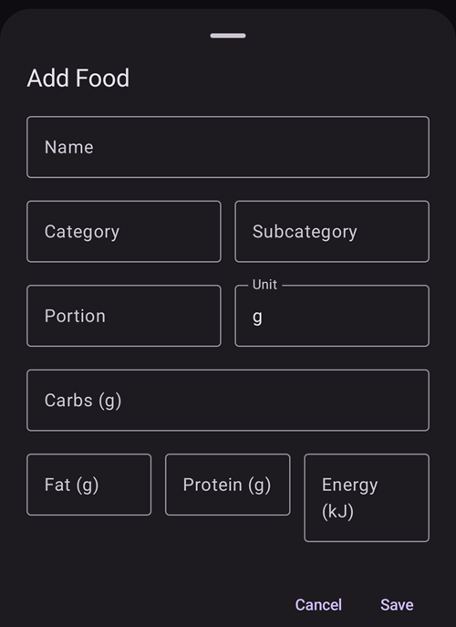

(food)=
# Voeding (je eigen voedingsdatabase)

De database **Voeding** is je eigen lijst met opgeslagen voedingsmiddelen. Elk item bewaart de **koolhydraten** van een voedingsmiddel (en eventueel ook vet, eiwit, energie en een categorie). Zo heb je wat je vaak eet op één plek, en kun je een bolus starten vanuit een opgeslagen voedingsmiddel waarbij de koolhydraten al zijn ingevuld.

```{contents} Table of contents
:depth: 2
:local: true
```

---

## De voedingsdatabase openen

Open het scherm **Beheren** (navigatie onderaan) en kies **Voeding** (*“Voedingsmiddelen beheren”*). In **AAPS** v4 is Voeding **geen plugin meer** — je hoeft niets in te schakelen; het is een apart scherm dat je opent via het [menu Beheren](#v4changes-manage).

---

## De lijst met voedingsmiddelen

Je voedingsmiddelen staan in een lijst waarin je kunt scrollen. Elke regel toont de **naam** van het voedingsmiddel, de **portie / eenheid / categorie** en de **koolhydraten**:


- **🔍 Zoeken** (bovenaan) — filter de lijst op **naam** (hoofdletters maken niet uit).
- **Filter op categorie** — met chips kun je de lijst beperken tot één **categorie**; als je een categorie kiest, verschijnen er chips voor de **subcategorie**. (Tik nog een keer op een gekozen chip om hem te wissen.)
- **➕** (rechtsonder) — voeg een nieuw voedingsmiddel toe (zie hieronder).
- Tik op een regel om dat voedingsmiddel te **bewerken**.

Als de lijst (of het huidige filter) leeg is, toont het scherm **Geen data**.

---

## Een voedingsmiddel toevoegen en bewerken

Tik op **➕** om toe te voegen, of tik op een bestaande regel om die te bewerken. Er opent een editor onderaan het scherm (**Voedingsmiddel toevoegen** / **Voedingsmiddel bewerken**):



De velden zijn:

- **Naam** — verplicht (zonder naam kun je niet opslaan).
- **Categorie** en **Subcategorie** — optioneel, om voedingsmiddelen te groeperen of te filteren.
- **Portie** en **Eenheid** — de gebruikelijke portiegrootte; **Eenheid** is standaard **g**.
- **Koolhydraten (g)** — de hoeveelheid koolhydraten van het voedingsmiddel.
- **Vet (g)**, **Eiwit (g)**, **Energie (kJ)** — optionele voedingswaarden.

Tik op **Opslaan** om het op te slaan, of op **Annuleren** om het te negeren. Als je een bestaand voedingsmiddel bewerkt, heeft de editor ook een knop **Verwijderen**.

```{admonition} Deleting is undoable
:class: note
Als je een voedingsmiddel verwijdert, verschijnt de melding **“Voedingsmiddel verwijderd”** met de actie **Ongedaan maken**. Zo kun je een verwijdering per ongeluk makkelijk terugdraaien.
```

---

## Een voedingsmiddel gebruiken voor een bolus

Elke regel heeft een knop **Calculator**. Als je erop tikt, opent de **Bolus wizard** met de **koolhydraten** van dat voedingsmiddel al ingevuld en de **naam** als notitie bij de behandeling — zo bevestig en geef je de bolus zonder de koolhydraten opnieuw in te typen.

```{admonition} The carbs value is used as-is
:class: note
Het opgeslagen aantal **koolhydraten** gaat direct naar de wizard — **AAPS** vermenigvuldigt het niet met de portie of met hoeveel je hebt gegeten. Eet je een andere hoeveelheid, pas dan de koolhydraten in de wizard aan voordat je bevestigt. (Er is geen keuzelijst voor voedingsmiddelen *in* de Bolus wizard of in het venster Koolhydraten; je start vanaf de regel van het voedingsmiddel hier.)
```

---

## Waar de voedingsmiddelen vandaan komen (Nightscout-synchronisatie)

De voedingsdatabase wordt gedeeld via **Nightscout**, maar **alleen in één richting**:

- **Downloaden:** **AAPS** **leest** voedingsmiddelen uit de **voedingsdatabase** van je Nightscout-site en houdt de lokale lijst daarmee gelijk. Dit gebeurt als onderdeel van de NSClient-synchronisatie, dus een gekoppelde **client/volger** krijgt ook dezelfde voedingsmiddelen.
- **Uploaden:** **AAPS** stuurt voedingsmiddelen **niet** **naar** Nightscout — NSClient kan geen voedingsmiddelen uploaden. Voedingsmiddelen die je **in AAPS** maakt of bewerkt, blijven daarom **op dat apparaat** en gaan niet naar Nightscout of naar je andere apparaten.

```{admonition} Maintain your shared list in Nightscout
:class: important
Omdat voeding **alleen gedownload** wordt, deel je één lijst met voedingsmiddelen tussen je telefoon, je volger/[client](../RemoteFeatures/ClientMasterControl.md) en de rest van je systeem door die lijst bij te houden in **Nightscout** (met de ingebouwde editor voor voeding). **AAPS** haalt die items dan op. Een voedingsmiddel dat je alleen in **AAPS** toevoegt, staat alleen op dat apparaat — en blijft daar ook: een download koppelt Nightscout-items via hun Nightscout-ID. Hij voegt die toe en werkt ze bij, maar overschrijft of verwijdert nooit een voedingsmiddel dat je lokaal hebt gemaakt (een voedingsmiddel wordt alleen verwijderd als de kopie ervan in Nightscout wordt verwijderd).

Let op: de voedingsdatabase is ook **geen** deel van het ondertekende master ↔ client-besturingskanaal — hij gaat alleen als Nightscout-gegevens mee.
```

---

## Niet op het horloge

De voedingsdatabase is een functie van de **telefoon** — er is geen voedingslijst, tegel of menu op een **Wear OS-horloge**.

---


<!-- =====================================================================
     Screenshots captured from a real master device:
       - food_list.png    (Manage → Food: list row, search, add button)
       - food_editor.png  ("Add Food" editor: name/category/subcategory/portion/unit/carbs/fat/protein/energy)
     No food was created or deleted (the editor was cancelled).
     Sync facts code-verified: download via LoadFoodsWorker.getFoods(); upload disabled
     (DataSyncSelectorV3 processChangedFoods() commented out — "NSCv3 doesn't support food update").
     Maintainers: relocate page + images and fix cross-links as needed.
     ===================================================================== -->
