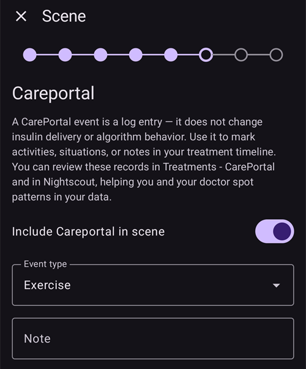
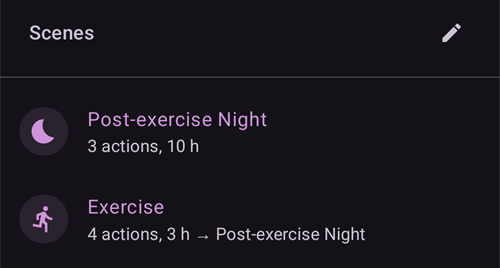

(scenes)=
# Scènes (voorinstellingen voor situaties)

Een **scène** is een voorinstelling met een naam die **een groep acties in één keer uitvoert**. Bijvoorbeeld een voorinstelling *Slaap*, *Beweging/sport* of *Ziektedag* die met één tik je profiel wisselt, een tijdelijk streefdoel instelt, SMB aan- of uitzet en een Careportal-notitie toevoegt. Als je wilt, doet hij dat voor een vaste tijdsduur.

```{contents} Table of contents
:depth: 2
:local: true
```

---

## Wat is een scène

Je hoeft niet elke keer met de hand meerdere dingen te veranderen als een bekende situatie terugkomt. Je stelt ze één keer in als scène en zet die aan met één tik. Een scène kan elk van deze acties bevatten:

- **Profiel wissel** — wissel van profiel en/of verander het met een percentage (bijv. 70 %).
- **Tijdelijk streefdoel** — stel een tijdelijk streefdoel in (bijv. *Activiteit*, *Eet Binnenkort* of een eigen waarde).
- **SMB aan/uit** — zet super-micro-bolussen aan of uit zolang de scène actief is.
- **Loopmodus** — verander de bedrijfsmodus (bijv. naar een voorzichtigere modus).
- **Careportal-notitie** — sla een gebeurtenis op (bijv. *Sport*, *Ziekte*), zodat deze in de grafiek en in Nightscout te zien is.

Een scène heeft ook een **tijdsduur** — een vaste tijd (minuten/uren/dagen) of *Onbeperkt (handmatig einde)* — en een **eindactie** die wordt uitgevoerd als de scène afloopt: een **melding**, of de scène kan **doorgaan** in een andere scène (bijvoorbeeld *Ziektedag → Beweging/sport*).

---

## Scènes beheren

Open **Beheren → Scènes** om je scènes te bekijken, te maken, te bewerken, aan of uit te zetten en de volgorde te veranderen.


Elke scènekaart toont:

- een **selectievakje** om de scène aan of uit te zetten,
- een **pictogram** en een **naam**,
- een samenvatting — *“N acties, tijdsduur”* — en de **→ vervolgscène** als de scène doorgaat in een andere scène,
- en drie knoppen: **▶ activeren**, **✏️ bewerken**, **🗑️ verwijderen**.

Tik op de knop **+** om een nieuwe scène te maken.

---

## Een scène maken of bewerken

### Begin met een sjabloon

Om een scène te **maken**, tik je op de knop **+** in het scherm Scènes. De eerste stap is **Aanmaken op basis van een sjabloon**: kies een kant-en-klare scène voor een veelvoorkomende situatie — *Beweging/sport*, *Ziektedag*, *Ziektedag - overgeven*, *Slaap*, *Nacht na beweging/sport*, *Voor de maaltijd*, *Alcohol*, *Autorijden*, *Baden*, *Luteale fase*, *Warm Weer*, *Medische Procedure* — of begin met een *Blanco* scène. Elk sjabloon **vult de aanbevolen acties alvast in**. Je kunt alles aanpassen in de volgende stappen.


Nadat je een sjabloon hebt gekozen, wordt het doel ervan uitgelegd — *wanneer* en *waarom* je het gebruikt — voordat je verdergaat:


### Ga stap voor stap door de acties

De rest van de editor is een korte wizard die je **stap voor stap** doorloopt. Elke stap is één soort actie met een schakelaar *“… opnemen in scène”*. Zet die alleen aan voor de acties die deze scène moet uitvoeren, en laat de rest uit.


Ga door de stappen met **Volgende**/**Terug**: *Profiel wissel*, *Tijdelijk streefdoel*, *SMB*, *Loopmodus*, *Careportal-notitie*, daarna de **tijdsduur**, de **eindactie** (melding of doorgaan in een andere scène) en tot slot de **naam en het pictogram** van de scène. Sla op als je klaar bent. (Om een bestaande scène te **bewerken**, tik je op de knop **✏️** — je komt dan direct in deze stappen.)

Elke stap begint met een korte uitleg van wat de actie doet. Zo zien de stappen eruit, hier met het sjabloon *Beweging/sport*:

**Tijdelijk streefdoel** — kies een van je voorinstellingen voor een tijdelijk streefdoel:


**SMB** — zet SMB aan of uit zolang de scène actief is:


**Bedrijfsmodus** — verander als je wilt de loopmodus:


**Careportal** — het type gebeurtenis en de notitie die worden opgeslagen:



**Tijdsduur** — hoe lang de scène actief blijft; 0 betekent tot je hem zelf beëindigt:


**Vervolg scène** — als je wilt, de scène die begint als deze afloopt:


**Scène** — de naam en het pictogram. Druk op **Voltooien** om op te slaan:


---

## Een scène activeren

Activeer een scène vanuit de lijst **Scènes** (de knop **▶**) of vanuit het onderdeel **Scènes** in de navigatie onderaan. In het scherm **Scènes** van de navigatie onderaan toont elke scène dezelfde samenvatting als in de lijst Scènes. Het **potlood** bovenaan dit scherm opent **Beheren → Scènes**, waar je scènes maakt of bewerkt.



Voordat er iets wordt uitgevoerd, krijg je een **bevestiging** met precies wat de scène gaat doen. Zo kun je het controleren:


Als de scène doorgaat in een andere scène, eindigt de bevestiging met **→** en de naam van die vervolgscène, op dezelfde manier als in de lijst Scènes.

Als je de scène start vanuit het onderdeel **Scènes** van de navigatie onderaan, is de bevestiging een eenvoudiger venster met dezelfde lijst acties. Druk op **OK** om te activeren:


Nadat je hebt bevestigd, worden de acties uitgevoerd. De **actieve scène** staat dan bovenaan het overzicht met een knop **Beëindig scène**. Als de scène doorgaat in een andere scène, noemt de banner ook die vervolgscène:


De acties van de scène blijven actief tot:

- de **tijdsduur** voorbij is (dan wordt de **eindactie** uitgevoerd — een melding, of doorgaan in de volgende scène), of
- je op **Beëindig scène** tikt om hem met de hand te beëindigen. Als de scène doorgaat in een andere scène, heb je twee keuzes: **Ga naar** de vervolgscène (de actieve scène stopt en de vervolgscène begint nu), of **Beëindig scène** (de actieve scène stopt en de vervolgscène begint niet).

Bij een scène zonder vervolg hoef je alleen te bevestigen:


Als je een scène beëindigt, worden de wijzigingen die hij heeft gedaan **teruggedraaid** (bijvoorbeeld de profielwissel en het tijdelijk streefdoel die hij heeft gestart).

Zolang een scène actief is, hebben het profiel en het streefdoel op het hoofdscherm een klein scènepictogram als de scène ze heeft ingesteld. Het scherm **Scènes** van de navigatie onderaan blijft beschikbaar om een andere scène te starten:


Als de tijdsduur vanzelf afloopt, worden de wijzigingen direct teruggedraaid en verandert de banner in **Scène beëindigd** met een knop **Negeren**. Negeren haalt alleen de banner van het scherm — de scène zelf is al voorbij. Automatiseringsregels en een vervolgscène gaan dus door zonder hierop te wachten.

---

## Scènes starten vanuit Automatisering

Je hoeft een scène niet met de hand te starten — **Automatisering** kan dat voor je doen. Als je een actie toevoegt aan een automatiseringsregel (**Beheren → Automatisering**), heeft de actiekiezer een categorie **Scènes**:

- **Scène uitvoeren** — activeer een scène als de triggers van de regel afgaan (bijvoorbeeld op een vaste tijd, als je ergens aankomt, of als de glucose over een grens gaat).
- **Scène inschakelen** / **Scène uitschakelen** — maak een scène beschikbaar (of niet beschikbaar) zonder hem te activeren.


Automatisering kan ook **reageren op** een scène: in de lijst met triggers staat een trigger **Scène**. Zo kan een regel alleen werken terwijl een bepaalde scène actief is. Samen met de **eindactie** van een scène (terugdraaien, melden of doorgaan in een andere scène) kunnen scènes zo automatisch beginnen, op elkaar volgen en eindigen.

---

## Scènes met master/client en een horloge

De **scène die nu actief is, wordt gesynchroniseerd** met al je gekoppelde apparaten — activeer hem op één telefoon en de andere tonen hem ook.

Een gekoppelde **client** (**AAPSClient**) kan ook een scène activeren of beëindigen: het verzoek gaat naar de **master**. Die maakt de bevestiging en voert de scène uit op zijn eigen gegevens. Zie [Master ↔ Client besturing](../RemoteFeatures/ClientMasterControl.md) voor hoe dat werkt.

(scenes-from-watch)=
### Vanaf een Wear OS-horloge

Scènes zijn beschikbaar op een **Wear OS-horloge** als **Scène-tegel**. Veeg naar de tegel **Scène** in de tegelcarrousel van je horloge (voeg hem eerst toe uit de tegellijst van de carrousel als hij er nog niet staat) en tik op de scène die je wilt starten:


De tegel heeft vier plaatsen. Standaard vult elke plaats zich **automatisch** met de volgende van je ingeschakelde scènes, in dezelfde volgorde als op de telefoon. Om zelf te kiezen, **druk je lang op de tegel** en open je de instellingen ervan: voor elk van de vier plaatsen kun je **Automatisch** houden, een **bepaalde scène** vastzetten, of **Geen** kiezen om de plaats leeg te laten. Een plaats met een scène die intussen is verwijderd of uitgeschakeld, toont **Niet beschikbaar** — kies er dan een andere scène voor.

Het horloge toont daarna een bevestiging — tik op **✓** om te activeren, of veeg terug om te annuleren:


Net als bij een client **maakt de master de bevestiging en voert hij de scène uit**. Het horloge stuurt alleen het verzoek door (via de client-telefoon, als het horloge aan een client is gekoppeld).

Zolang een scène loopt — of de banner **Scène beëindigd** nog op de telefoon staat — toont de tegel een knop **Einde** met de naam van de scène eronder. Tik erop om de actieve scène te beëindigen, of om de overgebleven banner weg te halen, direct vanaf je pols.

Als de lopende scène doorgaat in een andere scène, toont de tegel ook een knop **Overslaan** met de naam van de vervolgscène eronder. Dit zijn dezelfde twee keuzes als op de telefoon:

- **Einde** — de actieve scène stopt. De bevestiging zegt dat de vervolgscène niet zal beginnen.
- **Overslaan** — de actieve scène stopt en de vervolgscène begint nu. De bevestiging noemt beide scènes.

Het [Loop status-scherm](#WearOsSmartwatch-loop-status) van het horloge toont ook de actieve scène, de tijd die nog over is en de vervolgscène.

---


<!-- =====================================================================
     Screenshots captured from a real master device:
       - scenes_list.png        (Manage → Scenes management list)
       - templates_picker.png   (create: "Start from template" picker)
       - template_explanation.png (create: chosen template's explanation)
       - scene_editor.png       (scene editor, Profile switch step)
       - scene_confirmation.png (scene activation confirmation — also used on the Client/Master page)
       - scene_active_banner.png (overview active-scene banner with the End Scene button)
       - automation_scene_action.png (Automation action picker — Scenes category)
       - scene_watch_tile.png    (Wear OS Scene tile)
       - scene_watch_confirm.png (Wear OS scene confirmation)
     Maintainers: relocate page + images and fix cross-links as needed.
     ===================================================================== -->
