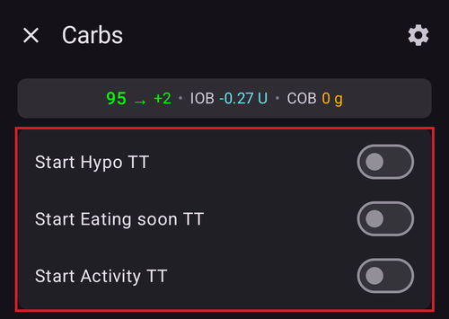

# Tijdelijk streefdoel

## Wat is een Tijdelijk streefdoel en hoe kan ik dat instellen?

Een **tijdelijk streefdoel** (of kort **TT**) is een functie van **AAPS** waarmee de gebruiker zijn [**BG**-streefbereik](#profile-glucose-targets) kan aanpassen voor geplande activiteiten. Dit doet **AAPS** door de hoeveelheid insuline voor de gebruiker aan te passen.

Een glucosestreefdoel, zeker als het maar kort geldt (korter dan 4 uur), hoeft niet de *echte waarde* te zijn die je verwacht of wilt bereiken. Het is eerder een goede manier om **AAPS** te laten weten dat het meer of minder agressief moet zijn, terwijl je glucose toch binnen bereik blijft.

Tijdelijke streefdoelen kunnen binnen deze grenzen worden ingesteld:

|         | Tijdelijk streefdoel   |
| ------- | ---------------------- |
| Minimum | 4 mmol/l of 72 mg/dl   |
| Maximum | 10 mmol/l of 180 mg/dl |

**AAPS** heeft drie ingebouwde voorinstellingen voor een **tijdelijk streefdoel**: voor sporten (**Activiteit**), maaltijden (**Eet Binnenkort**) en een voorspelde hypo (**Hypo**). Ze staan in het scherm **Tijdelijk streefdoel** (**Beheren** → **Tijdelijk streefdoel**). Je kunt dit scherm ook openen door op de **streefdoel-chip** op het hoofdscherm te tikken.

Gebruikers moeten realistische verwachtingen hebben van wat ze kunnen bereiken met een **tijdelijk streefdoel** in **AAPS**. Of een gewenst **BG**-streefdoel wordt bereikt, hangt af van veel factoren, zoals: hoe goed de **AAPS**-instellingen van de gebruiker kloppen, de algemene **BG**-regeling, **IOB**, insulinegevoeligheid, insulineresistentie, hoe zwaar de inspanning tijdens het sporten is, enzovoort.

Het kan ongeveer 30 minuten of langer duren voordat een **tijdelijk streefdoel** het gewenste **BG**-streefdoel bereikt. **AAPS** kan een **BG**-streefdoel nooit direct bereiken. Houd hier rekening mee als je een **tijdelijk streefdoel** kiest.

De onderdelen hieronder geven een overzicht van **Tijdelijk streefdoel - Activiteit**, **Tijdelijk streefdoel - Eet binnenkort** en **Tijdelijk streefdoel - Hypo**. De getoonde waarden zijn de standaardwaarden bij installatie — je kunt [elke voorinstelling aanpassen](#TempTargets-change-preset-defaults) aan je eigen wensen.

### TT - Activiteit


**BG-streefdoel (standaard voorinstelling, aan te passen)**

AAPS probeert 1 uur 30 min lang 140 mg/dl of 7,8 mmol/l te bereiken

**Andere punten waar gebruikers bij het kiezen rekening mee kunnen houden**:

Afhankelijk van de **BG** zal **AAPS** "minder" insuline geven om het **BG**-streefdoel te bereiken. Als het **BG**-streefdoel niet binnen bereik is (d.w.z. hoger dan het gekozen **BG**-streefdoel in het **profiel** van de gebruiker), dan kan **AAPS** de basaal aan laten.

In gesloten loop wordt **SMB**:

- *mogelijk* uitgeschakeld (zie verder hieronder); en/of
- kan de basaal worden aangezet als **AAPS** een negatieve **IOB** heeft, of <0.

Gebruikers kunnen ook overwegen:

- *het kiezen* van dit **TT** 1–2 uur voor het geplande sporten, zodat de IOB lager is (de juiste tijd voor dit TT verschilt per persoon); en
- *het kiezen* van een tijdelijk profiel (verlaging) voor de duur van de geplande activiteit, zodat de **IOB** lager is;
- *ervoor zorgen* dat het **TT** kort voor het sporten wordt *uitgezet*, omdat de **IOB** dan al lager is en sommige gebruikers na het sporten een snelle stijging van de **BG** krijgen.

### TT - Eet binnenkort


**BG-streefdoel (standaard voorinstelling, aan te passen)**

AAPS probeert 45 minuten lang 90 mg/dl of 5,0 mmol/l te bereiken

**Andere punten waar gebruikers bij het kiezen rekening mee kunnen houden**:

In gesloten loop wordt **SMB**:

- blijft geactiveerd; en/of
- kan de basaal ook worden aangezet, afhankelijk van de **profiel**instellingen van de gebruiker.

Afhankelijk van de **BG** zal **AAPS** "meer" insuline geven, binnen de **AAPS**-instellingen van de gebruiker, om het gewenste **BG**-streefdoel te bereiken.

### TT - Hypo


**BG-streefdoel (standaard voorinstelling, aan te passen)**

AAPS probeert 1 uur lang 160 mg/dl of 8,9 mmol/l te bereiken

**Andere punten waar gebruikers bij het kiezen rekening mee kunnen houden**:

In gesloten loop wordt **SMB**:

- *mogelijk* uitgeschakeld (zie verder hieronder); en/of
- kan de basaal worden aangezet als **AAPS** een negatieve **IOB** heeft, of <0.

(TempTargets-manage-v4)=

## Tijdelijke streefdoelen instellen en beheren (Beheren → Tijdelijk streefdoel)

In **AAPS** v4 beheer je je TT-**voorinstellingen** en start je een tijdelijk streefdoel via het scherm **Beheren** (navigatie onderaan) → **Tijdelijk streefdoel** (*“Tijdelijke streefdoelen beheren en activeren”*).


Het scherm heeft drie delen:

1. **Carrousel met voorinstellingen** (boven) — veeg door je TT-voorinstellingen. Elke kaart toont de **naam**, het **streefdoel** en de **tijdsduur** van de voorinstelling; het TT dat nu loopt, is gemarkeerd.
2. **Editor** (midden) — het **Tijdelijk streefdoel** en de **Tijdsduur** die echt worden gebruikt, plus een datum/tijd voor **Activatie**.
3. **Actiebalk** (onder) — **➕ toevoegen**, **‘️ verwijderen** en de knop **▶ activeren**.

Als je een kaart met een voorinstelling kiest, worden het **streefdoel** en de **tijdsduur** ervan in de editor geladen.

```{admonition} Ingebouwde en eigen voorinstellingen :class: note De ingebouwde voorinstellingen — **Eet Binnenkort**, **Activiteit** en **Hypo** — zijn er altijd en **kunnen niet worden verwijderd** (je kunt wel hun waarden veranderen en opslaan). Voorinstellingen die je zelf maakt, zijn **eigen** voorinstellingen. Die kun je vrij bewerken of verwijderen.

    <br />### Een tijdelijk streefdoel activeren
    
    Veeg naar de voorinstelling die je wilt (de waarden worden in de editor geladen), pas als je wilt het **streefdoel**/de **tijdsduur** aan in de editor en tik dan op **▶ Activeer**. Een bevestiging toont het precieze streefdoel, de tijdsduur en de reden, voordat er iets begint:
    
    
    
    Nadat je hebt bevestigd, begint het tijdelijk streefdoel direct (of op de gekozen tijd bij **Activatie**) en loopt het gedurende de ingestelde **tijdsduur**.
    
    ```{admonition} De getallen bewerken geldt maar één keer — de voorinstelling verandert niet
    :class: important
    Het **streefdoel** en de **tijdsduur** in de editor zijn de waarden die **Activeer** *nu* gebruikt. Als je ze verandert, is die wijziging **tijdelijk**: ze geldt alleen voor deze activatie en **verandert de opgeslagen voorinstelling niet**. Zo kun je een TT voor één keer "aanpassen en activeren" (bijvoorbeeld vandaag *Activiteit* met een iets ander streefdoel activeren), zonder de voorinstelling blijvend te veranderen.
    

### Wijzigingen in een voorinstelling opslaan

Als je een gewijzigde waarde *wel* wilt bewaren, moet je hem **opslaan**: als de editor verschilt van de gekozen voorinstelling, verschijnt er een pictogram **Opslaan** in de bovenste werkbalk. Als je daarop tikt, worden het huidige **streefdoel** en de **tijdsduur** (en bij eigen voorinstellingen ook de naam) in de gekozen voorinstelling opgeslagen. Bij de ingebouwde voorinstellingen verschijnt ook een knop **Standaardinstellingen herstellen** (↺) in de actiebalk: die zet de standaardwaarden van de voorinstelling terug.


De vuistregel is dus:

- **Activeer** → gebruik de getallen **één keer** (voorinstelling blijft hetzelfde).
- **Opslaan** → maak van de getallen de **nieuwe standaardwaarden** van de voorinstelling.

Om een ingebouwde voorinstelling terug te zetten zoals hij bij installatie was, kies je hem en tik je op de knop **↺ Herstellen**. Deze knop staat alleen in de actiebalk bij een **ingebouwde** voorinstelling waarvan de waarden nu verschillen van de fabriekswaarden. Hij zet het oorspronkelijke **streefdoel** en de oorspronkelijke **tijdsduur** van die voorinstelling terug.

### Voorinstellingen toevoegen en verwijderen

- **➕ Toevoegen** — maak een **nieuwe eigen voorinstelling** met de huidige waarden uit de editor. De nieuwe kaart verschijnt in de carrousel.
- **‘️ Verwijderen** — verwijder de gekozen **eigen** voorinstelling. Ingebouwde voorinstellingen (*Eet Binnenkort*, *Activiteit*, *Hypo*) kunnen niet worden verwijderd.

Als je minstens twee **eigen** voorinstellingen hebt, kun je ook hun volgorde in de carrousel veranderen: tik op het pictogram **Herschikken** (⇅) in de bovenste balk, verplaats de middelste kaart met de **◀ / ▶ verplaatsknoppen** en bevestig met **✓**. De ingebouwde voorinstellingen houden hun plaats — alleen eigen voorinstellingen kunnen worden verplaatst. (De knoppen zien er hetzelfde uit als bij [het herschikken van profielen](ProfileSwitch-ProfilePercentage.md).)

Je voorinstellingen horen bij de gesynchroniseerde configuratie. Ze worden dus gedeeld tussen je master en de gekoppelde clients.

### Andere manieren om een tijdelijk streefdoel in te stellen

Je kunt een tijdelijk streefdoel ook instellen zonder dit scherm te openen:

- met de **TT-schakelaars in het venster Koolhydraten** — zie [hieronder](#TempTargets-carbs-dialog),
- met een **knop voor een voorinstelling in de [QuickLaunch-werkbalk](QuickLaunch.md)** — de categorie *Voorinstellingen tijdelijke streefwaarden* in *Configureer QuickLaunch* biedt voor elke voorinstelling een knop die met één tik werkt,
- vanaf een **Wear OS-horloge** (het menu-item / de tegel **Tijdelijk streefdoel**),
- vanaf een gekoppelde **client** — zie [Master ↔ Client besturing](../RemoteFeatures/ClientMasterControl.md),
- als onderdeel van een **[scène](Scenes.md)** (de actie *Tijdelijk streefdoel*), of
- vanuit een regel in **Automatisering** (*Start tijdelijk doel* / *Stop tijdelijk doel*).

* * *

(TempTargets-where-can-i-select-a-temp-target)=

## Waar kan ik een tijdelijk streefdoel kiezen?

De snelste manier is tikken op de **streefdoel-chip** op het hoofdscherm (die toont je huidige streefbereik):


Dit opent het hierboven beschreven scherm **Tijdelijk streefdoel** — veeg naar een voorinstelling en tik op **▶ Activeer**. Hetzelfde scherm is ook te openen via **Beheren** → **Tijdelijk streefdoel**.

(TempTargets-carbs-dialog)= Als je koolhydraten invoert, hoef je het scherm **Tijdelijk streefdoel** helemaal niet te openen: het **venster Koolhydraten** (**Behandelingen** → **Koolhydraten**) heeft bovenaan de schakelaars **Start Hypo TT**, **Start binnenkort eten TT** en **Start inspanning TT**. Zet er een aan, dan wordt de bijbehorende voorinstelling samen met de koolhydraten geactiveerd:



    {admonition} Automatisch Hypo TT
    :class: note
    Als je het **venster Koolhydraten** opent terwijl je glucose lager is dan 72 mg/dl (4 mmol/l), kiest **AAPS** de schakelaar **Start Hypo TT** alvast voor je (behalve als er al een hoger tijdelijk streefdoel loopt dat nog langer duurt).

(TempTargets-change-preset-defaults)=

## Waar kan ik het standaard tijdelijk streefdoel veranderen en vervangen door mijn eigen voorkeuren?

Het **streefdoel** en de **tijdsduur** van elke voorinstelling bewerk je direct in het scherm **Tijdelijk streefdoel** — er is hiervoor geen aparte instelling meer:

1. Open het scherm **Tijdelijk streefdoel** (tik op de streefdoel-chip, of **Beheren** → **Tijdelijk streefdoel**).
2. Veeg naar de voorinstelling die je wilt veranderen.
3. Pas **Tijdelijk streefdoel** en/of **Tijdsduur** aan in de editor.
4. Tik op het pictogram **Opslaan** dat in de bovenste werkbalk verschijnt.


Zolang de editor verschilt van de fabriekswaarden van een ingebouwde voorinstelling, staat er ook een knop **↺ Herstellen** in de actiebalk — tik erop om het oorspronkelijke streefdoel en de oorspronkelijke tijdsduur van de voorinstelling terug te zetten.

## Hoe annuleer ik een tijdelijk streefdoel?

Zolang een tijdelijk streefdoel loopt, toont de streefdoel-chip op het hoofdscherm het streefdoel en de tijd die nog over is. Tik erop — in het scherm **Tijdelijk streefdoel** is de lopende voorinstelling gemarkeerd als **ACTIEF**, en er verschijnt een rode knop **✗ Afbreken** aan het eind van de werkbalk onderaan, direct links van de knop **▶ Activeer**. Tik erop en bevestig:


Een lopend tijdelijk streefdoel kan ook worden gestopt vanaf een **Wear OS-horloge**, vanaf een gekoppelde **client**, of door een regel in **Automatisering** (*Stop tijdelijk doel*).

(TempTargets-hypo-temp-target)=

## Hypo Tijdelijk streefdoel

Met **Tijdelijk streefdoel Hypo** kan **AAPS** een lage bloedglucose bij de gebruiker voorkomen door minder insuline te geven. Als de gebruiker verwacht dat de **BG** laag gaat worden: meestal kan **AAPS** dit zelf aan, maar veel hangt af van hoe goed de **AAPS**-instellingen van de gebruiker kloppen. Met een **Tijdelijk streefdoel Hypo** kan de gebruiker de voorspelde lage waarde voor zijn en **AAPS** laten weten dat het minder insuline moet geven.

Soms stijgt de **BG** van de gebruiker snel na het eten van koolhydraten tegen een hypo. **AAPS** corrigeert dan de snel stijgende **BG** door **SMB's** te geven.

Sommige gebruikers willen geen **SMB's** krijgen tijdens een **Tijdelijk streefdoel Hypo**. Dit doe je door *'SMB toestaan bij hoog tijdelijk streefdoel'* uit te zetten in **Instellingen** → **OpenAPS SMB** (zie verder hieronder):

- In (Gevorderd, doel 9): de gebruiker kan *“Hoog tijdelijk streefdoel verhoogt gevoeligheid”* aanzetten voor **tijdelijke streefdoelen** van 100 mg/dl (5,6 mmol/l) of hoger in OpenAPS SMB. **AAPS** is dan gevoeliger.

- In (Gevorderd, doel 9): de gebruiker kan *“SMB toestaan bij hoog tijdelijk streefdoel”* uitzetten. Dan geeft **AAPS** geen SMB's zolang een hoog tijdelijk streefdoel actief is, ook als **AAPS** COB > 0 heeft, “SMB toestaan bij laag tijdelijk streefdoel” of “SMB altijd toestaan” aan staat en OpenAPS SMB actief is.

Let op: als je het **venster Koolhydraten** opent terwijl je bloedglucose lager is dan 72 mg/dl of 4 mmol/l, kiest **AAPS** de schakelaar **Start Hypo TT** automatisch.

(TempTargets-activity-temp-target)=

## Activiteit Tijdelijk streefdoel

Voor en tijdens het sporten heeft de gebruiker misschien een hoger streefdoel nodig om een hypo tijdens de activiteit te voorkomen.

Om **Tijdelijk streefdoel Activiteit** makkelijker te maken, kan de gebruiker een standaard **Tijdelijk streefdoel - Activiteit** instellen. Dit verhoogt de **BG** door minder insuline te geven, zodat de **BG** langzamer daalt en een hypo wordt voorkomen.

Nieuwe gebruikers van **AAPS** moeten misschien wat uitproberen en hun standaardinstellingen voor **Tijdelijk streefdoel Activiteit** aanpassen, zodat deze functie voor hen het best werkt. Iedereen is anders als het gaat om een stabiele BG tijdens het sporten. Zie ook het [onderdeel over sport in de FAQ](#FAQ-sports).

Sommige gebruikers zetten ook liever een **Profiel wissel** aan (een profielverlaging < 100 %, zodat **AAPS** minder insuline geeft) voor en tijdens **Tijdelijk streefdoel Activiteit**. Je kunt beide in één stap starten: tik op de profielnaam op het hoofdscherm, tik op de ronde knop **▶**, stel een **Percentage** lager dan 100 % en een **Tijdsduur** in, en zet daarna **Tijdelijk streefdoel / Activiteit** aan. Zie [Het Profiel percentage wijzigen](#ProfileSwitch-change-percentage).

Gevorderd, doel 9: gebruikers kunnen *'Hoog tijdelijk streefdoel verhoogt gevoeligheid'* aanzetten voor **tijdelijke streefdoelen** van 100 mg/dl (5,6 mmol/l) of hoger in OpenAPS **SMB**. Een streefdoel van 99 mg/dl (5,5 mmol/l) is een normaal streefdoel, niet hoog en niet laag. Dan is **AAPS** gevoeliger.

Als *'SMB toestaan bij hoog tijdelijk streefdoel'* uit staat, geeft **AAPS** bovendien geen **SMB's**, ook niet als COB > 0 is, *'SMB toestaan bij laag tijdelijk streefdoel'* of *'SMB altijd toestaan'* aan staat en OpenAPS **SMB** actief is.

(TempTargets-eating-soon-temp-target)=

## Eet binnenkort Tijdelijk streefdoel

**Tijdelijk streefdoel - Eet binnenkort** kan helpen om de **BG** rustig te laten dalen en zorgt voor genoeg **IOB** voor het eten.

Dit kan een belangrijk hulpmiddel zijn voor gebruikers die geen pre-bolus geven. Hoe goed **Tijdelijk streefdoel - Eet binnenkort** werkt, hangt wel af van een aantal factoren, zoals: de instellingen van de gebruiker, of ze weinig koolhydraten eten, en of ze een snelwerkende insuline gebruiken (zoals Fiasp of Lyumjev) zodat een pre-bolus niet nodig is. Totdat gebruikers ervaring hebben met **AAPS**, moeten ze er meestal op rekenen dat ze een pre-bolus geven als ze **Tijdelijk streefdoel - Eet binnenkort** gebruiken. Dit geldt vooral als ze veel koolhydraten eten.

Je kunt meer lezen over de “Eet binnenkort-modus” in het artikel ['How to do “eating soon” mode'](https://diyps.org/2015/03/26/how-to-do-eating-soon-mode-diyps-lessons-learned/) (Engels) of [hier](https://diyps.org/tag/eating-soon-mode/).

Gevorderd, [doel 9](#objectives-objective9): als je OpenAPS SMB gebruikt en *'Laag tijdelijk streefdoel verlaagt gevoeligheid'* aan staat, werkt **AAPS** iets agressiever. Voor deze optie moet het **tijdelijk streefdoel** 98 mg/dl (5,4 mmol/l) of lager zijn.

## Hoe zet ik SMB uit tijdens een tijdelijk streefdoel?

Open hiervoor **Instellingen** → **OpenAPS SMB** en zet *'SMB toestaan bij hoog tijdelijk streefdoel'* uit.


Zo geeft **AAPS** geen **SMB's**, ook niet als COB > 0 is, *'SMB toestaan bij laag tijdelijk streefdoel'* of *'SMB altijd toestaan'* aan staat en OpenAPS SMB actief is.