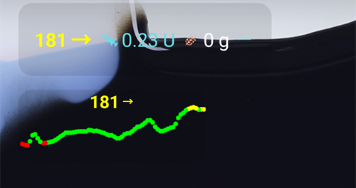
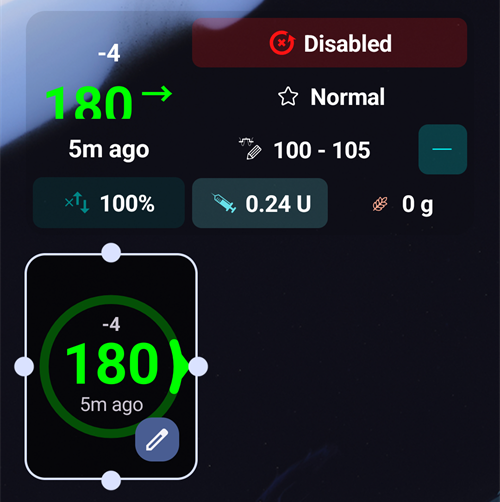

(widgets)=
# Widgets op het startscherm

**AAPS** heeft widgets die je op het startscherm van je telefoon kunt zetten. Een widget toont je actuele gegevens zonder dat je de app hoeft te openen. Tik op een widget om **AAPS** te openen.

```{contents} Table of contents
:depth: 2
:local: true
```

---

## Beschikbare widgets

Er zijn vijf widgets. Ze staan onder **AAPS** in de widgetkiezer van Android:


| Widget                            | Standaardgrootte | Wat hij toont                                                                                                                                                                                                                                              |
| --------------------------------- | ---------------- | ---------------------------------------------------------------------------------------------------------------------------------------------------------------------------------------------------------------------------------------------------------- |
| **AAPS widget**                   | 5 × 2            | The status block of the main screen: BG with trend and delta, the loop mode as an icon beside the profile name, target, sensitivity (shown as on the main screen), IOB and COB. The texts shrink to fit the size you give the widget instead of being cut. |
| **AAPS glucosecirkel**            | 2 × 2            | De BG-cirkel van het hoofdscherm: een ring in de kleur van de BG, de trendboog, de delta, de BG-waarde en de tijd sinds de laatste meting.                                                                                                                 |
| **AAPS Klein**                    | 2 × 2            | Profielnaam, BG met trendpijl, tijd sinds de laatste meting, delta, IOB en COB.                                                                                                                                                                            |
| **AAPS BG + IOB + COB (compact)** | 4 × 1            | Eén regel met BG en trendpijl, IOB en COB.                                                                                                                                                                                                                 |
| **AAPS BG-grafiek**               | 3 × 1            | De BG-waarde met een kleine grafiek van de laatste metingen.                                                                                                                                                                                               |

De **AAPS widget**, de **glucosecirkel** en de widget **Klein** op een startscherm:


De widget **compact** en de widget **BG-grafiek**:



BG-waarden hebben dezelfde kleuren als in **AAPS**: groen binnen bereik, geel boven het bereik, rood onder het bereik.

---

## Een widget toevoegen

De precieze stappen hangen af van je telefoon en de launcher. Op de meeste telefoons:

1. Druk lang op een lege plek van het startscherm en kies **Widgets**.

   

2. Open **AAPS** in de lijst en tik op de widget die je wilt.
3. Druk op **Toevoegen** (of sleep de widget naar de plek die je wilt).

   

De widget wordt op het startscherm geplaatst. Direct na het toevoegen zie je grepen rond de widget: sleep aan een greep om de **grootte te wijzigen**, of sleep de widget om hem te verplaatsen. De glucosecirkel kan elke grootte krijgen.



Als de pagina van het startscherm vol is, zet de telefoon de widget op een nieuwe pagina.

---

## Widget configuratie

Tik op de knop met het **potlood** die op de widget verschijnt direct nadat je hem hebt toegevoegd. Later druk je lang op de widget om de grepen en het potlood weer te zien.

Het venster **Widget configuratie** heeft twee instellingen:

- **Configureer dekking** — hoe ondoorzichtig de achtergrond van de widget is. Bij een lage waarde schijnt de achtergrondafbeelding erdoorheen.
- **Gebruik zwarte kleur** — gebruik een zwarte achtergrond in plaats van de standaardachtergrond.


Elke widget heeft zijn eigen instellingen.

---

## Goed om te weten

- Een widget **toont** alleen gegevens. Je kunt vanuit een widget geen bolus geven en niets wijzigen.
- De widget wordt bijgewerkt door **AAPS**. Als **AAPS** niet draait, of als Android de app op de achtergrond beperkt, kan de widget oude gegevens tonen. Controleer de tijd sinds de laatste meting, en zorg dat **AAPS** is uitgezonderd van [batterijoptimalisatie](#SetupWizard-StoragePermission).
- Bij **AAPSClient**, **AAPSClient2** en **AAPSClient3** is de achtergrond van de widget geel, blauw of groen, zodat je de apps uit elkaar kunt houden. Verhoog de dekking in de widgetconfiguratie als de kleur moeilijk te zien is. Zie [Over AAPSClient, AAPSClient2 en AAPSClient3](#remotecontrol-aapsclient-versions).
