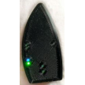

# Compatibele pompen

AAPS werkt met een aantal insulinepompen. De lijst hieronder toont de apparaten die nu ondersteund worden. Tussen haakjes staat of AAPS met de pomp communiceert via de ingebouwde Bluetooth van je telefoon, of dat er een RileyLink-compatibel apparaat nodig is.

<!-- List of hidden pages to avoid overcrowding the menu -->

```{toctree}
:hidden:

../CompatiblePumps/Accu-Chek-Combo-Pump-v2.md
../CompatiblePumps/Accu-Chek-Insight-Pump.md
../CompatiblePumps/CareLevo.md
../CompatiblePumps/DanaR-Insulin-Pump.md
../CompatiblePumps/DanaRS-Insulin-Pump.md
../CompatiblePumps/DiaconnG8.md
../CompatiblePumps/EOPatch2.md
../CompatiblePumps/Equil5.3.md
../CompatiblePumps/MedtronicPump.md
../CompatiblePumps/MedtrumNano.md
../CompatiblePumps/OmnipodDASH.md
../CompatiblePumps/OmnipodEros.md
../CompatiblePumps/Future-possible-Pump-Drivers.md
```

- [Accu-Chek Combo](../CompatiblePumps/Accu-Chek-Combo-Pump-v2.md) (Bluetooth; zie ook [Tips voor basisgebruik](#combov2-tips-for-basic-usage))
- [Accu-Chek Insight](../CompatiblePumps/Accu-Chek-Insight-Pump.md) (Bluetooth)
- [CareLevo](../CompatiblePumps/CareLevo.md) (Bluetooth)
- [DanaR](../CompatiblePumps/DanaR-Insulin-Pump.md) (Bluetooth)
- [DanaRS](../CompatiblePumps/DanaRS-Insulin-Pump.md) (Bluetooth)
- [Dana-i](../CompatiblePumps/DanaRS-Insulin-Pump.md) (Bluetooth)
- [Dana-i2](../CompatiblePumps/DanaRS-Insulin-Pump.md) (Bluetooth)
- [Diaconn G8](../CompatiblePumps/DiaconnG8.md) (Bluetooth)
- [EOPatch2](../CompatiblePumps/EOPatch2.md) (Bluetooth)
- [Equil 5.3](../CompatiblePumps/Equil5.3.md) (Bluetooth)
- Bepaalde oudere [Medtronic](../CompatiblePumps/MedtronicPump.md)-pompen ([extra communicatieapparaat](#CompatiblePumps-additional-communication-device) nodig)
- [Medtrum Nano 200U](../CompatiblePumps/MedtrumNano.md) (Bluetooth)
- [Medtrum 300U](../CompatiblePumps/MedtrumNano.md) (Bluetooth)
- [Omnipod DASH](../CompatiblePumps/OmnipodDASH.md) (Bluetooth)
- [Omnipod Eros](../CompatiblePumps/OmnipodEros.md) ([extra communicatieapparaat](#CompatiblePumps-additional-communication-device) nodig)

## Mijn pomp staat er niet bij

Informatie over de status van andere pompen die misschien met AAPS kunnen werken, staat op de pagina [Mogelijk toekomstige insulinepompen](../CompatiblePumps/Future-possible-Pump-Drivers.md).

(CompatiblePumps-additional-communication-device)=
## Extra communicatieapparaat

Als er geen extra communicatieapparaat genoemd wordt, verloopt de communicatie tussen de insulinepomp en **AAPS** via de ingebouwde Bluetooth van Android. Er is dan geen extra apparaat nodig om het communicatieprotocol te vertalen.

Voor oude Medtronic-pompen en Omnipod Eros is een extra communicatieapparaat (naast je telefoon) nodig. Dit "vertaalt" het radiosignaal van de pomp naar Bluetooth. Het apparaat moet dezelfde radiofrequentie gebruiken als je pomp:

- **Omnipod Eros**: 433 MHz.
- **Medtronic**: 916 MHz voor pompen die in de VS en Canada verkocht zijn, 868 MHz voor pompen die elders verkocht zijn. Zie [Hoe weet ik welke frequentie mijn pomp gebruikt](#MedtronicPump-faq).

Beschikbare communicatieapparaten:

-   [Website van OrangeLink](https://getrileylink.org/product/orangelink)
-  [433MHz RileyLink](https://getrileylink.org/product/rileylink433)
-   [Website van Emalink](https://github.com/sks01/EmaLink) - [Contactgegevens](mailto:getemalink@gmail.com)
-   DiaLink - [Contactgegevens](mailto:Boshetyn@ukr.net)
-   [Website van LoopLink](https://www.getlooplink.org/) - [Contactgegevens](https://jameswedding.substack.com/) - Niet getest