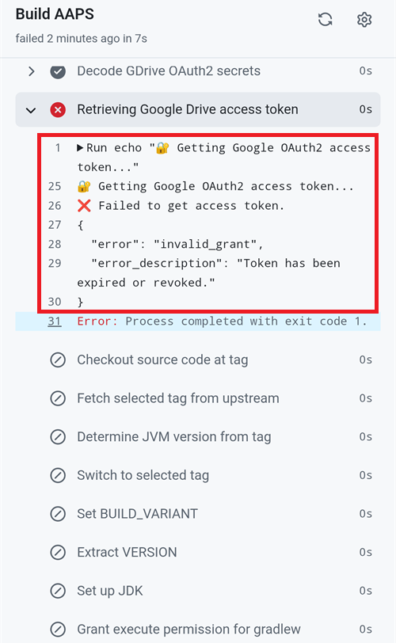

(aaps-ci-troubleshooting)=

# Bouwen in de browser: probleemoplossing

```{note}
Op deze pagina staan tips voor het oplossen van problemen bij [Bouwen in de browser](../SettingUpAaps/BrowserBuild.md).

Gebruik je **AAPS Builder**? Begin dan met het eigen [hoofdstuk probleemoplossing](#aaps-builder-troubleshooting) daarvan. De hoofdstukken over Google Drive hieronder gelden er ook voor.
```

## AAPS-CI probleemoplossing

(aaps-ci-read-the-logs)=
### Eerst: zoek uit wat er mis ging

Als een build mislukt, bewaart GitHub een log van elke stap. In de log staat welke stap is mislukt en waarom. Lees die eerst, voordat je iets anders probeert: de foutmelding is waar je op deze pagina naar zoekt, en waar helpers om zullen vragen.

1. Open **Actions** in je GitHub-kopie van AndroidAPS. Een mislukte build heeft een rood kruis. Tik op de naam ervan.

   

2. De samenvatting van de run toont **Failure** (mislukt) en daaronder de job die is mislukt (**Build AAPS**, met een rood kruis).

   

3. Scroll omlaag naar **Annotations** en tik op de rode regel **Build AAPS**.

   

4. De job gaat open. Stappen met een grijs vinkje zijn gelukt. De stap met het rode kruis is de stap die mislukt is: GitHub opent die voor je. De stappen daarna zijn overgeslagen (grijs rondje).

   

5. Lees de regels net boven `Error: Process completed with exit code 1.`: daar wordt het probleem uitgelegd. In dit voorbeeld is de stap **Retrieving Google Drive access token** mislukt met `invalid_grant` en `Token has been expired or revoked.`, zie [Google refresh token verlopen](#aaps-ci-google-token-expired).

   

```{tip}
Hulp vragen? Deel de naam van de mislukte stap en de foutregels (een screenshot zoals hierboven is prima). Deel nooit de inhoud van je secrets.
```

(aaps-ci-update-secret)=
#### Een secret bijwerken

Veel oplossingen betekenen dat je de waarde van een secret vervangt. Ga in je GitHub-kopie van AndroidAPS naar **Settings** → **Secrets and variables** → **Actions** en tik op het potlood naast het secret.


Typ of plak de nieuwe waarde en tik op **Update secret**. GitHub laat de oude waarde nooit zien: het veld is altijd leeg.


(aaps-ci-rerun)=
#### De build opnieuw starten na een oplossing

Als je de oorzaak hebt opgelost, hoef je niet helemaal opnieuw te beginnen: open de mislukte run, tik op **...** (rechtsboven) en daarna op **Re-run failed jobs**.


Tik op **Re-run jobs**. Je kunt ook zoals gewoonlijk een nieuwe build starten met **Run workflow**.


(aaps-ci-preparation-web)=
### Webpagina aaps-ci-preparation
  - De voorbereidingspagina wordt getoond door een tijdelijke lokale server (bijvoorbeeld Simple Web Server op een computer). Die server ontvangt ook het refresh token van Google.
  - Zie je het scherm hieronder, dan is de lokale server gestopt of niet bereikbaar.
  - Sluit de voorbereidingspagina, controleer of de lokale server draait, open aaps-ci-preparation.html opnieuw op dezelfde manier als in Stap 2 en doe de rest van de stappen. Dit is vooral nodig bij het maken van de eerste verbinding met Google tijdens het instellen.

  

(aaps-ci-google-token-expired)=
### Google refresh token verlopen
  - Google OAuth2 refresh tokens verlopen als ze 6 maanden niet worden gebruikt. Ze kunnen ook in andere gevallen ongeldig worden (bijv. als je het wachtwoord van je Google-account hebt gewijzigd, of de toegang zelf hebt ingetrokken). Meer informatie vind je in de [documentatie van Google OAuth2](https://developers.google.com/identity/protocols/oauth2).
  - In de [build-log](#aaps-ci-read-the-logs) mislukt de stap **Retrieving Google Drive access token** met `invalid_grant` en `Token has been expired or revoked.`:

  

  - Als je build mislukt door een verlopen of ingetrokken Google refresh token, moet je de stappen van [Google Drive Auth](#aaps-ci-google-drive-auth) opnieuw doen om een nieuw `GDRIVE_OAUTH2`-token te krijgen. Daarna [werk je het secret bij](#aaps-ci-update-secret) in je GitHub-repository en [start je de build opnieuw](#aaps-ci-rerun).
  - Als de autorisatie weer mislukt, of Google niet meer om je toestemming vraagt, verwijder dan eerst de bestaande toegang van AAPS uit je Google-account, zie [hieronder](#aaps-ci-google-remove-access).

(aaps-ci-google-remove-access)=
### Toegang van AAPS uit je Google-account verwijderen en de autorisatie opnieuw starten
  - Als de autorisatie van Google Drive steeds mislukt, of als je helemaal opnieuw wilt beginnen, verwijder dan eerst de toegang die je eerder aan AAPS hebt gegeven en doe daarna de autorisatie opnieuw.
  - Open op je telefoon [https://myaccount.google.com](https://myaccount.google.com), tik op **Security** (Beveiliging), scroll omlaag naar **Your connections to third-party apps & services** (je verbindingen met apps en services van derden) en open de lijst met gekoppelde apps. Je kunt ook direct naar [https://myaccount.google.com/connections](https://myaccount.google.com/connections) gaan.
  - Tik op **AAPS** in de lijst.

  

  - De pagina toont de toegang die je aan AAPS hebt gegeven (de Google Drive-bestanden die met de app worden gebruikt). Tik op **Delete all** (alles verwijderen) om de verbinding te verwijderen, of tik op **See details** (details bekijken) om deze eerst te bekijken.

  

  - Tik op de detailpagina op **Remove all access** (alle toegang verwijderen).

  

  - Tik op **Confirm** (bevestigen).

  

  - Google bevestigt dat AAPS geen toegang meer heeft. AAPS staat niet meer in de lijst met gekoppelde apps.

  

  - Start nu de autorisatie helemaal opnieuw: sluit **zowel** de voorbereidingspagina als de bestandsbeheer-app, open aaps-ci-preparation.html opnieuw vanuit bestandsbeheer en doe de stappen van [Google Drive Auth](#aaps-ci-google-drive-auth) opnieuw. Google vraagt je opnieuw om toegang te geven, en de pagina geeft je een nieuw `GDRIVE_OAUTH2`-token.
  - [Werk het secret `GDRIVE_OAUTH2` bij](#aaps-ci-update-secret) in je GitHub-repository met het nieuwe token en [start de build opnieuw](#aaps-ci-rerun).

(aaps-ci-disable-software)=
### Disable Software That May Interfere With OAuth Verification
  - Disable any VPN or security app (firewall, antimalware,...) on the phone before trying to get the OAuth key.

(aaps-ci-actions-permission)=
### Instellingen voor GitHub Actions-rechten controleren
  - Zorg dat het beleid van GitHub Actions op “Allow all actions and reusable workflows” staat (Settings → Actions → General). Als je het wijzigt, tik dan op **Save** onder de opties.

  

`actions/checkout@v4` and `actions/setup-java@v4` are not allowed to be used in `xxxxx/AndroidAPS`. Actions in this workflow must be: within a repository owned by `xxxxx`

(aaps-ci-workflow-permissions)=
### Instellingen voor GitHub-workflowrechten controleren
  - Als de build meteen mislukt met een foutmelding "Invalid workflow file", zoals de melding hieronder, dan zijn de standaard workflowrechten van je repository te streng:

```
Invalid workflow file
The workflow is not valid. .github/workflows/aaps-ci.yml (Line: 361, Col: 3):
Error calling workflow 'xxxxx/AndroidAPS/.github/workflows/cleanup-workflow-runs.yml@...'.
The nested job 'cleanup' is requesting 'actions: write', but is only allowed 'actions: none'.
```

  - Zorg dat Workflow permissions op “Read and write permissions” staat (Settings → Actions → General → Workflow permissions). Sla het daarna op en start de build-workflow opnieuw.

  

(aaps-ci-password-special-characters)=
### Build mislukt bij het controleren van het keystore-wachtwoord
  - In de [build-log](#aaps-ci-read-the-logs) mislukt de stap **Validating keystore, alias and password** met `Either KEYSTORE_BASE64, KEYSTORE_PASSWORD, KEY_PASSWORD, or KEY_ALIAS is incorrect`, gevolgd door `Keystore was tampered with, or password was incorrect`. De build stopt daar: de keystore en de wachtwoorden worden gecontroleerd voordat AAPS wordt gebouwd.

  

  - De build-workflow laat elk teken van je wachtwoorden ongewijzigd. Vul `KEYSTORE_PASSWORD` en `KEY_PASSWORD` precies zo in als ze zijn, zonder een backslash of een ander escape-teken toe te voegen. Als je backslashes hebt toegevoegd, [werk dan de secrets bij](#aaps-ci-update-secret) met het wachtwoord precies zoals het is. Het voorbeeld hieronder is fout: het wachtwoord is `Example2026`, de backslash is toegevoegd.

  

  - Mislukt de build nog steeds bij het ondertekenen van de APK, terwijl je wachtwoord goed is, en bevat het wachtwoord `$`, een backtick, `"` of `\`? Dan is het workflowbestand in je fork ouder dan september 2026 en behandelt het deze tekens nog als speciale tekens. [Synchroniseer je fork](#Update-to-new-version-update-your-repo) met de nieuwste dev en start daarna de build-workflow opnieuw.
  - De verticale streep `|` is een speciaal geval. De voorbereidingspagina van [Optie 1](#aaps-ci-option1) zet de keystore, wachtwoorden en alias samen in één secret `KEYSTORE_SET`, gescheiden door `|`. De workflow splitst het weer op dat teken. Het wachtwoord dat de voorbereidingspagina maakt, bevat alleen letters en cijfers. Met Optie 1 kan dit dus niet gebeuren. Het kan alleen gebeuren als je zelf een secret `KEYSTORE_SET` hebt gemaakt met een wachtwoord dat `|` bevat. Verwijder in dat geval `KEYSTORE_SET` en vul in plaats daarvan de losse secrets van [Optie 2](#aaps-ci-option2) in.
