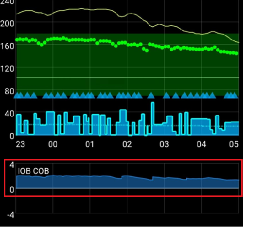

# Je AAPS-profiel afstellen

```{admonition} This is NOT a medical advice
:class: warning
Werk samen met je zorgteam voor hulp en advies bij je diabetesbehandeling.</br>
Gebruik deze handleiding pas als je [je **Profiel** goed hebt ingesteld](https://androidaps.readthedocs.io/en/latest/SettingUpAaps/YourAapsProfile.md) en alle doelen van **AAPS** hebt gevolgd.
```

Deze handleiding legt de logica uit van de resultaten van het OpenAPS-algoritme met een bepaald __Profiel__. Ook staat erin welke waarden in **AAPS** je kunt aanpassen als je bepaalde situaties of patronen ziet. De tips over basaal testen hieronder kunnen afwijken van het advies van je zorgteam.

Met een **gesloten loop** kan basaal testen makkelijker zijn. Het kan het risico op een hypo ook sterk verlagen als de basaal in je __Profiel__ te sterk is.

## Instellingen van het profiel wijzigen: zo pak je het aan

1. Zorg dat je de aanbevolen instellingen en het advies van __AAPS__ hieronder hebt gelezen en begrijpt. Als je dit advies niet volgt, kan het afstellen lastig worden en is de kans kleiner dat je een goed afgesteld __Profiel__ krijgt
2. Bekijk en vergelijk **gedurende meerdere dagen** goed wat er gebeurt met je __BG__ en __IOB__.
3. Let op patronen in **AAPS** die (bijna) elke dag rond dezelfde tijd gebeuren.
4. Het is belangrijk om dit gedurende meerdere dagen te doen. Als je het __Profiel__ aanpast op basis van gegevens van één dag, zijn de resultaten meestal slecht.
5. Pas als je een patroon ziet dat zich herhaalt, bijvoorbeeld om 13:00 uur een piek in je __BG__ of een negatieve __IOB__, begin je met kleine wijzigingen in je __Profiel__.
6. Het is belangrijk om maar één ding tegelijk te veranderen. Bijv. verhoog je basaal met 10% rond 13:00 uur.
7. Na elke wijziging is het belangrijk om de dagen daarna het effect op je __BG__ en __IOB__ te volgen.
8. Herhaal dit patroon: kijk, beslis en pas zo nodig opnieuw aan

Haast je niet, doe het rustig aan!

## Aanbevolen instellingen en advies tijdens het afstellen van de basaal

- Doe alle tests met [gesloten loop ingeschakeld](#AapsScreens-loop-status).
- **Zet alle [automatiseringen](../DailyLifeWithAaps/Automations.md) <u>UIT</u>**
- **Zet [DynISF](#Open-APS-features-DynamicISF), [AutoISF](#Open-APS-features-auto-isf) en [AutoSens](#Open-APS-features-autosens) <u>UIT</u>**, zodat ze je profiel niet proberen aan te passen.
- Doe tijdens het testen geen handmatige acties (handmatige bolus, tijdelijke streefdoelen enz.): laat het systeem alleen de instellingen van het **Profiel** gebruiken.
- Voor de [extra grafieken](#AapsScreens-section-g-additional-graphs): gebruik in grafiek 1 Actieve insuline (IOB), Actieve koolhydraten (COB) (en Gevoeligheid wijziging). Gebruik in grafiek 2 Afwijkingen en Bloedglucose impact. Zet deze altijd op je screenshots als je om advies vraagt.
- COB=0[*](#profiletuning-cob-zero)

Andere dingen die je het best kunt vermijden, omdat ze de gegevens beïnvloeden en tot verkeerde conclusies kunnen leiden:
- Geen lichamelijke activiteit.
- Geen stress.
- Geen ziekte.
- Geen extreem weer, zoals hoge of lage temperaturen.
- Geen mislukte pomp- of CGM-sessies.
- Geen niet-ingevoerde koolhydraten.

Let ook op:
- Als je [basaalprofiel](#your-aaps-profile-basal-rates) klopt en je op je streefdoel bent met COB=0[*](#profiletuning-cob-zero) en IOB=0, blijf je steeds op je streefdoel, wat je **ISF** ook is (**ISF** wordt alleen gebruikt als je hoger bent dan je **BG**-streefdoel).
- Kijk niet alleen naar de huidige **IOB**, maar ook naar de **IOB**-grafiek, om te zien hoe de **IOB** in de afgelopen uren is veranderd.

(profiletuning-cob-zero)=

***COB = 0**

Dit betekent dat de maaltijd verteerd is en dat er geen koolhydraten meer in je lichaam zijn.

**AAPS** kan [COB=0 tonen terwijl je nog actieve koolhydraten hebt](../DailyLifeWithAaps/CobCalculation.md).

## Definities van het [Profiel](../SettingUpAaps/YourAapsProfile.md)

Een te **sterk Profiel** wijst op een combinatie van het volgende:

- Het [ISF](#your-aaps-profile-insulin-sensitivity-factor)-getal is te klein.
- Het [basaal](#your-aaps-profile-basal-rates)-getal is te groot.
- Het [I:C](#your-aaps-profile-insulin-to-carbs-ratio)-getal is te klein.

## Waarnemingen van IOB

*Let op: je kunt ook de Loopalyzer IOB-grafiek in de Nightscout-rapporten gebruiken om IOB over meerdere dagen te bekijken.*

Als je na een paar dagen de volgende patronen ziet, overweeg dan deze wijzigingen:

### IOB positief

- Basaal in het **Profiel** is misschien niet sterk genoeg (dit kan ook komen door bijvoorbeeld niet-ingevoerd eten, ziekte, slechte opname op de infuusplaats, enz.)



### IOB negatief

- Standaard basaal te sterk.
- Kan het effect zijn van eerdere sport of lichamelijke activiteit.


- Vorige maaltijd: te veel bolus (met als gevolg een heel lange tijdelijke basaal van nul)


## Waarnemingen van het BG-streefdoel

### Blijft hoog

- Het __ISF__-getal is hoog en niet sterk genoeg (berekende insuline is te zwak)


- Basaal in het __Profiel__ is misschien niet sterk genoeg (**SMB's** hebben niet genoeg "basaalvoorraad" om te gebruiken)
- Een beveiliging ([MaxIOB](#Open-APS-features-maximum-total-iob-openaps-cant-go-over)?) is misschien actief geworden en beperkt de insuline. Controleer dit in het scherm van de **APS**-plugin (**Configuratie → APS → Plug-in openen**); zie [SMB](#Open-APS-features-super-micro-bolus-smb).
- Technisch probleem: opname op de infuusplaats, infuusset, ...

### Blijft laag

- __ISF__ te sterk: het getal moet hoger
- Basaal in het __Profiel__ te sterk (als IOB ook negatief is)

### Achtbaan (op en neer)

- **ISF** te sterk? Zie je [AAPS-profiel](#your-aaps-profile-insulin-sensitivity-factor)


## Waarnemingen van BG na maaltijden

### Snelle stijging en BG gaat hoog

- Het eten bevat snelle koolhydraten (zoals vruchtensap).
- Overweeg een pre-bolus, of een iets eerdere pre-bolus.
- Bolus (IC of geïnjecteerd %) niet sterk genoeg.


### Snelle stijging en daarna gaat BG laag

- Overweeg een pre-bolus; je **Profiel** is misschien te agressief (te sterke correctie van de stijging)
- Bolus te sterk.


## [Hoe bereken je je I:C](#your-aaps-profile-insulin-to-carbs-ratio)

1. Eerst heb je de juiste standaard basaal-instellingen in je **Profiel** nodig.
2. Begin op je streefdoel, liefst zonder negatieve IOB.
3. Noteer de totale gegeven insuline in **Beheren → Pomp** (of in de pompgeschiedenis) en noem dit begin-insuline. Meet een bekende hoeveelheid koolhydraten heel nauwkeurig af, en noteer de begintijd en de begin-IOB. Voer daarna de koolhydraten en de bolus in **AAPS** in met de wizard (met de huidige ingestelde I:C). Vergeet niet de koolhydraten op te eten ;)
4. Na een paar uur, als COB=0[*](#profiletuning-cob-zero) en je weer op je streefdoel bent, noteer je de eindtijd en de eind-IOB. Kijk zoals eerder naar de totale gegeven insuline en noem dit eind-insuline. *LET OP: De duur is NIET belangrijk, zolang deze langer is dan je vertering*
5. Neem het verschil tussen begin- en eind-insuline, en tel daar het verschil eind-IOB - begin-IOB bij op of trek het ervan af. Trek daarna de basale insuline af die je hebt berekend met de instellingen van je **Profiel**.
6. Als je __BG__ op het streefdoel is, heb je de totale insuline die nodig was om je koolhydraten te "verteren". Bereken je **I:C**.

### Uitleg bij de I:C-berekening

- Met een **Profiel** met de juiste standaard basaalstand blijf je in elke periode op je streefdoel, met een IOB rond 0. Je krijgt alleen de basaal van je **Profiel**.
- Je voegt daar koolhydraten en een bolus aan toe. Wacht tot je lichaam alle koolhydraten heeft verteerd en je weer op je **BG**-streefdoel bent. Je insulinegebruik is dan de som van je basaal + de insuline die nodig is voor de koolhydraten. Je berekent de insuline voor je basaal (met je **Profiel**). Wat overblijft is de insuline die nodig was om de koolhydraten te verteren.
- Als de periode te kort is, zijn er nog onverteerde koolhydraten. Dan is je "insuline nodig voor de koolhydraten" fout.
- Als de periode te lang is, gebeurt er niets ergs. Alle koolhydraten worden gebruikt en je krijgt meer basaal. Aan het eind trek je de basaal af van de totale gebruikte insuline. De langere periode (met meer basaal) heeft dus geen invloed op het resultaat.

Oorspronkelijk geschreven door @Robby (Discord) als tips en trucs om je **AAPS-profiel** af te stellen, nagekeken en aangepast door de community (bedankt!).
