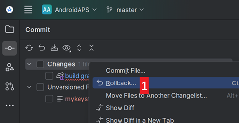
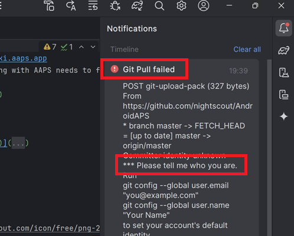

(troubleshooting_androidstudio-troubleshooting-android-studio)=

# Problemen met Android Studio oplossen

```{contents} List of common issues
:depth: 2
:local: true
```

(troubleshooting_androidstudio-lost-keystore)=
## Keystore (digitale handtekening) kwijt
Ben je je keystore of het wachtwoord kwijt, dan kan een apk die met een nieuwe keystore is ondertekend je huidige **AAPS** niet bijwerken: je moet AAPS dan verwijderen en opnieuw installeren. Zie [AAPS opnieuw installeren met een nieuwe keystore](#reinstall-aaps).

## Gradle Sync failed (Gradle-synchronisatie mislukt)
Gradle Sync kan om verschillende redenen mislukken. Krijg je een melding dat 'gradle sync failed', open dan de tab "Build" (1) onderaan in Android Studio en kijk welke foutmelding (2) er staat.


```{contents} Likely reasons for gradle sync failures are:
:depth: 1
:local: true
```

*Belangrijk*: Als je de instructies voor jouw probleem hebt gevolgd, moet je de [Gradle Sync](#gradle-resync) opnieuw starten.

(troubleshooting_androidstudio-uncommitted-changes)=
### Uncommitted changes (Niet-opgenomen wijzigingen)

Als je een foutmelding zoals deze krijgt:


```
Build file 'C:\Data\50-Android\AndroidAPS\app\build.gradle.kts' line: 243

There are uncommitted changes.
Clone sources again as described in wiki and do not allow gradle update
```

#### Stap 1 - Controleer de installatie van Git
  * Open onderaan in Android Studio de tab Terminal (1), kopieer de volgende tekst en plak of typ deze in de terminal (2).
    ```
    git --version
    ```

    

    Let op: tussen Git en version staan een spatie en twee streepjes!

  * Je moet een melding krijgen met de geïnstalleerde Git-versie, zoals in de screenshot hierboven. Ga in dat geval naar [Stap 2](#troubleshooting-android-studio-check-for-uncommitted-changes).

  * In case you get a message saying
    ```
    Git: command not found
    ```
    dan is je Git-installatie niet goed.

  * [Controleer de installatie van Git](#BuildingAaps-steps-for-installing-git)

  * Gebruik je Windows en is Git net geïnstalleerd, start dan je computer opnieuw, zodat Git na de installatie overal beschikbaar is

  * If Git is installed, you have restarted (if on Windows), and Git still cannot be found:

  * Zoek op je computer naar een bestand "git.exe".

    Schrijf voor jezelf op in welke map het is opgeslagen.

  * Go to the Environment variables in Windows, select the variable "PATH" and click edit. Voeg de map toe waar je je Git-installatie hebt gevonden.

  * Opslaan en sluiten.

  * Start Android Studio opnieuw.

(troubleshooting-android-studio-check-for-uncommitted-changes)=
#### Stap 2: Controleer op uncommitted changes (niet-opgenomen wijzigingen).

  * Open in Android Studio links de tab 'Commit' (1). 
  * Je ziet "Changes" (in oudere versies van Android Studio "Default changeset" genoemd) (2) of "Unversioned Files" (3):

    * Bij "Changes" heb je waarschijnlijk 'Gradle' bijgewerkt of per ongeluk de inhoud van een paar bestanden veranderd.

    * Klik met rechts op "Changes" en kies "Rollback…" (1)

      

    * De bestanden worden opnieuw opgehaald van de Git-server. Als er geen andere wijzigingen in de commit-tab staan, ga dan naar [Stap 3](#gradle-resync).

  * Zie je "Unversioned Files", dan heb je misschien per ongeluk bestanden in de map met je broncode gezet. Misschien zijn het belangrijke bestanden, zoals je keystore-bestand, die naar een andere plek moeten. Weet je niet wat die bestanden zijn en heb je ze niet zelf gemaakt, dan kun je ze verwijderen.

    * Gebruik de gewone bestandsverkenner op je computer om dat bestand te verplaatsen (of te knippen en te plakken) naar een veilige plek.

    * Ga terug naar Android Studio en klik in de tab Commit op de knop Refresh (4), om te controleren dat het bestand niet meer in de **AAPS**-map staat.

      Als er geen andere wijzigingen in de tab Commit staan, ga dan naar [Stap 3](#gradle-resync).


#### Stap 3: Gradle opnieuw synchroniseren (nog een keer)

Volg de instructies bij [Gradle opnieuw synchroniseren](#gradle-resync).

### Git Pull Failed - Please tell me who you are (Git wil weten wie je bent)

Zie je deze melding, dan wil Git dat je zegt wie je bent.



Open de terminal en typ de volgende twee commando's, het ene na het andere.

```
git config --global user.name "Your name here"
git config --global user.email your.email@here.com
```

Je naam moet tussen aanhalingstekens staan.


(troubleshooting_androidstudio-android-gradle-plugin-requires-java-11-to-run)=

(incompatible-gradle-jvm)=
### Incompatible Gradle JVM (niet-compatibele Gradle JVM)


```
Your build is currently configured to use incompatible Java 21.0.3 and Gradle 8.2.
Cannot sync the project.

We recommend upgrading to Gradle version 8.9.

The minimum compatible Gradle version is 8.5.

The maximum compatible Gradle JVM version is 19.
```

Of:

```
Cause: error: invalid source release: 21
```

If you experience the above error message, you need to download a correct JVM version before you can try to rebuild:

1.  Kijk in de [tabel met vereisten](#Building-APK-recommended-specification-of-computer-for-building-apk-file) welke JVM-versie je nodig hebt voor de **AAPS**-versie die je bouwt, en schrijf deze op.

2. Open de Gradle-weergave door rechts in Android Studio op de olifant (1) te klikken, open de instellingen (2) en kies **Gradle Settings** (3):


3.  Kijk in het veld **Gradle JDK** of de juiste versie is gekozen (1). Zo niet, klik dan op het veld en kijk of deze al in de lijst staat. In het voorbeeld hieronder heet JVM 21 “jbr-21”. Vind je deze, kies hem dan en je bent klaar. Is deze er niet, kies dan **Download JDK** (2).


4. Kies bij Version (1) de JDK die nodig is voor je **AAPS**-versie (degene die je hebt opgeschreven toen je de tabel met vereisten bekeek). Kies bij Vendor (2) een willekeurige leverancier. Location (3): niet wijzigen. Klik op **Download** (4).


5.  Sluit het venster **Settings** met **OK**.
6. Je moet nu de Gradle Sync opnieuw starten. Volg de instructies bij [Gradle opnieuw synchroniseren](#gradle-resync).

(incompatible-version-of-android-gradle-plugin)=
### Incompatible version of Android Gradle plugin (niet-compatibele versie van de Android Gradle-plugin)

  Als je de volgende foutmelding krijgt

`The project is using an incompatible version (AGP x.x.x) of the Android Gradle plugin. Latest supported version is AGP x.x.x`

  

  Je gebruikt een verouderde versie van Android Studio. Ga in het menu naar Help > Check for updates en installeer alle updates die gevonden worden voor Android Studio en de plugins.

(troubleshooting_androidstudio-could-not-resolve-no-cached-version)=
### Could not resolve/No cached version

  Je krijgt misschien deze foutmelding:


  * Open rechts de tab Gradle (1).

    Zorg dat de knop bij (2) *NIET* is geselecteerd.

    

  * Nu moet je [Gradle opnieuw synchroniseren](#gradle-resync)

(troubleshooting_androidstudio-unable-to-start-daemon-process)=
### Unable to start daemon process (Kan daemon proces niet starten)

  Als je een foutmelding ziet zoals hieronder dan gebruik je waarschijnlijk een 32-bit versie van Windows 10. Android Studio 3.5.1 en hoger ondersteunt dit niet, en helaas kunnen de ontwikkelaars van **AAPS** hier niets aan doen!

  Op internet staat informatie over hoe je kunt zien of je een 32-bit of 64-bit besturingssysteem hebt, bijvoorbeeld [deze pagina](https://support.microsoft.com/en-us/windows/32-bit-and-64-bit-windows-frequently-asked-questions-c6ca9541-8dce-4d48-0415-94a3faa2e13d).

  

(gradle-resync)=
### Gradle opnieuw synchroniseren

  Zie je nog steeds de melding dat de gradle sync is mislukt, kies dan nu de link **Try again** (1). 


  Zie je de melding niet meer, dan kun je dit ook met de hand starten:

  * Open de tab Gradle (1) aan de rechterrand van Android Studio.

    

  * Klik met rechts op AAPS (2)

  * Klik op "Reload Gradle Project" (3)

## Generate Signed APK generated successfully with 0 build variants (apk gemaakt met 0 build-varianten)

Als je de ondertekende apk maakt, krijg je misschien de melding dat het maken gelukt is, maar dat er '0 build variants' (0 build-varianten) zijn gemaakt:


Dit is een valse waarschuwing. Kijk in de map die je als "Destination folder" hebt gekozen (stap [Generate Signed APK](#Building-APK-generate-signed-apk)): daar vind je de gemaakte apk!


## App gemaakt met compiler/kotlin-waarschuwingen

Als het bouwen gelukt is, maar je krijgt compiler- of kotlin-waarschuwingen (te zien aan een geel of blauw uitroepteken), dan kun je deze waarschuwingen gewoon negeren.

 

Je apk is goed gebouwd en kan naar je telefoon worden overgezet!


## AAPS ontvangt geen CGM-gegevens

* Gebruik je de gepatchte Dexcom G6-app: deze app is verouderd. Gebruik in plaats daarvan de [BYODA](#DexcomG6-if-using-g6-with-build-your-own-dexcom-app)-app.

* Gebruik je xDrip: identificeer de ontvanger (identify receiver) zoals beschreven op de [pagina met xDrip-instellingen](#xdrip-identify-receiver).


## Apk niet geïnstalleerd


* Controleer of je inderdaad het bestand "app-full-release.apk" naar jouw telefoon hebt overgebracht.
* Deze fout betekent meestal dat de nieuwe apk met een andere keystore is ondertekend dan je geïnstalleerde **AAPS**. Heb je je vorige keystore nog, kies deze dan en bouw opnieuw. Zie anders [AAPS opnieuw installeren met een nieuwe keystore](#reinstall-aaps).
* Als "App niet geïnstalleerd" wordt weergegeven op jouw telefoon volg dan deze stappen:

1. [Exporteer instellingen](../Maintenance/ExportImportSettings.md) (in de AAPS-versie die al op je telefoon staat)
2. Verwijder **AAPS** van je telefoon.
3. Zet de vliegtuigmodus aan en Bluetooth uit.
4. Installeer nieuwe versie (“app-full-release.apk”)
5. [Importeer instellingen](../Maintenance/ExportImportSettings.md)
6. Zet Bluetooth weer aan en de vliegtuigmodus uit

## Apk geïnstalleerd, maar oude versie

If you built the app successfully, transferred it to your phone and installed it successfully but the version number stays the same then you might have forgotten to [update your local copy](#Update-to-new-version-update-your-local-copy)

## Niets van het bovenstaande werkte

Als geen van de tips hierboven helpt, kun je overwegen de apk helemaal opnieuw te bouwen:

1. [Exporteer instellingen](../Maintenance/ExportImportSettings.md) (in de AAPS-versie die al op je telefoon staat)

2. Houd je key password (sleutelwachtwoord) en key store password (keystore-wachtwoord) bij de hand.

    Of je gebruikt gewoon een nieuwe keystore.

3. Bouw de apk helemaal opnieuw zoals [hier](#Building-APK-download-AAPS-code) beschreven.

4. Als de apk goed is gebouwd, verwijder dan de bestaande apk op je telefoon, zet de nieuwe apk over naar je telefoon en installeer deze.
5. [Importeer instellingen](../Maintenance/ExportImportSettings.md) opnieuw om je doelen en instellingen terug te zetten.
6. Controleer je instellingen voor batterij optimalisatie en zet ze weer uit.

## In het ergste geval

Als dit je bouwprobleem niet oplost, kun je proberen Android Studio volledig te verwijderen en helemaal opnieuw te bouwen.  Sommige gebruikers merken dat dit hun bouwprobleem oplost.  Verwijder bij het verwijderen van Android Studio niet de Android-gebruikersinstellingen, en **zorg dat je alle bestanden van Android Studio verwijdert.** Als je Android Studio niet volledig verwijdert, met alle verborgen bestanden, kan het verwijderen nieuwe problemen geven in plaats van je huidige probleem op te lossen. Handleidingen om alles volledig te verwijderen vind je online, bijv.

[https://stackoverflow.com/questions/39953495/how-to-completely-uninstall-android-studio-from-windowsv10](https://stackoverflow.com/questions/39953495/how-to-completely-uninstall-android-studio-from-windowsv10).

Installeer Android Studio helemaal opnieuw zoals [hier](#Building-APK-install-android-studio) beschreven.
