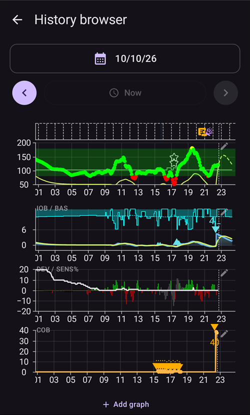
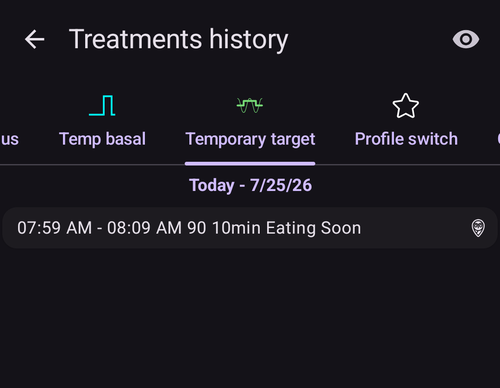
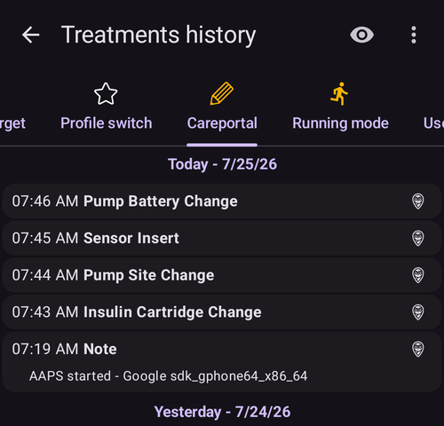

# Reviewing your data

## AAPS History Browser

**AAPS** keeps all your history (**BG**, treatments, basal, targets, **Profile Switch**, …) in a local database on the phone. This database is not part of the [settings export](../Maintenance/ExportImportSettings.md). You can review it in **AAPS** itself with the **History browser** and the **Statistics** screen described below. For long-term reviews and reports, upload your data to [Nightscout](../SettingUpAaps/Nightscout.md) or [Tidepool](../SettingUpAaps/Tidepool.md).

**AAPS** history can be reviewed in the **History browser**: open the **menu** (☰) and select **History browser**.

- Tap the **date card** to pick the day you want to review.
- The graphs open zoomed out to show the **whole selected day**. Pinch to zoom in on part of it.
- Use the **<** and **>** arrows to move one day back or forward, and **Now** to return to the current day.
- The graphs show the same data as the main screen graphs (BG, treatments, basal, IOB, COB, activity, deviations...).

(reviewing-statistics)=
## AAPS Statistics

**AAPS** provides basic monitoring statistics.

Most values are referenced by ADA 2023 [recommendations](https://diabetesjournals.org/care/article/46/Supplement_1/S97/148053/6-Glycemic-Targets-Standards-of-Care-in-Diabetes).

To open them, open the **menu** (☰) and select **Statistics**.

The **Statistics** screen has four tabs: **Insulin**, **Time in Range**, **Glucose** and **Cycle**. Tap a tab, or swipe left or right to move between them.

(reviewing-tdd)=
### Insulin tab: Total Daily Dose

The **Total Daily Dose** card shows one line per day for the previous days (up to one week) for which **AAPS** has insulin data, then their **Average**, then **Today** so far. Right after installing **AAPS**, only **Today** is shown. The columns are:

- **Basal**: only basal.
- **Bolus**: the sum of bolus treatments and SMBs.
- **TDD Total**: the Total Daily Dose of insulin (**TDD**), the sum of bolus and basal insulin delivered during the day.
- **Carbs**: declared carbs and eCarbs treatments.

The **TDD** section is calculated when you open the page and takes a few seconds to compute. Tap **Recalculate** to compute it again.

The **TDD** is your bolus plus basal insulin per day. Some doctors use - especially for new pumpers - a basal-bolus ratio of 50:50: the total base basal (**TBB**, the sum of your basal rates over 24 hours) should then be about half of the TDD. Others prefer a TBB of 32 % to 37 % of the TDD.

Like most rules of thumb, this is of limited real validity. Your diabetes may vary!

### Time in Range tab

Time In Range (**TIR**): 70-180 mg/dL or 3.9-10 mmol/L.

**TIR** information is available for 7 and 30 days, depending on the amount of data available within the **AAPS** database.

Time In Tight Range (TITR) 70-140 mg/dL or 3.9-7.8 mmol/L statistics are available below (the screen shows this range as 70-141).

**Discuss targets with your endo**

Your diabetes may vary. Any suggested targets should be discussed with your endocrinologist or supporting medical team. If used correctly, AAPS’ statistics can be an effective tool to follow __BG__ trends and monitor progress .

Below, the **Dexcom TIR** card shows detailed 14 days **TIR** statistics.

**SD**: Standard Deviation, an [indicator](https://www.ncbi.nlm.nih.gov/pmc/articles/PMC3125941/) of BG variability (the highest = the worst).

HbA1c: the estimate of the resulting glycated hemoglobin, based on the average of CGM measurements. This is an indicative value that might not match blood HbA1c tests.

(reviewing-statistics-agp)=
### Glucose tab: Ambulatory Glucose Profile (AGP)

The **Ambulatory Glucose Profile** (**AGP**) shows how your glucose usually moves over the day. Choose the period with the buttons at the top: **Today**, **24h**, **7d**, **30d** or **90d**.

- **The chart**: one day from midnight to midnight. The line is the **Median** (half of your readings at that hour were lower, half were higher). Around it, one band holds the middle half of your readings (**25–75%**) and a wider band most of them (**10–90%**). A narrow band means your glucose is similar from day to day at that hour. Dashed lines mark your **LOW mark**, 140 mg/dL (7.8 mmol/L) and your **HIGH mark**.
- **Glycemic overview**: the time spent in your range, in the tight range (70–140 mg/dL or 3.9–7.8 mmol/L), above your range and below it, then your **Average** and **Median** glucose. Your range is the **LOW mark** and **HIGH mark** set in [Range for visualization](#Preferences-range-for-visualization).
- **eA1c** and **GMI**: two estimates of HbA1c calculated from your CGM readings. Like the HbA1c above, they might not match your blood HbA1c tests.
- **SD** (standard deviation) and **CV** (coefficient of variation): how much your glucose varies. A lower value means steadier glucose.
- **Days**: how many days of CGM data were used.

 

Below the AGP, the **Glucose Pentagon (CGP)** card draws five measures of your last 14 days of glucose as a pentagon. A smaller pentagon means better glucose control.

### Cycle tab: TDD Cycle Pattern

**TDD Cycle Pattern** overlays your daily insulin totals in 28-day cycles, to help you spot recurring patterns. Each cycle is drawn as a line (**Individual cycles**), together with their average.

- **Raw TDD** / **Cleaned TDD**: choose the total daily dose as delivered, or the TDD minus insulin for carbs.
- **Cycle offset**: moves the start of the cycle (0 to 27 days).

At least 56 days of data (2 cycles) are needed. With less data, the card shows **Not enough data (need at least 56 days for 2 cycles)**. The pattern is calculated only when you open the **Cycle** tab, because it reads 168 days of data.

(aaps-screens-treatments)=
## Treatments history

Open the **menu** (☰) in the top-left corner of the main screen and select **Treatments history**. In this view, you can view and alter the history of the following treatments, each on its own tab (swipe the tab row to see all of them):

* Carbs and bolus
* [Vertraagde bolus](#Extended-Carbs-extended-bolus-and-switch-to-open-loop-dana-and-insight-pump-only)
* Temp basal
* [Temporary target](../DailyLifeWithAaps/TempTargets.md)
* [Profiel wissel](../DailyLifeWithAaps/ProfileSwitch-ProfilePercentage.md)
* Careportal: notes and careportal entries
* Running mode : history of loop status
* User entry: other notes that are not sent to Nightscout

At the end of each line, small icons show where the data comes from or has been sent to:
* **Nightscout** icon (the Nightscout logo): the data comes from or has been recorded to Nightscout
* **Pump** icon: the data comes from the pump history (it has been processed by the pump)
* **Trash can** icon: the entry has been deleted (it is shown only when you display deleted entries with the **eye** icon at the top right)

(screens-bolus-carbs)=
### Carbs and bolus

On this tab you can view the bolus and carbs log. Each bolus (line **1**) shows the remaining associated IOB next to the insulin amount. The origin of the bolus can be either :
* Meal (manually entered though the Insulin, Quick Wizard or Bolus Wizard buttons)
* SMB, when using the SMB Functionality

The carbs entries (line **2**) are shown with their amount in grams.

If you have used the [Bolus Wizard](#aaps-screens-bolus-wizard) to calculate insulin dosage, you can press the “Calc” text on the bolus line to show the details of how the bolus was calculated.

Depending on the pump used, insulin and carbs can be shown in one single line, or will result in multiple lines: one for the calculation detail, one for the carbs, one for the bolus itself.

The Treatments history can be used to correct faulty carb entries (_i.e._ you over- or underestimated carbs). Note that it is not possible to edit an existing entry, you need to follow the following process:

1. Check and remember actual COB and IOB on the main screen.
2. Depending on pump, carbs might be shown together with insulin in one line or as a separate entry (i.e. with Dana RS).
3. Remove the entry with the faulty carb amount: press the trashcan icon, select the lines to remove, and then press the trashcan icon again to finalize.
4. Make sure carbs are removed successfully by checking COB on the main screen again.
5. Do the same for IOB if there is just one line including carbs and insulin.

   → If carbs are not removed as intended, and you add additional carbs as explained here (6.), COB will be too high and that might lead to too high insulin delivery.

6. Enter the correct carb amount again (**Treatments → Carbs** in the bottom navigation, or a [QuickLaunch](#quicklaunch) **Carbs** button) and make sure to set the correct event time.
7. If there is just one line including carbs and insulin you have to add also the amount of insulin. Make sure to set the correct event time and check IOB on the main screen after confirming the new entry.

### Temp basal

The **temp basals** applied by the loop are shown here. When there is still an impact on the IOB for an entry, the information is shown next to the rate (line **1**). It can be:
* Positive IOB if the temp basal was higher than the one set in the Profile
* Negative IOB for a zero-temp (as on line **1**) or if the temp basal was lower than the one set in the Profile

Deleting the entries only affects your reports in Nightscout and will probably tamper your real IOB - it is not recommended.

On the left of a line, a red S means “Suspend” : it happens when basal is not currently delivered. This is a normal situation when in the process of changing a pod, for example.

### Temporary target

The history of temporary targets can be seen here.

### Profiel wissel

The history of profile switches can be seen here. You may see multiple entries each time you switch profile : line **1**, stored both in NS and Pump History, corresponds to the actual switch. Line **2**, stored in Nightscout but not in Pump History, corresponds to the request of a profile switch made by the user.

Deleting the entries only affects your reports in Nightscout and will never actually change the current profile.

You can use the **Clone** button shown on line **2** to make a copy of a **Profile Switch**. See [Your AAPS Profile > Manage your profiles](#your-aaps-profile-clone-profile-switch) for more information.

### Careportal

This tab shows all notes and careportal entries recorded in Nightscout.

(AapsScreens-running-mode)= (aaps-screens-running-mode)=
### Running mode

This tab shows the history of [loop status](#AapsScreens-loop-status) changes : open, closed, LGS, suspend, disconnect.

### User entry

This tab lists the actions made in **AAPS** by the user or by an **Automation** (loop mode changes, profile switches, treatments, settings exports...). These entries are not sent to Nightscout.

------

## What is the difference between Nightscout vs Tidepool?

Nightscout can facilitate the user’s storage of **AAPS’** data and offers a wide range of [reporting tools](https://nightscout.github.io/nightscout/reports/).

Whereas, Tidepool allows the user to [review their data](https://www.tidepool.org/viewing-your-data) and provides [simple sharing with your endo team](https://www.tidepool.org/providers/how-it-works#tidepool-data-platform).