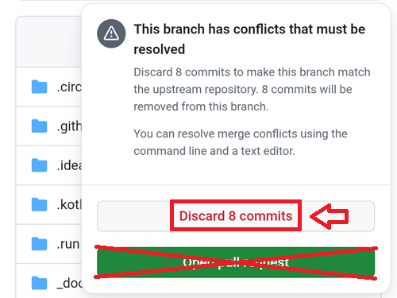
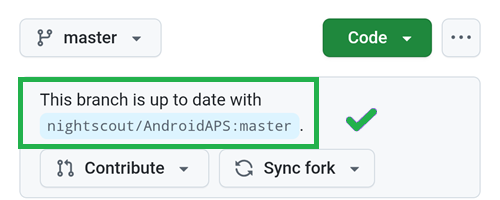

# Bijwerken met een browser (fork)

```{tip}
Heb je AAPS gebouwd met **AAPS Builder**? Dan heb je deze pagina niet nodig: zie [AAPS bijwerken met AAPS Builder](#aaps-builder-updates).
```

## Zelf bouwen, in plaats van downloaden

**AAPS** kun je niet downloaden, vanwege de regels voor medische hulpmiddelen. Je mag de app legaal bouwen voor eigen gebruik, maar je mag geen kopie aan anderen geven! Zie de [FAQ-pagina](../UsefulLinks/FAQ.md) voor meer informatie.

```{note}
Wil je **AAPS** voor het eerst met een browser bijwerken? Kopieer dan je back-up van het keystore-bestand naar je Google Drive. Volg daarna de [procedure om **AAPS** in de browser te bouwen](../SettingUpAaps/BrowserBuild.md) in plaats van deze handleiding. Maak geen nieuwe keystore, maar kies de keystore die je van je computer hebt gekopieerd.
Dit hoeft alleen de eerste keer. Voor de volgende updates kun je deze handleiding volgen.
```

```{tip}
**Overstappen naar AAPS Builder?** [AAPS Builder](../SettingUpAaps/BrowserBuildAapsBuilder.md) is de eenvoudigere manier om in de browser te bouwen: je hoeft geen fork te synchroniseren en je downloadt de app direct van GitHub. Je hoeft niet over te stappen: deze handleiding blijft werken. Stap je over? Haal dan eerst een kopie van je keystore uit je fork, zoals uitgelegd in [Overstappen van de vorige manier van bouwen in de browser](#aaps-builder-from-fork). Anders kan de nieuwe build de AAPS op je telefoon niet bijwerken.
```

## Overzicht: bijwerken naar een nieuwe versie van AAPS met een browser

```{contents} Steps for updating to a new version of AAPS
:depth: 1
:local: true
```

Heb je problemen? Zie dan de aparte pagina [Bouwen in de browser: probleemoplossing](../GettingHelp/BrowserBuildTroubleshooting.md).

### Exporteer je instellingen

Exporteer je instellingen uit de **AAPS**-versie die nu op je telefoon staat. Misschien heb je ze niet nodig, maar het is beter om het zeker te doen.

Weet je niet meer hoe dit moet? Kijk dan op de pagina [Back-ups maken en terugzetten](ExportImportSettings.md).

(Update-to-new-version-update-your-repo)=
### Werk je GitHub-repository bij

[Log in op GitHub](https://github.com/login).

1. Kies Repositories.
2. Scroll naar beneden en kies je eigen AndroidAPS-repository.


3. Controleer of je je eigen kopie van AndroidAPS gebruikt (Forked from nightscout/AndroidAPS)
4. Tik op Sync Fork om hem bij te werken (het aantal commits achterstand kan anders zijn dan op de afbeelding)


5. Tik op Update Branch


Let op: als je je kopie van AndroidAPS per ongeluk hebt gewijzigd, zie je dit scherm. Gooi alle wijzigingen (commits) weg (Discard) om terug te gaan naar de uitgebrachte versie.



Je hebt nu je eigen kopie gesynchroniseerd (bijgewerkt) met de nieuwste release van Android APS. Goed gedaan.



### Start de workflow om de ondertekende APK te bouwen

1. Kies in je GitHub-kopie van AndroidAPS Actions.
2. Klap All Workflows uit.
3. Kies AAPS-CI


4. Scroll naar beneden en tik op Run Workflow.


5. Laat de branch op master staan, kies de AAPS Version die je wilt bouwen (de nieuwste versie of een bepaalde versie die je nodig hebt), kies de [variant](#browserbuild-variant) (fullRelease) en tik dan op Run workflow.


6. Je ziet de melding Workflow run was successfully requested. Vernieuw de pagina in je browser. Dan kun je de voortgang van het bouwen volgen. Als de actie klaar is, toont de AAPS CI-actie een groen vinkje. Je hebt de bijgewerkte versie van Android APS gebouwd. Dit betekent dat de Master- en Wear-apk nu direct in je Google Drive worden opgeslagen (zie hieronder). De AAPSClient apk kun je downloaden via Github > nightscout > AndroidAPS [hier](https://github.com/nightscout/AndroidAPS/releases)


### Installeer de AAPS APK

1. Open je Google Drive
2. Ga naar de map AAPS en kies de map met de nieuwe versie. Daar vind je zowel de versie voor de telefoon als die voor Android Wear.


```{note}
Vanaf september 2026 kan Google's [Android developer verification](#android-developer-verification) het installeren van de APK door op het bestand te tikken blokkeren, afhankelijk van je land. Gratis oplossingen worden op die pagina uitgelegd.
```

Ga [hier](#Update-to-new-version-check-aaps-version-on-phone) verder

(update-browser-build-troubleshooting)=

## Probleemoplossing

Gaat er iets mis? Geen paniek.

Haal even diep adem!

Kijk daarna of je probleem al beschreven is: zie [Probleemoplossing voor AAPS Builder](#aaps-builder-troubleshooting) als je bouwt met **AAPS Builder**, of anders [Bouwen in de browser: probleemoplossing](#aaps-ci-troubleshooting).

Heb je meer hulp nodig? Vraag het dan aan andere **AAPS**-gebruikers op [Facebook](https://www.facebook.com/groups/AndroidAPSUsers) of [Discord](https://discord.gg/4fQUWHZ4Mw).
