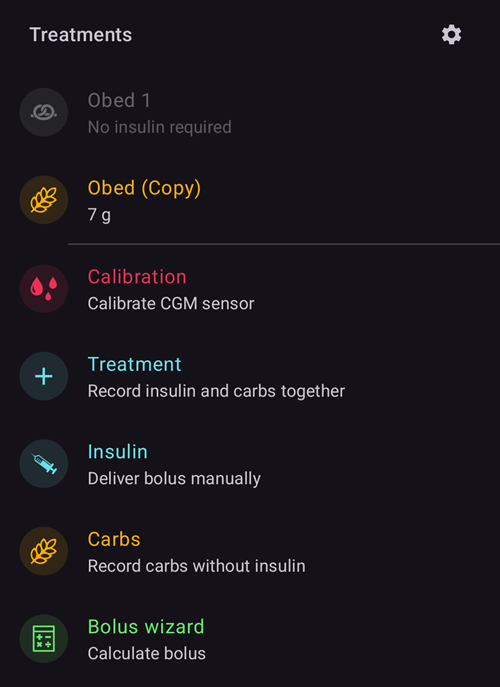
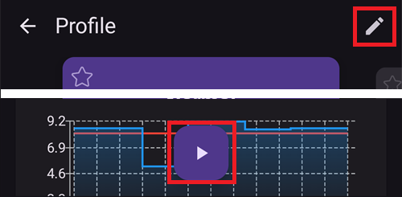

(v4-changes)=
# Wat is er veranderd in AAPS v4

Deze pagina verzamelt de belangrijke **veranderingen in gedrag** tussen **AAPS** v3 en v4: dingen die anders werken, verplaatst zijn of verwijderd zijn. Zo weten bestaande gebruikers wat ze kunnen verwachten als ze bijwerken. Zie ook de [Release notes](ReleaseNotes.md) en de [handleiding voor bijwerken](UpdateToNewVersion.md).

```{contents} Table of contents
:depth: 2
:local: true
```

---

## NSClient v1 is verwijderd

**AAPS** v3 had **twee** plugins voor synchronisatie met Nightscout:

- **NSClient**: de oude client (de oude Nightscout REST / socket.io API, ook *“v1”* genoemd), en
- **NSClientV3**: de client voor de nieuwere Nightscout **API v3**.

In **AAPS** v4 is de oude plugin **NSClient (v1)** **verwijderd**. Alleen **NSClientV3** blijft over voor synchronisatie met Nightscout.

```{admonition} What you need to do
:class: important
Synchroniseerde je (of je **AAPSClient**-volger) nog met de oude plugin **NSClient (v1)**? Stap dan voor of na het bijwerken over op **NSClientV3**:

- Open **[Configuratie](../SettingUpAaps/ConfigBuilder.md) → Communicatie → NSClientV3**.
- Vul je **Nightscout URL** en een **toegangstoken** in (NSClientV3 gebruikt een toegangstoken, *niet* de oude API secret, zie [een token aanmaken](https://nightscout.github.io/nightscout/security/#create-a-token)).
- Je Nightscout-site moet **API v3** ondersteunen (Nightscout 15 of nieuwer).
- Gebruik je **websockets**? Zet ze dan op **zowel** de master als de volger aan of uit, nooit op maar één van beide.
```

Dit verandert alleen hoe de app met Nightscout communiceert; je gegevens op Nightscout blijven hetzelfde.

---

## De onderste navigatiebalk: Behandelingen, Scènes en Beheren

In **AAPS** v3 ging je door de app met een rij **tabbladen** (Overzicht, Acties, Behandelingen, …), en verschillende functies waren **plugins** die je in de Configurator aanzette (**Acties**, **Automatisering**, **Voeding**, …).

In **AAPS** v4 zijn de tabbladen weg, en ook het oog-vakje in de Configurator waarmee een plugin als tabblad werd getoond. Het hoofdscherm is het **Overzicht**, en een **onderste navigatiebalk** geeft je drie menu's. **Acties, Automatisering en Voeding zijn geen plugins meer**: er is niets om aan te zetten in [Configuratie](../SettingUpAaps/ConfigBuilder.md) (de nieuwe naam van de Configurator); hun functies zitten nu in deze menu's.

(v4changes-treatments)=
### Behandelingen: invoeren en toedienen

In het menu **Behandelingen** registreer je een behandeling of dien je die toe: **Bolus wizard**, **Insuline** (handmatige bolus), **Koolhydraten**, **Behandeling** (insuline + koolhydraten samen), **Kalibratie**, **CGM** (opent je CGM-app, als die is ingesteld) en je **[QuickWizards](../DailyLifeWithAaps/QuickWizards.md)**.



Op een **Wear OS-horloge** voer je dezelfde behandelingen in via het **AAPS-menu** van het horloge (Bolus wizard / Calculator, eCarbs, Behandeling, …):


### Scènes

Je voorinstellingen voor situaties, zie [Scènes](../DailyLifeWithAaps/Scenes.md).

(v4changes-manage)=
### Beheren: beheren en activeren

In het menu **Beheren** beheer en activeer je al het andere: **[Profiel](../DailyLifeWithAaps/ProfileSwitch-ProfilePercentage.md)**, **Insuline instellingen** (je insulineconfiguraties), **[Tijdelijk streefdoel](../DailyLifeWithAaps/TempTargets.md)**, voorinstellingen voor **[QuickWizard](../DailyLifeWithAaps/QuickWizards.md)**, **[Scènes](../DailyLifeWithAaps/Scenes.md)**, **Automatisering**, **Voeding**, **Site rotatie**, **Pomp**, **[Geautoriseerde clients](../RemoteFeatures/ClientMasterControl.md)**, en ook de pompacties die vroeger op het tabblad *Acties* stonden (**Vertraagde bolus**, **Annuleer tijdelijk basaal**, **Prime/Vul**, **Sensor ingebracht**, **Pomp bat. wissel**).


Al je bestaande automatiseringsregels en voedingsitems blijven bewaard; alleen de manier waarop je bij deze functies komt, is veranderd.

(screens-action-tab)=
#### Waar is het tabblad Acties gebleven?

**AAPS** 3.x had een tabblad "Acties". In **AAPS** 4 zitten de functies daarvan op andere plekken:

* **Profiel wissel** en **Profiel percentage**: tik op de [profielnaam](#aaps-screens-profile--target) op het hoofdscherm, of ga naar **Beheren → Profiel**. Zie [Het Profiel percentage wijzigen](#ProfileSwitch-change-percentage).
* **Tijdelijk streefdoel**: tik op het [streefdoel](#aaps-screens-profile--target) op het hoofdscherm, of ga naar **Beheren → Tijdelijk streefdoel**.
* **Prime/Vul**, **Sensor ingebracht**, **BG Controle** en de andere careportal-items: in het uitgevouwen [statuspaneel](#aaps-screens-careportal), in **Beheren**, of als [QuickLaunch](../DailyLifeWithAaps/QuickLaunch.md)-knoppen.
* **Historie bekijken**, **Statistieken** (TDD): in het **menu** (☰).

```{admonition} Profile switch and profile percentage
:class: note
In **AAPS** v3 opende een lange druk op de profielnaam het venster voor profiel wissel (percentage, duur, tijdelijk streefdoel Activiteit). In **AAPS** v4 **tik** je op de profielnaam (of ga je naar **Beheren → Profiel**). Tik daarna op de ronde knop **▶** rechtsonder om dezelfde instellingen te openen. Zie [Het profiel percentage aanpassen](#ProfileSwitch-change-percentage).
```

---

(v4changes-read-only-management)=
## Instellingen beveiliging vergrendelt nu ook de beheerschermen

In **AAPS** v3 vroeg [Instellingen beveiliging](#Preferences-settings-protection) alleen om je wachtwoord als je de instellingen opende. Zonder wachtwoord kon je nog steeds profielen toevoegen of bewerken op het tabblad **Lokaal profiel**.

In **AAPS** v4 geldt Instellingen beveiliging ook voor het bewerken op de beheerschermen: **Profiel**, **Insuline instellingen**, **Tijdelijk streefdoel** en **QuickWizard**. Als je instellingen vergrendeld zijn, openen deze schermen als **alleen lezen**:

- Je kunt de items bekijken en ze met **▶ Activeer** activeren of gebruiken.
- De knoppen **Toevoegen / Bewerk / Dupliceren / Verwijderen** zijn **verborgen**. Alleen het **✏️ potlood** in de bovenste balk laat zien dat je het bewerken kunt ontgrendelen.



```{admonition} What you need to do
:class: important
Om een item toe te voegen, te bewerken, te dupliceren of te verwijderen, tik je op het **✏️ potlood** in de bovenste balk en voer je je instellingenwachtwoord in (of gebruik je biometrie). De knoppen verschijnen.

Hoef je je instellingen niet te beveiligen? Dan kun je Instellingen beveiliging uitzetten in **Instellingen → Beveiliging**.
```

---

(v4changes-active-insulin)=
## De insuline die in gebruik is, kun je niet bewerken

In **AAPS** v3 kon je de DIA van de insuline die je gebruikte op elk moment aanpassen.

In **AAPS** v4 is de insuline die als **ACTIEF** is gemarkeerd in **Beheren → Insuline instellingen** grijs: je kunt die niet bewerken of verwijderen.

Bij het bijwerken houdt **AAPS** de insuline en DIA die je profiel wissels uit v3 al hadden opgeslagen. Vindt het oudere records waarvan de insuline bekend is maar de DIA niet, dan gebruikt het voor die records een standaard-DIA en toont het één keer een melding, bijvoorbeeld *Oudere records hadden geen insuline duur, dus 9,0 uur werd gebruikt voor Lyumjev. Controleer je insuline-instellingen - al gemigreerde records worden niet achteraf bijgewerkt.* Controleer je insuline-instellingen als je deze melding ziet.

```{admonition} What you need to do
:class: important
Wil je de DIA of piek aanpassen? Voeg dan een nieuwe insuline toe met **+**, pas die aan, sla die op en activeer die met **▶ Activeer**. Zie [De insuline in gebruik wijzigen](#Config-Builder-insulin-change-active).
```

---

(v4changes-remote-control)=
## Bediening op afstand met AAPSClient vereist koppelen

In **AAPS** v3 bediende **AAPSClient** **AAPS** door careportal-behandelingen naar Nightscout te schrijven, en kon het geen bolus toedienen.

In **AAPS** v4 worden de client en de AAPS-telefoon één keer **gekoppeld**, en elke opdracht wordt ondertekend. De AAPS-telefoon controleert en bevestigt elke opdracht, en een client kan nu ook een bolus toedienen.

- Elke client heeft een **[rol](#client-master-control-roles)** die beperkt wat hij mag doen.
- Zolang client besturing aan staat, staat de AAPS-telefoon in **[beveiligde modus](#client-master-control-hardened-mode)**: behandelingen en wijzigingen die je rechtstreeks in Nightscout invoert (de website, andere apps), worden niet meer toegepast.
- Elke client krijgt een **[eigen Nightscout-token](#client-master-control-own-token)** met alleen de rechten die hij nodig heeft.

```{admonition} What you need to do
:class: important
Koppel elke **AAPSClient** met de AAPS-telefoon: zie [Master ↔ Client besturing](#client-master-control). Met een admin-token op de AAPS-telefoon toont de AAPS-telefoon een QR-code die de client in één scan instelt en koppelt. Voerde je behandelingen vroeger in op de Nightscout-website? Voer ze dan voortaan in op een gekoppelde client.
```

---

## Dubbele BG-gegevens zetten de loop nu op Stop bij laag

Als **AAPS** dezelfde BG-waarde twee keer ontvangt (een rood waarschuwingsteken op de snelkoppeling van de BG-bron in de onderste balk), kan het je trend niet betrouwbaar berekenen. Daarom geeft het geen correctie-insuline meer.

In **AAPS** v3 gebeurde dit stil op de achtergrond: je loop stond nog op **Closed loop**, ook al kon hij niet meer corrigeren.

In **AAPS** v4 is de verandering zichtbaar. Een gesloten loop wordt overgezet naar de modus **Stop bij laag**, en het loop-dialoogvenster vertelt je waarom: *"LGS modus als gevolg van dubbele waarden in de BG bron"*. **AAPS** kan je basaal nog steeds verlagen of stoppen om je tegen hypo's te beschermen.

```{admonition} What you need to do
:class: important
Zoek en verwijder de dubbele waarden, zie [BG-waarschuwingsteken](#aaps-screens-bg-warning-sign).

Ook als ze weg zijn, blijft **AAPS** in **Stop bij laag**. Het gaat niet vanzelf terug naar **Closed loop**: houd het loop-icoon ingedrukt en kies opnieuw **Closed loop**.
```

---

(v4changes-tidepool)=
## Tidepool: gegevens staan nu onder de apparaatnaam AAPS

In **AAPS** v3 werden de gegevens die naar [Tidepool](../SettingUpAaps/Tidepool.md) werden geüpload, in Tidepool onder een andere apparaatnaam getoond.

In **AAPS** v4 worden de gegevens getoond onder de apparaatnaam **AAPS**. Na het bijwerken begint **AAPS** een nieuwe gegevensset in Tidepool. Je oudere gegevens blijven in Tidepool onder de oude apparaatnaam.

```{admonition} What you need to do
:class: important
Meestal hoef je niets te doen: nieuwe gegevens verschijnen gewoon onder **AAPS**.

Voer **geen** "**Volledige synchronisatie**" uit zolang de oude gegevens nog in Tidepool staan: dezelfde gegevens zouden er dan twee keer in staan. Wil je al je gegevens onder de nieuwe naam? Gebruik dan eerst de knop "**Verwijder alle gegevens**" op het [Tidepool-scherm](#tidepool-menu) (die verwijdert ook de oude gegevens die door **AAPS** zijn geüpload), en voer daarna "**Volledige synchronisatie**" uit. Alleen de gegevens die nog in **AAPS** op je telefoon staan, kunnen opnieuw worden geüpload.
```

---


<!-- =====================================================================
     This page is a growing list of v4 behavioral changes.
     Add new changes as their own "## " section, newest grouping as agreed.
     Maintainers: relocate page + images and fix cross-links as needed.
     ===================================================================== -->
