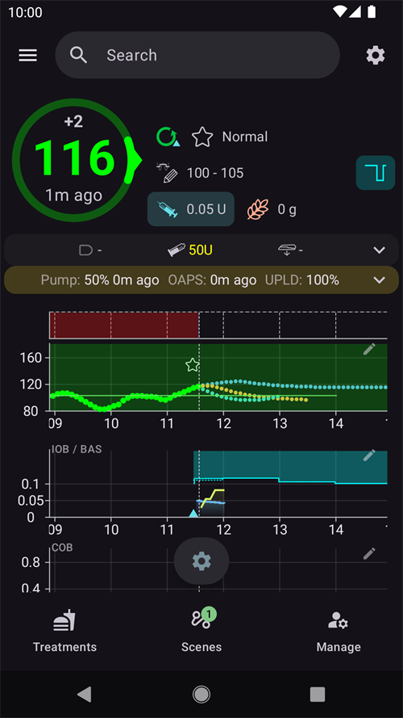

(aapsclient-app)=
# De app AAPSClient

**AAPSClient** is de bijbehorende app van **AAPS**: een app voor een tweede telefoon, meestal die van een verzorger, die de persoon die **AAPS** gebruikt **volgt**. Vanaf **AAPS** versie 4 kan de verzorger de loop ook op afstand **bedienen** met ondertekende opdrachten. Beide telefoons communiceren via je **Nightscout**-site; een directe verbinding tussen de telefoons is niet nodig.

```{admonition} Wording used on this page
:class: note
- **Client** = een telefoon waarop **AAPSClient** draait.
- **Master** = de telefoon met **AAPS** die de pomp beheert en de loop uitvoert.
```

```{admonition} Which devices can run AAPSClient?
:class: note
From **AAPS** version 4, **AAPSClient** runs on Android phones and tablets, on Wear OS watches and on computers (Windows, Mac and Linux). On an iPhone there is no ready-made download: you build the app yourself. See the [table of downloads by device](#aapsclient-platforms).
```

```{contents} Table of contents
:depth: 2
:local: true
```

## Wat AAPSClient wel (en niet) is

**AAPSClient** ziet eruit en werkt als **AAPS**, maar heeft **geen eigen loop**:

- Het bevat **geen APS-algoritme**, geen **Doelen** en **geen pompdrivers**: het doseert nooit zelf.
- De plugins die alleen de hoofdapp gebruikt (**SMS Commando's**, **Tidepool**, **Open Humans**), zitten er ook niet in.
- Wat het *wel* bevat: synchronisatie met **NSClientV3**, de BG-bron plugins, **xDrip+**-uitzending en de koppelingen met **Wear OS** / **Garmin**: alles wat nodig is om te volgen en opdrachten door te sturen. Een **Garmin**-horloge dat met een client verbonden is, kan de gegevens tonen. Maar koolhydraten die het verstuurt, worden niet ingevoerd, en het kan de pomp niet verbinden of loskoppelen: de client toont een melding, en je voert ze in **AAPS** in.

Alles wat je vanuit **AAPSClient** start, wordt gecontroleerd, begrensd, bevestigd en **uitgevoerd door de master** (de telefoon met de pomp). De aparte pagina [Master ↔ Client besturing](ClientMasterControl.md) legt uit hoe dit werkt: hoe je de twee telefoons koppelt, hoe de master de bevestigingstekst schrijft die je ziet, hoe een bolus die op de client is gestart wordt toegediend, en wat er gebeurt als de master offline is.

## Versies: AAPSClient, AAPSClient2 en AAPSClient3

Op dezelfde volgtelefoon kun je tot drie client-apps naast elkaar installeren, die elk een **andere** persoon volgen: **AAPSClient** (gele uil als icoon), **AAPSClient2** (blauwe uil) en, nieuw in **AAPS** versie 4, **AAPSClient3** (groene uil). Ze werken precies hetzelfde. Alleen de naam en de kleur verschillen (app-icoon, achtergrond van de widget en het statusgedeelte op het startscherm), zodat je ze uit elkaar kunt houden. Elke app is gekoppeld met een eigen master. Zie [Over AAPSClient, AAPSClient2 en AAPSClient3](#remotecontrol-aapsclient-versions) voor details.

(aapsclient-platforms)=
## De app downloaden

All the ready-made files are in the *Assets* list of the latest release on [GitHub](https://github.com/nightscout/AndroidAPS/releases/) (click *Assets* at the bottom of the release to expand it). In the table, *x.y.z* stands for the version number. Choose the file that matches your device:

| Device                  | File to download                    | Notities                                                                                                                                                                                     |
| ----------------------- | ----------------------------------- | -------------------------------------------------------------------------------------------------------------------------------------------------------------------------------------------- |
| Android phone or tablet | `app-aapsclient-release_x.y.z.apk`  | Install it like the main app: see [Download and installation of AAPSClient](#RemoteControl_aapsclient) and [Transferring and installing](../SettingUpAaps/TransferringAndInstallingAaps.md). |
| Wear OS watch           | `wear-aapsclient-release_x.y.z.apk` | Goes with the AAPSClient app on the phone. See [Wear OS smartwatch](../WearOS/WearOsSmartwatch.md).                                                                                          |
| Windows computer        | `AAPSClient-x.y.z.msi`              | Open the file to install.                                                                                                                                                                    |
| Mac                     | `AAPSClient-x.y.z.dmg`              | See the note on macOS below the table.                                                                                                                                                       |
| Linux (Debian, Ubuntu)  | `aapsclient_x.y.z_amd64.deb`        | Install it with your package manager.                                                                                                                                                        |
| iPhone                  | geen                                | There is no App Store version and no download. You build the app yourself, see [AAPSClient on an iPhone](#aapsclient-iphone).                                                                |

**Following two people?** Each file above also exists as *aapsclient2* / *AAPSClient2*. It is a second client app that installs next to the first one, so one device can follow two people (see [About AAPSClient, AAPSClient2 and AAPSClient3](#remotecontrol-aapsclient-versions)). **AAPSClient3** is not in the release assets: build it yourself ([build variants](#browserbuild-variant)).

**Files to ignore:** the *pumpcontrol* files (`app-pumpcontrol-release_…`, `wear-pumpcontrol-release_…`) are not a client. Leave them out.

**Mac: the first start.** The app is not notarized by Apple, so macOS blocks it the first time you open it. Click *Done*, then open *System Settings → Privacy & Security*, scroll down and click *Open Anyway*.

**Computer: how to connect.** A computer has no camera, so the QR code cannot be scanned. Set up **Nightscout** in the client, then on the master add the client with a **PIN** and type the 8-digit PIN in the client (**Pair with master**). See [Pairing with the master](#aapsclient-pairing-with-the-master).

**Same version everywhere.** The master and all its clients must run the same **AAPS** version. When you update the master, update the clients too.

(aapsclient-iphone)=
### AAPSClient on an iPhone

There is no **AAPSClient** in the App Store and no ready-made file to download, so you build the app yourself:

- You need a Mac with **Xcode** and an Apple developer account.
- The project is the `ios` folder of the [AndroidAPS repository on GitHub](https://github.com/nightscout/AndroidAPS/tree/master/ios).
- A build for a real iPhone is signed with your own Apple developer team. A build for the iPhone simulator does not need one.
- There is no step-by-step guide yet. This page will be updated when there is one.

The iPhone version pairs with the master like the others. Unlike the computer versions, the iPhone can scan the master's QR code with its camera.

## Eerste start: een kortere Setup Wizard

Bij de eerste start doorloopt **AAPSClient** dezelfde **Setup Wizard** die je kent van **AAPS**, maar met veel minder stappen: op een volger stel je geen profiel, insuline, pomp, APS of doelen in:

1. **Welkom**, **licentieovereenkomst**, **Machtigingen** en **Hoofdwachtwoord**: hetzelfde als in de hoofdapp, zie de [Setup Wizard van AAPS](../SettingUpAaps/SetupWizard.md).
2. De client vraagt **niet** naar de **eenheden** of de **LAAG/HOOG grens**: die neemt hij over van de AAPS-telefoon zodra hij met Nightscout verbonden is. Je kunt ze later zien in **Instellingen**, waar een klein **telefoonicoon** laat zien dat ze [gesynchroniseerd zijn met de AAPS-telefoon](#client-master-config-prefs). Je kunt ze alleen bewerken als de master bereikbaar is.
3. **Instellen vanaf de master**: open op de master **Beheren → Geautoriseerde clients**, voeg deze telefoon toe met een **QR-code** en tik hier op **Scan de QR-code**. Eén scan stelt Nightscout in met een eigen token voor deze telefoon en, met een code die koppelt, koppelt hij ook de telefoon. De telefoon neemt ook de naam over waarmee hij op de master is toegevoegd, als naam van dit exemplaar (letters met accenten worden gewone letters, "Miloš" wordt "Milos"). **Na de scan is het instellen klaar**: de wizard sluit, omdat de volgende stappen alleen zouden laten zien wat de code al heeft gedaan. Heb je geen QR-code? Sla deze stap dan over. (Not on a computer: it has no camera, see [Getting the app](#aapsclient-platforms).)

   

4. **Communicatie**: de lijst met plugins toont alleen wat een volger nodig heeft (NSClientV3, xDrip+, Wear, Externe Companion Apps, Garmin). Heb je geen QR-code gescand? Zet dan **NSClientV3** aan en vul **dezelfde Nightscout URL** in als op de AAPS-telefoon, plus een toegangstoken, met **websockets** aan, precies zoals beschreven in [Synchronisatie](#RemoteControl_aapsclient).

   

5. **Koppel met master**: deze stap bestaat **alleen** op de client. Hij verbindt dit apparaat met de master via het beveiligde opdrachtkanaal, met de pincode, en neemt de naam over waarmee de telefoon op de master is toegevoegd, net als bij de QR-code. **Na het koppelen is het instellen klaar.** Je kunt deze stap ook overslaan en later op elk moment koppelen via **Beheren → Koppel met master**.

   

6. **Wie gebruikt deze telefoon?**: alleen als je niet in de wizard hebt gekoppeld: de naam van de persoon die deze telefoon gebruikt. Zo is dit exemplaar te herkennen in rapporten en bij synchronisatie.

(aapsclient-pairing-with-the-master)=

## Koppelen met de master

Open op de **master** **Beheren → Geautoriseerde clients** en voeg een client toe. Er zijn twee manieren om te koppelen:

- **Met een QR-code** (het snelst, als de telefoon een camera heeft): scan de code in de wizardstap "**Instellen vanaf de master**" of via **Beheren → Koppel met master → Scan de QR-code**, en bevestig met "**Gebruik**". Dit stelt ook Nightscout in.
- **Met de pincode**: open op de **client** de wizardstap hierboven (of **Beheren → Koppel met master**), typ de eenmalige pincode die op de master staat en druk op "**Koppel**". De client laat dan zien wie hij gaat vertrouwen; bevestig met "**Koppel**":


Vanuit de wizard rondt een geslaagde koppeling het instellen af en opent het startscherm. Op de master staat de client als **Actief** in de lijst [Geautoriseerde clients](#client_master_master_setup). Daarna toont **Beheren → Koppel met master** "*Reeds gekoppeld*", de rol van de telefoon en of de beveiligde modus aan staat:

 De volledige koppelprocedure, details over de beveiliging en probleemoplossing staan op [Master ↔ Client besturing](#client_master_client_setup).

Na het koppelen krijgt de client een eigen Nightscout-token van de master (als de master een admin-token heeft), met alleen de rechten die een client nodig heeft. Daarna gebruikt hij het token dat je misschien had ingevuld niet meer. **AAPSClient** schrijft zelf nooit behandelingen of BG naar Nightscout: alles wat het doet, wordt naar de master gestuurd, en die schrijft het. Zie [Het eigen Nightscout-token van de client](#client-master-control-own-token).

De master bepaalt met de **[rol](#client-master-control-roles)** wat deze telefoon mag doen (Alleen lezen, Maaltijden, Zorgverlener of Beheerder). **Beheren → Koppel met master** toont de rol van de telefoon.

## Het startscherm

Het startscherm van de client is een kopie van de gevolgde loop:



- **BG, grafieken, IOB/COB en profiel** komen van Nightscout, precies zoals de master ze heeft geüpload.
- De getoonde **loopstatus** is die van de **master** (een client heeft geen eigen loop). Zolang de client de bedrijfsmodus van de master nog niet van Nightscout heeft ontvangen, toont de chip voor de bedrijfsmodus een **vraagteken** (onbekend).
- De **statuskaart** toont het reservoir en de batterij van de **gevolgde pomp** en de batterij van de uploader, uit de apparaatstatus in Nightscout. Een client heeft geen pomp, dus er is nergens in de app een eigen pompstatus of pompbeheer.
- De onderste balk toont **Behandelingen**, **Scènes** en **Beheren** zodra de client gekoppeld is (vóór het koppelen alleen **Beheren**). Er zijn geen tabbladen voor de pomp of de doelen.

## Behandelingen en acties

Alles onder **Beheren** werkt zoals in de hoofdapp, met één belangrijk verschil: op een client zijn acties die de therapie veranderen (bolus, koolhydraten, tijdelijke streefdoelen, scènes…) **verborgen totdat het apparaat gekoppeld is**. Na het koppelen worden ze **doorgestuurd naar de master**, die ze bevestigt en uitvoert. Zie [Bediening op afstand gebruiken](#client-master-control).

Het item **Profiel** is de uitzondering: het wordt ook op een **niet-gekoppelde** client getoond, maar opent als **alleen bekijken**. De client toont de profielen die hij via Nightscout ontvangt (hij heeft ze nodig voor zijn eigen berekeningen), zonder knoppen om te bewerken of te activeren. Zodra de client **gekoppeld** is, wordt de lijst met profielen gesynchroniseerd met de master, en kun je profielen vanaf de client bewerken en activeren, net als elke andere actie op afstand.

Op een **niet-gekoppelde** client toont **Beheren** alleen **Profiel** en **Koppel met master**:


De rode balk "*Master apparaat is niet bereikbaar. Bewerken is uitgeschakeld totdat de verbinding is hersteld.*" verschijnt ook op een niet-gekoppelde client. Dit is normaal: er is nog geen master om te bereiken. De balk verdwijnt zodra de client gekoppeld is en de master online is.

Zodra de client gekoppeld is, verschijnen de therapie-acties:


Er is **geen item Pomp**: een client heeft geen pomp.

Als de master niet bereikbaar is, verschijnt dezelfde balk op een gekoppelde client: de therapie-acties worden grijs, en alles wat je probeert, wordt geblokkeerd voordat het wordt verstuurd. De client merkt dat de master offline is als je een actie probeert, en zet de acties weer aan zodra de master weer online is.


## Instellingen gesynchroniseerd met de master

De actieve **configuratie** van de plugins en veel **instellingen** worden tussen de master en zijn gekoppelde clients gelijk gehouden. Gesynchroniseerde items hebben een klein **telefoonicoon** en zijn uitgeschakeld (met de balk "*Master apparaat is niet bereikbaar*") zolang de master niet bereikbaar is. Dit staat beschreven in [Configuratie en instellingen wijzigen](#client-master-config-prefs).

## AAPSClient op een smartwatch

Een Wear OS-horloge kan met de **client**-telefoon worden gekoppeld; de acties ervan worden via de client naar de master doorgestuurd. Zie [Wear OS](../WearOS/WearOsSmartwatch.md) en de [smartwatch-opties in Bediening op afstand](#RemoteControl_smartwatches).
