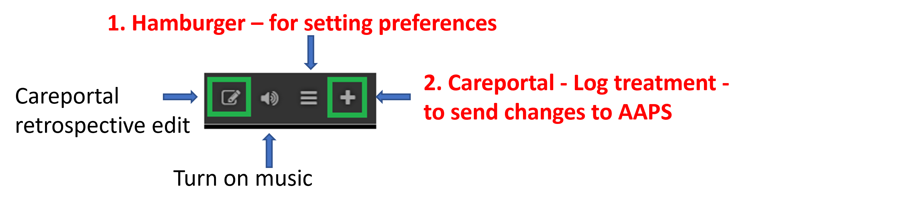

# AAPS op afstand bedienen

```{contents} In this page
:backlinks: entry
:depth: 2
```

Er zijn vier zeer effectieve hulpmiddelen om **AAPS** op afstand te beheren:

1) [SMS-commando's](#RemoteControl_SMS-Commands) (de volgtelefoon kan Android of iOS zijn), 2) [AAPSClient](#RemoteControl_aapsclient) (de volgtelefoon is Android; een iPhone-versie is in ontwikkeling) 3) [Nightscout](#RemoteControl_nightscout) (Android, iOS of een andere computer/ander apparaat), vooral om te volgen: zie de opmerking over [client besturing](#client-master-control) in dat deel.  
4) [Smartwatches](#RemoteControl_smartwatches) (Android)

De eerste drie zijn vooral geschikt voor verzorgers/ouders, maar smartwatches zijn erg handig voor verzorgers/ouders **en** voor volwassenen met diabetes zelf.


(RemoteControl_SMS-Commands)=

## 1) SMS-commando's

Zie de pagina [SMS-commando's](../RemoteFeatures/SMSCommands.md).

(RemoteControl_aapsclient)=
## 2) AAPSClient

**AAPSClient** lijkt erg op **AAPS** zelf. De verzorger krijgt dezelfde schermen en knoppen om op afstand opdrachten naar **AAPS** te sturen:


(remotecontrol-aapsclient-versions)=
### Over AAPSClient, AAPSClient2 en AAPSClient3

Er zijn 3 versies van de client-app: **AAPSClient**, **AAPSClient2** en **AAPSClient3**. Ze werken op dezelfde manier. Het enige verschil is dat ze naast elkaar op dezelfde volgtelefoon geïnstalleerd kunnen worden.

Een verzorger die één persoon volgt, heeft alleen **AAPSClient** nodig. Om een tweede persoon te volgen en op afstand te bedienen (met een eigen **Nightscout**-site en een eigen **AAPS**-telefoon), installeer je ook **AAPSClient2**, en **AAPSClient3** voor een derde persoon. Elke app wordt apart ingesteld en [gekoppeld](#aapsclient-pairing-with-the-master) met de **Nightscout**-site en de **AAPS**-telefoon van de persoon die hij volgt.

Om de apps uit elkaar te houden, hebben sommige onderdelen een andere kleur: geel voor **AAPSClient**, blauw voor **AAPSClient2** en groen voor **AAPSClient3**. Dat zijn het app-pictogram, de achtergrond van de widget en het statusgedeelte van **AAPS** op het startscherm van de app. <br/> Let op: de doorzichtigheid van de widgetachtergrond kun je instellen in de widgetconfiguratie. Bij een lage dekking is de kleur moeilijk te zien.


### Downloaden en installeren

**AAPSClient** kan op één telefoon of op meerdere volgtelefoons worden geïnstalleerd (bijv. de volgtelefoon van ouder 1 en die van ouder 2). Zo krijgen beide verzorgers toegang en kunnen ze de **AAPS**-telefoon van de patiënt op afstand bedienen.

To download **AAPSClient**, navigate to the [GitHub repository](https://github.com/nightscout/AndroidAPS/releases/) and click on the asset **“app-AAPSClient-release_x.x.x.x”** (it may be a newer version to that shown in the screenshot below):


Ga dan naar _downloads_ op je computer. In Windows staan de _downloads_ in de balk aan de rechterkant:


Klik na het downloaden op _show in folder_ (in map tonen) om het bestand te vinden.

De **AAPSClient**-apk kan nu:

Met een USB-kabel naar de telefoon van de volger overgezet; of In een Google Drive-map gesleept, en daarna op de telefoon van de volger geïnstalleerd door op het bestand "app-AAPSClient-release" te tikken.

Should you be needing **AAPS** for yourself, and **AAPSClient** for monitoring someone else, you will need to build **AAPSClient** yourself instead of downloading it from the GitHub repository as described above. De reden is dat je **AAPS** en **AAPSClient** niet op dezelfde telefoon kunt installeren als ze met verschillende sleutels zijn ondertekend. <br/> Om **AAPSClient** zelf te bouwen, volg je dezelfde stappen als bij het [gewoon bouwen van AAPS](../SettingUpAaps/BuildingAaps.md). Kies op de pagina **Generate signed App Bundle or APK** de optie **aapsclientRelease** in plaats van **fullRelease**.

Dezelfde regel geldt als je meerdere client-apps (**AAPSClient**, **AAPSClient2**, **AAPSClient3**) op één volgtelefoon installeert: ze moeten allemaal met **dezelfde sleutel** ondertekend zijn. Anders weigert Android de tweede te installeren (fout `INSTALL_FAILED_DUPLICATE_PERMISSION`).

### Synchronisatie: AAPSClient en AAPS instellen

Als de __AAPSClient__-apk op de volgtelefoon is geïnstalleerd, zorg dan dat **NSClientV3** op beide telefoons op dezelfde manier is ingesteld voor Nightscout 15 (zie de [update-notities](../Maintenance/UpdateToNewVersion.md)). Het voorbeeld hieronder toont de synchronisatie met NSClientV3 en Nightscout 15; er zijn in __AAPS__ ook andere gegevensbronnen beschikbaar (bijv. xDrip).

In **Configuratie** > **Communicatie** synchroniseert de gebruiker zijn gegevens met Nightscout via __NSClientV3__ (met de v3 API). Dit wordt op dezelfde manier ingesteld voor __AAPS__ en voor de volgtelefoon.


De gebruiker moet ervoor zorgen dat __beide__ telefoons, AAPS en AAPS Client, met elkaar gesynchroniseerd zijn door op elke telefoon NSClientV3 in te stellen. Op de volgtelefoon kan dit ook door een QR-code te scannen die **AAPS** toont, zie [AAPSClient koppelen met AAPS](#remotecontrol-pairing) hieronder:

- Voer je **Nightscout URL** in bij de **Instellingen** van NSClientV3

- Voer je **Nightscout toegangstoken** in bij dezelfde instellingen. Volg de notities [hier](https://nightscout.github.io/nightscout/security/#create-a-token). Gebruik op de **AAPS**-telefoon een **admin-token**: daarmee maakt **AAPS** voor elke volgtelefoon een eigen token.

- Zet **Websockets gebruiken** aan op **beide** telefoons. Op de **AAPS**-telefoon zijn websockets **verplicht** voor bediening op afstand: zonder websockets kan **AAPS** geen opdrachten van **AAPSClient** ontvangen. Op beide telefoons maken ze de synchronisatie ook sneller, maar de batterij raakt iets sneller leeg.


De gebruiker moet controleren dat zowel __AAPSClient__ als __AAPS__ ‘verbonden’ tonen in het scherm **NSClientV3** van elke telefoon. Nu volgt **AAPSClient** **AAPS** (BG, behandelingen, profiel), maar kan het nog niet bedienen: koppel de twee telefoons zoals hieronder beschreven.

(remotecontrol-pairing)=
### AAPSClient koppelen met AAPS (bediening op afstand)

Vanaf **AAPS** versie 4 bedient **AAPSClient** **AAPS** via een veilige, **gekoppelde** verbinding. Alleen synchronisatie is niet genoeg: zolang de telefoons niet gekoppeld zijn, toont **AAPSClient** alleen **Beheren** met een **Profiel** om alleen te bekijken en **Koppel met master**.

1. Open op de **AAPS**-telefoon **Beheren → Geautoriseerde clients** en zet **Client controle toestaan** aan (dit staat standaard uit, en in Eenvoudige modus altijd aan).
2. Tik op **+**, voer een naam in voor de volgtelefoon, kies hoe die wordt ingesteld en kies de **rol**:
   - **QR-code: Nightscout en koppelen** — **AAPS** toont een QR-code die Nightscout op de volgtelefoon instelt en de telefoon koppelt, met één scan. Hiervoor is een admin-token nodig in de NSClientV3-instellingen van de **AAPS**-telefoon.
   - **PIN** — voor een volgtelefoon zonder camera die al met Nightscout verbonden is: noteer de eenmalige **PIN** (ongeveer twee minuten geldig).
3. Scan op de **AAPSClient**-telefoon de code (in de Setup Wizard, of via **Beheren → Koppel met master → Scan de QR-code**), of open **Beheren → Koppel met master** en voer de PIN in. Bevestig.

De volgtelefoon staat dan als **Actief** in de lijst **Geautoriseerde clients**, en **AAPSClient** toont **Behandelingen**, **Scènes** en **Beheren**. De volgtelefoon krijgt een eigen Nightscout-token, met alleen de rechten die nodig zijn. De volledige werkwijze, met schermafbeeldingen en probleemoplossing, staat bij [Master ↔ Client besturing](#client_master_master_setup).

Controleer of de instelling werkt: voer koolhydraten in op **AAPSClient**, bevestig de getoonde hoeveelheid en controleer of de invoer op beide telefoons in **Behandelingen** staat.

(remotecontrol-nightscout-access-token)=

### Problemen met de instelling van het 'Nightscout toegangstoken' oplossen

De precieze instelling van het 'Nightscout toegangstoken' kan verschillen, afhankelijk van of je Nightscout bij een betaalde hostingdienst draait of niet.

Lukt het niet om **AAPS** het 'Nightscout toegangstoken' te laten accepteren en gebruik je een betaalde Nightscout-hostingdienst? Neem dan eerst contact op met je Nightscout-aanbieder om de problemen met het 'Nightscout toegangstoken' op te lossen. Lukt het anders niet, neem dan contact op met de **AAPS**-groep. Controleer wel eerst goed of je de notities [hier](https://nightscout.github.io/nightscout/security/#create-a-token) juist hebt gevolgd.

### Wat AAPSClient biedt

Na het koppelen biedt **AAPSClient** de verzorger bijna dezelfde schermen als **AAPS** zelf:

- **Behandelingen**: insulinebolus, koolhydraten en de bolus wizard.
- **Scènes**: [scènes](../DailyLifeWithAaps/Scenes.md) starten en stoppen.
- **Beheren**: profielen, insuline-instellingen, tijdelijke streefdoelen, QuickWizard, automatisering, voeding, site rotatie, koppelen en de lopende tijdelijke basaal.
- **Hoofdmenu**: behandelingen geschiedenis, historie bekijken, statistieken, onderhoud, configuratie.

Op **AAPSClient** is er geen pomp en zijn er geen doelen. Zie [De app AAPSClient](AapsClient.md) voor een uitgebreide beschrijving.

Met **AAPSClient** kan de verzorger op afstand, via het mobiele netwerk of internet, de meeste aanpassingen doen die ook direct in **AAPS** kunnen, **ook insulinebolussen**. Elke opdracht wordt ondertekend en via Nightscout naar de **AAPS**-telefoon gestuurd. Die controleert de opdracht met zijn eigen gegevens, begrenst hem, toont zijn eigen bevestiging en voert hem pas daarna uit. **AAPSClient** _kan_ veel sneller zijn dan [SMS-commando's](../RemoteFeatures/SMSCommands.md), vooral voor opdrachten die authenticatie nodig hebben.

Behandelingen die op een andere manier in Nightscout zijn ingevoerd (bijvoorbeeld op de Nightscout-website), worden niet toegepast zolang client besturing aan staat: **AAPS** staat dan in [beveiligde modus](#client-master-control-hardened-mode) en neemt alleen wijzigingen van gekoppelde clients aan. Met client besturing uit worden ze alleen toegepast als de bijbehorende **Ontvang**-opties aan staan in het [deel Synchronisatie van de NSClient-instellingen](#Preferences-nsclient-synchronization).

Bediening op afstand via **AAPSClient** wordt alleen aangeraden als je synchronisatie goed werkt (_d.w.z._ je ziet geen ongewenste wijzigingen in gegevens, zoals tijdelijke streefdoelen of TBR's die vanzelf veranderen).

### AAPSClient met smartwatch-opties

Een smartwatch kan erg handig zijn om **AAPS** bij kinderen te beheren. Enkele verschillende configuraties zijn mogelijk. Als **AAPSClient** op de telefoon van de verzorger staat, kun je de [**AAPSClient WearOS**-app](https://github.com/nightscout/AndroidAPS/releases/) downloaden en installeren op een geschikte smartwatch die met de telefoon van de ouder verbonden is. Dit toont de huidige BG en de loopstatus. Als **AAPSClient** met **AAPS** gekoppeld is, worden de acties van het horloge (ook bolussen, koolhydraten, tijdelijke streefdoelen en profielwijzigingen) via **AAPSClient** doorgestuurd naar **AAPS**, dat ze bevestigt en uitvoert: zie [Wear OS op een client](#clientmastercontrol-wear-os-on-a-client). Je kunt [hier](#remotecontrol-smartwatches) meer lezen over smartwatches.

(RemoteControl_nightscout)=
## 3) Nightscout

Nightscout is een server in “de cloud”, maar er is ook een eigen **Nightscout**-app die je direct uit de App Store op je iPhone kunt downloaden. If you have an Android follower phone, there is not a dedicated Nightscout app and it is better to use [**AAPSClient**](#RemoteControl_aapsclient), or, if you only want to follow, and not send treatments you can download and install the [Nightwatch](https://play.google.com/store/apps/details?id=se.cornixit.nightwatch) app from the Playstore.

Als je de **Nightscout**-app op je iPhone hebt geïnstalleerd, open je de app en volg je de stappen om hem in te stellen. Voer je Nightscout-adres in (zie hieronder, links). De vorm van dit adres kan anders zijn, afhankelijk van waar je Nightscout gehost wordt. (_bijv._ http://youraddresshere.herokuapp.com). Voer daarna je Nightscout API secret in (zie hieronder, rechts). Als niet om je API-wachtwoord wordt gevraagd, moet je het invoeren door op het hangslotje bovenaan in de app te tikken:


Meer informatie over het instellen vind je direct bij [Nightscout](https://nightscout.github.io/nightscout/discover/)

Als je voor het eerst inlogt, zie je een heel eenvoudig scherm. Pas de weergaveopties aan: tik op het “hamburgermenu” rechtsboven en scroll omlaag:


Scroll omlaag naar “Settings”. Misschien wil je “scale” op “linear” zetten, omdat de BG-weergave standaard logaritmisch is. Kies bij “render basal” de optie “default”, zodat de basaal van de pomp zichtbaar wordt.


Kies de opties die je wilt. Vink alarms uit als je een andere app voor alarmen gebruikt.


Scroll verder omlaag tot je bij “show plugins” komt.

Zorg dat “careportal” is aangevinkt. Je kunt ook verschillende andere gegevens kiezen (het meest nuttig zijn: IOB, care portal, pump, cannula age, insulin age, basal profile en OpenAPS).

Belangrijk: tik nu onderaan op “save”, anders worden deze wijzigingen niet toegepast.


Na het tikken op “save” gaat de app terug naar je Nightscout-hoofdscherm. Dat ziet er ongeveer zo uit:

1. Huidige glucosewaarde
2. Informatie over de status van het AAPS-systeem - tik op de afzonderlijke tabbladen op het scherm om meer details te zien. Voeg deze weergaveopties toe of verwijder ze via het hamburgermenu.
3. Recente glucosecurve met behandelingen (koolhydraten, bolussen)
4. Glucosecurve over een langere periode
5. "Hamburgermenu" voor weergaveopties, rapporten maken, profielen bewerken en Nightscout-beheertools
6. "**+**"-menu om behandelingen in te voeren (zie [hieronder](#RemoteControl_nightscout-treatments) wanneer **AAPS** ze toepast).
7. Kies een andere periode om te tonen
8. Basaal insulineprofiel
9. Groene lijn = glucose in het verleden Blauwe lijnen = voorspelde glucose


Het menu linksboven in de Nightscout-app in meer detail:

1. Careportal: achteraf bewerken
2. Alarmen aan/uit
3. Hamburgermenu - voor het instellen van voorkeuren
4. Careportal - behandeling vastleggen (zie [hieronder](#RemoteControl_nightscout-treatments) wanneer **AAPS** deze toepast)



In de grijze tabbladen op dit scherm staat heel veel informatie over de status van het **AAPS**-systeem (en als je op een tabblad tikt, zie je nog meer):

1. Glucosetrend over 5 min
2. Voorbeeld van de bolus wizard (BWP)
3. Tik op Basal om je huidige profiel en basaalinformatie te zien
4. Tijd sinds de laatste CGM-meting in AAPS
5. **Pump**: insuline, batterij-% en wanneer AAPS voor het laatst verbinding had met de pomp
6. Laatste keer dat AAPS heeft bijgewerkt - als dit langer dan 5 min geleden is, kan er een verbindingsprobleem zijn tussen de AAPS-telefoon en de pomp/CGM
7. Tik op IOB om de verdeling tussen basaal- en bolusinsuline te zien
8. Leeftijd van de insuline in het reservoir
9. Canule leeftijd
10. Batterijstatus van de AAPS-telefoon
11. Grootte van je database. Als die te vol raakt (alleen bij zelf gehoste Nightscout - negeer dit bij betaalde hosting), kun je verbindingsproblemen krijgen. Je kunt gegevens verwijderen om dit getal kleiner te maken, in het menu Admin tools (via het hamburgermenu).


Tik onderaan de pagina op "refresh" om de pop-up te sluiten.

(RemoteControl_nightscout-treatments)=
### Behandelingen via de Nightscout-app naar AAPS sturen

In **AAPS** 4 the supported way to control **AAPS** remotely is a **paired AAPSClient**, see [Master ↔ Client control](#client-master-control): each client has a [role](#client-master-control-roles) that limits what it may do, and every command is signed by the client, then checked and confirmed by the **AAPS** phone. Zolang client besturing aan staat, is de **AAPS**-telefoon in [beveiligde modus](#client-master-control-hardened-mode): behandelingen, tijdelijke streefdoelen en profielwissels die op de Nightscout-website of in de Nightscout-app worden ingevoerd, worden **niet** toegepast. De Nightscout-app is dan alleen een hulpmiddel om te volgen.

```{admonition} Only when client control is off
:class: warning
Als **Client controle toestaan** uit staat in **Beheren → Geautoriseerde clients** (en Eenvoudige modus uit staat), past **AAPS** careportal-invoer uit Nightscout alleen toe voor de soorten gegevens die je onder **Ontvang** hebt aangezet in het [deel Synchronisatie van de NSClientV3-instellingen](#Preferences-nsclient-synchronization): koolhydraten, tijdelijke streefdoelen, profielwissels en de andere careportal-invoer. Insuline wordt op deze manier nooit toegediend: een "Correctie bolus" die in Nightscout is ingevoerd, wordt alleen *aangekondigd*. **AAPS** telt die mee als actieve insuline (IOB), zonder hem toe te dienen. Deze instelling wordt niet aangeraden voor bediening op afstand; gebruik in plaats daarvan een gekoppelde **AAPSClient**.
```

Lees [hier](https://nightscout.github.io/) meer over de opties van **Nightscout**

### Tips om het meeste uit de Nightscout-app te halen

1). Als je op een pagina “vastzit” en het hoofdscherm weer wilt zien, tik dan op “refresh” (onderaan in het midden). Dan ga je terug naar de **Nightscout**-startpagina met de BG-grafiek.

Om het huidige profiel te zien dat op de telefoon actief is, tik je op de verschillende pictogrammen boven de grafiek. Meer informatie (huidige koolhydraatratio, gevoeligheid, tijdzone enz.) zie je als je op “basal” tikt. “OpenAPS” geeft informatie over het profiel, de huidige streefwaarde enz. Je kunt ook zowel het batterijpercentage van de telefoon als van de pomp volgen. BWP laat zien wat het algoritme verwacht dat er gaat gebeuren, op basis van IOB en COB.

#### Andere pictogrammen in het menu: wat betekent het potlood (bewerken)?

Met het potlood kun je (technisch gezien) bolus- of correctiebehandelingen van de laatste 48 uur verplaatsen of verwijderen.

Meer hierover [hier](https://nightscout.github.io/nightscout/discover/#edit-mode-edit)

Dit kan handig lijken om aangekondigde koolhydraten (waarvoor geen bolus is gegeven) te verwijderen. In de praktijk werkt het nu niet goed met **AAPS**. We raden aan zulke wijzigingen direct in de **AAPS**-app te doen.

(RemoteControl_smartwatches)= (remotecontrol-smartwatches)=

## 4) Smartwatches

### Optie 1) AAPS bedienen vanaf een Wear OS-horloge


Als je [**AAPS** op je horloge hebt ingesteld](../WearOS/BuildingAapsWearOS.md), vind je uitgebreide details over de watchfaces en hun functies in [AAPS instellen op je Wear OS-horloge](../WearOS/WearOsSmartwatch.md).

Een kort overzicht: de volgende functies kun je vanaf de smartwatch starten:

* een tijdelijk streefdoel instellen

* de bolus calculator gebruiken (de rekenvariabelen kun je instellen in de instellingen op de telefoon)

* eCarbs (vertraagde koolhydraten) invoeren

* een bolus toedienen (insuline + koolhydraten)

* horloge-instellingen

* status

* pompstatus bekijken

* loopstatus bekijken

* profiel bekijken en wijzigen, CPP (Circadiaans percentage profiel = tijdverschuiving + percentage)

* TDD tonen (totale dagelijkse dosis = bolus + basaal per dag)

* Bolus op afstand als de verzorger en het kind met T1D op verschillende plekken zijn (dit kan met het **AAPS**-horloge en de **AAPS**-telefoon, zolang beide apparaten met het netwerk verbonden zijn)

#### Communicatie van verzorgers naar het horloge via andere apps (zoals WhatsApp)

Je kunt extra apps op het horloge zetten, zoals WhatsApp, bijvoorbeeld om berichten te sturen tussen verzorgers en kinderen. Het is belangrijk dat er maar EEN Google-account aan de telefoon is gekoppeld, anders brengt het horloge deze gegevens niet over. Je moet 13 jaar of ouder zijn voor een Samsung-account. Dit account moet je instellen met hetzelfde e-mailadres dat op de Android-telefoon wordt gebruikt.

Een video over het instellen van WhatsApp voor berichten op het Galaxy Watch 4-horloge (niet alle functies van WhatsApp werken) vind je [hier](https://gorilla-fitnesswatches.com/how-to-get-whatsapp-on-galaxy-watch-4/)

Met aanpassingen in de app **Galaxy wearable** op de **AAPS**-telefoon en op het horloge kunnen WhatsApp-berichten met een lichte trilling worden gemeld en over de bestaande watchface worden getoond.

### Optie 2) **AAPS** op het horloge, om **AAPS** op een telefoon op afstand te bedienen

Net als een volgtelefoon met **AAPSClient** of SMS-commando's (zie de delen hierboven) kan een smartwatch worden gebruikt om **AAPS** op afstand te bedienen en volledige profielgegevens te tonen. Een belangrijk verschil met een volgtelefoon is dat de verbinding tussen smartwatch en **AAPS**-telefoon via Bluetooth loopt en geen Nightscout of authenticatiecode nodig heeft. Overigens: als de smartwatch en de **AAPS**-telefoon die via Bluetooth verbonden zijn, ook op een wifi-/mobiel datanetwerk zitten, werkt het horloge ook via dat netwerk met de **AAPS**-telefoon samen. Zo is het bereik groter. Dit maakt ook een bolus op afstand mogelijk als de verzorger met het **AAPS**-horloge en het kind met T1D (met de **AAPS**-telefoon) op verschillende plekken zijn. Dat kan handig zijn als het kind met T1D op school is.

Een smartwatch voor bediening op afstand is daarom vaak handig in elke situatie waarin:

a)  **AAPSClient** of **SMS**-commando's niet kunnen werken; of

b)  De gebruiker geen authenticatiecode wil typen (zoals nodig is bij SMS-commando's).

Een smartwatch heeft **Wear OS 3 of nieuwer** nodig om **AAPS** te kunnen bedienen. Controleer de technische gegevens van het horloge en zie de pagina [Smartwatches en AAPS](../Getting-Started/Watches.md). Search, or ask in the **AAPS** Facebook/Discord groups if unsure.

Hieronder staan handleidingen om **AAPS** in te stellen op de populaire Samsung Galaxy Watch 4 (40 mm). Het horloge van [Garmin](https://apps.garmin.com/en-US/apps/a2eebcac-d18a-4227-a143-cd333cf89b55?fbclid=IwAR0k3w3oes-OHgFdPO-cGCuTSIpqFJejHG-klBTm_rmyEJo6gdArw8Nl4Zc#0) is ook een populaire keuze. Heb je ervaring met het instellen van een andere smartwatch die nuttig kan zijn voor anderen? Voeg het dan toe aan deze pagina's ([de documentatie bewerken](../SupportingAaps/HowToEditTheDocs.md)) om je ervaring te delen met de hele **AAPS**-community.

### Optie 3) AAPSClient op een horloge, om **AAPS** op een telefoon op afstand te bedienen


The software for the watch, **AAPSClient** Wear apk, can be downloaded directly from [GitHub](https://github.com/nightscout/AndroidAPS/releases/).

Om de software te downloaden, klik je op de horloge-app die past bij de client-app op de telefoon: **wear-aapsclient-release_**_versie_ hoort bij **AAPSClient**, **wear-aapsclient2-release_**_versie_ hoort bij **AAPSClient2** (zie [Over AAPSClient, AAPSClient2 en AAPSClient3](#remotecontrol-aapsclient-versions)):


Kies dan "save as" (opslaan als) en sla het bestand op een handige plek op je computer op:


De **AAPSClient** Wear-apk kun je naar je telefoon overzetten en op het horloge installeren (side-loaden) op dezelfde manier als de **AAPS** Wear-app, zoals beschreven in [De Wear-app naar je AAPS-telefoon overzetten](#remote-control-transferring-the-aaps-wear-app-onto-your-aaps-phone)  


