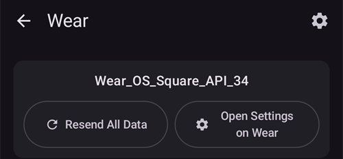
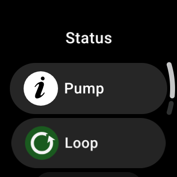
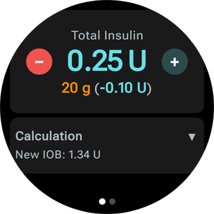
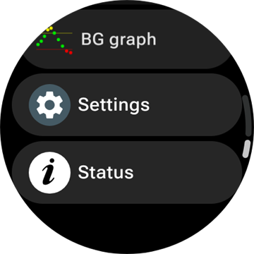
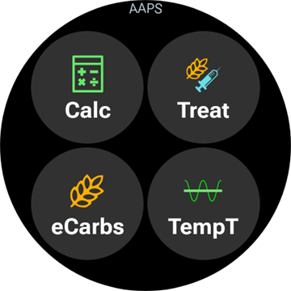
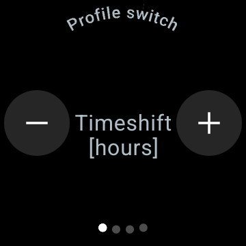

# AAPS bedienen via je Wear OS smartwatch

(Watchfaces-aaps-watchfaces)=

## AAPS-watchfaces

```{warning}
De klassieke **AAPS**-watchfaces werken alleen op Wear OS 5 en ouder, en Wear OS 5 beperkt ze al. Op **Wear OS 6 en nieuwer** installeert de horloge-app in plaats daarvan één watchface in het Watch Face Format van Google: je aangepaste watchface als afbeelding, of de **Wijzerplaat complicaties**. Zie [Wijzigingen in watchfaces van Wear OS](#wearos-watchface-changes) voor wat er per Wear OS-versie niet meer werkt, en [de watchface die AAPS installeert](#wearos-aaps-v4-watchface) voor Wear OS 6.
```

Op Wear OS 5 en ouder zitten er meerdere klassieke watchfaces in de **AAPS** horloge-app. Ze tonen de glucosewaarde met delta, IOB, de actieve basaalstand en een grafiek van de metingen. Er werken twee tikken op:

* Dubbeltik op de glucosewaarde om het hoofdmenu van **AAPS** te openen
* Dubbeltik op de grafiek om het tijdsinterval te wijzigen

Op elke Wear OS-versie werken de [complicaties](#Watchfaces-complications) en de [tegels](#WearOsSmartwatch-wear-os-tiles) van deze pagina met elke watchface die er ruimte voor heeft.

## Configuratie

Zet **Wear** aan in [**Configuratie** > **Communicatie**](#Config-Builder-wear).

Zet **Bediening via smartwatch** aan om vanaf het horloge een bolus te geven of andere acties te doen. De opties van de bolus wizard voor het horloge stel je op dezelfde plaats in: zie [Instellingen > Wear](#preferences-wear). Zolang **Bediening via smartwatch** uit staat, weigert de telefoon elke behandeling of moduswijziging die van het horloge komt, en toont het horloge *"Wear Control is uitgeschakeld in de Wear-instellingen op de telefoon."*

Met **Plug-in openen** op de kaart **Wear** open je het Wear-scherm:



De bovenste regel toont de naam van het verbonden horloge, of **(Geen horloge verbonden)**. Op dit scherm kun je

* Alle gegevens opnieuw verzenden. Kan handig zijn als het horloge een tijd niet verbonden was en je de informatie naar het horloge wilt sturen.
* Open de instellingen van je horloge direct vanaf je telefoon.
* Kiezen welke watchface **AAPS** op het horloge installeert (**Wijzerplaat is geïnstalleerd op horloge**: je aangepaste watchface of de complicaties-watchface). Deze kaart wordt alleen getoond als er een horloge met **Wear OS 6** of nieuwer verbonden is. Zie [de watchface die AAPS installeert](#wearos-aaps-v4-watchface).
* De **Aangepaste wijzerplaat** beheren (de kaart wordt getoond als er een horloge verbonden is): **Laad Watchface** stuurt een aangepaste watchface naar het horloge, **Watchface informatie** toont de details van de geladen watchface en de velden die erin zitten, **Meer wijzerplaten** opent de [uitwisselsite](../ExchangeSiteCustomWatchfaces/index.md) in je browser, en **Exporteer template** slaat een template op die je kunt bewerken. Onder de knoppen staat een voorbeeld van de geladen watchface. Zie [Overschakelen naar een AAPS-watchface](#WearOS_changing-to-AAPS-watchface).

Zorg dat meldingen van AAPS op het horloge niet geblokkeerd zijn. Een actie (bijv. bolus, tijdelijk streefdoel) bevestig je via een melding, die je moet vegen en aanvinken.

## Toegang tot het hoofdmenu van AAPS


Gebruik een van deze manieren om het hoofdmenu van **AAPS** te openen:

* open **AAPS** vanuit de lijst met apps op het horloge
* tik op een **AAPS**-complicatie die het menu opent, zie [Instellingen voor complicaties](#WearOsSmartwatch-complication-settings)
* tik op de tegel **BG Grafiek** waarvan de **Tik actie** op **Hoofdmenu** staat, zie [Instellingen van tegels](#WearOsSmartwatch-wear-os-tiles)
* dubbeltik op een klassieke **AAPS**-watchface op de glucosewaarde

(WearOsSmartwatch-loop-status)=

## Scherm Loop status

Het scherm **Loop status** geeft een overzicht van wat de loop doet, zonder dat je je telefoon hoeft te pakken. Open het vanuit het hoofdmenu van AAPS (**Loop status**, of **Status → Loop**), of door op de complicatie **Bloed glucose** te tikken. Het menu **Status** heeft ook een pagina **Pomp** en een pagina **TDD** met de totale dagdoses.




Het scherm is een lijst met kaarten. Scroll naar beneden om ze allemaal te zien:

* **Bedrijfsmodus** — de huidige modus (gesloten loop, open loop, LGS, onderbroken, verbinding verbroken…) en, bij een tijdelijke modus, hoe lang die nog loopt.
* **Loop resultaat** — wanneer de loop het laatst liep, en het tijdelijk basaal of de SMB die hij vroeg.
* **Scène** — alleen als er een [scène](#scenes-from-watch) actief is: de naam, de resterende tijd (of **Tot einde** bij een scène zonder eindtijd) en de **Vervolg**-scène die start als deze eindigt.
* **Streefdoelen** — je streefdoel, en het tijdelijk streefdoel als er een loopt.
* **Profiel** — de naam van het actieve profiel, met het **Percentage** en de **Tijdverschuiving** als die niet de standaardwaarden hebben. Een tijdelijke profiel wissel wordt gemarkeerd en toont hoe lang die nog loopt en naar welk profiel hij **Keert terug naar** als hij eindigt.
* **Gevoeligheid** — dezelfde regels als het gevoeligheidslabel op het hoofdscherm van de telefoon: de autosens-waarde en de ISF van het profiel, de variabele en de effectieve ISF.

Een klein scène-pictogram naast een bedrijfsmodus, een tijdelijk streefdoel of een profiel wissel betekent dat die is **veranderd door de actieve scene**. Hetzelfde pictogram staat ook in de keuzelijst **Bedrijfsmodus**.


(WearOsSmartwatch-bolus-calculator)=

## De boluscalculator op het horloge

Open **Calculator** vanuit het hoofdmenu van **AAPS**, vanuit de [tegel Acties](#WearOsSmartwatch-wear-os-tiles) of vanuit een complicatie die is ingesteld om de wizard te openen. Je gaat door een paar pagina's; veeg van rechts naar links om verder te gaan:

| Koolhydraten                                                             | Aanvraag                                                               | Resultaat                                                              | Berekening                                                                              | Bevestigen                                                               |
| ------------------------------------------------------------------------ | ---------------------------------------------------------------------- | ---------------------------------------------------------------------- | --------------------------------------------------------------------------------------- | ------------------------------------------------------------------------ |
|  |  |  |  |  |

1. **Koolhydraten**: voer de koolhydraten in met de knoppen **+10**, **+5**, **−** en **+**.
2. **Aanvraag**: de laatste pagina voordat de telefoon het overneemt. Deze toont wat je hebt ingevoerd: de koolhydraten, en het type maaltijd, de koolhydraattijd en het percentage als je die gebruikt, zie [Extra pagina's](#WearOsSmartwatch-calculator-optional-pages). Tik op het vinkje om het naar de telefoon te sturen, die de berekening uitvoert.
3. **Resultaat**: de bolus die **AAPS** voorstelt, met de koolhydraten eronder: de koolhydraten nu en de eCarbs later, de koolhydraattijd en de bel van de etensherinnering. Pas de dosis aan met **−** en **+**, zie hieronder. Scroll naar beneden voor de kaart **Berekening**: tik erop om elke regel van de berekening te zien, net als op de telefoon.
4. **Bevestigen**: veeg naar de tweede pagina en tik op het vinkje. De telefoon geeft de bolus en slaat de koolhydraten op.

(WearOsSmartwatch-calculator-optional-pages)=

### Extra pagina's

Drie instellingen op het horloge voegen elk een pagina toe na **Koolhydraten**. Standaard staan ze uit. Open het hoofdmenu van **AAPS**, dan **Instellingen** > **Interface**, en zet aan wat je wilt; als er meer dan één aan staat, komen de pagina's in deze volgorde: **Type maaltijd**, **Koolhydraattijd**, **Percentage**. De stippen onderaan de calculator tonen hoeveel pagina's er zijn.

| Instellingen                                                                                          | Type maaltijd                                                                 | Koolhydraattijd                                                                 | Percentage                                                                  |
| ----------------------------------------------------------------------------------------------------- | ----------------------------------------------------------------------------- | ------------------------------------------------------------------------------- | --------------------------------------------------------------------------- |
|  |  |  |  |

* **Rekenmachine Maaltijd Type**: **Brood**, **Cake** of **Pizza**, dat de koolhydraten van een langzame maaltijd verdeelt in koolhydraten nu en eCarbs later, zie [Het type maaltijd kiezen](#WearOsSmartwatch-wizard-meal-type).
* **Koolhydraten tijd calculator**: de minuten tot je gaat eten, met een bel **Alarm instellen** voor de etensherinnering, zie [Koolhydraattijd en de etensherinnering](#WearOsSmartwatch-wizard-carb-time).
* **Calculator percentage**: een percentage van de berekende bolus, bijvoorbeeld 70% als je een kleinere dosis wilt. Het begint bij het **Bolus percentage** uit de [instellingen van de bolus wizard](#Preferences-deliver-this-part-of-bolus-wizard-result) van de telefoon, 100% als je dat niet hebt gewijzigd. Zie ook de opmerking onder [De bolus aanpassen op de resultaatpagina](#WearOsSmartwatch-wizard-result).

(WearOsSmartwatch-wizard-result)=

### De bolus aanpassen op de resultaatpagina

De resultaatpagina toont de bolus die **AAPS** voorstelt, met een knop **−** en een knop **+**. Gebruik ze om de dosis aan te passen voordat je die bevestigt, zonder terug te gaan naar de telefoon.

| Voorgesteld                                                                          | Meer                                                                                  | Minder                                                                                  |
| ------------------------------------------------------------------------------------ | ------------------------------------------------------------------------------------- | --------------------------------------------------------------------------------------- |
|  |  |  |

* Elke druk verandert de bolus met **één stap van je pomp**, zodat de hoeveelheden altijd passen bij wat je pomp echt kan geven.
* **Houd een knop ingedrukt** om de waarde blijvend te veranderen. Hoe langer je drukt, hoe sneller het gaat.
* Je kunt niet onder **0 E** komen, en niet boven je instelling voor de **max bolus**.

Het lopende totaal staat op de resultaatpagina, zodat je altijd de hoeveelheid ziet die je gaat bevestigen. De wijziging staat na de koolhydraten, bijvoorbeeld *(+0,20 E)*, en de knop die je gebruikte wordt groen bij meer of rood bij minder.

Als **AAPS** de dosis moest beperken, bijvoorbeeld omdat de berekende bolus boven je instelling voor de **max bolus** ligt, zegt een oranje waarschuwingsregel onder het totaal dat (bijvoorbeeld *"Bolusbeperking toegepast"*). Hetzelfde geldt voor een beperkte hoeveelheid koolhydraten.

```{admonition} Dit is niet hetzelfde als Calculator percentage :class: note Met de instelling **Calculator percentage** voer je een *percentage* van de berekende bolus in **voordat** de resultaatpagina verschijnt. De knoppen **−** en **+** passen de *eindhoeveelheid* aan **op** de resultaatpagina. Je kunt beide gebruiken.

    <br />(WearOsSmartwatch-wizard-meal-type)=
    
    ### Het type maaltijd kiezen
    
    De calculator op het horloge kan de koolhydraten van een langzame maaltijd verdelen in koolhydraten nu en eCarbs later, net als het [type koolhydraten](#AapsScreens-carbs-type) van de wizard op de telefoon. Zet **Rekenmachine Maaltijd Type** aan in **Instellingen** > **Interface** op het horloge. Deze instelling staat standaard uit, en dan wordt de pagina **Type maaltijd** overgeslagen.
    
    * Nadat je de koolhydraten hebt ingevoerd, toont een pagina **Type maaltijd** drie pictogrammen: **Brood**, **Cake** en **Pizza**. Tik op een pictogram: de naam en de koolhydraten die het geeft staan onder de pictogrammen, bijvoorbeeld *65 g* voor brood, of *52+22 g* voor pizza (52 g nu en 22 g eCarbs later). **Brood** is de standaard en houdt alle koolhydraten op nu.
    * De pagina's Aanvraag en Bevestigen tonen de koolhydraten op dezelfde manier (*52+22 g*). De resultaatpagina toont ook wanneer de eCarbs beginnen en hoe lang ze duren.
    * De bolus wordt alleen berekend voor de koolhydraten die je nu eet. De verdeling gebruikt dezelfde getallen als de wizard op de telefoon.
    
    (WearOsSmartwatch-wizard-carb-time)=
    
    ### Koolhydraattijd en de etensherinnering
    
    Als **Koolhydraten tijd calculator** aan staat in **Instellingen** > **Interface** op het horloge, volgt na de koolhydraten een pagina **Koolhydraattijd**: de minuten tot je gaat eten, net als de [koolhydraattijd](#aaps-screens-bolus-wizard) van de wizard op de telefoon. **Nu** is de standaard. **−** en **+** verplaatsen de tijd in stappen van 5 minuten, tot een uur voor of na nu. Een tijd in het verleden is voor koolhydraten die je al hebt gegeten.
    
    Bij een tijd in de toekomst verschijnt een bel **Alarm instellen** onder de waarde. Deze staat standaard aan; tik erop om hem uit te zetten. De pagina's Aanvraag en Resultaat tonen de koolhydraattijd, bijvoorbeeld *+30 min*, en de bel. De telefoon slaat de koolhydraten op dat tijdstip op, verschuift de eCarbs van het type maaltijd mee, en start zijn herinnering **Tijd om te eten**.
    
    | Resultaat | BG Grafiek | Actief | Tijd om te eten |
    | --- | --- | --- | --- |
    |  |  |  |  |
    
    De herinnering staat ook op het horloge, dus hij gaat ook af als de telefoon buiten bereik is:
    
    * Het scherm **BG Grafiek**, de tegel **BG Grafiek** en de grafiek van de **Wijzerplaat complicaties** tekenen een oranje stippellijn waar de herinnering afgaat, met de resterende minuten ernaast.
    * Zolang hij loopt, staat er een stille melding **Tijd om te eten** met **Stop** en **+5 min** tussen de meldingen. Als je hem wegveegt, komt hij terug, tot de herinnering voorbij is.
    * Als het zover is, trilt het horloge, en daarna elke halve minuut, vijf minuten lang, tot je reageert. De melding biedt **Stil** en **+5 min**, en wegvegen maakt hem ook stil.
    
    **Stop**, **Stil** en **+5 min** doen hetzelfde op het horloge, op de telefoon en op een **AAPSClient**, en ze tonen allemaal dezelfde herinnering.
    
    (Watchfaces-complications)=
    
    ## Complicaties
    
    _Complicatie_ is een term uit de traditionele horlogemakerij. Het is een toevoeging aan de hoofdwijzerplaat, zoals een extra klein venster of kleine wijzerplaat (met datum, dag van de week, maanstand, enz.). Wear OS 2.0 gebruikt dit idee om eigen gegevensbronnen, zoals weer, meldingen, fitnesstellers en meer, toe te voegen aan elke watchface die complicaties ondersteunt.
    
    De AAPS Wear OS-app ondersteunt complicaties sinds build `2.6`. Elke watchface van een andere partij die complicaties ondersteunt, kan zo worden ingesteld dat hij AAPS-gegevens toont (BG met de trend, IOB, COB, enz.).
    
    Complicaties zijn ook een **snelkoppeling** naar functies van AAPS. Door te tikken op een complicatie kun je AAPS menu's en dialoogvensters openen (afhankelijk van type complicatie en configuratie).
    
    
    
    ### Soorten complicaties
    
    De AAPS Wear OS-app levert alleen ruwe gegevens, in vaste formaten. Het is aan de watchface van een andere partij om te bepalen waar en hoe complicaties worden getoond, inclusief de lay-out, rand, kleur en het lettertype. Van de vele soorten complicaties in Wear OS gebruikt AAPS:
    
    * `SHORT TEXT` - Bevat twee regels tekst van elk 7 tekens, soms waarde en label genoemd. Meestal getoond in een cirkel of kleine pil – onder elkaar of naast elkaar. Deze complicatie heeft heel weinig ruimte. AAPS probeert onnodige tekens te verwijderen om deze complicatie in te passen: door het afronden van waarden, het verwijderen van voorafgaande en afsluitende nullen uit waarden, enz.
    * `LONG TEXT` - Bevat twee regels tekst van elk ongeveer 20 tekens. Meestal getoond in een rechthoek of lange pil – onder elkaar. Het wordt gebruikt voor extra details en voor de status uitgeschreven in tekst.
    * `RANGED VALUE` - Voor waarden uit een vast bereik, zoals een percentage. Deze bevat een pictogram en een label, en wordt meestal getoond als een ronde voortgangsmeter.
    * `LARGE IMAGE` - Eigen achtergrondafbeelding die als achtergrond kan worden gebruikt (als de watchface dat ondersteunt).
    * `SMALL IMAGE` / `MONOCHROMATIC IMAGE` - Een klein pictogram. Op een `SMALL IMAGE`-plaats tekent AAPS het in zijn eigen kleur; op een `MONOCHROMATIC IMAGE`-plaats kleurt de watchface het.
    
    ### Complicaties instellen
    
    Om een complicatie aan de watchface toe te voegen, stel je die in door lang te drukken en op het tandwielpictogram eronder te tikken. Afhankelijk van hoe de watchface ze instelt: tik op de lege plaatsen, of open het instelmenu van de watchface voor complicaties. AAPS-complicaties zijn gegroepeerd onder het AAPS menu item.
    
    Bij het instellen van complicaties op de watchface toont en filtert Wear OS de lijst met complicaties die passen op de gekozen plaats op de watchface. Als je een bepaalde complicatie niet kunt vinden in de lijst, komt dat waarschijnlijk doordat die complicatie niet kan worden gebruikt voor de geselecteerde plaats.
    
    ### Complicaties van AAPS
    
    AAPS levert de complicaties hieronder. "Opent" is wat een tik doet als **Complicatie tik voor actie** op **Standaard** staat, zie [Instellingen voor complicaties](#WearOsSmartwatch-complication-settings).
    
    **Glucose**
    
    * **Bloed glucose** (`SHORT TEXT`, opent _Loop status_): de glucosewaarde met de trendpijl op de eerste regel, de leeftijd van de meting en de delta op de tweede.
    * **Bloedglucose (groot)** (`SHORT TEXT`, opent _BG Grafiek_): alleen de glucosewaarde op de eerste regel, zodat de watchface die groot kan tekenen. De leeftijd en de trendpijl staan op de tweede regel.
    * **BG Grafiek** (`SMALL IMAGE` / `LARGE IMAGE`, opent _BG Grafiek_): de BG-grafiek als afbeelding, voor watchfaces met een plaats voor een afbeelding. Dit is de grafiek op de **Wijzerplaat complicaties**.
    * **Volledige status** (`LONG TEXT`, opent _Menu_): de meeste gegevens op één regel: de glucosewaarde met de trendpijl, de delta en de leeftijd van de meting, dan actieve koolhydraten, actieve insuline en de basaalstand.
    * **Volledige status (omgedraaid)** (`LONG TEXT`, opent _Menu_): hetzelfde, met de twee regels omgewisseld, voor watchfaces die maar één van de twee regels van een `LONG TEXT`-plaats tonen.
    
    **Insuline en koolhydraten**
    
    * **IoB icoon** (`SHORT TEXT`, opent _Bolus_): actieve insuline met een spuitpictogram.
    * **Gedetailleerde IoB** (`SHORT TEXT`, opent _Bolus_): totale actieve insuline op de eerste regel, het bolus- en basaaldeel op de tweede.
    * **CoB icoon** (`SHORT TEXT`, opent _Wizard_): actieve koolhydraten met een koolhydratenpictogram.
    * **Gedetailleerde CoB** (`SHORT TEXT`, opent _Wizard_): de actieve koolhydraten nu op de eerste regel, de koolhydraten die nog komen (eCarbs) op de tweede.
    * **CoB & IoB** (`SHORT TEXT`, opent _Wizard_): actieve insuline op de eerste regel, actieve koolhydraten op de tweede.
    
    **Basaal en streefdoel**
    
    * **Basaal snelheid** (`SHORT TEXT`, opent _Menu_): de huidige basaalstand.
    * **BR & IOB** (`SHORT TEXT`, opent _Menu_): actieve insuline op de eerste regel, de basaalstand op de tweede.
    * **BR & Streefdoel** (`SHORT TEXT`, opent _Tijdelijk streefdoel_): het streefdoel op de eerste regel, met de resterende tijd als er een tijdelijk streefdoel loopt, en de basaalstand op de tweede.
    * **Streefdoel** (`SHORT TEXT`, opent _Tijdelijk streefdoel_): het streefdoel op de eerste regel en, zolang er een tijdelijk streefdoel loopt, de resterende tijd op de tweede.
    * **BR, CoB & IoB** (`SHORT TEXT`, opent _Menu_): de basaalstand op de eerste regel, actieve koolhydraten en actieve insuline op de tweede.
    
    **Loop en telefoon**
    
    * **Bedrijfsmodus** (`SMALL IMAGE` / `ICON`, opent _keuzelijst Bedrijfsmodus_): de huidige loop-modus als pictogram: gesloten loop, open loop, stop bij laag, onderbroken, verbinding verbroken of uitgeschakeld. Een tik opent een keuzelijst met de moduswijzigingen die nu mogen, bijvoorbeeld **Onderbreek loop**, **Verbreek verbinding met de pomp**, **Hervat loop** of **Pomp opnieuw verbinden**. Dezelfde keuzelijst staat in het hoofdmenu van **AAPS** onder **Bedrijfsmodus**.
    * **Uploader/Telefoon Batterij** (`RANGED VALUE` / `SHORT TEXT` / `ICON`, opent _Status_): de batterij van de **AAPS**-telefoon, als meter met een batterijpictogram, als getal, of alleen als pictogram. Deze wordt samen met de andere **AAPS**-gegevens bijgewerkt, meestal elke 5 minuten bij een nieuwe meting.
    
    De keuzelijst **Bedrijfsmodus**, zoals die opent vanuit de complicatie, het hoofdmenu of de tegel Bedrijfsmodus:
    
    
    
    (WearOsSmartwatch-complication-settings)=
    
    ### Instellingen voor complicaties
    
    Open in het hoofdmenu van **AAPS** op het horloge **Instellingen** > **Complicatie**:
    
    
    
    * **Complicatie tik voor actie** (standaard `Standaard`): wat een tik op een **AAPS**-complicatie opent, voor alle complicaties tegelijk:
      * _Standaard_: wat de complicatie zelf opent, zie de lijst hierboven
      * _Menu_: het hoofdmenu van **AAPS**
      * _Calculator_: de boluscalculator
      * _Behandeling_: het venster voor behandeling, insuline en koolhydraten
      * _eCarbs_: het venster voor eCarbs
      * _Status_: het menu Status
      * _Bedrijfsmodus_: de keuzelijst voor de bedrijfsmodus. Hiervoor moet **Bediening via smartwatch** aan staan in de Wear-instellingen van de telefoon, anders opent in plaats daarvan het hoofdmenu.
      * _Geen_: een tik doet niets
    * **BG grafiek tijdbereik** (standaard `3 uur`): hoeveel uur de complicatie **BG Grafiek** toont, 1, 3 of 6. De tegel BG Grafiek heeft een eigen instelling.
    * **Unicode in complicaties** (standaard `Aan`): de complicaties gebruiken Unicode-tekens zoals `Δ` voor de delta, `⁞` als scheidingsteken en `⎍` voor de basaalstand. Hoe ze eruitzien, hangt af van het lettertype van de watchface. Zet dit op `Uit` als een watchface ze als vakjes of lege plekken tekent.
    
    (WearOsSmartwatch-wear-os-tiles)=
    
    ## Wear OS-tegels
    
    Tegels zijn de pagina's die je bereikt door vanaf de watchface te vegen. **AAPS** heeft er zeven, elk met maximaal vier knoppen. Een tik op een knop opent het bijbehorende venster op het horloge, of vraagt je om te bevestigen, en daarna doet de telefoon het werk. Een tegel is een snelkoppeling, geen statusweergave: hij houdt de status van de telefoon-app niet bij.
    
    Zet **Bediening via smartwatch** aan in [Instellingen > Wear](#preferences-wear) voordat je de tegels gebruikt.
    
    ### Een tegel toevoegen
    
    Er zijn twee manieren, afhankelijk van je horloge en telefoon:
    
    1. Op het horloge: veeg vanaf de watchface voorbij de laatste tegel naar **Tegel toevoegen** en kies een **AAPS**-tegel. Op de meeste horloges opent lang drukken op een tegel ook het scherm om tegels toe te voegen en te verwijderen.
    2. Op de telefoon, in de begeleidende app van je horloge (**Galaxy Wearable** voor Samsung, **Wear OS** voor andere merken): open **Tegels**, tik op **Toevoegen** en kies de **AAPS**-tegels die je wilt. Je kunt de volgorde van de tegels wijzigen door te slepen.
    
    
    
    ### Instellingen van tegels
    
    De tegels **Acties**, **Tijdelijk Streefdoel**, **BG Grafiek** en **Scène** hebben instellingen op het horloge. Open het hoofdmenu van **AAPS**, dan **Instellingen** > **Tegels**, en kies de tegel. Lang drukken op de tegel opent ook de instellingen, behalve op Pixel-horloges. De andere drie tegels worden vanaf de telefoon gevuld en hebben geen instellingen op het horloge.
    
    | Hoofdmenu | Instellingen | Tegels |
    | --- | --- | --- |
    |  |  |  |
    
    De instellingen van een tegel zijn een lijst van de vier plaatsen. Tik op een plaats om te kiezen wat die toont, of op **Geen** om hem leeg te laten.
    
    | Lang drukken op de tegel | Instellingen van de tegel Tijdelijk Streefdoel |
    | --- | --- |
    |  |  |
    
    Elke tegel heeft vier plaatsen. Een tegel met meer items toont de eerste vier.
    
    ### Tegel Acties
    
    
    
    Snelkoppelingen naar de vensters van de **AAPS**-horloge-app. Kies er maximaal vier in de instellingen van de tegel:
    
    * **Calc**: de boluscalculator, met invoer van koolhydraten, een optioneel percentage [1] en een optioneel type maaltijd [2]
    * **Behandel**: insuline en koolhydraten in één keer
    * **Insuline**: een bolus, ingevoerd in eenheden
    * **Koolhydraten**: koolhydraten, ook vertraagde koolhydraten. Een **negatieve** hoeveelheid wordt geaccepteerd, tot aan je huidige COB, om eerder ingevoerde koolhydraten te corrigeren. Verwijderde koolhydraten worden getoond in de BG-grafiek van het horloge.
    * **eCarbs**: vertraagde koolhydraten
    * **TijdStreefd**: een tijdelijk streefdoel met een eigen streefwaarde en duur
    * **Profiel wissel**: een profiel wissel met percentage, tijdverschuiving en duur
    
    
    
    De vensters die de knoppen openen. Veeg van rechts naar links om naar de volgende pagina van een venster te gaan, en tik op het vinkje op de laatste pagina om de aanvraag naar de telefoon te sturen:
    
    | Behandel | Insuline | Koolhydraten | eCarbs | TijdStreefd | Profiel wissel |
    | --- | --- | --- | --- | --- | --- |
    |  |  |  |  |  |  |
    
    [1] Zet in **Instellingen** > **Interface** op het horloge **Calculator percentage** aan om de invoer van het percentage in de boluscalculator te tonen. Het standaardpercentage komt uit ["Geef dit deel van het resultaat van de bolus wizard %"](#Preferences-deliver-this-part-of-bolus-wizard-result) op de telefoon. De andere instellingen van de calculator zijn die van de telefoon onder **Instellingen** > **Instellingen bolus wizard**.
    
    [2] Zet in **Instellingen** > **Interface** op het horloge **Rekenmachine Maaltijd Type** aan om de pagina **Type maaltijd** te tonen. Daar kies je **Brood**, **Cake** of **Pizza** om de koolhydraten van een langzame maaltijd te verdelen in koolhydraten nu en eCarbs later. Zie [Het type maaltijd kiezen](#WearOsSmartwatch-wizard-meal-type).
    
    ### Tegel Tijdelijk Streefdoel
    
    
    
    Tijdelijke streefdoelen uit de voorinstellingen van de telefoon. Stel de duur en het streefdoel van elke voorinstelling in op de telefoon onder **Instellingen** > [Standaard tijdelijke streefdoelen](#Preferences-default-temp-targets). Kies er maximaal vier in de instellingen van de tegel:
    
    * **Activiteit**: voor sport
    * **Eten**: binnenkort eten, een lager streefdoel zodat er bij de maaltijd meer actieve insuline is
    * **Hypo**: een hoger streefdoel tijdens het behandelen van een hypo
    * **Handmatig**: een eigen streefwaarde en duur
    * **Afbreken**: stopt het lopende tijdelijke streefdoel. Deze knop wordt alleen getoond als er een tijdelijk streefdoel loopt.
    
    ### Tegel Quick Wizard
    
    
    
    De [QuickWizard](#quickwizards)-items van de telefoon waarbij **Weergeven op smartwatch** aan staat, binnen hun geldige uren. Een koolhydraten-item toont zijn koolhydraten in g, een insuline-item zijn vaste dosis in E. Een tik voert het item uit na een bevestiging op het horloge. Op het horloge is niets in te stellen: bewerk de items op de telefoon, en zet **Weergeven op smartwatch** aan onder **Apparaatkeuze** voor elk item dat je op de tegel wilt. Buiten de geldige uren van al je items toont de tegel **Geen configuratie beschikbaar**.
    
    
    
    ### Tegel Scène
    
    
    
    De [Scènes](#scenes-from-watch) van de telefoon. Elk van de vier plaatsen staat in de instellingen van de tegel op **Automatisch**, **Geen** of één scène. Een plaats op **Automatisch** neemt de volgende scène uit de lijst van de telefoon die nog niet door een andere plaats is gekozen. Een plaats met een scène die niet meer op de telefoon bestaat, toont **Niet beschikbaar**.
    
    
    
    ### Tegel Bedrijfsmodus
    
    
    
    De [bedrijfsmodi](#aaps-screens-running-mode) waarnaar je vanuit de huidige modus kunt overschakelen, met dezelfde pictogrammen als op de telefoon: gesloten loop, stop bij laag, open loop, loop deactiveren, loop onderbreken en verbinding met de pomp verbreken, of hervatten en opnieuw verbinden als een van die modi loopt. **Onderbreek loop** en **Verbreek verbinding met de pomp** vragen eerst om een duur. De telefoon bepaalt welke modi worden aangeboden; het horloge toont de eerste vier en laat **Loop deactiveren** weg als **Onderbreek loop** in de lijst staat.
    
    ### Tegel Gebruikersactie
    
    
    
    Eén knop voor elke [automatisering](#automations-automation-triggers) op de telefoon met als trigger **Gebruikersactie**. Een tik vraagt je om te bevestigen, daarna voert de telefoon de acties van de automatisering uit. De knoppen hebben de naam van de automatiseringen, dus geef ze korte namen. Op het horloge is niets in te stellen.
    
    ### Tegel BG Grafiek
    
    
    
    De glucosewaarde met pijl, delta en leeftijd, daaronder IOB, COB, basaalstand en streefdoel, en de BG-grafiek met voorspellingen, bolussen, koolhydraten en SMB's. Twee instellingen op het horloge: **Tijdsinterval** (1, 3 of 6 uur) en **Tik actie**, die de volledige **BG Grafiek**, het **Hoofdmenu** of het scherm **Loop status** opent.
    
    
    
    
    
    ## Altijd aan
    
    Deze en de volgende paragraaf gelden voor de klassieke **AAPS**-watchfaces op Wear OS 5 en ouder. Op Wear OS 6 heeft de **Wijzerplaat complicaties** een eigen altijd-aan-weergave, zie [de watchface die AAPS installeert](#wearos-aaps-v4-watchface).
    
    Een lange batterijduur is een uitdaging voor Android Wear OS smartwatches. Sommige smartwatches halen tot 30 uur voordat ze weer moeten opladen. Voor de beste energiebesparing moet het scherm uit staan als je het niet gebruikt. De meeste horloges ondersteunen een scherm dat “altijd aan” staat.
    
    Sinds AAPS versie 3 kunnen we in de altijd-aan-modus “Versimpel interface” gebruiken. Deze interface toont alleen de bloedglucose, de richting en de tijd. Deze interface is zuinig: hij wordt minder vaak bijgewerkt, toont minder informatie en zet minder pixels aan, om energie te sparen op OLED-schermen.
    
    De vereenvoudigde interface is beschikbaar voor de watchfaces Digital Style en Custom. De vereenvoudigde interface is optioneel en stel je in via de instellingen van de watchface (druk lang op de watchface en tik op “bewerken” of het tandwielpictogram). Kies de instelling “Versimpel interface” en zet die op “Altijd Aan modus” of “Altijd Aan en Opladen”.
    
    ### Nachtmodus
    
    Tijdens het opladen zou het handig zijn als het scherm ’s nachts “altijd aan” kan blijven en je bloedglucose toont. Maar de standaard watchfaces zijn te fel en tonen te veel informatie, en de details zijn moeilijk te lezen met slaperige ogen. Daarom hebben we een optie toegevoegd waarmee de watchface de interface alleen tijdens het opladen versimpelt, als dat in de configuratie is ingesteld.
    
    De vereenvoudigde interface is beschikbaar voor de watchfaces Digital Style en Custom. De vereenvoudigde interface is optioneel en stel je in via de instellingen van de watchface (druk lang op de watchface en tik op “bewerken” of het tandwielpictogram). Kies de instelling “Versimpel interface” en zet die op “Tijdens Opladen” of “Altijd Aan en Opladen”.
    
    Met de Android-ontwikkelaarsopties blijft je horloge wakker tijdens het opladen. Zie de [officiële documentatie](https://developer.android.com/training/wearables/get-started/debugging) om de ontwikkelaarsopties beschikbaar te maken. Zet “Stay awake when charging” (wakker blijven tijdens opladen) op “aan” in de ontwikkelaarsopties.
    
    Let op: niet alle schermen kunnen goed tegen altijd aan. Het kan inbranden van het scherm veroorzaken, vooral bij oudere OLED-schermen. Horloges dimmen het scherm meestal om inbranden te voorkomen; kijk voor advies in je handleiding, bij de fabrikant of op internet.
    
    
    
    
    
    (WearOsSmartwatch-phone-alarms)=
    
    ## Alarmen van de telefoon op het horloge
    
    
    
    Het horloge toont de alarmen van de telefoon, zodat je ziet waarom de telefoon geluid maakt en je vanaf je pols kunt reageren. Het horloge trilt, en daarna elke halve minuut, vijf minuten lang, tot je reageert. Een melding toont de titel en de tekst van het alarm, met dezelfde antwoorden als de herinnering [tijd om te eten](#WearOsSmartwatch-wizard-carb-time):
    
    * **Stil**, of wegvegen: het alarm stopt, en het alarmscherm op de telefoon sluit.
    * **Demp 5 min**: het alarm stopt en gaat na vijf minuten opnieuw af, op de telefoon en op het horloge.
    
    Twee soorten alarmen komen op het horloge:
    
    * Het alarmscherm van de telefoon (pompfouten, alarmen van automatiseringen, BG-alarmen): **Stil** en **Demp 5 min**.
    * Dringende meldingen met geluid, zoals *Pomp niet beschikbaar* of een Nightscout-alarm: alleen **Stil**. De telefoon heeft daarvoor alleen **Negeren**, en ze komen vanzelf terug zolang de oorzaak blijft.
    
    De herinnering *tijd om te eten* wordt niet op deze manier verstuurd: die laat het horloge zelf afgaan.
    
    ## Snelkoppeling AAPS Sluimer Alarm
    
    Het horloge [toont het alarm](#WearOsSmartwatch-phone-alarms) zelf; de snelkoppeling is een tweede manier om het met één druk stil te maken. Je kunt een snelkoppeling maken om de waarschuwingen/alarmen van AAPS te laten sluimeren. Het geluid via je horloge dempen is handig en sneller, zonder dat je je telefoon hoeft te pakken. Let op: je moet de alarmmelding op je telefoon nog steeds bekijken en er iets mee doen, maar dat kan later. Als je horloge twee knoppen heeft, kun je een knop koppelen aan het programma `AAPS Sluimer Alarm`.
    
    Om de knop op de Samsung Watch 4 te koppelen, ga je naar `Settings > Advanced Features > Customize Buttons > Double press > AAPS Snooze Alert`
    
    Op een watchface met complicaties doet een complicatie **App shortcut** (app-snelkoppeling), ingesteld op **AAPS Sluimer Alarm**, hetzelfde met een tik. De [andere opstelling van de Wijzerplaat complicaties](#wearos-complications-watchface-setup) gebruikt de plaats rechtsboven hiervoor.
    
    ### xDrip laten sluimeren
    
    Als je xDrip gebruikt en xDrip op het horloge hebt geïnstalleerd, laat de snelkoppeling ‘AAPS Sluimer Alarm’ ook elk alarm van xDrip sluimeren. 
    
    
    ## Tips voor prestaties en batterijduur
    
    Wear OS-horloges zijn apparaten met heel weinig energie. Het formaat van het horloge bepaalt de maximale grootte (en daarmee capaciteit) van de ingebouwde batterij. Zelfs met recente ontwikkelingen zowel op hardware als software gebied, zullen Wear OS horloges nog steeds dagelijks moeten worden opgeladen.
    
    Als de batterij korter dan een dag meegaat (van ’s ochtends tot ’s avonds), zijn hier enkele tips om het probleem op te lossen.
    
    De onderdelen die de meeste batterij gebruiken zijn:
    
    * Een actief scherm met achtergrondverlichting aan (bij LED) of op volle sterkte (bij OLED)
    * Tekenen op het scherm
    * Radiocommunicatie via Bluetooth
    
    Omdat we niet kunnen inleveren op communicatie (we hebben actuele gegevens nodig) en de nieuwste gegevens willen tonen, kunnen de meeste optimalisaties worden gedaan bij de _schermtijd_:
    
    * Standaard watchfaces zijn meestal beter geoptimaliseerd dan aangepaste watchfaces uit de store.
    * Het is beter om watchfaces te gebruiken die minder gegevens tonen in de inactieve/gedimde modus.
    * Let op als je andere complicaties combineert, zoals weerwidgets van andere partijen of andere die gegevens van externe bronnen gebruiken.
    * Begin met eenvoudigere watchfaces. Voeg één complicatie per keer toe en observeer hoe ze van invloed zijn op de levensduur van de batterij.
    * Gebruik een donker thema op de watchface. Op OLED-schermen betekenen minder verlichte pixels minder stroomverbruik en minder inbranden.
    * Kijk wat beter werkt op je horloge: de standaard AAPS-watchfaces of andere watchfaces met AAPS-complicaties.
    * Kijk een paar dagen, met verschillende activiteiten. De meeste horloges activeren het display wanneer je hem naar je gezicht beweegt, bij beweging en andere gebruik-gerelateerde zaken.
    * Controleer je algemene systeeminstellingen die de prestaties beïnvloeden: meldingen, time-out van achtergrondverlichting/actief scherm, wanneer GPS aan gaat.
    * Bekijk de [lijst met geteste telefoons en horloges](#Phones-list-of-tested-phones) en [vraag de community](../GettingHelp/WhereCanIGetHelp.md) naar ervaringen van andere gebruikers en hun batterijduur.
    * **We kunnen niet garanderen dat de gegevens op de watchface of complicatie actueel zijn**. Uiteindelijk is het aan Wear OS om te beslissen wanneer een watchface of een complicatie wordt bijgewerkt. Ook als de AAPS-app om een update vraagt, kan het systeem besluiten om updates uit te stellen of te negeren om batterij te sparen. Wanneer je twijfelt en het batterijniveau van je horloge is laag - doe altijd een dubbel-check met de AAPS-app op je telefoon.
    
    (Watchfaces-troubleshooting-the-wear-app)=
    
    ## Probleemoplossing voor de Wear-app
    
    Als het horloge geen of oude gegevens toont, controleer dan eerst de verbinding tussen horloge en telefoon, zie [Probleemoplossing voor de communicatie tussen AAPS-horloge en AAPS-telefoon](#wear-os-watch-phone-communication). Zie voor een horloge met Wear OS 5 ook de [algemene tips voor probleemoplossing bij Wear OS 5](#wear-os-5-troubleshooting). Een complicatie die niet wordt bijgewerkt, heeft dezelfde oorzaken als een tegel of watchface die niet wordt bijgewerkt, dus controleer die eerst.
    
    ## Er zijn ook meer aangepaste AAPS-watchfaces
    
    [Hier](../ExchangeSiteCustomWatchfaces/index.md) kun je zip-bestanden downloaden met aangepaste watchfaces die andere gebruikers hebben gemaakt.
    
    ## Maak je eigen watchface
    
    Als je je eigen watchface wilt maken, volg dan de [handleiding hier](../ExchangeSiteCustomWatchfaces/CustomWatchfaceReference.md).
    
    Als je een aangepaste watchface hebt gemaakt, kun je je eigen aangepaste **AAPS**-watchface met anderen delen: het zip-bestand kan met een Pull Request op GitHub worden geüpload naar de map "ExchangeSiteCustomWatchfaces". Bij het samenvoegen van de pull request haalt het documentatieteam het bestand CustomWatchface.png uit het zip-bestand en zet de bestandsnaam van het zip-bestand ervoor.
    
    (WearOsSmartwatch-complications-watchface-download)=
    
    ## Maak je eigen versie van de Wijzerplaat complicaties
    
    De **Wijzerplaat complicaties** die **AAPS** op Wear OS 6 installeert (zie [de watchface die AAPS installeert](#wearos-aaps-v4-watchface)), is gemaakt met **Watch Face Studio** van Samsung. Het projectbestand kun je gratis downloaden, zodat je het naar je eigen smaak kunt aanpassen, of kunt gebruiken op een horloge met Wear OS 5 of ouder, waar **AAPS** het niet installeert:
    
    [Complications watchface (AAPS V4), zip](https://github.com/openaps/AndroidAPSdocs/raw/refs/heads/master/docs/_static/wearos/Complications_watchface_AAPS_V4.zip)
    
    De zip bevat vier bestanden:
    
    * `AAPS V4_0_2.wfs`: het project. Open het in [Watch Face Studio](https://developer.samsung.com/watch-face-studio/download.html), wijzig wat je wilt, en installeer het van daaruit op het horloge.
    * `com.watchfacestudio.aapsv4.apk`: de watchface zoals hij is, klaar om te installeren met [adb](https://developer.android.com/tools/releases/platform-tools): `adb install com.watchfacestudio.aapsv4.apk` met het horloge verbonden via ADB-foutopsporing.
    * `README.txt`: de twee aanbevolen opstellingen voor complicaties, dezelfde als op de [Wear OS-pagina](#wearos-complications-watchface-setup).
    * `AAPS V4.png`: een voorbeeld.
    
    ```{admonition} Dit is geen aangepaste watchface
    :class: note
    De zip is geen aangepaste watchface voor **Laad Watchface** in de plugin **Wear**, en de telefoon kan hem niet installeren. Hij moet worden uitgepakt en op het horloge worden geïnstalleerd met Watch Face Studio of adb, zoals hierboven.