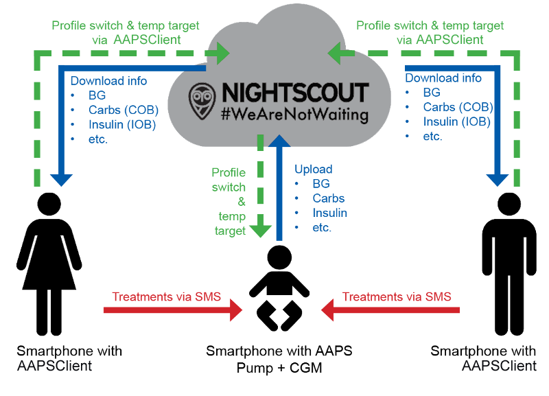

# Volgen op afstand

__AAPS__ heeft verschillende functies om kinderen met diabetes type 1 op afstand te volgen. Het maakt ook commando's op afstand mogelijk, die instructies op afstand naar __AAPS__ sturen. Op dezelfde manier kun je __AAPSClient__ ook gebruiken om de __AAPS__ van je partner of vriend op afstand te volgen.

## Functies

- De pomp van het kind wordt bestuurd door de telefoon van het kind met __AAPS__.
- Verzorgers kunnen op afstand alle belangrijke gegevens volgen, zoals glucosewaarden, actieve koolhydraten, actieve insuline enz., met de **AAPSClient apk** op hun Android-telefoon (een iPhone-versie van **AAPSClient** is in ontwikkeling, zie [AAPSClient](AapsClient.md)). Instellingen die in __AAPS__ worden gewijzigd, worden gesynchroniseerd met __AAPSClient__ en omgekeerd.
- Verzorgers kunnen alarmen krijgen met de **xDrip-app in volgmodus (follower mode)** op hun Android-telefoon, als de xDrip companion-modus is ingesteld.
- Bediening van __AAPS__ op afstand met [SMS-commando's](../RemoteFeatures/SMSCommands.md) is beveiligd met tweestapsverificatie.
- Bediening op afstand via __AAPSClient__ gebruikt het ondertekende commandokanaal dat in **AAPS** 4 is ingevoerd: de client moet eerst met de master **gekoppeld** zijn (met een QR-code of een pincode), en elk commando wordt door de master bevestigd en uitgevoerd. Elke telefoon van een verzorger kan een eigen [rol](#client-master-control-roles) krijgen, van alleen lezen tot volledige besturing — zie [Master ↔ Client besturing](#client-master-control).

## Hulpmiddelen en apps voor controle op afstand

- [Nightscout](https://nightscout.github.io/) in een webbrowser (vooral weergave van gegevens).
- [__AAPSClient__](AapsClient.md) is een uitgeklede versie van __AAPS__. Het kan de master __AAPS__ volgen en, zodra het **gekoppeld** is, commando's op afstand sturen: koolhydraten, __Tijdelijke streefdoelen__, __Profiel wisselingen__ en zelfs bolussen (zie [Master ↔ Client besturing](#client-master-control)). Er zijn 3 apps: [AAPSClient, AAPSClient2 & AAPSClient3 om te downloaden](https://github.com/nightscout/AndroidAPS/releases/), zodat een verzorger tot drie verschillende personen kan volgen vanaf dezelfde telefoon (bijv. twee kinderen met type 1, elk met een eigen Nightscout-account en een eigen master __AAPS__).
- Dexcom Follow als je de originele Dexcom-app gebruikt (alleen BG-waarden).
- [xDrip](../CompatibleCgms/xDrip.md) in volgmodus (vooral BG-waarden en **alarmen**).
- [Sugarmate](https://sugarmate.io/) of [Spike](https://spike-app.com/) op iOS (vooral BG-waarden en **alarmen**).
- Sommige gebruikers vinden een hulpmiddel voor volledige externe toegang, zoals [TeamViewer](https://www.teamviewer.com/), behulpzaam voor het geavanceerd oplossen van problemen op afstand.

## Smartwatch opties

Een smartwatch kan heel handig zijn om __AAPS__ te beheren bij kinderen met diabetes type 1. Er zijn een paar verschillende mogelijkheden:

- Optie 1 - Als __AAPSClient__ op de telefoon van de verzorger staat, kun je de [AAPSClient WearOS-app](https://github.com/nightscout/AndroidAPS/releases/) installeren op een compatibele smartwatch die met de telefoon van de verzorger verbonden is. Deze toont de huidige __BG__, de loopstatus en de bolusgeschiedenis. Je kunt er koolhydraten mee invoeren en __Tijdelijke streefdoelen__ en __Profiel__wijzigingen instellen. Als de client met de master **gekoppeld** is, kan het horloge ook een **bolus** starten: het commando gaat via de client naar de master, die het bevestigt en afgeeft (zie [Master ↔ Client besturing](#client-master-control)).
- Optie 2 - Je kunt ook de [AAPS WearOS-app](../WearOS/WearOsSmartwatch.md) bouwen en installeren op een compatibele smartwatch. Deze is verbonden met de telefoon van het kind, maar wordt door de verzorger gedragen. Dit omvat alle functies hierboven en daarnaast de mogelijkheid om direct insuline te bolussen, zonder dat je de telefoon van het kind hoeft te pakken.
- Optie 3 - Alleen weergave: een horloge dat **AAPS** niet direct ondersteunt (Xiaomi, Amazfit, of een Wear OS-horloge met een complicatie) kan glucose, IOB, COB en loopstatus tonen via een companion-app zoals WatchDrip+ of GlucoDataHandler. Die app krijgt de gegevens van de plugin **Externe Companion Apps** op de **AAPS**- of **AAPSClient**-telefoon waarmee het horloge verbonden is. Zie [Externe Companion Apps](#watches-external-companion-apps).

## Waar je aan moet denken

- Houd rekening met de vertraging tussen master en volger door de tijd voor uploaden en downloaden, en met het feit dat de __AAPS__ master-telefoon pas uploadt nadat de loop is uitgevoerd.
- Wat is je noodplan als bediening op afstand niet werkt (_bijv._ netwerkproblemen of verbroken Bluetooth-verbinding)? Denk altijd na over wat er met **AAPS** gebeurt als je plotseling geen nieuw commando meer kunt sturen. **AAPS** overschrijft de basaal, ISF en ICR in de pomp met de waarden van het huidige profiel. Gebruik alleen tijdelijke profielwissels (_d.w.z._ met een ingestelde duur) als je naar een sterker insulineprofiel wisselt, voor het geval je verbinding op afstand wegvalt. Dan gaat de pomp terug naar het oorspronkelijke profiel als de tijd voorbij is.
