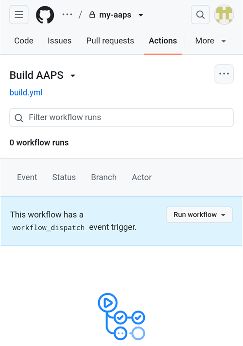

(aaps-builder)=

# Bouwen in de browser met AAPS Builder

```{note}
Dit is de aanbevolen manier om AAPS te bouwen vanaf een **Android-telefoon**. Het werkt ook vanuit elke browser op een computer. Voor de andere manieren om te bouwen vanaf een computer of een iPhone, zie het overzicht [Bouwen in de browser](BrowserBuild.md).
```

```{contents} In this page
:backlinks: entry
:depth: 2
```

**AAPS Builder** bouwt de AAPS-app voor je in GitHub, de gratis website voor het bewaren van code. Je hoeft niets op je telefoon te installeren en geen voorbereidingsbestand te openen.

A setup page walks you through it. De eerste keer duurt het ongeveer 10 minuten:

1. Create your own **private copy** of AAPS Builder in your GitHub account: the setup page opens GitHub with everything filled in, you only confirm. The build workflow, the file that tells GitHub how to build AAPS, is already in it.
2. Create or upload your **signing key** (the keystore).
3. Give the key to your repository as a GitHub **secret**.
4. **Build** the app. One build takes 15 to 30 minutes.
5. **Download and install** the app on your phone.

Je hoeft AndroidAPS **niet** te forken: de broncode van AAPS wordt bij elke build gedownload uit de officiële AndroidAPS-repository. Je hebt ook **geen** Google Drive nodig: je downloadt de app direct van GitHub.

```{admonition} Where the code comes from
:class: note

The build workflow is maintained by the AAPS developers in the [nightscout/aaps-builder](https://github.com/nightscout/aaps-builder) repository, and your repository is a copy of it. The [workflow](https://github.com/nightscout/aaps-builder/blob/main/.github/workflows/build.yml) in your copy is short: it runs the [build steps](https://github.com/nightscout/aaps-builder/blob/main/.github/workflows/aaps-builder.yml) kept in that repository, so improvements reach you without any change to your repository. You can read both files. Tijdens het bouwen downloadt de workflow alleen de officiële AAPS-broncode en de eigen buildtools van GitHub. Je keystore verlaat nooit je browser en je privé-repository.
```

(aaps-builder-before-you-start)=

## Voordat je begint

Je hebt nodig:

- Een **GitHub-account** (gratis). Als je er nog geen hebt, maak er dan eerst een aan op [github.com](https://github.com/signup).
- Een **webbrowser**: Chrome op je telefoon, of een willekeurige browser op een computer. Log in die browser in op github.com voordat je begint.
- **Heb je de GitHub-app op je telefoon?** Die mag je houden. Sommige knoppen van de instellingspagina openen dan de app in plaats van Chrome. Building works in the app, but the app **cannot download** the finished AAPS: [step 5](#aaps-builder-step5) shows how to switch to Chrome for the download.
- Je **bestaande keystore** (`.jks`-bestand), het wachtwoord en de alias ervan, als je AAPS al eerder gebouwd hebt en het wilt bijwerken zonder opnieuw te installeren.

```{warning}
**Je build-repository moet privé blijven.** Alles wat een build maakt, is zichtbaar voor iedereen die de repository kan zien. De instellingspagina maakt een privé-repository voor je aan. Never change it to public, and don't **fork** AAPS Builder instead: a fork is always public.

Een privé-repository krijgt elke maand 2000 gratis GitHub Actions-minuten. Dat is genoeg voor meerdere builds.
```

```{warning}
**Nieuwe sleutel of bestaande sleutel: dit bepaalt of je AAPS kunt bijwerken.**

- **Je hebt AAPS al op je telefoon, gebouwd met een keystore die je nog hebt**: kies **I already have a keystore** op de instellingspagina en upload hem. Je volgende build werkt AAPS dan bij zonder opnieuw te installeren. AAPS gebouwd met de vorige manier van bouwen in de browser (je eigen fork)? Je keystore staat in je fork: [maak er eerst een kopie van](#aaps-builder-from-fork).
- **Je bouwt AAPS voor de eerste keer, of je bent je keystore of het wachtwoord kwijt**: kies **Create a new key**. Een app die met een nieuwe sleutel is ondertekend, **kan een AAPS die met een andere sleutel is ondertekend niet bijwerken**. Je moet je instellingen exporteren, het bestand naar een plek buiten je telefoon kopiëren, de oude AAPS verwijderen, de nieuwe installeren en daarna je instellingen importeren: zie [AAPS opnieuw installeren met een nieuwe keystore](#reinstall-aaps).

Blijf daarna altijd dezelfde sleutel gebruiken. Als je een nieuwe sleutel maakt, download dan de back-up die de pagina aanbiedt en bewaar die samen met het wachtwoord en de alias (`key0`) op een veilige plek buiten je telefoon.
```

(aaps-builder-from-fork)=

## Overstappen van de vorige manier van bouwen in de browser (fork)

Sla dit deel over als je AAPS nooit hebt gebouwd met de vorige manier van bouwen in de browser (je eigen kopie, of fork, van AndroidAPS in GitHub, met het voorbereidingsbestand en Google Drive).

Je keystore staat als secrets in je fork. GitHub toont een secret nooit opnieuw, dus je kunt het niet naar je nieuwe repository kopiëren. Get a copy of your keystore first, then use it in [step 2](#aaps-builder-step2) with **I already have a keystore**.

```{warning}
Kies niet **Create a new key**. AAPS die met een nieuwe sleutel gebouwd is, kan de AAPS op je telefoon niet bijwerken.
```

Welke situatie is de jouwe?

- **Je hebt Optie 2 gebruikt** (je hebt je eigen keystore uit Android Studio geüpload), en je hebt het `.jks`-bestand, de wachtwoorden en de alias nog: dan hoef je hier niets te doen. Use that file in step 2.
- **Je hebt Optie 1 gebruikt** (het voorbereidingsbestand heeft je sleutel gemaakt), of je hebt je keystore-bestand niet meer: exporteer hem dan uit je fork zoals hieronder.

Zo exporteer je je keystore uit je fork:

1. Open in je fork **Settings** → **Secrets and variables** → **Actions** en voeg een secret toe met de naam `ZIP_PASSWORD`. Kies een wachtwoord met alleen Engelse letters en cijfers. Het beschermt het bestand dat je zo gaat maken.
2. Open het tabblad **Actions** van je fork, tik op **CI Keystore Export** en dan op **Run workflow**. Meer details: [Je keystore exporteren](#ci-keystore-export).
3. Als de run een groen vinkje heeft, open dan je Google Drive: het bestand `keystore.zip` staat in de map **AAPS** → **KeyStore**. Als de run mislukt bij de stap voor Google Drive, dan is de toegang van je fork tot Google Drive verlopen: zie [Google refresh token verlopen](#aaps-ci-google-token-expired).
4. Download `keystore.zip` en open het met je `ZIP_PASSWORD`: op een computer, of op je telefoon met een bestandsbeheer-app die ZIP-bestanden met een wachtwoord kan openen. Het bevat:
   - `keystore.jks`: je keystore,
   - `keyStoreInfo.txt`: je `KEYSTORE_PASSWORD`, `KEY_PASSWORD` en `ALIAS` (meestal `key0`).
5. Kopieer `keystore.jks` naar je telefoon (of naar Google Drive, zodat je hem daar kunt kiezen).

In [step 2](#aaps-builder-step2) of the setup page:

1. Tik op **I already have a keystore**.
2. Kies bij **Keystore file** het bestand `keystore.jks`.
3. Typ bij **Keystore password** het `KEYSTORE_PASSWORD` uit `keyStoreInfo.txt`.
4. Kies of typ bij **Key alias** de `ALIAS` uit `keyStoreInfo.txt`.
5. Als `KEY_PASSWORD` anders is dan `KEYSTORE_PASSWORD`, zet dan het vinkje bij **Key password is the same as the keystore password** uit en typ het `KEY_PASSWORD`.

Bewaar `keystore.zip` en het `ZIP_PASSWORD` op een veilige plek buiten je telefoon: het is de back-up van je sleutel.

To also save the builds of AAPS Builder in Google Drive, do [step 6](#aaps-builder-google-drive): the setup page gets a new `GDRIVE_OAUTH2` for you. Je kunt je fork houden tot AAPS die met AAPS Builder gebouwd is op je telefoon geïnstalleerd is.

## Open de instellingspagina

**→ [Open de instellingspagina van AAPS Builder](#aaps-builder-setup)**

The setup page is part of this documentation, in your language. Keep this page open in another tab as well: the sections below explain each step of the setup page in more detail, with screenshots.

De instellingspagina opent elke GitHub-pagina in een nieuw tabblad van Chrome. Om terug te gaan naar de instellingspagina, tik je op de tabbladknop naast de adresbalk van Chrome (het vierkantje met een getal) en kies je de instellingspagina van AAPS Builder.

De instellingspagina werkt helemaal in je browser: je sleutel en wachtwoorden worden nergens naartoe gestuurd, behalve naar het GitHub-secret waarin je ze zelf plakt. Alleen je GitHub-gebruikersnaam wordt naar GitHub gestuurd, om te controleren of die bestaat. De pagina onthoudt je GitHub-gebruikersnaam en de naam van je repository. Zo kun je er altijd naar terugkeren om je secrets-pagina of je builds opnieuw te openen.


(aaps-builder-step1)=

## Stap 1 – Maak je privé build-repository

This step creates your own private copy of AAPS Builder in your GitHub account, with the build workflow already in it. Alleen jij kunt hem zien, en ook de apps die hij bouwt.

1. Zorg dat je in deze browser bent ingelogd op github.com.

2. Typ bij **Your GitHub username** je GitHub-gebruikersnaam, niet je e-mailadres. De pagina controleert die bij GitHub: **✓ GitHub user found** betekent dat hij juist is.

3. Laat bij **Name of your repository** de voorgestelde naam `my-aaps` staan. Als je je repository al met een andere naam gemaakt hebt, typ dan precies die naam.

   ```{note}
   **Already have an AAPS Builder repository** (made with an earlier version of the setup page)? Don't create a new one: type its exact name, skip **Create my private repository**, and update its workflow once as explained in [Updating AAPS](#aaps-builder-updates). Your secrets stay as they are. If you want a new repository anyway, choose a name you don't have yet, for example `my-aaps-2`, and use the same keystore in step 2.

   Don't type the name of your fork of AndroidAPS: a fork is public, and it already builds with its own **AAPS CI** workflow.
   ```

   

4. Controleer de regel **Your repository:**. Daar staat `github.com/<your username>/my-aaps`. The setup page remembers the name from your last visit: check it every time before you use its buttons.

5. Tik op **Create my private repository**.

   

6. GitHub opens **Create a new repository** in a new tab. Everything is already filled in: under **Start with a template**, the template `nightscout/aaps-builder` with **Include all branches** off, and under **General**, your account as **Owner** and the name you chose.

   

   Don't change anything.

7. Scroll down: under **Configuration**, **Choose visibility** is already **Private**. Tap the green **Create repository** button.

   

   GitHub shows your new repository: it contains a folder `.github` (with the build workflow) and a file `README.md`. **Ga terug naar het tabblad van de instellingspagina** voor stap 2: tik op de tabbladknop naast de adresbalk van Chrome en kies de instellingspagina.

```{warning}
**Your new repository is empty**, with no files? It was not created from the template, and it cannot build. Delete it (**Settings** → bottom of the page → **Delete this repository**), then tap **Create my private repository** on the setup page again.
```

(aaps-builder-step2)=

## Step 2 – Your signing key

De app moet met je eigen sleutel ondertekend worden. Kies een van de twee tabbladen. Lees eerst de [waarschuwing over een nieuwe of bestaande sleutel](#aaps-builder-before-you-start).


### I already have a keystore (ik heb al een keystore)

1. Tik op **I already have a keystore**.
2. Kies bij **Keystore file** je `.jks`-bestand (of `.keystore`, `.p12`, `.pfx`). Op een telefoon: kopieer het bestand eerst naar je telefoon of naar Google Drive.
3. Typ bij **Keystore password** het wachtwoord van de keystore.
4. Kies bij **Key alias** je alias uit de lijst, of typ hem als er geen lijst is. Voor keystores die met Android Studio gemaakt zijn, is dit meestal `key0`.
5. Als je sleutelwachtwoord anders is dan het keystore-wachtwoord, zet dan het vinkje bij **Key password is the same as the keystore password** uit en typ het sleutelwachtwoord.
6. Tik op **Check and continue**.

De pagina controleert het wachtwoord en de alias op je apparaat. **Keystore OK! Continue with step 3.** means everything is right. Als er staat dat het wachtwoord gecontroleerd wordt tijdens het bouwen, ga dan toch verder: de build laat je weten als er iets fout is.

### Create a new key (een nieuwe sleutel maken)

1. Tik op **Create a new key**.

2. Kies een wachtwoord en typ het twee keer. Regels: minstens 8 tekens, alleen de letters a–z en A–Z, de cijfers 0–9 en symbolen zoals `! ? #`. Geen spaties, geen letters met accenten en niet het teken `|`.

3. Tik op **Create key**. Het duurt een paar seconden voordat **Key created** verschijnt.

   

4. Tik op **Download backup (aaps-keystore.jks)**. Als Chrome vraagt **Bestand opnieuw downloaden?** (Download file again?), dan staat er al een oudere back-up met dezelfde naam op je telefoon: tik op **Opnieuw downloaden** (Download again). Chrome slaat de nieuwe sleutel dan op als `aaps-keystore (1).jks`: dat is het bestand dat bij deze sleutel hoort. Bewaar het en verwar het niet met het oudere bestand.

   Bewaar deze drie samen op een veilige plek buiten je telefoon (bijvoorbeeld in je eigen cloudopslag):

   - het bestand `aaps-keystore.jks`,
   - je wachtwoord,
   - de alias van de sleutel: **`key0`**.

   Je hebt alle drie nodig als je AAPS ooit op een andere manier bouwt, bijvoorbeeld met Android Studio. Sleutels die met een eerdere versie van de instellingspagina gemaakt zijn, hebben de alias `aaps`.

   

(aaps-builder-step3)=

## Step 3 – Give the key to your repository

Step 3 unlocks when step 2 is done. Je sleutel, de wachtwoorden en de alias worden samengevoegd tot één waarde: het secret `KEYSTORE_SET`.

1. Tik op **Open the secrets page**.


2. GitHub opent de pagina **New secret** van je repository. Op een telefoon staat die onder het instellingenmenu: scrol naar beneden.


3. Ga naar het tabblad van de instellingspagina en tik op **Copy name**. Ga terug naar het GitHub-tabblad en plak het in het kleine veld **Name**. De naam is `KEYSTORE_SET`.

4. Ga naar het tabblad van de instellingspagina en tik op **Copy secret**. Ga terug naar het GitHub-tabblad en plak het in het grote vak **Secret** (op een telefoon lang drukken). Het secret is een heel lange code van duizenden tekens: de instellingspagina toont de eerste tekens ervan naast de knop. Plak daar niet het woord `KEYSTORE_SET`.

5. Tik op **Add secret**. `KEYSTORE_SET` staat nu onder **Repository secrets**.


Dit hoef je maar één keer te doen.

```{tip}
GitHub toont **Page not found** (404)? Controleer eerst of je in deze browser bent ingelogd op github.com: GitHub toont 404 voor privé-repositories als je niet bent ingelogd. Anders komt de gebruikersnaam of de naam van de repository in stap 1 niet overeen met je repository. Controleer de naam op github.com, verbeter hem in stap 1 en tik nog een keer op de knop.
```

(aaps-builder-step4)=

## Step 4 – Build the app

1. Tik op de instellingspagina op **Open the build page**. GitHub opent de pagina **Build AAPS** van je repository.

   

   Als in plaats daarvan de **GitHub-app** opent: tik op **RUN WORKFLOW**, controleer de versie en de variant, en tik nog een keer op **RUN WORKFLOW**. De app kan nog steeds **Nothing to see here** tonen: trek de lijst naar beneden om hem te vernieuwen en je build te zien. Ga daarna verder met stap 4 hieronder.

2. Als GitHub erom vraagt, tik dan op de groene knop om workflows aan te zetten.
3. Tik op **Run workflow**. Er opent een klein formulier:
   - **Version**: keep `latest` to build the newest AAPS release, or type a release number such as `4.0.0`.
   - **Variant**: laat `fullRelease` staan voor normaal gebruik met een pomp. De andere varianten worden uitgelegd bij [buildvarianten](#browserbuild-variant). `aapsclient3Release` bouwt **AAPSClient3**, beschikbaar vanaf **AAPS**-versie 4.0 (zie [Over AAPSClient, AAPSClient2 en AAPSClient3](#remotecontrol-aapsclient-versions)).
   - Tik op de groene knop **Run workflow**.

   

4. De build start en toont **In progress**, met twee delen: eerst **AAPS / Check**, dan **AAPS / Build AAPS**.

   

5. Wacht 15 tot 30 minuten. Een groen vinkje betekent dat de build klaar is. Een rood kruis betekent dat het mislukt is: open de build om de melding te lezen en bekijk dan [probleemoplossing](#aaps-builder-troubleshooting).

   

   ```{tip}
   **E-mail als een build klaar is:** GitHub stuurt je alleen een e-mail als een build mislukt. Om ook een e-mail te krijgen als hij lukt: open op github.com je profielfoto → **Settings** → **Notifications** → **System** → **Actions** en zet het vinkje bij **Only notify for failed workflows** uit.
   ```

Als er geen knop **Build AAPS** of **Run workflow** is:

- Open your repository and check that it has a folder `.github` with the file `workflows/build.yml`. If the repository is empty, it was not created from the template: delete it (**Settings** → bottom of the page → **Delete this repository**) and do [step 1](#aaps-builder-step1) again with the button.
- Open het tabblad **Actions**. Als er staat dat workflows uitgeschakeld zijn, tik dan op de groene knop om ze aan te zetten en tik daarna op **Build AAPS** in de lijst.

(aaps-builder-step5)=

## Step 5 – Install the app on your phone

```{warning}
**Voor elke update**: [exporteer je instellingen](#ExportImportSettings-Automating-Settings-Export) in AAPS en kopieer het bestand **naar een plek buiten de telefoon** (Google Drive, Dropbox…). Bewaar daar ook een paar oudere exports en de APK-bestanden, zodat je altijd terug kunt.
```

1. Open de instellingspagina op je telefoon in **Chrome**. Log in op github.com als daarom gevraagd wordt.
2. Tik op **Open my builds** en dan op de nieuwste build met een groen vinkje.

   ```{admonition} The GitHub app opened instead of Chrome?
   :class: note

   De GitHub-app kan geen builds downloaden. Open in de app de nieuwste build en tik dan op **Artifacts ↗**, of tik bovenaan op het deelpictogram en kies **Chrome** (of **Link kopiëren**, en plak de link dan in de adresbalk van Chrome). De build opent in Chrome: ga daar verder met de volgende stap.

   Zo zorg je dat GitHub-links niet meer in de app openen: Android **Instellingen** → **Apps** → **GitHub** → **Standaard openen** → zet **Ondersteunde links openen** uit.
   ```

   

3. Scrol naar beneden naar de samenvatting van de build en tik op de link **Download AAPS**.

   

   ```{tip}
   Scrol met je vinger op de tekst, niet op het schema van de buildstappen: anders beweegt het schema in plaats van de pagina.
   ```

   Je kunt ook verder naar beneden scrollen naar **Artifacts** en op het downloadpictogram naast `aaps-….apk` tikken.

   

4. Als het downloaden klaar is, open dan het menu van Chrome **⋮** → **Downloads**, tik op `aaps-….apk` en kies **Installeren**. Als erom gevraagd wordt, sta dan het installeren van apps uit deze bron toe.

   

`aaps-wear-….apk` is de app voor de smartwatch. Sla deze over als je geen smartwatch gebruikt.

De app blijft **14 dagen** op de buildpagina staan. Hij staat niet onder **Code** in je repository. Kopieer hem naar een veilige plek buiten je telefoon, samen met je geëxporteerde instellingen.

Voor meer manieren om de app te installeren, zie [AAPS overzetten en installeren](TransferringAndInstallingAaps.md).

```{note}
Vanaf september 2026 kan Google's [Android developer verification](#android-developer-verification) het installeren van de APK door op het bestand te tikken blokkeren, afhankelijk van je land. Gratis oplossingen worden op die pagina uitgelegd.
```

(aaps-builder-google-drive)=

## Step 6 (optional) – Also save the app in Google Drive

Je kunt elke build ook laten opslaan in je Google Drive, in de map `AAPS/<version>`. Dit is optioneel: de app is altijd beschikbaar op de buildpagina.

Hiervoor is nog één secret nodig: `GDRIVE_OAUTH2`. Step 6 of the setup page gets it from Google for you, on a phone or a computer. **AAPS** can then only see and change the files it creates in your Google Drive, nothing else.

1. On the setup page, tap **Connect Google Drive**. Google opens in a new tab.
2. Choose your Google account and allow access. If Google says the app is not verified, tap **Advanced**, then **Go to …**.
3. The new tab then shows an error such as **This site can't be reached** or **127.0.0.1 refused to connect**. **This is expected:** Google's answer is in the address of that tab. Tap the address bar, select the whole address (it starts with `http://127.0.0.1:47913/`) and copy it.
4. Go back to the setup page tab within a few minutes: Google's answer is only valid for a short time, and only once. Paste the address into **Paste the copied address here** and tap **Get GDRIVE_OAUTH2**. The page shows **GDRIVE_OAUTH2 is ready**.
5. Tik op **Open the secrets page**. Tik op **Copy name** en plak het in het kleine veld **Name** (de naam is `GDRIVE_OAUTH2`). Tap **Copy secret**, paste it into the big **Secret** box and tap **Add secret**.

Vanaf de volgende build worden de APK's ook in Google Drive opgeslagen.

Already have a `GDRIVE_OAUTH2` value from the preparation file of the other browser build methods? It works too: add it as the `GDRIVE_OAUTH2` secret.

Google stopt de toegang als je 6 maanden niet bouwt, of als je je Google-wachtwoord wijzigt. De build laat je dat dan weten: doe deze stappen dan opnieuw. Zie [Google refresh token verlopen](#aaps-ci-google-token-expired).

(aaps-builder-updates)=

## AAPS bijwerken

Je repository bouwt nooit iets uit zichzelf: jij bepaalt wanneer je bouwt, welke versie en welke variant. Als er een nieuwe AAPS-versie uitkomt:

1. [Back up your settings](#aaps-builder-step5) as explained in step 5.
2. Build the new version as in [step 4](#aaps-builder-step4). Laat `latest` staan, of typ het releasenummer.
3. Download and install it as in [step 5](#aaps-builder-step5).

**Updates of the build steps** reach you by themselves: at every build, your repository runs the build steps released by the AAPS developers in nightscout/aaps-builder. Nothing changes in your repository, and there is no automatic build.

**Updates of your workflow file** are rare: only when the **Run workflow** form changes, for example for a new build variant, or once if your repository was made with an earlier version of the setup page (an empty repository with a short workflow file) or from the old template. The [Docs updates & changes](../Maintenance/DocumentationUpdate.md) page says so. Your `KEYSTORE_SET` secret stays as it is. On the setup page, open **Updating your copy** at the end of step 1:

1. Tap **Open the newest workflow**. On a computer, click the **copy icon** ("Copy raw file") at the top right of the file. On a phone, open the **plain-text version** instead, press and hold the text, then **Select all** and **Copy**.
2. Tap **Open my workflow file**.
3. Replace the whole text with the copied workflow (long press on a phone: **Select all**, then **Paste**).
4. Tap **Commit changes…**, then **Commit changes**.

The first line of the file shows its version.

(aaps-builder-troubleshooting)=

## Probleemoplossing

To see why a build failed, [read the build log](#aaps-ci-read-the-logs): the step names are different, but you find the error the same way. You can also [update a secret](#aaps-ci-update-secret) and [run the build again](#aaps-ci-rerun) the same way.

- **No "Build AAPS" or "Run workflow" button, or the repository is empty**: the repository was not created from the template. Delete it (**Settings** → bottom of the page → **Delete this repository**) and do [step 1](#aaps-builder-step1) again with the **Create my private repository** button.
- **De build stopt met "This repository is PUBLIC"**: open in je repository **Settings** → **General** → **Danger Zone** → **Change visibility** → **Private** en bouw opnieuw.
- **"Secret KEYSTORE_SET is missing"**: do step 3 of the setup page.
- **"The secret is too short"**, **"The secret is not a valid code"** of **"The secret does not contain a keystore"**: er is verkeerde tekst in het secret geplakt, vaak het woord `KEYSTORE_SET` zelf, of maar een deel van de code. In your repository, open **Settings** → **Secrets and variables** → **Actions**, edit `KEYSTORE_SET` and paste the long code from **Copy secret** again (redo step 2 of the setup page first if you closed it).
- **"Keystore, password or alias is wrong"**: check your keystore's password and alias, then redo steps 2 and 3 of the setup page.
- **"Version … does not exist"**: de versie die je typte is geen AAPS-release. Gebruik `latest`, of controleer het releasenummer.
- **"Variant … is not supported"**: your workflow file is an older version. Replace it as explained in [Updating AAPS](#aaps-builder-updates).
- **"Page not found" (404) als de instellingspagina GitHub opent**: log in op github.com in dezelfde browser (GitHub toont 404 voor privé-repository's als je niet bent ingelogd). Als je wel bent ingelogd, dan komt de gebruikersnaam of de naam van de repository in stap 1 van de instellingspagina niet overeen met je repository. Typ de precieze namen.
- **"No GitHub user with this name"** in stap 1: typ je GitHub-gebruikersnaam zoals die in je GitHub-profiel staat, niet je e-mailadres.
- **Geen link Download, of de GitHub-app ging open**: de GitHub-app kan geen builds downloaden. Open the build in Chrome as explained in [step 5](#aaps-builder-step5). Zo zorg je dat GitHub-links niet meer in de app openen: Android **Instellingen** → **Apps** → **GitHub** → **Standaard openen** → zet **Ondersteunde links openen** uit.
- **"Google Drive access has expired or was revoked"**: redo [step 6](#aaps-builder-google-drive) and update the `GDRIVE_OAUTH2` secret.

For other GitHub and Google Drive issues, see [Browser build troubleshooting](../GettingHelp/BrowserBuildTroubleshooting.md).

```{toctree}
:hidden:

AAPS Builder setup page <BrowserBuildAapsBuilderSetup.md>
```
