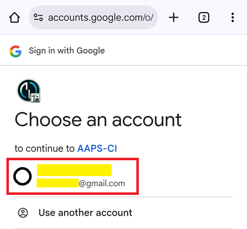

(aaps-ci-google-drive-auth)=

# Bouwen in de browser – Stap 3: Google Drive autoriseren

```{note}
Dit is **Stap 3** van [Bouwen in de browser](BrowserBuild.md). Rond eerst [Stap 2 – Je keystore voor ondertekening maken](BrowserBuildKeystore.md) af.
```

```{warning}
Welke van de vorige instructies je ook hebt gevolgd (Optie 1 of Optie 2), je MOET de autorisatie voor Google Drive toevoegen om met succes in de browser te kunnen bouwen.
```

Let op: als je dit deel al in de video hebt gedaan, kun je nu doorgaan naar [Stap 4 – De APK bouwen](BrowserBuildAPK.md).

```{warning}
Als de Google-autorisatie niet start of de voorbereidingspagina een fout geeft: sluit de voorbereidingspagina, open `aaps-ci-preparation.html` opnieuw op dezelfde manier als in Stap 2 en begin deze stap opnieuw. Zie [probleemoplossing](#aaps-ci-preparation-web).
```

Ga terug naar het tabblad met de voorbereidingspagina.

Scrol omlaag naar het deel Google Drive Auth en tik op Start Auth.


Kies je Google-account.



Scrol omlaag en geef de toegang. De webpagina heeft die nodig om de authenticatiesleutel voor Google Drive te krijgen.

Tik op Doorgaan (Continue).


Het veld `GDRIVE_OAUTH2` wordt ingevuld. Tik op de bovenste knop Copy.


Ga terug naar het tabblad van GitHub.

Scrol omlaag naar Repository secrets en tik op New repository secret.

Als je Optie 1 hebt gevolgd, zie je dit:


Als je Optie 2 hebt gevolgd, zijn er meer sleutels:


Plak in het veld Name de tekst die je net hebt gekopieerd. Houd je vinger lang op het tekstvak om het menu voor plakken te tonen.


Ga naar het tabblad met de voorbereidingspagina.

Tik op de tweede knop Copy.


Ga terug naar het tabblad van GitHub.

1. Plak in het veld Secret de tekst die je net hebt gekopieerd. Houd je vinger lang op het tekstvak om het menu voor plakken te tonen.

2. Tik op Add secret.


Je hebt nu twee (optie 1) of vijf (optie 2) secrets.


GitHub kan het AAPS apk-bestand nu na het bouwen in je Google Drive opslaan.

----

**Volgende: [Stap 4 – De APK bouwen](BrowserBuildAPK.md) →**
