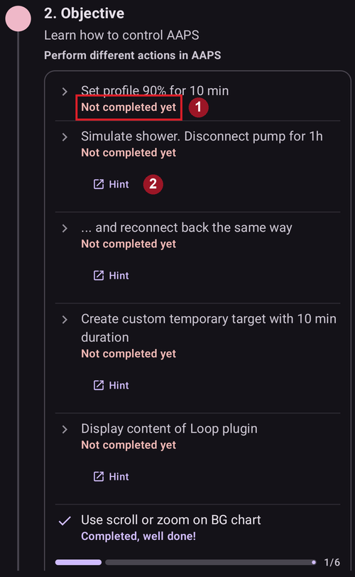

# De Doelen voltooien

**AAPS** heeft een reeks **Doelen** die je moet voltooien. Ze helpen je stap voor stap van een eenvoudige open loop naar een hybride gesloten loop en alle functies van **AAPS**. Door de **Doelen** te voltooien zorg je ervoor dat je:

* alles goed hebt ingesteld in je **AAPS**-installatie;
* de belangrijkste functies van **AAPS** hebt geleerd; en
* een basiskennis hebt van wat je systeem kan, zodat je met vertrouwen **AAPS** gebruikt.

Als **AAPS** voor de eerste keer is geïnstalleerd, moet je elk doel voltooien voordat je verder kunt naar het volgende. Nieuwe functies worden stap voor stap vrijgegeven naarmate je verder komt in de **Doelen**.

**Doelen 1 tot 8** begeleiden je van het instellen van **AAPS** op je smartphone tot een “eenvoudige” hybride gesloten loop. Dit duurt ongeveer 6 weken. Je kunt tot en met **Doel 5** werken met een virtuele pomp (en in de tussentijd op een andere manier insuline toedienen). **Doelen 9 en 10** testen meer geavanceerde functies van **AAPS**, met als doel een betere controle van je diabetes. Het duurt tot 3 maanden om ze te voltooien, misschien langer. Meer informatie over hoeveel tijd elk deel ongeveer kost vind je hier: [Hoe lang duurt het?](#preparing-how-long-will-it-take)

Naast verder gaan met de **Doelen** kun je, als dat nodig is, ook je voortgang wissen en [teruggaan naar een eerder doel](#go-back-in-objectives).

## Maak een back-up van je instellingen

```{admonition} Note
:class: note

Het is aan te raden om na elk voltooid **Doel** je **AAPS**-instellingen te exporteren!
```

Het wordt sterk aangeraden om na elk voltooid doel [je instellingen te exporteren](../Maintenance/ExportImportSettings.md), zodat je geen voortgang in **AAPS** verliest. Het exporteren maakt een **instellingenbestand** (.json). Bewaar een back-up hiervan op één of meer veilige plaatsen (bijv. Google Drive, harde schijf, e-mailbijlage _enz._). Zo weet je zeker dat je voortgang in **AAPS** bewaard is. Als je je telefoon kwijtraakt of per ongeluk je voortgang wist, kun je het json-bestand opnieuw in **AAPS** laden door een recent instellingenbestand te importeren. Een back-up van het **instellingenbestand** heb je ook nodig als je om welke reden dan ook een nieuwe **AAPS**-smartphone nodig hebt (nieuwe telefoon, verloren of kapotte telefoon _enz._)

Het **instellingen**bestand bewaart niet alleen je voortgang in de **Doelen**, maar ook al je **AAPS**-instellingen, zoals **max bolus** _enz._

Als je geen back-up van je instellingen hebt en er gebeurt iets met je **AAPS**-smartphone, moet je de **Doelen** opnieuw vanaf het begin doen. Het doorlopen van de **Doelen** kost tijd. Ze opnieuw moeten doen, bijvoorbeeld omdat je je smartphone kwijt bent, wil je liever voorkomen.

(objectives-objective1)=
## Doel 1: Visualisatie en monitoring instellen, basaal en ratio's analyseren

Bij **Doel 1** stel je de technische basis van **AAPS** in. Je kunt pas verder als deze stap klaar is.

- Kies de juiste CGM/FGM in [Configuratie → BG bron](#Config-Builder-bg-source). Zie [BG bron](../Getting-Started/CompatiblesCgms.md) voor meer informatie.
- Kies de juiste pomp in [Configuratie → Pomp](#Config-Builder-pump), zodat je pomp met **AAPS** kan communiceren. Kies **virtuele pomp** als je een pompmodel gebruikt zonder **AAPS**-driver voor loopen, of als je de eerste **Doelen** wilt doorlopen terwijl je een ander systeem gebruikt om insuline toe te dienen. Zie [insulinepomp](../Getting-Started/CompatiblePumps.md) voor meer informatie.
- Als je Nightscout gebruikt:
  - Volg de instructies op de pagina [Nightscout](../SettingUpAaps/Nightscout.md), zodat **Nightscout** de gegevens van **AAPS** kan ontvangen en tonen.
  - Let op: de URL in **NSClientV3** moet **_zonder_ "/api/v1/"** aan het eind zijn - zie [Instellingen → NSClientV3](#Preferences-nsclient).
- Als je Tidepool gebruikt:
  - Volg de instructies op de pagina [Tidepool](../SettingUpAaps/Tidepool.md), zodat **Tidepool** de gegevens van **AAPS** kan ontvangen en tonen.

Let op - *Misschien moet je wachten tot de volgende sensorwaarde binnenkomt voordat **AAPS** deze herkent.*

(objectives-objective2)=
## Doel 2: Leer hoe AAPS te gebruiken

Voor **Doel 2** moet je verschillende ‘taken’ uitvoeren, zoals te zien is in de schermafbeelding hieronder. Elke taak toont zijn status (**1**): het oranje "**Nog niet voltooid**" verandert in "**Voltooid, goed gedaan!**" zodra **AAPS** de actie heeft geregistreerd. Tik op **Tip** (**2**) onder een taak om de bijbehorende documentatie te openen, als je een bepaalde actie nog niet kent.



Taken om **Doel 2** te voltooien:
- Zet je **Profiel** op 90% voor een duur van 10 min.
  - _Tip_: tik op de naam van je profiel in het hoofdscherm om het scherm **Profiel** te openen. Gebruik daarna de knop **Activeer** (▶) en stel het percentage en de duur in. Meer informatie in [Profiel wissel & Profiel percentage](../DailyLifeWithAaps/ProfileSwitch-ProfilePercentage.md).
  - _Let op_: **AAPS** accepteert geen basaalstanden lager dan 0,05 E/u. Als je **Profiel** standen van 0,06 E/u of lager heeft, moet je eerst een tijdelijk **Profiel** met hogere basaalstanden maken voordat je deze taak doet. Ga na het voltooien van deze taak terug naar je normale **Profiel**.
- Doe alsof je "gaat douchen" door in **AAPS** [de verbinding met je pomp te verbreken](#AapsScreens-loop-status) voor een duur van 1 uur.
  - _Tip_: druk op het loop-pictogram in het hoofdscherm om het Loop-venster te openen. Kies dan een duur onder **Verbreek verbinding met de pomp**.
- Beëindig "douchen" door je pomp weer aan te sluiten.
  - _Tip_: druk op het pictogram "verbinding verbroken" om het Loop-venster weer te openen en kies **Opnieuw verbinden met pomp**.
- Stel een eigen [**Tijdelijk streefdoel**](../DailyLifeWithAaps/TempTargets.md) in met een duur van 10 min.
  - _Tip_: druk op het streefbereik in het hoofdscherm om het scherm voor tijdelijk streefdoel te openen.
- Toon de inhoud van de plugin **Loop**.
  - _Tip_: open **Configuratie → Loop** en tik op "**Plug-in openen**".
- Scroll of zoom in de BG-grafiek om een langere of kortere periode te bekijken.


(objectives-objective3)=
## Doel 3: Bewijs je kennis

Voor **Doel 3** moet je een meerkeuze-examen halen. Dit test je kennis van **AAPS**.

Sommige gebruikers vinden **Doel 3** het moeilijkste doel. Lees de documentatie van **AAPS** naast de vragen. Als je echt vastloopt nadat je de documentatie van **AAPS** hebt gelezen, zoek dan in de [Facebook](https://www.facebook.com/groups/AndroidAPSUsers)- of [Discord](https://discord.gg/4fQUWHZ4Mw)-groep naar "Objective 3" (Doel 3). Waarschijnlijk is jouw vraag al eerder gesteld en door de groep beantwoord. Deze groepen kunnen je vriendelijke tips geven of je naar het juiste deel van de documentatie van **AAPS** verwijzen.

Ondertussen:
- Om het aantal meldingen / beslissingen (tijdelijke basaal) in open loop te beperken, stel je een breed streefbereik in je **Profiel** in, _bijv._ 90 - 150 mg/dl of 5,0 - 8,5 mmol/l.
- Je kunt 's nachts een ruimere bovengrens instellen, of de Open Loop zelfs uitzetten.

Om verder te gaan met **Doel 3**, tik je op een vraag om deze te openen. Lees elke vraag goed en kies je antwoord(en).

Bij elke vraag kan meer dan één antwoord goed zijn! Kies je een fout antwoord, dan wordt de vraag 1 uur geblokkeerd. Daarna kun je de vraag opnieuw beantwoorden. Let op: de volgorde van de antwoorden kan veranderd zijn als je het opnieuw probeert. Zo lees je ze goed en begrijp je echt of elk antwoord klopt of niet.

```{admonition} __What happens if new question(s) are added to an Objective when I update to a newer version of AAPS?__
:class: note
Af en toe krijgt **AAPS** nieuwe functies. Daarvoor moet soms een nieuwe vraag worden toegevoegd aan de **Doelen**, vooral aan **Doel 3**. Daarom wordt elke nieuwe vraag in **Doel 3** gemarkeerd als “niet voltooid”, omdat **AAPS** wil dat je deze beantwoordt. Maak je geen zorgen: elk **Doel** staat los van de andere. Je verliest **geen bestaande functies van AAPS**, zolang de andere **Doelen** voltooid blijven.
```

## Doel 4: Starten met de Open Loop modus

Het doel van **Doel 4** is dat je ziet hoe vaak **AAPS** je basaal vergelijkt met je glucosewaarden en een aanpassing van de tijdelijke basaal voorstelt. In dit **Doel** zet je voor het eerst de open loop aan. Je accepteert 20 voorgestelde wijzigingen van de tijdelijke basaal en voert deze, als dat nodig is, handmatig uit op je pomp. Je ziet ook wat het effect is van [**Tijdelijke streefdoelen**](../DailyLifeWithAaps/TempTargets.md). Als je nog niet weet hoe je in **AAPS** een tijdelijke basaal instelt, kijk dan bij de pompacties in het menu **Beheren** ([Waar is het tabblad Acties gebleven?](#screens-action-tab)).

De minimale tijd om dit doel te voltooien: **7 dagen**. Dit is een verplichte wachttijd. Je kunt niet eerder naar het volgende **Doel**, ook niet als alle wijzigingen van de basaal al zijn uitgevoerd.

- Kies open loop door op het [Loop-pictogram](#AapsScreens-loop-status) in het hoofdscherm te drukken en **Open loop** als bedrijfsmodus te kiezen.
- Voer in 7 dagen minstens 20 van de voorgestelde tijdelijke basaalstanden handmatig uit: stel ze in op je (fysieke) pomp en bevestig in AAPS dat je ze hebt uitgevoerd. Controleer dat deze aanpassingen van de basaal te zien zijn in **AAPS** en **Nightscout**.
- Gebruik [**Tijdelijke streefdoelen**](../DailyLifeWithAaps/TempTargets.md) als dat nodig is. Gebruik na het behandelen van een hypo het vooraf ingestelde "tijdelijk streefdoel Hypo", zodat het systeem bij het terugveren niet te veel corrigeert.
- Als je nu nog in [Eenvoudige modus](#preferences-simple-mode) staat, is dit waarschijnlijk een goed moment om die uit te zetten.

Om het aantal voorgestelde wijzigingen van de basaal in open loop te beperken, kun je nog steeds de tips uit [**Doel 3**](#objective-3-prove-your-knowledge) gebruiken. Daarnaast kun je met de instelling "**Minimum wijziging open loop**" in **Instellingen → Loop** het minimale percentage voor voorgestelde wijzigingen van de basaal aanpassen. Hoe hoger de waarde, hoe minder meldingen over wijzigingen je krijgt.


```{admonition} Note
:class: note

Je hoeft niet elk advies van het systeem uit te voeren!
```
(objectives-objective5)=
## Doel 5: De Open Loop begrijpen, inclusief de voorgestelde tijdelijke basaalstanden

In **Doel 5** leer je begrijpen hoe de adviezen voor tijdelijke basaal tot stand komen. Dit omvat de [logica achter de basaal](#aaps-screens-how-predictions-become-a-dosing-decision): je bekijkt het effect via de [voorspellingslijnen in het **AAPS Overzicht**](#aaps-screens-prediction-lines) (of Nightscout) en je bekijkt de uitgebreide berekeningen op het scherm van de plugin **OpenAPS SMB** (**Configuratie → APS → Plug-in openen**).

Geschatte tijd om dit doel te voltooien: **7 dagen**.

Bij dit **Doel** bepaal je je “Maximale basaal” (max-basal) en stel je die in, zoals beschreven in [OpenAPS-functies](#Open-APS-features-max-u-h-a-temp-basal-can-be-set-to). Deze waarde stel je in bij [Instellingen → OpenAPS SMB](#Preferences-openaps-smb-settings). In [eenvoudige modus](#preferences-simple-mode) stelt **AAPS** deze waarde automatisch in en hoef je die niet te wijzigen. Als je nog een virtuele pomp gebruikt, zorg dan dat deze veiligheidsinstelling zowel in **AAPS** als op je insulinepomp is ingesteld.

Je kunt de [BG-streefwaarde in je **Profiel**](#profile-glucose-targets) hoger zetten dan normaal, totdat je vertrouwd bent met de berekeningen en instellingen van **AAPS**. Je kunt experimenteren door de **BG-streefwaarde** in je **Profiel** een smaller bereik te geven (bijvoorbeeld 1 mmol/l of minder [20 mg/dl of minder] breed) en kijken wat er dan gebeurt.


```{admonition} If you have been using a virtual pump, change to a real insulin pump now!
:class: note

Als je een open loop gebruikt met een virtuele pomp, **stop dan hier**. Klik pas aan het eind van dit **Doel** op Verifieer als je bent overgestapt op een "echte" pomp die insuline toedient.

```


(objectives-objective6)=
## Doel 6: Starten in Closed Loop met bescherming tegen lage BG


```{admonition} Closed loop will not correct high **BG** values in **Objective 6** as it is limited to **Low Glucose Suspend** only!
:class: note
Je moet hoge BG-waarden nog steeds zelf corrigeren (handmatig met correcties via pomp of pen)!
```

In **Doel 6** sluit je de loop en zet je de modus **Stop bij laag** (LGS, Low Glucose Suspend) aan, terwijl [max IOB](#Open-APS-features-maximum-total-iob-openaps-cant-go-over) op nul staat. Je moet 5 dagen in de LGS-modus blijven om dit **doel** te voltooien. Gebruik deze tijd om te controleren of de instellingen van je **Profiel** kloppen en of LGS niet te vaak wordt geactiveerd.

Minimale tijd om dit doel te voltooien: **5 dagen**. Dit is een verplichte wachttijd. Je kunt niet naar het volgende **Doel** voordat deze tijd voorbij is.

Het is erg belangrijk dat je huidige **Profiel** (basaal, ISF, IC) goed getest is voordat je je loop sluit in de **LGS**-modus. Onjuiste instellingen in je **Profiel** kunnen leiden tot hypo's die je handmatig moet behandelen. Een goed **Profiel** helpt om in deze 5 dagen minder vaak een lage glucose te hoeven behandelen.

**Heb je nog steeds vaak of ernstige lage glucosewaarden? Overweeg dan de [DIA van je insulinetype](#Config-Builder-insulin-dia), basaal, ISF en koolhydraatratio's te verfijnen.** Kijk in de [Facebook](https://www.facebook.com/groups/AndroidAPSUsers)- of [Discord](https://discord.gg/4fQUWHZ4Mw)-groep, daar wordt hier veel over gesproken.


Tijdens **Doel 6** zet **AAPS** de instelling maxIOB op nul. **Dit stopt als je naar Doel 7 gaat.**

Dit betekent: als je in **Doel 6** zit en je sensorglucose daalt, verlaagt **AAPS** je basale insuline voor je. Maar als je sensorglucose stijgt, verhoogt **AAPS** de basaal alleen boven de waarde in je **Profiel** als de **basale IOB** negatief is door een eerdere **LGS**. Verder verhoogt **AAPS** de basaal niet boven de waarde in je huidige profiel, ook niet als je glucose stijgt. Deze voorzorg is om hypo's te voorkomen terwijl je leert werken met **AAPS**.

**Daarom moet je hoge glucosewaarden zelf corrigeren met een handmatige bolus.**

- Als je IOB negatief is (zie de schermafbeelding hieronder), kan in **Doel 6** een tijdelijke basaal (TBR) > 100% worden gestart.


- Stel je streefbereik iets hoger in dan je normaal zou doen, voor de zekerheid en als extra veiligheidsmarge.
- Zet de modus 'Stop bij laag' aan door op het Loop-pictogram in het hoofdscherm te drukken en **Stop bij laag** als bedrijfsmodus te kiezen.
- Bekijk actieve tijdelijke basaalstanden via de turquoise basaaltekst op het scherm OVERZICHT of de turquoise basaallijn in de grafiek op het OVERZICHT.
- Na een behandelde hypo kun je tijdelijk pieken krijgen, omdat het basaal bij het herstel niet verhoogd kan worden.

(objectives-objective7)=
## Doel 7: De closed loop inregelen, maxIOB boven 0 verhogen en de BG-streefwaarden geleidelijk verlagen

Om **Doel 7** te voltooien moet je je loop sluiten en je [maxIOB](#Open-APS-features-maximum-total-iob-openaps-cant-go-over) verhogen. **maxIOB** stond in **Doel 6** automatisch op nul, vanwege de modus Stop bij laag (LGS). Dat is nu niet meer zo. **AAPS** gaat nu je ingestelde maxIOB-waarde gebruiken om hoge glucosewaarden te corrigeren. In [eenvoudige modus](#preferences-simple-mode) stelt **AAPS** maxIOB automatisch in en hoef je die niet te wijzigen.

Minimale tijd om dit doel te voltooien: **1 dag**. Dit is een verplichte wachttijd. Je kunt niet naar het volgende **Doel** voordat deze tijd voorbij is.

- Kies **Closed loop** door op het [Loop-pictogram](#AapsScreens-loop-status) in het hoofdscherm te drukken en **Closed loop** als bedrijfsmodus te kiezen. Blijf 1 dag lang in **Closed loop**.

- Verhoog je 'Maximale totale IOB waar OpenAPS niet boven mag komen' (in OpenAPS 'max-iob' genoemd) langzaam boven 0, tot je de instellingen vindt die het beste voor je werken.

Het standaardadvies voor deze instelling is “**gemiddelde maaltijdbolus + 3x max dagelijkse basaal**”. Hierbij is “max dagelijkse basaal” de hoogste uurwaarde in welk tijdsblok van de dag dan ook.


Deze aanbeveling moet als uitgangspunt worden beschouwd. Gebruik je deze regel, maar geeft AAPS te veel insuline als de glucose stijgt? Dan moet je misschien:
* de waarde "Maximale totale IOB waar OpenAPS niet boven mag komen" verlagen;
* bekijk de instellingen van je **Profiel** opnieuw en pas maar één ding tegelijk aan.

Of, als je erg insulineresistent bent, verhoog de waarde **maxIOB** dan heel voorzichtig.

Als je zeker weet welke **maxIOB** bij jouw loop past, verlaag dan je **BG-streefwaarden** naar het gewenste niveau.

(objectives-objective8)=
## Doel 8: Pas zo nodig het basaal en de ratio's aan en activeer daarna Autosens

In dit **doel** bekijk je opnieuw hoe goed je **Profiel** werkt. Je gebruikt de functie [Autosens](#Open-APS-features-autosens) als aanwijzing voor verkeerde instellingen.

Minimale tijd om dit doel te voltooien: **7 dagen**. Dit is een verplichte wachttijd. Je kunt niet naar het volgende **Doel** voordat deze tijd voorbij is.

Zet [Autosens](../DailyLifeWithAaps/KeyAapsFeatures.md) 7 dagen lang aan (in [eenvoudige modus](#preferences-simple-mode) staat het standaard aan). Kijk naar de [witte lijn in de grafiek van het **Overzicht**](#AapsScreens-section-g-additional-graphs): die laat zien hoe je insulinegevoeligheid stijgt of daalt door bijvoorbeeld sport of hormonen. Houd het scherm van de plugin **OpenAPS SMB** in de gaten (**Configuratie → APS → Plug-in openen**). Daar zie je hoe **AAPS** de gevoeligheid, basaal en streefdoelen hierop aanpast.

Dit is een goed moment om je instellingen voor [Gevoeligheid detectie](#Config-Builder-sensitivity-detection) te controleren. Je kunt je gevoeligheid in het hoofdscherm bekijken in een [extra grafiek](#AapsScreens-section-g-additional-graphs).

Daarnaast kun je [Autotune](#autotune-how-autotune-calculates-adjustments) eenmalig gebruiken om te controleren of je basaal nog klopt, of een klassieke basaaltest doen.

(objectives-objective9)=
## Doel 9: Extra oref1-functies voor overdag activeren, zoals super micro bolus (SMB)

In **Doel 9** ga je **"Super Micro Bolus (SMB)"** gebruiken als een van de kernfuncties. Na het verplichte leeswerk begrijp je goed wat SMB's zijn, hoe ze werken en waarom het basaal na een SMB tijdelijk op nul wordt gezet (zero-temping).

Minimale tijd om dit doel te voltooien: **28 dagen**. Dit is een verplichte wachttijd. Je kunt pas naar het volgende Doel als deze tijd voorbij is.

- Het [deel over SMB in deze documentatie](#Open-APS-features-super-micro-bolus-smb) en [de uitleg over oref1 in de documentatie van openAPS](https://openaps.readthedocs.io/en/latest/docs/Customize-Iterate/oref1.html) moet je echt lezen om **SMB** en het idee van **zero-temping** (tijdelijke basaal op nul) te begrijpen.
- Daarna kun je [maxIOB verhogen](#Open-APS-features-maximum-total-iob-openaps-cant-go-over), zodat **SMB's** beter werken. maxIOB omvat nu alle **IOB**, niet alleen de opgebouwde basaal. Deze grens pauzeert **SMB's** totdat de IOB onder deze waarde zakt (_bijv._ **maxIOB** staat op 7 E en je geeft een bolus van 8 E voor een maaltijd: SMB's worden gepauzeerd en pas weer gegeven als de **IOB** onder 7 E zakt). Een goed begin is **maxIOB** = **gemiddelde maaltijdbolus + 3x max dagelijkse basaal**. Hierbij is "max dagelijkse basaal" de hoogste uurwaarde in welk tijdsblok van de dag dan ook. Zie [doel 7](#objective-7-tuning-the-closed-loop-raising-maxiob-above-0-and-gradually-lowering-bg-targets) als referentie.
- Beoordeel hoe snel je koolhydraten worden opgenomen. Overweeg de parameter “min_5m_carbimpact” te wijzigen in [Instellingen → Opname instellingen → min_5m_carbimpact](#Preferences-min_5m_carbimpact) als je die te langzaam of te snel vindt.

(objectives-objective10)=
## Doel 10: Automatisering

**Automatisering** wordt beschikbaar als **Doel 10** is gestart.

Minimale tijd om dit doel te voltooien: **28 dagen**. Dit is een verplichte wachttijd. Je kunt pas naar het volgende Doel als deze tijd voorbij is.

Lees eerst de documentatiepagina [Automatisering](../DailyLifeWithAaps/Automations.md).

Maak de meest eenvoudige automatiseringsregel; laat bijvoorbeeld over een paar minuten een Android-notificatie verschijnen:
- Open **Beheren → Automatisering** en tik op de knop **+** (**Regel toevoegen**).
- Vul een **Taaknaam** in, bijvoorbeeld "Mijn eerste automatisering notificatie".
- Tik onder **Voorwaarde** op "**EDIT**".
  - Tik op "**Trigger toevoegen**" en kies "**Tijd**". **AAPS** maakt een regel voor vandaag op de huidige tijd.
  - Wijzig de tijd zodat de regel over een paar minuten wordt geactiveerd.
  - Tik op het pictogram **Opslaan** (rechtsboven) om terug te gaan naar de regel.
- Tik onder **Actie** op "**TOEV**" en kies "**Notificatie**".
  - Vul een bericht in op de kaart van de actie, bijvoorbeeld "Mijn eerste automatisering".
- Tik op het pictogram **Opslaan** (rechtsboven) en controleer dat de regel **Geactiveerd** is.
- Wacht tot de tijd de melding activeert (afhankelijk van je telefoon kan dit een paar minuten later zijn)

Daarna kun je experimenteren met een nuttigere **Automatisering**. De documentatiepagina geeft een paar voorbeelden. Je kunt ook in de [Facebook](https://www.facebook.com/groups/AndroidAPSUsers)-groep zoeken naar schermafbeeldingen van "Automation". Er is ook een apart kanaal in de [Discord](https://discord.gg/4fQUWHZ4Mw)-community.

Als je bijvoorbeeld elke ochtend voor school/werk op hetzelfde tijdstip hetzelfde ontbijt eet, kun je een **Automatisering** maken zoals "streefdoel-voor-ontbijt". Die zet 30 minuten voor het ontbijt een iets lager **Tijdelijk streefdoel**. In dat geval bevat je voorwaarde waarschijnlijk "terugkerende tijd": je kiest bepaalde dagen van de week (maandag, dinsdag, woensdag, donderdag, vrijdag) en een bepaalde tijd (06:30 uur). De actie is "Start tijdelijk doel" met een lagere streefwaarde dan normaal en een duur van 30 minuten.

## Als alle doelen voltooid zijn

Als je alle **Doelen** hebt voltooid, toont de lijst ze allemaal met een vinkje en de datum waarop ze zijn voltooid. Het item **Doelen** verdwijnt uit de navigatiebalk onderaan. Je kunt de lijst nog steeds openen via **Configuratie → Beperkingen → Doelen → Plug-in openen**.


Druk op "**Meer**" onder een doel om de taken weer te zien:


(CompletingTheObjectives-go-back-in-objectives)=
## Teruggaan in doelen

Als je om welke reden dan ook terug wilt in de **Doelen**, open dan het voltooide **Doel** met "**Meer**" en tik op "**Voltooiing wissen**":


Op dezelfde manier kun je het **Doel** waar je nu mee bezig bent opnieuw starten met "**Start wissen**".
