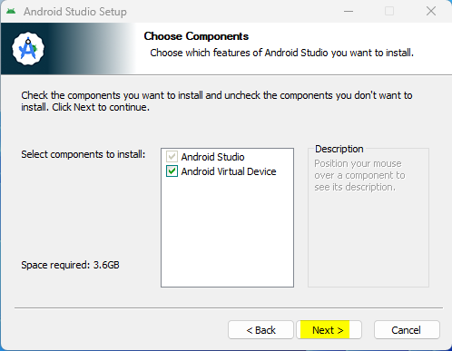
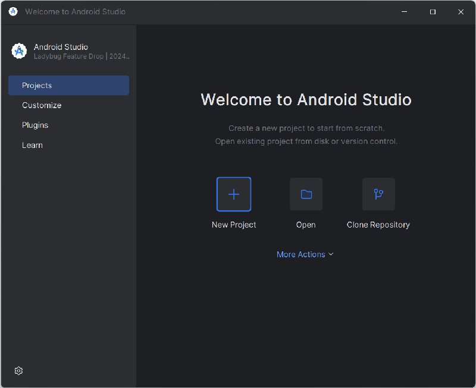
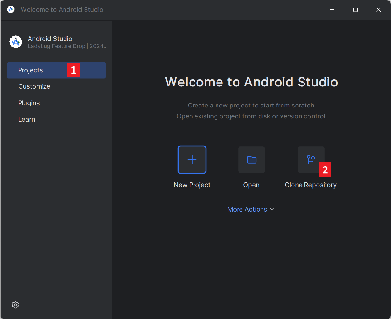
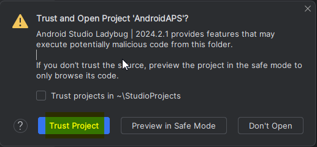

<!-- Android Studio Build, FKA Computer Build. Preserve filenames to avoid breaking URLs. -->

# Bouwen met Android Studio

Dit is de klassieke manier om je AAPS-app te bouwen.

Je kunt de app ook zonder computer bouwen met de methode [Bouwen in de browser](./BrowserBuild.md).

## Zelf bouwen, in plaats van downloaden

**De AAPS-app (een apk-bestand) is niet te downloaden, vanwege de regels voor medische hulpmiddelen. Je mag de app legaal bouwen voor eigen gebruik, maar je mag geen kopie aan anderen geven!**

Zie de [FAQ-pagina](../UsefulLinks/FAQ.md) voor meer informatie.

---

(Building-APK-recommended-specification-of-computer-for-building-apk-file)=
## Eisen aan computer en software voor het bouwen van AAPS

* Om de apk te bouwen kan een bepaalde versie van **[Android Studio](https://developer.android.com/studio/)** nodig zijn. Zie de tabel hieronder:

| AAPS versie             | Aanbevolen<br/>Android Studio<br/>versie | Andere<br/>Android Studio<br/>versie | Gradle | JVM |
| ----------------------- | ---------------------------------------------------- | ------------------------------------------------ | ------ |:--- |
| 2.6.2                   | 3.6.1                                                |                                                  | 5.6.4  | 11  |
| 2.8.2.1                 | 4.1.1                                                |                                                  | 6.1.1  | 13  |
| [3.1.0.3](#version3100) | 2020.3.1                                             | getest tot en met Quail 4                        | 7.3.3  | 17  |
| [3.2.0.4](#version3204) | Hedgehog (2023.1.1)                                  | getest tot en met Quail 4                        | 8.2    | 17  |
| [3.3.1.3](#version3300) | Ladybug Feature Drop (2024.2.2)                      | getest tot en met Quail 4                        | 8.10   | 21  |
| [3.3.2](#version3300)   | Meerkat (2024.3.1)                                   | getest tot en met Quail 4                        | 8.11.1 | 21  |
| [3.3.2.1](#version3321) | Narwhal (2025.1.2)                                   | getest tot en met Quail 4                        | 8.13   | 21  |
| [3.4.2.6](#version3426) | Panda 2 (2025.3.2)                                   | getest tot en met Quail 4                        | 9      | 21  |
| [4.0.0](#version400)    | Rabbit 2 (2026.2.2)                                  | Latest                                           | 9.8    | 21  |

De "aanbevolen versie" heeft al de juiste JVM-versie aan boord. De aanbevolen versie is ook de laagste versie waarmee je **AAPS** kunt bouwen. Met een versie die ouder is dan de "aanbevolen" versie kun je **NIET** bouwen. Met een andere versie kun je problemen krijgen met de JVM-versie. Zie de pagina [Problemen met Android Studio oplossen](#troubleshooting_androidstudio-uncommitted-changes) voor hulp bij deze problemen. Staat je huidige versie van Android Studio niet in de tabel? Werk Android Studio dan eerst bij.

De Gradle-versie hoort bij de broncode. Als je de broncode downloadt of bijwerkt, krijg je altijd de juiste Gradle-versie. Hij staat hier alleen ter informatie. Je hoeft er niets mee te doen.

* [32-bit Windows-systemen](#troubleshooting_androidstudio-unable-to-start-daemon-process) worden niet ondersteund door Android Studio. Let op: **een 64-bit processor en een 64-bit besturingssysteem zijn allebei verplicht.** Voldoet je systeem hier NIET aan, dan moet je de hardware of software in kwestie vervangen, of het hele systeem.

<table class="tg">
<tbody>
  <tr>
    <th class="tg-baqh">OS (Alleen 64 bit)</th>
    <td class="tg-baqh">Windows 10 or higher</td>
    <td class="tg-baqh">macOS 12 or higher</td>
    <td class="tg-baqh">Any Linux distribution that supports Gnome, KDE, or Unity DE;&nbsp;&nbsp;GNU C Library (glibc) 2.31 or later</td>
  </tr>
  <tr>
    <th class="tg-baqh"><p align="center">CPU (Alleen 64 bit)</th>
    <td class="tg-baqh">x86_64 CPU from 2017 or newer (Intel 8th generation Core i5, AMD Ryzen, or newer) with <a href="https://developer.android.com/studio/install" target="_blank" rel="noopener noreferrer">virtualization support</a> (Intel VT-x or AMD-V) enabled in the BIOS</td>
    <td class="tg-baqh">Apple Silicon (M1 or newer), or 6th generation Intel Core or newer (support for Intel Macs is being phased out)</td>
    <td class="tg-baqh">x86_64 CPU from 2017 or newer (Intel 8th generation Core i5, AMD Ryzen, or newer) with virtualization support (Intel VT-x or AMD-V) enabled in the BIOS</td>
  </tr>
  <tr>
    <th class="tg-baqh"><p align="center">RAM</th>
    <td class="tg-baqh" colspan="3"><p align="center">16GB or more (8GB is the strict minimum for Android Studio alone, 32GB is recommended)</td>
  </tr>
  <tr>
    <th class="tg-baqh"><p align="center">Schijf</th>
    <td class="tg-baqh" colspan="3"><p align="center">At least 32GB free space. SSD wordt aanbevolen.</td>
  </tr>
  <tr>
    <th class="tg-baqh"><p align="center">Schermresolutie</th>
    <td class="tg-baqh" colspan="3"><p align="center">1280 x 800 minimum (1920 x 1080 recommended)<br></td>
  </tr>
  <tr>
    <th class="tg-baqh"><p align="center">Internet</th>
    <td class="tg-baqh" colspan="3"><p align="center">Breedband</td>
  </tr>
</tbody>
</table>

**We raden sterk aan (niet verplicht) om een SSD (Solid State Disk) te gebruiken in plaats van een HDD (harde schijf), omdat het bouwen van het AAPS apk-bestand dan minder tijd kost.**  Je kunt ook een HDD gebruiken om het **AAPS** apk-bestand te bouwen. Als je dat doet, kan het bouwen lang duren. Maar als het eenmaal gestart is, kun je het zonder toezicht laten lopen.

## Hulp en ondersteuning tijdens het bouwen

Als je problemen hebt bij het bouwen van de **AAPS**-app, is er een apart deel [**Problemen met Android Studio oplossen**](../GettingHelp/TroubleshootingAndroidStudio.md). Kijk daar eerst.

Denk je dat iets in de bouwinstructies fout, onvolledig of onduidelijk is, of lukt het je nog steeds niet? Vraag het dan aan andere **AAPS**-gebruikers in de groep op [Facebook](https://www.facebook.com/groups/AndroidAPSUsers) of op [Discord](https://discord.gg/4fQUWHZ4Mw). Wil je zelf iets aanpassen (schermafbeeldingen bijwerken _enz._)? Dien dan een [pull request (PR)](../SupportingAaps/HowToEditTheDocs.md) in.

## Stap-voor-stap uitleg voor het bouwen van de AAPS-app

```{admonition} WARNING
:class: warning
Als je AAPS al eerder hebt gebouwd, hoef je niet alle volgende stappen opnieuw te doen.
Ga direct naar de [handleiding voor bijwerken](../Maintenance/UpdateToNewVersion.md)!
```

```{contents} The overall steps for building the **AAPS** apk file
:depth: 1
:local: true
```

In deze handleiding vind je _voorbeeld_-schermafbeeldingen van het bouwen van het apk-bestand van **AAPS**. **Android Studio**, het programma waarmee we de apk van **AAPS** bouwen, wordt regelmatig bijgewerkt. Daarom kunnen deze schermafbeeldingen iets anders zijn dan wat jij ziet, maar je moet ze nog steeds kunnen volgen.

Omdat **Android Studio** op Windows, Mac OS X en Linux draait, kunnen de stappen op de verschillende platforms iets verschillen.

(install-git-if-you-dont-have-it)=
### Git installeren

```{admonition} Why Git? 
:class: dropdown

Git is een zogenaamd “_Versioning Control System_” (VCS, versiebeheersysteem).\
Git is een programma waarmee je wijzigingen in code kunt bijhouden en met anderen kunt samenwerken. Met Git maak je een kopie van de broncode van **AAPS** van de GitHub-website naar je eigen computer. Daarna gebruik je Android Studio op je computer om de **AAPS**-app (apk) te bouwen. 
```

(BuildingAaps-steps-for-installing-git)=
#### Stappen voor het installeren van Git

1.  Controleer of **Git** niet al geïnstalleerd is. You can do this by typing “git” in the Windows search bar – if you see **“Git bash”** or some other form of Git, it is already installed and you can go straight to [installing Android Studio](#Building-APK-install-android-studio):


2. If you don’t have Git installed, download and install the latest version for your system from the "Download" section [**here**](https://git-scm.com/downloads). Elke recente versie van Git werkt. Kies de juiste versie voor je systeem: Mac, Windows of Linux.

**Let op voor Mac-gebruikers:** de Git-website helpt je ook om een extra programma "homebrew" te installeren, dat helpt bij de installatie. Als je Git via homebrew installeert, hoef je geen voorkeuren te wijzigen.

(Make_a_note_of_Git_path)=

* Als tijdens de installatie gevraagd wordt om "select destination location", schrijf dan op _waar_ Git wordt geïnstalleerd (het "**installatiepad**"). Je moet dit in de volgende stap controleren. Het lijkt op "C:\Program Files\Git\cmd\git.exe"

*  Accepteer tijdens de stappen van de Git-installatie gewoon alle standaardopties.

*  Weet je na de installatie niet meer waar Git is geïnstalleerd? Zoek het dan zo op: typ "git" in de zoekbalk van de pc, klik met de rechtermuisknop op "Git bash", kies "open file location" (bestandslocatie openen) en beweeg met je muis over het pictogram "Git bash". Dan zie je waar het is geïnstalleerd.

* Start je computer opnieuw op voor je verdergaat met de volgende stap.

(Building-APK-install-android-studio)=
### Installeer Git + Android Studio

- **Je moet tijdens de volgende stappen steeds online zijn, omdat Android Studio verschillende updates downloadt**

```{admonition} What is Android Studio?
:class: dropdown
Android Studio is een programma dat op je computer draait. Je kunt er broncode mee downloaden van internet (met Git) en apps voor smartphones (en smartwatches) mee bouwen. Je kunt een werkende versie van **AAPS** op je smartphone niet "kapotmaken" door een nieuwe of bijgewerkte app op je pc te bouwen met Android Studio. Dit zijn volledig losse processen. 
```

Een van de belangrijkste dingen bij het installeren van Android Studio is: **heb geduld!** Tijdens de installatie en het instellen downloadt Android Studio veel bestanden, en dat kost tijd.

```{admonition} Different UI
:class: warning
Belangrijke opmerking: Android Studio heeft in de laatste versies zijn UI veranderd. Deze handleiding toont de stappen met de *nieuwe UI*. De schermafbeeldingen zijn gemaakt met "Ladybug". Nieuwere versies kunnen er dus iets anders uitzien. Als je nog de oude UI gebruikt, kun je Android Studio eerst overzetten naar de nieuwe UI met [deze instructies](#computerbuild-NewUI).
```

De versie van Android Studio is erg belangrijk. Zie de [instructies hierboven](#Building-APK-recommended-specification-of-computer-for-building-apk-file) om de juiste versie van Android Studio te kiezen.

Download de [huidige versie van Android Studio](https://developer.android.com/studio) of een oudere versie uit het [**Archief**](https://developer.android.com/studio/archive) en accepteer de voorwaarden voor de download.


Start na het downloaden het gedownloade programma om het op je computer te installeren. Misschien moet je in Windows enkele waarschuwingen over gedownloade apps accepteren of bevestigen!

Installeer Android Studio door op "Next" te klikken, zoals in de volgende schermafbeeldingen. Je hoeft **geen** instellingen te wijzigen!


Als je ruimte op je harde schijf wilt besparen, kun je Android Virtual Device uitvinken: dit wordt niet gebruikt om **AAPS** te bouwen.




Klik nu op "Install":


Als het klaar is, klik je op "Next"


In the last step, click on "Finish" to start Android Studio for the first time.


Je wordt gevraagd of je wilt helpen om Android Studio te verbeteren. Kies wat je wilt, het maakt voor de volgende stappen geen verschil.


Het welkomstscherm heet je welkom bij de installatie van Android Studio. Klik op "Next".


Kies "Standard" als installatietype.


Controleer de instellingen en klik nogmaals op "Next".


Nu moet je de licentievoorwaarden accepteren. Links staan twee onderdelen (1 + 3). Kies ze een voor een en kies bij elk rechts "Accept" (2 + 4).

Daarna kun je op de knop "Finish" (5) klikken.


Nu worden enkele Android-pakketten gedownload en geïnstalleerd. Heb geduld en wacht.

Als het klaar is, zie je het volgende scherm. Kies daar weer "Finish".


Je ziet nu het welkomstscherm van Android Studio.




(Building-APK-download-AAPS-code)=
### De AAPS-code downloaden

```{admonition} Why can it take a long time to download the AAPS code?
:class: dropdown

De eerste keer dat **AAPS** wordt gedownload, maakt Android Studio via internet verbinding met de GitHub-website om de broncode van **AAPS** te downloaden. Dit duurt ongeveer 1 minuut. 

Daarna gebruikt Android Studio **Gradle** (een ontwikkeltool voor Android-apps) om te bepalen welke andere onderdelen nodig zijn om dit op je computer te bouwen. 
```

Controleer in het welkomstscherm van Android Studio dat links "**Projects**" (1) gemarkeerd is.

Klik dan rechts op "**Clone Repository**" (2):



Nu vertellen we Android Studio waar de code vandaan moet komen:


* Links moet "Repository URL" gekozen zijn (standaard) (1).
* Als versiebeheer moet "Git" gekozen zijn (standaard) (2).
* Kopieer nu deze URL:
    ```
    https://github.com/nightscout/AndroidAPS.git
    ```
    en plak hem in het tekstvak URL (3).

* Controleer dat de (standaard)map waarin de gekloonde code wordt opgeslagen nog niet bestaat op je computer (4). Je kunt een andere map kiezen, maar onthoud goed waar je het hebt opgeslagen!
* Klik nu op de knop "Clone" (5).

```{admonition} INFORMATION
:class: note
Schrijf de map op. Hier wordt je broncode opgeslagen!
```

Je ziet nu een scherm dat laat zien dat de repository wordt gekloond:


Op een gegeven moment sluit Android Studio en start het opnieuw. Misschien word je gevraagd of je het project vertrouwt. Klik op "Trust project":

  


Alleen voor Windows-gebruikers: vraagt je firewall om toestemming, geef dan toegang:

 

Nadat de repository succesvol is gekloond, zal Android Studio het gekloonde project openen.

(computerbuild-NewUI)=
```{admonition} New UI
:class: note
Android Studio heeft onlangs zijn UI veranderd. Nieuwe installaties van Android Studio gebruiken standaard de nieuwe UI (gebruikersinterface)!

Alleen als je Android Studio er anders uitziet, moet je misschien overschakelen naar de nieuwe UI:
Klik op het hamburgermenu linksboven en kies dan **Settings** (of **Preferences** op Apple-computers).
Ga in **Appearance & Behavior** naar **New UI** en vink **Enable new UI** aan. Start Android Studio daarna opnieuw om de nieuwe UI te gebruiken.

Vind je de optie **New UI** niet? Geen zorgen: je gebruikt hem al!
```


Als Android Studio geopend is, wacht dan geduldig (dit kan een paar minuten duren). Werk het project vooral **niet** bij, ook al wordt dat in de pop-up voorgesteld.

Android Studio start automatisch een "Gradle project sync". Dit duurt een paar minuten. Je kunt zien dat het (nog) bezig is:


```{admonition} NEVER UPDATE GRADLE!
:class: warning

Android Studio raadt misschien aan om het gradle-systeem bij te werken. **Werk gradle nooit bij!** Dit geeft problemen.
```

Alleen op Windows-computers: je krijgt misschien een melding dat Windows Defender actief is. Klik op **Automatically** en bevestig. Dan wordt het bouwen sneller!


Je kunt de Gradle sync laten lopen en alvast de volgende stappen volgen.

(Building-APK-set-git-path-in-preferences)=
### Git-pad instellen in de voorkeuren van Android Studio

Nu vertellen we Android Studio waar het Git kan vinden, dat je [eerder](#install-git-if-you-dont-have-it) hebt geïnstalleerd.

* Alleen voor Windows-gebruikers: zorg dat je je computer opnieuw hebt opgestart na het [installeren van Git](#install-git-if-you-dont-have-it). Zo niet, start dan nu opnieuw op en open Android Studio weer

Open linksboven in **Android Studio** het hamburgermenu en ga naar **File** > **Settings** (op Windows) of **Android Studio** > **Preferences** (op Mac). Dit opent het volgende venster. Klik om de lijst **Version Control** (1) open te klappen en kies **Git** (2)


Check if **Android Studio** can automatically locate the correct **Path to Git executable** by clicking the button "Test" (1):


Als de automatische instelling lukt, wordt je huidige versie van **Git** naast het pad getoond.

   


Als **git.exe** niet automatisch wordt gevonden, of als klikken op "Test" een fout geeft, kun je ofwel
* het pad dat je [eerder](#BuildingAaps-steps-for-installing-git) hebt opgeschreven handmatig invullen, of
* klik op het map-icoon (1) en ga handmatig naar de map waar **git.exe** [eerder](#BuildingAaps-steps-for-installing-git) is geïnstalleerd
* Controleer je instellingen met de knop **Test**!

  

(Building-APK-generate-signed-apk)=
### De "ondertekende" AAPS-APK bouwen

```{admonition} Why does the AAPS app need to be "signed"?
:class: dropdown

Android vereist dat elke app _ondertekend_ (signed) is. Zo kan een app later alleen worden bijgewerkt vanuit dezelfde vertrouwde bron die de oorspronkelijke app heeft uitgebracht. Volg [deze link](https://developer.android.com/studio/publish/app-signing.html#generate-key) voor meer informatie hierover. 

Voor ons betekent dit alleen dat we een ondertekenings- of "keystore"-bestand maken en dat gebruiken als we de **AAPS**-app bouwen.
```


**Belangrijk: zorg dat de gradle-synchronisatie goed is afgerond voordat je verdergaat!**


Klik linksboven op het hamburgermenu om de menubalk te openen. Kies **Build** (1) en kies dan **Generate Signed App Bundle / APK** (2)


Kies "APK" (1) in plaats van "Android App Bundle" en klik op "Next" (2):


Controleer in het volgende scherm dat "Module" op "AndroidAPS.app" (1) staat. Het deel vóór ".app" is de naam van de map waarin je de code hebt gekloond.

(Building-APK-wearapk)=
```{admonition} INFORMATION!
:class: note
Als je de apk voor je horloge wilt maken, moet je nu AndroidAPS.wear kiezen!
```


Klik op "Create new..." (2) om je keystore te gaan maken.

```{admonition} INFORMATION!
:class: note
Je hoeft de keystore maar één keer te maken.
Als je AAPS al eerder hebt gebouwd, maak dan GEEN nieuwe keystore, maar kies je bestaande keystore en vul de wachtwoorden in!
```

**_Let op:_** de keystore is een bestand waarin de gegevens voor het ondertekenen van de app worden opgeslagen. Het bestand is versleuteld en de gegevens zijn beveiligd met wachtwoorden.


* Klik op het symbool "map" (1) om een plek op je computer voor je keystore te kiezen.

  Gebruik **niet** de map waarin je je broncode hebt opgeslagen, maar een map die je ook naar een nieuwe computer zou overzetten.

```{admonition} WARNING!
:class: warning
Schrijf voor jezelf op waar je keystore is opgeslagen. You will need it when you build the next AAPS update!
```

* Kies nu een eenvoudig wachtwoord (en schrijf het op), vul het in het wachtwoordvak in (2) en bevestig het (2).

  De wachtwoorden voor de keystore en de key hoeven niet ingewikkeld te zijn. Als je in de toekomst je wachtwoord kwijtraakt, zie dan [AAPS opnieuw installeren met een nieuwe keystore](#reinstall-aaps).

```{warning}
**Gebruik geen speciale tekens in je wachtwoorden.** Gebruik alleen letters en cijfers voor het wachtwoord van de keystore en van de key. Gebruik vooral geen `$`, backtick, `"` of `\`. Als je later overstapt naar [Bouwen in de browser](#aaps-ci-option2) en deze keystore opnieuw gebruikt, kunnen deze tekens ervoor zorgen dat het ondertekenen mislukt, zie [Bouwen in de browser: probleemoplossing](#aaps-ci-password-special-characters).
```

* De standaard alias (3) voor je key is "key0". Laat dit zo.

* Je hebt nu een wachtwoord voor je key nodig. Om het eenvoudig te houden kun je, als je wilt, hetzelfde wachtwoord gebruiken als hierboven voor je keystore. Vul een wachtwoord in (4) en bevestig het.

```{admonition} WARNING!
:class: warning
Schrijf deze wachtwoorden op! Je hebt ze nodig als je de volgende update van AAPS bouwt!
```

* De geldigheid is standaard 25 jaar. Laat dit zo.

* Vul je voor- en achternaam in (5). Andere gegevens zijn niet nodig, maar je mag ze invullen (6-7).

* Klik op "OK" (8) om verder te gaan:


Op de pagina **Generate signed App Bundle or APK** wordt nu het pad naar je keystore getoond. Vul nu opnieuw het wachtwoord van de Key Store (1) en van de Key (2) in en vink het vakje (3) aan om de wachtwoorden te onthouden. Dan hoef je ze de volgende keer niet opnieuw in te vullen als je de apk bouwt (bijvoorbeeld bij het bijwerken naar een nieuwe AAPS-versie). Klik op "Next" (4):


Kies in het volgende scherm de build-variant "fullRelease" (1) en klik op "Create" (3). Onthoud de doelmap die bij (2) wordt getoond, want daar vind je later je gebouwde apk-bestand!

   

Android Studio bouwt nu de apk van **AAPS**. Rechtsonder staat dan "Gradle Build running" (2). Dit duurt even, afhankelijk van je computer en internetverbinding, dus **heb geduld!** Als je de voortgang van het bouwen wilt volgen, klik dan op het kleine hamer-icoon "build" (1) onderaan in Android Studio:


Nu kun je de voortgang van het bouwen volgen:


Android Studio toont de melding "BUILD SUCCESSFUL" als het bouwen klaar is. Misschien zie je een pop-upmelding waarop je kunt klikken om "locate" te kiezen. Als je dit mist, klik dan op het meldingen-icoon (1) om de Notifications te openen, en dan op **locate** (2):


**_Als het bouwen niet gelukt is, kijk dan in het deel [Problemen met Android Studio oplossen](../GettingHelp/TroubleshootingAndroidStudio.md)._**

Klik in het venster Notifications op de blauwe link "locate":

 Je bestandsbeheer opent en toont het apk-bestand dat je net hebt gebouwd.

   

Gefeliciteerd! Nu je het apk-bestand van **AAPS** hebt gebouwd, zet je dit bestand in het volgende deel van de documentatie over naar je smartphone.

```{tip}
Als je in de toekomst misschien een Android Wear-smartwatch wilt gebruiken, is dit het beste moment om de AAPS Wear-apk te bouwen. Zo weet je zeker dat deze gelijk loopt met je AAPS-apk.
```

Ga verder met de volgende stap: [**AAPS** overzetten en installeren](../SettingUpAaps/TransferringAndInstallingAaps.md).


