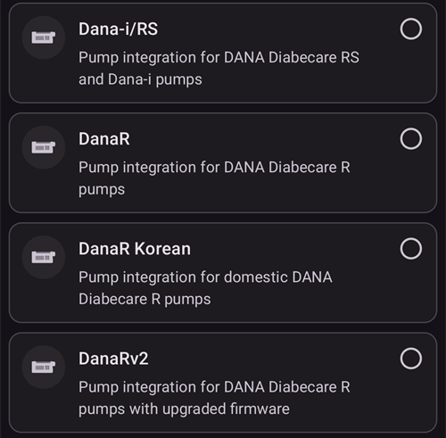
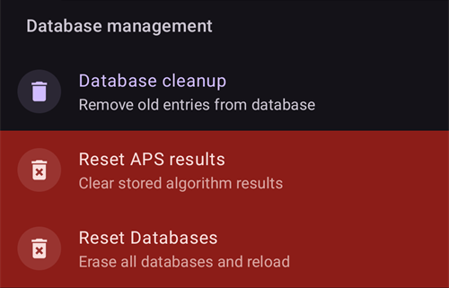

# Configuratie (Configurator)

```{admonition} Kom je van AAPS v3? :class: note De **Configurator** heet nu **Configuratie** en staat in het **menu** (☰). Zie [Wat is er veranderd in AAPS v4](#v4-changes).

    <br />In **Configuratie** kies je welke plugins actief zijn (CGM, pomp, APS-algoritme, gevoeligheid, synchronisatie, …) en open je elke plugin en de instellingen ervan. De [stap-voor-stap uitleg](#configuration-v4) staat hieronder; de rest van deze pagina beschrijft elk onderdeel in detail.
    
    (configuration-v4)=
    ## Configuratie in AAPS v4
    
    Tik in **AAPS** v4 op het **menu** (☰) in de **linkerbovenhoek** van het hoofdscherm en kies **Configuratie** (*“Configureer instellingen (CGM, pomp, ...) en activeer functies”*).
    
    
    
    Plugins zijn gegroepeerd per **categorie**, bijvoorbeeld *Vloeiend maken*, *Kalibratie*, *Gevoeligheid detectie*, *APS*, *Communicatie* en *Algemeen*. Elke rij toont de naam van de categorie en de plugin die **nu actief** is (bijv. *APS → OpenAPS SMB*). Tik op een rij om een categorie te openen.
    
    
    
    In een categorie zie je de plugins die ervoor beschikbaar zijn. Bij categorieën met één keuze kies je de actieve plugin; sommige categorieën hebben meerdere keuzes (*“Kies alle opties die van toepassing zijn.”*). Elke plugin heeft twee acties:
    
    - **Plug-in openen**: opent het eigen scherm van de plugin.
    - **Instellingen**: opent de instellingen van de plugin (instellingen kunnen gegroepeerd zijn in secties die je kunt uitklappen).
    
    
    
    (configuration_sync_icon)=
    ### Het mobiele icoon: “gesynchroniseerd vanaf de master”
    
    Een klein **mobiel (telefoon) icoon** naast een categorie of instelling betekent dat dit onderdeel **vanaf de master gesynchroniseerd** wordt: de waarde/keuze komt naar dit apparaat via het NSClientV3-kanaal (Nightscout).
    
    Op een **client** (**AAPSClient**) worden deze onderdelen **gelijk gehouden met de master**. Het icoon wordt alleen op een client getoond, dus het staat niet in de schermafbeelding hierboven; die is gemaakt in de gewone **AAPS**-app. Op een client staat het meestal bij *Vloeiend maken*, *Kalibratie*, *Gevoeligheid detectie* en *APS*. Hoe de master en clients precies gelijk blijven, en welke instellingen je aan welke kant kunt wijzigen, staat bij [Master ↔ Client besturing](#client-master-config-prefs).
    
    Hetzelfde icoon staat ook **in de instellingen**, naast de afzonderlijke instellingen die gesynchroniseerd worden. In het voorbeeld hieronder heeft *Afkapmoment koolhydraatabsorptie* het icoon; instellingen zonder het icoon worden per apparaat ingesteld:
    
    
    
    Onderdelen **zonder** het icoon worden **per apparaat** ingesteld. Het belangrijkste voorbeeld is de verbinding **NSClientV3 (Communicatie)** zelf: de **Nightscout URL**, het **Nightscout toegangstoken** en **websockets** stel je op elke telefoon apart in, dus die tonen het mobiele icoon **niet**.
    
    ---
    
    (Config-Builder-tab-or-hamburger-menu)=
    ## Een pluginscherm openen
    
    Je opent elk pluginscherm op een van deze manieren (de tabbladen en het oog-vinkje van **AAPS** v3 zijn verdwenen, zie [Wat is er veranderd in AAPS v4](#v4-changes)):
    
    - **Configuratie** → de categorie van de plugin → **Plug-in openen**,
    - het paneel **Beheren** in de navigatiebalk onderaan, voor de schermen die je het meest gebruikt (Profiel, Insuline instellingen, Pomp, Automatisering, Voeding...),
    - een [QuickLaunch](../DailyLifeWithAaps/QuickLaunch.md)-knop die je zelf toevoegt,
    - de **zoekbalk** op het hoofdscherm.
    
    ```{contents}
    :backlinks: entry
    :depth: 2
    

(ConfigBuilder_Profile)=

## Profiel

Deze module kan niet worden uitgeschakeld, omdat ze een kernonderdeel van **AAPS** is.

Zie [Je AAPS-profiel](../SettingUpAaps/YourAapsProfile.md) voor een basisuitleg over wat er in je **Profiel** staat.

(insulin)= (Config-Builder-insulin)=

## Insuline


In **AAPS** 4 is de insuline geen plugin meer die je kiest in **Configuratie**. Open **Beheren → Insuline instellingen** om de insuline in te stellen die je gebruikt.

Met de insuline-editor kun je:

* give the insulin an **Insulin nickname** so it is easy to recognise,
* set the **Peak** (time to maximum insulin activity, in minutes) and the **DIA** (Duration of Insulin Action, in hours), either by typing the value or using the **–** / **+** buttons,
* op een voorinstelling bij **Laad piekwaarde van** tikken — **Novorapid** (75 min), **Fiasp** (55 min) of **Lyumjev** (45 min) — om in één stap de standaard piektijd voor die insuline in te vullen.

De toegestane bereiken zijn hetzelfde, welke insuline je ook gebruikt:

* **DIA**: 5 tot 9 uur (5 tot 10 uur als het type patiënt is ingesteld op **Zwangere vrouw**). Zie [Werkingsduur van insuline (DIA) en piek](#Config-Builder-insulin-dia) om een waarde te kiezen.
* **Piek**: 35 tot 120 minuten.

De curves voor **IOB** (insuline aan boord) en **Activiteit** onderaan de editor veranderen mee als je de waarden wijzigt. Zo zie je meteen hoe je instellingen de werking van de insuline bepalen.

Meer uitleg over het insulineprofiel zoals **AAPS** het toont, vind je [hier](#AapsScreens-insulin-profile).

(Config-Builder-insulin-change-active)=

### De gebruikte insuline wijzigen (DIA of piek)

De insuline met het label **ACTIEF** is de insuline die je huidige profiel gebruikt. De velden ervan zijn grijs: je kunt deze insuline niet bewerken of verwijderen. Zo past de insulinenaam in je huidige profiel altijd bij de instellingen die echt gebruikt worden.

Om de DIA of piek die je gebruikt te wijzigen:

1. Open **Beheren → Insuline instellingen**. Als het scherm alleen-lezen opent (een **✏️ potlood** in de bovenste balk), tik dan op het potlood en ontgrendel je instellingen.
2. Tik op **+** (*Voeg nieuwe insuline toe*). **AAPS** maakt een kopie van de insuline die op het scherm staat.
3. Stel de nieuwe **Piek** en/of **DIA** in en tik dan op het opslaan-icoon (rechtsboven).
4. Tik op **▶** (*Activeer insuline*) en bevestig. De nieuwe insuline wordt **ACTIEF**.

```{admonition} De naam bevat piek en DIA :class: note **AAPS** voegt de piek, DIA en concentratie automatisch toe aan de insulinenaam (bijvoorbeeld *Fiasp 55m 8h U100*), zodat je je configuraties in één oogopslag uit elkaar kunt houden.

    <br />Je kunt de oude insuline verwijderen zodra die niet meer actief is.
    
    ### De voorinstellingen "Laad piekwaarde van"
    
    In **AAPS** 4 is er geen lijst met insulinetypes om uit te kiezen. Elke insuline gebruikt dezelfde exponentiële activiteitscurve; alleen de **Piek** en **DIA** verschillen. De voorinstellingen **Laad piekwaarde van** in de insuline-editor vullen met één tik de aanbevolen piek in voor de meest gebruikte insulines (het kleine ⓘ naast **Laad piekwaarde van** toont ze met hun piekwaarden). Je kunt de **Piek** en **DIA** daarna nog aanpassen.
    
    Wijk alleen af van de aanbevolen piekwaarde als je begrijpt wat het effect daarvan is. De [grafiek met de insulinecurve](#AapsScreens-insulin-profile) helpt je om de curves te begrijpen.
    
    #### Novorapid
    
    
    
    * aanbevolen voor Humalog, Novolog en Novorapid (heette *Rapid-Acting Oref* in **AAPS** v3)
    * Piek = 75 minuten na injectie
    
    #### Fiasp
    
    
    
    * aanbevolen voor Fiasp (heette *Ultra-Rapid Oref* in **AAPS** v3)
    * Piek = 55 minuten na injectie
    
    (Config-Builder-lyumjev)=
    #### Lyumjev
    
    
    
    * aanbevolen voor Lyumjev
    * Piek = 45 minuten na injectie
    
    #### Eigen piek
    
    * Er is in **AAPS** 4 geen apart insulinetype "Free-Peak Oref": vul een willekeurige **Piek** (35 tot 120 minuten) direct in de [insuline-editor](#Config-Builder-insulin) in, zonder een voorinstelling te gebruiken.
    * Een eigen piek is handig als je een insuline gebruikt die niet in de lijst staat, of een mengsel van verschillende insulines.
    
    (Config-Builder-insulin-dia)=
    ### Werkingsduur van insuline (DIA) en piek
    
    ```{warning}
    Bij het loopen geldt: een lagere DIA of piek zorgt altijd voor meer toegediende insuline. DIA werkt in AAPS anders dan in commerciële AID-systemen. Onvoorzichtige wijzigingen van deze instellingen kunnen de insulinedosering veel meer of veel minder veranderen dan je verwacht.
    

AAPS beschrijft het verloop van de insulinewerking met een wiskundige formule, die je instelt met de **DIA** en de nauw verwante instelling **piek**. DIA is de theoretische tijd totdat de IOB nul is, en de piek is het moment waarop de insuline het sterkst werkt. Dit geeft een IOB-curve en een activiteitscurve. De activiteitscurve is gewoon de **snelheid** waarmee de IOB afneemt.

Houd er rekening mee dat het normaal is dat AAPS tijdens het loopen soms een [tijdelijke basaal van nul](#Open-APS-features-super-micro-bolus-smb) geeft. Deze ontbrekende basale insuline wordt volledig van de IOB afgetrokken. Daarom bereikt de IOB in de praktijk vele uren eerder nul dan de ingestelde DIA. Je kunt de [bolus-IOB en basale IOB](#aaps-screens-iob-cob-basal-sens) apart bekijken op het hoofdscherm.

Om DIA en piek in te stellen, tik je op het hoofdscherm op **Beheren** en daarna op **Insuline instellingen**. AAPS toont de actieve insulineconfiguratie zo:


In dit voorbeeld is de piek ingesteld op 55 minuten, de DIA op 8 uur en de [insulineconcentratie](#Insulin-Concentration) is de standaard 100 E/ml.

Door de invloed van de tijdelijke basaal van nul (zie hierboven) en de formule die AAPS gebruikt voor de afname van de IOB, stellen de meeste gebruikers een duidelijk hogere DIA in dan in commerciële systemen. Over het algemeen vinden veel mensen dat een **DIA** van 9 uur goed voor hen werkt. Als je meer ervaring hebt met AAPS en een goed afgesteld profiel, kun je met de informatie hieronder proberen je persoonlijke DIA- en piekinstellingen te vinden.

````{admonition} Details over het effect van de instellingen voor DIA en piek :class: dropdown

Omdat de basaalstand in AAPS een indirecte invloed heeft op de afname van de IOB, kunnen te hoge basaalstanden een te hoge DIA verbergen, en andersom. Het is verstandig om eerst de basaalstanden zorgvuldig af te stellen, voordat je DIA en piek aanpast. Houd er ook rekening mee dat de instellingen voor DIA en piek op elkaar inwerken: het effect van de DIA hangt af van de piek, en andersom.

Deze grafieken tonen het precieze effect van DIA en piek op de IOB-curves, over het hele bereik van toegestane waarden.

DIA aanpassen:

```{image} ../images/iob_remaining_static_peak.png :width: 400px

    <br />Piek aanpassen:
    
    ```{image} ../images/iob_remaining_static_dia.png
    :width: 400px
    

Tot slot een vergelijking waarbij DIA en piek tegelijk worden aangepast. Het idee hier is dat beide waarden in dezelfde verhouding worden aangepast, dus `49/35 ~ 7/5`. Of op dezelfde manier: `120/93 ~ 9/7`. De intervallen blijven gelijk, wat de uitgangswaarde van DIA of piek ook is, zolang de relatieve verandering voor beide hetzelfde is.

```{image} ../images/iob_remaining_uniform.png :width: 400px

    <br />Let op: als DIA en piek op deze manier worden aangepast, verschuift elk punt van de curve met dezelfde relatieve hoeveelheid.
    
    ````
    
    #### Meer lezen over de instellingen voor DIA en piek
    
    * [Technische details en historische achtergrond van OpenAPS, de voorganger van AAPS](https://openaps.readthedocs.io/en/latest/docs/While%20You%20Wait%20For%20Gear/understanding-insulin-on-board-calculations.html#understanding-the-new-iob-curves-based-on-exponential-activity-curves).
    * [Why we are regularly wrong in the duration of insulin action (DIA) times we use, and why it matters…](https://www.diabettech.com/insulin/why-we-are-regularly-wrong-in-the-duration-of-insulin-action-dia-times-we-use-and-why-it-matters/) (waarom we de werkingsduur van insuline vaak verkeerd inschatten) op Diabettech.
    * [Exponential Insulin Curves + Fiasp](https://web.archive.org/web/20220630154425/http://seemycgm.com/2017/10/21/exponential-insulin-curves-fiasp/) op See My CGM (archief).
    * [Revised Humalog model in a closed loop](https://bionicwookiee.com/2022/04/13/revised-humalog-model-in-a-closed-loop/) en andere artikelen op Bionic Wookie, die een DIA van 9 uur aanraden voor Lyumjev, Fiasp, NovoRapid en Humalog.
    
    (Config-Builder-bg-source)=
    ## BG bron
    Selecteer de bloedglucosebron die je gebruikt. Zie de pagina [BG bron](../Getting-Started/CompatiblesCgms.md) voor meer informatie over het instellen.
    
    
    
    Scroll naar beneden om de andere bronnen te zien:
    
    
    
    
    
    * [xDrip+ BG](../CompatibleCgms/xDrip.md) - ook voor apps die ermee werken, zoals [Juggluco](../CompatibleCgms/Juggluco.md)
    * [NSClient BG](../CompatibleCgms/CgmNightscoutUpload.md) - alleen als je weet wat je doet, zie [BG bron](../Getting-Started/CompatiblesCgms.md).
    * [MM640g](../CompatibleCgms/MM640g.md)
    * Glimp - alleen versie 4.15.57 en nieuwer worden ondersteund
    * [BYODA (Build Your Own Dexcom App)](#DexcomG6-if-using-g6-with-build-your-own-dexcom-app).
    * MicroTech CGM App - voor de Aidex / LinX CGM
    * [Poctech](../CompatibleCgms/PocTech.md)
    * Tomato (MiaoMiao) - Tomato-app voor het MiaoMiao-apparaat
    * [Glunovo](https://infinovo.com/) - Glunovo-app voor het Glunovo CGM-systeem
    * Intelligo - Intelligo-app
    * Syai/Ottai - voor de apps van Syai en Ottai (zie [Syai Tag](../CompatibleCgms/SyaiTagX1.md) en [Ottai](../CompatibleCgms/OttaiM8.md))
    * SI App - aangepaste SI App of Sibionics-app voor de Sibionics CGM
    * Sino App - aangepaste app voor de Sinocare CGM
    * Notification Reader - leest glucosewaarden uit de meldingen van officiële CGM-apps (Dexcom, Medtronic, Eversense, enz.)
    * Instara - Instara-app
    * Willekeurige BG - maakt willekeurige BG-gegevens om te testen. Je kunt deze bron alleen aanzetten in een engineering-build (ontwikkelaarsversie) met de **Virtuele Pomp**. In een normale installatie van **AAPS** kun je hem dus niet gebruiken.
    
    ## Vloeiend maken
    
    
    
    Zie [Vloeiend maken van bloedglucosewaarden](../CompatibleCgms/SmoothingBloodGlucoseData.md).
    
    ## Kalibratie
    
    Kies hoe **AAPS** omgaat met de waarden die het van je sensor ontvangt:
    
    - **Geen kalibratie**: de sensorwaarden worden gebruikt zoals ze zijn. Gebruik dit als de sensor al in de fabriek is gekalibreerd en nauwkeurig is. Dit is de standaard.
    - **Lineaire kalibratie**: **AAPS** corrigeert de sensorwaarden met een helling en een verschuiving die het berekent uit je vingerprikwaarden.
    
    How to use **Linear calibration**:
    
    1. Select **Linear calibration** in the **Calibration** category.
    2. When you insert a new sensor, log the sensor change: use **Log sensor change** on the calibration screen, or enter a CGM sensor insert in the Careportal. This tells **AAPS** when the sensor session started. If **AAPS** notices a gap of more than 30 minutes in the readings, it may ask you to mark a sensor change; this prompt appears on the master only, not on a client.
    3. Open the plugin and tap **Add calibration**. Enter your fingerstick value. **AAPS** pairs it with the sensor value from the last 10 minutes.
    
    A calibration is accepted only when:
    
    - a sensor change is logged and at least **2 hours** have passed since then (warm-up),
    - your glucose is stable. If it changes too fast, the dialog tells you and shows the limit,
    - there is a CGM reading from the last 10 minutes,
    - it is for the current moment. You cannot enter older fingerstick values.
    
    How the correction works:
    
    - **AAPS** draws a straight line through the pairs of the current sensor: `corrected value = slope × sensor value + offset`.
    - Newer pairs count more than older ones: a pair that is 2 days old counts about 37 %, a 4-day-old pair about 14 %. The line therefore follows your sensor as it drifts.
    - At least **2 pairs** are needed.
    - If the pairs are close together (less than 54 mg/dL / 3 mmol/L apart), only the values are shifted (offset, no slope).
    - The slope is kept between 0.55 and 1.6. A slope outside this range is limited to the nearest value.
    - Safety limit: if the correction at 100 mg/dL (5.5 mmol/L) would be more than ±30 mg/dL (1.7 mmol/L), no correction is applied. This protects you from a wrong entry.
    
    What it changes:
    
    - The corrected value is used everywhere: the BG on the main screen, the graph and the loop. The sensor readings themselves are not changed. The correction is applied on top, also to the earlier readings of the current sensor.
    - A new sensor change starts from zero. Pairs from earlier sensors no longer count.
    - On the graph, a calibration is shown as a marker at the fingerstick value.
    - Calibrations are synchronized through Nightscout, so your clients show the same corrected values.
    
    Check and remove entries:
    
    - **Open plugin** shows the status (for example *Slope 0.85, mid-range correction -0.4*), a chart of your pairs with the line, and the list of entries.
    - If an entry is wrong (for example, you had sugar on your finger), tap the bin icon next to it. The line is calculated again at once.
    
    ```{admonition} Using xDrip+ as BG source?
    :class: note
    xDrip+ has its own calibration. Calibrate in one place only, so that the sensor values are not corrected twice.
    

    {admonition} Calibrate with care
    :class: warning
    A wrong fingerstick value leads to wrong glucose values and therefore to wrong insulin dosing. Was je handen voor het meten, en kalibreer niet als je glucose snel verandert.


(Config-Builder-pump)=

## Pomp

Selecteer de pomp die je gebruikt. Zie de pagina [Compatibele pompen](../Getting-Started/CompatiblePumps.md) voor meer informatie over het instellen.


Scroll naar beneden om alle pompdrivers te zien:




Als je een andere pomp selecteert, vraagt **AAPS** je om de wijziging te bevestigen:


* [Dana R](../CompatiblePumps/DanaR-Insulin-Pump.md)
* DanaR Koreaans (voor de binnenlandse Koreaanse DanaR-pomp)
* DanaRv2 (DanaR-pomp met een onofficiële firmware-upgrade)
* [Dana-i/RS](../CompatiblePumps/DanaRS-Insulin-Pump.md)
* [Accu-Chek Insight](../CompatiblePumps/Accu-Chek-Insight-Pump.md)
* [Accu-Chek Combo](../CompatiblePumps/Accu-Chek-Combo-Pump-v2.md)
* Omnipod voor [Omnipod Eros](../CompatiblePumps/OmnipodEros.md)
* Dash voor [Omnipod DASH](../CompatiblePumps/OmnipodDASH.md)
* [Medtronic](../CompatiblePumps/MedtronicPump.md)
* [Diaconn G8](../CompatiblePumps/DiaconnG8.md)
* [EOPatch2](../CompatiblePumps/EOPatch2.md)
* [Medtrum](../CompatiblePumps/MedtrumNano.md)
* [Equil 5.3](../CompatiblePumps/Equil5.3.md)
* [Carelevo](../CompatiblePumps/CareLevo.md)
* Virtuele pomp: open loop - alleen voorstellen van **AAPS** 
  * as you make your first steps with **AAPS**, during the first [objectives](../SettingUpAaps/CompletingTheObjectives.md)
  * voor een pomp die nog geen driver heeft

(config-builder-wrong-pump-data)=

### Melding: "Data komt van een andere pomp"

**AAPS** onthoudt met welke pomp het verbonden is (pomptype en serienummer). Als het gegevens van een andere pomp ontvangt, bijvoorbeeld nadat je pomp is vervangen door een nieuwe van hetzelfde model, toont het deze melding en negeert het de gegevens van die pomp:


Om de nieuwe pomp te gebruiken, wijzig je de pompdriver: selecteer **Virtuele Pomp**, bevestig, en selecteer daarna weer je eigen pomp. **AAPS** registreert dan de pomp waarmee het nu verbonden is.

(Config-Builder-sensitivity-detection)=

## Gevoeligheid detectie


Selecteer het type gevoeligheidsdetectie. Lees [hier verder](../DailyLifeWithAaps/SensitivityDetectionAndCob.md) voor meer details over de verschillende varianten. Dit analyseert je eerdere gegevens doorlopend en past de instellingen aan als het merkt dat je gevoeliger (of juist resistenter) reageert op insuline dan normaal. Meer details over hoe de gevoeligheidsratio zelf wordt berekend, vind je in [Belangrijkste functies van AAPS > Autosens](#Open-APS-features-autosens).

You can view your sensitivity on the main screen in an [additional graph](#AapsScreens-section-g-additional-graphs), by selecting SENS% and watching the white line. Let op: je moet in [Doel 8](#objectives-objective8) zijn voordat gevoeligheidsdetectie/[Autosens](#Open-APS-features-autosens) de hoeveelheid toegediende insuline automatisch mag aanpassen. Voordat je dat doel bereikt, wordt het Autosens-percentage / de lijn in je grafiek alleen ter informatie getoond.

### Opname instellingen

Als je Oref1 met **SMB** gebruikt, moet je **min_5m_carbimpact** op 8 zetten. Deze waarde wordt alleen gebruikt bij gaten in de **CGM**-metingen, of als lichamelijke activiteit alle bloedglucosestijging "opgebruikt" die **AAPS** anders zou gebruiken om COB te laten afnemen. Op momenten waarop de [koolhydraatopname](../DailyLifeWithAaps/CobCalculation.md) niet dynamisch kan worden berekend uit de reactie van je bloed, gebruikt het een standaard afname voor je koolhydraten. Het is in feite een vangnet.

(Config-Builder-aps)=

## APS


Selecteer het gewenste APS-algoritme voor aanpassingen van de therapie. Met **Plug-in openen** kun je de actieve details van het gekozen algoritme bekijken.

* OpenAPS AMA 
  * Advanced Meal Assist: ouder algoritme, niet meer aanbevolen.
  * Eenvoudig gezegd: nadat je een maaltijdbolus hebt gegeven, kan het systeem sneller een hoge tijdelijke basaal geven, ALS je de koolhydraten betrouwbaar invoert.
* [OpenAPS SMB](#Open-APS-features-super-micro-bolus-smb) 
  * Super Micro Bolus: nieuwste algoritme, aanbevolen voor alle gebruikers.
  * Anders dan AMA gebruikt SMB geen tijdelijke basaalstanden om de glucose te regelen, maar vooral kleine **Super Micro Bolussen**.
  * Let op: we raden aan om dit algoritme vanaf het begin te gebruiken, ook al krijg je pas echt SMB's toegediend vanaf [Doel 9](#objectives-objective9).
* [Auto ISF](#Open-APS-features-auto-isf) 
  * Experimenteel algoritme voor gevorderde gebruikers. Het staat pas in de lijst als de doelen zijn voltooid.

Als je van het AMA- naar het SMB-algoritme overstapt, moet je *min_5m_carbimpact* met de hand op **8** zetten (standaardwaarde voor SMB) in [Instellingen → Opname instellingen](#Preferences-min_5m_carbimpact).

## Loop

Deze module kan niet worden uitgeschakeld, omdat ze een kernonderdeel van **AAPS** is.


## Beperkingen


### Doelen

**AAPS** heeft een leerprogramma (een reeks doelen) dat je stap voor stap moet doorlopen. Dit leidt je veilig door het opzetten van een gesloten loop.

Zie de pagina [Doelen](../SettingUpAaps/CompletingTheObjectives.md) voor meer informatie.

## Communicatie

In deze categorie (in **AAPS** v3 heette die **Synchronisatie**) kies je of en waarheen **AAPS** je gegevens moet sturen.


Scroll naar beneden om de rest van de lijst te zien:


### NSClientV3

Kan worden gebruikt als [rapportageserver](../SettingUpAaps/SettingUpTheReportingServer.md) en/of voor [volgen op afstand](../RemoteFeatures/RemoteMonitoring.md) en [bediening op afstand](../RemoteFeatures/RemoteControl.md).

Zie [Synchronisatie met de rapportageserver](#SetupWizard-synchronization-with-the-reporting-server-and-more) om de synchronisatie met NSClientV3 in te stellen.

### Tidepool

Kan worden gebruikt als [rapportageserver](../SettingUpAaps/SettingUpTheReportingServer.md).

Zie [Tidepool](../SettingUpAaps/Tidepool.md).

### xDrip

Wordt gebruikt om gegevens zoals glucosewaarden en behandelingen te **verzenden** naar xDrip+ op dezelfde telefoon. In de instellingen staat ook **Status naar xDrip+ verzenden**: een statusregel met IOB en COB die xDrip+ en sommige companion-apps voor horloges tonen.

### Open Humans

Zie [Open Humans](../SupportingAaps/OpenHumans.md).

(Config-Builder-wear)=

### Wear

Volg en bedien **AAPS** vanaf een Wear OS-horloge. Het instellen van het horloge wordt uitgelegd op [AAPS instellen op je Wear OS-horloge](../WearOS/WearOsSmartwatch.md). Kies na het aanzetten van de plugin de opties in [Instellingen > Wear](#preferences-wear). Het gebruik van het horloge wordt uitgelegd op [AAPS bedienen via je Wear OS smartwatch](../RemoteFeatures/RemoteControlWearOS.md).

(external-companion-apps)=

### Externe Companion Apps

Zendt statusgegevens van **AAPS** uit op de telefoon, zodat andere apps op die telefoon ze kunnen tonen, bijvoorbeeld companion-apps voor horloges of widgets. De uitzending bevat glucose en trend, IOB, COB, basaal en tijdelijke basaal, profielnaam, loopstatus, batterij van telefoon en pomp, reservoirniveau en de voortgang van een bolus. Zet het alleen aan als een companion-app die je gebruikt om deze gegevens vraagt.

Apps waarvan bekend is dat ze deze uitzending lezen, zijn [WatchDrip+](https://bigdigital.home.blog/) (horloges van Xiaomi en Amazfit), [GlucoDataHandler](https://github.com/pachi81/GlucoDataHandler) (complicaties en widgets voor Wear OS, en Android Auto via GlucoDataAuto) en de app G-Watch. Hoe je ze instelt, staat op [Smartwatches en AAPS](#watches-external-companion-apps). Sommige gebruiken ook **Status naar xDrip+ verzenden** van de plugin **xDrip** hierboven, voor een statusregel met IOB en COB.

In eerdere versies heette deze plugin **Samsung Tizen**, naar de [G-Watch-app voor Samsung Tizen-horloges](#Watchfaces-tizen) waarvoor hij eerst gemaakt was.

### Garmin

Verbinding met een Garmin-apparaat (Fenix, Edge...)

## Behandelingen

Open het **menu** (☰) en selecteer [Behandelingen geschiedenis](#aaps-screens-treatments) om de behandelingen te zien die zijn geregistreerd. Wil je een invoer bewerken of verwijderen (bijv. je hebt minder koolhydraten gegeten dan je dacht), selecteer dan 'Verwijder' en voer de nieuwe waarde in (pas zo nodig de tijd aan) via **Behandelingen → Koolhydraten** in de navigatiebalk onderaan (zie [Koolhydraten](#screens-bolus-carbs)).

## Algemeen

In **AAPS** 4 staat in de categorie **Algemeen** van **Configuratie** alleen **Autotune**. De andere functies hieronder zijn altijd beschikbaar en hoeven hier niet meer aangezet te worden; bij elke alinea staat waar je ze vindt.


### Overzicht

Het [hoofdscherm](#AapsScreens-the-homescreen) van **AAPS** is geen plugin meer en heeft geen eigen instellingen in **Configuratie**. De opties die hier vroeger stonden, vind je nu in **Instellingen** (tandwielicoon): [Notities weergeven in dialogen](#Preferences-show-notes-field-in-treatments-dialogs), [Statusindicatoren](#Preferences-status-lights) en het [Bolus percentage](#Preferences-deliver-this-part-of-bolus-wizard-result) dat de bolus wizard gebruikt. De optie superbolus van **AAPS** 3.x is in **AAPS** 4 [niet beschikbaar als instelling](#Preferences-advanced-settings-overview).

(Config-Builder-actions)=

### Acties

Het tabblad Acties van **AAPS** 3.x bestaat niet meer. De knoppen ervan staan nu in het paneel **Beheren**, zie [Waar is het tabblad Acties gebleven?](#screens-action-tab).

### Automatisering

Met **Beheren → Automatisering** beheer je je [automatiseringen](../DailyLifeWithAaps/Automations.md), vanaf [Doel 10](#objectives-objective10).

(Config-Builder-sms-communicator)=

### SMS Commando's

Hiermee kunnen verzorgers op afstand sommige functies van **AAPS** bedienen via sms. Zie [SMS-commando's](../RemoteFeatures/SMSCommands.md) voor meer informatie over het instellen.

### Voeding

**Beheren → Voeding** toont de voedingsvoorinstellingen uit de voedingsdatabase van Nightscout. Zie [Nightscout Readme](https://github.com/nightscout/cgm-remote-monitor#food-custom-foods) voor meer informatie over het instellen.

Let op: deze invoer kan niet worden gebruikt in de rekenhulp van **AAPS**. (Alleen bekijken)

(Config-Builder-autotune)=

### Autotune

Je kunt Autotune aanzetten, zie [hier](../AdvancedOptions/Autotune.md).

### Onderhoud

Open het **menu** (☰) en selecteer **Onderhoud** om instellingen te exporteren / importeren en logbestanden te beheren.




### Configurator

Heet nu **Configuratie**: deze pagina.