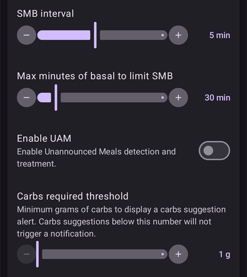
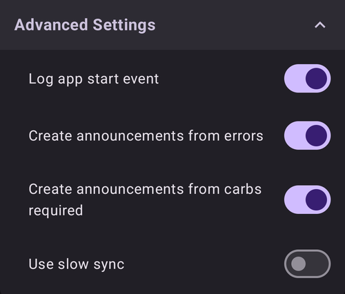
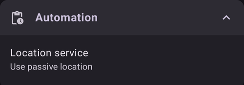
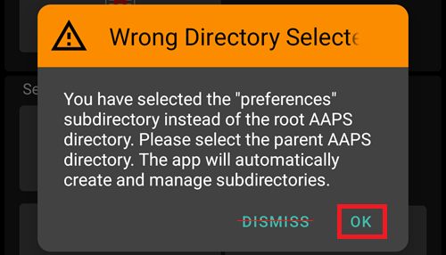
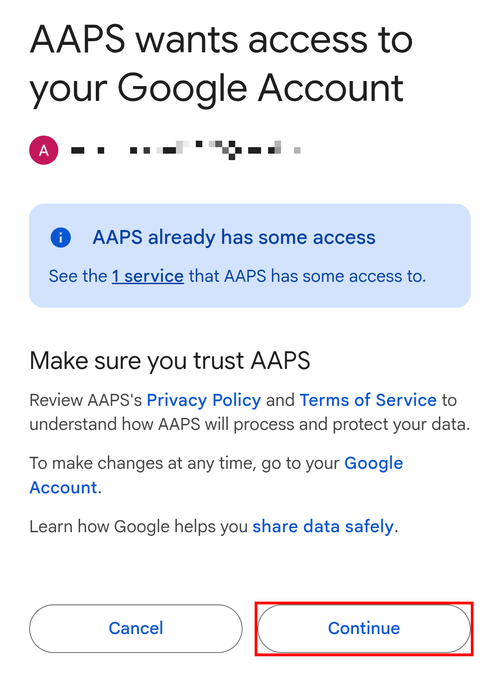
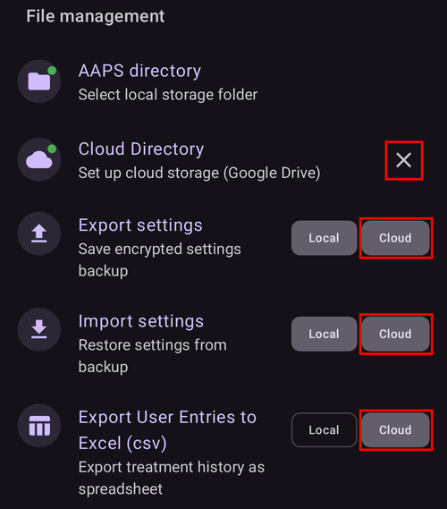

# Instellingen

In **AAPS** v4 vind je de voorkeuren op het scherm **Instellingen**. Er zijn drie manieren om ze te openen — zie [Wijzigingen maken in de configuratie van AAPS](../SettingUpAaps/ChangeAapsConfiguration.md) voor de details:

1. Tik op het pictogram **Instellingen** (tandwiel) rechtsboven in het hoofdscherm: alle instellingen, verdeeld over secties die je kunt openklappen.
2. Tik in **Configuratie** op "**Instellingen**" onder een actieve plugin: alleen de instellingen van die plugin.
3. Gebruik de **zoekbalk** bovenaan het hoofdscherm: begin gewoon een deel van de tekst te typen die je zoekt. Zo vind je losse instellingen (ook instellingen die niet zichtbaar zijn op het scherm Instellingen), dialogen en documentatie.


- Je opent en sluit **secties** door erop te tikken. Welke secties je ziet, hangt af van de plugins die je hebt ingeschakeld en van de [Eenvoudige modus](#preferences-simple-mode).


```{contents}
:backlinks: entry
:depth: 2
```

(Preferences-general)=
## Algemeen


**Eenheid**

- Stel de eenheid in op mmol/l of mg/dl, zoals jij dat wilt.

**Taal**

- By default **AAPS** follows the language of the phone (recommended).

- If you want **AAPS** in another language than the phone, choose it here. On Android 13 and newer, **AAPS** registers it as its own app language in Android, so all its screens, the main screen, the widgets and the way numbers are written follow it.

- Als je de taal verandert, worden de teksten van **AAPS** meteen in de nieuwe taal getoond. Zie je nog teksten in de oude taal? Start **AAPS** dan opnieuw.
- On Android 12 this setting is not shown: **AAPS** always uses the language of the phone.
- Instelling verborgen in [eenvoudige modus](#preferences-simple-mode).

(preferences-simple-mode)= **Eenvoudige modus**

De **eenvoudige modus** staat standaard aan als je **AAPS** voor het eerst installeert. In de **eenvoudige modus** is een groot deel van de instellingen verborgen en worden instellingen vervangen door vooraf ingestelde waarden. Zet de eenvoudige modus uit zodra je de gebruikersinterface en de instellingen van **AAPS** goed kent.

**Insuline concentratie ondersteuning**

- Zet ondersteuning aan voor andere insulineconcentraties (U50, U200, ...). Zet dit alleen aan als je echt een andere concentratie dan U100 gebruikt, en lees de waarschuwingen goed.
- Instelling verborgen in [eenvoudige modus](#preferences-simple-mode).

**Scherm aan houden**

- Zorgt dat Android het scherm altijd aan houdt. Dit is handig voor presentaties enz. Maar het kost veel batterijstroom. Daarom wordt aangeraden om de smartphone aan een oplaadkabel te koppelen.

**Naam van dit exemplaar**

- De naam van de persoon die deze telefoon gebruikt. Hiermee is deze **AAPS** te herkennen in rapporten en bij synchronisatie, bijvoorbeeld als twee kinderen met diabetes type 1 in je gezin **AAPS** gebruiken.
- Wordt gebruikt in de namen van geëxporteerde instellingenbestanden.
- Wordt getoond op de [Dual Watchface](../WearOS/WearOsSmartwatch.md).

(Preferences-skin)=
### Skin

De keuze van de skin uit **AAPS** 3.x (Original, Low resolution, Large display...) bestaat niet meer in **AAPS** 4. De nieuwe interface past zich automatisch aan je scherm aan, en het kleurenschema kun je veranderen in [Weergave](#preferences-appearance).

(preferences-appearance)=
## Weergave


(Preferences-range-for-visualization)=
### Bereik voor visualisatie

Kies de hoge en lage grens voor de BG-grafiek op het hoofdscherm van **AAPS** en op de smartwatch. Het is alleen voor de weergave, niet het streefbereik voor je BG. Voorbeeld: 70 - 180 mg/dl of 3,9 - 10 mmol/l

(Preferences-show-notes-field-in-treatments-dialogs)=
### Notities weergeven in dialogen

Hiermee kun je korte notities toevoegen aan je behandelingen (bolus wizard, koolhydraten, insuline...)

Instelling verborgen in [eenvoudige modus](#preferences-simple-mode).

### Kleurenschema

Kies tussen het lichte thema, het donkere thema of de systeeminstelling van je telefoon.

(Preferences-protection)=
## Beveiliging


(Preferences-master-password)=
### Hoofdwachtwoord

Verplicht om [instellingen te kunnen exporteren](../Maintenance/ExportImportSettings.md), omdat die vanaf versie 2.7 versleuteld zijn.

**Biometrische beveiliging werkt misschien niet op OnePlus-telefoons. Dit is een bekend probleem van OnePlus op sommige telefoons.**


(Preferences-settings-protection)=
### Instellingen beveiliging

- Beveilig je instellingen met een wachtwoord of met de biometrische verificatie van je telefoon (bijv. als een [kind **AAPS** gebruikt](../RemoteFeatures/RemoteMonitoring.md)). Als je deze functie aanzet, moet je je elke keer verifiëren als je een scherm met instellingen wilt openen.

- De beheerschermen (**Profiel**, **Insuline instellingen**, **Tijdelijk streefdoel**, **QuickWizard**) openen dan als **alleen lezen**. Je kunt een item nog steeds activeren of gebruiken, maar toevoegen, bewerken, klonen en verwijderen zijn verborgen tot je je instellingen ontgrendelt. Zie [Instellingen beveiliging vergrendelt nu ook de beheerschermen](#v4changes-read-only-management).

- Gebruik een aangepast wachtwoord als je het hoofdwachtwoord alleen wilt gebruiken om [geëxporteerde instellingen](../Maintenance/ExportImportSettings.md) te beveiligen, en een ander wachtwoord om de instellingen te bewerken.

- Gebruik je een aangepast wachtwoord? Tik dan op de regel "Wachtwoord instellingen" om het wachtwoord in te stellen zoals [hierboven](#Preferences-master-password) beschreven.

### App beveiliging

Als de app beveiligd is, moet je het wachtwoord invoeren of de biometrische verificatie van je telefoon gebruiken om **AAPS** te openen. Dat moet opnieuw als je terugkomt na de [time-out van de beveiliging](#Preferences-password-and-pin-retention).

**AAPS** sluit meteen af als een verkeerd wachtwoord wordt ingevoerd - maar blijft op de achtergrond draaien als het eerder met succes was geopend.

### Bolus beveiliging

- Bolus beveiliging kan handig zijn als **AAPS** door een klein kind wordt gebruikt en je [een bolus via sms](../RemoteFeatures/SMSCommands.md) geeft.

- **Bolus beveiliging** kun je pas kiezen als **Instellingen beveiliging** (niveau 2) is ingesteld.

- In het voorbeeld hieronder gebruikt de bolus beveiliging het **Hoofdwachtwoord**: **AAPS** vraagt erom voordat een behandelingsdialoog zoals **Insuline** opent. Met **Biometrisch** kun je het hoofdwachtwoord invoeren als de biometrische verificatie niet werkt.


(Preferences-password-and-pin-retention)=
### Geldigheid wachtwoord en pincode

**Time-out** bepaalt hoe lang (in seconden) de instellingen of bolusfuncties ontgrendeld blijven nadat je het wachtwoord goed hebt ingevoerd.

## Veiligheid van behandelingen


(preferences-patient-type)=
### Leeftijd patiënt

- Veiligheidslimieten worden ingesteld op basis van de leeftijd die je in deze instelling selecteert.
- Als je deze harde limieten (zoals max bolus) vaak bereikt, is het tijd om één stap hoger te kiezen.
- Het is een slecht idee om een hogere leeftijd te kiezen dan de echte leeftijd. Dat kan leiden tot een overdosis als je een verkeerde waarde invoert in het insulinedialoog (bijvoorbeeld als je de decimale punt vergeet).
- Wil je de echte getallen van deze vaste veiligheidslimieten weten? Scroll dan op [deze pagina](../DailyLifeWithAaps/KeyAapsFeatures.md) naar de algoritmefunctie die je gebruikt.

(Preferences-maximum-bolus)=
### Maximum bolus

- Bepaalt de maximale hoeveelheid bolusinsuline, in insuline-eenheden, die **AAPS** in één keer mag afgeven.
- Deze instelling is een veiligheidslimiet om te voorkomen dat er per ongeluk een enorme bolus wordt afgegeven door een misrekening of typfout van de gebruiker.
- Het wordt aangeraden om dit in te stellen op een verstandige hoeveelheid die ongeveer gelijk is aan de grootste hoeveelheid bolusinsuline die je ooit nodig zult hebben voor een maaltijd of een correctie.
- Deze beperking wordt ook toegepast op de resultaten van de Boluscalculator.

### Maximum toegestane koolhydraten

- Bepaalt de maximale hoeveelheid koolhydraten, in grammen, waarvoor de boluscalculator van **AAPS** een bolus mag berekenen.
- Deze instelling is een veiligheidslimiet om te voorkomen dat er per ongeluk een enorme bolus wordt afgegeven door een misrekening of typfout van de gebruiker.
- Het wordt aangeraden om dit in te stellen op een verstandige hoeveelheid die ongeveer gelijk is aan de grootste hoeveelheid koolhydraten die je ooit nodig zult hebben voor een maaltijd.

## BG bron

De instellingen van je gekozen [BG bron](#Config-Builder-bg-source) staan in een eigen sectie. Bijvoorbeeld met **xDrip+ BG**:


- **Upload data naar NS**: laat **AAPS** de ontvangen BG-waarden naar Nightscout uploaden. Zet dit alleen aan als de CGM-app ze zelf nog niet uploadt.
- **Log plaatsen nieuwe sensor**: maak automatisch een therapiegebeurtenis 'sensor gewisseld' aan als de sensor wordt geplaatst.

## Het hoofdscherm

In **AAPS** 3.x stonden deze instellingen samen in een sectie "Overzicht". In **AAPS** 4 stel je ze direct in vanuit de onderdelen van het hoofdscherm waar ze bij horen.

(Preferences-buttons)=
### QuickLaunch-knoppen

Bepaal welke actieknoppen zichtbaar zijn op het hoofdscherm: tik op het kleine **tandwiel** onderaan in het midden van het hoofdscherm ("Configureer QuickLaunch") en kies **Toevoegen** voor de acties die je snel wilt kunnen gebruiken (behandelingen, CGM-acties, Careportal-invoer...).


(Preferences-quick-wizard)=
### Quick Wizard

Maak eigen knoppen voor bepaalde standaardmaaltijden of tussendoortjes. Deze knoppen worden op het hoofdscherm getoond. Handig voor standaardmaaltijden die je vaak eet.

Voor elke knop stel je de koolhydraten en de berekeningsmethode voor de bolus in. Daarna stel je in tijdens welke tijdsperiode de knop zichtbaar is op je hoofdscherm - maar één knop per periode. De knop is niet zichtbaar buiten de ingestelde tijdsperiode, of als je genoeg IOB hebt voor de koolhydraten van de QuickWizard-knop. Als je voor verschillende maaltijden verschillende tijden instelt, heb je op het hoofdscherm altijd de juiste knop voor de standaardmaaltijd, afhankelijk van het tijdstip van de dag.

Om je QuickWizard-instellingen te beheren, typ je "QuickWizard" in de zoekbalk van het hoofdscherm en open je **QuickWizard - QuickWizard-instellingen beheren**.

Als je op de QuickWizard-knop tikt, berekent **AAPS** een bolus voor die koolhydraten op basis van je huidige ratio's en stelt die voor (rekening houdend met de bloedglucose of de actieve insuline (IOB), als dat zo is ingesteld).

Je moet het voorstel bevestigen voordat de insuline wordt afgeleverd.

(Preferences-default-temp-targets)=
### Standaard tijdelijke streefdoelen

Met [tijdelijke streefdoelen (TT)](../DailyLifeWithAaps/TempTargets.md) kun je je bloedglucosestreefdoel voor een bepaalde tijd veranderen. Met standaard TT's kun je je streefdoel gemakkelijk aanpassen voor activiteit, binnenkort eten enz.

Tik op het **streefbereik** op het hoofdscherm om het scherm **Tijdelijk streefdoel** te openen. Veeg door de kaarten met voorinstellingen (Eet Binnenkort, Activiteit, Hypo) en verander het streefdoel en de duur van elke voorinstelling onder **Presetinstellingen**. Standaardwaardes zijn:

* Eet Binnenkort: streefdoel 90 mg/dl / 5,0 mmol/l, duur 45 min
* Activiteit: streefdoel 140 mg/dl / 7,8 mmol/l, duur 90 min
* Hypo: streefdoel 160 mg/dl / 8,9 mmol/l, duur 60 min


Lees [hier hoe je tijdelijke streefdoelen activeert](#TempTargets-where-can-i-select-a-temp-target).

### Prime/Vul standaard insuline hoeveelheden

Wil je de slang vullen of de canule voorvullen via **AAPS**? Dat doe je met de knoppen **Prime/Vul** in het uitgeklapte statuspaneel van het hoofdscherm.

De standaardhoeveelheden van de drie vulknoppen stel je in bij de instellingen **Prime/Vul**, afhankelijk van de lengte van je canule. Typ "prime" in de zoekbalk van het hoofdscherm om ze te openen.


(Preferences-status-lights)=
### Statusindicatoren

Statusindicatoren geven een visuele waarschuwing voor:

- Sensor leeftijd
- Insuline leeftijd (aantal dagen dat reservoir wordt gebruikt)
- Reservoir niveau (eenheden)
- Canule leeftijd
- Pomp batterij leeftijd
- Pomp batterij niveau (%)

Als de waarschuwingsdrempel wordt overschreden, worden de waarden geel weergegeven. Als de kritieke drempel wordt overschreden, worden de waarden rood weergegeven.

Om de drempels te veranderen, klap je het statuspaneel op het hoofdscherm uit (pijltje rechts van de statusregel) en tik je op het kleine pictogram **Instellingen** naast "Status":


Tik op een onderdeel (**Canule**, **Insuline**, **Sensor** of **Pomp batterij**) om de waarschuwings- en kritieke drempels te openen:


Met de laatste optie kun je deze instellingen uit Nightscout importeren, als ze daar zijn ingesteld. Zie de [Nightscout-documentatie](https://nightscout.github.io/nightscout/setup_variables/#age-pills) voor meer informatie.

(Preferences-deliver-this-part-of-bolus-wizard-result)=
### Instellingen bolus wizard

Typ "bolus" in de zoekbalk van het hoofdscherm om de instellingen van de **Bolus wizard** te openen:


**Bolus percentage** stelt het [standaardpercentage](#AapsScreens-section-j) in van de bolus die de bolus wizard berekent.

Standaard is 100%: geen correctie. Ook als je hier een andere waarde instelt, kun je die nog steeds aanpassen elke keer dat je de bolus wizard gebruikt. Als deze instelling 75% is en je 10 E zou moeten bolussen, stelt de bolus wizard een maaltijdbolus voor van maar 7,5 eenheden.

Bij gebruik van [SMB](#objectives-objective9) geven veel mensen niet 100% van de benodigde insuline als maaltijdbolus, maar maar een deel ervan (bijv. 75%). De rest laten ze over aan SMB met UAM (Unattended Meal Detection, detectie van niet-aangekondigde maaltijden). Een waarde lager dan 100% kan hier handig zijn:
* voor mensen met een trage vertering: de hele bolus vooraf geven kan een hypo veroorzaken, omdat de insuline sneller werkt dan de vertering.
* om **AAPS** meer ruimte te geven om zelf met een **stijgende BG** om te gaan. In beide gevallen vult **AAPS** het ontbrekende deel van de bolus aan met SMB's, als en wanneer dat nodig is.

**Gebruik de bolusadviseur**

Als dit aan staat en je de bolus wizard gebruikt terwijl je BG te hoog is (hyperglykemie), krijg je een waarschuwing. Je wordt dan gevraagd of je een pre-bolus wilt geven en later wilt eten, als je **BG** weer binnen bereik is.

(Preferences-advanced-settings-overview)=
### Superbolus

De optie Superbolus uit **AAPS** 3.x is in **AAPS** 4 niet beschikbaar als instelling.

## Loop

Zie [AAPS-schermen > Het hoofdscherm > Loop status](#AapsScreens-loop-status) om de loopmodus nu te veranderen.

(Preferences-minimal-request-change)=
### Minimum wijziging open loop

Bij gebruik van **Open loop** krijg je een melding telkens als **AAPS** voorstelt de basaalstand aan te passen. Om het aantal meldingen te verminderen, kun je een [breder BG-streefbereik](#profile-glucose-targets) gebruiken of het percentage van de instelling "**Minimum wijziging open loop**" verhogen. Dit bepaalt hoe groot de relatieve wijziging moet zijn voordat je een melding krijgt.


## Advanced Meal Assist (AMA) of Super Micro Bolus (SMB)

Afhankelijk van je instellingen in [Configuratie > APS](../SettingUpAaps/ConfigBuilder.md) kun je kiezen tussen twee algoritmes:

- [Advanced meal assist (OpenAPS AMA)](#Open-APS-features-advanced-meal-assist-ama) - stand van het algoritme in 2017
- [Super Micro Bolus (OpenAPS SMB)](#Open-APS-features-super-micro-bolus-smb) - het nieuwste algoritme, aanbevolen voor beginners

Vanaf [**AAPS** versie 3.3](#version3300) is de functie [Dynamische ISF](../DailyLifeWithAaps/DynamicISF.md) verplaatst naar OpenAPS SMB.

### OpenAPS AMA

Alle instellingen voor OpenAPS AMA staan beschreven in het eigen gedeelte in [Belangrijkste functies van AAPS > Advanced Meal Assist (AMA)](#Open-APS-features-advanced-meal-assist-ama).

(Preferences-openaps-smb-settings)=
### OpenAPS SMB

Alle instellingen voor OpenAPS SMB staan beschreven in het eigen gedeelte in [Belangrijkste functies van AAPS > Super Micro Bolus (SMB)](#Open-APS-features-super-micro-bolus-smb).

Welke instellingen je ziet, hangt af van je voortgang in de [Doelen](../SettingUpAaps/CompletingTheObjectives.md) en van de [Eenvoudige modus](#preferences-simple-mode). Bij een nieuwe installatie wordt alleen **Gebruik dynamische gevoeligheid** getoond. Als de doelen zijn afgerond, ziet de sectie er zo uit:




**Geavanceerde instellingen** onderaan de sectie bevat waarden die je normaal niet hoeft te veranderen:


## Opname instellingen


(Preferences-min_5m_carbimpact)=
### SMB min 5 m koolhydraten impact (min_5m_carbimpact)

Instelling verborgen in [eenvoudige modus](#preferences-simple-mode).

Het algoritme gebruikt BGI (blood glucose impact, invloed op de bloedglucose) om te bepalen wanneer [koolhydraten zijn opgenomen](../DailyLifeWithAaps/CobCalculation.md).

Als de opname van koolhydraten niet dynamisch kan worden bepaald uit de reactie van je bloed, gebruikt **AAPS** een standaard afbraak voor je koolhydraten. Het is in feite een vangnet. Deze waarde wordt alleen gebruikt tijdens gaten in de **CGM**-metingen, of als lichamelijke activiteit de hele bloedglucosestijging "opgebruikt" die er anders voor zou zorgen dat **AAPS** de COB laat afnemen.

Eenvoudig gezegd: het algoritme "weet" hoe je BG zich *zou moeten* gedragen onder invloed van de huidige dosis insuline enz. Elke keer als er een positieve afwijking is van het verwachte gedrag, worden er wat koolhydraten als opgenomen/afgebroken beschouwd. Hierbij geldt: grote verandering = veel koolhydraten.

De min_5m_carbimpact bepaalt de standaard opname van koolhydraten per 5 minuten. Voor de volledige beschrijving van deze parameter, zie de [documentatie van OpenAPS over voorkeuren en veiligheidsinstellingen](https://openaps.readthedocs.io/en/latest/docs/While%20You%20Wait%20For%20Gear/preferences-and-safety-settings.html?highlight=carbimpact#min-5m-carbimpact).

Standaard waarde voor AMA is 3, voor SMB is het 8.

De COB-grafiek op het hoofdscherm laat met oranje stippen bovenaan de COB-lijn zien wanneer min_5m_carbimpact wordt gebruikt.


### Afkapmoment koolhydraatabsorptie

Tijd waarna een maaltijd als opgenomen wordt beschouwd; de overgebleven koolhydraten worden dan geschrapt. Als je vaak maaltijden met een hoog vet- of eiwitgehalte eet, moet je de opnametijd verhogen.

### Geavanceerde instellingen - autosens ratio


- Stel de min. en max. [autosens](#Open-APS-features-autosens)-ratio in.
- Normaal gesproken moet je de standaardwaarden (max. 1,2 en min. 0,7) niet veranderen.

## Pomp


### BT Watchdog

Zet de BT Watchdog aan als dat nodig is (bijv. voor Dana-pompen). Deze zet Bluetooth één seconde uit als er geen verbinding met de pomp mogelijk is. Dit kan helpen op sommige telefoons waarop de Bluetooth-stack vastloopt.

## Pomp instellingen

De opties hier hangen af van het pompstuurprogramma dat je hebt gekozen in [Configuratie > Pomp](#Config-Builder-pump). Koppel en stel je pomp in volgens de [instructies voor je pomp](../Getting-Started/CompatiblePumps.md).

Bijvoorbeeld met de **Virtuele Pomp** heet de sectie **Virtuele pomp instellingen**. Je kiest welk **Soort pomp** de virtuele pomp nabootst, en of de status ervan naar Nightscout wordt geüpload:


## Tidepool

Meer informatie vind je op de pagina [Tidepool](../SettingUpAaps/Tidepool.md).

(Preferences-nsclient)=
## NSClientV3


De NSClient-plugin (in het configuratiemenu getoond als **NSClientV3**) synchroniseert je gegevens met Nightscout. Deze gebruikt de Nightscout API v3.

```{admonition} Data uploaders
:class: warning

Bij gebruik van NSClientV3 moeten alle uploaders de Nightscout API v3 gebruiken. Als een andere uploader (bijvoorbeeld je CGM-app) niet geschikt is voor API v3, **laat dan AAPS alle gegevens** (BG, behandelingen, ...) naar Nightscout uploaden en zet die uploader uit.
```

- Stel je *Nightscout URL* in (bijv. <https://yoursitename.yourplatform.dom>).
- **Zorg ervoor dat de URL is ingevuld ZONDER /api/v1/ aan het eind.**
- Maak in Nightscout een *[Admin token](https://nightscout.github.io/nightscout/security/#create-a-token)* aan (hiervoor heb je [Nightscout 15](https://nightscout.github.io/update/update/) nodig om de V3 API te gebruiken) en vul het in bij **Nightscout toegangstoken** (niet je API Secret!). Op **AAPSClient** kun je in plaats daarvan de QR-code van de AAPS-telefoon scannen. Daarmee krijgt de client een eigen token. Een client die met de pincode is gekoppeld, krijgt na het koppelen een eigen token van de AAPS-telefoon. Zie [Het eigen Nightscout-token van de client](#client-master-control-own-token).
- Hiermee kunnen gegevens worden gelezen en geschreven tussen de Nightscout-website en **AAPS**.
- Als je vastzit in Doel 1, controleer dan goed of je hier geen typfouten hebt gemaakt.
- Laat "Websockets gebruiken" aan staan (aanbevolen).

(Preferences-nsclient-synchronization)=
### Synchronisatie


Welke synchronisatie je kiest, hangt af van hoe je **AAPS** wilt gebruiken.

Je kunt kiezen welke gegevens je wilt [uploaden naar of downloaden van Nightscout](#Nightscout-aaps-settings).

Zolang client besturing aan staat (altijd in Eenvoudige modus), zijn deze instellingen verborgen: **AAPS** staat dan in [beveiligde modus](#client-master-control-hardened-mode), neemt geen wijzigingen over die direct in Nightscout zijn gedaan en uploadt al zijn gegevens.

### Alarm opties


- Met Alarm opties kies je welke Nightscout-alarmen je via de app wilt gebruiken. **AAPS** geeft een alarm als er een Nightscout-alarm afgaat.
- Om de alarmen te laten klinken, moet je de alarmwaarden Urgent High, High, Low en Urgent Low instellen in je [Nightscout-variabelen](https://nightscout.github.io/nightscout/setup_variables/#alarms).
- Ze werken alleen als je verbinding hebt met Nightscout en zijn bedoeld voor ouders/verzorgers.
- Heb je de **CGM**-bron op je telefoon (bijv. xDrip of BYODA)? Gebruik dan die alarmen in plaats van de Nightscout-alarmen.
- NS meldingen toont Nightscout-[aankondigingen](https://nightscout.github.io/nightscout/discover/#announcement) als meldingen in **AAPS**.
- Je kunt de drempels voor de alarmen voor oude gegevens en dringend oude gegevens aanpassen. Deze alarmen gaan af als er na een bepaalde tijd geen gegevens van Nightscout zijn ontvangen.

### Afstandsbediening

De schakelaar "**Client controle toestaan**" staat niet meer in deze instellingen: je vindt hem bovenaan **Beheren → Geautoriseerde clients**, waar de gekoppelde clients worden beheerd. Zie de pagina [Master ↔ Client besturing](../RemoteFeatures/ClientMasterControl.md), ook over de [beveiligde modus](#client-master-control-hardened-mode), die deze schakelaar aanzet.

### Verbindings instellingen


- Met Verbindings instellingen bepaal je wanneer de verbinding met Nightscout actief is.
- Beperk de Nightscout-upload tot alleen wifi, of zelfs tot bepaalde wifi-SSID's.
- Wil je alleen een bepaald wifi-netwerk gebruiken? Dan kun je de wifi-SSID van dat netwerk invullen.
- Meerdere SSID's kunnen worden gescheiden door puntkomma's.
- Om alle SSID's te verwijderen, vul je een spatie in dit veld in.

(Preferences-advanced-settings-nsclient)=
### Advanced settings (NSClientV3)



De opties in de geavanceerde instellingen spreken voor zich.

## SMS Commando's

Meer informatie vind je op de pagina [SMS-commando's](../RemoteFeatures/SMSCommands.md).

(preferences-wear)=
## Wear

Deze sectie wordt getoond als de plugin **Wear** is ingeschakeld in [Configuratie > Communicatie](#Config-Builder-wear). Meer informatie vind je op de pagina's [AAPS instellen op je Wear OS-horloge](../WearOS/WearOsSmartwatch.md) en [AAPS bedienen via je Wear OS smartwatch](../RemoteFeatures/RemoteControlWearOS.md).


- **Bediening via smartwatch**: sta toe dat behandelingen en andere acties vanaf het horloge worden verstuurd. Zonder deze instelling toont het horloge alleen gegevens: de telefoon weigert elke opdracht van het horloge. Als je op een complicatie tikt die een bedieningsscherm zou openen, opent in plaats daarvan het menu van **AAPS** op het horloge.

**Instellingen Wear Wizard** bepaalt welke berekeningen worden meegenomen in het resultaat van de bolus wizard op het horloge. Op het horloge voer je alleen de koolhydraten in; deze schakelaars vervangen de keuzes die je in de bolus wizard op de telefoon zou maken:

- **Gebruik BG in wizard**: voeg een correctie toe voor het verschil tussen je huidige glucose en je streefdoel.
- **Gebruik tijdelijk streefdoel in wizard**: gebruik voor deze correctie het actieve tijdelijke streefdoel in plaats van het streefdoel uit het profiel.
- **Gebruik trend in wizard**: houd rekening met de huidige trend van de glucose.
- **Gebruik COB in wizard**: voeg insuline toe voor de koolhydraten die nog actief zijn.
- **Gebruik IOB in wizard**: trek de insuline af die nog actief is.


**Aanpasbare Wijzerplaat Instellingen** bevat **Aangepaste wijzerplaten toestaan**. Een bestand met een aangepaste watchface kan waarden bevatten voor sommige instellingen van het horloge. Als deze schakelaar aan staat, mag zo'n watchface bij het laden die instellingen op het horloge veranderen; als hij uit staat, wordt de watchface geladen maar blijven de instellingen zoals ze zijn:


**Algemene instellingen** bevat **Melding bij SMB**, zodat je op het horloge een melding krijgt elke keer als er een SMB wordt gegeven:


## Autotune

Deze sectie wordt getoond als de plugin **Autotune** is ingeschakeld in [Configuratie > Algemeen](#Config-Builder-autotune). De instellingen staan beschreven op de pagina [Autotune](../AdvancedOptions/Autotune.md).


## Automatisering



Selecteer welke locatieservice moet worden gebruikt:

- Gebruik passieve locatie: **AAPS** neemt alleen locaties over als andere apps erom vragen
- Gebruik netwerklocatie: locatie van je wifi
- Gebruik GPS-locatie (Let op! Dit kan veel batterijverbruik geven!)

## Lokale alarmen


Instellingen spreken voor zich.

**Override Do Not Disturb mode** (on by default): the **AAPS** alarms ring even when the phone is silent or in Do Not Disturb. Turn it off if **AAPS** should respect those modes: the alarms do not ring then, and in Do Not Disturb they only vibrate, on the phone and on the watch. Loop suggestions that arrive during Do Not Disturb are shown without a sound.

When an alarm rings, the alarm screen offers **Silence alarm** (the screen stays open, so you can read the message) and **Silence and close**. Swiping the alarm notification away in the notification tray mutes the alarm. When you open **AAPS** later, an alarm you did not answer is shown again.

(preferences-maintenance-settings)=
## Onderhoud instellingen


**E-mailontvanger**: de standaardontvanger van logbestanden is <logs@aaps.app>.

**Aantal logbestanden te verzenden**: hoeveel van de nieuwste logbestanden worden meegestuurd als je logbestanden verstuurt.

**Data Keuzes**


Je kunt helpen **AAPS** verder te ontwikkelen door crashrapporten naar de ontwikkelaars te sturen.

**Automatisch instellingen exporteren**<br/> Als je deze functie aanzet, mag **AAPS** instellingen exporteren zonder dat jij iets hoeft te doen. Hiervoor wordt het hoofdwachtwoord bij de volgende handmatige export veilig opgeslagen op je telefoon (alleen daar). Het opgeslagen wachtwoord wordt maximaal 4 weken gebruikt. Na 4 weken krijg je een melding dat het wachtwoord bijna verloopt. Tijdens een extra periode van 1 week kun je het wachtwoord dan vernieuwen door handmatig instellingen te exporteren vanuit het menu Onderhoud.

Als deze extra periode van 1 week voorbij is, verloopt het opgeslagen wachtwoord. Elke automatische export van instellingen stopt dan en je krijgt een melding met de vraag om het wachtwoord opnieuw in te voeren. [(**Automatische exports van instellingen**)](../DailyLifeWithAaps/Automations.md#automating-preference-settings-export) worden vastgelegd in de lijsten 'Careportal' en 'Gebruikersinvoer' van **AAPS** onder Behandelingen.

Doe na het aanzetten van deze optie een handmatige export van de instellingen. Je wordt dan om je wachtwoord gevraagd, zodat **AAPS** het kan opslaan.

### Logbestanden

AAPS slaat logbestanden op om problemen te kunnen oplossen.

Zet deze functie niet uit: als er iets misgaat, helpt het om de oorzaak te begrijpen.

Moet je de logbestanden naar de ontwikkelaars sturen? Beschrijf het probleem dan nauwkeurig in de e-mail. Stuur logbestanden het liefst alleen als daarom wordt gevraagd, na een [probleemmelding op GitHub](https://github.com/nightscout/AndroidAPS/issues).

Je vindt de logbestanden van AAPS in het geheugen van je telefoon -> Android -> data -> info.nightscout.androidaps -> files.

Het beheer van logbestanden (log-instellingen, logbestanden verzenden en verwijderen) en het bestandsbeheer vind je op het scherm **Onderhoud**. Je opent dat via het **menu** (☰) linksboven in het hoofdscherm:


(preferences-maintenance-logdirectory)=

### De lokale AAPS map instellen

Op het scherm **Onderhoud** staat ook de **AAPS map**. Met deze instelling kies je een map op je telefoon waarin **AAPS** instellingen, logbestanden en andere bestanden opslaat. Als je een map hebt gekozen, wordt het pad ervan (bijvoorbeeld `Documents/AAPS`) getoond onder **AAPS map**. Zo zie je altijd waar je bestanden worden opgeslagen.

Het wordt sterk aangeraden om een map te gebruiken die direct in de hoofdmap van het telefoongeheugen staat. Standaard is dat AAPS.


Als je een submap van AAPS kiest, krijg je een foutmelding. Tik op "OK" en probeer het opnieuw. Kies dan de juiste map (één niveau hoger). Kies niet "NEGEREN", tenzij je precies weet wat je doet.



Android kan de toestemming voor de map zonder melding intrekken, bijvoorbeeld als je **AAPS** opnieuw installeert of de opslag ervan wist. Als dat gebeurt, toont **AAPS** een blijvende melding **De toegang tot de AAPS map is verloren**. Het lokaal exporteren van instellingen werkt dan niet meer tot je hier terugkomt en de map opnieuw kiest. Doe dit snel, anders worden je back-ups op de telefoon niet meer bijgewerkt.

(preferences-maintenance-cloud)=

### Een cloud map instellen

Je kunt je instellingen, logbestanden en CSV-gegevens exporteren naar een clouddienst.

1. Open het **menu** (☰), kies **Onderhoud** en tik op **Cloud map** (onder **Bestandsbeheer**).

   

2. Kies bij **Selecteer een opslagtype** de optie **Google Drive**.

   

3. Er opent een inlogpagina van Google. Kies het Google-account waarin je back-ups worden bewaard (je kunt een [apart Google-account](../UsefulLinks/DedicatedGoogleAccountForAaps.md) gebruiken).

   

4. Controleer of het account het juiste is en tik op **Continue** (Doorgaan) om **AAPS** toegang te geven. Als je de cloud map al eerder hebt ingesteld, staat op de pagina dat **AAPS** al enige toegang heeft.

   

5. Terug in **AAPS** verschijnt de melding **Authenticatie cloudopslag gelukt** onderaan het hoofdscherm:

   

   In het menu **Onderhoud** heeft **Cloud map** nu een groene stip, en de knoppen **Cloud** naast **Logbestanden verzenden**, **Exporteer instellingen**, **Importeer instellingen** en **Exporteer gebruikersinvoer naar Excel (csv)** zijn beschikbaar.

   

Om te stoppen met exporteren naar de cloud, tik je op het pictogram **✕** (**Wis instellingen**) aan het eind van de regel **Cloud map** in het menu **Onderhoud** (dit wordt getoond als er een clouddienst is ingesteld) en bevestig je **Wis cloud instellingen**. Dan wordt er teruggeschakeld naar lokale opslag en wordt de autorisatie gewist.

## Open Humans

Je kunt de community verder helpen door jouw gegevens te doneren aan wetenschappelijk onderzoek. De details staan op de [Open Humans-pagina](../SupportingAaps/OpenHumans.md).

In **Instellingen → Open Humans** kun je instellen wanneer gegevens worden geüpload
- alleen als er verbinding is met wifi
- alleen tijdens opladen
