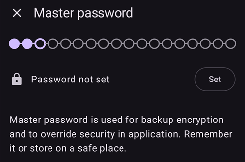
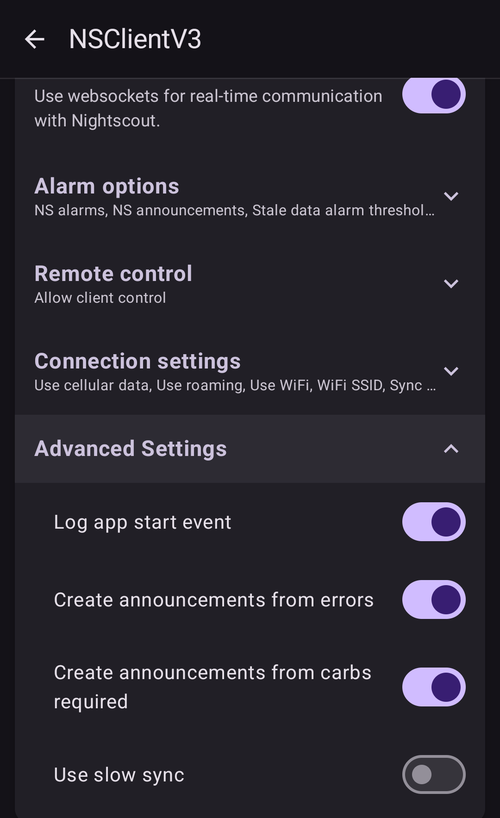
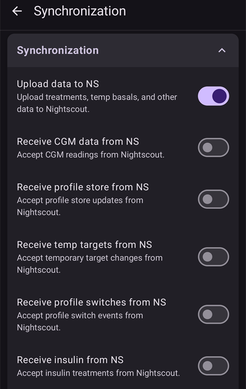
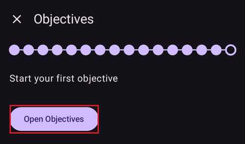

# Setup Wizard van AAPS

```{contents} In this page
:backlinks: entry
:depth: 2
```

Als je **AAPS** voor het eerst start, word je begeleid door de "**Setup Wizard**". Zo stel je snel alle basisinstellingen van je app in één keer in. De **Setup Wizard** begeleidt je, zodat je niets belangrijks vergeet. Zo zijn bijvoorbeeld de **instellingen voor machtigingen** essentieel om **AAPS** goed in te stellen.

Je hoeft echter niet alles volledig in te stellen bij de eerste keer dat je de **Setup Wizard** gebruikt. Je kunt de wizard eenvoudig verlaten en er later naar terugkeren. Na de **Setup Wizard** zijn er drie manieren om de configuratie verder te verbeteren of aan te passen. Die worden in het volgende deel uitgelegd. Het is dus geen probleem als je sommige punten in de Setup Wizard overslaat: je kunt ze later eenvoudig instellen.

Tijdens en direct na het gebruik van de **Setup Wizard** merk je misschien geen grote zichtbare veranderingen in **AAPS**. Om je **AAPS**-loop aan te zetten, moet je de **Doelen** volgen. Zo zet je de ene functie na de andere aan. Aan het einde van de Setup Wizard start je **Doel 1**. Jij bent de baas over **AAPS**, niet andersom.

```{admonition} Preview Objectives
:class: note
Wil je graag weten hoe de doelen zijn opgebouwd, lees dan [De doelen voltooien](../SettingUpAaps/CompletingTheObjectives.md), maar kom daarna hier terug om eerst de Setup Wizard te doorlopen.

```

Uit ervaring weten we dat nieuwe gebruikers zichzelf vaak onder druk zetten om **AAPS** zo snel mogelijk in te stellen. Dat kan tot frustratie leiden, want er valt veel te leren.

Neem dus je tijd om je loop in te stellen. De voordelen van een goed werkende **AAPS**-loop zijn enorm.

```{admonition} Ask for Help
:class: note
Als er een fout in de documentatie staat of als je een beter idee hebt om iets uit te leggen, kun je de community om hulp vragen, zoals uitgelegd in [Contact met andere gebruikers](../GettingHelp/WhereCanIGetHelp.md).
```
## Welkomstbericht

Als de Setup Wizard opent, begroet hij je met een kort welkomstbericht en toont hij direct onderaan het scherm een paneel "**Vereiste machtigingen**" (zie het volgende deel).

Als je de machtigingen hebt gegeven, sluit het paneel en toont het welkomstscherm een knop "**Volgende**". Druk op "**VOLGENDE**" om verder te gaan:


## Vereiste machtigingen

**AAPS** heeft een aantal machtigingen nodig om goed te werken. De wizard toont ze samen in één paneel "**Vereiste machtigingen**", elk met een eigen knop "**Toestaan**". Geef ze één voor één — het pictogram naast elk item verandert in een vinkje zodra het klaar is.


### Batterij optimalisatie

Het batterijverbruik van smartphones is een aandachtspunt, want batterijen kunnen nog steeds maar beperkt presteren. Daarom is het Android-besturingssysteem op je smartphone streng in het toestaan dat apps draaien en processortijd, en dus batterijstroom, gebruiken.

**AAPS** moet echter regelmatig draaien, _bijv._ om elke paar minuten de glucosewaarden te ontvangen en dan met het algoritme te bepalen hoe met je glucosewaarden moet worden omgegaan, op basis van jouw instellingen. Daarom moet het worden uitgesloten van batterijoptimalisatie.

Druk op "**Toestaan**" naast "**Batterij optimalisatie**" en kies dan "**Toestaan**" (Allow) in het venster "App altijd op de achtergrond laten uitvoeren?":


(SetupWizard-StoragePermission)=

### AAPS map

**AAPS** moet zijn instellingen en loggegevens opslaan in het permanente geheugen van je smartphone. Permanente opslag betekent dat de gegevens ook na het herstarten van je smartphone nog beschikbaar zijn. Andere informatie gaat gewoon verloren, omdat die niet in permanente opslag wordt bewaard.

Druk op "**Toestaan**" naast "**AAPS map**". Dit opent het bestandssysteem van je telefoon. Daar kies je waar **AAPS** zijn gegevens opslaat.

```{tip}
Het is aan te raden de standaard AAPS-map te kiezen.</br>
Kies **geen** submap van AAPS.
```

De standaardmap is **AAPS**, maar je kunt elke eigen map gebruiken die je wilt. Maak de map aan als dat nodig is, open hem en kies "**DEZE MAP GEBRUIKEN**" (USE THIS FOLDER):


Bevestig met "**TOESTAAN**" (ALLOW) dat je **AAPS** toegang wilt geven tot de gekozen map:


### Notificaties

Android vraagt een speciale machtiging voor apps die je meldingen willen sturen.

Het is goed om meldingen _bijv._ van sociale-media-apps uit te zetten, maar het is essentieel dat je **AAPS** toestaat om je meldingen te sturen.

Druk op "**Toestaan**" naast "**Notificaties**" en kies "**Toestaan**" (Allow) in de systeemvraag:


### Alarmen en herinneringen

Op **Android 14 en nieuwer** heeft **AAPS** de machtiging "**Alarmen en herinneringen**" nodig. Zo kunnen alarmen het scherm aanzetten terwijl **AAPS** op de achtergrond draait, en gaan herinneringen (bijvoorbeeld van een **Automatisering**) op tijd af.

Dit item wordt alleen getoond zolang het nodig is. Zodra **AAPS** is uitgesloten van batterijoptimalisatie (zie hierboven), geeft Android automatisch toestemming voor exacte alarmen en verdwijnt het item. Staat het er nog, druk dan op "**Toestaan**" naast "**Alarmen en herinneringen**". Dit opent een scherm met systeeminstellingen voor **AAPS**; zet de schakelaar aan en ga terug naar **AAPS**. Op Android 13 en ouder verschijnt dit item niet en hoef je niets te doen.

Zodra alle machtigingen een vinkje tonen (drie, of vier op Android 14 en nieuwer), sluit het paneel "**Vereiste machtigingen**" vanzelf. Je kunt dan op het welkomstscherm op "**VOLGENDE**" drukken om verder te gaan.

(setup-wizard-bluetooth-battery-optimisation)=
### Batterijoptimalisatie van Bluetooth

```{admonition} Extra Android setting, not part of the Wizard
:class: note
Het volgende is extra Android-configuratie die je buiten de Setup Wizard doet. Het is geen van de knoppen "Toestaan" hierboven, maar het is belangrijk voor een betrouwbare verbinding met de pomp.
```

Nieuwere versies van Android hebben ook batterijoptimalisatie toegevoegd aan de systeem-app Bluetooth.

Naast het uitzetten van batterijoptimalisatie voor **AAPS** moet je dit waarschijnlijk ook uitzetten voor de systeem-app Bluetooth. Als je dit niet doet, kan de verbinding met de pomp wegvallen en kunnen er problemen ontstaan.

***LET OP: de xDrip-documentatie beschrijft hier hoe je dit doet: [xDrip-documentatie](https://navid200.github.io/xDrip/docs/BluetoothBatteryOpt.html)***

Volg deze stappen op Android 16; bij andere versies wijkt het iets af van de schermafbeeldingen:

1. Open de Android-instellingen, zoek naar **Apps** en open de instellingen voor apps.

   

2. Je ziet de app-instellingen, maar we moeten de lijst uitklappen om alle apps te zien. Tik op **Alle apps bekijken** (See all apps) om de lijst uit te klappen.

   

3. De Bluetooth-app is een systeem-app en is standaard verborgen. We moeten dus de systeem-apps laten zien. Tik rechtsboven op de **drie puntjes** (⋮) (1). Tik daarna op **Systeem tonen** (Show system) (2).

   

4. Zoek de app `Bluetooth` en tik op `Bluetooth` en/of `Legacy Bluetooth`. Als beide er zijn, volg de stappen dan voor allebei.

   ***LET OP: je kunt de `Bluetooth MIDI Service` gerust negeren, die wordt niet door AAPS gebruikt***

           

   1. Tik op Android 12 op `Battery` (Batterij), op Android 13+ op `App battery usage` (Batterijgebruik van app),

   )

5. Kies op Android 12+ de optie `Unrestricted` (Onbeperkt). Op Android 15+ moet je de instelling `Allow background usage` (Gebruik op de achtergrond toestaan) uitklappen. Tik daarvoor op het rood gemarkeerde deel en volg dan stap 6 om het af te ronden.

       

6. Kies op Android 16 `Unrestricted` (Onbeperkt)

   

## Licentieovereenkomst

In de licentieovereenkomst voor eindgebruikers staat belangrijke informatie over de juridische kant van het gebruik van **AAPS**. Lees deze zorgvuldig.

Als je de licentieovereenkomst voor eindgebruikers niet begrijpt of er niet mee akkoord kunt gaan, gebruik **AAPS** dan helemaal niet!

Als je het begrijpt en ermee akkoord gaat, druk dan op de knop "**Begrepen en goedgekeurd**" en volg de Setup Wizard:


Zodra je akkoord bent gegaan, verschijnt een knop "**Volgende**". Druk op "**VOLGENDE**".

Het volgende scherm, "**Machtigingen**", toont de machtigingen nog een keer. Ze zouden allemaal een vinkje moeten tonen, want je hebt ze aan het begin gegeven. Ontbreekt er een, druk dan op "**Toestaan**" ernaast. Druk op "**VOLGENDE**" om verder te gaan:


## Hoofdwachtwoord

De configuratie van **AAPS** bevat gevoelige gegevens (_bijv._ het toegangstoken voor je Nightscout-server). Daarom wordt ze versleuteld met een wachtwoord dat je hier instelt.

De wizard toont "**Wachtwoord niet ingesteld**". Druk op "**Instellen**":



Dit opent het scherm "**Beveiliging**". Druk op "**Hoofdwachtwoord**" (getoond als "Wachtwoord niet ingesteld"):


Vul in beide velden hetzelfde wachtwoord in en druk op "**OK**":


Ga terug met de pijl linksboven. De wizard toont nu "**Wachtwoord ingesteld!**":


```{admonition} Do not lose your Master Password
:class: danger
**RAAK JE HOOFDWACHTWOORD NIET KWIJT**. Schrijf het op, _bijv._ in Google Drive. Dat is een goede plek, want Google maakt er een back-up van voor je. Je smartphone of pc kan crashen, en dan heb je misschien geen actuele kopie. Als je je hoofdwachtwoord vergeet, kan het later moeilijk zijn om je profielconfiguratie en je voortgang in de **Doelen** terug te halen.
```

Als je klaar bent, druk je op "**VOLGENDE**" om naar het volgende scherm te gaan.

(setup-wizard-import-settings)=
## Importeer instellingen

Dit scherm wordt alleen getoond als **AAPS** eerder geëxporteerde instellingen vindt in de **AAPS**-map ("Opgeslagen instellingen gevonden"), bijvoorbeeld als je de app opnieuw installeert of naar een nieuwe telefoon overstapt.

- Om je vorige configuratie terug te zetten, druk je op "**Importeer instellingen**" — zie [Instellingen exporteren & importeren](../Maintenance/ExportImportSettings.md).
- Om met een nieuwe configuratie te beginnen, druk je op "**VOLGENDE**" en ga je verder met de wizard.


## Eenheden (mg/dl <-> mmol/l)

Kies of je glucosewaarden in mg/dl of mmol/l zijn en druk dan op de knop "**VOLGENDE**":


## Scherm instellingen

Hier stel je de "**LAAG grens**" en "**HOOG grens**" in voor de weergave van de sensorglucose. Glucosewaarden tussen deze twee grenzen worden getoond als "binnen bereik". Je kunt de standaardwaarden (72 en 180 mg/dl) voorlopig laten staan en ze later aanpassen.

De waarden die je kiest, bepalen alleen hoe de grafiek eruitziet, en verder niets.

Je glucosestreefwaarde _bijv._ stel je apart in je profiel in.

Je bereik voor de TIR-analyse (tijd binnen bereik) stel je apart in op je rapportageserver.

Pas de grenzen zo nodig aan met de knoppen "−" / "+" en druk dan op de knop "**VOLGENDE**":


(SetupWizard-synchronization-with-the-reporting-server-and-more)=
## Communicatie

Het scherm "**Communicatie**" toont de plugins die je gegevens uploaden, synchroniseren en uitzenden:

- **SMS Commando's** – **AAPS** op afstand bedienen met SMS-commando's
- **NSClientV3** – synchroniseert je gegevens met Nightscout via de v3 API
- **Tidepool** – uploadt gegevens naar Tidepool
- **xDrip** – stuurt gegevens naar xDrip
- **Open Humans** – upload en doneer je diabetesgegevens aan wetenschappelijke projecten
- **Wear** – **AAPS** volgen en bedienen vanaf een WearOS-horloge
- **Externe Companion Apps** – gegevens uitzenden naar verschillende externe apps
- **Garmin** – verbinding met een Garmin-apparaat


Scroll naar beneden om de rest van de lijst te zien:


Je kunt er nu meerdere van instellen, maar bij de eerste keer richten we ons alleen op de rapportageserver. Kun je die nu nog niet instellen, sla hem dan voorlopig over — je kunt hem later instellen.

In dit voorbeeld gebruiken we Nightscout als rapportageserver. Vink het vakje rechts van "**NSClientV3**" aan om het aan te zetten. Voor Tidepool is het nog eenvoudiger: je hebt alleen je persoonlijke inloggegevens nodig.

Als het aan staat, druk je op "**Instellingen**" onder NSClientV3 om het in te stellen:


Hier stel je de Nightscout-rapportageserver in. De instellingen van NSClientV3 worden getoond als één pagina waarin je kunt scrollen:


Druk op "**Nightscout URL**" en vul het adres van je eigen Nightscout-server in (de URL die je zelf hebt ingesteld of van je dienstverlener hebt gekregen). Bevestig met "**OK**".

Druk op "**Nightscout toegangstoken**" en vul het toegangstoken voor je Nightscout-server in. Zonder dit token werkt de toegang niet. Heb je het nog niet, lees dan de documentatie over het instellen van de rapportageserver.

Laat "**Websockets gebruiken**" aan staan voor realtime communicatie met Nightscout.

De overige delen kun je voorlopig op hun standaardwaarden laten staan. Ze worden hier beschreven, zodat je weet waar je ze later kunt vinden:

**Alarm opties** — Nightscout-alarmen, aankondigingen en drempels voor verouderde gegevens. Laat de schakelaars voorlopig uit; we openen ze alleen zodat je de opties kent.

**Verbindings instellingen** — kies hoe gegevens worden verstuurd. Verzorgers moeten "**Mobiele data gebruiken**" aanzetten. Anders kan de telefoon van de persoon voor wie ze zorgen (_bijv._ een kind) niet uploaden buiten het bereik van wifi, _bijv._ onderweg naar school. Andere gebruikers kunnen versturen via mobiele data uitzetten om data of batterij te besparen. Twijfel je, laat dan alles aan staan.


**Geavanceerde instellingen** — zet "**Log het starten van de app**" aan als je in Nightscout wilt zien wanneer de app opnieuw start (handig voor verzorgers). Laat "**Meldingen aanmaken bij fouten**" en "**Meldingen aanmaken voor benodigde koolhydraten**" aan staan. Laat "**Langzaam synchroniseren**" uit; dit gebruik je alleen als de Nightscout-server traag is met het verwerken van veel gegevens.



Ga terug naar de lijst met plugins en druk op "**VOLGENDE**" om naar het volgende scherm te gaan.

## Client besturing

Vanaf **AAPS** versie 4 kunnen client-apparaten met **AAPSClient** worden **gekoppeld** aan deze telefoon (de **master**) en deze bedienen met ondertekende commando's die via Nightscout worden verstuurd. Dit is de nieuwe aanbevolen manier om **AAPS** op afstand te bedienen — zie [Master ↔ Client besturing](../RemoteFeatures/ClientMasterControl.md) voor de volledige uitleg en het instellen.

Op dit scherm hoef je nu niets in te stellen; je kunt clients later op elk moment koppelen via **Beheren → Geautoriseerde clients**. Daar voeg je een client toe met een **QR-code** (die stelt ook Nightscout in op de client) of met een **PIN**, en geef je hem een **rol**.

- "**Geautoriseerde clients**" — beheer de gekoppelde client-apparaten die deze master mogen bedienen.
- "**Nightscout-gegevensacceptatie**" — het accepteren van behandelingen en gegevens die direct in Nightscout zijn ingevoerd (de oude, minder veilige manier) staat nu standaard uit. Open deze instellingen alleen als je dit nog nodig hebt, _bijv._ om gegevens in te voeren via Nightscout of apps van derden.

Als client-besturing al aan staat — altijd in [Eenvoudige modus](#preferences-simple-mode) — staat deze telefoon in [beveiligde modus](#client-master-control-hardened-mode): hij accepteert alleen wijzigingen van gekoppelde clients. Het scherm legt dan de beveiligde modus uit in plaats van de instellingen voor "**Nightscout-gegevensacceptatie**" aan te bieden.


"**Nightscout-gegevensacceptatie**" opent de instellingen voor "**Synchronisatie**". Daar heeft elk soort gegevens dat van Nightscout wordt ontvangen een eigen schakelaar:



Druk op "**VOLGENDE**" om naar het volgende scherm te gaan.

(setup-wizard-instance-name)=
## Wie gebruikt deze telefoon?

Hier vul je de naam in van de persoon die deze telefoon gebruikt. Zo is deze **AAPS**-installatie te onderscheiden van andere in rapporten en bij het synchroniseren, bijvoorbeeld als twee kinderen in je gezin **AAPS** gebruiken. De naam wordt ook gebruikt in de namen van geëxporteerde instellingsbestanden en getoond op het horloge.

Dit kan van alles zijn. Je kunt hem later aanpassen in **Instellingen → Algemeen → Naam van dit exemplaar**.

Druk op "**VOLGENDE**" om naar het volgende scherm te gaan.


## Type patiënt

Hier kies je je "Type patiënt". Dat is belangrijk, want de **AAPS**-software heeft verschillende limieten, afhankelijk van de leeftijd van de patiënt. Dit is belangrijk voor de beveiliging en de veiligheid.

Hier stel je ook de **maximaal toegestane bolus** voor een maaltijd in. Dat wil zeggen: de grootste bolus die je nodig hebt voor je gewone maaltijden. Het is een veiligheidsfunctie die helpt om per ongeluk een overdosis te voorkomen als je voor een maaltijd een bolus geeft.

De tweede limiet werkt op dezelfde manier, maar gaat over de maximale hoeveelheid koolhydraten die je verwacht te eten.

Druk na het instellen van deze waarden op "**VOLGENDE**" om naar het volgende scherm te gaan:


## Insuline

Hier stel je de insuline in die in je pomp wordt gebruikt. Nieuwe insulineprofielen vereisen een **DIA van minstens 5 uur**.

Druk op de knop "**Insuline**" om de insuline-editor te openen:


In de editor kun je de insuline een **bijnaam** geven en de **Piek** (in minuten) en **DIA** (in uren) instellen. De snelste manier is een voorinstelling te laden met "**Laad piekwaarde van**" — kies **Novorapid**, **Fiasp** of **Lyumjev** — dan wordt de piek voor je ingevuld. De grafiek onderaan toont vooraf de curve van de insulinewerking die daaruit volgt.


Kies de voorinstelling die bij je insuline past, bijvoorbeeld **Fiasp**:


```{admonition} Use your insulin brand's preset peak
:class: danger
Verander de piek niet, tenzij je een expert bent — meestal werken de vooringestelde waarden goed voor elk insulinemerk.
```

Ben je een nieuwe **AAPS**-gebruiker, stel **DIA** dan in op 9 uur — zie [Werkingsduur van insuline (DIA) en piek](#Config-Builder-insulin-dia) om te begrijpen waarom.

```{admonition} "Insulin configuration changed" dialog
:class: note
Als een gekoppelde client (_bijv._ een andere telefoon) de insulineconfiguratie heeft gewijzigd, verschijnt er een venster. Druk op **OK** om de wijzigingen van de client te laden, of op **Annuleren** om verder te bewerken (bij de volgende keer opslaan worden hun wijzigingen overschreven).
```


Druk op het opslaan-pictogram (rechtsboven) en druk dan op "**VOLGENDE**" om naar het volgende scherm te gaan.

## Bloedglucosebron

Hier kies je waar **AAPS** zijn glucosegegevens vandaan haalt. Lees de documentatie voor je [BG bron](../Getting-Started/CompatiblesCgms.md).

Er zijn veel bronnen beschikbaar — scroll door de lijst en kies de bron die je gebruikt:


Als je een bron kiest, klapt de kaart uit en toont twee knoppen: "**Instellingen**" om aan te passen hoe de gegevens worden ontvangen, en "**Plug-in openen**" om het eigen scherm van de bron te openen. In het voorbeeld hieronder is **BYODA** gekozen. Bij sommige bronnen valt in deze stap niets in te stellen, dus meestal kun je direct naar het volgende scherm gaan:


Druk na je keuze op "**VOLGENDE**" om naar het volgende scherm te gaan.

(setup-wizard-profile)=
## Profiel

Nu komen we bij een heel belangrijk deel van de Setup Wizard.

Lees de documentatie over [profielen](../SettingUpAaps/YourAapsProfile.md) voordat je je profielgegevens invult op het volgende scherm.

```{admonition} Working profile required - no exceptions here !
:class: danger
Een nauwkeurig profiel is nodig om **AAPS** veilig te laten werken.

Je moet je profiel hebben bepaald en besproken met je arts, en het moet bewezen goed werken door geslaagde tests van basaal, ISF en KH-ratio!

Als een robot verkeerde invoer krijgt, gaat het mis - steeds weer. **AAPS** kan alleen werken met de informatie die het krijgt. Als je profiel te sterk is, loop je risico op een hypo. Als het te zwak is, loop je risico op een hyperglykemie. 
```

Druk op de knop "**Profiel**" om de profiel-editor te openen:


De editor opent leeg ("Geen records beschikbaar"). Druk onderaan op de knop "**+**" om een nieuw profiel te maken:


Op de lange termijn kun je zo nodig meerdere profielen hebben. Hier maken we er maar één.

```{admonition} Profile only for tutorial - not for your usage
:class: note
Het voorbeeldprofiel hier dient alleen om te laten zien hoe je gegevens invult.

Het is niet bedoeld als nauwkeurig of goed geoptimaliseerd profiel, want ieders behoeften zijn heel verschillend.

Gebruik het niet om echt te loopen!
```

Het nieuwe profiel (bijvoorbeeld "**LocalProfile1**") heeft vier tabbladen: **KH-ratio**, **ISF**, **BAS** en **DOEL**. Druk op het potlood naast de profielnaam om de naam te wijzigen. Vul elk tabblad in — een tabblad blijft rood en toont een foutmelding tot het geldige waarden bevat:


Druk op "**KH-ratio**" en vul je [KH-ratio](#your-aaps-profile-insulin-to-carbs-ratio)-waarden in. Gebruik de knop "**+**" om meer tijdsblokken toe te voegen:


Druk op "**ISF**" en vul je [ISF-waarden](#your-aaps-profile-insulin-sensitivity-factor) in:


Druk op "**BAS**" en vul je [basaalwaarden](#your-aaps-profile-basal-rates) in:


Druk op "**DOEL**" en vul je streefwaarden voor de bloedglucose in.

Bij een open loop kan deze streefwaarde een breder bereik zijn. Anders meldt **AAPS** je steeds dat je het tijdelijk basaal of een andere instelling moet aanpassen, en dat kan erg vermoeiend zijn.

Later, bij de gesloten loop, heb je meestal maar één waarde voor de boven- en ondergrens. Dan kan **AAPS** de streefwaarde makkelijker halen en krijg je een betere diabetesregeling in het algemeen.


Als alle vier tabbladen geldig zijn, wordt het **opslaan-pictogram** (rechtsboven) actief. Druk erop om het profiel op te slaan:


Sluit de editor met de "**X**" linksboven. Het profieloverzicht toont dan de naam, de totale dagelijkse basaal (∑), de eenheden en de waarden voor KH-ratio en ISF met hun grafieken:


```{admonition} Several defined but only one active profile
:class: note
Je kunt meerdere profielen hebben, maar er is altijd maar één profiel tegelijk actief.
```

Druk rechtsonder op de knop "**▶**" (activeren). Het scherm "**Activeer**" opent. Omdat er nog geen insuline in gebruik is, vraagt het eerst om de insuline te kiezen die je gebruikt, zodat de profielwissel die kan vastleggen. De knop "**Activeer**" blijft grijs tot je dat doet:


Druk op "**Selecteer insuline**" en kies de insuline die je eerder hebt ingesteld. Laat het percentage op 100 % staan en druk op "**Activeer**":


Er verschijnt een venster voor de profielwissel. Laat het in dit geval zoals het is ingesteld en bevestig met "**OK**":

```{admonition} Profile switch dialog
:class: note
Later leer je hoe je dit algemene venster gebruikt in situaties als ziekte of sport, waarin je je profiel moet aanpassen aan de omstandigheden.
```


Je profiel is nu actief. Druk op "**VOLGENDE**" om naar het volgende scherm te gaan.

## Insulinepomp

Nu kies je je insulinepomp. Lees de documentatie voor je [insulinepomp](../Getting-Started/CompatiblePumps.md).

Scroll door de lijst en kies je pomp. In dit voorbeeld gebruiken we de "**Virtuele Pomp**". Die is handig zolang je nog aan het leren bent en nog geen echte pomp hebt verbonden:


Er worden veel pompen ondersteund — scroll naar beneden om de jouwe te vinden:


Als je een echte pomp kiest, vraagt **AAPS** om een bevestiging. Het kopieert namelijk de basaalstanden van je profiel naar de pomp en overschrijft de basaalstanden die daar zijn opgeslagen. Druk alleen op "**OK**" als de basaalstanden in je **AAPS**-profiel juist zijn; druk anders op "**Annuleren**" en kies de pomp later:


Als de pomp die je kiest via Bluetooth communiceert, vraagt **AAPS** na het afronden van de wizard om toestemming om verbinding te maken met apparaten in de buurt (zie [Bluetooth-machtiging](#bluetooth-permission)).

Als je je profiel al hebt ingesteld en weet hoe je je pomp verbindt, kun je hem nu gerust verbinden. Laat hem anders voorlopig op **Virtuele Pomp** staan — je kunt dit altijd aanpassen. Je kunt de Setup Wizard ook verlaten met de pijl linksboven en **AAPS** eerst wat bloedglucosewaarden laten tonen.

Druk op "**VOLGENDE**" om naar het volgende scherm te gaan.

## APS algoritme

Gebruik het OpenAPS SMB-algoritme als je APS-algoritme. Ondanks de naam is de SMB-functie van het algoritme uitgeschakeld tot je AAPS kent en de eerste doelen hebt doorlopen. OpenAPS SMB is hoe dan ook nieuwer en meestal beter dan OpenAPS AMA.

SMB staat in het begin uit, omdat de SMB-functie sneller reageert op een stijgende bloedglucose. Het gebruikt dan een Super Micro Bolus in plaats van het percentage van de basaalstand te verhogen. Omdat je profiel in het begin meestal nog niet zo goed is als na wat ervaring, staat de functie eerst uit.

```{admonition} Only use the older algorithm **OpenAPS AMA** if you know what you are doing
:class: note
OpenAPS AMA is het meest eenvoudige algoritme. Het ondersteunt geen microbolussen om hoge waarden te corrigeren. Soms kan het beter zijn om dit algoritme te gebruiken, maar het is niet de aanbeveling.
```

Kies "**OpenAPS SMB**" en druk dan op "**Instellingen**" om de details te zien:


De enige optie hier is "**Gebruik dynamische gevoeligheid**". Laat het uit staan en verander voorlopig niets — lees alleen de tekst.

Door de beperkingen van de **Doelen** kun je op dit moment toch nog geen "gesloten loop" of "SMB-functies" gebruiken.

Ga terug en druk op "**VOLGENDE**" om naar het volgende scherm te gaan:


## Gevoeligheidsdetectie (Autosens)

Laat "**Gevoeligheid Oref1**" gekozen als de standaard plugin voor gevoeligheid:


Als je op "**Instellingen**" drukt, kun je de instellingen voor absorptie bekijken; de standaardwaarden (_bijv._ een absorptie-afkapwaarde van 6 uur) zijn voorlopig goed.


Druk op "**VOLGENDE**" om naar het volgende scherm te gaan.

## Doel 1 starten

Je komt nu bij de Doelen — de voorwaarden om toegang te krijgen tot meer functies van **AAPS**.

Druk op "**Open Doelen**":



Hier starten we Doel 1, ook al is onze installatie op dit moment nog niet helemaal klaar om dit doel met succes te voltooien. Maar dit is het begin.

Druk op de knop "**Start**" naast "**1. Doel**":


Het doel klapt uit en toont de afzonderlijke controles. Je ziet dat je al wat vooruitgang hebt geboekt, terwijl andere punten nog moeten gebeuren:


Ga terug en druk dan op "**VOLTOOIEN**" om de Setup Wizard af te ronden:


Na het drukken op "**VOLTOOIEN**" kom je op het hoofdscherm van **AAPS**. Er kan een paneel "**Notificatie**" openen met informatieberichten, bijvoorbeeld over de profielwissel die je net hebt gedaan — druk onder elk bericht op "**Negeren**" om het weg te halen.

Als je de Setup Wizard per ongeluk op een bepaald moment verlaat, kun je de wizard gewoon opnieuw starten, of de [configuratie van de AAPS-loop](../SettingUpAaps/ChangeAapsConfiguration.md) handmatig aanpassen.

## Bluetooth-machtiging

Als je een pomp kiest die via Bluetooth verbindt (bijvoorbeeld **Omnipod Dash**), herinnert een banner je eraan dat **AAPS** een Bluetooth-machtiging nodig heeft. Je kunt voorlopig op "**Negeren**" drukken — de machtiging wordt gegeven nadat je de wizard hebt afgerond:


Als de Setup Wizard klaar is, toont het hoofdscherm van **AAPS** een paneel "**Vereiste machtigingen**". De andere machtigingen zijn al gegeven; druk op "**Toestaan**" naast "**Bluetooth**":


Kies "**Toestaan**" (Allow) zodat **AAPS** je pomp kan vinden en ermee kan verbinden:


Als je **AAPS**-loop nu helemaal is ingesteld, ga dan verder naar het volgende deel ["De doelen voltooien"](../SettingUpAaps/CompletingTheObjectives.md).
