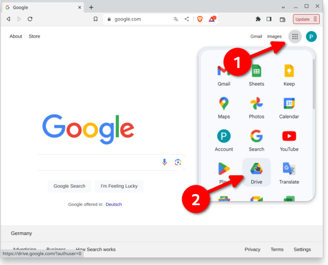

# AAPS overzetten en installeren

In het vorige deel, [**AAPS** bouwen](../SettingUpAaps/BuildingAaps.md), heb je de **AAPS** app (een .apk-bestand) op een computer gebouwd.

De volgende stappen zijn: het **AAPS** APK-bestand (en andere apps die je misschien nodig hebt, zoals BYODA, xDrip of een andere CGM-ontvanger-app) naar je Android-smartphone **overzetten** en daarna de app(s) **installeren**. Nadat **AAPS** op de smartphone is geïnstalleerd, kun je verder met [**het instellen van de AAPS loop**](../SettingUpAaps/SetupWizard.md).

Deze pagina legt ook [Android-ontwikkelaarsverificatie](#android-developer-verification) uit. Dit is een wijziging die Google vanaf september 2026 invoert en die het installeren van zelfgebouwde apps beïnvloedt. Daarnaast lees je hier over de [gratis installatiemethoden](#android-developer-verification-free-methods) die na de wijziging blijven werken.

```{contents} Table of contents
:depth: 1
:local: true
```

## AAPS installeren door op het APK-bestand te tikken

Op dit moment installeer je **AAPS** door het APK-bestand naar je telefoon over te zetten en het te openen (erop te "tikken"). Er zijn meerdere manieren om het **AAPS** APK-bestand van je computer naar de smartphone over te zetten. Hier leggen we twee verschillende manieren uit:

* Optie 1 - Gebruik je Google Drive (Gdrive)
* Optie 2 - Gebruik een USB-kabel

Let op: overzetten per e-mail kan problemen geven en raden we af.

```{admonition} Android developer verification
:class: warning
Google voert vanaf september 2026 [Android-ontwikkelaarsverificatie](#android-developer-verification) in (eerst in Brazilië, Indonesië, Singapore en Thailand; wereldwijd in 2027). Waar dit wordt afgedwongen, is installeren door op het APK-bestand te tikken (zoals in beide opties hieronder) geblokkeerd. Gebruik in dat geval een van de [gratis installatiemethoden](#android-developer-verification-free-methods) verderop op deze pagina.
```

### Optie 1. Bestanden overzetten met Google Drive

Open [Google.com](https://www.google.com/) in je webbrowser en log in met je Google-account.

Kies rechtsboven de app Drive in het Google-menu.



Klik linksboven op **Nieuw** (of klik met de rechtermuisknop op een leeg gebied onder je bestanden en mappen) en kies **Bestand uploaden**.


Het APK-bestand zou nu naar Google Drive geüpload moeten zijn.

#### Gebruik de Google Drive-app om het APK-bestand te openen en te installeren

Ga naar je telefoon en start de Google Drive-app. Het is een vooraf geïnstalleerde app. Je vindt hem bij de andere Google-apps, of door op de naam van de app te zoeken.


Start de installatie van de APK door in de Google Drive-app op de telefoon op de bestandsnaam te tikken.


Krijg je een beveiligingsmelding dat je op dit moment geen apps vanuit Google Drive mag installeren? Tik dan op "Instellingen" en sta het voor dat korte moment toe. Verbied het daarna weer, want het is een veiligheidsrisico om het altijd aan te laten staan.


Als de installatie klaar is, ben je klaar met deze stap.

Je ziet nu het **AAPS** pictogram en je kunt de app openen.

```{warning}
**BELANGRIJKE VEILIGHEIDSMELDING**
Heb je eraan gedacht om installatie vanuit Google Drive weer te verbieden?
```

Ga verder met [het instellen van de AAPS loop](../SettingUpAaps/SetupWizard.md).

### Optie 2. Bestanden overzetten met een USB-kabel

De tweede manier om het AAPS APK-bestand over te zetten is met een [USB-kabel](https://support.google.com/android/answer/9064445?hl=en).

Zet het bestand vanaf de plek op je computer in de map "downloads" op de telefoon.

Op je telefoon moet je de installatie uit onbekende bronnen toestaan. Uitleg hierover vind je op internet (_bijv._ [hier](https://www.expressvpn.com/de/support/vpn-setup/enable-apk-installs-android/) of [hier](https://www.androidcentral.com/unknown-sources)).

Als je het bestand hebt overgezet door het te slepen, open je de map "Downloads" op de telefoon en tik je op het AAPS APK-bestand:


De eerste keer meldt Android dat de telefoon geen onbekende apps uit deze bron mag installeren. Tik op "**Instellingen**":


Zet "**Toestaan van deze bron**" aan en ga terug:


Tik opnieuw op het APK-bestand en kies "**Installeren**":


Als de installatie klaar is, tik je op "**Openen**" om **AAPS** te starten, of op "**Gereed**" om de app later te openen:


```{warning}
**BELANGRIJKE VEILIGHEIDSMELDING**
Zet "Toestaan van deze bron" na de installatie weer uit, want het is een veiligheidsrisico om het altijd aan te laten staan.
```

Ga verder met [het instellen van de AAPS loop](../SettingUpAaps/SetupWizard.md).

(transferring-installing-play-protect-warning)=
## Waarschuwing van Google Play Protect

Als je **AAPS** installeert, kan Google Play Protect waarschuwen dat de app onveilig is, voor een oudere Android-versie is gebouwd en niet de nieuwste privacybescherming heeft.


Dat is normaal voor een app die je zelf hebt gebouwd. Tik op **Meer details** en daarna op **Toch installeren**.

Wordt de installatie **geblokkeerd** met een melding over een niet-geverifieerde ontwikkelaar (en is het niet alleen een waarschuwing)? Lees dan [Android-ontwikkelaarsverificatie](#android-developer-verification) hieronder.

(android-developer-verification)=

## Android-ontwikkelaarsverificatie

Google voert **Android-ontwikkelaarsverificatie** in: op de meeste Android-telefoons worden apps alleen nog geïnstalleerd als een geverifieerde ontwikkelaar ze bij Google heeft geregistreerd. Dit geldt ook voor apps die je vanuit een APK-bestand installeert ("sideloading"). Zo installeer je de **AAPS** app die je zelf hebt gebouwd.

### Wat verandert er

Als je **AAPS** installeert op een telefoon met Google-diensten (een "gecertificeerd" Android-apparaat; dat is bijna elke telefoon die met de Play Store wordt verkocht), controleert Android of de app komt van een ontwikkelaar die bij Google is geregistreerd. Is dat niet zo, dan wordt de normale installatie door op het APK-bestand te tikken geblokkeerd.

**De controle gebeurt als een app wordt geïnstalleerd of bijgewerkt.** Apps die al geïnstalleerd zijn en draaien, worden niet verwijderd.

Google voert dit stap voor stap in:

| Wanneer           | Wat gebeurt er                                                                                                                                                        |
| ----------------- | --------------------------------------------------------------------------------------------------------------------------------------------------------------------- |
| Augustus 2026     | Gratis ontwikkelaarsaccounts voor "beperkte distributie" zijn wereldwijd open, en de "geavanceerde procedure" (advanced flow) komt geleidelijk op telefoons           |
| 30 september 2026 | Verificatie wordt afgedwongen in **Brazilië, Indonesië, Singapore en Thailand**, voor apps die worden geïnstalleerd vanuit Google Play en een paar andere app-winkels |
| 2027              | Het afdwingen breidt uit naar de **rest van de wereld** en naar **alle installaties**, ook APK-bestanden                                                              |

Google publiceert de details op de pagina's over [Android developer verification](https://developer.android.com/developer-verification), met ook een [FAQ](https://developer.android.com/developer-verification/guides/faq). Google kan data en details nog aanpassen; deze pagina wordt bijgewerkt zodra er meer bekend is.

### Geldt dit voor mij?

- **Het bouwen van AAPS verandert helemaal niet.** [Bouwen in de browser](#browser-build), [bouwen met Android Studio](ComputerBuild.md) en [bouwen via de opdrachtregel (CLI)](CLIBuild.md) werken precies zoals eerst, en je keystore verandert niet.
- **Je huidige AAPS blijft werken.** Verificatie wordt alleen gecontroleerd bij het installeren of bijwerken van een app.
- **Woon je in Brazilië, Indonesië, Singapore of Thailand?** Vanaf 30 september 2026 wordt verificatie afgedwongen voor apps die worden geïnstalleerd vanuit Google Play en een paar andere app-winkels. Google zegt dat het direct installeren van een APK-bestand niet onder deze eerste stap valt. **AAPS** zou dus nog gewoon moeten installeren. Bereid toch nu al een van de [gratis installatiemethoden](#android-developer-verification-free-methods) hieronder voor, zodat je niet verrast wordt als dit verandert.
- **Woon je ergens anders?** Voor 2027 verandert er voor jou niets, en voorlopig niets doen is een prima keuze. Maar stel een van de [gratis installatiemethoden](#android-developer-verification-free-methods) hieronder in zolang alles nog werkt. Het is een slecht moment om de blokkade pas te ontdekken op de dag dat een update wordt geweigerd, met de 24 uur wachttijd van de [geavanceerde procedure](#android-developer-verification-advanced-flow) nog voor je.
- **Oude telefoons:** verificatie geldt voor telefoons met Android 7 of hoger. Dat is dus elke telefoon waarop **AAPS** kan draaien.

(android-developer-verification-free-methods)=

## Gratis manieren om AAPS te installeren

Je hoeft Google **niets** te betalen om **AAPS** te blijven gebruiken. Er zijn meerdere gratis methoden; kies de methode die bij jouw situatie past.

```{admonition} Which method should I use?
:class: tip
- Je hebt een **computer** (op welke manier je **AAPS** ook hebt gebouwd): gebruik [ADB](#android-developer-verification-adb) of, als je de opdrachtregel liever niet gebruikt, de [webinstaller](#android-developer-verification-web). Beide zijn vrijgesteld van verificatie, hebben geen limieten en hebben geen Google-account nodig.
- Je hebt **helemaal geen computer**: gebruik de [geavanceerde procedure](#android-developer-verification-advanced-flow) op je telefoon.
- Je registreert je liever bij Google, zodat de normale installatie door "op de APK te tikken" blijft werken: er bestaat een [gratis account voor beperkte distributie](#android-developer-verification-limited-account), maar dit is nog niet getest met **AAPS**.
```

(android-developer-verification-adb)=

### Optie 1: Installeren met ADB (computer nodig)

ADB (Android Debug Bridge) is het officiële hulpmiddel van Google om met een USB-kabel apps vanaf een computer op een telefoon te installeren. Google heeft bevestigd dat **apps die met ADB worden geïnstalleerd geen verificatie nodig hebben**: er is geen wachttijd, geen limiet op het aantal apparaten en geen registratie.

Eenmalige voorbereiding:

1. Zet op je telefoon de verborgen ontwikkelaarsopties aan: ga naar **Instellingen** > **Over de telefoon** (op sommige telefoons **Softwaregegevens**) en tik zeven keer op **Buildnummer**, tot de telefoon bevestigt dat je ontwikkelaar bent.
1. Ga terug naar het hoofdmenu van **Instellingen**, open het nieuwe onderdeel **Opties voor ontwikkelaars** en zet **USB-foutopsporing** aan.
1. Zorg dat ADB op je computer beschikbaar is:
   - Gebruik je **Android Studio**? Dan is ADB daarmee al geïnstalleerd.
   - Download anders de gratis [SDK Platform Tools](https://developer.android.com/tools/releases/platform-tools) van Google en pak de map uit. Je hoeft niets te installeren; ADB is het programma `adb` in die map.

**AAPS** installeren (en later bijwerken):

1. Verbind de telefoon met een USB-kabel met de computer. Je hoeft het APK-bestand niet eerst naar de telefoon over te zetten: ADB stuurt het rechtstreeks vanaf de computer.
1. Accepteer op de telefoon de vraag **USB-foutopsporing toestaan?** (alleen de eerste keer).
1. Open op de computer een terminal (opdrachtprompt) in de map met ADB en het **AAPS** APK-bestand, en voer uit:

   ```
   adb install -r app-full-release.apk
   ```

   Vervang `app-full-release.apk` door de echte naam van je APK-bestand. De optie `-r` werkt een al geïnstalleerde **AAPS** bij en houdt alle gegevens en instellingen.

1. Wacht tot `Success` wordt getoond. **AAPS** is nu op je telefoon geïnstalleerd.

Voor elke volgende update gebruik je dezelfde opdracht. De [pagina's over Wear OS](../WearOS/WearOsSmartwatch.md) gebruiken ADB al op dezelfde manier om de horloge-app te installeren.

Wil je liever geen kabel gebruiken? Op Android 11 en nieuwer kan **Draadloze foutopsporing** (ook onder **Opties voor ontwikkelaars**) hetzelfde doen via wifi, na eenmalig koppelen met een code die op de telefoon wordt getoond.

(android-developer-verification-web)=

### Optie 2: Installeren vanaf een webpagina (computer, geen opdrachtregel)

Is de opdrachtregel niets voor jou? Dan kan een webpagina precies hetzelfde doen als ADB, rechtstreeks vanuit je browser. Omdat de pagina via hetzelfde mechanisme als ADB met de telefoon praat, geldt **dezelfde vrijstelling van verificatie**. Maar je hoeft niets te downloaden, geen map uit te pakken en geen opdracht te typen.

Dit is de makkelijkste weg als je [in de browser hebt gebouwd](#browser-build) en nog nooit een opdrachtregel hebt geopend.

1. Zet **USB-foutopsporing** aan op de telefoon (stap 1 en 2 van de [ADB-methode](#android-developer-verification-adb) hierboven; eenmalig instellen).
1. Open de **[AAPS-webinstaller](#web-installer)** in je browser.
1. Verbind de telefoon met een USB-kabel en volg de instructies op de pagina: verbinden, je APK-bestand kiezen en installeren.

Drie dingen om te weten:

- Het werkt alleen in **Chrome, Edge of Opera**. Firefox en Safari kunnen niet met USB-apparaten praten.
- Er kan maar één programma tegelijk de ADB-verbinding van de telefoon gebruiken. **Sluit dus Android Studio** (of iets anders dat ADB gebruikt) voordat je verbinding maakt.
- Een webpagina die zo verbonden is, krijgt volledige controle over je telefoon. **Gebruik alleen het adres hierboven**, uit de **AAPS** documentatie. Gebruik nooit een installatiepagina die je via een zoekmachine hebt gevonden. De **AAPS** webinstaller werkt volledig in je browser: je APK-bestand wordt nergens naartoe geüpload.

```{admonition} No computer? A second phone works too
:class: tip
De webinstaller werkt ook vanuit **Chrome op een andere Android-telefoon** met een USB-C-naar-USB-C-kabel. Zo kan een ouder **AAPS** op de telefoon van een kind installeren, zonder computer in huis.
```

(android-developer-verification-advanced-flow)=

### Optie 3: De "geavanceerde procedure" (advanced flow) op je telefoon (geen computer nodig)

Google biedt een uitweg voor ervaren gebruikers die de risico's van het installeren van niet-geverifieerde apps begrijpen. Dit heet de **geavanceerde procedure** (advanced flow). Google is in augustus 2026 begonnen dit naar telefoons uit te rollen, voordat het afdwingen begint. Je kunt het dus nu al instellen. Je stelt dit eenmalig in op de telefoon zelf, en dat **duurt 24 uur**:

1. Zet de verborgen ontwikkelaarsopties aan (zie stap 1 van de ADB-methode hierboven) en open daarna **Instellingen** > **Opties voor ontwikkelaars** > **Apps from unverified developers** (apps van niet-geverifieerde ontwikkelaars).
1. Zet **Allow apps from unverified developers** (apps van niet-geverifieerde ontwikkelaars toestaan) aan. De telefoon vraagt om je schermvergrendeling om te bevestigen dat jij het bent.
1. De telefoon vraagt of iemand je vraagt om deze instelling aan te zetten, en legt uit dat banken, overheidsinstanties of de politie je dat nooit zouden vragen. Lees de waarschuwing en bevestig dat niemand je onder druk zet of je stap voor stap begeleidt (dit beschermt je tegen oplichters).
1. **Start je telefoon opnieuw op.** Daarmee begint een eenmalige **wachttijd van 24 uur**.
1. Ga na 24 uur terug naar **Instellingen** > **Opties voor ontwikkelaars** > **Apps from unverified developers** om het instellen af te ronden.
1. Kies of je niet-geverifieerde apps toestaat voor **7 dagen** of **voor onbepaalde tijd**. Kies voor **AAPS** **voor onbepaalde tijd**, anders wordt je volgende update geblokkeerd zodra de 7 dagen voorbij zijn.

Na dit instellen werkt het installeren of bijwerken van de **AAPS** APK zoals nu, met één extra waarschuwing dat de app van een niet-geverifieerde ontwikkelaar komt. Tik dan op **Toch installeren**.

Goed om te weten:

- Je kunt **Opties voor ontwikkelaars** daarna weer uitzetten: de geavanceerde procedure blijft aan. Google geeft apps (zoals bank-apps) ook geen manier om te zien dat de geavanceerde procedure aan staat.
- Zet je de geavanceerde procedure uit, dan is installeren **of bijwerken** van **AAPS** weer geblokkeerd (je geïnstalleerde **AAPS** blijft werken). Je hebt dan 10 minuten om het weer aan te zetten; daarna begint de wachttijd van 24 uur opnieuw.
- De klok van de telefoon veranderen maakt de wachttijd niet korter, en ADB kan de wachttijd niet overslaan.
- Google zegt dat je keuze via je Google-account meegaat naar je andere apparaten. Een nieuwe telefoon zou dus niet opnieuw 24 uur wachten moeten betekenen.
- Vind je **Apps from unverified developers** niet in de ontwikkelaarsopties? Dan heeft je telefoon de functie nog niet gekregen. De functie komt via een systeemonderdeel dat **Android Developer Verifier** heet. Google rolt dit stap voor stap uit via de Play Store. Je kunt het versnellen door **Android Developer Verifier** in de Play Store te openen.

```{note}
Google noemt dit een eerste versie en kan de schermen en stappen nog veranderen; dit deel wordt bijgewerkt met schermafbeeldingen zodra de definitieve versie beschikbaar is.
```

(android-developer-verification-limited-account)=

### Optie 4: Registreren bij Google (gratis account voor beperkte distributie)

Google biedt een **gratis** type ontwikkelaarsaccount voor hobbyisten en persoonlijk gebruik, een **account voor beperkte distributie** (limited distribution account). Sinds augustus 2026 is dit voor iedereen open:

- **Geen identiteitsbewijs** en **geen kosten** (anders dan bij het betaalde ontwikkelaarsaccount, dat je voor persoonlijk gebruik van **AAPS** niet nodig hebt). Je hebt wel nodig: een Google-account met verificatie in twee stappen, een Google-betalingsprofiel met je officiële naam en adres, en een e-mailadres voor contact.
- Je registreert de pakketnaam van je app in de Android Developer Console van Google. Daarna geef je de telefoons waarop de app geïnstalleerd mag worden toestemming, tot **20 apparaten**, via een koppeling met een QR-code of link tussen de telefoon en de console.
- Na de registratie werkt de normale installatie (op het APK-bestand tikken) weer op de toegestane telefoons, zonder ADB en zonder de geavanceerde procedure.
- Een account voor beperkte distributie kan later worden omgezet naar een volledig account, maar niet andersom.

```{warning}
Google heeft niet uitgelegd hoe registratie werkt als veel mensen dezelfde open-source app bouwen: elke zelfgebouwde **AAPS** gebruikt dezelfde pakketnaam (`info.nightscout.androidaps`) met een andere ondertekeningssleutel. Volgens de FAQ van Google kan een pakketnaam die al door anderen wordt gebruikt niet zomaar worden geclaimd, en is er een extra beoordeling nodig. De uitkomst van zo'n beoordeling is onbekend, en het betaalde ontwikkelaarsaccount ($25 en een identiteitsbewijs) helpt hier niet: betalen haalt alleen de limiet van 20 apparaten weg, niet de beoordeling van de pakketnaam.

Daarom kunnen we nog geen stapsgewijze instructies schrijven. Dit deel wordt aangevuld zodra registratie met **AAPS** is getest. Tot die tijd zijn ADB, de webinstaller en de geavanceerde procedure hierboven betrouwbare alternatieven.
```

## Wat verandert er niet

- **AAPS** zelf bouwen, met elk van de drie [bouwmethoden](BuildingAaps.md).
- Je GitHub-account, je build-repository (AAPS Builder) of fork, en je keystore.
- Je geïnstalleerde **AAPS** app, je instellingen en je [Doelen](CompletingTheObjectives.md).
- Telefoons zonder Google-diensten, en [installaties met ADB](#android-developer-verification-adb) in het algemeen.

## Waar je hulp kunt krijgen

1. **Lees** de [FAQ over ontwikkelaarsverificatie](https://developer.android.com/developer-verification/guides/faq) van Google voor vragen over de verificatie zelf.
2. **Vraag** het in het kanaal *#AAPS* op [Discord](https://discord.gg/4fQUWHZ4Mw), of in een van de andere [community-kanalen](../GettingHelp/WhereCanIGetHelp.md), als een installatie wordt geblokkeerd.
3. Vermeld als je om hulp vraagt: merk en model van je telefoon, Android-versie, je land en de exacte melding die verschijnt als de installatie mislukt.

```{toctree}
:hidden:

AAPS-webinstaller <WebInstaller.md>
```
