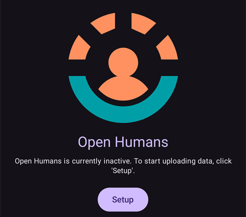

# Open Humans Uploader

## Doneer je gegevens aan de wetenschap

Je kunt de community verder helpen door jouw gegevens te doneren aan wetenschappelijk onderzoek. Dit helpt onderzoekers om dit project vooruit te helpen, nieuwe wetenschappelijke ideeën te ontwikkelen en de open mind van open source closed loop systemen te verbreden. AAPS is ready to synchronize your data with [Open Humans](https://www.openhumans.org), a platform allowing you to upload, connect, and store your personal data – such as genetics, activity and health data.

Je behoudt de volledige controle over wat er met je gegevens gebeurt en welke projecten je wilt ondersteunen door ze toegang tot je gegevens te geven. Welke gegevens worden gebruikt en op welke manier, is afhankelijk van de projecten waar je je op OpenHumans bij aansluit.

De volgende gegevens worden geüpload naar je Open Humans account:

- Glucose values
- Careportal events (except notes)
- Extended boluses
- Profile switches
- Total daily doses
- Temporary basals
- Temp targets
- Instellingen
- Application version
- Device model
- Screen dimensions

Geheime of persoonlijke informatie zoals je Nightscout URL of API-secret zal niet worden geüpload.

## Pomp koppelen

1. Create your account on [Open Humans](https://www.openhumans.org) if not already done. Je kunt je bestaande Google of Facebook account gebruiken als je wilt.
2. Enable the **Open Humans** plugin in [**Configuration** > **Communication**](../SettingUpAaps/ConfigBuilder.md).


3. Tap **Settings** on the **Open Humans** card. You can restrict uploads to times when the phone uses Wi-Fi (**WiFi only**) and/or is charging (**Charging only**).


4. Tap **Open plugin** on the **Open Humans** card, then tap **Setup**.



5. On the **Welcome to Open Humans** screen, tap **Next**. Read the **Consent** screen carefully: it shows the terms of use and which data is uploaded and not uploaded.
6. Switch on **I understand and agree.** (1) and tap **Login to Open Humans** (2).


7. De Open Humans website zal worden geopend. Log in met je inloggegevens.
8. Decide whether you want to hide your AAPS Uploader membership in your public Open Humans profile (1).
9. Click **Authorize project** (2).


```{admonition} Older screenshot
:class: note
The screenshots above show an earlier version of the Open Humans website and still use the old project name **AndroidAPS Uploader**. The steps are the same.
```

10. Back in **AAPS**, the **Final touches** screen asks whether you want to proceed. Tap **Proceed**.
11. Wait until **We're done!** appears, then tap **Close**. From now on, your phone uploads data in the background from time to time.
12. The **Open Humans** plugin screen now shows your **Project Member ID**. Tap **Upload now** if you want to start an upload right away.
13. Tap **Logout** if you want to stop uploading data to Open Humans.
14. Je zult een Android melding zien met informatie over de voortgang van jouw upload.


```{admonition} Older screenshot
:class: note
The screenshot above is from an earlier **AAPS** version. In **AAPS** 4 the confirmation screens are **Final touches** and **We're done!**, there is no queue size, and the buttons are **Upload now** and **Logout**.
```

15. You can manage your data by logging in to the [Open Humans website](https://www.openhumans.org).


## Gegevens delen met onderzoeksprojecten

### [The 'OPEN' project](https://www.open-diabetes.eu/)

Het 'OPEN'-project brengt een internationale en intersectorale groep patiënten, artsen, sociale wetenschappers, computerwetenschappers en patiëntenbelangenorganisaties samen. Ze onderzoeken verschillende aspecten van Doe-het-zelf-Kunstmatige Pancreas-systemen (DIY APS). For more details see their [website](https://www.open-diabetes.eu/).

September 2020 the 'OPEN' project launched a [survey](https://survey.open-diabetes.eu/) including the option to donate data you uploaded to Open Humans. A [tutorial](https://open-diabetes.eu/en/open-survey/survey-tutorials/) how to donate your data to the 'OPEN' project is available on their site and within the survey itself.

### [OpenAPS Data Commons](https://www.openhumans.org/activity/openaps-data-commons/)

Om gegevenssets van de DIYAPS gemeenschap gemakkelijk beschikbaar te maken voor onderzoek is de OpenAPS Data Commons in het leven geroepen. De gegevens kunnen zowel worden gebruikt door traditionele onderzoekers die wetenschappelijke studies uitvoeren, als door groepen of individuen uit de gemeenschap die gegevens willen bekijken als onderdeel van hun eigen onderzoek. The OpenAPS Data Commons uses the 'Open Humans' platform to enable people to easily upload and share their data from DIYAPS including AAPS, Loop, and OpenAPS.

Je kunt jouw gegevens naar Open Humans uploaden op één van deze drie manieren:

1. use the AAPS uploader option to get your data into Open Humans
2. Gebruik Nightscout Gegevensoverdracht (Data Transfer)
3. Upload jouw gegevensbestanden handmatig naar Open Humans.

Nadat je een account hebt aangemaakt en je gegevens in Open Humans hebt staan, moet je je gegevens ook nog delen met de OpenAPS Data Commons om jouw gegevens beschikbaar te maken voor onderzoek.

## Gebruiksvoorwaarden

This is an open source tool that will copy your data to [Open Humans](https://www.openhumans.org). We behouden geen rechten om je gegevens met derden te delen zonder je uitdrukkelijke toestemming. De gegevens die het project en de app ontvangen worden opgeslagen onder een willekeurig gegenereerde gebruikers-ID en zullen alleen veilig worden verzonden naar een Open Humans-account met jouw toestemming voor dat proces. You can stop uploading and delete your upload data at any time via [www.openhumans.org](https://www.openhumans.org). Houd er rekening mee dat sommige projecten die gegevens ontvangen dit niet ondersteunen.

Also see [Open Humans Terms of Use](https://www.openhumans.org/terms/).

## Gegevensbescherming

Open Humans beschermt jouw privacy door voor elk project een numerieke ID aan jou toe te wijzen. Hierdoor kunnen projecten jou herkennen, maar ze kunnen je niet identificeren. The Application ID uploaded by AAPS is similar and only helps administrate the data. Meer informatie vind je hier:

- [Open Humans Data Use Policy](https://www.openhumans.org/data-use/)
- [Open Humans GDPR](https://www.openhumans.org/gdpr/)
