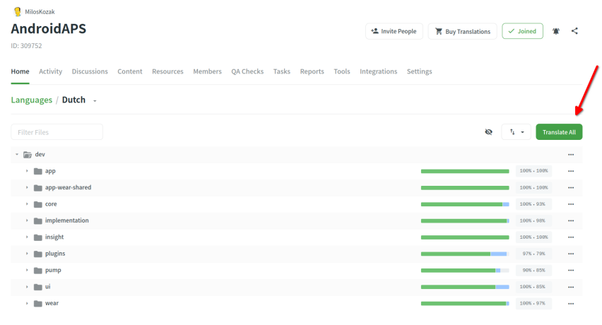
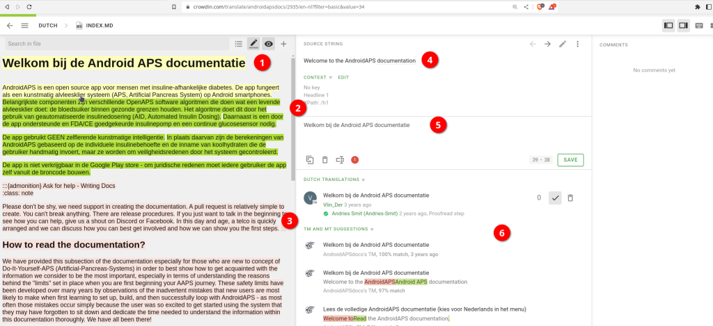

# Strings vertalen voor de AAPS-app of de documentatie

* Voor de strings van de app ga je naar <https://crowdin.com/project/androidaps> en log je in met je GitHub-account
* Voor de documentatie ga je naar <https://crowdin.com/project/androidapsdocs> en log je in met je GitHub-account

* Stuur een verzoek om lid te worden naar het docs-team. Klik daarvoor op de vlag van de gewenste taal en daarna op de knop "Join" rechtsboven op de volgende pagina. Geef de taal op, vertel iets over jezelf en je ervaring met AAPS, en of je vertaler of proeflezer wilt worden (alleen voor mensen die goed kunnen vertalen + gevorderde AAPS-gebruikers).

```{admonition} Tijd voor goedkeuring :class: note

De goedkeuring gebeurt met de hand. Als non-profitorganisatie geven we geen SLA's, maar meestal gebeurt de goedkeuring binnen 1 dag (< 1 dag). Lukt dat niet, neem dan contact op met het docs-team via Facebook of Discord.

    <br />* Als we je goedkeuren, klik je op de vlag
       
    
    ## Vertaling van de app
    
    (translations-translate-strings-for-AAPS-app)=
    ### Strings vertalen voor de AAPS-app
    
    * Heb je geen voorkeur voor welke strings je vertaalt, klik dan op de knop "Translate All" om te beginnen. Je ziet dan de strings die vertaald moeten worden.
    
       
    
    * Wil je één bestand vertalen, zoek het bestand dan via het zoekvenster of de mappenstructuur en klik op de bestandsnaam. Dan begin je met de strings in dat bestand.
    
       
    
    * Vertaal zinnen aan de linkerkant door nieuwe vertaalde tekst toe te voegen, of gebruik & bewerk een suggestie
    
       
    
    
    ### Strings van de AAPS-app proeflezen
    
    * Proeflezers beginnen met "Proofread" te kiezen op het startscherm van de taal.
    
       
    
    
      en vertaalde teksten goedkeuren
    
       
    
    Als een proeflezer een vertaling goedkeurt, komt die in de volgende versie van AAPS.
    
    (translations-translation-of-the-documentation)=
    ## Vertaling van de documentatie
    
    * Klik op de naam van de docs-pagina die je wilt vertalen
    
    
    
    
    * Vertaal zin voor zin
    
        1. De gele tekst is de tekst waar je nu aan werkt.
    
        1. De groene tekst is al vertaald. Die hoef je niet opnieuw te doen.
    
        1. De rode tekst is de tekst die nog vertaald moet worden.
    
        1. Dit is de brontekst waar je nu aan werkt
    
        1. Dit is de vertaling die je maakt. Je kunt de tekst hierboven kopiëren of een van de suggesties hieronder kiezen.
    
        1. Dit zijn de suggesties voor een vertaling. Je ziet vooral hoe goed Crowdin de suggestie vindt passen, of dat de tekst al eerder vertaald was en alleen terugkwam omdat de tekst verplaatst is, niet veranderd.
        1. Klik op de knop "Save" om een voorstel voor de vertaling op te slaan. Daarna gaat die naar een proeflezer voor de laatste controle.
    
    
    
    * Een vertaalde pagina wordt pas in de docs gepubliceerd als
    
        1. de vertaling proefgelezen is
    
        1. de synchronisatie tussen Crowdin en GitHub klaar is (eens per uur). Die maakt een PR voor GitHub.
    
        1. de PR op GitHub goedgekeurd is.
    
    Meestal duurt dit 1–3 dagen, maar in vakanties kan het wat langer duren.
    
    ### Links vertalen
    
    ```{admonition} Links worden niet meer vertaald
    :class: note
    
    Links worden niet meer vertaald. Vroeger stond hier een onderwerp over, maar dat is weg. Door de overstap naar Markdown en de myst_parser maken we labels in de Engelse tekst, en die labels worden op de achtergrond doorgegeven aan de andere talen.
    
    

Je vertaalt de tekst die de link weergeeft. Let goed op dat je de link **niet** verwijdert. Die wordt weergegeven door een paar `<0></0>`-tags, of door andere nummers als er meer links in één alinea staan.

De proeflezer moet hier extra goed op letten!

### Proeflezen

* Proeflezers moeten overschakelen naar de modus "Proofread"
    
    
    
    en vertaalde teksten goedkeuren
    
    

* Als een proeflezer een vertaling goedkeurt, komt die in de volgende build van de docs. Die gebeurt niet volgens een vast schema maar op aanvraag, ongeveer eens per week, behalve in vakanties. Om het proces te versnellen kun je het docs-team laten weten dat er nieuwe vertalingen zijn.