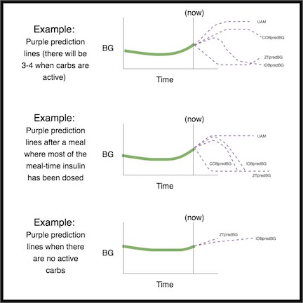

# Voor zorgverleners – Een algemene introductie en handleiding voor AAPS

```{note}
Deze pagina is een algemene introductie voor zorgverleners. De pagina is voor het laatst nagekeken in juni 2026. AAPS wordt steeds verder ontwikkeld. Kijk voor de meest juiste en actuele details altijd in de [hoofddocumentatie van AAPS](../index.md).
```

Deze pagina is bedoeld voor zorgverleners die interesse hebben in open-source technologie voor een kunstmatige alvleesklier, zoals AAPS, of voor patiënten die zulke informatie met hun zorgverleners willen delen.

Deze handleiding geeft algemene informatie over doe-het-zelf gesloten loops en in het bijzonder over hoe AAPS werkt. Bekijk voor meer details over al deze onderwerpen de [uitgebreide AAPS-documentatie online](../index.md). Als u vragen hebt, dan kunt u uw patiënt benaderen, of stel uw vraag aan één van de gebruikersgroepen. (Als u niet op sociale media zit (bijv. [Twitter](https://twitter.com/kozakmilos) of Facebook), kunt u gerust mailen naar developers@aaps.app). Verder kunt u [op deze website](https://openaps.org/outcomes/) een aantal van de laatste studies vinden & gegevens over de resultaten van gesloten loops.

## De stappen om een doe-het-zelf gesloten loop te bouwen:

Om met AAPS te beginnen, moeten de volgende stappen worden gezet:

* Zoek een [compatibele pomp](../Getting-Started/CompatiblePumps.md), een [compatibel Android-apparaat](../Getting-Started/Phones.md) en een [compatibele CGM-bron](../Getting-Started/CompatiblesCgms.md).
* [Download de broncode van AAPS en bouw de software](../SettingUpAaps/BuildingAaps.md).
* [Configureer de software zodat deze met de diabetesapparaten communiceert, en stel de instellingen en veiligheidsvoorkeuren in](../SettingUpAaps/SetupWizard.md).

## Hoe een doe-het-zelf gesloten loop werkt

Mensen met diabetes die geen gesloten loop gebruiken, zullen informatie uit hun pomp en CGM gebruiken om te besluiten wat ze moeten doen, en vervolgens de bijbehorende actie ondernemen.

Het systeem doet eigenlijk hetzelfde: het verzamelt gegevens van de pomp, CGM, en waar dan ook informatie wordt ingevoerd (zoals Nightscout, een website waar gegevens 'in de cloud' worden opgeslagen). Deze informatie wordt gebruikt om berekeningen te doen en te bepalen hoeveel meer of juist minder insuline nodig is (ten opzichte van de normale basaalstanden). Het systeem gebruikt tijdelijke basaalstanden om de benodigde aanpassingen te maken, zodat de bloedglucosewaardes binnen de streefwaardes worden gehouden of gebracht.

Als het apparaat waarop AAPS draait kapotgaat of buiten bereik van de pomp raakt, werkt de pomp weer als een gewone pomp met de voorgeprogrammeerde basaalstanden, zodra de laatste tijdelijke basaalstand is afgelopen.

## Hoe gegevens worden verzameld:

Bij AAPS draait een speciale app op een Android-apparaat die de berekeningen doet. Het apparaat communiceert via Bluetooth met een ondersteunde pomp. AAPS kan via wifi of mobiele data communiceren met andere apparaten en met de cloud. Zo verzamelt het extra informatie, en meldt het aan de patiënt, verzorgers en naasten wat het doet en waarom.

De Android telefoon moet zowel met de pomp als de CGM verbonden zijn:

* om commando's naar de pomp te sturen, en ook om de pompgeschiedenis uit te lezen - om te weten hoeveel insuline is toegediend
* om gegevens te ontvangen van de CGM (rechtstreeks of via de cloud) - om te zien wat de bloedglucosewaardes doen

Wanneer het apparaat deze gegevens heeft verzameld, voert het algoritme zijn berekeningen uit en neemt het beslissingen op basis van de instellingen (ISF, koolhydraatratio, DIA, streefwaarde, enz.). Indien nodig stuurt het daarna commando's naar de pomp om de snelheid van de insulinetoediening aan te passen.

Het verzamelt ook alle informatie over bolussen, koolhydraatinname en aanpassingen van het tijdelijk streefdoel, uit de pomp of uit Nightscout. Deze informatie gebruikt het om de insulinetoediening te berekenen.

## Hoe weet het systeem wat het moet doen?

De open-source software is zo ontworpen dat het apparaat eenvoudig het werk kan doen dat mensen vroeger zelf deden (in de handmatige modus) om te berekenen hoe de insulinetoediening moet worden aangepast. Eerst verzamelt het gegevens van alle ondersteunende apparaten en uit de cloud, bereidt de gegevens voor en voert de berekeningen uit. Het voorspelt de glucosewaarden voor de komende uren in verschillende scenario's. Daarna berekent het welke aanpassingen nodig zijn om de glucose binnen het streefbereik te houden of terug te brengen. Dan stuurt hij commando's naar de pomp om die aanpassingen te maken. Het algoritme leest de gegevens weer uit, en doet dit hele proces dan steeds opnieuw.

Omdat de bloedglucosewaarde van de CGM de belangrijkste invoerparameter is, zijn CGM-gegevens van hoge kwaliteit belangrijk.

AAPS is ontworpen om alle verzamelde invoergegevens, de daaruit volgende aanbeveling en elke uitgevoerde actie transparant bij te houden. Daardoor kunt u op elk moment eenvoudig de vraag “waarom doet het systeem X?” beantwoorden door de logs te bekijken.

## Voorbeelden van hoe het AAPS-algoritme beslissingen neemt:

AAPS gebruikt hetzelfde basisalgoritme en dezelfde functies als OpenAPS. Het algoritme maakt meerdere voorspellingen (op basis van de instellingen en de situatie). Deze tonen verschillende scenario's van wat er in de toekomst kan gebeuren. Deze worden in Nightscout weergegeven als paarse lijnen in de toekomst. AAPS gebruikt verschillende kleuren om deze [voorspellingslijnen](#aaps-screens-prediction-lines) te onderscheiden. In de logs is terug te vinden welke voorspelling en welk tijdsbestek heeft geleid tot een actie van het algoritme.

### Hier volgen voorbeelden van de paarse voorspellingslijnen en hoe ze kunnen verschillen:



(clinicianguide-dosing-scenarios)=

### Hier volgen voorbeelden van verschillende tijdsbestekken die bepalen welke aanpassingen van de insulinetoediening nodig zijn:

### Scenario 1 - Zero Temp (tijdelijke basaalstand van nul) voor de veiligheid

In dit voorbeeld stijgt de bloedglucose op de korte termijn, maar er wordt een lage bloedglucose voorspeld voor de lange termijn. Er wordt voorspeld dat de glucosewaarde onder het streefdoel ('BG target') zal uitkomen *en* onder de veiligheidsdrempel ('threshold'). Om de hypo veilig te voorkomen, stelt AAPS een zero temp in (tijdelijke basaalstand van 0%), totdat de eventualBG (in elk tijdsbestek) boven de drempel ligt.


### Scenario 2 - Zero Temp (tijdelijke basaalstand van nul) voor de veiligheid

In dit voorbeeld wordt voorspeld dat de bloedglucose op korte termijn zal dalen, maar uiteindelijk boven het streefdoel zal liggen. Maar omdat de lage waarde op korte termijn wel onder de veiligheidsdrempel ligt, stelt AAPS een zero temp in, totdat geen enkel punt van de voorspellingslijn nog onder de drempel ligt.


### Scenario 3 - Meer insuline nodig

In dit voorbeeld wordt op korte termijn een daling van de bloedglucose voorspeld waarbij hij onder het streefdoel komt. De voorspelling is dat de bloedglucose echter niet onder de veiligheidsdrempel komt. De uiteindelijke glucosewaarde ligt boven het streefdoel. Daarom geeft AAPS geen insuline die zou bijdragen aan een lage waarde op korte termijn (insuline waardoor de voorspelling onder de drempel zou komen). Vervolgens zal hij met het verstrijken van de tijd, kijken of het al veilig is om extra insuline te geven zodat de bloedglucose op de lange termijn lager (en dus dichter bij het streefdoel) uitkomt. *Afhankelijk van de gebruikersinstellingen en van de hoeveelheid en het tijdstip waarop extra insuline nodig is, wordt de insuline toegediend dmv een tijdelijke basaalstand of SMB's (super micro bolussen).*


### Scenario 4 - Lage tijdelijke basaalstand (low temp) voor de veiligheid

In dit voorbeeld ziet AAPS dat de bloedglucose snel stijgt tot ruim boven het streefdoel. Door de timing van de insuline is er echter al genoeg insuline in het lichaam om de bloedglucose uiteindelijk binnen het streefbereik te brengen. De voorspellingslijn geeft aan dat de glucosewaarde uiteindelijk zelfs onder het streefdoel zal uitkomen. Daarom geeft AAPS geen extra insuline, zodat het niet bijdraagt aan een lage waarde op langere termijn. Er zal waarschijnlijk een lage tijdelijke basaalstand worden ingesteld (ook al is de bloedglucose op dit moment hoog).


## Instellingen optimaliseren en wijzigingen aanbrengen

Als zorgverlener zonder ervaring met AAPS of doe-het-zelf gesloten loops vindt u het misschien lastig om uw patiënt te helpen de instellingen te optimaliseren of wijzigingen te maken die de uitkomsten verbeteren. Gelukkig zijn er meerdere tools en [handleidingen](https://openaps.readthedocs.io/en/latest/docs/Customize-Iterate/optimize-your-settings.html) online te vinden die patiënten helpen om kleine, stapsgewijze aanpassingen te maken aan hun instellingen en zo hun uitkomsten te optimaliseren.

Voor patiënten is het belangrijkste dat zij één verandering tegelijk maken, en het effect 2–3 dagen bekijken voordat zij een andere instelling aanpassen (tenzij de verandering duidelijk slecht is en het erger maakt; in dat geval moeten zij meteen terug naar de vorige instelling). Een hele menselijke neiging is om aan alle knoppen tegelijk te willen draaien, maar wie dat doet kan eindigen met verdere sub-optimale instellingen, en dan is het soms lastig om de eerdere goede instellingen weer terug te vinden.

Een van de krachtigste hulpmiddelen om instellingen aan te passen is een geautomatiseerd rekenprogramma voor basaalstanden, ISF en koolhydraatratio. Dit heet “[Autotune](#autotune-how-autotune-calculates-adjustments)”. Het is ontworpen om handmatig te worden uitgevoerd, en de resultaten ervan kunnen een leidraad zijn bij het aanpassen van de instellingen. In de community is het goed gebruik om eerst Autotune-rapporten te draaien (of te bekijken), voordat instellingen handmatig worden aangepast. Autotune is als plugin in AAPS ingebouwd (**Configuratie** → **Algemeen** → **Autotune**); zie [Autotune](../AdvancedOptions/Autotune.md). Het kan op verzoek of automatisch worden uitgevoerd. Deze parameters zijn een voorwaarde voor zowel insulinetoediening met een gewone pomp als met een gesloten loop. Daarom zijn het bespreken van de Autotune-resultaten en het aanpassen van deze parameters het natuurlijke aanknopingspunt voor de zorgverlener.

Daarnaast beïnvloedt menselijk gedrag (aangeleerd bij de handmatige diabetesbehandeling) vaak de uitkomsten, zelfs met een doe-het-zelf gesloten loop. Als bijvoorbeeld een lage bloedglucose wordt voorspeld en AAPS de insuline tijdens de daling al verlaagt, is misschien maar een kleine hoeveelheid koolhydraten (bijv. 3–4 g) nodig om de bloedglucose vanaf 70 mg/dl (3,9 mmol/l) te laten stijgen. In veel gevallen kiest iemand er echter voor om met veel meer koolhydraten te behandelen (bijvoorbeeld volgens de 15-gramregel). Dit veroorzaakt een snellere piek, zowel door de extra glucose als doordat de insuline al was verlaagd in de periode vóór de hypo.

## OpenAPS

**Deze tekst is een aanpassing van [The clinician's guide to OpenAPS](https://openaps.readthedocs.io/en/latest/docs/Resources/clinician-guide-to-OpenAPS.html).** OpenAPS is een systeem dat is ontwikkeld om te draaien op een kleine draagbare computer (meestal "rig" genoemd). AAPS gebruikt veel technieken die in OpenAPS zijn geïmplementeerd en deelt een groot deel van de logica en algoritmen. Daarom lijkt deze handleiding sterk op de oorspronkelijke handleiding. Veel informatie over OpenAPS is eenvoudig toe te passen op AAPS. Het belangrijkste verschil is het hardwareplatform waarop de software draait.

## Samenvatting

Dit is bedoeld als een algemeen overzicht van hoe AAPS werkt. Vraag voor meer details uw patiënt, neem contact op met de community of lees de volledige AAPS-documentatie online.

Aanvullende aanbevolen informatie:

* De [volledige AAPS-documentatie](../index.md)
* Het [OpenAPS Reference Design](https://OpenAPS.org/reference-design/), waarin wordt uitgelegd hoe OpenAPS met het oog op veiligheid is ontworpen: https://openaps.org/reference-design/
* De [volledige OpenAPS documentatie](https://openaps.readthedocs.io/en/latest/index.html) 
  * Zie [hoe AAPS voorspellingen omzet in een doseringsbeslissing](#aaps-screens-how-predictions-become-a-dosing-decision) in deze documentatie, of de [determine-basal-documentatie van OpenAPS](https://openaps.readthedocs.io/en/latest/docs/While%20You%20Wait%20For%20Gear/Understand-determine-basal.html#understanding-the-determine-basal-logic) voor het onderliggende algoritme in alle technische details