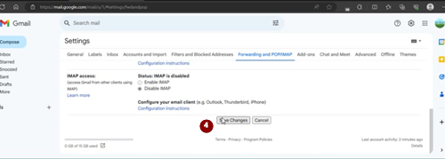

# Een apart Google-account voor AAPS (optioneel)

Sommige **AAPS**-gebruikers gebruiken liever ook hun gewone e-mailaccount voor **AAPS**. Andere **AAPS**-gebruikers (of hun verzorgers) maken een apart e-mailaccount voor **AAPS**. Dit is optioneel; hieronder geven we een voorbeeld van hoe je dat doet.

Wil je geen apart Gmail-account voor **AAPS** maken? Ga dan direct naar het volgende deel, [AAPS bouwen](../SettingUpAaps/BuildingAaps.md).

```{admonition} Advantages of a dedicated Google account for AAPS
:class: dropdown

- Met aparte Google Drive-ruimte loop je niet het risico dat je persoonlijke Google Drive-limiet volraakt door **Exporteer instellingen**.
- Elke versie van **AAPS** (en ondersteunende apps zoals xDrip, BYODA, enz.) wordt op één plek opgeslagen, die los staat van je computer. Als je pc of telefoon gestolen, kwijt of kapot is, heb je er nog steeds toegang toe.
- Als iedereen het op dezelfde manier inricht, met een vergelijkbare mappenstructuur, is online hulp geven eenvoudiger.
- Afhankelijk van hoe je het inricht (zie hieronder), heb je een aparte identiteit als alias om in de community te communiceren. Dat kan je privacy beschermen. 
- Kinderen met diabetes type 1 kunnen als minderjarige hun eigen “dagelijkse” e-mailaccount houden, terwijl ze **AAPS** gebruiken en functies die een account van een volwassene nodig hebben.
- Bij Gmail kun je tot 4 accounts registreren met hetzelfde telefoonnummer.
```

## Een apart Google-account voor AAPS instellen

(⌛Ongeveer 10 minuten)


Benodigdheden:

* Je hebt een Windows-pc (Windows 10 of nieuwer) en een Android-telefoon (Android 12 of nieuwer) waarop de **AAPS**-app komt. Op beide zijn de nieuwste beveiligingsupdates geïnstalleerd, en ze hebben internettoegang en beheerdersrechten, omdat je bij sommige stappen programma's moet downloaden en installeren.
* De Android-telefoon is al ingesteld met je persoonlijke ”dagelijkse” e-mailadres, bijvoorbeeld een Gmail-account.

```{admonition} Things to consider when setting up your new account
:class: dropdown
- Om privacyredenen kun je een andere naam dan je eigen naam kiezen, die past bij het account (zoals t1dsuperstar). Die kun je dan gebruiken op openbare **AAPS**-forums, terwijl je eigen identiteit privé blijft. Omdat Google een herstel-e-mailadres en telefoonnummer vraagt, is het account nog steeds naar jou te herleiden.
- Het nieuwe **AAPS**-account gebruikt hetzelfde telefoonnummer voor verificatie als je “_dagelijkse_” account. Het gebruikt het “dagelijkse” e-mailadres voor verificatie;
- We stellen het doorsturen van e-mail zo in dat alle e-mail naar het nieuwe aparte AAPS-account wordt doorgestuurd naar het hoofdaccount (zo hoef je niet twee mailboxen te controleren);
- Gebruik verschillende wachtwoorden voor je _dagelijkse_ Gmail-account en het aparte AAPS-Gmail-account
- Als je Google “2-step verification” (verificatie in twee stappen, ook wel meervoudige verificatie) gebruikt voor één Gmail-account, kun je dat net zo goed voor beide Gmail-accounts doen.
- Als je Google “Passkeys” wilt gebruiken, registreer dan meerdere apparaten. Zo sluit je jezelf niet buiten. Doe dit alleen op apparaten waar niemand anders toegang toe heeft (_dus_ niet op een pc met een gedeeld account dat andere mensen kunnen ontgrendelen).
```


```{admonition} Video Walkthrough!
:class: note
Klik [hier](<https://drive.google.com/file/d/1dMZTIolO-kd2eB0soP7boEVtHeCDEQBF/view?usp=drive_link>) voor een video over hoe je een apart Google-account instelt.
```

 Dit zijn de stappen uit de video:

In dit voorbeeld: 
- Je bestaande “_dagelijkse_” Google-account is <donald.muck42@gmail.com> ; 
- Je nieuwe “_AAPS_” Gmail-account wordt: <donald.muck42.aaps@gmail.com>; 


### Ga naar <https://account.google.com> 

 Als je al bent ingelogd bij Google, kom je zo op de pagina **My Account** (Mijn account) van je “dagelijkse” account. (1) Klik rechtsboven op de pagina op je profielfoto (in dit geval een simpele  (2) kies “_add another account_” (nog een account toevoegen).


### Voer de gegevens van je NIEUWE aparte account in: 

- Voer het nieuwe account in: 
- Account maken
- for my personal use (voor persoonlijk gebruik). 


### Vul je persoonlijke gegevens in:
 - Vul je voornaam in
 - achternaam
 - geboortedatum (je moet volwassen zijn)

### Kies je NIEUWE e-mailadres & wachtwoord

Dit voorbeeld voegt “.AAPS” toe aan het bestaande adres van Donald Muck…\
Stel een wachtwoord in

### Voer een telefoonnummer in dat de sms-verificatie kan ontvangen

Gmail stuurt je nu een unieke code die je moet invullen om te bevestigen.

### Voer het herstel-e-mailadres in

In dit geval is dat je bestaande “_dagelijkse_” e-mailadres…

### Het account verder instellen

Gmail toont de accountnaam. Je moet de voorwaarden van Gmail accepteren & je instellingen voor personalisatie bevestigen.

### De weergave van het nieuwe profiel aanpassen

Je zou nu op de pagina MyAccount van Gmail moeten zijn, met je nieuwe aparte **AAPS**-e-mailaccount. De profielfoto is standaard de eerste letter van je naam. Verander het in iets unieks om verwarring te voorkomen… in dit voorbeeld heeft Donald.Muck.AAPS  vervangen door 

\


### Open de Gmail-website in beide vensters om het nieuwe account in te stellen

Stuur alle e-mails van het nieuwe aparte **AAPS**-account door naar je dagelijkse account, zodat je geen extra e-mailaccount hoeft te controleren\
Dit deel kan wat verwarrend zijn, omdat je steeds tussen beide accounts moet wisselen. Open voor het gemak 2 aparte browservensters boven elkaar:

1. Zet je bestaande browservenster bovenaan je scherm en maak het zo klein dat het ongeveer alleen de bovenste helft van het scherm vult…
2. Klik met de rechtermuisknop op het logo van je browser in de taakbalk
3. Kies in het menu “New Window” (Nieuw venster)… en zet het zo neer dat het alleen de onderste helft van het scherm vult.

Open <https://gmail.com> in elk browservenster. Zorg dat je persoonlijke account bovenaan staat en het nieuwe aparte **AAPS**-account onderaan. Dat account herken je makkelijk aan de profielfoto rechtsboven. (zo nodig kun je altijd van account wisselen door op de profielfoto te klikken en het juiste account te kiezen.


De startpagina's van Gmail zien er dan zo uit:\


 ### Open in het nieuwe Gmail-account (onderste venster) de instellingen van Gmail…

- Klik op het tandwiel links van de profielfoto
- kies daarna “**See all Settings**” (Alle instellingen bekijken)


### Doorsturen instellen…

- Klik in de instellingen op het tabblad “Doorsturen en POP/IMAP”
- Klik op “Een doorstuuradres toevoegen”
- Voeg je “gewone” e-mailadres toe
- Gmail stuurt een verificatiecode naar je “dagelijkse” e-mailadres.
- Je gaat terug naar je gewone profiel en klikt op de link om te bevestigen dat je het doorsturen accepteert (of je haalt de code uit de bevestigingsmail van Gmail in je “gewone” Gmail-venster en plakt die in je “nieuwe aparte AAPS” Gmail-venster).

Je moet een paar keer heen en weer tussen de vensters, maar zo zie je, als je de e-mail van je “gewone” account bekijkt, ook de e-mails die je aparte AAPS-account doorstuurt, zoals Gmail-meldingen.


### Het doorgestuurde e-mailadres bevestigen

- In de “dagelijkse” Gmail (bovenste venster) krijg je de e-mail “Gmail forwarding Confirmation” (bevestiging voor doorsturen).
- Open de e-mail en “klik op de link om het verzoek te bevestigen”

### Doorgestuurde e-mails archiveren in het nieuwe aparte Gmail-account (onderste venster)

<!---->

1. Vernieuw het onderste venster
2. Vink “inkomende e-mail doorsturen” aan
3. En archiveer de kopie van Gmail (zo blijft je nieuwe aparte mailbox opgeruimd)
4. Scrol helemaal naar beneden om je wijzigingen op te slaan\
   



Gefeliciteerd! Nu heb je een apart Google-account voor AAPS gemaakt. De volgende stap is [de AAPS-app bouwen](../SettingUpAaps/BuildingAaps.md).