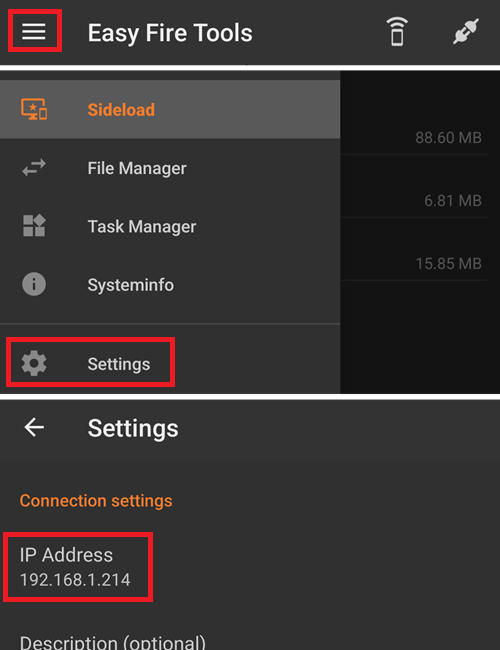

# AAPS instellen op je Wear OS-horloge

De uitleg hieronder geldt voor de **AAPS Wear** apk die je zelf moet bouwen. Als je die nog niet hebt gebouwd, zie dan de handleiding [hier](../WearOS/BuildingAapsWearOS.md). Gebruik bij het bouwen hetzelfde keystore-bestand als voor de **AAPS** apk van de telefoon.

Je kunt een deel van deze informatie ook gebruiken voor de **AAPSClient** en **PumpControl** **Wear** apk. Elke **Wear**-app communiceert met de bijbehorende telefoon-app. Bijvoorbeeld: de app **AAPSClient Wear** kan gebruikt worden om gegevens van **AAPSClient** te tonen, en niet die van **AAPS**. Als er meerdere client-varianten (**AAPSClient**, **AAPSClient2**, **AAPSClient3**) naast elkaar geïnstalleerd zijn, hebben de tegels van elke variant een kleine kop in de accentkleur van die variant. Zo zie je tijdens het swipen welke variant het is.

## Wear OS-versies en compatibiliteit

(wearos-watchface-changes)=

### Veranderingen aan watchfaces in Wear OS (gevolgen voor AAPS-watchfaces)

```{admonition} Why newer Wear OS watches break AAPS watchfaces
:class: warning

In juni 2025 heeft Google [veranderingen aangekondigd](https://android-developers.googleblog.com/2025/06/upcoming-changes-to-wear-os-watch-faces.html) waardoor de oude watchface-engine (de AndroidX / Wearable Support Library-engine, of "WSL") stap voor stap verdwijnt. In de plaats komt het nieuwere, declaratieve **Watch Face Format**. De aangepaste watchfaces van **AAPS** zijn gebouwd op de oude engine. Hoe nieuwer de Wear OS-versie, hoe groter de kans dat een AAPS-watchface niet goed werkt of helemaal stopt.

Dit geldt alleen voor de **watchfaces**. AAPS-**complicaties**, tegels en functies voor bediening op afstand hebben er geen last van. Daarom kan **een firmware-/systeemupdate op een Wear OS-horloge AAPS-watchfaces kapotmaken**. Je kunt een horloge daarna niet terugzetten naar een oudere Wear OS-versie. Als je AAPS-watchface nu werkt, **zet dan automatische updates van het horloge uit**.
```

De tabel hieronder laat per Wear OS-versie zien wat de verandering van Google betekent voor de AAPS-watchfaces (oude engine):

| Wear OS-versie          | Basis-Android | API-niveau | Gevolgen voor AAPS-watchfaces (oude engine)                                                                                                                                                                    |
| ----------------------- | ------------- | ---------- | -------------------------------------------------------------------------------------------------------------------------------------------------------------------------------------------------------------- |
| Wear OS 6               | Android 16    | 36         | **Oude watchfaces niet meer beschikbaar** — AAPS installeert in plaats daarvan een [Watch Face Format-watchface](#wearos-aaps-v4-watchface): je aangepaste watchface, of de AAPS V4-watchface met complicaties |
| Wear OS 5               | Android 14    | 34         | **Ernstig** — actieve (interactieve) modus faalt vaak, complicaties bevriezen, animaties stoppen                                                                                                               |
| Wear OS 4               | Android 13    | 33         | **Matig** — vertraging (throttling), gemiste updates, gedeeltelijke fouten                                                                                                                                     |
| Wear OS 3.0 / 3.2 / 3.5 | Android 11    | 30         | **Laag** — oude engine wordt nog ondersteund                                                                                                                                                                   |

Als je horloge een versie heeft waarop AAPS-watchfaces niet betrouwbaar zijn, kun je AAPS-gegevens ook tonen via **complicaties** op een geschikte watchface. Of gebruik [GlucoDataHandler](https://play.google.com/store/apps/details?id=de.michelinside.glucodatahandler) met een complicatie, die gegevens krijgt van de plugin [Externe Companion Apps](#external-companion-apps) van **AAPS**. Op **Wear OS 6 en nieuwer** installeert AAPS een vervangende watchface in het nieuwe formaat — zie hieronder.

(wearos-aaps-v4-watchface)=

### Wear OS 6 en nieuwer — de watchface die AAPS installeert

Horloges met **Wear OS 6 of nieuwer** kunnen de klassieke AAPS-watchfaces niet als watchface gebruiken. Voor deze horloges brengt de AAPS-horloge-app twee watchfaces mee, gemaakt in het nieuwe **Watch Face Format** van Google. Wear OS laat een app maar **één** watchface installeren. Daarom kies je welke van de twee op het horloge staat:

- **Aangepaste wijzerplaat** (standaard): toont de aangepaste watchface die je vanaf de telefoon hebt geladen met **Laad Watchface** (zie [Een AAPS-watchface kiezen](#WearOS_changing-to-AAPS-watchface)). Het horloge tekent je ontwerp als een afbeelding. Daardoor werkt elke bestaande aangepaste watchface. De complicatievakken die een aangepaste watchface kan hebben, zijn in deze afbeelding **niet beschikbaar**, omdat Wear OS alleen complicatiegegevens levert aan een echte watchface. Druk lang op de watchface om bij de enige instelling te komen: of het always-on-scherm een gewone klok toont of je eigen ontwerp, gedimd.
- **Wijzerplaat complicaties** (de **AAPS V4**-watchface): de **zeven complicatievakken** zijn **vooraf ingesteld met AAPS-gegevens**: BG-waarde, IOB, COB, de [complicatie BG Grafiek](#Watchfaces-complications), basaalstand / tijdelijk streefdoel, en het pictogram **Bedrijfsmodus** in het vak linksboven (tik erop om de loop-modus vanaf het horloge te veranderen). Tik op de tijd bovenaan om de wekker-app van het horloge te openen. In de watchface-editor kun je veranderen wat elk vak toont.

Je kiest op de telefoon: open de plugin **Wear** en kies onder **Wijzerplaat is geïnstalleerd op horloge** een van de twee. Deze kaart wordt alleen getoond als er een horloge met Wear OS 6 of nieuwer verbonden is. **AAPS** vraagt je om te bevestigen, omdat het horloge zijn watchface meteen vervangt. Als je van de **Wijzerplaat complicaties** overstapt naar de andere watchface, worden de complicaties die je in de watchface-editor hebt veranderd ook teruggezet naar de standaard. De bevestiging meldt dat ook. Zolang **Wijzerplaat complicaties** gekozen is, zijn de knoppen voor de aangepaste watchface verborgen en zie je in plaats daarvan een voorbeeld van de watchface. Als je een aangepaste watchface laadt terwijl **Wijzerplaat complicaties** gekozen is, herinnert **AAPS** je eraan om **Aangepaste wijzerplaat** te kiezen om hem op het horloge te zien.

- De gekozen watchface wordt **automatisch geïnstalleerd en geactiveerd** de eerste keer dat de AAPS-horloge-app op zo'n horloge draait. Hij wordt ook **automatisch bijgewerkt** samen met de horloge-app.
- Als je de watchface hebt verwijderd, verschijnt onderaan het AAPS-**Hoofdmenu** op het horloge een item **Installeer de wijzerplaat**. Tik erop om hem opnieuw te installeren.

Zolang er een horloge met Wear OS 5 of ouder verbonden is, wordt de kaart **Wijzerplaat is geïnstalleerd op horloge** helemaal niet getoond (de techniek erachter vereist Wear OS 6). De klassieke watchfaces werken daar zoals voorheen.

(wearos-complications-watchface-setup)=

### Wijzerplaat complicaties — aanbevolen instelling

De **Wijzerplaat complicaties** heeft zeven complicatievakken. Druk lang op de watchface, tik op **Aanpassen** en kies voor elk vak een gegevensbron. De vakken zijn genummerd zoals in de watchface-editor: **1** links, **2** midden, **3** rechts, **4** de grafiek, **5** onder, **6** linksboven en **7** rechtsboven.

| Standaardinstelling                                                                                    | Alternatieve instelling                                                                                        |
| ------------------------------------------------------------------------------------------------------ | -------------------------------------------------------------------------------------------------------------- |
|  |  |

| Vak | Positie     | Standaard                                                                        | Alternatief                                   |
| --- | ----------- | -------------------------------------------------------------------------------- | --------------------------------------------- |
| 1   | Links       | IoB icoon                                                                        | CoB & IoB                                     |
| 2   | Midden      | Bloed glucose                                                                    | Bloed glucose                                 |
| 3   | Rechts      | CoB icoon                                                                        | BR & Streefdoel                               |
| 4   | Grafiek     | BG Grafiek                                                                       | BG Grafiek                                    |
| 5   | Onder       | BR & Streefdoel                                                                  | Uploader/Telefoon Batterij                    |
| 6   | Linksboven  | Bedrijfsmodus                                                                    | Bedrijfsmodus                                 |
| 7   | Rechtsboven | Uploader/Telefoon Batterij, of een app-snelkoppeling naar **AAPS Sluimer Alarm** | App-snelkoppeling naar **AAPS Sluimer Alarm** |

De snelkoppeling **AAPS Sluimer Alarm** kies je uit de eigen complicaties **App-snelkoppeling** van het horloge. Als je erop tikt, gaat het alarm dat op de telefoon afgaat in sluimerstand.

```{tip}
Zet **Always On Display** (scherm altijd aan) aan op het horloge (**Instellingen** > **Scherm**). De watchface blijft dan je glucose tonen als je pols omlaag is, in plaats van een leeg scherm of een gewone klok.
```

```{admonition} No complication data while the watch is locked
:class: note
Als er onder **Instellingen** > **Beveiliging en privacy** een **Vergrendelingstype** is ingesteld, verbergt het horloge complicatiegegevens zolang het vergrendeld is. De watchface toont dan lege vakken tot je het horloge ontgrendelt. Zet in hetzelfde menu **Informatie verbergen** uit om de gegevens zichtbaar te houden.
```

### Wear OS 3

Installeer de **AAPS Wear** apk met [Wear Installer 2](https://youtu.be/abgN4jQqHb0?si=5L7WUeYMSd_8IdPV), Easy Fire Tools (hieronder beschreven) of ADB.  
Geen beperkingen in de werking van **AAPS Wear**.

(BuildingAapsWearOs-WearOS5)=

### Wear OS 4 en Wear OS 5

Voorbeeld: Galaxy Watch 4, 5, 6, 7 en Ultra of Pixel Watch die nog **niet** zijn bijgewerkt naar Wear OS 6. Controleer de versie onder **Instellingen** > **Over horloge** > **Software**.

Installeer de **AAPS Wear** apk met [Wear Installer 2](https://youtu.be/abgN4jQqHb0?si=5L7WUeYMSd_8IdPV) (volg voor Wear OS 5 [deze video](https://www.youtube.com/watch?v=yef_qGvcCnk)). Alle functies van **AAPS Wear** werken, maar de klassieke **AAPS**-watchfaces zijn beperkt, zoals in de tabel hierboven staat: vertraagd op Wear OS 4, vaak niet werkend op Wear OS 5.

```{admonition} Wear OS 5
:class: warning
Op Wear OS 5 moet je de AAPS-watchface met Wear Installer 2 kiezen, direct na het installeren van de Wear-app: aan het eind van de installatie biedt de installer de watchface **AAPS (Custom)** aan. Als je per ongeluk naar een andere watchface overstapt, herhaal dan de installatie. Het veranderen van de instellingen van de watchface (Donker, Watchdivider, enz.) is misschien niet mogelijk.

Als de klassieke watchface nu voor je werkt, **zet dan automatische updates van het horloge uit**: de volgende firmware-update maakt hem waarschijnlijk kapot. Als je toch bijwerkt naar Wear OS 6, lees dan het deel hierboven: **AAPS** installeert dan een eigen watchface in het nieuwe formaat.
```

Als de watchface te onbetrouwbaar is, kun je in plaats daarvan [GlucoDataHandler](https://play.google.com/store/apps/details?id=de.michelinside.glucodatahandler) met een complicatie gebruiken. Daarvoor moet de plugin [Externe Companion Apps](#external-companion-apps) aan staan in **AAPS**.

### Wear OS 6 en nieuwer

Voorbeeld: Galaxy Watch 4 en nieuwer met One UI 8 Watch, Pixel Watch na de update van 2025. De meeste Galaxy- en Pixel-horloges hebben deze update gekregen.

Installeer de **AAPS Wear** apk met [Wear Installer 2](https://youtu.be/abgN4jQqHb0?si=5L7WUeYMSd_8IdPV). De klassieke watchfaces zijn niet beschikbaar; **AAPS** installeert automatisch de watchface die op de telefoon gekozen is, zie [de watchface die AAPS installeert](#wearos-aaps-v4-watchface). Geen beperkingen in de werking van **AAPS Wear**.

## Een Samsung Galaxy Watch 4-smartwatch instellen met **AAPS**

Dit deel gaat ervan uit dat smartwatches helemaal nieuw voor je zijn. Eerst krijg je een korte uitleg over een populair horloge, de **Galaxy Watch 4**. Daarna volgt een stap-voor-stap handleiding om **AAPS** op het horloge in te stellen.

_Deze handleiding is geschreven voor een Galaxy Watch met Wear OS 3._ Op Wear OS 4 en later vraagt het horloge om een **koppelingscode** als een telefoon of computer verbinding maakt via ADB. Wear Installer 2 en de werkwijze met de terminal [hieronder](#BuildingAapsWearOs-WearOS5-TShoot) ondersteunen dit allebei.

Hier zijn basishandleidingen voor de [Galaxy Watch 5](https://www.youtube.com/watch?v=Y5upzOIxwTU) en de [Galaxy Watch 6](https://www.youtube.com/watch?v=D6bq20KzPW0)

## Basiskennis van smartwatches

Als je het horloge volgens de video hierboven hebt ingesteld, ga je op de telefoon naar de Play Store en download je de volgende apps: "Galaxy Wearable", “Samsung” en “Easy Fire tools” of "Wear Installer 2".

Er zijn veel YouTube-video's van anderen die je helpen om je nieuwe smartwatch te leren kennen, bijvoorbeeld:

[https://www.youtube.com/watch?v=tSVkqWNmO2c](https://www.youtube.com/watch?v=tSVkqWNmO2c)

De app “Galaxy Wearable” heeft ook een deel met een handleiding. Open Galaxy Wearable op de telefoon, zoek het horloge en probeer het horloge te koppelen met de telefoon. Afhankelijk van je versie kan de app vragen om nog een app te installeren: “galaxy watch 4 plugin” uit de Play Store (het downloaden duurt even). Installeer deze op de telefoon en probeer daarna opnieuw het horloge en de telefoon te koppelen in de Wearable-app. Ga door een reeks menu's en vink verschillende voorkeuren aan.

## Een Samsung-account instellen

Zorg dat het e-mailaccount waarmee je het Samsung-account instelt een geboortedatum heeft waarbij de gebruiker 13 jaar of ouder is. Anders is het heel moeilijk om de Samsung-toestemmingen te geven. Als je je kind jonger dan 13 een Gmail-account hebt gegeven en je gebruikt dat e-mailadres, dan kun je het niet zomaar omzetten naar een account voor volwassenen. Een oplossing is om de huidige geboortedatum zo te veranderen dat de leeftijd nu 12 jaar en 364 dagen is. De volgende dag wordt het account omgezet naar een account voor volwassenen en kun je verder met het instellen van het Samsung-account.

(remote-control-transferring-the-aaps-wear-app-onto-your-aaps-phone)=

## De **AAPS** Wear-app naar je **AAPS**-telefoon overzetten

Je kunt Wear.apk op twee manieren vanuit Android Studio naar je telefoon zetten:

a)  met een USB-kabel het **AAPS** wear apk-bestand op de telefoon zetten en het daarna naar het horloge “side-loaden”. Zet Wear.apk via USB in de map Downloads op de telefoon; of

b)  Wear.apk vanuit Android Studio knippen en plakken naar je Google Drive.


Om AAPS naar het horloge te side-loaden, kun je een van deze gebruiken: 1) Wear Installer 2 2) Easy Fire tools 3) Android Debug Bridge (ADB) Wij raden hier Wear Installer 2 aan, omdat de uitleg en de stappen in de video heel duidelijk zijn. Als Wear Installer 2 bij jou niet werkt, probeer dan Easy Fire Tools of ADB. Beide staan hieronder beschreven.

### Wear Installer 2 gebruiken om **AAPS** Wear van de telefoon naar het horloge te side-loaden

 

Wear Installer 2, gemaakt door [Malcolm Bryant](https://www.youtube.com/@Freepoc), kun je vanuit Google Play op je telefoon downloaden. Hiermee kun je de AAPS wear-app naar het horloge side-loaden. In de app staat een handige ‘how to sideload’ [video.](https://youtu.be/abgN4jQqHb0?si=5L7WUeYMSd_8IdPV)

```{tip}
Volg voor horloges met Wear OS 5 [deze video](https://www.youtube.com/watch?v=yef_qGvcCnk).
Zie de tips voor probleemoplossing [hieronder](#BuildingAapsWearOs-WearOS5-TShoot).
```

Hierin staan alle details die je nodig hebt (open de video het liefst op een ander apparaat, zodat je ernaar kunt kijken terwijl je de telefoon instelt).

Zoals in de video staat: zet na afloop ADB-foutopsporing op het horloge uit, zodat de batterij van de smartwatch niet leegloopt.

Je kunt ook het volgende doen, maar niet voor Wear OS 5:

### Easy Fire tools gebruiken om **AAPS** wear naar het horloge te side-loaden

1)   Download _[Easy Fire Tools](https://play.google.com/store/apps/details?id=de.agondev.easyfiretools&hl=en)_ uit de Play Store op de telefoon


2)  Maak jezelf ontwikkelaar op het horloge (als het horloge is ingesteld en met de telefoon verbonden is):

Ga naar **Instellingen** > **Systeem** > **Over** > **Versies** (de namen van de menu's verschillen per merk horloge — op sommige horloges is het **Over horloge** > **Software-informatie** > **Softwareversie**).


Tik een paar keer snel achter elkaar op **Buildnummer** (of **Softwareversie**) tot een melding zegt dat je nu ontwikkelaar bent.


Ga terug naar **Instellingen** > **Systeem**: daar staat nu een nieuw menu **Ontwikkelaarsopties**.

Zet in **Ontwikkelaarsopties** de opties **ADB-foutopsporing** en **Draadloze foutopsporing** aan en bevestig de vragen. Draadloze foutopsporing toont dan het **IP-adres en de poort** van het horloge, bijvoorbeeld: **192.168.1.214** : 5555. Je hebt alleen het IP-adres nodig (hier **192.168.1.214**), niet het poortnummer na de dubbele punt. Let op: het IP-adres kan veranderen, bijvoorbeeld elke keer als je een nieuwe telefoon voor AAPS gaat gebruiken.


STAP 3)     Voer het IP-adres _bijv._ **192.168.1.214** in Easy Fire tools op de telefoon in (open het hamburgermenu links, ga naar de instellingen en voer het IP-adres in).



Klik daarna op het stekkerpictogram rechtsboven. Het wordt groen als er verbinding is.


STAP 4) Volg de uitleg [hier](https://wearablestouse.com/blog/2022/01/04/install-apps-apk-samsung-galaxy-watch-4/?utm_content=cmp-true) om aaps-wear.apk met Easy Fire tools naar de smartwatch te side-loaden (dus over te zetten)


(BuildingAapsWearOs-WearOS5-TShoot)=

### De terminal gebruiken
Verbind je smartwatch en je computer met hetzelfde wifi-netwerk.

- Download ADB om het te installeren via: https://developer.android.com/tools/releases/platform-tools
- Open een terminal.
- Maak op Windows een nieuwe map met de naam `adb` op je schijf `C:`. Open het bestand `platform-tools-latest-windows.zip` dat je hierboven hebt gedownload. Kopieer alle bestanden in `platform-tools` naar `C:\adb` en open deze map in een opdrachtprompt (rechtsklik en Openen in Terminal). Typ het commando hieronder om het pad in te stellen naar de map waar ADB staat: `setx PATH "%PATH%;C:\adb"`
- Op een Mac kun je in plaats van handmatig installeren ook homebrew gebruiken: `brew install android-platform-tools`

Op het horloge:
- Ga naar Instellingen → Over horloge → **Software-informatie**
- Tik 7 keer op Softwareversie tot je ziet dat de ontwikkelaarsmodus aan staat.
- Ga naar Instellingen → Ontwikkelaarsopties. Zet **ADB-foutopsporing** aan
- Ga naar Instellingen → Ontwikkelaarsopties → Draadloze foutopsporing → **Nieuw apparaat koppelen**

Je ziet een wifi-koppelingscode en een IP-adres en poort verschijnen:


- In de terminal: `adb pair ipaddress:port` Bijv. `adb pair 10.10.1.125:36299`
- Je wordt gevraagd om de koppelingscode. Voer die in.
- Je ziet als antwoord:<br> `Successfully paired to 10.10.1.125:36299 [guid=adb-RXXXW20LMKJY-eh5zBj]`<br>
- Typ in de terminal: <br>`adb devices`.<br> Je ziet dan iets als:<br> `List of devices attached`<br> `10.10.1.125:36299  offline`<br> `adb-RFAW20LMKJY-eh5zBj._adb-tls-connect._tcp   device`<br>

- Ga nu naar de map op je computer waar de Wear apk staat en typ<br> `adb install wear-full.apk` <br>waarbij je wear-full.apk vervangt door de naam van je apk-bestand.
- Je ziet:<br> `Performing Streamed Install`<br> `Success`


(wear-os-5-troubleshooting)=

### Algemene tips voor probleemoplossing bij Wear OS 5

- Gebruik geen wifi-tethering. Dat werkt niet.
- Je hoeft adb-foutopsporing niet aan te zetten op de telefoon (alleen op het horloge). Zet adb-foutopsporing op de telefoon uit.
- Zorg dat je verbinding maakt met je lokale netwerk, waar de telefoon en het horloge elkaar kunnen zien (gebruik niet je wifi-gastnetwerk).
- Zorg dat het horloge en de telefoon allebei op hetzelfde netwerk en hetzelfde wifi-apparaat zitten. Vooral wifi-repeaters of access points kunnen problemen geven.
- Ga dicht bij je hoofdrouter staan en start daarna de telefoon en het horloge opnieuw op.

**Koppelen:**

- Horloge: Draadloze foutopsporing: noteer het IP-adres.
- Wear Installer: voer het IP-adres in de Wear Installer-app in.
- Kies Nieuw apparaat koppelen en noteer de koppelingscode en het poortnummer die getoond worden.
- Wear Installer: voer de koppelingscode + spatie + poortnummer in.
- Wear Installer moet melden dat het koppelen gelukt is. Als dat niet zo is, sluit Wear Installer af en probeer het opnieuw.

Na het koppelen kun je de AAPS wear apk installeren:

- Sluit Wear Installer af en start het opnieuw.
- Noteer bij Draadloze foutopsporing het IP-adres en poortnummer, en controleer of voer het IP-adres en poortnummer in Wear Installer in.
- Let op: dit poortnummer is anders dan het poortnummer voor het koppelen!

## De verbinding tussen het horloge en de telefoon instellen vanuit **AAPS**

De laatste stap is **AAPS** op de telefoon zo instellen dat het samenwerkt met **Wear.apk** op het horloge. Zet hiervoor de Wear-plugin aan:

* Ga naar de **AAPS**-app op de telefoon

* Open het **menu** (☰) linksboven en ga naar **Configuratie** > **Communicatie**

* Vink het vakje **Wear** aan


Om vanaf het horloge een bolus te geven of andere acties te doen, zet je ook **Bediening via smartwatch** aan in [Instellingen > Wear](#preferences-wear).

Om een andere **AAPS**-watchface te kiezen, druk je op het startscherm van het horloge. Je komt dan in “aanpassen”. Swipe dan naar rechts tot je alle **AAPS**-watchfaces ziet.

Als de **AAPS** Wear.apk goed naar de smartwatch is gezet, ziet het er zo uit:


Bij sommige smartwatches, zoals de Samsung Galaxy, moet 'Verbinding op afstand' (Remote Connection) onder Geavanceerde functies van de Samsung Galaxy **aan** staan om **Wear.apk** en **AAPS** op afstand via wifi te gebruiken.


(wear-os-watch-phone-communication)=

### Probleemoplossing voor de communicatie tussen het **AAPS**-horloge en de **AAPS**-telefoon

1.  Als EasyFire tools geen verbinding maakt of als je ‘authorisation failed’ krijgt > controleer of het IP-adres goed is ingevoerd.
2.  Controleer of de smartwatch verbonden is met internet (en niet alleen via Bluetooth met de telefoon).
3.  Controleer of de **AAPS**-telefoon en de smartwatch gekoppeld of verbonden zijn in de Samsung-app.
4.  Het kan ook helpen om de telefoon en de smartwatch helemaal opnieuw op te starten (dus de telefoon uit- en weer aanzetten)
5.  Stel dat je Wear.apk wel op je telefoon hebt kunnen downloaden, maar je krijgt geen BG-gegevens. _Controleer_ dan of je de juiste **AAPS** Wear apk naar het horloge hebt gezet: de horloge-app van een browser-build is het bestand `aaps-wear-….apk`, zie [De Wear AAPS-app bouwen](../WearOS/BuildingAapsWearOS.md). Als het bestand dat je hebt geïnstalleerd een van deze is: a) een **AAPSClient** Wear apk (terwijl op de telefoon **AAPS** draait); b) een `.aab`-bestand; of c) een bestand met het woord ‘debug’ in de naam, dan heb je bij het bouwen niet de juiste Wear OS apk gekozen.
6.  Controleer of je router de apparaten niet van elkaar afschermt.

Meer tips voor probleemoplossing vind je [hier](https://freepoc.org/wear-installer-help-page/#:~:text=If%20you%20are%20having%20problems,your%20phone%20and%20your%20watch.)

(WearOS_changing-to-AAPS-watchface)=

## Een AAPS-watchface kiezen op je WearOS-horloge

In de standaard build van de AAPS Wear OS APK zitten een aantal watchfaces. Zodra je de AAPS Wear APK op je horloge hebt geïnstalleerd, zijn ze beschikbaar. Zo kies je er een:

1. Druk op je horloge (uitgaande van WearOS) lang op je huidige watchface om het scherm te openen waar je een watchface kiest. Scroll helemaal naar rechts tot je de knop "Wijzerplaat toevoegen" ("Add Watch Face") ziet en kies die


2. Scroll door de lijst tot je "AAPS (Custom)" vindt (afhankelijk van het horloge staan de watchfaces van geïnstalleerde apps in een deel "Gedownload" of zijn ze per app gegroepeerd). Klik op het midden van de afbeelding om hem toe te voegen aan je korte lijst met huidige watchfaces. Let nog niet op hoe de watchface "AAPS (Custom)" er nu uitziet. In de volgende stap kies je de skin die je wilt.


3. Open nu AAPS op je telefoon en open de Wear-plugin: **Configuratie** > **Communicatie** > **Wear** > **Plug-in openen** (vink eerst **Wear** aan als het nog niet aan staat).


4. Klik op de knop "Laad Watchface" en kies de watchface die je mooi vindt


5. Kijk op je horloge: de watchface "AAPS (Custom)" toont nu de skin die je hebt gekozen. Wacht een paar seconden tot het scherm is bijgewerkt. Het scherm **Wear** op de telefoon toont nu de naam van de geladen watchface en een voorbeeld ervan. **Watchface informatie** toont de details en de velden die erin zitten. **Meer wijzerplaten** opent de [uitwisselsite](../ExchangeSiteCustomWatchfaces/index.md) waar je andere aangepaste watchfaces kunt downloaden. Je kunt nu de complicaties enz. aanpassen: druk lang op de watchface en druk dan op de knop "Aanpassen" op de afbeelding van de watchface.

```{admonition} Complications on a custom watchface
:class: note
Aangepaste watchfaces die gemaakt zijn met versie 3.0 of nieuwer van het formaat voor aangepaste watchfaces, kunnen tot vijf complicatievakken hebben. De watchface bepaalt hun positie en grootte (**Complicatie indeling**). Druk op het horloge lang op de watchface, tik op **Aanpassen** en tik op **Complicatie 1** tot **Complicatie 5** om voor elk vak de gegevensbron te kiezen. Dezelfde rijen staan in de AAPS-app op het horloge onder **Instellingen** > **AAPS(Custom)**. Als je daar op een rij tikt, opent dezelfde keuzelijst. **Complicatietype prioriteit** bepaalt of een vak liever een waarde of meter, tekst of een pictogram toont, als de gegevensbron er meerdere aanbiedt. Een veranderde prioriteit geldt pas de volgende keer dat je een gegevensbron voor dat vak kiest.

Deze vakken werken alleen op horloges met **Wear OS 5 of ouder**, waar de aangepaste watchface als echte watchface draait. Op **Wear OS 6 en nieuwer** wordt de aangepaste watchface getoond als een afbeelding zonder complicatievakken, en zijn stap 1 en 2 hierboven niet nodig: zorg dat **Aangepaste wijzerplaat** gekozen is onder **Wijzerplaat is geïnstalleerd op horloge** in de **Wear**-plugin op de telefoon (zie [de watchface die AAPS installeert](#wearos-aaps-v4-watchface)).
```

## AAPSv2-watchface - legenda


A - tijd sinds laatste uitvoering loop

B - CGM-uitlezing

C - minuten sinds laatste CGM-uitlezing

D - verandering ten opzichte van de vorige CGM-uitlezing (in mmol of mg/dl)

E - gemiddelde verandering van de CGM-uitlezing in de laatste 15 minuten

F - batterij van de telefoon

G - basaalstand (in E/u bij de standaard basaalstand en in % tijdens een TBR)

H - BGI (blood glucose interaction, invloed op de bloedglucose) -> hoe sterk de BG “zou” moeten stijgen of dalen, alleen door de werking van insuline.

I - koolhydraten (koolhydraten aan boord | e-carbs in de toekomst)

J - insuline aan boord (van bolus | van basaal)
