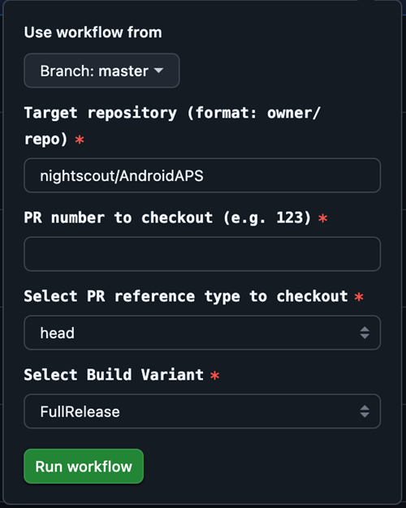

# Branch de desenvolvimento

```{warning}
A branch dev serve apenas para o desenvolvimento futuro do AAPS. Ela deve ser usada em um telefone separado, para testes, <font color="#FF0000">**não para fazer loop de verdade!**</font>
```

A versão mais estável do AAPS para usar é a da [branch Master](https://github.com/nightscout/AndroidAPS/tree/master). Recomendamos ficar na branch Master para fazer loop de verdade.

A versão dev do AAPS é só para desenvolvedores e testadores que sabem lidar com stacktraces, analisar arquivos de log e talvez iniciar o depurador para criar relatórios de bugs úteis para os desenvolvedores (em resumo: pessoas que sabem o que estão fazendo sem precisar de ajuda!). Por isso, muitos recursos não terminados estão desativados. To enable these features enter **Engineering Mode** by creating a file named `engineering_mode` in the directory /AAPS/extra. Ativar o modo engenheiro pode quebrar o loop totalmente.

Mesmo assim, a branch dev é um bom lugar para ver quais recursos estão sendo testados, ajudar a eliminar bugs e dar feedback sobre como os novos recursos funcionam na prática. Muitas vezes as pessoas testam a branch dev em um telefone e uma bomba antigos até terem certeza de que ela está estável - qualquer uso é por sua conta e risco. Ao testar qualquer recurso novo, lembre-se de que você está escolhendo testar um recurso que ainda está em desenvolvimento. Faça isso por sua conta e risco & com o devido cuidado para se manter seguro.

Se você encontrar um bug ou achar que algo deu errado ao usar a branch dev, veja a [aba de issues](https://github.com/nightscout/AndroidAPS/issues) para verificar se alguém já o encontrou, ou adicione-o você mesmo se não. Quanto mais informações você compartilhar aqui, melhor (não esqueça que talvez seja necessário compartilhar seus [arquivos de log](../GettingHelp/AccessingLogFiles.md)). Os novos recursos também podem ser discutidos no [discord](https://discord.gg/4fQUWHZ4Mw).

Uma versão dev tem uma data de validade. Isso parece inconveniente quando ela funciona bem, mas tem um propósito. Quando há uma única versão dev em circulação, é mais fácil acompanhar os bugs que as pessoas relatam. Os desenvolvedores não querem uma situação em que haja três versões dev em uso, com bugs corrigidos em algumas e não em outras, e as pessoas continuem relatando os bugs já corrigidos.

(branch-ci-test)=

## Testar uma branch específica (branch-ci)

Para compilar uma branch de teste, selecione branch-ci, que permite escolher uma branch específica para criar o APK. Você pode usar este método quando precisar testar a branch dev.


(github-pr-test)=

## Testar itens de um pull request (implantação por GitHub CI actions)

Disponível a partir da 3.3.2.1.dev

- Adequado para testadores ou para quem ajuda nos testes.

```{eval-rst}
.. raw:: html

    <!--crowdin: exclude-->
    <div align="center" style="max-width: 360px; margin: auto; margin-bottom: 2em;">
      <div style="position: relative; width: 100%; aspect-ratio: 9/16;">
        <iframe
          src="https://geo.dailymotion.com/player/x9rdx1q.html?video=x9rdx1q&loop=true&mute=true"
          loading="lazy"
          style="position: absolute; top: 0; left: 0; width: 100%; height: 100%;"
          frameborder="0"
          allowfullscreen>
        </iframe>
      </div>
    </div>
```



- Repositório de destino: o repositório que contém o PR, no formato owner/repo. Deixe o padrão **nightscout/AndroidAPS**, a menos que alguém tenha pedido para você usar outro repositório (só desenvolvedores devem fazer isso).

- Número do PR: digite o número do PR que você quer testar.

- Tipos de referência do PR: há duas opções:
    
    - head:
    - Busca o conteúdo real da branch do autor do PR (ou seja, o histórico de commits original, sem nenhuma operação de merge).
    - Isso equivale ao estado original da branch do PR, como se fosse buscado diretamente de um fork ou de uma branch de recurso.
    
    - merge:
    
    - Busca o resultado do merge que o GitHub simula antecipadamente do PR na branch de destino (por exemplo, dev).
    - Este é um commit de merge virtual criado automaticamente pelo GitHub.
    - Este commit só existe quando o PR não tem conflitos e pode ser mesclado.
    
    - variant:
    
    - Veja [variante](#browserbuild-variant)