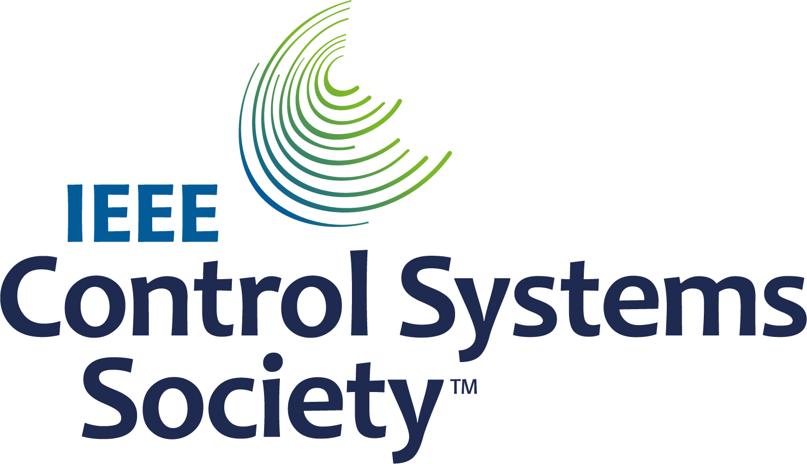
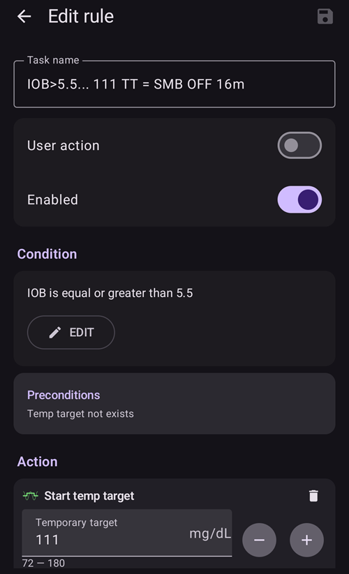

# Loop fechado completo

```{contents} In this page
:backlinks: entry
:depth: 2
```

A principal vantagem do loop fechado completo **FCL** é que ele pode imitar um pâncreas artificial e facilitar o dia a dia, sem a necessidade de dar bólus para as refeições.

Embora o **loop fechado híbrido** ('HCL') seja baseado em algoritmo, ele ainda exige que o usuário dê bólus manualmente antes das refeições. Como resultado, o loop pode entrar em um desligamento temporário (basal temporária zero) para evitar o excesso de insulina.

No **FCL**, os bólus de acordo com o tamanho da refeição não são mais necessários: deixe isso com o algoritmo!  O **AAPS** consegue lidar com refeições sem que o usuário dê nenhum bólus e sem inserir carboidratos, em um modo chamado ‘refeições não anunciadas’ **(‘UAM’)**. O **UAM** permite que o **AAPS** tolere melhor entradas de carboidratos incorretas, sendo mais agressivo.

## O que esperar?

Há muitos estudos publicados sobre os bons resultados que o **FCL** pode alcançar. Para ler mais, veja:

1)   National Library of Medicine, PubMed [First Use of Open-Source Automated Insulin Delivery AndroidAPS in Full Closed-Loop Scenario: Pancreas4ALL Randomized Pilot Study](https://pubmed.ncbi.nlm.nih.gov/36826996/);

2)  ClinicalTrials.gov National Library of Medicine, Clinical Trial [Feasibility and Safety Study of the Automated Insulin Delivery Closed Loop System Pancreas4ALL (ASAP)](https://www.clinicaltrials.gov/study/NCT04835350?term=Feasibility%20and%20Safety%20Study%20of%20the%20Automated%20Insulin%20Delivery%20Closed%20Loop%20System%20Pancreas4ALL%20(ASAP)&rank=1)

O sucesso com o **FCL** exige que o usuário:

- verifique se cumpre os requisitos do **FCL**;
- configure **Automações** adaptadas às necessidades do seu dia a dia; e
- faça o ajuste fino das configurações do **AAPS** (principalmente das **Automações**).


## Considerações gerais: por que (não) passar do HCL para o FCL

O **FCL** não é para todos:

- Alguns usuários de **FCL** alcançam TIR (70–180) em torno de 90% e HbA1c abaixo de 6%, mas outros usuários preferem um controle mais rigoroso. Principalmente, minimizar valores acima de 140 mg/dl com dietas de carboidratos rápidos provavelmente exige pré-bólus.
- Ajustar o **AAPS** pode ser difícil. Não é para usuários que se sentem sobrecarregados pelo AAPS.  Você vai precisar dedicar algumas semanas para ajustar e fazer o ajuste fino do seu **FCL**. Investir esse tempo pode trazer resultados melhores e um melhor controle da **glicose**.
- O controle das refeições pode ficar mais fácil, mas os exercícios ainda podem ser difíceis no **FCL**. A maioria de nós prefere limitar os lanches durante o esporte para tentar controlar o peso corporal.
- Ainda há dificuldades para estabelecer um **FCL** para crianças (veja abaixo).


## Loop fechado híbrido bem ajustado

É recomendável primeiro estabelecer um **HCL** bem ajustado antes de pensar na transição para o **FCL**.  O sucesso com o **FCL** exige um ajuste altamente personalizado das configurações do usuário, para que o **AAPS** possa dar insulina imitando de perto o SEU modo de loop fechado híbrido bem-sucedido.

O **FCL** exige que o usuário configure e ajuste suas **Automações**. Porém, o usuário deve entender bem suas necessidades de insulina antes de começar com o **FCL**. Erros podem ser escondidos por outros erros que os compensam. Isso pode criar um sistema **FCL** instável e dificultar a correção depois. Você deve esperar alcançar com o seu FCL um %TIR parecido com o que você vê hoje no seu **HCL**.

**O FCL é uma configuração de Automações feita por você mesmo (DIY), definida pelo usuário ao analisar seus dados tanto do HCL bem-sucedido quanto da experiência inicial com o FCL, ao ajustar suas configurações.**

## Insulina rápida (Lyumjev, Fiasp)

O **FCL** exige insulina rápida.  Isso é para que, no início da subida da **glicose** causada pela refeição, o **FCL** consiga manter a **glicose** na faixa-alvo (pela definição comum, abaixo de 180 mg/dl (10 mmol/l)).

Um estudo de modelagem (detalhes em LINK FullLoop V2/March2023; ali, seção 2.2) pode mostrar em números que *insulinas mais rápidas*

Fonte:

 


IEEE Control Systems Magazine, ResearchGate [The Artificial Pancreas and Meal Control: An Overview of Postprandial Glucose Regulation in Type 1 Diabetes](https://www.researchgate.net/publication/322866519_The_Artificial_Pancreas_and_Meal_Control_An_Overview_of_Postprandial_Glucose_Regulation_in_Type_1_Diabetes);

- resultarão em picos de **glicose** bem menores do que insulinas mais lentas;
- tolerar um primeiro bólus de refeição alguns minutos atrasado sem causar picos altos demais; e
- minimizar o efeito de diferentes quantidades de carboidratos (tamanhos de refeição) no pico de **glicose**.

É pouco provável que o **FCL** seja eficaz com insulinas que não sejam Lyumjev ou Fiasp, a menos que o usuário siga uma dieta com quantidade moderada a baixa de carboidratos.

Porém, Fiasp ou Lyumjev podem causar oclusões frequentes da bomba, mesmo depois de otimizar coisas como o comprimento da agulha. É importante ficar de olho no tempo de uso da cânula ou do pod. Muitos usuários acham que 48 horas é o limite de eficácia da insulina antes de ocorrer falha da cânula/pod.

## Pré-requisitos

Valores de **glicose** e uma conexão Bluetooth estável são necessários para garantir que o **AAPS** funcione da melhor forma sem perder tempo valioso. O **FCL** exige um sistema tecnicamente estável 24 horas por dia, 7 dias por semana:

- o **desempenho do seu CGM**. Seu CGM não deve gerar valores de **glicose** com saltos que possam ser interpretados erroneamente pelo **FCL** como sinal de uma refeição começando. Da mesma forma, as calibrações do **CGM** podem gerar resultados com saltos.
- como e onde é feita qualquer suavização do **CGM** e o que isso pode significar para o seu ajuste. Principalmente como o delta é definido, e o AAPS reconhecer isso como sinal de uma refeição começando.
- estabilidade do Bluetooth para a bomba e o CGM;
- evitar (ou pelo menos reconhecer cedo) a oclusão da bomba;
- o fluxo de dados, os apps usados no seu telefone e a diferença entre os dias de uso do sensor;
- manter todos os componentes do **AAPS** bem carregados e as peças de reposição por perto; e
- trocar a cânula (ou o pod) sempre cedo o suficiente para reduzir o risco de oclusão;

Isso vai variar de acordo com os componentes do seu sistema **AAPS** e com o seu estilo de vida.

## Limitações relacionadas às refeições

- Configurar um **FCL** pode ser mais fácil para pessoas cuja alimentação não tem alimentos com efeito rápido e alto na **glicose**, e cujos padrões de refeição não mudam muito de um dia para o outro. Isso não significa necessariamente pouco carboidrato.

- Dietas ricas em gordura ou proteína, ou digestão lenta/gastroparesia, tornam as coisas mais fáceis, e não mais difíceis, para o **FCL**, porque os carboidratos tardios cobrem bem os inevitáveis “finais” da ação tardia do bólus necessário perto do pico.

### Índice glicêmico e efeito na glicose

O desafio para o modo **UAM** aumenta quanto maior for o 'Efeito na glicose' ('EBG')

- Comece com moderado/baixo e ajuste as configurações do seu **Perfil**. Só depois disso, "teste" refeições com **EBG** alto.
- Considere um bólus inicial < 50% se for consumir algo com **EBG** muito alto.

1) **Sem EBG**: por exemplo, carne fresca, peixe, ovos, bacon, óleos, queijo. 2) **EBG baixo**: por exemplo, verduras e frutas vermelhas frescas, cogumelos, castanhas, leite, iogurte, queijo cottage. 3) **EBG moderado**: por exemplo, pão/macarrão integral, batatas, arroz selvagem, aveia, frutas secas. 4) **EBG alto**: por exemplo, pão de trigo, baguete, torradas, waffles, biscoitos, purê de batata, macarrão, arroz. 5) **EBG muito alto**: por exemplo, açúcar, bebidas doces, sucos de frutas, cornflakes, balas, doces, batatas chips, palitos de pretzel salgados.


As refeições mais difíceis para o **FCL** são aquelas com alimentos que só têm componentes de **EBG** muito alto e alto (veja em vermelho na imagem): não só a **glicose** sobe rapidamente, mas também há pouca gordura/proteína/fibra para equilibrar o inevitável “final” da atividade da insulina que viria das tentativas de controlar a glicose alta mais cedo.

O consumo irregular de lanches e bebidas doces cheios de carboidratos de absorção rápida é um problema para o **FCL**.


## Preparação para atividade/esportes

Ao fazer exercícios ou estar ativo, com uma bomba ou loop fechado híbrido, é recomendado que o usuário reduza o **IOB** antes do exercício.

No **FCL**, o algoritmo é ajustado para detectar **UAM** e administrar insulina automaticamente para combater subidas da **glicose**.  Um **Alvo temporário** alto e uma **Porcentagem do perfil** menor (já em vigor perto do início da refeição) devem ser definidos bem antes de qualquer atividade.

Níveis de atividade física incomuns ou irregulares são difíceis para o **FCL**. É preciso planejar com antecedência para exercícios (principalmente se você quiser reduzir a necessidade de carboidratos/lanches de resgate durante hipoglicemias no esporte). Depois de um dia ativo, é recomendado definir uma **Porcentagem do perfil** menor para a noite, depois que o jantar estiver totalmente digerido: defina nas **Automações** um alvo de **glicose** elevado (>100 mg/dl), com “sem **SMBs** com alvo elevado” selecionado nas **Configurações** do **AAPS**.

## Obstáculos para crianças

O **FCL** pode trazer desafios extras para crianças, entre eles:

- Lyumjev ou Fiasp podem não estar disponíveis ou não ser bem tolerados.
- A taxa basal por hora pode ser muito baixa, o que dá uma base fraca para **SMBs** grandes.
- A alimentação pode ser rica em componentes doces. Com o volume de sangue tipicamente baixo de um corpo pequeno, há uma forte tendência a picos de **glicose** muito altos.
- Os hormônios do crescimento e as grandes mudanças na sensibilidade à insulina dificultam manter o **FCL** bem ajustado.


## Ativando SMBs reforçados: segurança

No **HCL**, há restrições de segurança para o tamanho dos bólus que podem ser dados automaticamente pelo loop.

Os usuários de **FCL** não precisam mais dar um bólus grande perto do início da refeição. Isso significa que os limites de tamanho dos **SMBs** devem ser ampliados, para que o loop consiga administrar **SMBs** grandes o suficiente.

Se você usa o **AAPS** na versão Master, é sugerido definir nas **Configurações** do **AAPS** o tamanho máximo de **SMB** permitido que o **FCL** pode dar (maxUAMSMBBasalMinutes=120, ou seja, 2 horas de basal naquele horário do dia).

Se a sua taxa basal for muito baixa, os limites de **SMB** resultantes podem ser baixos demais para permitir controle suficiente das subidas da **glicose** após as refeições. Uma solução possível é evitar dietas que causam picos fortes de **glicose**. O algoritmo [Auto ISF](#Open-APS-features-auto-isf) (disponível apenas em uma versão dev com o modo de engenharia) tem a configuração **Extensão máxima da faixa de SMB**, que amplia o máximo padrão de 2 horas de basal por um fator >1, e permite aumentar a **Proporção de administração de SMB** padrão de 50%.

**Siga as instruções para permitir que o AAPS imite seus bólus com alguns SMBs**.

Verifique periodicamente a tela do plugin **APS** (**Configuração → APS → Abrir plugin**) para ver se seus **SMBs** podem ser grandes o suficiente para administrar a insulina que o loop precisa perto do início das refeições.

Se não, seus esforços de ajuste às vezes não darão em nada!


```{admonition} Boosting **ISF** can become dangerous
:class: danger

Observe/analise com atenção o tamanho dos **SMB** logo depois que sua refeição começa. Ajuste em etapas e não mude mais de 1 ou 2 parâmetros por vez.

As configurações do seu **AAPS** devem estar bem preparadas para lidar com a (sua!) variedade de refeições.
```

## Detecção de refeições/suas Automações para reforço

Para um **FCL** bem-sucedido, o **ISF** é o principal parâmetro de ajuste. Ao usar o **AAPS** Master + **Automações**, uma **mudança de perfil > 100% deve ser iniciada automaticamente quando a refeição for reconhecida** (pelos deltas da glicose), e fornecer o **ISF** mais forte.

O **AAPS** Master permite um **Perfil** temporário de até 130% no modo **HCL**. O reforço do **ISF** é feito em 3 etapas:

- Etapa 1 - verifique o **ISF** do **Perfil** para o horário desta refeição e veja se, por exemplo, o Autosens sugere uma mudança que leve em conta o estado atual (das últimas horas) da sensibilidade à insulina do corpo.
- Etapa 2 - aplique um fator (1/Perfil%, como definido na **Automação**) para reforçar o **ISF**.
- Etapa 3 - verifique se o **ISF** sugerido está dentro dos limites de segurança definidos.

### Modelos de Automação do FCL

Caixas para marcar na parte de cima. Você tem a opção:

- Na sua lista de **Automação**, você pode DESMARCAR a marca de seleção (à esquerda de cada campo) => Isso desativa essa **Automação**. Por exemplo, você pode fazer isso com todas as **Automações** de **FCL** do café da manhã, para usar o **HCL** no café da manhã.

- Em cada regra de **Automação**, você pode marcar a caixa Ação do usuário => assim, as Ações definidas não serão executadas automaticamente quando as Condições forem atendidas. Em vez disso, a tela principal do **AAPS** vai avisar você sempre que o seu **FCL** for dar um **SMB** automaticamente. Então, você tem a chance de dizer ‘sim’ ou ‘não’. Isso é muito útil na sua fase de ajuste.

Este recurso pode ser útil em certas situações, como a síndrome “foot to floor” (pé no chão), em que há uma subida repentina da **glicose** ao levantar de manhã, mas o usuário quer evitar uma resposta totalmente automática de “café da manhã iniciado”.

A seção abaixo explica como agrupar as Condições das **Automações** e como lidar com situações em que o **AAPS** deve aumentar (ou diminuir) a administração de insulina. Como o **ISF** não pode ser ajustado diretamente, aumentar a **Porcentagem do perfil** acima de 100% tem o mesmo efeito para o nosso objetivo.

### SMBs grandes automáticos na subida da glicose

O segredo para um **FCL** bem-sucedido: **no início das subidas da glicose causadas por refeições, o loop deve dar SMBs automáticos muito grandes o mais rápido possível** para “alcançar” o **IOB** necessário (compare com o bólus típico que você daria para uma refeição parecida no **HCL**!)

Para isso, os dados do seu **HCL** devem ser analisados para determinar quais **deltas** podem não estar relacionados a refeições e quais deltas podem estar.

- Como você pode definir a **Automação** dentro de uma janela de tempo predefinida, só precisa analisar esse período.
- Se você faz refeições muito diferentes (por exemplo, um café da manhã com muitos carboidratos, mas um almoço com poucos), pode criar dois (conjuntos de) **Automações** diferentes, um para cada horário.
- Exclua as noites se você vir saltos ocasionais causados por baixas de compressão
- Normalmente, usar apenas o delta dos últimos 5 minutos é suficiente.
- Mas você também pode usar um dos deltas médios. Comparando os deltas nas condições das suas **Automações**, você pode até definir ações com agressividade diferente, dependendo de a **glicose** subir de forma acelerada ou não.

> ( delta – short avg delta )>n   é uma expressão que pode ser usada para detectar aceleração, para iniciar o primeiro **SMB** no primeiro sinal de subida da **glicose**. -                                                                             
> Atenção: não pode ser usado com valores de **CGM** ruins ou muito suavizados!

Um **CGM** com dados falhos deixa o usuário em uma situação ruim porque, para ficar do lado seguro, você precisa ser „conservador“ ao definir qual delta é com certeza sinal de uma refeição iniciada. Isso significa:

- o **FCL** perde mais tempo, o que resulta em picos de **glicose** mais altos e %**TIR** menor;
- você não pode usar um delta mais cedo ou menor, que poderia iniciar, mesmo sem refeição, os **SMBs** que devem substituir o bólus do usuário no **FCL**.

Além disso, as primeiras subidas após uma refeição são marcadas por **iob baixo**. Com isso em mente, uma Automação (#1) para um jantar pode ser assim:


Automação #1

Se as Condições forem atendidas, o **AAPS** dará 1 ou 2 **SMBs** nos próximos 12 minutos, usando um **ISF** reforçado de acordo com a **Porcentagem do perfil** elevada definida (no exemplo, um reforço de 30% no insulinReq). Enquanto essas Condições forem atendidas, a regra de **Automação** é estendida por mais 12 minutos. Uma refeição com poucos carboidratos pode ter uma subida da **glicose** mais lenta. Seria útil ter outra Automação (#2) que entra em ação com um delta menor e dá um reforço de insulina mais fraco.


A mesma **Automação** provavelmente também vai entrar em ação em refeições com mais carboidratos, quando a subida forte definida na Automação #1 terminar.

Você precisa “escalonar” essas duas (+ talvez uma terceira) **Automações** para combinar com o que você vê nas suas refeições (variedade) => Definir tamanhos de salto, critérios de **iob** e reforços adequados será um processo de ajuste em várias rodadas.  Além disso, se você incluir os horários certos nas Condições, pode facilmente criar Automações diferentes para os horários das suas refeições diárias (café da manhã, almoço, jantar).

Observe que, ainda na fase de subida (!), o "excesso" de **iob** deve ser bloqueado, para que os efeitos tardios da **insulina** (o "**final**" após 3–5 horas) não ultrapassem a capacidade de frenagem do loop por meio de basal temporária zero (“retirando” basal para reduzir o risco de hipoglicemia).

Com refeições grandes, às vezes há **uma segunda subida**. Nesse momento, normalmente o iob também já caiu um pouco, e as Automações mais agressivas voltam a agir. (Verifique se a sua condição de iob na Automação #2 não está baixa demais para que isso aconteça).

Logo após os primeiros **SMBs**, vem uma **fase equilibrada**, em que uma administração moderada de insulina deve cobrir os carboidratos adicionais absorvidos. (Exceto em refeições com poucos carboidratos, em que o loop pode ver uma subida da **glicose** fraca demais e já entrar em basal temporária zero agora).

A tela principal do **AAPS** (onde você vê cob=0 no loop completo com **UAM**) pode, nesta fase, pedir mais carboidratos necessários. No modo **UAM**, isso simplesmente significa que você pode fazer uma verificação bem aproximada: é provável que essa quantidade de carboidratos esteja no seu corpo, ainda não absorvida da refeição de cerca de uma hora atrás (sobre a qual você não deu nenhuma informação ao loop)?


### Limite de iob

Muitas vezes, as **Automações** #1 e/ou #2 fazem o iob subir até níveis que normalmente são suficientes para as **suas** refeições. Para um ajuste personalizado, veja nos seus dados do **HCL** os valores máximos de iob que ocorrem em refeições bem controladas (muitas vezes: seu bólus de refeição) e a partir de qual valor ocorreu uma hipoglicemia (ou necessidade de carboidratos extras) no final.

Os **limites de iob** adequados, a partir dos quais você deve reduzir a agressividade do seu loop, podem não ser os mesmos para todas as refeições. Mas principalmente na primeira hora após o início da refeição, que é muito importante no modo **UAM**. Isso será diferente para cada usuário. Para alguns usuários, só cerca de 30 g/hora são absorvidos, e pode ser possível definir um **iob** útil independente da refeição exata.

Para refeições especiais, ou para baixá-lo se houver esporte em seguida, o limite de **iob** pode ser alterado rapidamente na sua **Automação**.

A Automação (#3), ”iobTH atingido => **SMBs** desligados”, é definida para encerrar (ou pausar, até chegar outra onda de subida causada por carboidratos) o reforço agressivo de **SMB**.



Automação #3

Ela diz ao loop que, acima do **limite de iob** definido, é melhor não usar mais **SMBs**

- O exemplo faz isso definindo TT=111 (o que é um tanto arbitrário; escolha um número >100 que você reconheça facilmente como o seu desligamento automático de **SMB**)
- Nas [Configurações → SMB OpenAPS](#Preferences-openaps-smb-settings) do **AAPS**, em geral não permita **SMB** com alvo elevado.                                                                                                                   
  A insulina necessária então terá que ser administrada com muito mais cautela pelo gargalo das **TBRs**

**Atenção: a Automação #3 só funciona quando não há nenhum TT ativo.** Então, se você usou um EatingSoonTT, ele deve ser encerrado até esse momento, que normalmente deve ser 30–40 minutos após o início da refeição.

Uma forma de fazer isso é configurar uma Condição de **Automação** que encerre um EatingSoonTT que esteja ativo, com a Condição **iob**>65% * iobTH.
> Formas de trabalhar com EatingSoonTT Alguns loopers definem (apertando o botão TT, ou de forma automática por meio de um alvo de **glicose** menor no **Perfil**, se os horários das refeições forem bem fixos) um EatingSoonTT cerca de uma hora ou mais antes do início da refeição, só para garantir uma **glicose** inicial baixa e um **iob** um pouco maior. Mas, supondo que o **FCL** esteja sempre a caminho do alvo, isso pode não trazer muito, e você pode preferir definir uma **Automação** que ative um EatingSoonTT quando reconhecer o início da refeição (delta da glicose, ou aceleração = delta > avg delta). Um **TT** baixo é importante nesta fase, porque o loop calcula qualquer **SMB** usando (glicose prevista menos TT)/sens, então um TT baixo aumenta o insulinReq resultante.

Depois que os primeiros **SMB**s reforçados forem dados, seu iobTH definido e a **Automação** #3 devem criar um bom equilíbrio entre limitar o pico de glicose e não causar hipoglicemia após a refeição.

Se o seu café da manhã tiver uma quantidade de carboidratos muito diferente do seu jantar médio, pode ser útil definir **Automações** que se apliquem nos respectivos horários do dia e tenham **iobTH** diferentes (talvez também deltas diferentes e uma **Porcentagem do perfil** diferente). Tanto você, ao definir seu espectro de refeições e suas configurações (principalmente o **iobTH**), quanto o loop, ao lidar com a curva de **glicose** que se forma, devem aceitar certas alturas de pico para reduzir o risco de hipoglicemia perto do fim das **DIAs** dos **SMBs**.

### Estagnação com valores altos de glicose

Se, depois de uma refeição “pesada”, você vir uma estagnação longa com **glicose alta**, a **Automação** #4 (abaixo), “post-meal High”, ajuda a lidar com a resistência causada pelos ácidos graxos: depois de refeições com vários pratos, uma pizza grande e gordurosa ou uma noite de raclette, a curva da glicose pode formar duas ondas ou, muito frequentemente, um platô alto e longo.


Automação #4


Automação #5

A Automação #4, “post-meal High”, também é adequada no loop fechado híbrido.

Além disso, é necessária uma Automação de término #5, “Stop pmH”, para que a agressividade da administração de insulina seja reduzida assim que o valor da glicose começar a cair. (No entanto, muitas vezes o loop já limita a insulina extra para prevenir hipoglicemia, porque a glicose prevista já está baixa).

## Prevenção de hipoglicemia

O problema central é que o **FCL** com **UAM** (sem entrada de carboidratos) pode **não ter ideia de quantos g de carboidratos ainda estão disponíveis** para absorção e que poderiam consumir esse “final” de insulina sem que você tenha uma hipoglicemia por causa dele.

Usando **SMBs** reforçados, o **FCL** “alcançou” o que antes fazíamos com um bólus de refeição. Mas **no “final” da atividade da insulina, a prevenção de hipoglicemia pode se tornar um assunto sério**.

Na preparação para o **FCL**, o usuário deve olhar com mais atenção a **evolução do iob ao longo do tempo** em refeições típicas e avaliar **quando ele fica alto demais e como você pode controlar isso ajustando suas Automações**. Isso é possível porque temos vários “parafusos de ajuste”. Acertar isso pode ser um desafio

Em geral, não faz sentido continuar otimizando as configurações para um só tipo de refeição. Quando você tiver uma configuração boa o suficiente, por exemplo, para um tipo de almoço que você come com frequência, teste como ela funciona com outros tipos e como você faria um “meio-termo”.

Para prevenir hipoglicemia nas horas 3–5 após a refeição, reduza a agressividade antes que se acumule iob demais. Abordagens específicas:

- Fique cada vez mais suave com o **ISF** já durante a subida da glicose, como nos exemplos de Automação #1 e #2.
- Defina o limite de iob a partir do qual o **AAPS** fica bem mais cauteloso (Automação #3, acima). Observe que este **iob** pode ser ultrapassado pelo último **SMB** antes de a regra entrar em vigor; e depois ainda mais por TBRs, se o loop vir insulinReq. Os carboidratos sendo absorvidos vão criar um movimento contrário, em direção a um iob menor.
- O limite de iob pode ser diferente para cada refeição: clonando as automações, você pode facilmente diferenciar os horários do café da manhã, almoço e jantar (ou até locais, como o refeitório da empresa, ou a casa da sogra etc.)
> Você pode diferenciar ainda mais dentro desses horários, definindo TTs diferentes para refeições com poucos carboidratos vs. carboidratos rápidos etc., e assim “codificar” diferentes tipos de refeição que podem ocorrer nesse horário do dia e acioná-los com **Automações** ajustadas especialmente para eles. Isso provavelmente não é necessário, a menos que seus hábitos alimentares variem muito.

Antes de uma refeição especial, você pode aumentar seu limite de **iob** ou fazer outra mudança em qualquer uma das suas Automações em menos de 5 segundos, direto no seu telefone com AAPS (**Gerenciar → Automação**).

O risco de hipoglicemia algumas horas após a refeição depende basicamente de a composição da refeição ter sido tal que o **final da insulina usada contra a maior parte dos carboidratos** seja **consumido por “carboidratos estendidos”** (absorção de carboidratos excessiva/atrasada, proteína, gordura, fibras).

Com o tempo, você vai aprender os padrões e ajustar suas Automações – talvez até mudar um pouco seus hábitos alimentares, por exemplo, comer de vez em quando um pequeno(!) lanche mais tarde, que pode ajudar a manter um bom **equilíbrio entre a atividade da insulina e a absorção de carboidratos** durante **todo** o tempo da refeição (digestão, absorção) e, assim, facilitar a vida do seu loop (e a sua).

### Ordem das Automações programadas

Podem surgir problemas com definições sobrepostas nas **Automações**. Exemplo: o problema é que delta >8 também é delta >5, ou seja, pode haver duas **Automações** concorrentes. O que o loop faz então? Ele sempre decide de acordo com a ordem em que suas **Automações** aparecem em **Gerenciar → Automação**.  Exemplo: a regra delta > +8 deve vir primeiro (e iniciar o reforço mais forte se todas as condições forem atendidas); depois vem a verificação de delta >5 (com uma resposta mais suave). Se for feito ao contrário, a regra delta>8 nunca entraria em vigor, porque delta>5 já se aplica, e pronto.
> Dica para Automações: é muito fácil mudar a ordem. Em **Gerenciar → Automação**, toque e segure a alça **=** à direita de uma regra e arraste-a para outra posição.

Além disso, é muito fácil e rápido ajustar quaisquer condições ou ações a qualquer momento, em segundos, direto no seu smartphone com AAPS; por exemplo, se você for a um evento com uma refeição muito especial. (Mas não se esqueça de voltar ao normal no dia seguinte).

(full-closed-loop-troubleshooting)=

## Resolução de problemas

### Como voltar ao loop fechado híbrido

Você pode desmarcar as caixas das **Automações** relacionadas ao seu **FCL**, voltar a dar bólus para as refeições e inserir carboidratos de novo. Se você tiver removido os botões **Insulina** ou **Calculadora** da tela principal, adicione-os de novo na configuração da [barra de acesso rápido](#quicklaunch) (eles sempre continuam disponíveis em **Tratamentos** na navegação inferior). Lembre-se de que agora é de novo sua tarefa dar bólus para as refeições.

Pode ser sensato usar o **FCL** apenas para as refeições (horários) em que as **Automações** estão totalmente definidas e marcadas, e desmarcar apenas as dos outros horários de refeição em que você prefere usar o **HCL** (ou em que ainda não definiu nenhuma, no seu período de transição).

Por exemplo, é totalmente possível, sem nenhuma etapa extra depois que as **Automações** para o horário do jantar estiverem definidas, usar o **FCL** só nos jantares, enquanto o café da manhã e o almoço são feitos no **HCL**, como você está acostumado.


### Os pré-requisitos para o FCL ainda são atendidos?

- O **Perfil** básico ainda está correto?
- A qualidade do **CGM** piorou?
- Veja os pré-requisitos (acima).

### A glicose sobe demais

- As refeições não são reconhecidas o mais cedo possível
    - Verifique a (in)estabilidade do Bluetooth
    - Verifique se você poderia definir deltas menores para iniciar o primeiro **SMB**
    - Experimente um aperitivo ou uma sopa alguns minutos antes do início da refeição
- Os SMBs são fracos demais
    - Verifique a ordem das **Automações** (por exemplo: delta grande antes de delta pequeno)
    - Verifique (em tempo real) na tela do plugin **APS** se a basal do perfil por hora e os minutos definidos (máx. 120) limitam o tamanho permitido do SMB
    - Verifique (em tempo real) na tela do plugin **APS** se o %perfil deve ser definido maior
- Se todas as suas configurações estiverem no limite, talvez você tenha que aceitar a glicose alta temporária ou ajustar sua alimentação.
> Se você estiver pronto para testar uma versão dev, o [Auto ISF](#Open-APS-features-auto-isf) também permite tamanhos de SMB ainda maiores. Alguns usuários também usam um pequeno pré-bólus no seu “FCL”. Porém, isso interfere no comportamento da curva de glicose e, portanto, na detecção das subidas e nos **SMBs** iniciados, e por isso não é fácil de implementar com um benefício geral convincente.
- Uma observação importante dos usuários piloto foi que a forma como suas curvas de glicose e iob se aproximam do início da refeição importa muito para o pico causado pelos carboidratos: Descer (por exemplo, em direção a um EatingSoonTT definido), acumular algum iob e já curvar em direção a uma forte aceleração positiva parece ajudar muito a manter os picos baixos.

### A glicose cai demais

- As refeições são reconhecidas por engano
    - Verifique se você poderia definir deltas maiores para iniciar o primeiro **SMB**
    - Marque “Ação do usuário” na Automação relacionada, para que no futuro você possa decidir na hora bloquear a execução da Automação se não for relacionada a uma refeição
    - Para evitar que lanches iniciem **SMBs** como se fossem uma refeição, defina um TT>100 ao fazer um lanche (como você faria de qualquer forma no esporte e em lanches contra hipoglicemia)
- Os SMBs administram, no geral, insulina demais
    - Verifique (em tempo real) na tela do plugin **APS** se a **Extensão máxima da faixa de SMB** deve ser definida menor
    - Verifique (em tempo real) na tela do plugin **APS** se a **Porcentagem do perfil** deve ser definida menor
    - A proporção de administração de SMB provavelmente pode ser definida menor. Observe que, neste caso, isso vale para todos os **SMBs** (todos os horários),
- Problemas com o “final” da insulina após as refeições
    - Talvez você precise comer um lanche (ao ver a previsão de hipoglicemia) ou tabletes de glicose (se já estiver na zona de hipoglicemia). Mas observe que os carboidratos necessários que o loop pode indicar em algum momento provavelmente são exagerados, pois o loop não tem absolutamente nenhuma informação sobre quanto da sua ingestão de carboidratos (enquanto você talvez consiga estimar quanto mais, incl. de gorduras e proteínas) ainda está esperando para ser absorvido.
    - Uma informação valiosa seria saber se o problema já começa principalmente na fase de subida da glicose. Então, definir um iobTH menor pode ser uma solução fácil.
    - Se a necessidade de carboidratos extras acontecer com frequência, anote quantos gramas foram necessários (sem contar o que você acabou comendo a mais e que exigiu insulina extra de novo).  Então, use o valor de IC do seu perfil para estimar quanto menos insulina o **SMB** deveria ter administrado e use essa informação no seu ajuste (da **Porcentagem do perfil** nas **Automações**, ou talvez também do seu iobTH definido). Isso pode estar relacionado aos **SMBs** dados quando a glicose estava alta, ou também aos **SMBs** durante a subida da **glicose**.
    - Pode ser que você simplesmente tenha que aceitar picos de **glicose** mais altos para não ter hipoglicemia. Ou mude a alimentação para algo com menos carboidratos e mais proteínas e gorduras.


### Mais informações

Mantenha contato com outros usuários de **FCL**.

Discussão sobre loop fechado completo usando Automações:

- Inglês:   [Canal do Discord](https://discord.gg/ChXj8BaKwA)

- Alemão:  [German Looper Community](https://de.loopercommunity.org/t/ueber-die-kategorie-full-loop/10107)
