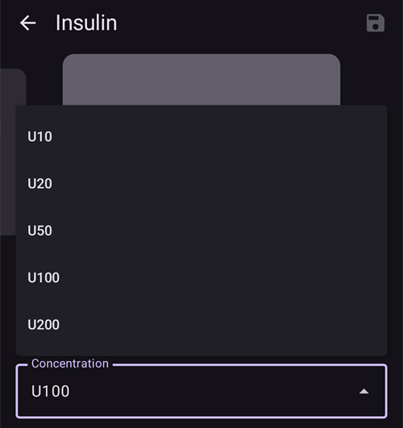

(Insulin-Concentration)=
# Concentração de insulina

```{warning}
Todas as bombas comerciais foram feitas para uso **SOMENTE** com insulina U100. Usar outra concentração de insulina em uma bomba pode ser perigoso. Embora cada vez mais usuários usem o AAPS com outras concentrações, a conversão sempre precisa ser gerenciada e muitas vezes leva a erros (até mesmo para usuários muito experientes!).
```

## Lembrete do básico sobre insulina

Este capítulo trata dos conceitos essenciais de medição e administração de insulina.

### A unidade de insulina: uma medida de ação

A insulina é medida em **Unidades Internacionais (UI)**, que medem a sua atividade biológica (poder de baixar a glicose no sangue), e não apenas a sua massa física.

- **Definição:** 1 UI corresponde à atividade de uma quantidade específica de insulina, padronizada em **aproximadamente 0,04167 mg**.
- **Ponto-chave:** Uma "unidade" tem o mesmo efeito biológico em todos os tipos de insulina, o que garante doses consistentes.

### Concentrações de insulina

A insulina existe em diferentes concentrações, definidas pelo número de unidades por mililitro (ml).

- **U100:** O padrão mundial, com **100 UI/ml**.
- **U200–U500:** Insulinas mais concentradas (por exemplo, a U200 tem 200 UI/ml) para volumes de injeção menores.
- **U40/U50:** Concentrações menos comuns e históricas (40 UI/ml e 50 UI/ml). **A U40 exige seringas específicas para U40.**
- **Diluição manual:** Uma prática clínica para criar insulina muito diluída (por exemplo, U50, U10) para casos raros, como uso em recém-nascidos ou sensibilidade extrema. Isso exige um preparo muito cuidadoso em farmácia.

```{admonition} Critical Warning
:class: danger
Usar uma concentração com um dispositivo que não corresponde a ela é extremamente perigoso e pode causar uma superdosagem ou subdosagem grave. **Sempre confira três vezes se a concentração da insulina corresponde às especificações da seringa, da caneta ou da bomba.**
```

## Quando usar uma concentração fora do padrão?

Embora as bombas de insulina sejam feitas para insulina U100, algumas situações médicas específicas exigem concentrações fora do padrão. Esses casos exigem cuidado extremo e um gerenciamento muito cuidadoso.

### Caso de uso 1: insulina diluída para doses muito baixas

- **Cenário:** Tratamento do diabetes tipo 1 em bebês e crianças muito pequenas.
- **Problema:** A necessidade de insulina deles é tão baixa que a dose mínima que a bomba consegue administrar (por exemplo, 0,05 U) ainda pode ser grande demais. Isso dificulta um controle glicêmico preciso e traz um alto risco de hipoglicemia.
- **Solução:** Usar insulina muito diluída (por exemplo, U10, que tem 10 UI/ml).
- **Efeito:** Isso aumenta o volume de líquido administrado por unidade de insulina. Com "pacotes" de insulina maiores em volume, mas mais fracos em concentração, é possível fazer ajustes muito mais finos e ter doses mais precisas com as configurações que a bomba já tem.

```{admonition} Critical Safety Note on Dilution
:class: danger
A diluição de insulina é um procedimento de alto risco e nunca deve ser feita em casa sem treinamento específico e supervisão médica. Ela deve ser feita por um profissional de saúde ou por um cuidador treinado, usando um diluente estéril feito especificamente para aquele tipo de insulina. **Nunca use água da torneira, soro fisiológico ou qualquer outro líquido**, pois isso pode desativar a insulina, alterar a sua ação e introduzir contaminantes perigosos.
```

### Caso de uso 2: insulina concentrada para alta necessidade de insulina ou resistência à insulina significativa

- **Cenário:** Tratamento de adultos ou adolescentes com resistência à insulina significativa, ou de pessoas que sentem dor local por causa dos aditivos da insulina padrão.
- **Problema:**
  1. **Alta necessidade:** Uma necessidade diária de insulina muito alta pode passar do limite máximo de bólus ou de administração diária da bomba.
  1. **Dor:** Os conservantes da insulina podem causar ardência ou irritação durante a infusão.
- **Solução:** Usar uma insulina mais concentrada, como a U200 (200 UI/ml).
- **Efeito:** Isso administra a dose de insulina necessária na metade do volume. Para o usuário, as configurações internas da bomba precisam ser ajustadas (por exemplo, taxas basais e bólus pela metade) para compensar a concentração dobrada, garantindo que o número correto de unidades seja administrado. Isso também reduz o volume de líquido possivelmente irritante administrado sob a pele.

## Como gerenciar a concentração de insulina com o AAPS (AAPS 3 e anteriores)?

Usar insulina que não é U100 em um loop do AAPS exige uma configuração muito cuidadosa, para alinhar os cálculos do software com a insulina que é realmente administrada. Um método comum é "Usar um perfil modificado".

### Usar um perfil modificado

Este método faz o AAPS "acreditar" que a necessidade de insulina do paciente é menor do que realmente é, para compensar o fato de a bomba administrar uma insulina mais concentrada do que aquela para a qual foi feita. O caso de uso abaixo é para insulina U200 colocada em uma bomba feita para U100.

- **O problema central:** Uma bomba feita para U100 é calibrada para administrar **10 µL** para **1 unidade**. Se você a preencher com U200 (1 unidade de U200 corresponde a **5 µL** de insulina), quando você seleciona **1 unidade** na bomba, ela administra **10 µL** de insulina, mas esse volume agora contém **2 unidades de insulina U200**. Isso leva a uma superdosagem de 100%.
- **A solução da "troca de perfil de 50%":** Para corrigir isso, todo o perfil de terapia do paciente é ajustado no AAPS para ficar "duas vezes mais fraco".
  1. O usuário cria um novo perfil com base no seu perfil U100 padrão, usando a função "Troca de perfil **50%**".
  1. Isso cria um novo perfil em que:
     - As **taxas basais** são reduzidas pela metade.
     - A **relação insulina/carboidrato (IC)** é dobrada (por exemplo, 1:10 g passa a ser 1:20 g).
     - O **fator de sensibilidade à insulina (ISF)** é dobrado (por exemplo, "1 unidade baixa a glicose em 50 mg/dl (2,8 mmol/l)" passa a ser "1 unidade baixa a glicose em 100 mg/dl (5,6 mmol/l)").
- **O resultado corrigido:** O AAPS agora acredita que o paciente só precisa de metade da insulina. Quando ele calcula e comanda um bólus de **1 unidade**, a bomba (feita para U100, mas preenchida com U200) administra os **10 µL**, que contêm **2 unidades reais de insulina U200**. Como o AAPS calculou essa dose com base em um perfil "com metade da força", essa administração de **2 unidades reais** é a dose correta e desejada. A matemática do loop "com metade da força" se alinha com a administração da bomba "com o dobro da força".

```{admonition} Critical Risks and Common Errors
:class: caution

Este método traz riscos significativos, porque cria uma diferença permanente entre os dados do app e a realidade física.

**O erro principal: a diferença no "bólus externo"**

O erro mais comum acontece quando a insulina é administrada e registrada **fora** do sistema AAPS-bomba.

- **O cenário:** O AAPS, usando o perfil modificado, calcula um bólus de **5 unidades** para uma refeição. O usuário aplica essa dose com uma caneta U200.
- **O erro duplo:**
  1. **Escolha errada da dose:** O usuário pensa "o AAPS calcula 5 unidades" e, por causa da caneta U200, espera aplicar **5 unidades reais de U200** sem nenhuma conversão. Mas, como o perfil está pela metade, o corpo na verdade precisa de **10 unidades reais**. Isso é uma **subdosagem de 50%**, que pode levar a hiperglicemia.
  1. **Cálculo errado da insulina ativa (IOB) (IOB superestimada):** Quando o usuário registra esse bólus externo no AAPS, ele registra **5 unidades**. Isso está errado. Como o perfil do AAPS é para U200, **1 unidade no AAPS equivale a 2 unidades reais**. Portanto, as 5 unidades reais aplicadas pela caneta devem ser registradas como **2,5 unidades** no app. Ao registrar 5 unidades, o usuário superestima a IOB em 100%. O AAPS agora acha que há 5 "unidades concentradas" ativas (o equivalente a 10 unidades reais), quando apenas 5 unidades reais estão ativas. Isso pode fazer o loop suspender a insulina basal ou reduzir os próximos bólus, piorando o risco de hiperglicemia causado pela subdosagem inicial.

**Outros riscos:**

- **Dados e relatórios enganosos:** Todos os dados no AAPS ou no Nightscout, incluindo IOB, dose diária total (TDD) e relatórios históricos, estão em "unidades concentradas". Isso dá uma imagem distorcida para o usuário e para a sua equipe médica. Um médico que analisa um relatório pode ver uma TDD de 30 unidades e não perceber que o paciente recebeu na verdade 60 unidades reais, o que leva a avaliações erradas da terapia.
- **Modelo mental alterado:** Depois de muito tempo de uso, o usuário começa a "pensar" nos valores pela metade do app. Ele passa a acreditar que o seu ISF é 100 mg/dl (5,6 mmol/l) ou que a sua basal é 0,5 U/h, esquecendo que esses valores são "concentrados". Isso cria uma dependência perigosa do sistema e uma perda de noção da necessidade real de insulina, o que é crítico para a segurança quando a bomba falha ou o app tem problemas.

**Conclusão:** Este método exige atenção total e obriga o usuário a converter o tempo todo entre um "mundo concentrado" no app e o mundo físico. Qualquer administração externa de insulina ou análise de dados quebra esse modelo mental e traz um risco grave. Ele muda de forma fundamental o significado de todos os números do sistema.
```

## Usar o parâmetro de concentração (novo recurso no AAPS 4.0)

Para reduzir os riscos de usar um perfil modificado, um novo recurso gerencia a concentração de insulina diretamente no AAPS. Este recurso faz as conversões automaticamente, e assim o aplicativo principal sempre trabalha em **Unidades Internacionais (UI) reais**.

### Como funciona: conversão automática

O princípio central é uma separação clara entre a lógica do app e a comunicação com a bomba:

- **O AAPS usa Unidades Internacionais:** O banco de dados principal do AAPS, os algoritmos, os relatórios e os registros **sempre usam UI reais**. Isso significa que a sua IOB, a sua TDD e as suas configurações de terapia (basal, ISF, IC) refletem as unidades biológicas reais de insulina.
- **O driver da bomba usa unidades concentradas:** Todos os valores enviados ao driver da bomba ou recebidos dele são convertidos automaticamente para "unidades concentradas" dentro do driver da bomba, com base na concentração selecionada.
  - **Exemplo com U200:** Quando o usuário pede um **bólus de 1 unidade**, o driver da bomba recebe **0,5 CU (unidades concentradas)** antes de enviar o comando à bomba. A bomba (configurada para U100) então administra **5 µL**, que contêm **1 UI de insulina U200**.

### Benefícios e riscos que continuam

**Benefícios:**

- Elimina a necessidade de um perfil modificado e os erros de conversão mental que vêm com ele.
- Os usuários sempre podem "pensar" em UI reais.
- Para um bólus externo com caneta, basta selecionar na caneta a quantidade de insulina desejada (qualquer que seja a caneta e a concentração de insulina usadas). Nenhuma conversão é necessária, pois as canetas U100 e U200 sempre usam UI para selecionar as unidades.
- Todos os relatórios e dados do AAPS (TDD, IOB) estão em UI reais, o que dá clareza para o usuário e para a sua equipe médica.
- Remove o risco de calcular errado os bólus externos, pois eles são registrados em UI reais.

**Riscos que continuam:**

- **Transição do modelo mental:** Usuários que deixam o método do "perfil modificado" precisam voltar ao perfil real correto (ou seja, duas vezes mais forte se vierem da U200) e precisam de tempo para ajustar o seu **modelo mental**. Depois de se acostumarem com valores "concentrados" no app, eles precisam reaprender a confiar nos **valores reais em UI, sem conversão escondida**, mostrados em todo lugar. Esse período de adaptação traz um risco de interpretação errada.
- **Bólus manual na bomba:** Usar a função de bólus da própria bomba (sem passar pelo AAPS) resulta em uma superdosagem de 100%, pois a bomba administra insulina U200 usando os cálculos de volume para U100.
- **Aviso geral:** Usar concentrações fora do padrão continua sendo um procedimento avançado, com riscos, e não é recomendado oficialmente.

```{admonition} Never use the pump's own interface (tube pump users) to deliver a bolus manually
:class: danger
Cole uma etiqueta permanente na sua bomba com **"Insulina U200"** como lembrete, para nunca esquecer!
```

### Exibição na interface do usuário

Para dar clareza, a interface do usuário mostra tanto as unidades reais quanto as concentradas, quando isso é relevante. Observe que a interface do usuário não muda se a insulina atual for U100.

**Exemplos de exibição:**

- **Diálogo Bólus em andamento:**
  - O diálogo Bólus em andamento faz parte do aplicativo principal do AAPS, por isso só mostra a informação em UI (de acordo com o que o usuário selecionou): **`2.50 U / 10.00 U delivered`**
- **Interface do driver da bomba (status atual):**
  - Na visão geral da bomba, a quantidade administrada é mostrada nas duas unidades; por exemplo, se `U200` estiver selecionada: **`Last Bolus: 10 U (5 CU) (10')`**

**Observação:** As duas unidades (U e CU) só aparecem na visão geral principal da bomba. Dependendo da sua bomba, pode haver outras telas em que só as unidades concentradas são mostradas. Os dados históricos dentro dos drivers de bomba normalmente continuam em "unidades concentradas".

### Ativar o recurso

Por causa dos riscos de segurança envolvidos, este parâmetro não vem ativado por padrão. Para ativá-lo, conclua o Objetivo 3 e ative **Suporte a concentrações de insulina** em Configurações gerais.

### Criar uma nova insulina com outra concentração

Para criar uma insulina com outra concentração, primeiro abra **Gerenciar → Configurações de insulina**.

- Toque no ícone "+" na parte de baixo da tela.
- Selecione a nova concentração desejada no menu suspenso (estão disponíveis U10, U20, U50, U100 e U200).
  - Concentrações diluídas como U10, U20 ou U50 são para crianças com taxas basais muito baixas.
  - A U200 é mais indicada para adultos com alta necessidade de insulina.

  

- Ajuste o tempo de pico, a duração da ação da insulina (DIA) e, se quiser, personalize o apelido da insulina (opcional).
- Use o botão de salvar no canto superior direito da tela.

Neste passo, a insulina foi criada, mas não pode ser selecionada diretamente em **Configurações de insulina**.

### Trocar a concentração de U100 para Uxxx (AAPS 4)

```{admonition} Switching concentration is only allowed during a reservoir or patch/pod change
:class: warning
Por motivos de segurança, o AAPS só registra uma troca de concentração durante uma troca de reservatório ou uma troca de patch/Pod.
```

Quando você parte de insulina U100, todo o seu perfil, os dados históricos e os relatórios já estão de acordo com o padrão de Unidades Internacionais, então a troca é bem "fácil":

- Em uma bomba de patch/Pod, há um passo específico na troca da bomba para selecionar a insulina que você colocou nela.
- Em uma bomba com tubo, toque no botão Purgar/Preencher (para a troca de insulina) na Visão geral (barra de status expandida) e depois toque no botão "Alterar".

1. Selecione a concentração desejada no menu suspenso (por exemplo, `U200`).
1. Depois selecione a insulina correta abaixo. Até você confirmar, o texto acima do nome dela mostra **Será ativada** (em vez de **Atualmente ativa**).

   

1. **Importante:** a troca de concentração só é registrada no AAPS depois que a troca de perfil é aplicada na bomba.
   - Este passo é obrigatório para todas as bombas de patch/Pod.
   - Em bombas com tubo, espere a troca de perfil ser aplicada na bomba, ou aplique-a em **Gerenciar → Perfil** ou em **Configurações de insulina**.

Pronto!

Se uma **troca de perfil** temporária (com duração) estiver em andamento quando você trocar a insulina, a nova insulina também é atribuída ao perfil que volta quando a troca temporária termina. A insulina antiga não volta.

### Trocar a concentração para usuários com insulina U200 associada a um perfil de 50% (AAPS 4)

Quando você já usa U200 na sua bomba, mas associada a um perfil de 50%, precisa fazer passos extras em comparação com a troca padrão a partir da insulina U100.

Lembre-se de que a parte mais difícil provavelmente não será gerenciar a troca corretamente no AAPS, mas sim treinar o seu cérebro de novo para pensar em "UI" em vez de "CU". Todos os valores habituais de bólus (café da manhã, almoço, jantar...) serão duas vezes maiores, assim como a sua TDD, as taxas basais etc. Você precisa ter muito cuidado para não cometer erros nas primeiras semanas, até "pensar de novo" em Unidades Internacionais.

- Primeiro, prepare um novo perfil com todos os valores de acordo com as Unidades Internacionais:
  - Faça uma troca de perfil temporária de 200% do seu perfil padrão em uso.
  - Abra o menu (☰) → **Tratamentos**, vá até a aba **Troca de Perfil** e clone o novo perfil de 200% (veja [Clonar uma troca de perfil](#your-aaps-profile-clone-profile-switch)).
  - Volte para o seu perfil padrão até a próxima troca de reservatório ou de patch.
  - Vá em **Gerenciar → Perfil** e renomeie este novo perfil com um nome claro (ele será o seu futuro perfil associado à insulina U200 configurada no AAPS 4).
- Se você usa o recurso ISF dinâmico (DynISF), precisa desativá-lo por pelo menos uma semana:
  - Todo o seu histórico registrado no AAPS ou no Nightscout está nas unidades erradas (CU), com metade do valor real em Unidades Internacionais. Espere pelo menos uma semana usando a insulina U200 antes de reativá-lo.
- Agora você está pronto para trocar a insulina (com uma nova U200 definida em **Configurações de insulina**) na próxima troca de insulina ou troca de Pod.
- Depois que a nova insulina U200 for aplicada corretamente, não se esqueça de aplicar o novo perfil padrão definido no primeiro passo.

## Como gerenciar bólus externos com canetas diferentes?

### Com insulina U200 associada a um perfil de 50% (AAPS 3)

Lembre-se de que todas as graduações das canetas estão em Unidades Internacionais. Então, qualquer que seja a caneta usada (U100, U200), se você usar uma caneta para um bólus externo, precisa fazer a conversão nos dois sentidos:

- Do AAPS para a caneta: se a Calculadora sugerir um bólus, ou se você tiver uma quantidade específica em mente, multiplique por 2 ao selecionar a quantidade na caneta, em comparação com o mesmo bólus aplicado pelo AAPS.
- Da caneta para o AAPS: se você selecionou uma quantidade na caneta para dar um bólus externo, divida essa quantidade por 2 para registrar o valor correto no AAPS (botão Insulina, bólus externo) e obter o cálculo correto da IOB em CU (unidades concentradas).

### Com insulina U200 usando o gerenciamento de concentração incluído no AAPS 4

Tudo fica muito mais simples com o gerenciamento interno de concentração no AAPS: basta selecionar a quantidade desejada na caneta (qualquer que seja a caneta e a insulina correspondente usadas) e registrá-la no AAPS.

- No botão Insulina, se você selecionar um bólus externo, pode selecionar qualquer tipo de insulina definido em **Configurações de insulina** (principalmente U100 e U200 para canetas). Assim você obtém uma IOB calculada com muita precisão, mesmo que o pico/DIA da insulina usada na caneta seja muito diferente do pico/DIA usado na bomba.
