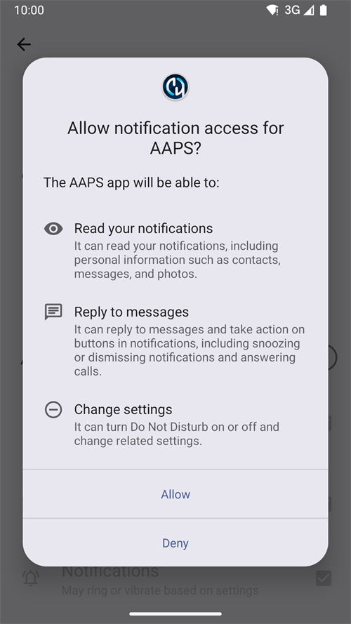
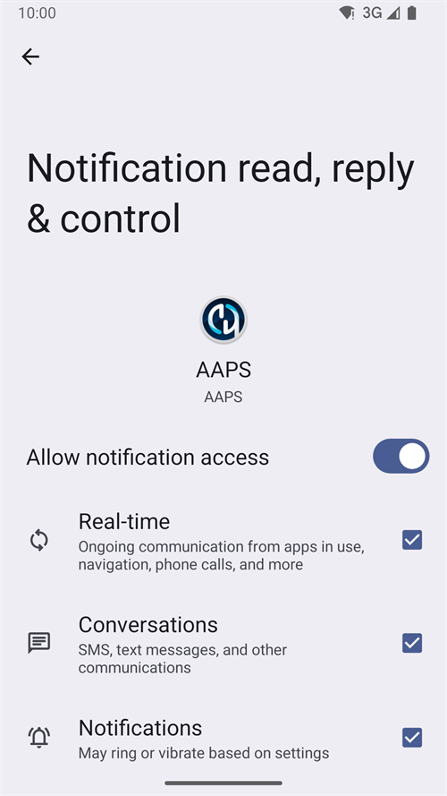

# Dexcom G6 e ONE

## Primeiro o básico

-   Siga as recomendações gerais de higiene do CGM e de colocação do sensor [aqui](../CompatibleCgms/GeneralCGMRecommendation.md).

## Dicas gerais para usar o loop com G6 e ONE

- Os transmissores recentes se chamam Firefly. Os sensores não podem ser reiniciados sem remover o transmissor, que por sua vez não pode ser redefinido. Eles também não geram dados brutos (raw).

- Se você reinicia sensores, esteja pronto para calibrar e fique atento às variações.

- A pré-imersão (pre-soak) do G6/ONE com calibração de fábrica provavelmente vai causar variações nos resultados. Se você faz pré-imersão (pre-soak), para ter os melhores resultados você provavelmente vai precisar calibrar o sensor.

Leia mais no [artigo](https://www.diabettech.com/artificial-pancreas/diy-looping-and-cgm/) publicado por Tim Street em [www.diabettech.com](https://www.diabettech.com).

## Se você usa o G6 ou ONE com o xDrip

- Se ainda não estiver configurado, baixe o [xDrip](https://github.com/NightscoutFoundation/xDrip) e ajuste as configurações dele seguindo a [página de configurações do xDrip](../CompatibleCgms/xDrip.md).
- Selecione xDrip em [**Configuração → Fonte de BG**](#Config-Builder-bg-source).
- Os transmissores Dexcom G6 e ONE podem ser conectados ao mesmo tempo ao receptor Dexcom (ou, como alternativa, à bomba t:slim) e a um app no seu telefone.
- Ao usar o xDrip como receptor, desinstale primeiro o app da Dexcom. **Você não pode conectar o xDrip e o app da Dexcom ao transmissor ao mesmo tempo!**
- Se você precisa do Clarity e quer aproveitar os alarmes do xDrip, use o [BYODA](#DexcomG6-if-using-g6-with-build-your-own-dexcom-app) (somente G6) com transmissão local (local broadcast) para o xDrip.
- You can also use xDrip as a companion app of the official Dexcom app, but you might experience delays in BG readings. Para ler as notificações do app Dexcom sem o xDrip, como fonte de dados confiável, use o [Leitor de notificações](#DexcomG6-notification-reader).
- Com os transmissores atuais, o xDrip sempre usa o [algoritmo nativo](https://navid200.github.io/xDrip/docs/Native-Algorithm.html) do transmissor; não há motivo para desativá-lo. Os [reinícios preventivos](https://navid200.github.io/xDrip/docs/Preemptive-Restart.html) só funcionam em transmissores antigos (firmware 1.6.5.25 ou anterior), onde são necessários para evitar que o sensor pare após 10 dias; os transmissores recentes (Firefly) os ignoram. Veja [Restart a sensor](https://navid200.github.io/xDrip/docs/Restart-G6-sensor.html) antes de tentar qualquer reinício.
- Tudo o que se refere ao próprio sensor e ao transmissor está documentado na [página Dexcom do xDrip](https://navid200.github.io/xDrip/docs/Dexcom_page.html).

(DexcomG6-if-using-g6-with-build-your-own-dexcom-app)=
## Se você usa o G6 com o Build Your Own Dexcom App

```{admonition} Old app version
:class: warning
O Dexcom BYODA é agora uma versão muito antiga do app e não pode ser atualizado.
```

-   O [Build Your Own Dexcom App](https://docs.google.com/forms/d/e/1FAIpQLScD76G0Y-BlL4tZljaFkjlwuqhT83QlFM5v6ZEfO7gCU98iJQ/viewform?fbzx=2196386787609383750) (BYODA) permite transmissão local (local broadcast) para o AAPS e/ou o xDrip

-   Este app permite usar o seu Dexcom G6 com qualquer smartphone Android.
-   Desinstale o app original da Dexcom ou o app Dexcom modificado, se você usava um deles antes (**não pare** o sensor que está em uso)
-   Instale o apk baixado
-   Digite o código do sensor e o número de série do transmissor no app modificado.
-   Nas configurações do telefone, vá em apps > Dexcom G6 > permissões > permissões adicionais e toque em 'Access Dexcom app'.
-   Depois de pouco tempo, o BYODA deve captar o sinal do transmissor.

### Configurações do AAPS

-   Selecione **BYODA** em [**Configuração → Fonte de BG**](#Config-Builder-bg-source).

-   Se você não receber nenhum valor, selecione qualquer outra fonte de dados e depois selecione **BYODA** de novo para disparar o pedido de permissões que estabelece a conexão entre o AAPS e a transmissão do BYODA.

### Configurações do xDrip

-   Selecione '640G/Eversense' como fonte de dados.
-   O comando 'start sensor' precisa ser executado no xDrip para receber valores. Isso não afeta o seu sensor atual, que é controlado pelo Build Your Own Dexcom App.

(DexcomG6-notification-reader)=
## Se você usa o G6 ou o ONE com o Leitor de notificações

O app oficial Dexcom G6 ou ONE continua conectado ao transmissor. O **AAPS** lê o valor da glicose diretamente da notificação do app Dexcom, sem nenhum outro app no meio.

```{admonition} Trusted data source
:class: note
As leituras dos apps Dexcom G6 e ONE são uma [fonte de dados de glicose confiável](#GettingStarted-TrustedBGSource): os SMBs podem ser permitidos o tempo todo.
```

Comparado ao BYODA ou ao xDrip, o Leitor de notificações tem limites:

- **Sem seta de tendência** e **sem preenchimento retroativo (backfill)**: as leituras perdidas enquanto o telefone estava desligado ou fora de alcance são perdidas.
- Cada leitura recebe o horário em que a notificação apareceu, não o horário exato da leitura do sensor.
- Só são lidos valores entre 40 e 405 mg/dl (2,2 e 22,5 mmol/l). "LOW" e "HIGH" não são lidos.

### Configurar o app Dexcom

-   Mantenha o app Dexcom instalado e conectado ao transmissor.
-   Verifique se o app Dexcom mostra o valor atual da glicose na notificação. As notificações dele devem continuar visíveis: não silencie nem oculte essas notificações.
-   Use as mesmas unidades de glicose (mg/dl ou mmol/l) no app Dexcom e no **AAPS**. Caso contrário, o **AAPS** não consegue ler o valor.

### Configuração no AAPS

-   Selecione **Leitor de notificações** em [**Configuração → Fonte de BG**](#Config-Builder-bg-source) e confirme a troca.

    

-   De volta à tela principal, o **AAPS** mostra **Permissões necessárias**. Ao lado de **Acesso às notificações**, toque em **Conceder**.

    

-   O Android abre a sua lista de acesso às notificações (o nome depende da versão do Android, por exemplo *Leitura, resposta e controle de notificações*). Selecione o **AAPS**, ative **Permitir acesso às notificações** e confirme com **Permitir**.

    

    O Android avisa que o **AAPS** poderia ler todas as suas notificações. O **AAPS** só lê as notificações dos apps de CGM compatíveis e ignora todas as outras.

    

-   Se **Permitir acesso às notificações** estiver cinza (*Controlado por configuração restrita*), o Android bloqueia essa opção porque o **AAPS** não foi instalado pela Play Store. Abra as informações do app **AAPS** (toque longo no ícone do **AAPS** > **Informações do app**), toque no menu de três pontos no canto superior direito e selecione **Permitir configurações restritas**. Depois volte à tela de acesso a notificações e permita o acesso.
-   As leituras aparecem no **AAPS** quando o app Dexcom mostra um novo valor.

```{warning}
Se a notificação do app Dexcom mostrar mais de um número de glicose, ou nenhum, o **AAPS** ignora essa notificação.
```


(DexcomG6-troubleshooting-g6)=
## Resolução de problemas do G6 e ONE

### Resolução de problemas específica do Dexcom G6/ONE

-   Role para baixo até **Troubleshooting** [aqui](https://navid200.github.io/xDrip/docs/Dexcom_page.html).

### Resolução de problemas geral

A resolução de problemas geral para CGMs está [aqui](#general-cgm-troubleshooting).

### Novo transmissor com sensor em uso

Se você precisar trocar o transmissor durante uma sessão de sensor em andamento, pode tentar remover o transmissor sem danificar a base do sensor. Há um vídeo [aqui](https://navid200.github.io/xDrip/docs/Remove-transmitter.html). Se você escolher [esta solução](https://youtu.be/tx-kTsrkNUM), tenha cuidado para não [danificar os contatos do sensor](https://navid200.github.io/xDrip/docs/Petroleum-jelly-in-Dexcom-G6-Sensor.html) com a tira.
