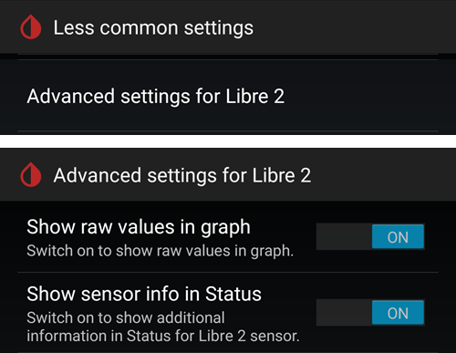

# Como configurar o FSL 2 e o OOP2 para usar uma conexão Bluetooth nativa no xDrip

Transferido do [MinimalL00per](https://www.minimallooper.com/post/how-to-setup-freestyle-libre-2-and-oop2-to-use-a-native-Bluetooth-connection-in-xdrip) para markdown e **revisado/atualizado**: 25 de agosto de 2025, psonnera

No fim deste documento há uma lista de definições. Se você não conhece algum termo ou abreviação, *[pule para baixo](#minimallooper-definitions)* para ver a explicação.

 

## Configuration

### Hardware

- *FSL2 e 2+* **OBSERVAÇÃO: as versões US, CAN, NZ e AUS NÃO são suportadas**

**(OPCIONAL) Leitor** (não compatível com o FSL2+)

- Leitor 1 (com firmware atualizado)

- Leitor 2

*OBSERVAÇÃO: se você pretende usar o leitor nesta solução, você PRECISA INICIAR o sensor PRIMEIRO COM O LEITOR. Se você não fizer isso, não poderá usar o leitor para obter leituras do sensor ativado. Depois que o sensor aquecer, você pode fazer leituras com o app LL ou com o xDrip.*

### Software

**OOP** - Out of Process Algorithm (algoritmo fora do processo), um app Android externo (APK) que ajuda a obter os dados brutos do sensor para calcular os valores de glicose. O xDrip envia os dados brutos BT coletados do FSL2 para o OOP, e os valores de glicose voltam para o xDrip.

- **OOP2**

  - **Funciona somente com sensores FSL2/2+ europeus**

  - Código fechado (não disponível no GitHub)

  - O objetivo é descriptografar os valores brutos criptografados do sensor e devolvê-los ao xDrip. Depois, o xDrip pode ser usado com os dados brutos, que precisam de calibração, ou fornecer valores de glicose parecidos com os do Leitor 1.

[***xDrip***](https://jamorham.github.io/)

- [*Nightly*](https://github.com/NightscoutFoundation/xDrip/releases): o código-fonte mais recente, compilado todas as noites. Não totalmente testado

- [*Stable*](https://xdrip-plus-updates.appspot.com/stable/xdrip-plus-latest.apk): a versão estável mais recente e testada.

- **OBSERVAÇÃO: sensores novos precisam de um app OOP2 atualizado. Para isso, é recomendado usar pelo menos a versão mais recente do xDrip (Stable), que combina com o OOP2 mais recente.**

 

## Processo

- *Primeiro, baixe e instale os apps abaixo*
- *Desinstale os apps que podem causar conflito*
- *Como iniciar um sensor FSL2 no modo Bluetooth nativo usando o LL e o xDrip
  - [*Passo 1: Instalação e configuração dos apps*](#minimallooper-step1)
  - [*Passo 2: Configurações do xDrip*](#minimallooper-step2)
  - [*Passo 3: Insira o sensor fisicamente*](#minimallooper-step3)
  - [*Passo 4: Abra o app LL e inicie o sensor com o primeiro escaneamento NFC*](#minimallooper-step4)
  - [*Passo 5: Abra o xDrip e escaneie o sensor FSL2 por NFC*](#minimallooper-step5)
  - [*Passo 6: Inicie o novo sensor no xDrip*](#minimallooper-step6)
  - [*Passo 7: Espere 60 segundos e escaneie o sensor por NFC novamente*](#minimallooper-step7)
  - [*Passo 8: Coleta de dados entre 3 e 15 minutos*](#minimallooper-step8)
  - [*Passo 9: Verifique se o sensor está conectado e enviando dados*](#minimallooper-step9)

- *[Notes](#minimallooper-notes)*
- *[Vantagens](#minimallooper-advantages)*
- *[Desvantagens](#minimallooper-disadvantages)*
- <u>*\[Resolução de problemas\](#minimallooper-troubleshooting)*</u>

## Antes de começar

É muito recomendado seguir este processo com um **sensor novo**. Embora haja relatos de que é possível conectar a um sensor já em uso (***veja [abaixo](#minimallooper-started-sensor)***), é muito provável que o app LL ou o leitor crie uma nova chave privada compartilhada para a comunicação durante a conexão. Isso significa que, depois do vínculo, o xDrip não conhece a nova chave e não conseguirá se comunicar com o sensor. Tente conectar a um sensor já em uso por sua conta e risco, de preferência perto do fim da vida útil do sensor.

### Primeiro, baixe e instale os apps abaixo

(Libre2_OOP2)=

- **OOP2** - As versões do oop2 estão em:

  (*Observação: você precisa estar conectado à sua conta Google para abrir o link.*)

*[oop2.apk](https://drive.google.com/file/d/1106h2s12b3Ev9gKCTU2G75q8h9ChHjcz/view?usp=sharing)* - OOP2_21_09_25 (05d1989) **2025.09.21** (versão mais recente)

- **xDrip** - a **<u>versão mais recente</u>** (versão mínima 2025.09.26) está em:

[*xDrip.apk*](https://github.com/NightscoutFoundation/xDrip/releases)

(minimallooper-started-sensor)=

### E se o meu sensor já estiver iniciado? Ainda consigo receber leituras no xDrip? SIM!

Muitas pessoas perguntaram se este método pode ser usado com um sensor já ativo, e posso dizer com um grande **SIM**: você pode iniciar um sensor que já está em uso.

1.  **PRIMEIRO**, garanta que você fez as mudanças de configuração no xDrip e instalou e configurou o OOP2, como mostrado abaixo.

2.  **DEPOIS**, vá para o *Passo 5* e **GARANTA** que você forçou o fechamento do LL antes de começar. Depois, siga o processo até o fim.

*OBSERVAÇÃO: você não poderá usar o seu sensor FSL2 ativado com o FSLReader SE ele não foi iniciado primeiro com o FSLReader. Se ele FOI iniciado primeiro com o FSLReader, você poderá **escanear** o sensor e obter leituras TANTO do sensor quanto de apps como o LL e o xDrip.*

## Como iniciar um sensor FSL2 no modo Bluetooth nativo usando o LL e o xDrip

*OBSERVAÇÃO: se houver configurações nas capturas de tela que não estão marcadas com uma CAIXA e estão DESMARCADAS (ou seja, desativadas), MANTENHA-AS DESATIVADAS. As capturas de tela mostram uma configuração que funciona para TODAS as configurações mostradas. Se você quiser testar ativar ou desativar outras funções depois que o sensor estiver funcionando, você pode fazer isso por sua conta e risco.*

(minimallooper-step1)=

### Passo 1: Instalação e configuração dos apps

**Instale e configure o OOP2** e verifique se ele funciona apenas abrindo o app.


**Configurações**

- *Use service* **on**

- *Use foreground service* **on**

- *Timer Duration* **5 minutos**

  - Mude para **1 s** se não estiver obtendo resultados rápido o suficiente (a captura de tela abaixo mostra esta configuração).

**Versão 2: 93e5cac-2020.12.08 (versão mais recente)**


**Instale o xDrip**, versão mínima: a versão mais recente. Mais documentação sobre a instalação e configuração do xDrip está [*aqui*](../CompatibleCgms/xDrip.md).

(minimallooper-step2)=

### Passo 2: Configurações do xDrip

**Hardware Data Source**: Libre Bluetooth


**NFC Scan features**: *as configurações não mencionadas devem estar desativadas.*

- *Use NFC feature*: **on**
- *Sensor Age or Expiry*: **on**
- *Scan when not in xDrip*: **on**
- *Use Any-tag optimized reading method*: **off**, mas tente **on** se houver dificuldade para escanear


- *Starting Bluetooth connection with FSL2 sensor*: **Always connect to libre2 sensors**


- *Smooth libre 3 data when using xxx method*: deixe o padrão. Aumente o valor para sensores com ruído, diminua quando estiverem estáveis.


**Less Common Settings -\> Bluetooth Settings** (*estas são importantes e podem variar conforme o seu telefone/configuração*)

- *Turn Bluetooth on*: **on**
- *Trust Auto-Connect*: **on**
- *Use Background Scans*: **on**
- *Always discover services*: **on**

Você pode configurar o xDrip usando o código QR abaixo. Você precisa escaneá-lo (ou carregar a imagem) em xDrip -> Auto Configure.

```{admonition} QR Code
:class: dropdown


```


Depois de escanear o código QR acima, se você tem um telefone Samsung (isso também é útil para muitas marcas chinesas), escaneie o outro código QR abaixo para mudar as configurações e ter uma conexão mais confiável:

- *Trust Auto-Connect*: **off**
- *Use Background Scans*: **off**

```{admonition} QR Code
:class: dropdown


```


**Advanced settings for FSL2** (*opcional, mas útil*)

- *show Raw values in Graph*: **on**

- *show Sensor info in Status*: **on**



**Extra Logging Settings** (*necessário para depurar se não funcionar corretamente*)

- *Extra tags for logging*: insira este valor

`BgReading:d,jamorham librereceiver:v,LibreOOPAlgorithm:v,jamorham nsemulator:v,DexCollectionService:v`


(minimallooper-OOPsettings)=

**Less Common Settings -\> Other misc options**

> **Configurações para o OOP2**

- *Out of process Libre algorithm*: **OFF**

(*GARANTA QUE ISTO ESTEJA **OFF** PARA O OOP2, SENÃO VOCÊ NÃO RECEBERÁ LEITURAS!*)


(minimallooper-step3)=

### Passo 3: Insira o sensor fisicamente

(minimallooper-step4)=

### Passo 4: Abra o app LL e inicie o sensor com o primeiro escaneamento NFC

Abra o app LL, escaneie o sensor recém-inserido e depois feche e desative ou desinstale o app LL. **Você ainda precisa esperar os 60 minutos inteiros de aquecimento do sensor antes de continuar e iniciar o sensor no xDrip**. Não confie nas leituras anteriores, porque o sensor ainda está se calibrando internamente e os valores variam muito.

#### Passo 4a (OPCIONAL, usar o FSLReader):

**Inicie o sensor FSL2 (não o 2+) escaneando-o com o FSLReader no primeiro escaneamento NFC**

Se você quer poder usar o **FSLReader** e também o app LL ou o xDrip para ler valores do sensor FSL2, **você precisa escanear o sensor FSL2 recém-inserido PRIMEIRO com o FSL Reader.** Depois que o aquecimento do sensor terminar, você pode usar o app LL ou o xDrip para escanear as leituras.

*OBSERVAÇÃO: o app LL só é necessário para o PRIMEIRÍSSIMO escaneamento NFC depois da inserção do sensor. Ele serve para enviar o sinal de início do aquecimento. Depois disso, o app PRECISA ser desativado (configurações do app-\>forçar parada) ou desinstalado. Você pode usar o app Patched 2.3 ou as versões oficiais, tanto faz. O principal é impedir que o app LL esteja em execução quando o xDrip tenta iniciar o processo de vínculo BT com o sensor, porque o app LL atrapalha a comunicação e interfere no processo de reconexão Bluetooth.*

*Há relatos de que basta desativar a **permissão de localização** do app LL nas configurações do sistema Android para impedir que ele interfira na conexão. Alguns usuários relataram que isso funcionou. Mesmo assim, **recomendo desativar ou desinstalar o app**, mas você pode tentar isso se quiser testar.*

(minimallooper-step5)=

### Passo 5: Abra o xDrip e escaneie o sensor FSL2 por NFC

(*Lembrete! Garanta que o LL esteja desativado (localização desligada) ou desinstalado E que você esperou os 60 minutos inteiros para o sensor aquecer e se calibrar internamente.*)

**Escaneie por NFC** o sensor FSL2 com o xDrip. Isto envia um sinal ao sensor para ativar o pareamento Bluetooth e iniciar o processo de vínculo (bonding). Uma pequena notificação aparece rapidamente na parte de baixo da tela principal do xDrip com o texto **Scanning** e depois a notificação **Scanned OK!** quando o escaneamento NFC do sensor FSL 2 dá certo.


(minimallooper-step6)=

### Passo 6: Inicie o novo sensor no xDrip

Na **tela principal do xDrip**, toque no **menu hambúrguer** no canto superior esquerdo. Depois, escolha **Start Sensor**.

Na tela **Start New Sensor**, toque em **Start Sensor**. Uma pergunta aparece: **Did you insert it today?** Responda tocando em **NOT TODAY**.


*OBSERVAÇÃO: se você clicou em "YES, TODAY" por engano, precisa usar "stop sensor" no menu principal do xDrip e depois "start sensor", fazendo o Passo 5 de novo.*

(minimallooper-step7)=

### Passo 7: Espere 60 segundos e escaneie o sensor por NFC novamente

É necessário um segundo escaneamento NFC para **ADICIONAR** o sensor como o dispositivo Bluetooth que o xDrip vai usar para obter as leituras. Quando terminar, você verá uma notificação dizendo **NEW SENSOR STARTED**.


É obrigatório esperar 60 segundos, porque durante este processo o sensor não pode ser escaneado mais de uma vez por minuto. Se o sensor for escaneado cedo demais, o aviso **Not so quickly, wait 60 seconds** aparece na tela principal do xDrip.


Abra os logs de eventos do xDrip e verifique se o sensor foi pareado corretamente com o xDrip.


(minimallooper-step8)=

### Passo 8: Coleta de dados entre 3 e 15 minutos

Entre 3 e 15 minutos, dados suficientes são coletados para mostrar os primeiros valores. *Se você ainda não estiver recebendo leituras nesse momento, às vezes ajuda reiniciar o telefone.*

Se você usa um Samsung (ou muitos telefones de marcas chinesas) e tem problemas para receber dados, escaneie o código QR abaixo em xDrip -> Auto Configure.

```{admonition} QR Code
:class: dropdown


```

Ele muda as configurações Bluetooth do xDrip para:

- *Trust Auto-Connect*: **off**
- *Use Background Scans*: **off**

(minimallooper-step9)=

### Passo 9: Verifique se o sensor está conectado e enviando dados

Toque no menu hambúrguer no canto superior esquerdo da tela principal do xDrip e selecione **System Status**. Na tela System Status, o campo **Bluetooth Device:** ativo mostra o nome Bluetooth do FSL2 no formato **ABB___XXXXXXXXXXX**, em que os XXX são o número de série do sensor. O campo **Connection Status** mostra **Connected** e o campo **Sensor Start:** mostra a hora em que o sensor foi iniciado.


Na tela **BT Device** (deslize para a esquerda), você pode verificar mais detalhes da conexão do sensor e também usar esta tela para resolver problemas de conexão. Abaixo há uma lista dos campos e para que servem, para ajudar a resolver problemas de conexão.

*OBSERVAÇÃO: **<u>NÃO TOQUE</u> E NÃO MUDE Bluetooth Pairing de <u>Disabled</u>** nesta janela. Se fizer isso, será feita uma tentativa de pareamento direto, ela vai falhar (Not bonded) e você terá que recomeçar todo o processo a partir do Passo 5.*


- **Phone Service State:** a última vez em que o telefone fez uma conexão BT com o sensor (deve ser há menos de 5 minutos)
- **Bluetooth Device:** mostra o estado atual da conexão (**Connected** ou **Disconnected**)
- **Device Mac Address**: é o ID de hardware do sensor
- **Bluetooth Pairing**: deve estar **<u>Disabled, tap to enable</u>**. Cuidado para NÃO tocar nisso. Se você tocar por engano, toque de novo até voltar a desativado.
- **Slowest wake up**: você pode ignorar isto. O xDrip não fica o tempo todo esperando leituras: ele começa a esperá-las depois de um certo tempo (normalmente 5 minutos). Se nenhum dado chegar nesse momento, você verá "Woke up early", o que significa que o xDrip esperava dados prontos, mas não havia nenhum. Slowest wake up é o maior atraso que ocorreu antes de receber dados normalmente.
- **Next Wake up**: deve mostrar 5 minutos


(minimallooper-notes)=

### Notes

- **Usar escaneamentos NFC do LL DEPOIS que o vínculo/pareamento no xDrip estiver concluído**: você pode fazer escaneamentos NFC, mas o processo de vínculo/pareamento com o xDrip precisa estar concluído antes. Sempre olhe no xDrip se está perto da leitura de 5 minutos (por exemplo, há 4 minutos). Se estiver perto de 5 min, espere a nova leitura BT chegar e só então faça o escaneamento NFC. Se você fizer isso na hora errada, vai atrapalhar o processo BT no xDrip e ele não receberá leituras BT. Pode levar um tempo para refazer o vínculo e voltar a transmitir, e às vezes a conexão BT de um sensor pode ser "roubada" pelo LL. Mesmo assim, entre essas leituras BT, não tive nenhum problema ao fazer um escaneamento NFC seguido da desativação imediata do app. Não tenho certeza se o LL precisa ser desativado toda vez, mas eu o desativo por segurança.

- - **O que está acontecendo?** Quando uma conexão Bluetooth é feita, é criada uma chave privada compartilhada, necessária para a comunicação entre o sensor e o app/dispositivo que se conecta. É muito provável que o app LL ou o leitor crie uma nova chave privada compartilhada para a comunicação durante a conexão. Isso significa que, depois do vínculo, o xDrip não conhece a nova chave e não conseguirá se comunicar com o sensor.

  - Vários usuários relataram que o app LL pode ser iniciado de novo depois de iniciar o sensor com sucesso e receber leituras no xDrip. Nas permissões Android do app LL, basta desativar a configuração **Permitir localização**. Depois disso, você deve conseguir usar o app LL e o xDrip ao mesmo tempo. Recomendo não escolher um app padrão para o escaneamento NFC e escolher a cada vez qual app vai ler o sensor no escaneamento NFC. Além disso, NÃO ESQUEÇA: na próxima troca de sensor, force a parada do app LL depois do escaneamento NFC inicial de aquecimento do novo sensor. Depois que o sensor estiver configurado e recebendo leituras no xDrip, você pode iniciar o app LL de novo.

&nbsp;

- **Reiniciar o telefone**: depois de reiniciar, e depois de desativar ou forçar a parada do app, LEMBRE-SE de verificar que o app LL NÃO está em execução. Sugiro testar uma reinicialização para ver se o LL inicia sozinho de novo. Você pode ver isso nas configurações do app LL, em Configurações de aplicativos do Android no seu telefone. Se ele ainda estiver ativado, desative o app LL de novo. Desinstalar o app LL pode ser a única forma de evitar isso. Isto evita que o LL "roube" o vínculo BT por acidente. Além disso, depois de reiniciar, leva os mesmos 3–15 minutos para receber leituras BT do sensor. Tenha paciência e planeje isso se você reiniciar perto de momentos em que precisa de uma leitura de glicose para um bólus, refeições etc.

&nbsp;

- **Configurações de otimização da bateria**: EXCLUA estes apps das configurações de otimização da bateria do seu telefone

  - xDrip

  - OOP 2

  - LL

  - AAPS

&nbsp;

- **Usar o modo avião:** há situações em que você ativa o modo avião (ao viajar de avião ;-), ao dormir à noite e não querer sinais de Wi-Fi ou de dados móveis com o telefone perto da cabeça), e isso pode causar problemas na comunicação Bluetooth durante a ativação do modo avião. Quando você ativa o modo avião no telefone e depois ativa o Bluetooth, as leituras de glicose são perdidas. A única solução é reiniciar o coletor em xdrip+ -\> System Status -\> Classic Status Page. Depois de reiniciar o coletor, as leituras de glicose apareceram de novo.

 

(minimallooper-advantages)=

### Vantagens

- **O app LL modificado (patched) não é mais necessário** Você não precisa mais de uma versão modificada do app LL para obter valores do sensor FSL2. Você pode usar o app LL modificado, mas as versões oficiais do app LL também podem fazer o primeiro escaneamento NFC de inicialização da mesma forma que o app modificado. Não há diferença no escaneamento NFC de inicialização para iniciar o sensor.

&nbsp;

- **Um dispositivo NFC de terceiros não é mais necessário** Dispositivos NFC de terceiros (como Miaomiao, Bubble ou Blucon) não são mais necessários *(mas ainda podem ser usados)* para coletar leituras, porque agora o próprio sensor pode enviá-las por Bluetooth. Menos hardware significa menos coisas que podem dar errado, menos dispositivos para carregar e uma configuração mais simples.

&nbsp;

- **Você ainda poderá escanear leituras por NFC com o leitor FSL2 (versão 1 com firmware atualizado ou versão 2) QUANDO o sensor FSL2 tiver sido iniciado PRIMEIRO com o FSL Reader.** O leitor FSL2 independente ainda pode ser usado para escanear leituras do sensor ativo depois que ele estiver vinculado por Bluetooth ao xDrip.

  - Você **PRECISA** iniciar o sensor com o primeiro escaneamento NFC para começar o aquecimento do sensor **PRIMEIRO com o FSL Reader**. A partir daí, outros apps também poderão fazer leituras NFC do sensor agora ativado.
- Pelo que entendo, o sensor FSL2 (enquanto não tiver estabelecido ou não estiver tentando estabelecer uma conexão) sempre anuncia sua presença (e disponibilidade) por BLE exatamente a cada 2 minutos (visível em qualquer dispositivo Bluetooth que consiga procurar dispositivos Bluetooth). O primeiro dispositivo que responde a esse anúncio ganha a disputa e é o *único* dispositivo que pode se conectar e ler o sensor, porque durante o processo de conexão do escaneamento NFC é criada uma chave privada compartilhada, usada para descriptografar a comunicação do FSL 2. O sensor fica então indisponível para outros dispositivos que não têm essa chave privada compartilhada e que também podem estar tentando se conectar. Parece que o leitor FSL 2 sempre ganha essa disputa, seja qual for o "adversário".

&nbsp;

- **Configuração com o mínimo de dispositivos** Meu objetivo sempre foi manter no mínimo os dispositivos médicos presos ao meu corpo. O FSL2 junto com o sistema Omnipod alcançou esse objetivo. Isso é ainda mais importante quando viajo (distâncias curtas e longas), porque o número de itens e de trocas desses itens diminui, e sobra mais espaço na minha mala para outras coisas. Espero que no futuro exista uma bomba patch com apenas um reservatório substituível, e que o chip e o motor sejam uma peça que pode ser guardada e reutilizada. Isso reduziria o lixo e as embalagens nas trocas de local de aplicação, o que de novo deixa mais espaço na minha mala para outras coisas.

&nbsp;

- **Sem mais intervalos de uma hora ao trocar de sensor** Como você pode iniciar outro sensor com o app LL usando um escaneamento NFC inicial, o sensor atual pode continuar funcionando e enviando leituras por Bluetooth ao mesmo tempo. Depois de 20 minutos, você pode obter leituras do novo sensor, mas é melhor esperar 1 hora para que o sensor se calibre internamente de forma correta. Isso significa que você pode parar o sensor atual e iniciar o novo (depois que ele foi colocado e aquecido com o escaneamento NFC do LL uma hora antes) e em 3 a 15 minutos você terá suas calibrações iniciais e leituras.

&nbsp;

(minimallooper-disadvantages)=

### Desvantagens

- **Reinicialização do telefone:** como o processo Bluetooth precisa começar de novo quando o telefone reinicia, primeiro você precisa garantir que desativou manualmente o app LL (se não o desinstalou) e ter paciência até as primeiras leituras chegarem (3 a 15 min). Por isso, escolha bem a hora de reiniciar o telefone, para que não aconteça em momentos críticos, como bólus de correção ou horários de refeições e lanches.

&nbsp;

- **Você não pode usar o LL e o xDrip ao mesmo tempo para leituras por Bluetooth**. O LL sempre vai tentar "roubar" a conexão Bluetooth com o sensor e o vínculo. Se isso acontecer, você fica preso ao LL pelo resto da vida útil do sensor. Por isso, usar os apps ao mesmo tempo nem sempre funciona. Como menciono abaixo, você pode ativar o app LL e fazer um escaneamento NFC para obter a leitura do LL (se precisar comparar ou quiser obter o histórico para você ou para relatórios do endocrinologista). Porém, desative-o assim que tiver a sua leitura e não tente fazer isso no minuto em que o xDrip vai obter a leitura Bluetooth. Não tenho certeza de como o leitor FSL2 funciona enquanto se faz isso, mas vou testar mais tarde.
- Vários usuários relataram que o app LL pode ser iniciado de novo depois de iniciar o sensor com sucesso e receber leituras no xDrip. Nas permissões Android do app LL, basta desativar a configuração **Permitir localização**. Depois disso, você deve conseguir usar o app LL e o xDrip ao mesmo tempo. Recomendo não escolher um app padrão para o escaneamento NFC e escolher a cada vez qual app vai ler o sensor no escaneamento NFC. Além disso, NÃO ESQUEÇA: na próxima troca de sensor, force a parada do app LL depois do escaneamento NFC inicial de aquecimento do novo sensor. Depois que o sensor estiver configurado e recebendo leituras no xDrip, você pode iniciar o app LL de novo.

&nbsp;

- **Dispositivos NFC de terceiros ainda podem ser usados**. Sim, coloquei isto como desvantagem, mas também queria mostrar que, se algo der errado com o sensor e o LL assumir o controle dele, você sempre pode voltar a colocar um dispositivo NFC no sensor para receber leituras no xDrip. Você também pode usar esse dispositivo em vez de uma conexão Bluetooth direta, se preferir uma configuração com um dispositivo NFC de terceiros (Miaomiao, Bubble, Blucon). Às vezes, alguns telefones não funcionam bem com o vínculo Bluetooth nativo com o sensor e a leitura de dados. Você pode usar esses dispositivos como reserva ou no uso normal; de qualquer forma, você ainda tem essa opção.
- Se você planeja usar o **FSL Reader** como dispositivo NFC para fazer leituras, você PRECISA iniciar o sensor FSL2 com o **PRIMEIRÍSSIMO escaneamento NFC** para aquecer o sensor **PRIMEIRO COM O LEITOR**.

&nbsp;

- **Os dados do LV não serão enviados automaticamente** Como o app LL não tem uma conexão Bluetooth constante (porque o LL não deve estar em execução junto com o xDrip depois que o sensor está enviando leituras por Bluetooth), ele não recebe leituras automaticamente do sensor. Isso significa que os dados de glicose não são enviados automaticamente para o LV e, com isso, para outros telefones com LL. Considero isso uma desvantagem, porque sei que muitos pais dependem dessa função, assim como as pessoas que precisam usar os relatórios do LV para a sua equipe de saúde. Você ainda pode abrir o app LL e escanear a cada 8 horas para levar os dados preenchidos depois (backfill) do sensor para o LL (3 vezes por dia, pelo menos a cada 8 horas, mas provavelmente mais escaneamentos seriam necessários para obter as 24 horas de dados), mas de novo este é um processo manual.

&nbsp;

(minimallooper-definitions)=

### Definições

- **BT** - Bluetooth

- **BLE** - Bluetooth Low Energy

- **FSL** - FreeStyle Libre
  - **Libre 1 (FSL1)** - somente NFC. Primeira versão do sensor

  - **FSL2 (FSL2)** - Bluetooth e NFC. Segunda versão do sensor.

  - **Libre 3 (FSL3)** - Bluetooth e NFC. Terceira versão do sensor, menor. Não é suportado pelo OOP2 (veja Juggluco).

- **LL** - LibreLink, **app** usado para iniciar o sensor com o escaneamento NFC inicial

- **LV** - LibreView, serviço na nuvem para compartilhar dados com a sua equipe de endocrinologia (considere usar Tidepool ou Nightscout)

- **MM** - MiaoMiao, nome e fabricante de um dispositivo NFC de terceiros que envia leituras por Bluetooth para o xDrip.

- **NFC** - Near Field Communication (comunicação por campo de proximidade), uma ação física em que você aproxima o sensor NFC do seu telefone do seu sensor para iniciar uma leitura. Isso é muitas vezes chamado de "escanear o sensor", "escaneamento do sensor" ou "escaneamento NFC". Este processo não usa Bluetooth de forma alguma.

- **OOP1** - Out of Process Algorithm versão 1, o app de terceiros que recebe valores brutos (enviados do sensor ao xDrip por Bluetooth ou escaneamento NFC) e depois usa um algoritmo (muito parecido com o algoritmo de hardware do chip do sensor) para processar os valores brutos. Ele devolve ao xDrip uma glicose calibrada (pelo algoritmo do OOP1, não pelas calibrações nativas do xDrip), que o xDrip mostra ou processa depois com a calibração do xDrip (com uma calibração por glicemia capilar), se necessário.

- **OOP2** - Out of Process Algorithm versão 2, o app de terceiros que recebe os dados criptografados enviados pelo sensor FSL 2 (por Bluetooth ou escaneamento NFC) e depois descriptografa esses dados. Depois de descriptografados, os dados são enviados ao xDrip.

 

(minimallooper-troubleshooting)=

### Troubleshooting

#### Falha ao escanear o sensor por NFC

- Verifique se o leitor NFC do seu telefone está ativado nas configurações do Android.
- O leitor NFC precisa ser compatível com tags **ISO 15693**. Alguns telefones Cubot são muito difíceis de usar.
- Consulte a documentação do seu telefone para saber onde fica a antena NFC. Aproxime-o do sensor e mantenha por 10 segundos: a leitura NFC do xDrip demora mais do que a do app do fabricante ou do leitor.
- Tente fechar o xDrip antes de escanear o sensor.
- Garanta que nenhum outro app queira ler o sensor (ao escanear, pode aparecer uma lista com vários apps para escolher: selecione o xDrip, mas não mova o telefone).
- Teste todas as combinações das configurações NFC do xDrip *Use faster multi-block reading method* e *Use Any-tag optimized reading method*, sabendo que os escaneamentos NFC costumam ser mais confiáveis com essas duas opções em **off**.

#### Preso na coleta das leituras iniciais

*Observação: o FSL 2 não é reconhecido como fonte de dados confiável quando é calibrado manualmente.*

Defina a estratégia de [calibração do OOP2](#minimallooper-OOPsettings) como "No calibration" até que tudo esteja funcionando.

Depois, você pode decidir se vai calibrar ou não.


#### O sensor aparece como FSL1


Garanta que você está usando as versões mais recentes do xDrip e do OOP2.

#### A conexão com o sensor falha

- Verifique se o OOP1 está desativado (veja [aqui](#minimallooper-OOPsettings))


- Verifique se o OOP2 não é colocado em suspensão pelos apps e configurações de economia de bateria do telefone
- Verifique se o Google Play Protect está desativado, porque ele encerra o OOP2
- Você mudou Bluetooth Pairing em System Status? Toque nele de novo para voltar a **<u>Disabled</u>**


#### Leituras perdidas

Garanta que o OOP2 mostre valores diferentes de 0 ou -1; isso pode ser sinal de que o seu sensor está falhando (exemplo abaixo em mmol/l).


Se a idade do sensor (Sensor age) não avançou, isso também pode ser sinal de problema no sensor. Isso significa que o xDrip recebeu um valor, mas o descartou porque não era aceitável (erro do sensor).


#### Refazer o pareamento do sensor do zero

1. Menu do xDrip -> Stop sensor (não para o FSL2, apenas muda o estado do xDrip para não iniciado)
2. Menu do xDrip -> System status -> Forget device
3. Escaneie o sensor com o NFC do xDrip. Espere pelo menos um minuto
4. Menu do xDrip -> Start sensor. Espere pelo menos um minuto
5. Escaneie o sensor com o NFC do xDrip algumas vezes, sempre esperando pelo menos um minuto entre dois escaneamentos
